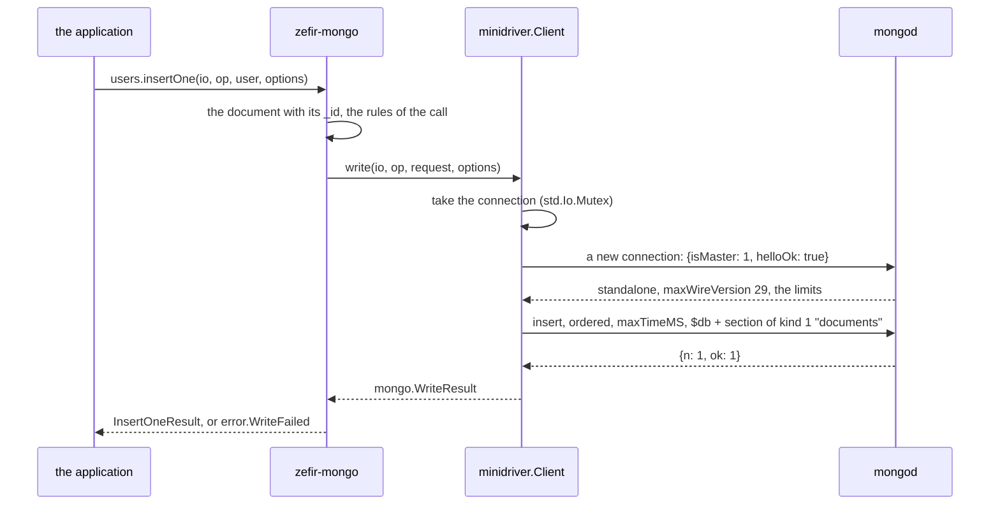

# minidriver: your own MongoDB driver for zefir-mongo

zefir-mongo does not care how a command reaches mongod. Its collection API,
`mongo.Database` and `mongo.Collection`, is written once over one
interface, `mongo.Client`, and works on any driver that implements it and
passes the conformance suite, `mongo.testing.conformance`. A driver of your
own lives outside zefir, in a package of its own, with only the public API
of `zefir-mongo`. This directory is such a package. Its driver, minidriver,
speaks MongoDB's wire protocol to a real mongod in about 900 lines, and
passes every check of the suite.

Use it as a template: copy the directory, and grow the parts that the table
at the end names.

What minidriver does not do, on purpose:

- one standalone mongod of MongoDB 7.0 or later; a replica set, a mongos or
  an older server is `error.Unsupported`;
- no TLS and no authentication: a URI with `tls=true` or a user is
  `error.Unsupported`, so it is for a trusted network only;
- one connection, which one call at a time uses: the others wait for it;
- a TCP connect waits as long as the system lets it.

## How a command travels



1. The collection API turns the operation into a command and calls
   `mongo.Client`. Its wrapper checks the rules of the contract once, for
   every driver, before the driver sees the call: the names, the fields
   that only a driver writes, a deadline with less than 1 ms left, a
   canceled token.
2. minidriver takes its one connection, under an `std.Io.Mutex`, and opens
   it when there is none: TCP, then hello, the legacy `isMaster` in an
   OP_MSG with `helloOk: true`. A server that is not a standalone mongod of
   wire version 21 or later gets no command: the call is
   `error.Unsupported`.
3. The command goes out through `mongo.wire.opmsg`: the caller's body
   unchanged, then `$db`, and under a deadline `maxTimeMS`, the time left of
   it. A write goes in batches that `mongo.wire.batch` cuts to the limits
   of the connection's hello, each batch's items in a section of kind 1,
   and `mongo.wire.batch.Merge` merges their replies as the Bulk API does.
4. Every read and write of the socket goes through `io.operateTimeout`
   with the deadline of the call. Past it the call is `error.Timeout` and
   the connection closes, so a late reply is never taken for the next
   command's. A task canceled while it waits gets `error.Interrupted`, and
   the driver calls `io.recancel()`, so that the task keeps its
   cancelation.
5. A cursor gives the first batch of the reply, then asks `getMore` in the
   cursor's namespace, without `maxTimeMS`. `close` and `deinit` send
   `killCursors` with a time budget of their own; so does `close` of the
   client for the cursors still open, after it has cut the call in flight.

After a broken connection, the next call opens another. Nothing is ever
sent twice: zefir-mongo leaves retries to the application, which can ask
`mongo.outcome(err)` whether the server may have run the call.

## Why the application gives the driver its zefir

The module `mongo-minidriver` imports `zefir-mongo` and `zefir-core`, but its
`build.zig` gives it no imports: the application adds them from its own
zefir dependency.

```zig
// build.zig of the application
const zefir = b.dependency("zefir", .{ .target = target, .optimize = optimize });
const minidriver = b.dependency("mongo_minidriver", .{ .target = target, .optimize = optimize });
const minidriver_module = minidriver.module("mongo-minidriver");
minidriver_module.addImport("zefir-mongo", zefir.module("zefir-mongo"));
minidriver_module.addImport("zefir-core", zefir.module("zefir-core"));
```

If the package took zefir from a dependency of its own, and the
application pinned another version, the build would hold two modules
`zefir-mongo`: the `mongo.Client` of one would not fit the
`mongo.Database` of the other, and the build would fail. With the modules
from the application there is one zefir, whatever version the application
picks.

The package still names zefir in its `build.zig.zon`, pinned to one
release and marked lazy: only its own tests use it. An application that
depends on the package never fetches it.

## The same code on any driver

`consumer/src/users.zig` is the application: a repository of users on
`mongo.Collection`, with a unique index on `email`. It imports zefir-mongo
and no driver:

```zig
pub fn register(u: Users, io: Io, op: mongo.OperationContext, gpa: Allocator, user: User) RegisterError!bson.ObjectId {
    var diagnostics: mongo.Diagnostics = .{};
    var result = u.collection.insertOne(io, op, user, .{ .allocator = gpa, .diagnostics = &diagnostics }) catch |err| {
        // 11000 is DuplicateKey.
        if (err == error.WriteFailed and diagnostics.server != null and diagnostics.server.?.code == 11000) return error.EmailTaken;
        return err;
    };
    defer result.deinit(gpa);
    return result.inserted_id.object_id;
}
```

`consumer/src/users_test.zig` runs the same steps on two drivers. Only the
line that makes the `mongo.Database` differs:

```zig
// In a unit test: no server; the script says what mongod answers.
var fake: mongo.testing.FakeDriver = .init(testing.allocator, &script);
try exercise(io, .init(fake.client(), "app", &ids));

// Against a live mongod: the driver of this package.
var driver: minidriver.Client = try .init(testing.allocator, io, .{ .uri = uri });
try driver.connect(io, .root);
const db: mongo.Database = .init(driver.client(), "zefir_minidriver_users", &ids);
try exercise(io, db);
```

## Running the tests

`consumer/` is the application side: its `build.zig` wires the modules as
above, with zefir of this checkout.

```sh
cd consumer
zig build test        # layer S of the suite, the application on FakeDriver,
                      # the tests in src/root.zig
zig build test -Dlive-uri=mongodb://127.0.0.1:27117
                      # besides, against that mongod: layer L of the suite,
                      # fail points included, the application on minidriver,
                      # and the scenarios of the collection API
```

The live mongod must run with `enableTestCommands=1`, since checks L7–L10
make it fail through the fail point `failCommand`; nothing else may use it
meanwhile. From the root of the repository:

```sh
docker compose --profile mongo up -d --wait mongo-plain   # 127.0.0.1:27117
```

`zig build test` in this directory runs the suite against the zefir that
`build.zig.zon` pins. That release, v0.8.0, came before zefir-mongo, so for
now the step fails with a message that sends you to `consumer/`. CI runs
`consumer/` on every change to zefir-mongo, against the commit it checks.

The suite reports, for minidriver against mongod 9.0.4:

```text
mongo conformance of "minidriver": 31 passed, 0 failed, 0 skipped
  passed   S1   a command goes out as it is, with $db; its reply comes back byte for byte
  passed   S2   the driver's fields: maxTimeMS within the deadline, none in getMore and killCursors, no sessions
  …
  passed   S16  wire only: a reply that breaks OP_MSG is ProtocolViolation, and its connection is dropped
  passed   S17  closing the client: calls out end, new ones are Closed, open cursors are killed, twice is harmless
  …
  passed   L7   fail point closeConnection: ConnectionLost, and the next call goes through
  passed   L8   fail point errorCode 91 with a label: CommandFailed with both, and no retry
  passed   L9   fail point 462 with SystemOverloadedError and RetryableError: CommandFailed, and no retry
  passed   L10  fail points blockConnection past the deadline and errorCode 50: Timeout
```

Without `-Dlive-uri`, layer L is skipped, 21 checks pass and 10 are
skipped. The harness of the suite is `testing.Harness` in `src/root.zig`:
a fresh client for each check, connected to the target the suite gives.

## From the sample to a real driver

| In minidriver | In a driver for production |
| --- | --- |
| one connection under an `std.Io.Mutex`; a call waits for it as long as the call before takes | a pool of connections (CMAP): a limit, a FIFO queue of checkouts under the deadline that ends with `error.PoolExhausted`, a clear of the pool after a network error |
| a URI with a user is `error.Unsupported` | SCRAM-SHA-256 and SCRAM-SHA-1 (RFC 5802, RFC 7677), the mechanism from `saslSupportedMechs`, speculative authentication in hello, a cache of the keys PBKDF2 derives |
| `maxTimeMS` is the time left of the deadline | `maxTimeMS` is the time left less minRTT, the shortest recent round trip of hello, so the server gives up before the client; a call it leaves no room for is `error.DeadlineExceeded` before sending |
| hello is `{isMaster: 1, helloOk: true}` | hello with the metadata of the handshake spec: `client` with the driver's name and version, the system, the platform and `application.name` |
| `mongodb://host:port`, nothing more | the connection string spec: credentials in percent-encoding, `authSource`, `authMechanism`, `appName`, timeouts and the options of the pool, and an error that names an option it does not take |
| a TCP connect waits as long as the system lets it | DNS, TCP and hello in a task of their own that races a timer, since `std.Io` has no portable time limit for a connect |
| `close` cuts the call in flight at once | `close` gives the calls in flight time to end, then cuts them |

The rules every driver keeps are in the doc comments of `mongo.Client` and
`mongo.Cursor`: wait only through `std.Io`, never swallow a cancelation,
take the reply's memory from the caller's allocator, send nothing twice.
The suite checks them all.
