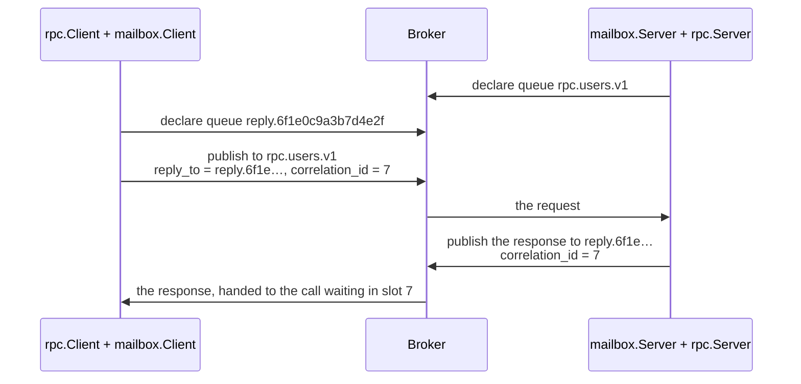

# rpc-mailbox: your own transport for zefir-rpc

zefir-rpc does not care how the bytes of a call travel. NATS is built in,
and any other way — AMQP, a protocol of your own over TCP, shared memory —
is a transport you can write outside zefir, in a package of your own, with
only the public API of `zefir-rpc`. This directory is such a package. Its
transport, `mailbox`, carries calls through a message broker the way
RabbitMQ carries RPC, and it passes the conformance suite that every
transport of zefir passes.

Use it as a template: copy the directory, replace the broker in memory
with the client library of your broker, and keep the rest.

## How a call travels

The broker (`Broker` in `src/root.zig`) is a small one in memory: named
queues of messages. RPC over it goes as over AMQP:



1. `mailbox.Server` declares a queue per contract, `rpc.<service>.v<version>`,
   and runs a task per queue that hands each request to the engine
   (`rpc.transport.Dispatcher.admit`, then `Incoming.start`).
2. `mailbox.Client` declares a reply queue of its own. Each call takes a
   slot in `rpc.transport.Pending`, publishes the request with `reply_to`
   and `correlation_id` (the slot's id), and waits in the slot until its
   deadline.
3. The engine answers through the call's `Reply`; the server publishes the
   response to `reply_to`, and the client's task hands it to the slot. A
   response that comes after the call gave up finds no slot and is dropped.

A call to a contract that no server serves, or to a server that drains,
finds no queue: the client gets `error.Unavailable` at once, and knows the
call did not run.

## Why the application gives the transport its zefir

The module `rpc-mailbox` imports `zefir-rpc` and `zefir-core`, but its
`build.zig` gives it no imports: the application adds them from its own
zefir dependency.

```zig
// build.zig of the application
const zefir = b.dependency("zefir", .{ .target = target, .optimize = optimize });
const mailbox = b.dependency("rpc_mailbox", .{ .target = target, .optimize = optimize });
const mailbox_module = mailbox.module("rpc-mailbox");
mailbox_module.addImport("zefir-rpc", zefir.module("zefir-rpc"));
mailbox_module.addImport("zefir-core", zefir.module("zefir-core"));
```

If the package took zefir from a dependency of its own, and the
application pinned another version, the build would hold two different
modules `zefir-rpc`: the `rpc.ServerTransport` of one would not fit the
`rpc.RawServer` of the other, and the build would fail. With the modules
from the application, there is one zefir, whatever version the
application picks.

The package still names zefir in its `build.zig.zon`, pinned to one
commit and marked lazy: only its own tests use it. An application that
depends on the package never fetches it.

## Running the tests

```sh
zig build test              # here: the suite against the zefir the package pins
cd consumer && zig build test   # as an application builds it, with zefir of this checkout
```

`consumer/` is the application side: its `build.zig` wires the modules as
above, and its tests run the conformance suite on the transport and a
contract through `rpc.Server` and `rpc.Client` over it. CI runs it on every
change to rpc, against the commit it checks, not the one the package pins:
that the package builds there shows it does not force its own zefir.

The suite reports, for the mailbox:

```text
rpc conformance of "mailbox": 19 passed, 0 failed, 3 skipped
  …
  skipped  T12  broken link: ConnectionLost, Unavailable, calls canceled: the harness has no breakLink
  skipped  T16  at-least-once delivery: one response per call: info().delivery is not at_least_once
  skipped  T17  restart of the other side: new calls go through: it needs a live broker: options.live_broker is false
```

A transport for a real broker adds `breakLink` and `restartPeer` to its
harness (`testing.Harness` in `src/root.zig`) and runs the suite against
the broker with `.live_broker = true`.

## From the sample to a real broker

| In the sample                     | With an AMQP library                                    |
| --------------------------------- | ------------------------------------------------------- |
| `Broker.declare`                  | queue.declare; an exclusive reply queue for the client  |
| `Broker.publish`, `Broker.reply`  | basic.publish with `reply_to` and `correlation_id`      |
| the tasks on `std.Io.Queue`       | basic.consume, read in a task on the application's `io` |
| `Call.release`                    | basic.ack, or basic.nack with requeue for `not_started` |
| `error.NoRoute` → `Unavailable`   | the mandatory flag and basic.return                     |

The rules every transport keeps are in the doc comments of
`rpc.ClientTransport`, `rpc.ServerTransport` and `rpc.transport.Reply`:
wait only through `std.Io`, never swallow a cancelation, decide on a call
before reading its body, and release every call exactly once.
