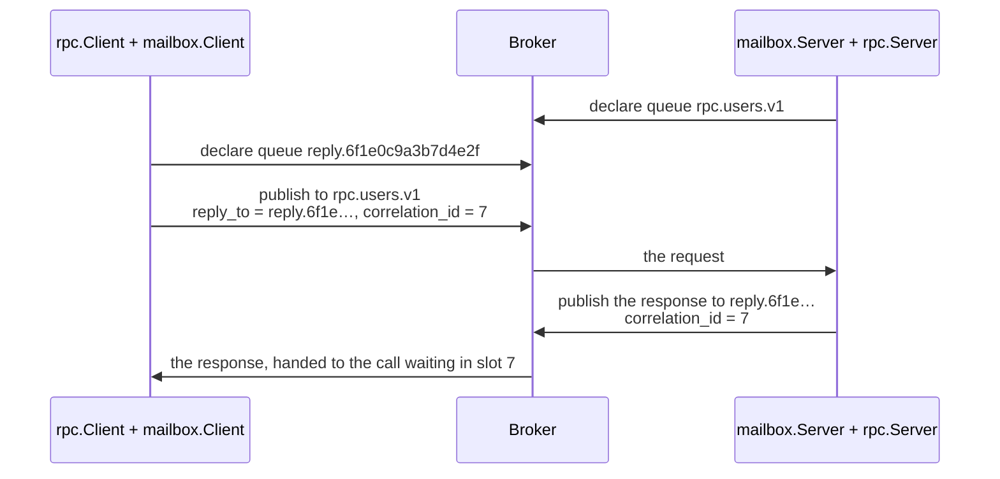

# rpc-mailbox: your own transport for zefir-rpc

The minimal skeleton of a transport of your own; the reference transport
is [zefir-rpc-nats](../../src/rpc-nats/examples/README.md), built step by
step in [Writing a transport](../../src/rpc-nats/examples/writing-a-transport.md).

zefir-rpc does not care how the bytes of a call travel. NATS ships with
zefir, as rpc-nats, and any other way — AMQP, a protocol of your own over
TCP, shared memory — is a transport you can write outside zefir, in a
package of your own, with only the public API of `zefir-rpc`. This
directory is such a package. Its transport, `mailbox`, carries calls
through a message broker the way RabbitMQ carries RPC, and it passes the
conformance suite that every transport of zefir passes.

Use it as a template: copy the directory, replace the broker in memory
with the client library of your broker, and keep the rest.

## How a call travels

The broker (`Broker` in `src/root.zig`) is a small one in memory: named
queues of messages. RPC over it goes as over AMQP:



1. `mailbox.Server` declares a queue per contract, `rpc.<service>.v<version>`,
   and runs a task per queue that hands each request to the engine
   (`rpc.transport.Dispatcher.admit`, then `Incoming.start`).
2. `mailbox.Client` declares a reply queue of its own. Each call takes a
   slot in `rpc.transport.Pending`, publishes the request with `reply_to`
   and `correlation_id` (the slot's id), and waits in the slot until its
   deadline.
3. The engine answers through the call's `Reply`; the server publishes the
   response to `reply_to`, and the client's task hands it to the slot. A
   response that comes after the call gave up finds no slot and is dropped.

A call to a contract that no server serves, or to a server that drains,
finds no queue: the client gets `error.Unavailable` at once, and knows the
call did not run.

## Why the application gives the transport its zefir

The module `rpc-mailbox` imports `zefir-rpc` and `zefir-core`, and the
application gives them to it from its own zefir dependency: the package's
`build.zig` adds them only for the package's own tests, when it is built
by itself. In `consumer/`, the application side of this sample,
`build.zig` starts its `build` function with:

```zig
const target = b.standardTargetOptions(.{});
const optimize = b.standardOptimizeOption(.{});
const zefir = b.dependency("zefir", .{ .target = target, .optimize = optimize });
const mailbox = b.dependency("rpc_mailbox", .{ .target = target, .optimize = optimize });

// One zefir in the build: the transport takes the application's.
const mailbox_module = mailbox.module("rpc-mailbox");
mailbox_module.addImport("zefir-rpc", zefir.module("zefir-rpc"));
mailbox_module.addImport("zefir-core", zefir.module("zefir-core"));
const imports: []const std.Build.Module.Import = &.{
    .{ .name = "zefir-core", .module = zefir.module("zefir-core") },
    .{ .name = "zefir-rpc", .module = zefir.module("zefir-rpc") },
    .{ .name = "rpc-mailbox", .module = mailbox_module },
};
```

The modules of the application, here its tests, take `imports`, so that
they and the transport share one zefir-rpc and one zefir-core.

If the package took zefir from a dependency of its own, and the
application pinned another version, the build would hold two different
modules `zefir-rpc`: the `rpc.ServerTransport` of one would not fit the
`rpc.RawServer` of the other, and the build would fail. With the modules
from the application, there is one zefir, whatever version the
application picks.

The package still names zefir in its `build.zig.zon`, pinned to one
release and marked lazy: only its own tests use it. An application that
depends on the package never fetches it.

## An application on the mailbox

An application hands the two sides of the transport to zefir-rpc, each as
`.transport`: the server side to `rpc.Server`, the client side to
`rpc.Client`. A test of `consumer/` serves a contract and calls it over
the mailbox, on one broker. `api.UserApi` there is a contract with one
method, `getUser`; `UserHandler` serves it, as in the
[guide of rpc](../../src/rpc/examples/README.md#getting-started); and
`far(io)` is a deadline 30 s away:

```zig
test "rpc.Server and rpc.Client over the mailbox" {
    const io = std.testing.io;
    const gpa = std.testing.allocator;
    var broker: mailbox.Broker = .init(gpa, .{});
    defer broker.deinit();

    var server_side: mailbox.Server = .init(&broker);
    var users: UserHandler = .{};
    var server = try rpc.Server.init(gpa, .{ .handlers = .{&users} }, .{ .transport = server_side.serverTransport() });
    defer server.deinit(io);
    try server.start(io);

    var client_side: mailbox.Client = try .init(&broker, .{});
    // Before connect: deinit also frees a client whose connect failed.
    defer client_side.deinit(io);
    try client_side.connect(io);
    var client = try rpc.Client.init(gpa, .{}, .{ .transport = client_side.clientTransport() });
    defer client.deinit();

    var found = try client.call(io, .root, api.UserApi.getUser, .{ .id = 1 }, .{});
    defer found.deinit();
    switch (found.outcome) {
        .ok => |user| try std.testing.expectEqualStrings("Ada", user.name),
        .failure => return error.TestUnexpectedResult,
    }

    var missing = try client.call(io, .root, api.UserApi.getUser, .{ .id = 2 }, .{});
    defer missing.deinit();
    switch (missing.outcome) {
        .ok => return error.TestUnexpectedResult,
        .failure => |failure| try std.testing.expectEqualStrings("users.not_found", failure.app_code),
    }

    // Once the server stops, its queue is gone: the call surely did not run.
    try server.shutdown(io, far(io));
    try std.testing.expectError(error.Unavailable, client.call(io, .root, api.UserApi.getUser, .{ .id = 1 }, .{}));
}
```

- **The server side**, `mailbox.Server`, does no I/O when it is made and
  has no `deinit`: `rpc.Server` starts it in `start`, and drains and
  closes it when it stops, in `shutdown` or in its own `deinit`.
- **`connect`.** `mailbox.Client.init` does no I/O either: it only takes
  room for the calls that may wait. `connect(io)` declares the client's
  reply queue, under a name drawn from `io.randomSecure`, and starts the
  task that reads it; a call before it gets `error.Unavailable`, and a
  second `connect` does nothing. From `connect` on, the client stays where
  it is, and its calls come on the `io` of `connect`: a safe build panics
  on another one.
- **The order of the `deinit` calls** is the reverse of the `defer`s:
  `rpc.Client` first, which borrows its transport; then `mailbox.Client`,
  which takes its reply queue out of the broker and ends its task, with
  no call in flight; then `rpc.Server`, which stops and closes the server
  side; the broker last, once no queue is left in it. `client_side.deinit`
  is deferred before `connect`, so that it frees a client whose `connect`
  failed too.
- **A server that stopped** has no queue: a call to it gets
  `error.Unavailable` at once, and surely did not run.

## The conformance suite

`rpc.testing.conformance.run` checks that a transport keeps the rules the
engine relies on, T1–T22: zefir's memory and NATS transports pass it, and
so does the mailbox. It takes a harness, `testing.Harness` in
`src/root.zig`, which makes a fresh broker with a server side and a client
side for every check, and returns a report. The test of `consumer/`:

```zig
test "the mailbox passes the conformance suite of rpc" {
    var harness: mailbox.testing.Harness = .{};
    var report = try rpc.testing.conformance.run(std.testing.io, std.testing.allocator, &harness, .{});
    defer report.deinit();
    if (report.failedCount() > 0) {
        std.debug.print("{f}", .{&report});
        return error.TestUnexpectedResult;
    }
    // Skipped are only the checks the mailbox cannot take: T12 (it does not
    // see a broken link at once), T16 (it delivers at most once) and T17
    // (it needs a live broker that restarts).
    for ([_]rpc.testing.conformance.Check{ .t12, .t16, .t17 }) |check| {
        try std.testing.expect(report.outcome(check) == .skipped);
    }
    try std.testing.expectEqual(@as(usize, 3), report.skippedCount());
}
```

The package's own `zig build test` runs the suite with the zefir that its
`build.zig.zon` pins. The `zig build test` of `consumer/` runs it with the
application's zefir, together with the test of
[An application on the mailbox](#an-application-on-the-mailbox), checks of
its own (the deadline, the peer, the `std.Io` of a call) and the tests in
`src/root.zig` (where a reply goes, a message of the wrong kind).

`consumer/build.zig.zon` takes zefir by the relative path `../../..`, which
leads nowhere in a copy of this directory. In a copy, `consumer/` is your
application: delete the `.zefir` entry of its `build.zig.zon`, then run
`zig fetch --save` in `consumer/`, as
[Installation](../../src/rpc/examples/README.md#installation) of the guide
of rpc shows.

The report of the suite on the mailbox, as `{f}` writes it:

```text
rpc conformance of "mailbox": 19 passed, 0 failed, 3 skipped
  passed   T1   echo: bodies byte for byte, empty, not UTF-8
  passed   T2   metadata: order, repeated keys, empty values, reserved keys
  passed   T3   failures: every code, app code, message, field and failure body
  passed   T4   the head on the server: route, request id, codec, peer
  passed   T5   budget: the server sees the time left; a past deadline is not sent
  passed   T6   client deadline: Timeout on time; a late response is not seen
  passed   T7   canceling the caller: Canceled once; the server is told
  passed   T8   64 calls at once with random delays: responses not mixed up
  passed   T9   sizes: a body at the limit and one byte over; response limits
  passed   T10  unknown route: unimplemented or Unavailable
  passed   T11  drain: calls in flight answered, new ones not taken
  skipped  T12  broken link: ConnectionLost, Unavailable, calls canceled: the harness has no breakLink
  passed   T13  server discipline under the recording dispatcher
  passed   T14  lifecycle: a busy address, drain and close twice
  passed   T15  memory: the caller's buffers and allocator after return
  skipped  T16  at-least-once delivery: one response per call: info().delivery is not at_least_once
  skipped  T17  restart of the other side: new calls go through: it needs a live broker: options.live_broker is false
  passed   T18  reentrance: an answer before start returns, a cancel during start, start refused
  passed   T19  drain, close and release keep a cancelation of their task
  passed   T20  close while a request is on its way: abandon, bounded close
  passed   T21  a refusal at admission arrives with refused = true
  passed   T22  metadata of middleware passes unchanged
  note     T6   the cancel on the server after Timeout was not checked: info().propagates_cancellation is false
  note     T7   the cancel on the server was not checked: info().propagates_cancellation is false
  note     T18  a broken link during start was not checked: it needs harness.breakLink and info().reports_connection_loss
  defaults left by the transport: rpc.ServerTransport.isReady
```

A check that the transport or its harness cannot take is skipped, with
the reason. T12, a broken link, needs `breakLink` in the harness and a
client side that sees a broken link at once,
`info().reports_connection_loss`; T16 is for a transport that delivers a
request at least once; T17 needs a live broker that the harness restarts.
A note names a part of a check that did not run: the mailbox has no
signal that a client gave up (`info().propagates_cancellation`), and no
broken link. The last line names an entry the transport left at its
default: the mailbox has no `isReady` of its own.

A transport for a real broker adds `breakLink` and `restartPeer` to its
harness, sets `reports_connection_loss` in `info()` when its client sees a
broken link at once, and runs the suite against the broker with
`.live_broker = true`.

## From the sample to a real broker

| In the sample                             | With an AMQP library                                         |
| ----------------------------------------- | ------------------------------------------------------------ |
| `Broker.declare`                          | queue.declare; an exclusive reply queue for the client       |
| `Broker.publish`, `Broker.reply`          | basic.publish with `reply_to` and `correlation_id`           |
| the tasks on `std.Io.Queue`               | basic.consume, read in a task on the application's `io`      |
| a server takes what its queue holds       | basic.qos, prefetch = `dispatcher.service().max_inflight`    |
| `timeout` and `published_at` of a request | `expiration` = the timeout; the server counts from delivery  |
| `.peer = .none`                           | the user the broker checked, `user_id`; never `reply_to`     |
| `answerable`: only `reply.…` gets answers | answer only `amq.rabbitmq.reply-to.*` or your own prefix     |
| `Call.release`                            | basic.ack, or basic.nack with requeue for `not_started`      |
| `error.NoRoute` → `Unavailable`           | the mandatory flag and basic.return                          |

With prefetch at `max_inflight`, the server holds no more deliveries than
the engine takes at once, and the broker keeps the rest in the queue
instead of the engine refusing them. The broker of the sample shares the
client's clock, so the server counts a request's budget from the moment
it was published; another host does not, so a real server counts it from
the delivery, and `expiration` has the broker drop a request that waited
out its budget.

`reply_to` and the correlation ids are secrets of a call. With the name of
a reply queue, anyone who may publish to it can answer for the server, and
the ids of `rpc.transport.Pending` are easy to guess: 1, 2, 3… The sample
draws the name from `io.randomSecure` and gives the engine no peer, so
`ctx.peer()`, and so no log, ever holds it. With RabbitMQ, take an exclusive
reply queue or direct reply-to (`amq.rabbitmq.reply-to`), and keep both
values out of logs.

A server answers only in reply queues, and drops a request whose
`reply_to` names any other queue: a client that may publish requests
could name the request queue of another service there, and the answers
would land in it. Each task also drops a message of the kind it does not
read, a response in a request queue or a request in a reply queue,
instead of taking it for its own kind.

The rules every transport keeps are in the doc comments of
`rpc.ClientTransport`, `rpc.ServerTransport` and `rpc.transport.Reply`:
wait only through `std.Io`, never swallow a cancelation, decide on a call
before reading its body, and release every call exactly once.
