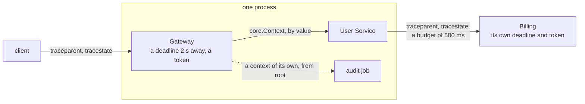

# zefir-core: context, deadlines, cancellation and trace context

**The execution context of Zefir services.** One small value,
`core.Context`, carries an operation's deadline, its cancellation token and
its W3C trace identity through your code. Transports (RPC, HTTP, job
queues) create it; your code passes it down by value and checks it before
work. Like every primitive of core, it never allocates, reads a clock or
does I/O: you pass it the time.

A request comes to a gateway with a `traceparent` header and two seconds to
get its answer. The gateway gives it a context: a deadline 2 s away, a
cancellation token that the request owns, and a span of its own in the
caller's trace. User Service, in the same process, takes that
context with its deadline and token as they are, checks it before work
and adds a span of its own. Its call to Billing, in another process,
carries only the W3C headers and a budget in milliseconds: the call's own
500 ms, never more than the request has left. Billing builds a context of
its own from them. When the client goes away, the gateway cancels the
token, and every check in its process fails at once with
`error.Cancelled`; when the time is up, with `error.DeadlineExceeded`. An
audit job that must outlive the request gets a context of its own, and the
cancel does not reach it.



> [!IMPORTANT]
> **Not implemented yet (TODO):**
>
> - **Spans, sampling and export.** core carries the trace identity only:
>   it creates no spans, samples nothing and exports nothing.
> - **Ids.** core draws no trace or span ids: draw them with `io.random`,
>   as [Trace identity](#trace-identity) shows.
> - **Changing a tracestate.** core forwards the tracestate it received
>   unchanged: it adds no entry of its own, moves none and truncates none.
>   Build a new value yourself, as [W3C headers](#w3c-headers) says.
> - **Linked tokens and waking.** Cancelling a token cancels no other
>   token, wakes no task and interrupts no I/O: waking a task is the job of
>   `std.Io` task cancellation.
> - **Baggage.** The W3C `baggage` header is neither read nor written.

core also holds `zefir.App`, the root of an application: it builds the
application out of modules and starts and stops its servers. App is the one
exception to the rule that core's primitives never allocate, read a clock
or do I/O: it holds memory, runs tasks and reads the clock.
**[Read the guide of App →](app/README.md)**

A request's context, as [core in a minute](#core-in-a-minute) makes it:

```zig
var token: core.CancellationToken = .init;
const ctx = core.Context.root
    .withDeadline(.after(std.Io.Clock.awake.now(init.io), .fromMilliseconds(500)))
    .withCancellation(&token);
```

and a function below the handler, which checks it before work:

```zig
fn findUser(ctx: core.Context, io: std.Io, id: u64) ![]const u8 {
    try ctx.check(std.Io.Clock.awake.now(io)); // error.Cancelled or error.DeadlineExceeded
    return if (id == 42) "Ada" else error.UserNotFound;
}
```

## Contents

- [Installation](#installation)
- [core in a minute](#core-in-a-minute)
- [Context](#context)
- [An HTTP handler](#an-http-handler)
- [Passing a context](#passing-a-context)
- [Ownership and lifetimes](#ownership-and-lifetimes)
- [Cancellation](#cancellation)
- [Deadlines and clocks](#deadlines-and-clocks)
- [Trace identity](#trace-identity)
- [W3C headers](#w3c-headers)
- [Three services](#three-services)
- [Errors](#errors)
- [Sensitive types](#sensitive-types)
- [Thread safety](#thread-safety)
- [Tests](#tests)
- [Limits](#limits)

The programs of this guide, each shown whole with its run:
[core in a minute](#core-in-a-minute) · [an HTTP handler](#an-http-handler) ·
[an RPC handler](#passing-a-context) · [Gateway → User → Billing](#three-services).
Its tests are in [Tests](#tests).

## Installation

Add Zefir to your `build.zig.zon`; core ships since v0.2.0:

```sh
zig fetch --save git+https://github.com/vkiryakov/zefir#dev
```

This guide is on the `dev` branch, so the command fetches its latest commit; `--save` pins that commit. For the latest release, v0.11.0, fetch `#v0.11.0` instead.

Then import the module `zefir-core` in `build.zig`. A whole `build.zig`
of a program that uses core, with the two test files of this guide as its
tests:

```zig
// build.zig
const std = @import("std");

pub fn build(b: *std.Build) void {
    const target = b.standardTargetOptions(.{});
    const optimize = b.standardOptimizeOption(.{});
    const zefir = b.dependency("zefir", .{ .target = target, .optimize = optimize });

    const exe = b.addExecutable(.{
        .name = "app",
        .root_module = b.createModule(.{
            .root_source_file = b.path("src/main.zig"),
            .target = target,
            .optimize = optimize,
            .imports = &.{
                .{ .name = "core", .module = zefir.module("zefir-core") },
            },
        }),
    });
    b.installArtifact(exe);
    b.step("run", "Run the app").dependOn(&b.addRunArtifact(exe).step);

    const test_step = b.step("test", "Run the tests");
    for ([_][]const u8{ "src/context_test.zig", "src/trace_test.zig" }) |path| {
        const tests = b.addTest(.{
            .root_module = b.createModule(.{
                .root_source_file = b.path(path),
                .target = target,
                .optimize = optimize,
                .imports = &.{.{ .name = "core", .module = zefir.module("zefir-core") }},
            }),
        });
        test_step.dependOn(&b.addRunArtifact(tests).step);
    }
}
```

Every program of this guide is such a `src/main.zig`, and `zig build run`
runs it; the two test files go next to it, as `src/context_test.zig` and
`src/trace_test.zig`.

> [!TIP]
> core is also part of the umbrella module: with `zefir.module("zefir")`
> imported as `zefir`, it is `@import("zefir").core`. Both are the same
> module. zefir-core imports nothing, not even the other modules of Zefir.

## core in a minute

A whole program, `minute.zig`. It gives a request a deadline 500 ms away
and a cancellation token, passes the context to `findUser` by value, and
checks it there before work:

```zig
const std = @import("std");
const core = @import("core");

pub fn main(init: std.process.Init) !void {
    // The request owns the token; contexts only point to it.
    var token: core.CancellationToken = .init;
    const ctx = core.Context.root
        .withDeadline(.after(std.Io.Clock.awake.now(init.io), .fromMilliseconds(500)))
        .withCancellation(&token);

    const name = try findUser(ctx, init.io, 42);
    std.log.info("user 42 is {s}", .{name});
}

fn findUser(ctx: core.Context, io: std.Io, id: u64) ![]const u8 {
    try ctx.check(std.Io.Clock.awake.now(io)); // error.Cancelled or error.DeadlineExceeded
    return if (id == 42) "Ada" else error.UserNotFound;
}
```

`std.log` writes to stderr:

```text
$ zig build run
info: user 42 is Ada
```

- **The request owns the token**, and the context only points to it. Cancel
  the token when the client goes away, and every check below fails with
  `error.Cancelled`.
- **The deadline is a moment**: 500 ms after the time that `main` read from
  the awake clock. Once it has passed, every check fails with
  `error.DeadlineExceeded`.
- **core never reads the clock.** `findUser` reads it with the `std.Io` it
  was given and passes the time to `check`. The programs of this guide use
  `init.io`, the `std.Io` that `main` gets; the code of a service reads the
  clock with the `io` it already has, that of its zio runtime.

## Context

| Field | Meaning | Derive with |
| --- | --- | --- |
| `trace: ?TraceContext` | trace identity; null when tracing is off | `withTrace` |
| `deadline: ?Deadline` | the earliest deadline in effect | `withDeadline` (never extends it) |
| `cancellation: ?*const CancellationToken` | the token that cancels the operation | `withCancellation` (replaces it) |

`Context.root` has none of them. Every `with*` returns a new context; the
original stays as it was. The fields are read-only: change them only through
`with*`, or the "deadlines never grow" rule breaks.

- `ctx.check(now)` returns `error.Cancelled` when the token is cancelled,
  otherwise `error.DeadlineExceeded` when the deadline has passed. When both
  hold, cancellation wins.
- `ctx.isCancelled()`, `ctx.isExpired(now)` and `ctx.remaining(now)` answer one
  question each; `remaining` is null without a deadline and never negative.

## An HTTP handler

A server gives every request a context: the request scope owns the token,
and the deadline is the time the server allows a request. The handler
checks the context before work. zefir-http gives a handler this context as
`ctx.operation()`; once the deadline passes it answers 504, and it sends
nothing to a client that has gone.

A whole program, `http_handler.zig`. Its `main` plays a server of its own,
which names each failure with `core.ErrorCode` and maps the class to a
status, 499 for a client that went away and 504 for a request out of time:

```zig
//! An HTTP-style handler: the server gives every request a context with a
//! deadline and a cancellation token, and the handler checks it before work.

const std = @import("std");
const core = @import("core");

const Request = struct { path: []const u8 };
const Response = struct { status: u16, body: []const u8 };

fn handleRequest(ctx: core.Context, io: std.Io, request: Request) core.ContextError!Response {
    try ctx.check(std.Io.Clock.awake.now(io));
    return .{ .status = 200, .body = request.path };
}

/// What the server answers when the handler fails.
fn statusFor(err: core.ContextError) u16 {
    return switch (core.ErrorCode.fromContextError(err)) {
        .cancelled => 499,
        .deadline_exceeded => 504,
        else => 500,
    };
}

pub fn main(init: std.process.Init) !void {
    const io = init.io;
    var stdout_buffer: [256]u8 = undefined;
    var stdout = std.Io.File.stdout().writerStreaming(io, &stdout_buffer);
    const out = &stdout.interface;
    defer out.flush() catch {};

    // The request scope owns the token; the context only points to it.
    var token: core.CancellationToken = .init;
    const now = std.Io.Clock.awake.now(io);
    const ctx = core.Context.root
        .withDeadline(.after(now, .fromSeconds(2)))
        .withCancellation(&token);

    const ok = try handleRequest(ctx, io, .{ .path = "/users/42" });
    try out.print("{d} {s}\n", .{ ok.status, ok.body });
    if (ok.status != 200) return error.UnexpectedStatus;

    // The client disconnected: the server cancels the request.
    token.cancel();
    if (handleRequest(ctx, io, .{ .path = "/users/42" })) |_| {
        return error.ExpectedCancellation;
    } else |err| {
        try out.print("{d} after {t}\n", .{ statusFor(err), err });
        if (err != error.Cancelled) return error.UnexpectedError;
    }

    // A request whose deadline has passed is refused the same way.
    const late = core.Context.root.withDeadline(.after(now, .zero));
    if (handleRequest(late, io, .{ .path = "/users/42" })) |_| {
        return error.ExpectedDeadlineExceeded;
    } else |err| {
        try out.print("{d} after {t}\n", .{ statusFor(err), err });
        if (err != error.DeadlineExceeded) return error.UnexpectedError;
    }
}
```

```text
$ zig build run
200 /users/42
499 after Cancelled
504 after DeadlineExceeded
```

The first request passes its check. Then the server cancels the token, as it
does when the client disconnects, and the same context fails with
`error.Cancelled`. The last request has a budget of zero, a deadline that
has passed at once, and fails with `error.DeadlineExceeded`.
`core.ErrorCode.fromContextError` names the class of each failure, and the
server maps the class to its own status.

## Passing a context

One rule for RPC, HTTP and background jobs:

- code below the handler — services, repositories, clients — takes
  `ctx: core.Context` **by value** as a parameter;
- the allocator and `std.Io` are separate parameters (or constructor-injected
  fields of long-lived services); a context carries neither;
- transport types (an RPC context, an HTTP request) never cross the handler
  boundary.

zefir-http and zefir-rpc give a handler its `core.Context` as
`ctx.operation()`.

The repository of the program below takes the context next to its other
parameters, and checks it before work:

```zig
fn find(repo: Repository, ctx: core.Context, io: std.Io, id: u64) !User {
    try ctx.check(std.Io.Clock.awake.now(io));
    for (repo.users) |user| {
        if (user.id == id) return user;
    }
    return error.UserNotFound;
}
```

A context is 96 bytes and copying it costs nothing beyond that.

A whole program, `rpc_handler.zig`. A call arrives with the trace of its
caller and the budget the caller has left; the program builds the call's
context from them, with a span of its own in the caller's trace, and passes
it from the handler `getUser` down to the repository. `codeFor` classifies
the errors as a transport would:

```zig
//! An RPC-style handler: the context goes down to the repository by value,
//! next to the other parameters, and every layer checks it before work.

const std = @import("std");
const core = @import("core");

const User = struct { id: u64, name: []const u8 };

const Repository = struct {
    users: []const User,

    fn find(repo: Repository, ctx: core.Context, io: std.Io, id: u64) !User {
        try ctx.check(std.Io.Clock.awake.now(io));
        for (repo.users) |user| {
            if (user.id == id) return user;
        }
        return error.UserNotFound;
    }
};

fn getUser(ctx: core.Context, io: std.Io, repo: Repository, id: u64) !User {
    try ctx.check(std.Io.Clock.awake.now(io));
    return repo.find(ctx, io, id);
}

/// How a transport classifies the handler's errors.
fn codeFor(err: anyerror) core.ErrorCode {
    return switch (err) {
        error.Cancelled => .cancelled,
        error.DeadlineExceeded => .deadline_exceeded,
        error.UserNotFound => .not_found,
        else => .internal,
    };
}

/// A new span id: 8 random bytes, drawn again in the rare case that all of
/// them are zero.
fn newSpanId(io: std.Io) core.SpanId {
    while (true) {
        var bytes: [8]u8 = undefined;
        io.random(&bytes);
        return core.SpanId.fromBytes(bytes) catch continue;
    }
}

pub fn main(init: std.process.Init) !void {
    const io = init.io;
    var stdout_buffer: [256]u8 = undefined;
    var stdout = std.Io.File.stdout().writerStreaming(io, &stdout_buffer);
    const out = &stdout.interface;
    defer out.flush() catch {};

    const repo: Repository = .{ .users = &.{.{ .id = 42, .name = "Ada" }} };

    // What the call brought: the trace of the caller, and the budget it has
    // left for the call.
    const caller = try core.w3c.parseTraceparent("00-4bf92f3577b34da6a3ce929d0e0e4736-00f067aa0ba902b7-01");
    const budget: std.Io.Duration = .fromMilliseconds(500);

    // The call scope owns the token; the context only points to it. The
    // handler's span is a child of the caller's, in the same trace.
    var token: core.CancellationToken = .init;
    const ctx = core.Context.root
        .withTrace(caller.child(newSpanId(io)))
        .withDeadline(.after(std.Io.Clock.awake.now(io), budget))
        .withCancellation(&token);

    const user = try getUser(ctx, io, repo, 42);
    try out.print("trace {f}: user {d} is {s}\n", .{ caller.trace_id, user.id, user.name });

    if (getUser(ctx, io, repo, 7)) |_| return error.ExpectedNotFound else |err| {
        try out.print("user 7: {t}\n", .{codeFor(err)});
        if (codeFor(err) != .not_found) return error.UnexpectedCode;
    }

    token.cancel();
    if (getUser(ctx, io, repo, 42)) |_| return error.ExpectedCancellation else |err| {
        try out.print("after cancel: {t}\n", .{codeFor(err)});
        if (codeFor(err) != .cancelled) return error.UnexpectedCode;
    }
}
```

```text
$ zig build run
trace 4bf92f3577b34da6a3ce929d0e0e4736: user 42 is Ada
user 7: not_found
after cancel: cancelled
```

The trace id is the caller's, so every run prints the same one. The span id
of the handler is drawn at random (see [Trace identity](#trace-identity)),
and the program does not print it.

## Ownership and lifetimes

A context owns nothing. It **borrows** two things:

- the `CancellationToken` it points to;
- through `trace.state`, the bytes of the incoming `tracestate` header.

So a context must not outlive the scope that owns them:

| Where | Who owns the token and the header bytes |
| --- | --- |
| HTTP request | the request scope |
| RPC call | the call scope |
| WebSocket | the connection or the message scope |
| Background job | the job's execution scope |
| Database query | uses the context of its caller |

An asynchronous task must not keep a borrowed context after its owner ends.
**A job that outlives the request** gets its own context, built from `root`.
The audit job of [Three services](#three-services) gets it from this
function, with a token that its caller owns for as long as the job runs:

```zig
fn auditJobContext(request: core.Context, io: std.Io, tracer: *Tracer, job_token: *const core.CancellationToken) !core.Context {
    const request_trace = request.trace orelse return error.NoTrace;
    var trace = request_trace.child(try tracer.newSpanId());
    trace.state = .empty; // the request's tracestate bytes end with the request
    return core.Context.root
        .withTrace(trace)
        .withDeadline(.after(std.Io.Clock.awake.now(io), .fromSeconds(30)))
        .withCancellation(job_token);
}
```

The job stays in the request's trace, in a span of its own, whose id the
stand-in tracer of that program hands out, and it keeps no byte of the
request. Replacing the token with `withCancellation` is not enough: the
derived context would keep the request's deadline and its tracestate bytes.

## Cancellation

`CancellationToken` is a cooperative flag:

- `var token: core.CancellationToken = .init;` then `token.cancel()` from any
  thread, any number of times; `isCancelled()` never goes back to false;
- everything a thread wrote before its `cancel()` is visible to a thread that
  sees `isCancelled() == true`;
- it wakes no one and interrupts no I/O; the token must outlive the contexts
  that point to it, and must not be copied once they do.

Use the token for **explicit** cancellation only: the client went away, the
connection broke, the server is stopping. A timeout is a deadline. Rules for
runtimes and adapters built on `std.Io`:

1. Never cancel the token to signal a timeout. Set a deadline;
   `check` reports `error.DeadlineExceeded` once the time has passed.
2. Wake waiting tasks with `std.Io` task cancellation. Cancel a task for a
   timeout only once `now >= deadline.expires`, and arm timers with
   `deadline.toTimeout()`.
3. An adapter that gets `error.Canceled` from `std.Io` reads a fresh time and
   calls `ctx.check(now)`, returning its error. If the check passes, the task
   — not the operation — was cancelled: return `error.Canceled` unchanged.
4. Long CPU work checks `ctx.check(fresh now)` (and `io.checkCancel()` if
   needed) at its checkpoints; `isCancelled()` alone does not see the deadline.

`error.Cancelled` from core is **not** `std.Io`'s `error.Canceled`. Core's
error repeats on every check while the token is cancelled; `std.Io`'s is
returned once by a cancelation point and follows `recancel` and
`CancelProtection` rules.

## Deadlines and clocks

Deadlines are `std.Io.Timestamp` values on the **`std.Io.Clock.awake`**
clock: monotonic and not affected by changes to the system time. The
primitives of core never read the clock: a service passes
`std.Io.Clock.awake.now(io)`, and a test passes times of its own. In the
tests of this guide, `at(ms)` is the moment `ms` milliseconds after the
clock started:

```zig
const deadline: core.Deadline = .after(at(1_000), .fromMilliseconds(500));
try testing.expect(!deadline.isExpired(at(1_499)));
try testing.expect(deadline.isExpired(at(1_500))); // from the moment now reaches it
try testing.expectEqual(std.Io.Duration.fromMilliseconds(200), deadline.remaining(at(1_300)));
try testing.expectEqual(std.Io.Duration.zero, deadline.remaining(at(1_800))); // never negative
```

`deadline.toTimeout()` gives the same moment as a `std.Io.Timeout` on the
awake clock, for the calls of `std.Io` that take one. `Deadline.at(expires)`
wraps a timestamp you already have, and `a.earliest(b)` keeps the earlier of
two deadlines. `withDeadline` uses it, so a call's own timeout never
outlives the request. Here `request` has its deadline 2 s after `at(0)`:

```zig
// Early in the request, a call gets the 500 ms it asks for...
const early = request.withDeadline(.after(at(100), .fromMilliseconds(500)));
try testing.expectEqual(@as(?std.Io.Duration, .fromMilliseconds(500)), early.remaining(at(100)));
// ...and late in it, only what the request has left.
const late = request.withDeadline(.after(at(1_800), .fromMilliseconds(500)));
try testing.expectEqual(@as(?std.Io.Duration, .fromMilliseconds(200)), late.remaining(at(1_800)));
```

A timestamp means nothing on another machine. **Send the remaining budget**,
not the deadline: the caller writes `ctx.remaining(now)`, for example in
milliseconds, and the receiver builds its own `Deadline.after(now, budget)`:

```zig
// The caller is at 1.25 s on its clock, and its deadline is at 2 s.
const caller = core.Context.root.withDeadline(.at(at(2_000)));
const budget = caller.remaining(at(1_250)) orelse return error.TestUnexpectedResult;
const budget_ms = budget.toMilliseconds();
try testing.expectEqual(@as(i64, 750), budget_ms);

// The receiver's clock says 90 s: its deadline is 750 ms from there.
const receiver = core.Context.root.withDeadline(.after(at(90_000), .fromMilliseconds(budget_ms)));
try testing.expectEqual(@as(?core.Deadline, .at(at(90_750))), receiver.deadline);
```

`after` saturates instead of overflowing, so a huge budget from the wire is
safe; a negative one has already expired.

## Trace identity

- `TraceId` (16 bytes) and `SpanId` (8 bytes) hold byte arrays. Build them
  with `fromBytes` or `parseHex` (lowercase hex); all-zero ids are rejected.
  Print them with `{f}`, or get the hex with `toHex()`. A struct literal can
  hold an invalid id: don't build them that way.
- `TraceFlags` is a byte with `sampled` and `random` fields; unknown bits are
  kept in `reserved`. `TraceFlags.fromByte` and `toByte` convert all eight bits.
- `TraceContext` is `trace_id`, `span_id`, `flags`, `state` and `is_remote`.
  `parent.child(span_id)` is the identity of a child span: same trace, flags
  and state, local.

core generates no ids. Draw them with `std.Io`, as `newSpanId` of
`rpc_handler.zig` does:

```zig
fn newSpanId(io: std.Io) core.SpanId {
    while (true) {
        var bytes: [8]u8 = undefined;
        io.random(&bytes);
        return core.SpanId.fromBytes(bytes) catch continue;
    }
}
```

All-zero bytes are no id: `fromBytes` refuses them, and the loop draws
again. A trace id comes the same way, from 16 bytes, for a request that
arrives without a valid `traceparent`.

## W3C headers

`core.w3c` parses and formats the W3C Trace Context headers for any
transport. It follows Level 1 plus the two Level 2 additions the official
test suite checks: the `random` flag and the tracestate key grammar.

Receiving, as `receive` of `trace_test.zig` does:

```zig
const trace: ?core.TraceContext = if (core.w3c.parseTraceparent(traceparent)) |parsed| blk: {
    var with_state = parsed;
    with_state.state = core.w3c.parseTracestate(tracestate) catch .empty; // a bad tracestate is dropped
    break :blk with_state;
} else |_| null; // a bad traceparent restarts the trace; tracestate is not parsed
```

Sending, after `parent.child(span_id)` for your own span, as `send` of
`trace_test.zig` does:

```zig
var traceparent: [core.w3c.traceparent_len]u8 = undefined;
const value = core.w3c.formatTraceparent(trace, &traceparent); // always version 00
try w.print("{s}: {s}\n", .{ core.w3c.traceparent_header, value });
if (!trace.state.isEmpty()) try w.print("{s}: {s}\n", .{ core.w3c.tracestate_header, trace.state.header });
```

core forwards the received tracestate unchanged. To add or move your own
entry, build a new value from `trace.state.iterator()` (`Entry{ key, value }`)
into a buffer you own and parse it back with `parseTracestate`. Truncation
under a size limit is your transport's policy: W3C removes whole entries,
those over 128 characters first, then from the right.

- **traceparent:** version `00` exactly (55 characters, lowercase hex, no
  all-zero ids); newer versions are read the W3C way and written back as
  `00`; spaces and tabs around the value are ignored.
- **Flags:** `sampled` and `random` are sent; the unknown bits of a
  version-00 traceparent are kept in memory but always sent as zero, as W3C
  requires; of a newer version, only `sampled` and `random` are read.
- **tracestate:** at most 32 entries; keys and values follow the W3C grammar;
  empty members and whitespace around them are allowed; a repeated key is
  allowed and kept (`get` returns the left-most value). Any other invalid
  entry makes the whole tracestate invalid — the traceparent stays.
- **Lifetime:** `TraceState` borrows the bytes you parsed. Parse them from a
  buffer that lives as long as the request.

The transport's part:

- header names are case-insensitive; send them in lowercase, as
  `core.w3c.traceparent_header` and `core.w3c.tracestate_header` spell them;
- two or more `traceparent` fields are invalid;
- join several `tracestate` fields with `,` in their order before parsing;
- drop a `tracestate` that arrives without a valid `traceparent`;
- do not send an empty tracestate;
- if your transport allows only `0x20-0x7E` in values, rebuild the value
  from `trace.state.iterator()` before sending it: `parseTracestate`
  keeps the spaces and tabs between members, so `trace.state.header`
  may hold a tab.

## Three services

The scenario of the start of this guide, as a whole program without a
network, `services.zig`: Gateway and User Service in one process, Billing
behind a simulated wire, and an audit job that outlives the request. A
stand-in tracer hands out the span ids and records what the context of each
service says:

```zig
//! Context propagation through three services without a network:
//! Gateway → User Service (same process) → Billing Service (over a simulated
//! wire). It returns an error if an invariant breaks.
//!
//! In process, the context itself travels: the child shares the token and
//! the deadline. Over the wire only the W3C headers and a millisecond budget
//! travel; the receiver builds its own deadline and owns its own token.

const std = @import("std");
const core = @import("core");

/// What the gateway gives a request.
const request_budget: std.Io.Duration = .fromSeconds(2);
/// What User Service gives a call to Billing, at most.
const billing_timeout: std.Io.Duration = .fromMilliseconds(500);

pub fn main(init: std.process.Init) !void {
    const io = init.io;
    var stdout_buffer: [1024]u8 = undefined;
    var stdout = std.Io.File.stdout().writerStreaming(io, &stdout_buffer);
    const out = &stdout.interface;
    defer out.flush() catch {};

    // The request scope owns the header bytes and the token; every context
    // below borrows them and ends with the request.
    const traceparent = "00-4bf92f3577b34da6a3ce929d0e0e4736-00f067aa0ba902b7-01";
    const tracestate = "rojo=00f067aa0ba902b7,congo=t61rcWkgMzE";
    var token: core.CancellationToken = .init;
    var tracer: Tracer = .{ .incoming_state = tracestate };

    var incoming = try core.w3c.parseTraceparent(traceparent);
    incoming.state = core.w3c.parseTracestate(tracestate) catch .empty;

    const now = std.Io.Clock.awake.now(io);
    const ctx = core.Context.root
        .withTrace(incoming.child(try tracer.newSpanId()))
        .withDeadline(.after(now, request_budget))
        .withCancellation(&token);
    try tracer.record("gateway", ctx, incoming.span_id, now);

    try userService(ctx, io, &tracer);
    for (tracer.hops[0..tracer.len]) |hop| {
        try out.print("{s:<8} trace {f} span {f} parent {f} vendor entries {d} ", .{
            hop.service, hop.trace_id, hop.span_id, hop.parent_span_id, hop.vendor_entries,
        });
        if (hop.budget) |budget| {
            try out.print("budget {f}\n", .{budget});
        } else {
            try out.print("budget of its caller\n", .{});
        }
    }
    try checkTrail(tracer, incoming);

    // A job that must outlive the request gets its own context from root.
    var job_token: core.CancellationToken = .init;
    const job = try auditJobContext(ctx, io, &tracer, &job_token);

    // The client went away: cancelling the request reaches User Service
    // through the shared token, but not the detached job.
    token.cancel();
    if (userService(ctx, io, &tracer)) |_| {
        return error.ExpectedCancellation;
    } else |err| switch (err) {
        error.Cancelled => try out.print("after cancel: {t}\n", .{err}),
        else => return err,
    }
    try job.check(std.Io.Clock.awake.now(io));
    if (!std.mem.eql(u8, &job.trace.?.trace_id.bytes, &incoming.trace_id.bytes)) return error.JobLostTrace;
    if (!job.trace.?.state.isEmpty()) return error.JobBorrowsRequestState;
    if (job.deadline.?.expires.nanoseconds <= ctx.deadline.?.expires.nanoseconds) return error.JobInheritedDeadline;
}

fn userService(ctx: core.Context, io: std.Io, tracer: *Tracer) !void {
    try ctx.check(std.Io.Clock.awake.now(io));
    // A span of its own in the request's trace; the token and the deadline
    // stay those of the request.
    const trace = ctx.trace orelse return error.NoTrace;
    const child = ctx.withTrace(trace.child(try tracer.newSpanId()));
    try tracer.record("user", child, trace.span_id, null);
    try callBilling(child, io, tracer);
}

/// What crosses the wire. The message owns its bytes, as a received network
/// message would.
const Message = struct {
    traceparent: [core.w3c.traceparent_len]u8 = undefined,
    tracestate: [512]u8 = undefined,
    tracestate_len: usize = 0,
    budget_ms: u32 = 0,
};

/// The client side of the call: headers and the remaining budget, never the
/// local clock's timestamps.
fn callBilling(ctx: core.Context, io: std.Io, tracer: *Tracer) !void {
    const now = std.Io.Clock.awake.now(io);
    // The call's own timeout. The context keeps the earlier deadline, so the
    // call never outlives the request.
    const call = ctx.withDeadline(.after(now, billing_timeout));
    try call.check(now);
    const trace = call.trace orelse return error.NoTrace;

    var message: Message = .{};
    _ = core.w3c.formatTraceparent(trace, &message.traceparent);
    const state = trace.state;
    // Over its size limit this example drops the tracestate whole. W3C asks a
    // transport to remove whole entries instead (entries over 128 characters
    // first, then from the right); build that with `state.iterator()`.
    if (state.header.len <= message.tracestate.len) {
        @memcpy(message.tracestate[0..state.header.len], state.header);
        message.tracestate_len = state.header.len;
    }
    const remaining_ms = call.remaining(now).?.toMilliseconds();
    if (remaining_ms < 1) return error.DeadlineExceeded;
    message.budget_ms = std.math.cast(u32, remaining_ms) orelse std.math.maxInt(u32);

    try billingService(io, &message, tracer);
}

/// The server side: its own call scope, token and deadline.
fn billingService(io: std.Io, message: *const Message, tracer: *Tracer) !void {
    var token: core.CancellationToken = .init;
    const now = std.Io.Clock.awake.now(io);

    var parent = try core.w3c.parseTraceparent(&message.traceparent);
    parent.state = core.w3c.parseTracestate(message.tracestate[0..message.tracestate_len]) catch .empty;

    const ctx = core.Context.root
        .withTrace(parent.child(try tracer.newSpanId()))
        .withDeadline(.after(now, .fromMilliseconds(message.budget_ms)))
        .withCancellation(&token);
    try ctx.check(now);
    try tracer.record("billing", ctx, parent.span_id, now);
}

/// A background job that keeps running after the request: it starts from
/// root, owns its token and deadline, and copies only values from the request.
fn auditJobContext(request: core.Context, io: std.Io, tracer: *Tracer, job_token: *const core.CancellationToken) !core.Context {
    const request_trace = request.trace orelse return error.NoTrace;
    var trace = request_trace.child(try tracer.newSpanId());
    trace.state = .empty; // the request's tracestate bytes end with the request
    return core.Context.root
        .withTrace(trace)
        .withDeadline(.after(std.Io.Clock.awake.now(io), .fromSeconds(30)))
        .withCancellation(job_token);
}

const Hop = struct {
    service: []const u8,
    trace_id: core.TraceId,
    span_id: core.SpanId,
    parent_span_id: core.SpanId,
    deadline: core.Deadline,
    /// The budget of a deadline that the service set itself, at the moment
    /// it set it; null when it works under its caller's deadline.
    budget: ?std.Io.Duration,
    sampled: bool,
    vendor_entries: usize,
    /// Whether the tracestate matched the incoming header byte for byte.
    state_intact: bool,
};

/// Stands in for a tracer: it hands out span ids, and every service records
/// what its context says. A tracer draws span ids at random, with
/// `io.random`; this one hands out fixed ones, so that every run prints the
/// same. It compares the tracestate while the bytes are alive: Billing's
/// copy belongs to its call scope and ends with it.
const Tracer = struct {
    incoming_state: []const u8,
    hops: [3]Hop = undefined,
    len: usize = 0,
    spans: usize = 0,

    const span_ids = [_][]const u8{ "b7ad6b7169203331", "53995c3f42cd8ad8", "e457b5a2e4d86bd1", "8d2fb3c1e6a04f95" };

    fn newSpanId(tracer: *Tracer) !core.SpanId {
        if (tracer.spans == span_ids.len) return error.OutOfSpanIds;
        tracer.spans += 1;
        return core.SpanId.parseHex(span_ids[tracer.spans - 1]);
    }

    /// `deadline_set_at`: when the service set its own deadline; null when
    /// it works under its caller's.
    fn record(tracer: *Tracer, service: []const u8, ctx: core.Context, parent_span_id: core.SpanId, deadline_set_at: ?std.Io.Timestamp) !void {
        if (tracer.len == tracer.hops.len) return error.TooManyHops;
        const trace = ctx.trace orelse return error.NoTrace;
        const deadline = ctx.deadline orelse return error.NoDeadline;
        var entries: usize = 0;
        var it = trace.state.iterator();
        while (it.next()) |_| entries += 1;
        tracer.hops[tracer.len] = .{
            .service = service,
            .trace_id = trace.trace_id,
            .span_id = trace.span_id,
            .parent_span_id = parent_span_id,
            .deadline = deadline,
            .budget = if (deadline_set_at) |set_at| deadline.remaining(set_at) else null,
            .sampled = trace.flags.sampled,
            .vendor_entries = entries,
            .state_intact = std.mem.eql(u8, trace.state.header, tracer.incoming_state),
        };
        tracer.len += 1;
    }
};

fn checkTrail(tracer: Tracer, incoming: core.TraceContext) !void {
    const hops = tracer.hops[0..tracer.len];
    if (hops.len != 3) return error.MissingHop;
    var parent = incoming.span_id;
    for (hops) |hop| {
        if (!std.mem.eql(u8, &hop.trace_id.bytes, &incoming.trace_id.bytes)) return error.TraceChanged;
        if (!std.mem.eql(u8, &hop.parent_span_id.bytes, &parent.bytes)) return error.WrongParent;
        if (std.mem.eql(u8, &hop.span_id.bytes, &parent.bytes)) return error.SpanReused;
        if (!hop.state_intact) return error.VendorStateLost;
        if (!hop.sampled) return error.SamplingLost;
        parent = hop.span_id;
    }
    // In process the request's deadline travels as it is; over the wire
    // Billing gets the budget of the call, never more than the request's.
    const gateway = hops[0];
    const user = hops[1];
    const billing = hops[2];
    if (user.budget != null or user.deadline.expires.nanoseconds != gateway.deadline.expires.nanoseconds) return error.DeadlineNotShared;
    const request = gateway.budget orelse return error.NoBudget;
    const call = billing.budget orelse return error.NoBudget;
    if (call.nanoseconds > billing_timeout.nanoseconds or call.nanoseconds > request.nanoseconds) return error.BudgetGrew;
}
```

```text
$ zig build run
gateway  trace 4bf92f3577b34da6a3ce929d0e0e4736 span b7ad6b7169203331 parent 00f067aa0ba902b7 vendor entries 2 budget 2s
user     trace 4bf92f3577b34da6a3ce929d0e0e4736 span 53995c3f42cd8ad8 parent b7ad6b7169203331 vendor entries 2 budget of its caller
billing  trace 4bf92f3577b34da6a3ce929d0e0e4736 span e457b5a2e4d86bd1 parent 53995c3f42cd8ad8 vendor entries 2 budget 500ms
after cancel: Cancelled
```

- **One trace, a span per service.** Every service keeps the caller's trace
  id and makes a span of its own, whose parent is the span of its caller;
  the vendor entries of the tracestate travel as they came.
- **In process, the context travels whole.** User Service works under the
  gateway's deadline and token: its line says so instead of a budget.
- **Over the wire, a budget.** The call to Billing has a timeout of its own,
  500 ms. `withDeadline` keeps the earlier of it and the request's deadline,
  so the call gets its 500 ms while the request has more left, and only
  what the request has left otherwise. The client sends the budget in
  milliseconds, and Billing builds a deadline and a token of its own.
- **A cancel reaches what shares the token.** After `token.cancel()`, User
  Service fails its first check with `error.Cancelled`. The audit job
  started from root, so it keeps running.
- **The output is the same in every run.** The stand-in tracer hands out
  fixed span ids, where a tracer draws them with `io.random`, and the
  budgets come from the program's own constants.

## Errors

Zig error sets stay the way code reports errors. `core.ErrorCode` names the
class of a failure, so a transport can map it to its own status:

| Code | Meaning |
| --- | --- |
| `cancelled` | the caller cancelled the operation |
| `unknown` | an error with no better code |
| `invalid_argument` | the request is invalid regardless of the system state |
| `deadline_exceeded` | the deadline expired before the operation finished |
| `not_found` | a requested entity does not exist |
| `already_exists` | the entity to create already exists |
| `permission_denied` | the caller is known but not allowed to do this |
| `resource_exhausted` | a quota or limit ran out |
| `failed_precondition` | the system is not in the state the operation needs |
| `aborted` | aborted, typically by a concurrency conflict |
| `out_of_range` | a value is outside the valid range |
| `unimplemented` | not implemented or not supported |
| `internal` | an invariant is broken |
| `unavailable` | unavailable right now; retrying may help |
| `data_loss` | unrecoverable data loss or corruption |
| `unauthenticated` | no valid credentials |

These are the canonical codes of gRPC, Connect and Twirp. `ErrorCode.fromContextError`
maps `error.Cancelled` and `error.DeadlineExceeded`; `ErrorInfo` pairs a code
with a borrowed message that core never fills in by itself.

## Sensitive types

A type whose values must never be written out — a password, a token, a
key — marks itself with one public declaration, and a comptime assertion
next to it, as in `context_test.zig`:

```zig
const ApiKey = struct {
    value: []const u8,
    pub const zefir_sensitive = true;
};

comptime {
    std.debug.assert(core.isSensitive(ApiKey));
}
```

Modules that write values out check `core.isSensitive(T)` and write a
placeholder instead: zefir-log writes `"[REDACTED]"`, also for `?ApiKey`,
`*const ApiKey`, `[]const ApiKey` and `[N]ApiKey`. `confy.Secret` is marked
already. The declaration must be `pub`: a private one is invisible to the
check, which is why each sensitive type should assert it, as above. With a
private declaration, the assertion stops the build.

std.fmt does not check the marker: `{any}` and `{}` print the fields of
`ApiKey` above, bytes and all (`.{ .value = { 107, 45, 49 } }` for the key
`"k-1"`), so std.log text shows them, also through zefir-log's std.log
bridge. To keep the bytes out of formatted text too, hold them behind a
many-item pointer, as `confy.Secret` does, or use `confy.Secret`.

## Thread safety

A context is an immutable value: any number of threads may read the same
context while the token and the header bytes it borrows are alive.
`cancel` and `isCancelled` are atomic. There is no thread-local or global
state.

## Tests

core never reads the clock, so a test of code that takes a context needs no
clock either: it passes times of its own, and every run gives the same
result. The tests of this guide do so with `at(ms)`. `zig build test`, with
the `build.zig` of [Installation](#installation), runs them.

`context_test.zig`: deadlines and checks, a call's own timeout, the budget
across the wire, a job of its own, and a sensitive type:

```zig
//! The context, its deadline and its token at times the test sets, and a
//! type that marks itself sensitive. core never reads the clock: every call
//! that needs the time takes it, so a test passes fixed times.

const std = @import("std");
const core = @import("core");

const testing = std.testing;

/// A time on the awake clock: `ms` milliseconds after it started.
fn at(ms: i64) std.Io.Timestamp {
    return .fromNanoseconds(@as(i96, ms) * std.time.ns_per_ms);
}

test "a deadline expires when now reaches it" {
    const deadline: core.Deadline = .after(at(1_000), .fromMilliseconds(500));
    try testing.expect(!deadline.isExpired(at(1_499)));
    try testing.expect(deadline.isExpired(at(1_500))); // from the moment now reaches it
    try testing.expectEqual(std.Io.Duration.fromMilliseconds(200), deadline.remaining(at(1_300)));
    try testing.expectEqual(std.Io.Duration.zero, deadline.remaining(at(1_800))); // never negative

    // For the calls of std.Io that take a timeout: the same moment, on the
    // awake clock.
    switch (deadline.toTimeout()) {
        .deadline => |timeout| {
            try testing.expectEqual(std.Io.Clock.awake, timeout.clock);
            try testing.expectEqual(at(1_500), timeout.raw);
        },
        else => return error.TestUnexpectedResult,
    }
}

test "a check fails once the token is cancelled or the deadline has passed" {
    var token: core.CancellationToken = .init;
    const ctx = core.Context.root
        .withDeadline(.after(at(0), .fromMilliseconds(300)))
        .withCancellation(&token);
    try ctx.check(at(299));
    try testing.expectError(error.DeadlineExceeded, ctx.check(at(300)));

    token.cancel();
    try testing.expectError(error.Cancelled, ctx.check(at(299)));
    // When both hold, cancellation wins.
    try testing.expectError(error.Cancelled, ctx.check(at(300)));
    try testing.expectEqual(core.ErrorCode.cancelled, core.ErrorCode.fromContextError(error.Cancelled));
}

test "a call's own timeout never outlives the request" {
    var token: core.CancellationToken = .init;
    const request = core.Context.root
        .withDeadline(.after(at(0), .fromSeconds(2)))
        .withCancellation(&token);

    // Early in the request, a call gets the 500 ms it asks for...
    const early = request.withDeadline(.after(at(100), .fromMilliseconds(500)));
    try testing.expectEqual(@as(?std.Io.Duration, .fromMilliseconds(500)), early.remaining(at(100)));
    // ...and late in it, only what the request has left.
    const late = request.withDeadline(.after(at(1_800), .fromMilliseconds(500)));
    try testing.expectEqual(@as(?std.Io.Duration, .fromMilliseconds(200)), late.remaining(at(1_800)));

    // The request keeps its own deadline, and its token reaches the calls.
    try testing.expectEqual(@as(?std.Io.Duration, .fromSeconds(2)), request.remaining(at(0)));
    token.cancel();
    try testing.expectError(error.Cancelled, early.check(at(100)));
}

test "the budget crosses the wire in milliseconds, and the receiver sets its own deadline" {
    // The caller is at 1.25 s on its clock, and its deadline is at 2 s.
    const caller = core.Context.root.withDeadline(.at(at(2_000)));
    const budget = caller.remaining(at(1_250)) orelse return error.TestUnexpectedResult;
    const budget_ms = budget.toMilliseconds();
    try testing.expectEqual(@as(i64, 750), budget_ms);

    // The receiver's clock says 90 s: its deadline is 750 ms from there.
    const receiver = core.Context.root.withDeadline(.after(at(90_000), .fromMilliseconds(budget_ms)));
    try testing.expectEqual(@as(?core.Deadline, .at(at(90_750))), receiver.deadline);
}

test "a budget from the wire cannot overflow, and a negative one has expired" {
    const huge: core.Deadline = .after(at(1_000), .max);
    try testing.expect(!huge.isExpired(at(1_000_000_000)));
    const negative: core.Deadline = .after(at(1_000), .fromMilliseconds(-5));
    try testing.expect(negative.isExpired(at(1_000)));
}

test "a job that outlives the request starts from root" {
    var request_token: core.CancellationToken = .init;
    const request = core.Context.root
        .withDeadline(.after(at(0), .fromMilliseconds(300)))
        .withCancellation(&request_token);

    // Replacing the token is not enough: the request's deadline stays.
    var job_token: core.CancellationToken = .init;
    const derived = request.withCancellation(&job_token);
    try testing.expectError(error.DeadlineExceeded, derived.check(at(300)));

    // From root, the job has a token and a deadline of its own.
    const job = core.Context.root
        .withDeadline(.after(at(100), .fromSeconds(30)))
        .withCancellation(&job_token);
    request_token.cancel();
    try testing.expectError(error.Cancelled, request.check(at(200)));
    try job.check(at(300));
}

const ApiKey = struct {
    value: []const u8,
    pub const zefir_sensitive = true;
};

comptime {
    std.debug.assert(core.isSensitive(ApiKey));
}

test "std.fmt does not check the marker: {any} prints the bytes" {
    var buffer: [64]u8 = undefined;
    const text = try std.fmt.bufPrint(&buffer, "{any}", .{ApiKey{ .value = "k-1" }});
    try testing.expectEqualStrings(".{ .value = { 107, 45, 49 } }", text);
}
```

`trace_test.zig`: the adapter of a transport, which reads and writes the W3C
headers, then ids, flags and the tracestate:

```zig
//! The trace identity and the W3C headers, with the values they give: the
//! two functions of a transport's adapter, one that reads the headers of an
//! incoming message and one that writes those of an outgoing one, then ids,
//! flags and the tracestate.

const std = @import("std");
const core = @import("core");

const testing = std.testing;

/// The trace of an incoming message; null when its traceparent is bad, and
/// the service starts a new trace.
fn receive(traceparent: []const u8, tracestate: []const u8) ?core.TraceContext {
    const trace: ?core.TraceContext = if (core.w3c.parseTraceparent(traceparent)) |parsed| blk: {
        var with_state = parsed;
        with_state.state = core.w3c.parseTracestate(tracestate) catch .empty; // a bad tracestate is dropped
        break :blk with_state;
    } else |_| null; // a bad traceparent restarts the trace; tracestate is not parsed
    return trace;
}

/// Writes the trace headers of an outgoing message, a `name: value` line
/// each.
fn send(w: *std.Io.Writer, trace: core.TraceContext) std.Io.Writer.Error!void {
    var traceparent: [core.w3c.traceparent_len]u8 = undefined;
    const value = core.w3c.formatTraceparent(trace, &traceparent); // always version 00
    try w.print("{s}: {s}\n", .{ core.w3c.traceparent_header, value });
    if (!trace.state.isEmpty()) try w.print("{s}: {s}\n", .{ core.w3c.tracestate_header, trace.state.header });
}

test "a service passes the trace on: the same trace, its own span, the tracestate as it came" {
    const incoming = receive(
        "00-4bf92f3577b34da6a3ce929d0e0e4736-00f067aa0ba902b7-01",
        "rojo=00f067aa0ba902b7,congo=t61rcWkgMzE",
    ) orelse return error.TestUnexpectedResult;
    try testing.expect(incoming.is_remote);
    try testing.expect(incoming.flags.sampled);
    try testing.expectEqualDeep(@as(?[]const u8, "t61rcWkgMzE"), incoming.state.get("congo"));

    // The span of this service: a child in the same trace, and local.
    const span = incoming.child(try .parseHex("b7ad6b7169203331"));
    try testing.expect(!span.is_remote);
    var buffer: [256]u8 = undefined;
    var w: std.Io.Writer = .fixed(&buffer);
    try send(&w, span);
    try testing.expectEqualStrings(
        \\traceparent: 00-4bf92f3577b34da6a3ce929d0e0e4736-b7ad6b7169203331-01
        \\tracestate: rojo=00f067aa0ba902b7,congo=t61rcWkgMzE
        \\
    , w.buffered());
}

test "a bad tracestate is dropped, and the traceparent stays" {
    // A key starts with a lowercase letter or a digit.
    const incoming = receive("00-4bf92f3577b34da6a3ce929d0e0e4736-00f067aa0ba902b7-01", "Rojo=00f067aa0ba902b7") orelse return error.TestUnexpectedResult;
    try testing.expect(incoming.state.isEmpty());

    var buffer: [256]u8 = undefined;
    var w: std.Io.Writer = .fixed(&buffer);
    try send(&w, incoming.child(try .parseHex("b7ad6b7169203331")));
    try testing.expectEqualStrings("traceparent: 00-4bf92f3577b34da6a3ce929d0e0e4736-b7ad6b7169203331-01\n", w.buffered());
}

test "a bad traceparent restarts the trace" {
    try testing.expect(receive("00-4BF92F3577B34DA6A3CE929D0E0E4736-00f067aa0ba902b7-01", "rojo=1") == null); // uppercase
    try testing.expect(receive("00-00000000000000000000000000000000-00f067aa0ba902b7-01", "rojo=1") == null); // all zero
    try testing.expect(receive("00-4bf92f3577b34da6a3ce929d0e0e4736-00f067aa0ba902b7-01-", "rojo=1") == null); // version 00 ends there
}

test "a newer version is read the W3C way, and a trace is written as version 00 with the known flags only" {
    const newer = receive("cc-4bf92f3577b34da6a3ce929d0e0e4736-00f067aa0ba902b7-01-what-comes-next", "") orelse return error.TestUnexpectedResult;
    // 0x0b: sampled, random and a bit that version 00 does not define; the
    // spaces and tabs around a value do not count.
    const unknown_bits = receive(" 00-4bf92f3577b34da6a3ce929d0e0e4736-00f067aa0ba902b7-0b\t", "") orelse return error.TestUnexpectedResult;
    try testing.expectEqual(@as(u8, 0x0b), unknown_bits.flags.toByte());
    try testing.expect(unknown_bits.flags.sampled and unknown_bits.flags.random);

    var traceparent: [core.w3c.traceparent_len]u8 = undefined;
    try testing.expectEqualStrings("00-4bf92f3577b34da6a3ce929d0e0e4736-00f067aa0ba902b7-01", core.w3c.formatTraceparent(newer, &traceparent));
    try testing.expectEqualStrings("00-4bf92f3577b34da6a3ce929d0e0e4736-00f067aa0ba902b7-03", core.w3c.formatTraceparent(unknown_bits, &traceparent));
}

test "ids are lowercase hex, never all zero, and print with {f}" {
    const trace_id: core.TraceId = try .parseHex("4bf92f3577b34da6a3ce929d0e0e4736");
    const span_id: core.SpanId = try .fromBytes(.{ 0x00, 0xf0, 0x67, 0xaa, 0x0b, 0xa9, 0x02, 0xb7 });
    var buffer: [64]u8 = undefined;
    try testing.expectEqualStrings("4bf92f3577b34da6a3ce929d0e0e4736 00f067aa0ba902b7", try std.fmt.bufPrint(&buffer, "{f} {f}", .{ trace_id, span_id }));
    try testing.expectEqualStrings("00f067aa0ba902b7", &span_id.toHex());

    try testing.expectError(error.InvalidTraceId, core.TraceId.parseHex("4BF92F3577B34DA6A3CE929D0E0E4736"));
    try testing.expectError(error.InvalidSpanId, core.SpanId.fromBytes(@splat(0)));
}

test "a tracestate keeps a repeated key, and get returns the left-most value" {
    const state = try core.w3c.parseTracestate("rojo=1, ,congo=2 ,rojo=3");
    try testing.expectEqualDeep(@as(?[]const u8, "1"), state.get("rojo"));
    try testing.expectEqualDeep(@as(?[]const u8, null), state.get("vert"));

    var keys: [4][]const u8 = undefined;
    var count: usize = 0;
    var it = state.iterator();
    while (it.next()) |entry| : (count += 1) {
        if (count == keys.len) return error.TestUnexpectedResult;
        keys[count] = entry.key;
    }
    try testing.expectEqualDeep(@as([]const []const u8, &.{ "rojo", "congo", "rojo" }), @as([]const []const u8, keys[0..count]));
}
```

## Limits

| What | Limit |
| --- | --- |
| `Context` | 96 bytes, passed by value |
| Allocation, clock reads, I/O | none in `Context`, `Deadline`, `CancellationToken`, the trace types and `ErrorCode`; `App` allocates, reads the clock and runs tasks |
| traceparent written | 55 characters, version `00` |
| tracestate | 32 entries; key and value up to 256 characters; no total length limit |
