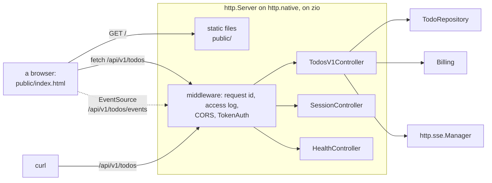
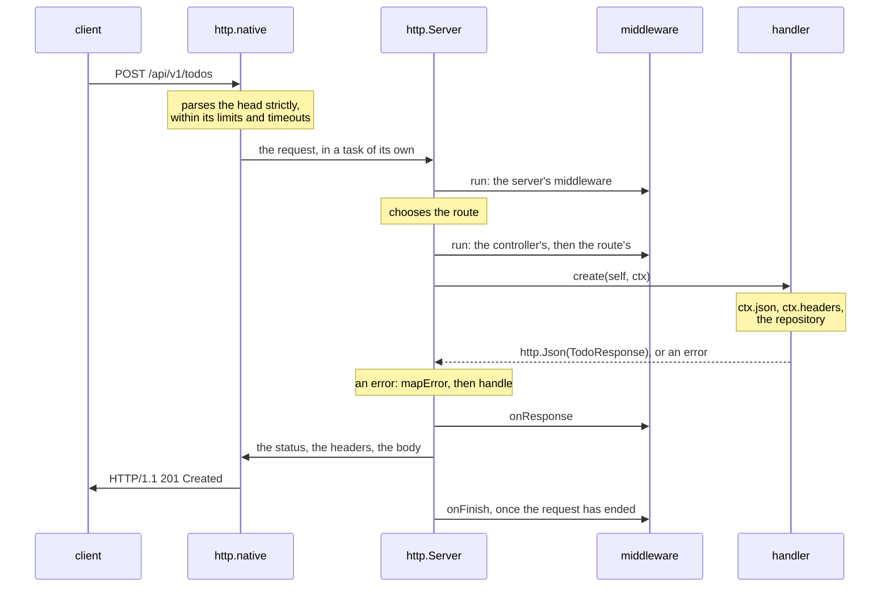
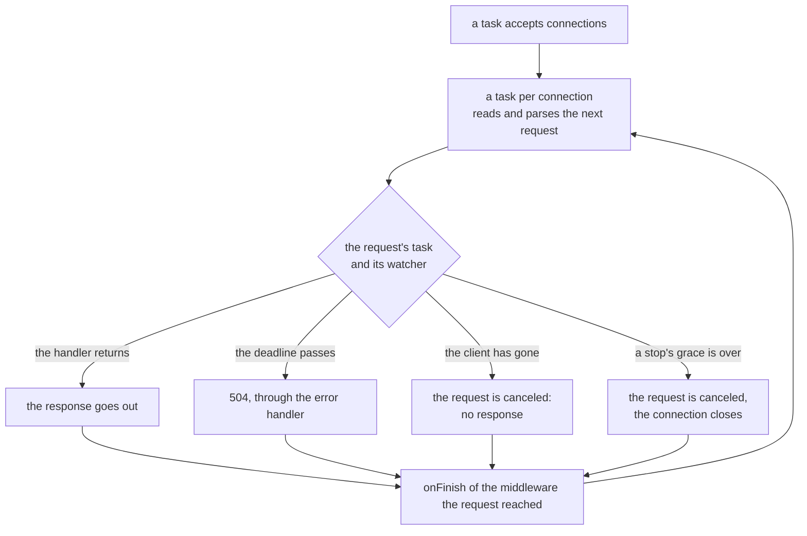
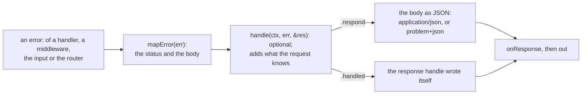
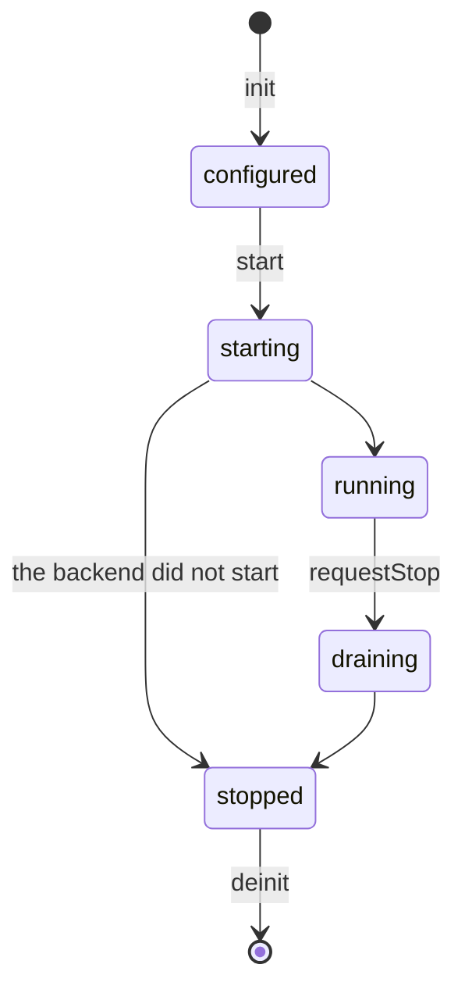

# http

**Web services and APIs in Zig, with routes the compiler checks.** A web
service answers HTTP requests: a browser asks for a page, an app sends JSON
to `/api/v1/todos`, another service asks for a report. With zefir-http you
write *controllers*, ordinary structs whose methods handle requests and
which declare their routes, so the compiler knows every route of the
service: it checks each handler's signature, and every error a handler may
return, when it builds the service. What a request brings, its path, query,
headers, cookies and JSON or form body, comes into structs of your own by
the `field_rules` of zefir-validator: outside names, transforms such as
`v.trim`, and rules, with every violation reported at once. Responses go out
by the same rules. Middleware are your own code, on three levels and in the
order you write them, and one error handler turns every error into a
response. Static files, streamed responses and server-sent events are built
in. The server parses HTTP/1.1 itself, strictly, and runs on
[zio](https://github.com/lalinsky/zio); for tests, the same server runs in
memory.

> [!IMPORTANT]
> **Not implemented yet (TODO):**
>
> - **WebSocket.** It will come, outside this version. Server-sent events
>   carry events from the server to a browser today.
> - **Templates.** No view engine: `ctx.response.html(…)` sends HTML that
>   you build.
> - **File uploads.** A body of `multipart/form-data` is not taken apart;
>   `ctx.request.bodyReader()` reads a body as a stream.
> - **OpenAPI.** No document is generated from the routes yet.
> - **`http.Patch(T)`.** A PATCH body fills `?T` fields, where a missing
>   field and `null` look the same: a field can be changed, but not
>   cleared to `null`.
> - **`zefir.map`.** Fields are not copied between structs by themselves: a
>   DTO of a response is filled by a function of its own, such as
>   `dto.TodoResponse.from(todo)`.
> - **Routes known only at start.** Every route is declared when the service
>   compiles; of the paths, only the server's `.prefix` may come from the
>   settings.
> - **Ready-made middleware.** zefir-http ships none: CORS, authentication,
>   rate limits and security headers are code of your application, and this
>   guide shows the first two. A library of them will come.
> - **HTTP/2, HTTP/3 and TLS.** The server speaks HTTP/1.1 and 1.0; TLS
>   ends at a proxy in front of it.
> - **Compression.** Responses go out as they are, and a request body with
>   `Content-Encoding` is refused with 415.
> - **Static files.** Several ranges in one request get the whole file, not
>   `multipart/byteranges`; no precompressed `.gz` or `.br` files; no
>   `If-Match` or `If-Unmodified-Since`; no listings of directories; no
>   symbolic links inside the root.
> - **Missed events.** A client of server-sent events that reconnects gets
>   the events from then on; those it missed are not sent again. The data of
>   an event is JSON.
> - **The App container.** `main` builds the objects of a service and runs
>   its server; the App of zefir-core, which will run the lifecycle of many
>   components, is planned.

A whole program: a controller, a server, and three requests to it. The
server runs on the backend in memory, `http.testing`, which needs no
network; on the network, `http.native` takes its place, and the controller
stays the same.

```zig
const std = @import("std");
const http = @import("http");
const v = @import("validator");

const Todo = struct { id: u64, title: []const u8 };

// The body of POST: the title is trimmed, then checked.
const NewTodo = struct {
    title: []const u8,

    pub const field_rules = .{ .title = .{ v.trim, v.notBlank, v.maxLength(200) } };
};

// A controller: the routes it declares, and a method for each.
const TodosV1Controller = struct {
    gpa: std.mem.Allocator,
    mutex: std.Io.Mutex = .init,
    todos: std.ArrayList(Todo) = .empty,

    pub const http_routes = http.routes(.{
        .prefix = "/v1/todos",
        .methods = .{
            .list = http.get("", .{}),
            .create = http.post("", .{}),
        },
    });

    pub fn list(self: *TodosV1Controller, ctx: *http.Context) !http.Json([]const Todo) {
        try self.mutex.lock(ctx.io());
        defer self.mutex.unlock(ctx.io());
        return .{ .value = try ctx.allocator().dupe(Todo, self.todos.items) };
    }

    pub fn create(self: *TodosV1Controller, ctx: *http.Context) !http.Json(Todo) {
        // Parsed, trimmed and checked: a body that does not fit never gets here.
        const body = try ctx.json(NewTodo);
        try self.mutex.lock(ctx.io());
        defer self.mutex.unlock(ctx.io());
        const todo: Todo = .{ .id = self.todos.items.len + 1, .title = try self.gpa.dupe(u8, body.title) };
        try self.todos.append(self.gpa, todo);
        return .{ .value = todo, .status = 201 };
    }

    fn deinit(self: *TodosV1Controller) void {
        for (self.todos.items) |todo| self.gpa.free(todo.title);
        self.todos.deinit(self.gpa);
    }
};

pub fn main(init: std.process.Init) !void {
    const gpa = init.gpa;
    const io = init.io;

    // The backend in memory serves the server without a network; on the
    // network, http.native.Backend takes its place.
    var backend: http.testing.Backend = .init(gpa);
    defer backend.deinit();
    var todos: TodosV1Controller = .{ .gpa = gpa };
    defer todos.deinit();
    var server = try http.Server.init(gpa, .{ .backend = backend.backend(), .prefix = "/api", .controllers = .{&todos} });
    defer server.deinit(io);
    try server.start(io);

    var buffer: [1024]u8 = undefined;
    var stdout = std.Io.File.stdout().writer(io, &buffer);
    const out = &stdout.interface;
    for ([_]struct { std.http.Method, []const u8 }{
        .{ .POST, "{\"title\":\"  Buy milk  \"}" },
        .{ .POST, "{\"title\":\"   \"}" },
        .{ .GET, "" },
    }) |request| {
        const method, const body = request;
        var res = try backend.request(io, .{
            .method = method,
            .target = "/api/v1/todos",
            .headers = &.{.{ "content-type", "application/json" }},
            .body = body,
        });
        defer res.deinit();
        try out.print("{t} /api/v1/todos{s}{s}\n", .{ method, if (body.len > 0) " " else "", body });
        try out.print("→ {d} {s} {s}\n", .{ res.status, res.header("content-type").?, res.body });
    }
    try out.flush();
}
```

```text
$ zig build run
POST /api/v1/todos {"title":"  Buy milk  "}
→ 201 application/json {"id":1,"title":"Buy milk"}
POST /api/v1/todos {"title":"   "}
→ 422 application/problem+json {"type":"about:blank","title":"Unprocessable Content","status":422,"code":"validation_failed","errors":[{"code":"validation.not_blank","message":"must not be blank","field":"title"}]}
GET /api/v1/todos
→ 200 application/json [{"id":1,"title":"Buy milk"}]
```

- **Routes checked when it compiles.** A controller declares its routes in
  `pub const http_routes`; a handler with the wrong signature, two routes on
  one path, or an error that no one turns into a response stops the build
  with a message that says what to write.
- **Input by your own types.** `ctx.json(NewTodo)` reads the body into the
  struct, by the outside names of its fields; the transforms run, then the
  rules, and every violation comes back at once, field by field.
- **Middleware are yours.** Functions, types and objects of the
  application, on three levels: the server's, a controller's and a
  route's. They run in the order you write them, and so do their after
  phases.
- **One error handler.** Handlers and middleware return Zig errors; one
  place turns each into a status and a body of your format.
- **Static files, streams, server-sent events.** A directory served safely,
  responses written as they go, live updates for browsers.
- **Deadlines and a graceful stop.** Every request has a deadline and is
  canceled when its client leaves; a stop lets the requests at work finish.
- **Tests without a network.** `http.testing.Backend` serves the same
  server from memory.

## Contents

- [The todo service](#the-todo-service)
- [How a request travels](#how-a-request-travels)
- [Installation](#installation)
- [Getting started](#getting-started)
- [Controllers and routes](#controllers-and-routes)
- [Input](#input)
- [Responses](#responses)
- [Errors](#errors)
- [Middleware](#middleware)
- [Authentication and CORS](#authentication-and-cors)
- [Server-sent events](#server-sent-events)
- [Static files](#static-files)
- [Tests](#tests)
- [Limits and timeouts](#limits-and-timeouts)
- [Stopping gracefully](#stopping-gracefully)

`zig build test-http` builds and runs "http in a minute" and the tests of
the example app, and checks them against this guide. The service runs on
the network: in `tests/http`, `zig build examples` starts it, sends it every
curl command of this guide, and checks each response, and the log of the
service, against what the guide shows.

## The todo service

This guide builds one service, step by step: a list of todos for each user.
Ann and Bob sign in with a token each. They make todos, change and delete
them, export them as CSV, and see changes as they happen. A web page comes
from the same server.



The files of the service, each shown whole in the chapter where it is
explained:

| File | What is in it |
| --- | --- |
| `main.zig` | the settings, the log, the runtime, the objects and the server |
| `TodosV1Controller.zig` | `/api/v1/todos`: the routes and their handlers |
| `SessionController.zig` | `/api/session`: signing a browser in and out |
| `HealthController.zig` | `/api/health`, for a load balancer |
| `dto.zig` | what requests bring in and responses send out |
| `TodoRepository.zig` | the todos, kept in memory |
| `Billing.zig` | the plan of a user: a stand-in for another service |
| `middleware.zig` | the middleware of the app |
| `auth.zig` | its authentication: `TokenAuth`, `requireUser`, `requirePermission` |
| `cors.zig` | its CORS |
| `errors.zig` | the error handler |
| `public/index.html` | the web page |
| `todos_test.zig` | tests without a network |

In a project of your own they live in `src/`, and `public/` next to
`build.zig`.

## How a request travels



1. **The backend** reads the request from its connection and parses its
   head strictly, by the rules of RFC 9112, and refuses what other servers
   on the way could read in another way, such as a body with two lengths. A
   head that breaks the rules, or comes too slowly, gets its answer from the
   backend: 400, 408, 414 or 431, and the connection closes.
2. **The request runs in a task of its own.** On zio a task is a coroutine:
   while a handler waits for its database, the thread serves other
   requests. Next to the request a watcher waits: when the client closes
   its connection, the server cancels the request, and when its deadline
   passes, the request ends with 504.
3. **The server's middleware** run before the route is chosen, so they see
   every request, the unknown paths too. Then the middleware of the
   controller and of the route run, and the handler.
4. **The handler** reads what it needs from the request and returns the
   response, or an error. An error goes to the error handler, which turns it
   into a status and a body.
5. **The after phases**: `onResponse` right before the head of the response
   goes out, `onFinish` once the request has ended, on a task of its own
   with a deadline of its own.



## Installation

Add Zefir to your `build.zig.zon`:

```sh
zig fetch --save git+https://github.com/vkiryakov/zefir#dev
```

zefir-http is on the `dev` branch until the next release. The command
fetches the latest commit of `dev`; `--save` pins that commit. The latest
release, v0.7.0, came before zefir-http, so `#v0.7.0` does not have it.

A service runs on zio. zio has no release for Zig 0.17 yet, so pin the
commit Zefir is tested with:

```sh
zig fetch --save git+https://github.com/lalinsky/zio#d15034f1a4d9ddaa42829aae8f7e02d37cd1093a
```

Then import the modules in `build.zig`. The service reads its settings with
confy, logs with log, takes contexts from core, and its DTOs use the rules
of validator. Its tests need no zio:

```zig
// build.zig of the todo service
const zefir = b.dependency("zefir", .{ .target = target, .optimize = optimize });
const zio = b.dependency("zio", .{ .target = target, .optimize = optimize });
const imports: []const std.Build.Module.Import = &.{
    .{ .name = "http", .module = zefir.module("zefir-http") },
    .{ .name = "core", .module = zefir.module("zefir-core") },
    .{ .name = "validator", .module = zefir.module("zefir-validator") },
    .{ .name = "confy", .module = zefir.module("zefir-confy") },
    .{ .name = "log", .module = zefir.module("zefir-log") },
};

const exe = b.addExecutable(.{
    .name = "todo-service",
    .root_module = b.createModule(.{
        .root_source_file = b.path("src/main.zig"),
        .target = target,
        .optimize = optimize,
        .imports = imports,
    }),
});
exe.root_module.addImport("zio", zio.module("zio"));
b.installArtifact(exe);
b.step("run", "Run the service").dependOn(&b.addRunArtifact(exe).step);

const tests = b.addTest(.{
    .root_module = b.createModule(.{
        .root_source_file = b.path("src/todos_test.zig"),
        .target = target,
        .optimize = optimize,
        .imports = imports,
    }),
});
b.step("test", "Run the tests").dependOn(&b.addRunArtifact(tests).step);
```

> [!TIP]
> http is also part of the umbrella module: with `zefir.module("zefir")`
> imported as `zefir`, it is `@import("zefir").http`. zefir-http itself
> imports only core and validator, and nothing outside Zefir.

## Getting started

The service begins in `main.zig`. It reads its settings, starts the log and
the runtime, builds the objects of the service, and runs the server until
Ctrl+C:

```zig
//! The todo service of the guide, on the network: its settings come from
//! the environment through confy, it logs with zefir-log, runs on zio and
//! serves on `http.native`. Ctrl+C or SIGTERM stops it gracefully.
//!
//! Settings, from the environment or a file `.env`:
//!
//!   APP_AUTH_ANN_TOKEN   the token of Ann, who may read and delete todos
//!   APP_AUTH_BOB_TOKEN   the token of Bob, who may not delete them
//!   APP_PORT             8080 by default; 0 takes a free port
//!   APP_PUBLIC_DIR       the static files, `public` by default
//!   APP_CORS_ORIGIN      the origin of a page on another site that may
//!                        call the API; http://localhost:5173 by default
//!
//! In tests/http, `zig build examples` runs it and sends it the requests
//! of the guide.

const std = @import("std");
const confy = @import("confy");
const http = @import("http");
const log = @import("log");
const zio = @import("zio");
const auth = @import("auth.zig");
const Cors = @import("cors.zig").Cors;
const errors = @import("errors.zig");
const mw = @import("middleware.zig");
const Billing = @import("Billing.zig");
const HealthController = @import("HealthController.zig");
const SessionController = @import("SessionController.zig");
const TodoRepository = @import("TodoRepository.zig");
const TodosV1Controller = @import("TodosV1Controller.zig");

/// zefir-http logs through std.log; this sends its records to the logger.
pub const std_options: std.Options = .{ .logFn = log.stdLogFn };

const Config = struct {
    auth: struct {
        ann_token: confy.Secret,
        bob_token: confy.Secret,
    },
    port: u16 = 8080,
    public_dir: []const u8 = "public",
    cors_origin: []const u8 = "http://localhost:5173",
};

pub fn main(init: std.process.Init) !void {
    var config: Config = undefined;
    confy.loadOrExit(init.arena.allocator(), &config, .{
        .io = init.io,
        .environ = init.environ_map,
        .env_prefix = "APP_",
        .sources = &.{ .env(".env"), .osEnv() },
    });
    // The logger outlives the runtime, so it takes `init.io`, through which
    // the tasks of the runtime may log too.
    const logger: log.Logger = try .init(init.gpa, init.io, .{ .format = .text });
    defer logger.deinit();
    logger.installStdLog();
    const app = logger.scoped("app");

    // One runtime for the service, an executor per CPU core: every request
    // runs in a task of its own on it.
    const rt = try zio.Runtime.init(init.gpa, .{ .executors = .auto });
    defer rt.deinit();
    const io = rt.io();
    const gpa = init.gpa;

    // What the handlers use. It outlives the server: its deinit comes after
    // the server's, which runs first, in the reverse order of the defers.
    var repo: TodoRepository = .init(gpa);
    defer repo.deinit();
    var billing: Billing = .{};
    var live: http.sse.Manager = .init(gpa, .{});
    defer live.deinit(io);

    // The objects of the middleware; the server borrows them.
    const users = [_]auth.TokenAuth.User{
        .{ .token = config.auth.ann_token, .id = "ann", .permissions = &.{ "todos", "todos:delete" } },
        .{ .token = config.auth.bob_token, .id = "bob", .permissions = &.{"todos"} },
    };
    var token_auth: auth.TokenAuth = .{ .users = &users };
    const origins = [_][]const u8{config.cors_origin};
    var cors: Cors = .{ .origins = &origins };
    var access_log: mw.AccessLog = .{ .logger = logger.scoped("access") };
    var plans: mw.PlanLookup = .{ .billing = &billing, .repo = &repo };
    var app_errors: errors.AppErrors = .{};

    var todos_v1: TodosV1Controller = .{ .repo = &repo, .live = &live, .plans = &plans };
    var sessions: SessionController = .{ .token_auth = &token_auth, .live = &live };
    var health: HealthController = .{};

    // The network: connections, the strict HTTP/1.1 parser, keep-alive.
    var native: http.native.Backend = try .init(gpa, .{ .port = config.port });
    defer native.deinit();
    var server = try http.Server.init(gpa, .{
        .backend = native.backend(),
        // Before the routes of the controllers: /api/v1/todos, /api/health.
        .prefix = "/api",
        .controllers = .{ &todos_v1, &sessions, &health },
        // Every request runs these, in this order, before its route is chosen.
        .middleware = .{ mw.requestId, &access_log, http.onResponse(mw.securityHeaders), &cors, &token_auth },
        .error_handler = &app_errors,
        // The page and its files; a path without a file gets index.html, so
        // that the page's own router reads the path.
        .static = .{http.static("/", .{ .root = config.public_dir, .spa_fallback = "index.html" })},
    });
    defer server.deinit(io);

    try server.start(io);
    app.info("Serving", .{ .port = native.port() });

    // Ctrl+C or SIGTERM begins a graceful stop; `wait` returns once it is over.
    var on_interrupt = try io.concurrent(stopOnSignal, .{ io, &server, app, .interrupt });
    defer on_interrupt.cancel(io) catch {};
    var on_terminate = try io.concurrent(stopOnSignal, .{ io, &server, app, .terminate });
    defer on_terminate.cancel(io) catch {};
    try server.wait(io);
    app.info("Stopped", .{});
}

/// Waits for the signal `kind`, then asks the server to stop. A handler of
/// the system's signals may not call `std.Io`, so a task waits for it.
fn stopOnSignal(io: std.Io, server: *http.Server, app: log.Logger, kind: zio.SignalKind) !void {
    var signal = try zio.Signal.init(kind);
    defer signal.deinit();
    try signal.wait();
    app.info("Stopping", .{ .signal = @tagName(kind) });
    server.requestStop(io);
}
```

What each part does:

- **The settings** come from the environment, or from a file `.env`,
  through confy: `APP_PORT` fills `port`, `APP_AUTH_ANN_TOKEN` fills
  `auth.ann_token`. The tokens are `confy.Secret`: the log never shows them.
- **The logger** writes text records to stdout. `logger.installStdLog()`
  and `std_options` send zefir-http's own records, which it writes through
  `std.log` under the scope `http`, to the same log.
- **The runtime**: zio with an executor per CPU core. Every request runs in
  a task of its own on it, and so does everything the request waits for.
- **The objects of the service**: the repository, the stand-in for billing,
  the manager of server-sent events, the objects of the middleware and the
  controllers, each with pointers to what it uses. The server borrows them,
  so they live as long as it does: Zig runs the `defer`s in reverse, and the
  server's `deinit` runs before theirs.
- **`http.native.Backend`** is the network: it listens on the port, reads
  the requests of each connection, and writes the responses.
- **`http.Server.init`** takes the controllers, the server's middleware, the
  error handler and the static files. The compiler checks all of it here:
  the routes of every controller, the signature of every handler, every
  middleware of every route, and every error a route can return.
- **`server.start`** opens the static files' directory and starts taking
  requests. A task waits for Ctrl+C or SIGTERM and asks the server to stop;
  `server.wait` returns once the stop is over. See
  [Stopping gracefully](#stopping-gracefully).

Run it with the tokens of the two users:

```text
$ APP_AUTH_ANN_TOKEN=ann-secret APP_AUTH_BOB_TOKEN=bob-secret zig build run
2026-10-17T20:02:44.960Z INFO  [app] Serving port=8080
```

It waits for requests on port 8080. In another terminal:

```text
$ curl -i localhost:8080/api/health
HTTP/1.1 200 OK
content-type: application/json
x-request-id: fd94ff4adbee24f59a6e042180ee85d6
x-content-type-options: nosniff
vary: Origin
Date: Sat, 17 Oct 2026 20:02:44 GMT
Content-Length: 15

{"status":"ok"}
```

`curl -i` shows the head of the response too: the status, then the header
fields, then the body. `x-request-id`, `x-content-type-options` and `vary`
come from the middleware of the service, `vary` from its CORS (see
[Authentication and CORS](#authentication-and-cors)); `Date` and
`Content-Length` come from the backend. Make a todo as Ann, and list hers:

```text
$ curl -i localhost:8080/api/v1/todos -H "Authorization: Bearer ann-secret" --json '{"title":"Buy milk"}'
HTTP/1.1 201 Created
content-type: application/json
x-request-id: acf21061a073486c45ed19fe75dd9b41
x-content-type-options: nosniff
vary: Origin
cache-control: no-store
Date: Sat, 17 Oct 2026 20:02:44 GMT
Content-Length: 85

{"id":1,"title":"Buy milk","done":false,"priority":"normal","dueDate":null,"tags":[]}

$ curl -i localhost:8080/api/v1/todos -H "Authorization: Bearer ann-secret"
HTTP/1.1 200 OK
content-type: application/json
x-request-id: 2ea3528aa741ad5e8d7ce72c0c20ac79
x-content-type-options: nosniff
vary: Origin
cache-control: no-store
Date: Sat, 17 Oct 2026 20:02:44 GMT
Content-Length: 129

{"items":[{"id":1,"title":"Buy milk","done":false,"priority":"normal","dueDate":null,"tags":[]}],"page":1,"perPage":20,"total":1}
```

`curl --json` sends the body with `Content-Type: application/json`; without
it, `ctx.json` answers 415. The token goes in `Authorization`: the todos are
Ann's own, and Bob does not see them.

## Controllers and routes

A controller is a struct with a method for each route, and the routes are
declared in it. Its dependencies are fields, pointers to objects that
`main` builds:

```zig
//! The REST controller of todos, version 1: /api/v1/todos. It declares its
//! routes; the compiler checks them where `main` passes the controller to
//! `http.Server.init`. Every route needs a signed-in user, and each user
//! sees only their own todos.

const std = @import("std");
const http = @import("http");
const auth = @import("auth.zig");
const dto = @import("dto.zig");
const mw = @import("middleware.zig");
const Billing = @import("Billing.zig");
const TodoRepository = @import("TodoRepository.zig");

const TodosV1Controller = @This();

// The dependencies are fields: `main` builds them and the controller.
repo: *TodoRepository,
/// The SSE streams of live updates, a key per user.
live: *http.sse.Manager,
/// A middleware object of this controller: `.plans` in the routes below.
plans: *mw.PlanLookup,

pub const http_routes = http.routes(.{
    .prefix = "/v1/todos",
    // After the server's middleware and before a route's own: the set with
    // requireUser, then the permission every route here needs.
    .middleware = .{ mw.protected, auth.requirePermission("todos") },
    .methods = .{
        .list = http.get("", .{}),
        .get = http.get("/{id}", .{}),
        .create = http.post("", .{ .middleware = .{.plans}, .max_body_bytes = 16 * 1024 }),
        .update = http.patch("/{id}", .{}),
        .delete = http.delete("/{id}", .{ .middleware = .{auth.requirePermission("todos:delete")} }),
        // A literal segment wins over {id}: /export.csv is not a todo.
        .exportCsv = http.get("/export.csv", .{ .timeout = std.Io.Duration.fromSeconds(300) }),
        .events = http.sse.get("/events", .{ .heartbeat = std.Io.Duration.fromSeconds(15), .on_close = .eventsClosed }),
    },
});

pub fn list(self: *TodosV1Controller, ctx: *http.Context) !http.Json(dto.TodoListResponse) {
    // Parsed, transformed and checked: a query that does not fit is a 422.
    const query = try ctx.query(dto.ListTodosQuery);
    const page = try self.repo.list(ctx.operation(), ctx.io(), ctx.allocator(), try owner(ctx), .{
        .done = query.done,
        .search = query.q,
        .tags = query.tags,
        .page = query.page,
        .per_page = query.per_page,
    });
    return .{ .value = try .from(ctx.allocator(), page, query) };
}

pub fn get(self: *TodosV1Controller, ctx: *http.Context) !http.Json(dto.TodoResponse) {
    const path = try ctx.path(dto.TodoIdPath);
    // No such todo: error.TodoNotFound, which AppErrors turns into a 404.
    const todo = try self.repo.find(ctx.operation(), ctx.io(), ctx.allocator(), try owner(ctx), path.id);
    return .{ .value = .from(todo) };
}

pub fn create(self: *TodosV1Controller, ctx: *http.Context) !http.Json(dto.TodoResponse) {
    const body = try ctx.json(dto.CreateTodoRequest);
    const headers = try ctx.headers(dto.CreateTodoHeaders);
    const user = try owner(ctx);
    // The same Idempotency-Key again, a retry: the todo it made, as it is.
    if (headers.idempotency_key) |key| {
        if (try self.repo.findByKey(ctx.operation(), ctx.io(), ctx.allocator(), user, key)) |todo| return .{ .value = .from(todo) };
    }
    // Put there by PlanLookup, which runs on this route only.
    const plan = try ctx.local(Billing.Plan);
    const usage = try ctx.local(mw.Usage);
    if (usage.todos >= plan.max_todos) return error.TodoLimitReached;
    const todo = try self.repo.insert(ctx.operation(), ctx.io(), ctx.allocator(), .{
        .owner = user,
        .title = body.title,
        .priority = body.priority,
        .due_date = body.due_date,
        .tags = body.tags,
        .idempotency_key = headers.idempotency_key,
    });
    try self.live.publish(ctx.operation(), ctx.io(), user, .{ .event = "todo.created", .data = dto.TodoResponse.from(todo) });
    return .{ .value = .from(todo), .status = 201 };
}

pub fn update(self: *TodosV1Controller, ctx: *http.Context) !http.Json(dto.TodoResponse) {
    const path = try ctx.path(dto.TodoIdPath);
    const body = try ctx.json(dto.UpdateTodoRequest);
    const user = try owner(ctx);
    const todo = try self.repo.update(ctx.operation(), ctx.io(), ctx.allocator(), user, path.id, .{
        .title = body.title,
        .done = body.done,
        .priority = body.priority,
        .due_date = body.due_date,
    });
    try self.live.publish(ctx.operation(), ctx.io(), user, .{ .event = "todo.updated", .data = dto.TodoResponse.from(todo) });
    return .{ .value = .from(todo) };
}

pub fn delete(self: *TodosV1Controller, ctx: *http.Context) !void {
    const path = try ctx.path(dto.TodoIdPath);
    const user = try owner(ctx);
    try self.repo.delete(ctx.operation(), ctx.io(), user, path.id);
    try self.live.publish(ctx.operation(), ctx.io(), user, .{ .event = "todo.deleted", .data = path });
    // Nothing written into the response: 204 No Content.
}

/// A streamed response: the rows go out as they are written, through a
/// buffer, and the file is never whole in memory.
pub fn exportCsv(self: *TodosV1Controller, ctx: *http.Context) !void {
    const todos = try self.repo.all(ctx.operation(), ctx.io(), ctx.allocator(), try owner(ctx));
    var out = try ctx.response.stream(.{ .content_type = "text/csv", .download_as = "todos.csv" });
    try out.writeAll("id,title,done\n");
    for (todos) |todo| {
        // A quote inside a CSV field is written twice.
        const title = try std.mem.replaceOwned(u8, ctx.allocator(), todo.title, "\"", "\"\"");
        try out.print("{d},\"{s}\",{}\n", .{ todo.id, title, todo.done });
    }
    try out.finish();
}

/// Opens the stream of live updates: an ordinary request until
/// `subscribe`, which sends the head of the stream and returns at once;
/// the stream lives on, and `publish` above writes to it.
pub fn events(self: *TodosV1Controller, ctx: *http.sse.Context) !void {
    _ = try self.live.subscribe(ctx, try owner(ctx));
}

/// Once, when the stream has ended: the client left, `close`, a queue that
/// overflowed or the stop of the server.
pub fn eventsClosed(_: *TodosV1Controller, ctx: *http.sse.Context) void {
    const user = ctx.locals.get(auth.CurrentUser) orelse return;
    std.log.scoped(.todos).info("Live updates closed for {s}", .{user.id});
}

/// The signed-in user: requireUser in the controller's middleware lets no
/// request without one reach a handler.
fn owner(ctx: anytype) error{LocalMissing}![]const u8 {
    return (try ctx.local(auth.CurrentUser)).id;
}
```

<details>
<summary><b>The repository</b>, <code>TodoRepository.zig</code>: the todos in memory, the application's own code</summary>

```zig
//! The todos of the example app, kept in memory: the application's own
//! code, which knows nothing of HTTP. Like a repository on a real
//! database, each method takes the request's `core.Context`, the `std.Io`
//! it waits on, and an allocator for what it returns.

const std = @import("std");
const core = @import("core");

const TodoRepository = @This();

pub const Priority = enum { low, normal, high };

/// A stored todo; a response shows `dto.TodoResponse` instead.
pub const Todo = struct {
    id: u64,
    /// The id of the user it belongs to.
    owner: []const u8,
    title: []const u8,
    done: bool,
    priority: Priority,
    /// A date such as 2026-10-20.
    due_date: ?[]const u8,
    tags: []const []const u8,
    /// The `Idempotency-Key` of the request that made it.
    idempotency_key: ?[]const u8,
};

pub const NewTodo = struct {
    owner: []const u8,
    title: []const u8,
    priority: Priority,
    due_date: ?[]const u8,
    tags: []const []const u8,
    idempotency_key: ?[]const u8,
};

/// What `update` changes: the fields that are not null.
pub const Change = struct {
    title: ?[]const u8,
    done: ?bool,
    priority: ?Priority,
    due_date: ?[]const u8,
};

pub const Filter = struct {
    done: ?bool,
    /// In the title, without case: lower case already.
    search: ?[]const u8,
    /// The todo has every one of them.
    tags: []const []const u8,
    page: u32,
    per_page: u32,
};

pub const Page = struct { items: []const Todo, total: u64 };

/// The errors of the domain, which the error handler turns into responses,
/// and those of a request that is out of time or canceled.
pub const Error = error{ TodoNotFound, OutOfMemory } || std.Io.Cancelable || core.ContextError;

gpa: std.mem.Allocator,
/// Requests run in tasks of their own, many at once: the mutex guards the
/// list, and waits through `std.Io` like everything a handler does.
mutex: std.Io.Mutex = .init,
todos: std.ArrayList(Todo) = .empty,
next_id: u64 = 1,

pub fn init(gpa: std.mem.Allocator) TodoRepository {
    return .{ .gpa = gpa };
}

pub fn deinit(repo: *TodoRepository) void {
    for (repo.todos.items) |todo| free(repo.gpa, todo);
    repo.todos.deinit(repo.gpa);
}

/// A page of the todos of `owner` that pass `filter`, in the order they
/// were made, copied into `arena`.
pub fn list(repo: *TodoRepository, ctx: core.Context, io: std.Io, arena: std.mem.Allocator, owner: []const u8, filter: Filter) Error!Page {
    // A request that is out of time or canceled stops before the work.
    try ctx.check(std.Io.Clock.awake.now(io));
    try repo.mutex.lock(io);
    defer repo.mutex.unlock(io);
    var matching: std.ArrayList(Todo) = .empty;
    for (repo.todos.items) |todo| {
        if (std.mem.eql(u8, todo.owner, owner) and passes(todo, filter)) try matching.append(arena, todo);
    }
    const first = @min(@as(usize, filter.page - 1) * filter.per_page, matching.items.len);
    const shown = matching.items[first..@min(first + filter.per_page, matching.items.len)];
    const items = try arena.alloc(Todo, shown.len);
    for (shown, items) |todo, *item| item.* = try copy(arena, todo);
    return .{ .items = items, .total = matching.items.len };
}

fn passes(todo: Todo, filter: Filter) bool {
    if (filter.done) |done| if (todo.done != done) return false;
    if (filter.search) |words| if (std.ascii.findIgnoreCase(todo.title, words) == null) return false;
    for (filter.tags) |wanted| {
        for (todo.tags) |tag| {
            if (std.mem.eql(u8, tag, wanted)) break;
        } else return false;
    }
    return true;
}

/// The todo `id` of `owner`, copied into `arena`: once the mutex is
/// released, another request may change the stored one.
pub fn find(repo: *TodoRepository, ctx: core.Context, io: std.Io, arena: std.mem.Allocator, owner: []const u8, id: u64) Error!Todo {
    try ctx.check(std.Io.Clock.awake.now(io));
    try repo.mutex.lock(io);
    defer repo.mutex.unlock(io);
    return copy(arena, (repo.at(owner, id) orelse return error.TodoNotFound).*);
}

/// The todo of `owner` that a request with `key` made, if one did.
pub fn findByKey(repo: *TodoRepository, ctx: core.Context, io: std.Io, arena: std.mem.Allocator, owner: []const u8, key: []const u8) Error!?Todo {
    try ctx.check(std.Io.Clock.awake.now(io));
    try repo.mutex.lock(io);
    defer repo.mutex.unlock(io);
    for (repo.todos.items) |todo| {
        const made_with = todo.idempotency_key orelse continue;
        if (std.mem.eql(u8, todo.owner, owner) and std.mem.eql(u8, made_with, key)) return try copy(arena, todo);
    }
    return null;
}

/// How many todos `owner` has.
pub fn count(repo: *TodoRepository, ctx: core.Context, io: std.Io, owner: []const u8) (std.Io.Cancelable || core.ContextError)!u32 {
    try ctx.check(std.Io.Clock.awake.now(io));
    try repo.mutex.lock(io);
    defer repo.mutex.unlock(io);
    var n: u32 = 0;
    for (repo.todos.items) |todo| {
        if (std.mem.eql(u8, todo.owner, owner)) n += 1;
    }
    return n;
}

/// Stores a new todo; the todo returned lives in `arena`.
pub fn insert(repo: *TodoRepository, ctx: core.Context, io: std.Io, arena: std.mem.Allocator, new: NewTodo) Error!Todo {
    try ctx.check(std.Io.Clock.awake.now(io));
    try repo.mutex.lock(io);
    defer repo.mutex.unlock(io);
    const todo: Todo = .{
        .id = repo.next_id,
        .owner = new.owner,
        .title = new.title,
        .done = false,
        .priority = new.priority,
        .due_date = new.due_date,
        .tags = new.tags,
        .idempotency_key = new.idempotency_key,
    };
    const stored = try copy(repo.gpa, todo);
    errdefer free(repo.gpa, stored);
    try repo.todos.append(repo.gpa, stored);
    repo.next_id += 1;
    return copy(arena, todo);
}

/// Changes the todo `id` of `owner`; the todo returned lives in `arena`.
pub fn update(repo: *TodoRepository, ctx: core.Context, io: std.Io, arena: std.mem.Allocator, owner: []const u8, id: u64, change: Change) Error!Todo {
    try ctx.check(std.Io.Clock.awake.now(io));
    try repo.mutex.lock(io);
    defer repo.mutex.unlock(io);
    const stored = repo.at(owner, id) orelse return error.TodoNotFound;
    var changed = stored.*;
    if (change.title) |title| changed.title = title;
    if (change.done) |done| changed.done = done;
    if (change.priority) |priority| changed.priority = priority;
    if (change.due_date) |due_date| changed.due_date = due_date;
    const kept = try copy(repo.gpa, changed);
    free(repo.gpa, stored.*);
    stored.* = kept;
    return copy(arena, kept);
}

pub fn delete(repo: *TodoRepository, ctx: core.Context, io: std.Io, owner: []const u8, id: u64) Error!void {
    try ctx.check(std.Io.Clock.awake.now(io));
    try repo.mutex.lock(io);
    defer repo.mutex.unlock(io);
    for (repo.todos.items, 0..) |todo, i| {
        if (todo.id == id and std.mem.eql(u8, todo.owner, owner)) {
            free(repo.gpa, repo.todos.orderedRemove(i));
            return;
        }
    }
    return error.TodoNotFound;
}

/// Every todo of `owner`, copied into `arena`: for the export, which writes
/// them to the client after the mutex is released. A database would hand
/// the rows over as it reads them instead.
pub fn all(repo: *TodoRepository, ctx: core.Context, io: std.Io, arena: std.mem.Allocator, owner: []const u8) Error![]const Todo {
    try ctx.check(std.Io.Clock.awake.now(io));
    try repo.mutex.lock(io);
    defer repo.mutex.unlock(io);
    var mine: std.ArrayList(Todo) = .empty;
    for (repo.todos.items) |todo| {
        if (std.mem.eql(u8, todo.owner, owner)) try mine.append(arena, try copy(arena, todo));
    }
    return mine.items;
}

fn at(repo: *TodoRepository, owner: []const u8, id: u64) ?*Todo {
    for (repo.todos.items) |*todo| {
        if (todo.id == id and std.mem.eql(u8, todo.owner, owner)) return todo;
    }
    return null;
}

/// `todo` with every string in `allocator`.
fn copy(allocator: std.mem.Allocator, todo: Todo) error{OutOfMemory}!Todo {
    var out = todo;
    out.owner = try allocator.dupe(u8, todo.owner);
    errdefer allocator.free(out.owner);
    out.title = try allocator.dupe(u8, todo.title);
    errdefer allocator.free(out.title);
    out.due_date = if (todo.due_date) |d| try allocator.dupe(u8, d) else null;
    errdefer if (out.due_date) |d| allocator.free(d);
    out.idempotency_key = if (todo.idempotency_key) |k| try allocator.dupe(u8, k) else null;
    errdefer if (out.idempotency_key) |k| allocator.free(k);
    const tags = try allocator.alloc([]const u8, todo.tags.len);
    var done: usize = 0;
    errdefer {
        for (tags[0..done]) |tag| allocator.free(tag);
        allocator.free(tags);
    }
    for (tags, todo.tags) |*tag, given| {
        tag.* = try allocator.dupe(u8, given);
        done += 1;
    }
    out.tags = tags;
    return out;
}

fn free(allocator: std.mem.Allocator, todo: Todo) void {
    allocator.free(todo.owner);
    allocator.free(todo.title);
    if (todo.due_date) |d| allocator.free(d);
    if (todo.idempotency_key) |k| allocator.free(k);
    for (todo.tags) |tag| allocator.free(tag);
    allocator.free(todo.tags);
}
```

</details>

- **`pub const http_routes = http.routes(.{ … })`** is a constant that the
  compiler computes when it builds the service; `http.Server.init` reads it
  when it takes the controller. A controller without it, or with one that is
  not `pub`, does not compile.
- **The path of a route** is the prefix of the server, `/api`, then the
  prefix of the controller, `/v1/todos`, then the path of the method:
  `GET /api/v1/todos/{id}`. The version goes in the controller's prefix and
  in its name, `TodosV1Controller`: a `TodosV2Controller` can serve
  `/v2/todos` next to it.
- **The keys of `.methods`** are the names of the controller's methods.
  Each is `fn (self: *C, ctx: *http.Context) !Out`, or, for
  `http.sse.get`, `fn (self: *C, ctx: *http.sse.Context) !void`; the
  compiler checks that the method is there and has the form.
- **The kinds of routes**: `http.get`, `post`, `put`, `patch`, `delete`,
  `head`, `options` and `http.sse.get`. Every GET answers HEAD too, with the
  head alone; an SSE route does not, since HEAD would open a stream.
- **Parameters of a path**: `{id}` takes one segment, `{*rest}` the rest of
  the path, as the last segment.
- **A literal wins over a parameter**, and a parameter over `{*rest}`: so
  `/export.csv` is no `{id}`. Two routes of one method on one path stop the
  build, with a message that names both.
- **The options of a route**: `.middleware` (see
  [Middleware](#middleware)), `.max_body_bytes` instead of the server's
  1 MiB, and `.timeout` instead of its deadline of 30 seconds, here 300 for
  the export. The options are compile-time values of any type, so a
  duration is written in full: `std.Io.Duration.fromSeconds(300)`. Where a
  type is known, as in the fields of `http.native.Backend.init` or of a
  cookie, `.fromSeconds(300)` is enough.

What a handler returns:

| It returns | The response |
| --- | --- |
| `!http.Json(T)` | 200 and the value as JSON, written after the handler has returned (see [Responses](#responses)); another status with `.{ .value = x, .status = 201 }` |
| `!void`, nothing written | 204 No Content |
| `!void`, a response written with `ctx.response` | what was written: text, HTML, a redirect, a stream |
| an error | the response of the error handler (see [Errors](#errors)) |

A todo, read by its id:

```text
$ curl -i localhost:8080/api/v1/todos/1 -H "Authorization: Bearer ann-secret"
HTTP/1.1 200 OK
content-type: application/json
x-request-id: 9cb5a0caaf77967c00b4bacc5a232a8d
x-content-type-options: nosniff
vary: Origin
cache-control: no-store
Date: Sat, 17 Oct 2026 20:02:44 GMT
Content-Length: 85

{"id":1,"title":"Buy milk","done":false,"priority":"normal","dueDate":null,"tags":[]}
```

A path that exists without the method is 405, with the methods it has in
`Allow`; a path that does not exist is 404. Both come from the error
handler of the service, in its format:

```text
$ curl -i -X PUT localhost:8080/api/v1/todos/1 -H "Authorization: Bearer ann-secret"
HTTP/1.1 405 Method Not Allowed
content-type: application/json
x-request-id: b37fcc3bc87070d9c97b379811072bf2
allow: GET, HEAD, PATCH, DELETE, OPTIONS
x-content-type-options: nosniff
vary: Origin
Date: Sat, 17 Oct 2026 20:02:44 GMT
Content-Length: 118

{"code":"method_not_allowed","message":"Method Not Allowed","details":[],"traceId":"c2abda21ef87476cc8b31dcba14ab9ff"}

$ curl -i localhost:8080/api/v2/todos -H "Authorization: Bearer ann-secret"
HTTP/1.1 404 Not Found
content-type: application/json
x-request-id: 11a28cc05650ab58a71564a5ba4148ad
x-content-type-options: nosniff
vary: Origin
Date: Sat, 17 Oct 2026 20:02:44 GMT
Content-Length: 100

{"code":"not_found","message":"Not Found","details":[],"traceId":"bfca559a8c04593b827c89bc6dc266d3"}
```

HEAD of a GET route, the head without the body:

```text
$ curl -I localhost:8080/api/health
HTTP/1.1 200 OK
content-type: application/json
x-request-id: ae48102b9e2993d164e3895e745726c2
x-content-type-options: nosniff
vary: Origin
Date: Sat, 17 Oct 2026 20:02:44 GMT
Content-Length: 15
```

An OPTIONS request gets 204 with the methods of its path in `Allow`, unless
the path has a route of `http.options` of its own. Before a path is matched it is taken apart in segments, and then each is decoded: a
`%2F` inside `{id}` stays a `/` of the value. `.` and `..` resolve as RFC
3986 says, an empty segment (`//`) matches no route, a slash at the end does
not matter, the case of letters does.

The health check of the load balancer is a controller without a version,
open to everybody, since it lists no `requireUser`:

```zig
//! GET /api/health, for the load balancer: a service route without a
//! version, open to everybody, since it lists no requireUser.

const http = @import("http");

const HealthController = @This();

pub const http_routes = http.routes(.{
    .methods = .{ .check = http.get("/health", .{}) },
});

pub const Health = struct { status: []const u8 };

pub fn check(_: *HealthController, _: *http.Context) !http.Json(Health) {
    return .{ .value = .{ .status = "ok" } };
}
```

## Input

A handler takes what it needs from the request with a call of its own, and
gets a struct of the type it names:

| Call | Reads | Outside names |
| --- | --- | --- |
| `ctx.path(T)` | the parameters of the route | `{id}` fills the field `id`, `{userId}` a field with `v.rename("userId")` |
| `ctx.query(T)` | the query, `?page=2&perPage=50` | as the DTO names them |
| `ctx.json(T)` | the body, `application/json` or a `+json` type; else 415 | as the DTO names them |
| `ctx.form(T)` | the body, `application/x-www-form-urlencoded`; else 415 | as the DTO names them |
| `ctx.headers(T)` | the headers | the field `idempotency_key` is the header `Idempotency-Key`, in any case |
| `ctx.cookies(T)` | the cookies | as the DTO names them |
| `ctx.body()` | the bytes of the body, such as for the signature of a webhook | |

Every one of them works in the same steps:

```text
1. read        the body, once, into the request's memory, within its limit     → 413
2. parse       JSON, a query or a form; its Content-Type; valid UTF-8         → 400, 415
3. map         into the fields of T by their outside names: types,           → 422, every violation
               missing fields, unknown fields
4. transform   v.transform: v.trim, v.toLower, functions of your own          → the error of your function
5. check       the rules of field_rules: v.checkAll                           → 422, every violation
```

The DTOs of the service describe all of it in one place, `field_rules`: per
field, its outside name, its transforms and its rules, in this order.

```zig
//! The DTOs of /api/v1/todos: what a request brings in and what a response
//! sends out. The `field_rules` of a field hold, in this order, its outside
//! name (`v.rename`), its transforms and its rules; zefir-http reads the
//! input by them and writes the output by them.

const std = @import("std");
const v = @import("validator");
const TodoRepository = @import("TodoRepository.zig");

/// In JSON and in a query: "low", "normal" or "high".
pub const Priority = TodoRepository.Priority;

// ---------- Requests ----------

/// The path of /v1/todos/{id}: the field `id` reads the parameter `{id}`.
pub const TodoIdPath = struct {
    id: u64,

    pub const field_rules = .{ .id = v.positive };
};

/// The query of GET /v1/todos, such as
/// `?done=false&page=2&perPage=50&tags=home,shop&q=milk`. Parameters it
/// does not name are ignored: proxies and analytics add their own.
pub const ListTodosQuery = struct {
    /// No parameter: done or not.
    done: ?bool = null,
    page: u32 = 1,
    per_page: u32 = 20,
    tags: []const []const u8 = &.{},
    /// Words of the title.
    q: ?[]const u8 = null,

    pub const field_rules = .{
        .page = v.range(1, 10_000),
        .per_page = .{ v.rename("perPage"), v.range(1, 100) },
        // ?tags=home&tags=shop or ?tags=home,shop: a list either way.
        .tags = v.transformWith(splitComma),
        // A transform runs on the value of an optional field when it is there.
        .q = .{ v.trim, v.toLower, v.maxLength(100) },
    };
};

/// Each item of `value` split at its commas, without empty parts.
fn splitComma(arena: std.mem.Allocator, value: []const []const u8) error{OutOfMemory}![]const []const u8 {
    var parts: std.ArrayList([]const u8) = .empty;
    for (value) |item| {
        var it = std.mem.tokenizeScalar(u8, item, ',');
        while (it.next()) |part| try parts.append(arena, part);
    }
    return parts.items;
}

/// The headers of POST /v1/todos: the field `idempotency_key` is the header
/// `Idempotency-Key`. A client that sends the same key again, after a
/// timeout say, gets the todo it made the first time instead of a second
/// one.
pub const CreateTodoHeaders = struct {
    idempotency_key: ?[]const u8 = null,

    pub const field_rules = .{ .idempotency_key = .{ v.trim, v.notBlank, v.maxLength(64) } };
};

/// The body of POST /v1/todos. A field it does not name is refused:
/// `{"titel": …}` is a 422.
pub const CreateTodoRequest = struct {
    title: []const u8,
    priority: Priority = .normal,
    due_date: ?[]const u8 = null,
    tags: []const []const u8 = &.{},

    // The transforms run before the rules: notBlank and maxLength see the
    // trimmed title.
    pub const field_rules = .{
        .title = .{ v.trim, v.notBlank, v.maxLength(200) },
        .due_date = .{ v.rename("dueDate"), v.trim, v.date },
        .tags = v.each(.{ v.trim, v.toLower, v.notBlank, v.maxLength(30) }),
    };
};

/// The body of PATCH /v1/todos/{id}: a field that is not sent stays as it
/// is. A missing field and `null` read the same, so a due date can be
/// changed but not removed this way.
pub const UpdateTodoRequest = struct {
    title: ?[]const u8 = null,
    done: ?bool = null,
    priority: ?Priority = null,
    due_date: ?[]const u8 = null,

    pub const field_rules = .{
        .title = .{ v.trim, v.notBlank, v.maxLength(200) },
        .due_date = .{ v.rename("dueDate"), v.trim, v.date },
    };
};

// ---------- Responses ----------

/// One todo, as the API shows it: the owner and the idempotency key of the
/// stored todo stay inside.
pub const TodoResponse = struct {
    id: u64,
    title: []const u8,
    done: bool,
    priority: Priority,
    due_date: ?[]const u8,
    tags: []const []const u8,

    // The outside names hold for the output too.
    pub const field_rules = .{ .due_date = v.rename("dueDate") };

    pub fn from(todo: TodoRepository.Todo) TodoResponse {
        return .{ .id = todo.id, .title = todo.title, .done = todo.done, .priority = todo.priority, .due_date = todo.due_date, .tags = todo.tags };
    }
};

/// A page of the list.
pub const TodoListResponse = struct {
    items: []const TodoResponse,
    page: u32,
    per_page: u32,
    total: u64,

    pub const field_rules = .{ .per_page = v.rename("perPage") };

    /// `arena` is the request's: what it gives is freed with the request.
    pub fn from(arena: std.mem.Allocator, page: TodoRepository.Page, query: ListTodosQuery) error{OutOfMemory}!TodoListResponse {
        const items = try arena.alloc(TodoResponse, page.items.len);
        for (items, page.items) |*item, todo| item.* = .from(todo);
        return .{ .items = items, .page = query.page, .per_page = query.per_page, .total = page.total };
    }
};
```

A todo with a title in spaces, a priority, a due date and two tags:

```text
$ curl -i localhost:8080/api/v1/todos -H "Authorization: Bearer ann-secret" --json '{"title":"  Call Bob  ","priority":"high","dueDate":"2026-10-20","tags":["Phone"," home "]}'
HTTP/1.1 201 Created
content-type: application/json
x-request-id: 3295353046ea6e46b8ab48ec5665db72
x-content-type-options: nosniff
vary: Origin
cache-control: no-store
Date: Sat, 17 Oct 2026 20:02:44 GMT
Content-Length: 105

{"id":2,"title":"Call Bob","done":false,"priority":"high","dueDate":"2026-10-20","tags":["phone","home"]}
```

The title is trimmed and the tags in lower case before the rules see them,
and the response writes `due_date` as `dueDate`, by the same `field_rules`.
A body that does not fit gets every violation at once, each field by its
outside name:

```text
$ curl -i localhost:8080/api/v1/todos -H "Authorization: Bearer ann-secret" --json '{"titel":"Buy bread","priority":"urgent"}'
HTTP/1.1 422 Unprocessable Content
content-type: application/json
x-request-id: 7288cd5e5684dbfd5651eb149e9e056d
x-content-type-options: nosniff
vary: Origin
cache-control: no-store
Date: Sat, 17 Oct 2026 20:02:44 GMT
Content-Length: 348

{"code":"validation_failed","message":"Invalid request","details":[{"code":"http.unknown_field","message":"unknown field","field":"titel"},{"code":"http.invalid_type","message":"must be one of low, normal, high","field":"priority"},{"code":"http.missing_field","message":"is required","field":"title"}],"traceId":"7c77c78d676292ce422fd10b1317d639"}
```

`titel` is a field the DTO does not have: a body that names an unknown field
is refused, so that a typo in a field never passes unnoticed. The query is
read the same way, and ignores the parameters it does not know, which
proxies and analytics add:

```text
$ curl -i 'localhost:8080/api/v1/todos?q=BOB&tags=phone,home' -H "Authorization: Bearer ann-secret"
HTTP/1.1 200 OK
content-type: application/json
x-request-id: cddb6c0cc059a3d3a28574fb959d1590
x-content-type-options: nosniff
vary: Origin
cache-control: no-store
Date: Sat, 17 Oct 2026 20:02:44 GMT
Content-Length: 149

{"items":[{"id":2,"title":"Call Bob","done":false,"priority":"high","dueDate":"2026-10-20","tags":["phone","home"]}],"page":1,"perPage":20,"total":1}

$ curl -i 'localhost:8080/api/v1/todos?perPage=500' -H "Authorization: Bearer ann-secret"
HTTP/1.1 422 Unprocessable Content
content-type: application/json
x-request-id: 8c3072075a3522b51f809d6d3ac2f3fc
x-content-type-options: nosniff
vary: Origin
cache-control: no-store
Date: Sat, 17 Oct 2026 20:02:44 GMT
Content-Length: 193

{"code":"validation_failed","message":"Invalid request","details":[{"code":"validation.range","message":"must be from 1 to 100","field":"perPage"}],"traceId":"c83cf65c96bfec7aee954ab6c0c9d293"}
```

`q` was trimmed and put in lower case, and `tags=phone,home` became a list
by `splitComma`, a transform of the application. The strings of a query, a
form, a path and the headers become the types of the fields:

| Field | From a query, path, header or form | From JSON |
| --- | --- | --- |
| `u64`, `i32`, `f64` | `"2"` → 2 | a number |
| `bool` | `true`, `false`, `1`, `0` | `true`, `false` |
| an enum | the name of a value: `"high"` | a string |
| `?T` | no parameter → `null` | no field or `null` → `null` |
| a field with a default | no parameter → the default | no field → the default |
| `[]const T` | the parameter again: `?tag=a&tag=b` | an array |
| `[]const u8` | the string, decoded, valid UTF-8 | a string |
| a struct | — | an object |

A PATCH changes only what it sends. Its fields are `?T`: a field it does not
send is `null`, and stays as it is:

```text
$ curl -i -X PATCH localhost:8080/api/v1/todos/1 -H "Authorization: Bearer ann-secret" --json '{"done":true}'
HTTP/1.1 200 OK
content-type: application/json
x-request-id: 70a687213e8c8703a82a8913b48c157a
x-content-type-options: nosniff
vary: Origin
cache-control: no-store
Date: Sat, 17 Oct 2026 20:02:44 GMT
Content-Length: 84

{"id":1,"title":"Buy milk","done":true,"priority":"normal","dueDate":null,"tags":[]}
```

So a PATCH cannot clear a field to `null` in this version: `null` and a
missing field look the same (`http.Patch(T)` is on the TODO list above).

The headers come in a DTO too. A client that did not get its answer, after
a timeout say, sends its request again with the same `Idempotency-Key`, and
gets the todo it made the first time:

```text
$ curl -i localhost:8080/api/v1/todos -H "Authorization: Bearer ann-secret" -H "Idempotency-Key: plants-1" --json '{"title":"Water the plants"}'
HTTP/1.1 201 Created
content-type: application/json
x-request-id: db527cbb15e40f24218d51dd8dca4042
x-content-type-options: nosniff
vary: Origin
cache-control: no-store
Date: Sat, 17 Oct 2026 20:02:44 GMT
Content-Length: 93

{"id":3,"title":"Water the plants","done":false,"priority":"normal","dueDate":null,"tags":[]}

$ curl -i localhost:8080/api/v1/todos -H "Authorization: Bearer ann-secret" -H "Idempotency-Key: plants-1" --json '{"title":"Water the plants"}'
HTTP/1.1 200 OK
content-type: application/json
x-request-id: ad400f14731c00fbc94fd63ca0b9c2cb
x-content-type-options: nosniff
vary: Origin
cache-control: no-store
Date: Sat, 17 Oct 2026 20:02:45 GMT
Content-Length: 93

{"id":3,"title":"Water the plants","done":false,"priority":"normal","dueDate":null,"tags":[]}
```

- **Errors of input need no catching.** `try ctx.json(…)` returns them, and
  they go to the error handler: `ValidationFailed` (422) with the
  violations in `ctx.violations()`, `InvalidRequest` (400), `PayloadTooLarge`
  (413) and `UnsupportedMediaType` (415).
- **An error of a transform of your own** is an error like any other: it is
  in the error set of `ctx.json(T)`, and the error handler maps it.
- **The body is read once.** `ctx.json` again parses the same bytes; after
  `ctx.request.bodyReader()`, which reads a body as a stream, `ctx.json` is
  `error.BodyConsumed`.
- **Unknown fields**: a body refuses them, a query ignores them. A DTO says
  otherwise with `pub const unknown_fields = .ignore;` (or `.reject`), the
  server with its option `.unknown_fields`.
- **Strings live in the request's memory**, the arena of
  `ctx.allocator()`, until the request has ended. The repository copies
  what it keeps.

## Responses

The responses a handler writes itself go through `ctx.response`:

| Call | The response |
| --- | --- |
| `return .{ .value = x, .status = 201 }` with `!http.Json(T)` | `x` as JSON, through the transforms and the outside names of `T` |
| `ctx.response.json(x)` | the same, written at once |
| `ctx.response.text(s)`, `.html(s)` | `text/plain` or `text/html`, UTF-8 |
| `ctx.response.status(303).redirect("/")` | a redirect; without a status, 302 |
| `ctx.response.setCookie(.{ … })` | a `Set-Cookie` field |
| `ctx.response.setHeader(name, value)` | a header field, in place of one of that name; not those the backend writes, nor `Set-Cookie` (see below) |
| `ctx.response.file(path, .{ … })` | a file of the application, read as it goes out |
| `ctx.response.stream(.{ … })` | a body written as it goes |

**The value of `http.Json(T)` goes out after the handler has returned**, and
after its `defer`s: the JSON is written from the value as the response goes
to the client. So what the value points to must live, unchanged, until then.
The memory of `ctx.allocator()` does, and so do the copies the repository
makes there. A slice of something that the handler shares with other
requests does not, such as the list of an object read under a mutex that a
`defer` unlocks: before it goes out, another request may change it or free
it. Copy such a value into `ctx.allocator()` first, or write it at once with
`ctx.response.json(x)`.

The export of the service writes a CSV row by row, through a buffer of
16 KiB, so the file is never whole in memory:

```zig
var out = try ctx.response.stream(.{ .content_type = "text/csv", .download_as = "todos.csv" });
try out.writeAll("id,title,done\n");
```

```text
$ curl -i localhost:8080/api/v1/todos/export.csv -H "Authorization: Bearer ann-secret"
HTTP/1.1 200 OK
content-type: text/csv
x-request-id: 6f6d6699b8903b99aa45ac664d65cfb6
content-disposition: attachment; filename="todos.csv"; filename*=UTF-8''todos.csv
x-content-type-options: nosniff
vary: Origin
cache-control: no-store
Date: Sat, 17 Oct 2026 20:02:45 GMT
Content-Length: 78

id,title,done
1,"Buy milk",true
2,"Call Bob",false
3,"Water the plants",false
```

`download_as` asks the browser to save the body as `todos.csv`. A body that
ends within the buffer goes out with its length; a longer one goes chunked,
and `out.flush()` sends what is written at once, for a client that waits for
each part.

A response goes from `uncommitted`, while its status and its fields can
still change, to `committed`, once its head has gone to the client, and to
`finished`. Until it is committed, an error replaces the response with the
answer of the error handler: the status, the body and the fields of the
content (`Content-Type`, `Content-Length`, `Content-Encoding`,
`Content-Disposition`) go, the other fields set before, such as
`x-request-id`, stay. Once it is committed, an error cuts the response: a
chunked body loses its end, a body with a length its connection, so the
client sees a broken response, never a whole one.

The backend writes the fields of the framing and of the connection itself,
so that the head always says what the body is: `setHeader` refuses
`Content-Length`, `Transfer-Encoding`, `Connection`, `Keep-Alive`, `TE`,
`Trailer`, `Upgrade` and `Date` with `error.ReservedHeader`. It refuses
`Set-Cookie` too, since a response has a field of its own for each cookie:
`setCookie` adds them. A name that is not a token, or a value with CR, LF,
NUL or another control character but a tab, is `error.InvalidHeaderValue`.
Both errors are mistakes of the program, 500.

`ctx.response.setCookie` and `redirect` are shown in
[Authentication and CORS](#authentication-and-cors): signing in sets a cookie
and sends the browser back to the page.

## Errors

A handler, a middleware and the repository only return Zig errors. One
error handler for the whole server turns each into a response:



```zig
//! The error handler of the example app: the one place where errors become
//! responses. Handlers, middleware and the repository only return Zig
//! errors; `mapError` gives each one its status and body, and `handle`
//! adds what only the request knows.

const http = @import("http");
const v = @import("validator");

/// The body of every error response of this API, as `application/json`.
/// For the problem+json of RFC 9457, `mapError` returns
/// `http.ErrorResponse(http.Problem)` instead.
pub const ApiError = struct {
    code: []const u8,
    message: []const u8,
    /// The violations of a 422, each field by its outside name.
    details: []const http.Violation = &.{},
    /// The trace of the request, to find its records in the logs.
    trace_id: []const u8 = "",

    pub const field_rules = .{ .trace_id = v.rename("traceId") };
};

pub const AppErrors = struct {
    /// An error → its status and body. A pure function without a context:
    /// the compiler calls it while it builds the server, for every error a
    /// route can return (the strict error check).
    pub fn mapError(err: anyerror) http.ErrorResponse(ApiError) {
        return switch (err) {
            error.TodoNotFound => .{ .status = 404, .body = .{ .code = "todos.not_found", .message = "Todo not found" } },
            error.TodoLimitReached => .{ .status = 409, .body = .{ .code = "todos.limit_reached", .message = "The plan allows no more todos" } },
            error.ValidationFailed => .{ .status = 422, .body = .{ .code = "validation_failed", .message = "Invalid request" } },
            // Every other error: the framework's status, in this format.
            // `.fallback` marks the branch for the strict error check.
            else => .fallback(err, .{ .code = http.defaultCode(err), .message = http.defaultTitle(err) }),
        };
    }

    /// Optional: the trace id and the violations go into the body, and the
    /// header that every 401 needs into the response.
    pub fn handle(_: *AppErrors, ctx: *http.Context, err: anyerror, res: *http.ErrorResponse(ApiError)) !http.ErrorAction {
        res.body.trace_id = ctx.traceId();
        switch (err) {
            error.ValidationFailed => res.body.details = ctx.violations(),
            // RFC 9110 asks it of every 401.
            error.Unauthenticated => try ctx.response.setHeader("www-authenticate", "Bearer"),
            else => {},
        }
        return .respond;
    }
};
```

```text
$ curl -i localhost:8080/api/v1/todos/42 -H "Authorization: Bearer ann-secret"
HTTP/1.1 404 Not Found
content-type: application/json
x-request-id: d1f57d9f45d673d0d21c641f0295f231
x-content-type-options: nosniff
vary: Origin
cache-control: no-store
Date: Sat, 17 Oct 2026 20:02:45 GMT
Content-Length: 111

{"code":"todos.not_found","message":"Todo not found","details":[],"traceId":"c8a562984e6f8c9c7d1e751d12d3bba5"}

$ curl -i localhost:8080/api/v1/todos -H "Authorization: Bearer ann-secret" --json '{"title":"Plan the trip"}'
HTTP/1.1 409 Conflict
content-type: application/json
x-request-id: 10b2f37bc0682da2a86c3eaa1dca23ea
x-content-type-options: nosniff
vary: Origin
cache-control: no-store
Date: Sat, 17 Oct 2026 20:02:45 GMT
Content-Length: 130

{"code":"todos.limit_reached","message":"The plan allows no more todos","details":[],"traceId":"228ce1c75ce01ee40eb469d44803ffc2"}

$ curl -i localhost:8080/api/v1/todos -H "Authorization: Bearer ann-secret" -d 'title=Plan the trip'
HTTP/1.1 415 Unsupported Media Type
content-type: application/json
x-request-id: c673882e0c719dd4ae1eb4f8620671de
x-content-type-options: nosniff
vary: Origin
cache-control: no-store
Date: Sat, 17 Oct 2026 20:02:45 GMT
Content-Length: 126

{"code":"unsupported_media_type","message":"Unsupported Media Type","details":[],"traceId":"4f485e01742b4d7ca9b3dae99dc0f0f3"}
```

- **`mapError(err)`** gives an error its status and its body. It is a pure
  function, without a context: the compiler calls it while it builds the
  service, for every error a route can return.
- **`.fallback(err, body)`** is the branch for the errors `mapError` does
  not name: the framework's status, `http.defaultStatus(err)`, in your
  format, so every error goes out alike. `http.defaultCode` and
  `http.defaultTitle` give the code and the title of the status.
- **`handle`** is optional. It gets the response that `mapError` made and
  may add to it what only the request knows: the trace id, the violations
  of a 422, a header such as `WWW-Authenticate`. It returns `.respond` to
  send it, or `.handled` after it wrote a response of its own, such as an
  HTML page.
- **Without `.error_handler`**, errors go out as problem+json of RFC 9457,
  as in "http in a minute" above.
- **A 500 says nothing of its cause** to the client; the server logs the
  error with the id of the request.

**The strict error check.** For every route, the compiler collects the
errors its handler and the `run` of each of its middleware can return, and
calls `mapError` for each. An error of the application that only the
fallback gives 500 is a mistake, and stops the build. Without the branch of
`error.TodoLimitReached` above, the service does not compile:

```text
error: zefir.http: TodosV1Controller.create can return error.TodoLimitReached; AppErrors.mapError gives it 500 through .fallback (strict error check; .strict_errors = false turns it off)
```

An explicit `error.X => .{ .status = 500, … }` is a choice, and passes. A
handler that returns `anyerror` stops the build too: its errors cannot be
checked. Without `.error_handler`, the default handler gives every error of
the application 500, so the check stops the build for each one: a service
with errors of its own has an error handler that maps them. The framework's
errors have their statuses already:

| Error | Status |
| --- | --- |
| `InvalidRequest` | 400 |
| `Unauthenticated` | 401 |
| `PermissionDenied` | 403 |
| `RouteNotFound` | 404 |
| `MethodNotAllowed` | 405, with `Allow` |
| `PayloadTooLarge` | 413 |
| `UnsupportedMediaType` | 415 |
| `ValidationFailed` | 422 |
| `RateLimited` | 429 |
| `Overloaded`, `Unavailable` | 503 |
| `RequestTimeout`, `DeadlineExceeded` of core | 504 |
| `Canceled`: the client has gone, or a stop | no response |
| `InvalidEvent`, `EventTooLarge`: an SSE event that cannot go out | 500 |
| the rest: `OutOfMemory`, `LocalMissing`, `InvalidHeaderValue`, `ReservedHeader`, … | 500 |

A request whose head is broken never reaches the error handler: it has no
method and no path yet. The backend answers it with a short text and closes
the connection: 400 for a broken request line or header, 408 for a head that
does not come in time, 414 for a URL that is too long, 431 for a head that is
too large. A connection that sends nothing is closed without an answer.

## Middleware

**zefir-http ships no middleware.** It gives the mechanism, and every
middleware in this guide is code of the application, with the name of its
file. A middleware is code that runs around the handlers: it may stop a
request, as `requireUser` does, give the handler a value, as `PlanLookup`
does, or change the response, as `securityHeaders` does.

```zig
// Application code (src/middleware.zig of the example app): zefir-http ships none of these.
//! The middleware of the example app, one of each kind zefir-http takes: a
//! function, functions as after phases, a set, an object with a
//! dependency, and an object that calls two services at once. The
//! authentication is in auth.zig, CORS in cors.zig.

const std = @import("std");
const http = @import("http");
const log = @import("log");
const auth = @import("auth.zig");
const Billing = @import("Billing.zig");
const TodoRepository = @import("TodoRepository.zig");

/// A function: a `run` phase alone. The id of the request goes back to the
/// client, which can quote it when it reports a problem.
pub fn requestId(ctx: *http.Context) !http.MiddlewareResult {
    try ctx.response.setHeader("x-request-id", ctx.requestId());
    return .next;
}

/// A function as an after phase, listed as `http.onResponse(securityHeaders)`:
/// it runs right before the head of every response goes out, the answers
/// to errors too.
pub fn securityHeaders(ctx: *http.Context) !void {
    try ctx.response.setHeader("x-content-type-options", "nosniff");
}

/// Listed as `http.onResponse(noCache)` in `protected`: a cache keeps no
/// response that needs a user.
pub fn noCache(ctx: *http.Context) !void {
    try ctx.response.setHeader("cache-control", "no-store");
}

/// A set: a tuple of middleware, unfolded in place wherever it is listed.
/// The controllers that need a user list it.
pub const protected = .{ auth.requireUser, http.onResponse(noCache) };

/// An object with an `onFinish` phase alone: a record for each request
/// once it has ended, answered, refused or cut. It is listed by its
/// address, `&access_log`, and borrowed by the server.
pub const AccessLog = struct {
    logger: log.Logger,

    pub fn onFinish(self: *AccessLog, ctx: *http.Context, outcome: http.Outcome) !void {
        self.logger.info("Request", .{
            .method = @tagName(ctx.request.method),
            .path = ctx.request.path,
            .status = outcome.status,
            .user = if (ctx.locals.get(auth.CurrentUser)) |user| user.id else "-",
            .err = if (outcome.err) |err| @errorName(err) else "-",
            .request = ctx.requestId(),
            .duration_ms = outcome.duration.toMilliseconds(),
        });
    }
};

/// How many todos a user has, as `PlanLookup` puts it into `ctx.locals`.
pub const Usage = struct { todos: u32 };

/// An object that does I/O: the plan of the user from the billing service
/// and the count of their todos from the repository, both at once, into
/// `ctx.locals` for the handler. The route of POST /v1/todos lists it as
/// `.plans`, a field of its controller.
pub const PlanLookup = struct {
    billing: *Billing,
    repo: *TodoRepository,

    pub fn run(self: *PlanLookup, ctx: *http.Context) !http.MiddlewareResult {
        // An anonymous request has no plan; requireUser has refused it before.
        const user = ctx.locals.get(auth.CurrentUser) orelse return .next;
        const io = ctx.io();
        // Two calls at once: the request waits for the longer one, not for both.
        var plan = io.async(Billing.planOf, .{ self.billing, ctx.operation(), io, user.id });
        defer if (plan.cancel(io)) |_| {} else |_| {};
        var usage = io.async(TodoRepository.count, .{ self.repo, ctx.operation(), io, user.id });
        defer if (usage.cancel(io)) |_| {} else |_| {};
        try ctx.locals.put(Billing.Plan, try plan.await(io));
        try ctx.locals.put(Usage, .{ .todos = try usage.await(io) });
        return .next;
    }
};
```

<details>
<summary><b>The billing</b>, <code>Billing.zig</code>: the stand-in for another service that <code>PlanLookup</code> calls</summary>

```zig
//! The billing of the example app, a stand-in for a client of another
//! service: a real one asks it over the network, and its answer takes a
//! while. Here every user is on the free plan.

const std = @import("std");
const core = @import("core");

const Billing = @This();

/// The plan of every user here.
free: Plan = .{ .name = "free", .max_todos = 3 },

/// What a user's plan allows.
pub const Plan = struct { name: []const u8, max_todos: u32 };

pub const Error = std.Io.Cancelable || core.ContextError;

/// The plan of `user`, after a wait like that of a call over the network.
pub fn planOf(billing: *Billing, ctx: core.Context, io: std.Io, user: []const u8) Error!Plan {
    _ = user;
    try ctx.check(std.Io.Clock.awake.now(io));
    try io.sleep(.fromMilliseconds(5), .awake);
    return billing.free;
}
```

</details>

A middleware has up to three phases:

| Phase | When | Of an object | Of a function |
| --- | --- | --- | --- |
| `run` | before the handler | `run(self, ctx) !http.MiddlewareResult` | the function itself, `fn (ctx) !http.MiddlewareResult` |
| `onResponse` | right before the head of the response goes out; its status and fields can still change; for an error's answer too | `onResponse(self, ctx) !void` | `http.onResponse(f)` |
| `onFinish` | once, when the request has ended: answered, failed or cut | `onFinish(self, ctx, outcome) !void` | `http.onFinish(f)` |

`run` returns `.next` to go on, or `.handled` once it has written the
response, a status or a body, and nothing after it runs. An error of `run`
goes to the error handler. An element of a list of middleware is one of:

- a function: a `run` alone, such as `mw.requestId`;
- a type with any of the phases as `pub fn`, and a `pub const name` for the
  log and the messages of the build, such as `auth.requirePermission("todos")`;
- `http.onResponse(f)` and `http.onFinish(f)`, which make a phase of a
  function;
- an object of the application with any of the phases: in the server's
  list by its address, `&access_log`; in a controller's or a route's list
  by the name of a field of the controller, `.plans`;
- a set: a tuple of elements, unfolded in place, such as `mw.protected`.

**Three levels, one order.** The server's middleware run first, then the
controller's, then the route's, each list from left to right; the after
phases run in the same order. For `DELETE /api/v1/todos/1` (in brackets, the
elements without that phase):

```text
run         requestId → (AccessLog) → (securityHeaders) → Cors → TokenAuth          the server's
            ── the route is chosen ──
            → requireUser → (noCache) → requirePermission(todos)                     the controller's: a set and a type
            → requirePermission(todos:delete)                                        the route's
handler     delete
onResponse  securityHeaders → Cors → noCache                                         in the same order
onFinish    AccessLog                                                                in the same order
```

- **The server's middleware run before the route is chosen.** So CORS
  answers the preflight of any path, and the access log sees the requests of
  unknown paths too. `ctx.route()` is null there.
- **An element gets its after phases** when its `run` returned, `.next` or
  `.handled`, or, without a `run`, when every `run` before it returned
  `.next`. When `requireUser` refuses a request with
  `error.Unauthenticated`, the elements after it get no after phases, and
  `AccessLog`, before it, still logs the request. A `run` that fails cleans
  up what it took itself.
- **The narrower the level, the later it runs**: an `onResponse` of a route
  can change a field that a middleware of the server set.
- **An error of `onResponse`** is logged, and the response goes as it is; an
  error of `onFinish` is logged, and the next one runs.
- **`onFinish` runs on a task of its own**, with a context of its own: the
  trace of the request, no cancelation of the request, and a deadline
  `.finish_timeout` away, 5 seconds by default. A record written after the
  client has gone is not lost, and does not wait forever.

**Middleware wait as handlers do.** Every phase gets the context with
`ctx.io()`: `PlanLookup` calls billing and the repository at once with
`io.async`, and the request waits for the longer of the two. On zio a wait
puts only the request's task to sleep. Never block a thread in a middleware
or a handler, with a sleep of the thread or a blocking C library: it stops
every task of that thread. One object serves all requests at once, on
several threads: its fields that change are atomics or behind a
`std.Io.Mutex`, whose `lock(io)` puts a task to sleep, not the thread.

`ctx.locals` carries values from the middleware to the handler, one per
type: `ctx.locals.put(Usage, …)` in a middleware, `ctx.local(Usage)` in the
handler. `ctx.local(T)` of a value that no middleware put is
`error.LocalMissing`, a 500: `ctx.locals.get(T)` gives null instead, for a
value that may be missing, such as the user of an anonymous request.

The id of a request comes from the server, or, from a proxy the server
trusts, from its `X-Request-Id`:

```text
$ curl -i localhost:8080/api/health -H "X-Request-Id: checkout-42"
HTTP/1.1 200 OK
content-type: application/json
x-request-id: checkout-42
x-content-type-options: nosniff
vary: Origin
Date: Sat, 17 Oct 2026 20:02:45 GMT
Content-Length: 15

{"status":"ok"}
```

Whom the server trusts is its option `.trusted_proxies`; see
[Limits and timeouts](#limits-and-timeouts).

## Authentication and CORS

zefir-http has no authentication of its own: it is middleware of the
application, and the controllers that need a user list it. The service
knows its users by tokens, which come from its settings as `confy.Secret`:

```zig
// Application code (src/auth.zig of the example app): zefir-http ships none of these.
//! The authentication of the example app, made of ordinary middleware.
//! `TokenAuth` sits in the server's middleware and puts the user of a
//! known token into `ctx.locals`; a request without one, or with a token
//! nobody has, goes on as anonymous. `requireUser` and
//! `requirePermission` sit in the middleware of the controllers that need
//! a user, and refuse the request with 401 and 403.
//!
//! ```zig
//! // main: the server's middleware, for every request
//! .middleware = .{ &token_auth },
//! // a protected controller
//! .middleware = .{ auth.requireUser, auth.requirePermission("todos") },
//! // a handler
//! const user = try ctx.local(auth.CurrentUser);
//! ```
//!
//! A real service verifies a signed token (a JWT) or asks a store of
//! sessions instead of a table; the shape of the middleware stays the same.

const std = @import("std");
const confy = @import("confy");
const http = @import("http");

/// The signed-in user of a request, as `TokenAuth` puts it into
/// `ctx.locals`.
pub const CurrentUser = struct {
    id: []const u8,
    permissions: []const []const u8,

    pub fn has(user: CurrentUser, permission: []const u8) bool {
        for (user.permissions) |held| {
            if (std.mem.eql(u8, held, permission)) return true;
        }
        return false;
    }
};

/// Who is calling: the bearer token of `Authorization`, or the cookie
/// `session` (a browser's `EventSource` cannot send `Authorization`),
/// looked up in a table of tokens that comes from the settings.
pub const TokenAuth = struct {
    /// The tokens and their users; borrowed, they live as long as the
    /// server.
    users: []const User,

    pub const User = struct {
        /// From the settings, such as `APP_AUTH_ANN_TOKEN`; never logged.
        token: confy.Secret,
        id: []const u8,
        permissions: []const []const u8,
    };

    /// A known token puts its user into `ctx.locals`; no token, or one
    /// nobody has, goes on as anonymous: only `requireUser` refuses a
    /// request, and only where it stands, so an old cookie does not break
    /// the pages that need no user.
    pub fn run(self: *TokenAuth, ctx: *http.Context) !http.MiddlewareResult {
        const token = bearer(ctx.request.header("authorization")) orelse ctx.request.cookie("session") orelse return .next;
        const user = self.userOf(token) orelse return .next;
        try ctx.locals.put(CurrentUser, .{ .id = user.id, .permissions = user.permissions });
        return .next;
    }

    /// The user of `token`; null for a token nobody has.
    pub fn userOf(self: *const TokenAuth, token: []const u8) ?User {
        for (self.users) |user| {
            if (sameToken(token, user.token.expose())) return user;
        }
        return null;
    }
};

/// The token of `Authorization: Bearer <token>`.
fn bearer(value: ?[]const u8) ?[]const u8 {
    const header = value orelse return null;
    const scheme = "bearer ";
    if (header.len <= scheme.len or !std.ascii.startsWithIgnoreCase(header, scheme)) return null;
    return header[scheme.len..];
}

/// Compares the tokens in a time that does not depend on where they
/// differ, so that a caller cannot guess a token byte by byte.
fn sameToken(given: []const u8, expected: []const u8) bool {
    const Sha256 = std.crypto.hash.sha2.Sha256;
    var a: [Sha256.digest_length]u8 = undefined;
    var b: [Sha256.digest_length]u8 = undefined;
    Sha256.hash(given, &a, .{});
    Sha256.hash(expected, &b, .{});
    return std.crypto.timing_safe.eql([Sha256.digest_length]u8, a, b);
}

/// 401 without a signed-in user: `error.Unauthenticated`, which the
/// framework answers with 401. The application's error handler adds
/// `WWW-Authenticate`, as RFC 9110 asks of every 401.
pub fn requireUser(ctx: *http.Context) !http.MiddlewareResult {
    _ = ctx.locals.get(CurrentUser) orelse return error.Unauthenticated;
    return .next;
}

/// 403 without the permission: a type made at compile time for each
/// permission, with a name of its own, so that the log and the messages of
/// the build say `requirePermission(todos:delete)`.
pub fn requirePermission(comptime permission: []const u8) type {
    return struct {
        pub const name = "requirePermission(" ++ permission ++ ")";

        pub fn run(ctx: *http.Context) !http.MiddlewareResult {
            const user = ctx.locals.get(CurrentUser) orelse return error.Unauthenticated;
            if (!user.has(permission)) return error.PermissionDenied;
            return .next;
        }
    };
}
```

- **`TokenAuth`** stands in the server's middleware, for every request. A
  known token puts its user into `ctx.locals`; a request without one, or
  with a token nobody has, goes on as anonymous.
- **`requireUser`** stands where a user is needed, in the set `protected` of
  the todos: without a user it returns `error.Unauthenticated`, which the
  framework answers with 401. The error handler of the service adds
  `WWW-Authenticate`, which RFC 9110 asks of every 401.
- **`requirePermission("todos:delete")`** is a type made at compile time for
  each permission, with a name of its own: `PermissionDenied`, 403.

A token that is not there, and one that may not delete:

```text
$ curl -i localhost:8080/api/v1/todos
HTTP/1.1 401 Unauthorized
content-type: application/json
x-request-id: 7b35c989e7bbb17766eb8e2adff210f1
www-authenticate: Bearer
x-content-type-options: nosniff
vary: Origin
Date: Sat, 17 Oct 2026 20:02:45 GMT
Content-Length: 109

{"code":"unauthenticated","message":"Unauthorized","details":[],"traceId":"7c12468b8c10118ad0e23e9b4b3008a1"}

$ curl -i -X DELETE localhost:8080/api/v1/todos/1 -H "Authorization: Bearer bob-secret"
HTTP/1.1 403 Forbidden
content-type: application/json
x-request-id: 3551b6f041f05d6332ac31e2ca2f718b
x-content-type-options: nosniff
vary: Origin
cache-control: no-store
Date: Sat, 17 Oct 2026 20:02:45 GMT
Content-Length: 108

{"code":"permission_denied","message":"Forbidden","details":[],"traceId":"23b53b631722d7703b96e0dc446c8ec4"}

$ curl -i -X DELETE localhost:8080/api/v1/todos/1 -H "Authorization: Bearer ann-secret"
HTTP/1.1 204 No Content
x-request-id: d8fb5ccd6e6492337e9b60a5885ddeea
x-content-type-options: nosniff
vary: Origin
cache-control: no-store
Date: Sat, 17 Oct 2026 20:02:45 GMT
```

A browser signs in with a form, and keeps its token in a cookie:

```zig
//! Signing a browser in and out: /api/session. The page posts a form with
//! a token; the answer sets the cookie `session`, which `TokenAuth` reads
//! from then on, and sends the browser back to the page. A cookie, since a
//! browser's `EventSource` cannot send `Authorization`.

const std = @import("std");
const http = @import("http");
const v = @import("validator");
const auth = @import("auth.zig");

const SessionController = @This();

token_auth: *auth.TokenAuth,
/// The streams of a user end when they sign out.
live: *http.sse.Manager,

pub const http_routes = http.routes(.{
    .prefix = "/session",
    .methods = .{
        // A form of one field: a small limit for its body.
        .login = http.post("", .{ .max_body_bytes = 1024 }),
        .logout = http.delete("", .{ .middleware = .{auth.requireUser} }),
    },
});

/// The form of the page, `application/x-www-form-urlencoded`: `token=…`.
pub const LoginForm = struct {
    token: []const u8,

    pub const field_rules = .{ .token = .{ v.trim, v.notBlank, v.maxLength(256) } };
};

pub fn login(self: *SessionController, ctx: *http.Context) !void {
    // A page of another site can post this form too, with a token of its
    // own, and sign the browser in as somebody else: login CSRF. 403.
    if (!fromThisSite(ctx)) return error.PermissionDenied;
    const form = try ctx.form(LoginForm);
    // A token nobody has: 401, as on any request.
    _ = self.token_auth.userOf(form.token) orelse return error.Unauthenticated;
    // HttpOnly: no script of a page reads it. SameSite=Lax: the requests
    // that other sites start go without it. Secure: only over HTTPS, and a
    // browser counts http://localhost as secure.
    try ctx.response.setCookie(.{
        .name = "session",
        .value = form.token,
        .http_only = true,
        .same_site = .lax,
        .secure = true,
        .max_age = .fromSeconds(8 * 60 * 60),
    });
    // 303: the browser goes on with a GET of the page.
    try ctx.response.status(303).redirect("/");
}

pub fn logout(self: *SessionController, ctx: *http.Context) !void {
    const user = try ctx.local(auth.CurrentUser);
    // The live updates of the user end too: their streams close.
    self.live.close(ctx.io(), user.id);
    // The cookie again, empty and expired: the browser deletes it.
    try ctx.response.setCookie(.{ .name = "session", .value = "", .http_only = true, .same_site = .lax, .secure = true, .max_age = .zero });
    // No body: 204 No Content.
}

/// Whether the request comes from a page of this site, as the browser
/// says. `Sec-Fetch-Site` is `same-origin` from a page of this site and
/// `none` from the user, from a bookmark say; `same-site` and `cross-site`
/// from other sites. An older browser sends only `Origin`, which then
/// names the host of `Host`. A request with neither comes from no browser,
/// curl say, and goes on.
fn fromThisSite(ctx: *http.Context) bool {
    if (ctx.request.header("sec-fetch-site")) |site| return std.mem.eql(u8, site, "same-origin") or std.mem.eql(u8, site, "none");
    const origin = ctx.request.header("origin") orelse return true;
    const host = ctx.request.header("host") orelse return false;
    // "http://localhost:8080": the host and the port after the scheme.
    const scheme_end = std.mem.find(u8, origin, "://") orelse return false;
    return std.ascii.eqlIgnoreCase(origin[scheme_end + 3 ..], host);
}
```

```text
$ curl -i localhost:8080/api/session -d 'token=ann-secret'
HTTP/1.1 303 See Other
x-request-id: 1356f41e8bfb8f433e811fd9742f2e32
set-cookie: session=ann-secret; Path=/; Max-Age=28800; Secure; HttpOnly; SameSite=Lax
location: /
x-content-type-options: nosniff
vary: Origin
Date: Sat, 17 Oct 2026 20:02:45 GMT
Content-Length: 0

$ curl -i localhost:8080/api/v1/todos -b 'session=ann-secret'
HTTP/1.1 200 OK
content-type: application/json
x-request-id: 66c0cc38f6498fa4f2c2436cc2c7bc46
x-content-type-options: nosniff
vary: Origin
cache-control: no-store
Date: Sat, 17 Oct 2026 20:02:45 GMT
Content-Length: 243

{"items":[{"id":2,"title":"Call Bob","done":false,"priority":"high","dueDate":"2026-10-20","tags":["phone","home"]},{"id":3,"title":"Water the plants","done":false,"priority":"normal","dueDate":null,"tags":[]}],"page":1,"perPage":20,"total":2}

$ curl -i -X DELETE localhost:8080/api/session -b 'session=ann-secret'
HTTP/1.1 204 No Content
x-request-id: 836c0333d29e41bd80020ffcb8d0feb3
set-cookie: session=; Path=/; Max-Age=0; Secure; HttpOnly; SameSite=Lax
x-content-type-options: nosniff
vary: Origin
Date: Sat, 17 Oct 2026 20:02:45 GMT
```

The answer to the form is 303, so the browser goes on with a GET of `/`.
`curl -b` sends a cookie as a browser does; `TokenAuth` reads the token of
`Authorization` first, then of the cookie `session`. Signing out sends the
cookie again, empty and expired, and the browser deletes it.

**Cookies and CSRF.** A browser sends the cookies of a site with every
request to it, the requests that a page of another site starts too. The
cookie has `SameSite=Lax`, so those requests go without it, and `ctx.json`
asks for `Content-Type: application/json`: a form of another site cannot
send that, and a script of another site has to ask first, with a preflight
that CORS does not let through.

The form of signing in is the exception: it needs no cookie, and a page of
any site can post it. A page of another site could post it with a token of
the attacker's and sign the browser in as the attacker, so that what the
user writes next lands in the attacker's account: this is called login
CSRF. So `login` asks where the form comes from, as the browser says it
(`fromThisSite` above), and a form of another site gets 403:

```text
$ curl -i localhost:8080/api/session -d 'token=ann-secret' -H "Sec-Fetch-Site: cross-site"
HTTP/1.1 403 Forbidden
content-type: application/json
x-request-id: f0b5d259d3ac19145fef81e1e47703d2
x-content-type-options: nosniff
vary: Origin
Date: Sat, 17 Oct 2026 20:02:45 GMT
Content-Length: 108

{"code":"permission_denied","message":"Forbidden","details":[],"traceId":"b9b2b26092aacb48a56ad1f183e2209f"}
```

curl sends neither `Sec-Fetch-Site` nor `Origin`, as no browser would, so
its form above goes on.

**CORS.** A page of another origin, such as the frontend at
`http://localhost:5173` while it is developed, may call the API only when
the API's answers say so. The service's middleware for it:

```zig
// Application code (src/cors.zig of the example app): zefir-http ships none of these.
//! The CORS of the example app, as the Fetch standard defines it: what a
//! browser needs before a page of another origin may call the API. It sits
//! in the server's middleware, which runs before the route is chosen, so
//! the preflight of any path reaches it.
//!
//! ```zig
//! const origins = [_][]const u8{config.cors_origin};
//! var cors: Cors = .{ .origins = &origins };
//! // main: .middleware = .{ &cors, &token_auth },
//! ```

const std = @import("std");
const http = @import("http");

pub const Cors = struct {
    /// The origins whose pages may call the API, such as
    /// "https://app.example.com"; borrowed, they live as long as the
    /// server. "*" lets the page of any origin call it, and then never
    /// with credentials: a browser refuses `*` together with cookies or
    /// `Authorization`, and an API that echoed any origin with credentials
    /// would hand its users' sessions to every site.
    origins: []const []const u8,
    /// The methods and request headers a page may use.
    methods: []const u8 = "GET, HEAD, POST, PUT, PATCH, DELETE",
    headers: []const u8 = "authorization, content-type, idempotency-key",
    /// The response headers a page may read.
    expose: []const u8 = "x-request-id",
    /// Cookies and `Authorization` go with the calls.
    credentials: bool = true,

    /// A preflight, `OPTIONS` with `Origin` and
    /// `Access-Control-Request-Method`, of an origin it lets in: 204 with
    /// what the page may send, and nothing further runs. A status set is a
    /// response written, so `.handled` sends it without a body. Any other
    /// request goes on.
    pub fn run(self: *Cors, ctx: *http.Context) !http.MiddlewareResult {
        if (ctx.request.method != .OPTIONS or ctx.request.header("access-control-request-method") == null) return .next;
        const origin = ctx.request.header("origin") orelse return .next;
        if (!try self.allow(ctx, origin)) return .next;
        _ = ctx.response.status(204);
        try ctx.response.setHeader("access-control-allow-methods", self.methods);
        try ctx.response.setHeader("access-control-allow-headers", self.headers);
        return .handled;
    }

    /// Every response, the answers to errors too: `onResponse` runs for
    /// all, right before the head goes out. Unless any origin may call, the
    /// answer depends on `Origin`, so every one says `Vary: Origin`: else a
    /// cache could keep a response without `Access-Control-Allow-Origin`
    /// and give it to the page of an origin it lists.
    pub fn onResponse(self: *Cors, ctx: *http.Context) !void {
        if (!self.anyOrigin()) try ctx.response.setHeader("vary", "Origin");
        const origin = ctx.request.header("origin") orelse return;
        if (!try self.allow(ctx, origin)) return;
        try ctx.response.setHeader("access-control-expose-headers", self.expose);
    }

    /// Lets `origin` in when it is listed: `Access-Control-Allow-Origin`,
    /// and the credentials when they go with it; false for an origin it
    /// does not list.
    fn allow(self: *const Cors, ctx: *http.Context, origin: []const u8) !bool {
        for (self.origins) |listed| {
            if (std.mem.eql(u8, listed, "*")) {
                try ctx.response.setHeader("access-control-allow-origin", "*");
                return true;
            }
            if (!std.mem.eql(u8, listed, origin)) continue;
            try ctx.response.setHeader("access-control-allow-origin", origin);
            if (self.credentials) try ctx.response.setHeader("access-control-allow-credentials", "true");
            return true;
        }
        return false;
    }

    /// Whether the list has "*", which lets the page of any origin call.
    fn anyOrigin(self: *const Cors) bool {
        for (self.origins) |listed| {
            if (std.mem.eql(u8, listed, "*")) return true;
        }
        return false;
    }
};
```

It stands in the server's middleware, which runs before the route is chosen,
so the preflight of any path reaches it. The browser asks with `OPTIONS`
whether its page may delete a todo:

```text
$ curl -i -X OPTIONS localhost:8080/api/v1/todos/2 -H "Origin: http://localhost:5173" -H "Access-Control-Request-Method: DELETE"
HTTP/1.1 204 No Content
x-request-id: 0f7b330190aa38dee44ff9fabbad3faf
access-control-allow-origin: http://localhost:5173
access-control-allow-credentials: true
access-control-allow-methods: GET, HEAD, POST, PUT, PATCH, DELETE
access-control-allow-headers: authorization, content-type, idempotency-key
x-content-type-options: nosniff
vary: Origin
access-control-expose-headers: x-request-id
Date: Sat, 17 Oct 2026 20:02:45 GMT
```

`Cors.run` answers the preflight: a status set is a response, so `.handled`
sends 204 without a body, and nothing after it runs: neither `TokenAuth` nor
a route. On every other response of an origin it lists, its `onResponse`
adds the fields, on the answers to errors too, so that the page can read a
401. Unless the list has `*`, every response says `Vary: Origin`, the
answers to curl too: the answer depends on `Origin`, and a cache must not
give the answer to one origin to another.

## Server-sent events

Server-sent events (SSE) are a response that does not end: a stream of
events of `text/event-stream`, which the server writes as they happen. A
browser reads it with `EventSource`, and reconnects by itself when the
connection drops. The service sends every change of a user's todos to the
streams of that user:

```zig
.events = http.sse.get("/events", .{ .heartbeat = std.Io.Duration.fromSeconds(15), .on_close = .eventsClosed }),
```

- **The handler of the route**, `events`, runs as an ordinary request: its
  middleware run, and an error here is an ordinary 4xx or 5xx answer, so a
  stream without a user gets 401. `subscribe` sends the head of the stream
  and returns at once; the stream lives on, until the client leaves.
- **`publish`**, in `create`, `update` and `delete`, puts an event into the
  queue of every stream of the user, and returns without waiting: the data
  of an event is written as JSON, through the transforms and with the outside
  names of its type, as `http.Json(T)` writes a response.
- **`.on_close`** names the method that runs once, when the stream has
  ended: the client left, `close(key)`, the queue overflowed, or the server
  stopped.
- **`close(io, key)`** ends the streams of a key, here when the user signs
  out: what was published before goes out first, then the end.

In one terminal, the stream of Ann; `curl -N` shows each event as it comes:

```text
$ curl -i -N localhost:8080/api/v1/todos/events -b 'session=ann-secret'
HTTP/1.1 200 OK
content-type: text/event-stream
x-request-id: 3c4e2e4c38f06aff4263880e3f851255
cache-control: no-store
x-accel-buffering: no
x-content-type-options: nosniff
vary: Origin
Date: Sat, 17 Oct 2026 20:02:45 GMT
Transfer-Encoding: chunked

event: todo.updated
data: {"id":2,"title":"Call Bob","done":true,"priority":"high","dueDate":"2026-10-20","tags":["phone","home"]}

^C
```

In another terminal, a change, which comes out in the first one as
`todo.updated`. Ctrl+C in the first terminal then ends the stream, and the
log of the service says `Live updates closed for ann`:

```text
$ curl -i -X PATCH localhost:8080/api/v1/todos/2 -H "Authorization: Bearer ann-secret" --json '{"done":true}'
HTTP/1.1 200 OK
content-type: application/json
x-request-id: f2fc0a1772fcc137cbdde2218d93b5b8
x-content-type-options: nosniff
vary: Origin
cache-control: no-store
Date: Sat, 17 Oct 2026 20:02:45 GMT
Content-Length: 104

{"id":2,"title":"Call Bob","done":true,"priority":"high","dueDate":"2026-10-20","tags":["phone","home"]}
```

- **Each event** is lines of `event:`, `id:`, `retry:` and `data:`, and an
  empty line. `id` is what the browser sends back as `Last-Event-ID` when it
  reconnects: the handler reads it with `ctx.lastEventId()`. The server does
  not send again what the client missed.
- **The head of the stream** says `Cache-Control: no-cache` and
  `X-Accel-Buffering: no`, so that no proxy holds the events back. The
  `onResponse` phases of its middleware run before it goes out and may
  change its fields: here `noCache` of `mw.protected` makes it `no-store`.
- **The stream is no request at work.** It does not count in
  `.max_in_flight`, and the deadline of its request does not apply to it;
  the streams count in `.max_streams`, 10 000 by default. The `onFinish` of
  its middleware runs when the stream has ended.
- **A heartbeat**, the comment `: ping`, goes out after `.heartbeat` of
  silence, when nothing else went out for that long, not on a clock: it
  keeps the connection through proxies, and shows that a client has gone. A
  route has none unless it sets one.
- **A client that falls behind** fills its queue, 64 events or 256 KiB by
  default, and its stream is closed: memory does not grow. The client
  reconnects and reads the list anew. An event longer than the queue's
  `.max_bytes` alone fits no queue: `publish` returns `error.EventTooLarge`,
  a 500, and logs it; the event goes to nobody, and the streams stay open.
- **A stream that ends whole**, by `close(key)` or by a stop, ends its
  response with the last chunk, as any chunked response ends. On HTTP/1.1
  its connection then serves the next request, as keep-alive does, unless
  the server is stopping, which closes it. To an HTTP/1.0 client a stream
  goes on until its connection closes.
- **`EventSource` cannot send `Authorization`**, so the stream of a browser
  comes with the cookie `session`. A token in the URL would end up in the
  logs of every proxy.
- **The manager outlives the server.** `main` declares `live` before the
  server, so that the server's `deinit`, which ends the streams, runs first.
  A stop of the server closes the streams: each sends what was published to
  it before, within `.shutdown_grace`, then ends, and its client reconnects,
  to another instance.

## Static files

The page of the service and its files come from the directory `public/`:

```zig
.static = .{http.static("/", .{ .root = config.public_dir, .spa_fallback = "index.html" })},
```

```html
<!doctype html>
<html lang="en">
<head>
<meta charset="utf-8">
<title>Todos</title>
</head>
<body>
<h1>Todos</h1>
<!-- Shown until the cookie session is there: SessionController sets it. -->
<form id="login" method="post" action="/api/session" hidden>
  <input name="token" type="password" placeholder="Token" required>
  <button>Sign in</button>
</form>
<form id="add" hidden>
  <input name="title" placeholder="What to do" required>
  <button>Add</button>
</form>
<ul id="todos"></ul>
<script>
  const list = document.getElementById("todos");
  const add = document.getElementById("add");

  // The browser sends the cookie session with every request to the site.
  async function show() {
    const res = await fetch("/api/v1/todos");
    if (res.status === 401) {
      document.getElementById("login").hidden = false;
      return false;
    }
    const page = await res.json();
    list.replaceChildren(...page.items.map((todo) => {
      const item = document.createElement("li");
      item.textContent = todo.done ? todo.title + " (done)" : todo.title;
      return item;
    }));
    add.hidden = false;
    return true;
  }

  add.addEventListener("submit", async (event) => {
    event.preventDefault();
    const title = new FormData(add).get("title");
    // JSON, as ctx.json asks: a form of another site cannot send it.
    await fetch("/api/v1/todos", {
      method: "POST",
      headers: { "content-type": "application/json" },
      body: JSON.stringify({ title }),
    });
    add.reset();
  });

  // Live updates: an EventSource sends the cookie, not Authorization.
  show().then((signedIn) => {
    if (!signedIn) return;
    const live = new EventSource("/api/v1/todos/events");
    for (const name of ["todo.created", "todo.updated", "todo.deleted"]) live.addEventListener(name, show);
  });
</script>
</body>
</html>
```

```text
$ curl -I localhost:8080/
HTTP/1.1 200 OK
content-type: text/html; charset=utf-8
x-request-id: 4a2a2c782ef295446038f0aefb1b4fb0
etag: "18df694d8e0bc286-735"
last-modified: Sat, 17 Oct 2026 19:55:58 GMT
x-content-type-options: nosniff
accept-ranges: bytes
vary: Origin
Date: Sat, 17 Oct 2026 20:02:45 GMT
Content-Length: 1845

$ curl -I localhost:8080/todos/today
HTTP/1.1 200 OK
content-type: text/html; charset=utf-8
x-request-id: 4f8770e1c8c1b0e0cf3f88debceeab4a
etag: "18df694d8e0bc286-735"
last-modified: Sat, 17 Oct 2026 19:55:58 GMT
x-content-type-options: nosniff
accept-ranges: bytes
vary: Origin
Date: Sat, 17 Oct 2026 20:02:45 GMT
Content-Length: 1845

$ curl -i localhost:8080/.env
HTTP/1.1 404 Not Found
content-type: application/json
x-request-id: 6bcb4d2c288468ad324e01449d4fa1bd
x-content-type-options: nosniff
vary: Origin
Date: Sat, 17 Oct 2026 20:02:45 GMT
Content-Length: 100

{"code":"not_found","message":"Not Found","details":[],"traceId":"d59914a0c2005fc2ed3432b93496c44c"}
```

- **Routes come first.** A GET or HEAD that no route takes is served from the
  mount with the longest path that begins it. OPTIONS on a file gets 204
  with `Allow: GET, HEAD`, as the path of a route does, and another method
  405 with the same `Allow`; on a path without a file, both are 404.
- **`spa_fallback`** gives `index.html` to a GET of any path without a file,
  `/todos/today` above, so that a single-page application reads its own
  paths; never under the server's prefix, `/api`, where a 404 stays a 404.
  A directory gives its index file, `index.html` by default, and never a
  listing.
- **`ETag` and `Last-Modified`** go with every file, and `If-None-Match`
  (or else `If-Modified-Since`) gets 304. One range of a GET gets 206,
  `If-Range` sends a file that changed whole, and a range past the end is
  416.
- **The root is checked by `start`.** It opens the directory and keeps it
  open until `deinit`; without it the server does not start, with
  `error.InvalidStaticRoot`. A deploy that swaps the directory needs a
  restart.
- **Nothing leaves the root.** A path is decoded by the server's own code,
  and its `.` and `..` resolve inside the path, as RFC 3986 says:
  `/sub/../a.txt` is `/a.txt`, and `..` never climbs above the root. A path
  that is not UTF-8 is 400. Each segment is checked before a file is
  opened, and these are 404: a `/` or a `\` inside it (`%2F`, `%5C`), NUL
  and `:`; a hidden name, which begins with a dot, such as `.env` above; a
  name that ends with a dot or a space; `~` before a digit, as in
  `report~1.pdf`, the mark of a short name on Windows; and the names of
  Windows devices, such as `CON` or `nul.txt`. The rules of Windows hold on
  every system, so a site behaves the same wherever it runs, a share of a
  Windows disk too. Each component of the path opens on its own, and a
  symbolic link inside the root is not served at all, wherever it points.
- **No redirect to a trailing slash**: `/docs` serves `docs/index.html` as
  it is, and its relative links would resolve against `/`. Make the links of
  `index.html` absolute, `/api/v1/todos`, as the page above does.
- **`Cache-Control`** comes from the mount's option `.cache_control`, such
  as `"public, max-age=31536000, immutable"` for files whose names change
  with their content; `X-Content-Type-Options: nosniff` always.
- **The deadline covers the start of a static response.** The server's
  middleware run within `.request_timeout`, as for every request, and so
  does the open of the file: past it, 504. The file then goes out without a
  deadline: a large file to a slow client takes its time, and the backend's
  write timeout cuts a client that stops reading.

## Tests

`http.testing.Backend` serves the same server, the same controllers and
middleware, from memory: no sockets, and a test sees every response whole.
The tests of the service build it as `main` does, read its settings with
confy from an environment of their own, and keep the records of its access
log:

```zig
//! Tests of the example app without a network: `http.testing.Backend`
//! serves the same server, the same controllers and the same middleware
//! from memory. The app is built as `main` builds it, its settings read
//! with confy from an environment of the test's own, and its access log
//! written where the test can read it.

const std = @import("std");
const confy = @import("confy");
const http = @import("http");
const log = @import("log");
const auth = @import("auth.zig");
const Cors = @import("cors.zig").Cors;
const errors = @import("errors.zig");
const mw = @import("middleware.zig");
const Billing = @import("Billing.zig");
const HealthController = @import("HealthController.zig");
const SessionController = @import("SessionController.zig");
const TodoRepository = @import("TodoRepository.zig");
const TodosV1Controller = @import("TodosV1Controller.zig");

const testing = std.testing;

/// The settings of the app that the tests need: the tokens of its users.
const Config = struct {
    auth: struct {
        ann_token: confy.Secret,
        bob_token: confy.Secret,
    },
};

/// The app as `main` builds it, on the backend in memory and without the
/// static files, whose directory the module's own tests cover.
const App = struct {
    arena: std.heap.ArenaAllocator,
    config: Config = undefined,
    /// What the access log wrote, a record per line.
    records: std.Io.Writer.Allocating,
    logger: log.Logger = undefined,
    repo: TodoRepository,
    billing: Billing = .{},
    live: http.sse.Manager,
    users: [2]auth.TokenAuth.User = undefined,
    token_auth: auth.TokenAuth = undefined,
    origins: [1][]const u8 = .{"http://localhost:5173"},
    cors: Cors = undefined,
    access_log: mw.AccessLog = undefined,
    plans: mw.PlanLookup = undefined,
    app_errors: errors.AppErrors = .{},
    todos_v1: TodosV1Controller = undefined,
    sessions: SessionController = undefined,
    health: HealthController = .{},
    backend: http.testing.Backend,
    server: http.Server = undefined,

    /// Starts the app; `app` stays where it is until `stop`.
    fn start(app: *App) !void {
        const gpa = testing.allocator;
        app.* = .{
            .arena = .init(gpa),
            .records = .init(gpa),
            .repo = .init(gpa),
            .live = .init(gpa, .{}),
            .backend = .init(gpa),
        };
        errdefer app.free();

        var environ: std.process.Environ.Map = .init(gpa);
        defer environ.deinit();
        try environ.put("APP_AUTH_ANN_TOKEN", "ann-secret");
        try environ.put("APP_AUTH_BOB_TOKEN", "bob-secret");
        try confy.load(app.arena.allocator(), &app.config, .{
            .io = testing.io,
            .environ = &environ,
            .env_prefix = "APP_",
            .sources = &.{.osEnv()},
        });
        app.logger = try .init(gpa, testing.io, .{ .format = .text, .output = .{ .writer = &app.records.writer } });
        errdefer app.logger.deinit();

        app.users = .{
            .{ .token = app.config.auth.ann_token, .id = "ann", .permissions = &.{ "todos", "todos:delete" } },
            .{ .token = app.config.auth.bob_token, .id = "bob", .permissions = &.{"todos"} },
        };
        app.token_auth = .{ .users = &app.users };
        app.cors = .{ .origins = &app.origins };
        app.access_log = .{ .logger = app.logger.scoped("access") };
        app.plans = .{ .billing = &app.billing, .repo = &app.repo };
        app.todos_v1 = .{ .repo = &app.repo, .live = &app.live, .plans = &app.plans };
        app.sessions = .{ .token_auth = &app.token_auth, .live = &app.live };
        app.server = try .init(gpa, .{
            .backend = app.backend.backend(),
            .prefix = "/api",
            .controllers = .{ &app.todos_v1, &app.sessions, &app.health },
            .middleware = .{ mw.requestId, &app.access_log, http.onResponse(mw.securityHeaders), &app.cors, &app.token_auth },
            .error_handler = &app.app_errors,
        });
        app.server.start(testing.io) catch |err| {
            app.server.deinit(testing.io);
            return err;
        };
    }

    /// Stops the server first: what it borrowed goes after it.
    fn stop(app: *App) void {
        app.server.deinit(testing.io);
        app.logger.deinit();
        app.free();
    }

    fn free(app: *App) void {
        app.backend.deinit();
        app.live.deinit(testing.io);
        app.repo.deinit();
        app.records.deinit();
        app.arena.deinit();
    }

    fn request(app: *App, method: std.http.Method, target: []const u8, headers: []const [2][]const u8, body: []const u8) !http.testing.Response {
        return app.backend.request(testing.io, .{ .method = method, .target = target, .headers = headers, .body = body });
    }

    /// A request of Ann's, with a JSON body when there is one.
    fn asAnn(app: *App, method: std.http.Method, target: []const u8, body: []const u8) !http.testing.Response {
        const json: []const [2][]const u8 = &.{ .{ "authorization", "Bearer ann-secret" }, .{ "content-type", "application/json" } };
        return app.request(method, target, if (body.len > 0) json else json[0..1], body);
    }
};

/// The body of an error response.
const ApiError = struct {
    code: []const u8,
    details: []const struct { field: []const u8, code: []const u8 } = &.{},
};

fn errorOf(res: *http.testing.Response) !ApiError {
    return std.json.parseFromSliceLeaky(ApiError, res.arena.allocator(), res.body, .{ .ignore_unknown_fields = true });
}

test "a todo is made, read, changed and deleted, and the other user never sees it" {
    var app: App = undefined;
    try app.start();
    defer app.stop();

    var created = try app.asAnn(.POST, "/api/v1/todos", "{\"title\":\"  Buy milk  \",\"dueDate\":\"2026-10-20\",\"tags\":[\" Shop \"]}");
    defer created.deinit();
    try testing.expectEqual(201, created.status);
    // Trimmed by the transforms of field_rules, written by its outside names.
    try testing.expectEqualStrings("{\"id\":1,\"title\":\"Buy milk\",\"done\":false,\"priority\":\"normal\",\"dueDate\":\"2026-10-20\",\"tags\":[\"shop\"]}", created.body);

    var changed = try app.asAnn(.PATCH, "/api/v1/todos/1", "{\"done\":true}");
    defer changed.deinit();
    try testing.expectEqualStrings("{\"id\":1,\"title\":\"Buy milk\",\"done\":true,\"priority\":\"normal\",\"dueDate\":\"2026-10-20\",\"tags\":[\"shop\"]}", changed.body);

    var found = try app.asAnn(.GET, "/api/v1/todos?done=true&tags=shop&q=MILK", "");
    defer found.deinit();
    try testing.expectEqualStrings("{\"items\":[{\"id\":1,\"title\":\"Buy milk\",\"done\":true,\"priority\":\"normal\",\"dueDate\":\"2026-10-20\",\"tags\":[\"shop\"]}],\"page\":1,\"perPage\":20,\"total\":1}", found.body);

    // Bob has none, and Ann's is no todo of his.
    var bobs = try app.request(.GET, "/api/v1/todos", &.{.{ "authorization", "Bearer bob-secret" }}, "");
    defer bobs.deinit();
    try testing.expectEqualStrings("{\"items\":[],\"page\":1,\"perPage\":20,\"total\":0}", bobs.body);
    var not_his = try app.request(.GET, "/api/v1/todos/1", &.{.{ "authorization", "Bearer bob-secret" }}, "");
    defer not_his.deinit();
    try testing.expectEqual(404, not_his.status);
    try testing.expectEqualStrings("todos.not_found", (try errorOf(&not_his)).code);

    var deleted = try app.asAnn(.DELETE, "/api/v1/todos/1", "");
    defer deleted.deinit();
    try testing.expectEqual(204, deleted.status);
    var gone = try app.asAnn(.GET, "/api/v1/todos/1", "");
    defer gone.deinit();
    try testing.expectEqual(404, gone.status);
}

test "a body that does not fit is a 422 in the API's format, with every field at once" {
    var app: App = undefined;
    try app.start();
    defer app.stop();

    var res = try app.asAnn(.POST, "/api/v1/todos", "{\"titel\":\"Buy milk\",\"priority\":\"urgent\"}");
    defer res.deinit();
    try testing.expectEqual(422, res.status);
    try testing.expectEqualStrings("application/json", res.header("content-type").?);
    const body = try errorOf(&res);
    try testing.expectEqualStrings("validation_failed", body.code);
    try testing.expectEqual(3, body.details.len);
    try testing.expectEqualStrings("titel", body.details[0].field);
    try testing.expectEqualStrings("http.unknown_field", body.details[0].code);
    try testing.expectEqualStrings("priority", body.details[1].field);
    try testing.expectEqualStrings("http.invalid_type", body.details[1].code);
    try testing.expectEqualStrings("title", body.details[2].field);
    try testing.expectEqualStrings("http.missing_field", body.details[2].code);

    // The rules see the trimmed value; the query has its own names.
    var blank = try app.asAnn(.POST, "/api/v1/todos", "{\"title\":\"   \",\"dueDate\":\"2026-13-01\"}");
    defer blank.deinit();
    const rules = try errorOf(&blank);
    try testing.expectEqualStrings("validation.not_blank", rules.details[0].code);
    try testing.expectEqualStrings("dueDate", rules.details[1].field);
    var page = try app.asAnn(.GET, "/api/v1/todos?perPage=500", "");
    defer page.deinit();
    try testing.expectEqualStrings("perPage", (try errorOf(&page)).details[0].field);
}

test "the free plan allows three todos, the fourth is a 409; the same Idempotency-Key gives the first todo back" {
    var app: App = undefined;
    try app.start();
    defer app.stop();

    const headers: []const [2][]const u8 = &.{
        .{ "authorization", "Bearer ann-secret" },
        .{ "content-type", "application/json" },
        .{ "idempotency-key", "groceries-1" },
    };
    var first = try app.request(.POST, "/api/v1/todos", headers, "{\"title\":\"Buy milk\"}");
    defer first.deinit();
    try testing.expectEqual(201, first.status);
    // A retry: the todo of the first request, not a second one.
    var again = try app.request(.POST, "/api/v1/todos", headers, "{\"title\":\"Buy milk\"}");
    defer again.deinit();
    try testing.expectEqual(200, again.status);
    try testing.expectEqualStrings(first.body, again.body);

    for ([_][]const u8{ "{\"title\":\"Call Bob\"}", "{\"title\":\"Water the plants\"}" }) |body| {
        var res = try app.asAnn(.POST, "/api/v1/todos", body);
        defer res.deinit();
        try testing.expectEqual(201, res.status);
    }
    var over = try app.asAnn(.POST, "/api/v1/todos", "{\"title\":\"One more\"}");
    defer over.deinit();
    try testing.expectEqual(409, over.status);
    try testing.expectEqualStrings("todos.limit_reached", (try errorOf(&over)).code);
}

test "without a user: 401 with WWW-Authenticate; Bob may read but not delete: 403" {
    var app: App = undefined;
    try app.start();
    defer app.stop();

    var anonymous = try app.request(.GET, "/api/v1/todos", &.{}, "");
    defer anonymous.deinit();
    try testing.expectEqual(401, anonymous.status);
    try testing.expectEqualStrings("Bearer", anonymous.header("www-authenticate").?);
    try testing.expectEqualStrings("unauthenticated", (try errorOf(&anonymous)).code);

    // The health check needs no user.
    var health = try app.request(.GET, "/api/health", &.{}, "");
    defer health.deinit();
    try testing.expectEqualStrings("{\"status\":\"ok\"}", health.body);

    var denied = try app.request(.DELETE, "/api/v1/todos/1", &.{.{ "authorization", "Bearer bob-secret" }}, "");
    defer denied.deinit();
    try testing.expectEqual(403, denied.status);
    try testing.expectEqualStrings("permission_denied", (try errorOf(&denied)).code);
}

test "the stream of live updates gets each todo as it is made" {
    var app: App = undefined;
    try app.start();
    defer app.stop();

    // The cookie, as a browser's EventSource sends it.
    var stream = try app.backend.open(testing.io, .{
        .method = .GET,
        .target = "/api/v1/todos/events",
        .headers = &.{.{ "cookie", "session=ann-secret" }},
    });
    defer stream.deinit(testing.io);
    try testing.expectEqual(200, stream.status);
    try testing.expectEqualStrings("text/event-stream", stream.header("content-type").?);

    var created = try app.asAnn(.POST, "/api/v1/todos", "{\"title\":\"Buy milk\"}");
    defer created.deinit();
    const event = (try stream.next(testing.io, .fromSeconds(5))).?;
    try testing.expectEqualStrings("event: todo.created\ndata: {\"id\":1,\"title\":\"Buy milk\",\"done\":false,\"priority\":\"normal\",\"dueDate\":null,\"tags\":[]}\n\n", event);
}

test "the export is a CSV attachment, its quotes doubled" {
    var app: App = undefined;
    try app.start();
    defer app.stop();

    var created = try app.asAnn(.POST, "/api/v1/todos", "{\"title\":\"Read \\\"Dune\\\"\"}");
    defer created.deinit();
    var res = try app.asAnn(.GET, "/api/v1/todos/export.csv", "");
    defer res.deinit();
    try testing.expectEqual(200, res.status);
    try testing.expectEqualStrings("text/csv", res.header("content-type").?);
    try testing.expectEqualStrings("id,title,done\n1,\"Read \"\"Dune\"\"\",false\n", res.body);
    try testing.expect(std.mem.startsWith(u8, res.header("content-disposition").?, "attachment; filename=\"todos.csv\""));
}

test "a form signs a browser in with the cookie session and a 303, a form of another site gets 403; signing out clears it" {
    var app: App = undefined;
    try app.start();
    defer app.stop();

    const form: [2][]const u8 = .{ "content-type", "application/x-www-form-urlencoded" };
    // The browser says that the page of this site sent it.
    var login = try app.request(.POST, "/api/session", &.{ form, .{ "sec-fetch-site", "same-origin" } }, "token=ann-secret");
    defer login.deinit();
    try testing.expectEqual(303, login.status);
    try testing.expectEqualStrings("/", login.header("location").?);
    try testing.expectEqualStrings("session=ann-secret; Path=/; Max-Age=28800; Secure; HttpOnly; SameSite=Lax", login.header("set-cookie").?);

    var wrong = try app.request(.POST, "/api/session", &.{form}, "token=guess");
    defer wrong.deinit();
    try testing.expectEqual(401, wrong.status);

    // The page of another site, as a browser says, or as the Origin of an
    // older one shows: 403, and no cookie.
    for ([_][2][]const u8{ .{ "sec-fetch-site", "cross-site" }, .{ "origin", "https://evil.example" } }) |from| {
        var forged = try app.request(.POST, "/api/session", &.{ form, from, .{ "host", "localhost:8080" } }, "token=ann-secret");
        defer forged.deinit();
        try testing.expectEqual(403, forged.status);
        try testing.expectEqual(null, forged.header("set-cookie"));
    }

    var logout = try app.request(.DELETE, "/api/session", &.{.{ "cookie", "session=ann-secret" }}, "");
    defer logout.deinit();
    try testing.expectEqual(204, logout.status);
    try testing.expectEqualStrings("session=; Path=/; Max-Age=0; Secure; HttpOnly; SameSite=Lax", logout.header("set-cookie").?);
}

test "the access log writes a record for every request, the refused ones too" {
    var app: App = undefined;
    try app.start();
    defer app.stop();

    // The id of each request comes from its client, a trusted proxy here.
    for ([_][]const u8{ "/api/health", "/api/v1/todos" }) |target| {
        var res = try app.request(.GET, target, &.{.{ "x-request-id", "test-1" }}, "");
        res.deinit();
    }
    // `request` returns once the request has ended, its onFinish phases too.
    var lines = std.mem.splitScalar(u8, app.records.written(), '\n');
    try testing.expect(std.mem.find(u8, lines.next().?, "[access] Request method=GET path=/api/health status=200 user=- err=- request=test-1") != null);
    try testing.expect(std.mem.find(u8, lines.next().?, "[access] Request method=GET path=/api/v1/todos status=401 user=- err=Unauthenticated request=test-1") != null);
}
```

- **`backend.request(io, .{ … })`** hands a request to the server and
  returns its response once the request has ended, its `onFinish` phases
  too: its status, its fields (without `Date`) and its body.
- **`backend.open(io, .{ … })`** returns once the head of a response has
  come, and `stream.next(io, timeout)` gives the pieces of its body as the
  server writes them: one event of a stream each.
- **A client that leaves**: `.leave_after` in the request, or
  `stream.leave(io)`; **a client that does not read**: `.stalled = true`.
  `.client_address` gives the address `ctx.request.clientAddress()` sees.
- **A test that builds the server makes the compiler check it.** Zig
  compiles only the code a program uses, so the routes, the middleware and
  the strict error check of a service are checked when something builds its
  `http.Server`: keep a test that does, and `zig build test` checks them
  even before the service runs.

The tests of `TokenAuth` and `Cors` on their own are in
[middleware_test.zig](middleware_test.zig).

## Limits and timeouts

Every limit has a default, and lives where it applies. A connection's are
in the options of `http.native.Backend.init`:

| Option | Default | Over it |
| --- | --- | --- |
| `.limits.max_head_bytes`, the request line and its fields | 16 KiB | 431 |
| `.limits.max_header_fields` | 100 | 431 |
| `.limits.max_target_bytes`, the URL | 8 KiB | 414 |
| `.limits.max_chunk_meta_bytes`, the extensions and trailers of a chunked body | 4 KiB | 400 |
| `.limits.max_connections` | 10 000 | the next ones wait in the kernel's queue |
| `.timeouts.header`: the first byte of a new connection, then its whole head | 10 s | 408 and close; without a byte, close |
| `.timeouts.body`, between two reads of a body | 30 s | 408 and close |
| `.timeouts.idle`, between the requests of a connection kept alive | 60 s | close |
| `.timeouts.write`, a write that sends nothing: a client that does not read | 30 s | close |

A request's are in the options of `http.Server.init`:

| Option | Default | Over it |
| --- | --- | --- |
| `.max_body_bytes`; a route may set its own, which holds in the server's middleware too | 1 MiB | 413: by its `Content-Length` before the body is read; a chunked body once it crosses the limit |
| the items of the lists of a JSON body, in memory, each as `@sizeOf` its type | 4 × `.max_body_bytes` | 413 |
| `.json.max_depth` | 64 | 400 |
| `.max_query_params`, of a query and of a form | 100 | 400 |
| `.max_in_flight`, the requests at work, streams aside | 10 000 | 503 |
| `.max_streams`, the SSE streams | 10 000 | 503 |
| `.request_timeout`, the deadline of a request; a route may set its own; `null` for none | 30 s | 504 |
| `.shutdown_grace` | 10 s | the requests left are canceled |
| `.finish_timeout`, all `onFinish` phases of a request | 5 s | they are canceled |

A JSON body of small items, such as `[{},{},…]`, takes many times its size
once it is read into a list of structs, so its lists have a budget of their
own: a rule such as `v.maxItems` runs only after the list is built.

The deadline of a request begins once its head is parsed, and covers the
server's middleware, the reading of its body and its handler. It is in
`ctx.operation()`, the request's `core.Context`, which the handler passes to
its services: they check it themselves, `ctx.check(now)`, and when it passes,
the server cancels the request too. Of a static file, it covers the server's
middleware and the open of the file, not the file going out; it does not
cover the streams of SSE.

- **A client that leaves while its body is unread.** The watcher of a
  request reads the connection only once the body has been read; until
  then, a client that has gone is noticed when the request's deadline
  passes, or, with `.request_timeout = null`, when the server writes the
  response.
- **A half-close counts as gone.** A client that closes its side of the
  connection right after its request, as some do, gets no response: the
  server takes it for a client that has left, and cancels the request.
- **Trusted proxies.** `.trusted_proxies` says whose `X-Forwarded-For`,
  `Forwarded` and `X-Request-Id` the server believes: `.all` by default,
  `.private` (loopback and private networks), `.none`, or a list of CIDR
  blocks, `.{ .list = &.{"10.1.0.0/16"} }`. A service open to the internet
  without a proxy in front sets `.none`: a client would forge its address and
  the id of its request otherwise, as `checkout-42` above shows.
  `X-Forwarded-For` comes first: `Forwarded` is read only when a request has
  no `X-Forwarded-For`. So a proxy that writes only `Forwarded` must remove
  the `X-Forwarded-For` that a client sends, or the client names its own
  address.
- **10 000 connections on Linux.** On zio a request at work takes three
  coroutines, and each coroutine about two mappings of memory: 10 000
  requests at work take about 60 000, under Linux's default limit of 65 530,
  and the tasks of the application add theirs, such as the two of
  `PlanLookup`. Raise the limit on a machine that serves that many, to
  262 144 say: `sudo sysctl -w vm.max_map_count=262144`, and in
  `/etc/sysctl.conf` to keep it.
- **Open files.** Each connection is a file descriptor, and a process may
  open 1024 of them by default on Linux and 256 on macOS, far fewer than
  `.max_connections`. Past that, `accept` fails, the backend logs a warning
  and tries again every 100 ms, and new clients wait. Raise the limit where
  the service starts: `ulimit -n 65536` in its shell, or `LimitNOFILE=65536`
  in its systemd unit.
- **One instance per port.** On Linux and macOS a second server on a port
  that another one serves starts too, and the two share the connections of
  the port, or the new one takes them all: the backend listens with
  `SO_REUSEADDR`, so that a restart need not wait out the connections of its
  last run, and zio sets `SO_REUSEPORT` with it there. Keeping one instance
  per port is the job of what runs the service, such as systemd or
  Kubernetes. On Windows the second server's `start` returns
  `error.AddressInUse`.

The backend reads the requests of a connection one after another, kept
alive between them; HTTP/1.0 keeps a connection only with its own
`Connection: keep-alive`, and gets a stream until the connection closes
instead of chunked. `Expect: 100-continue` gets `100 Continue` when the
handler first reads the body, or 413 at once for a body over the limit. A
response sent before its body was read, a 401 say, reads and drops up to
64 KiB of the body, so the connection can go on; for more, it closes.

## Stopping gracefully



| Method | What it does |
| --- | --- |
| `init(gpa, options)` | builds the server; the compiler checks the routes, the middleware and the errors; no I/O |
| `start(io)` | checks the backend and the roots of the static files, starts taking requests, returns once it does |
| `wait(io)` | waits until the server has stopped |
| `run(io)` | `start`, then `wait` |
| `requestStop(io)` | begins a graceful stop; from any task, a handler too; never waits |
| `shutdown(io)` | `requestStop`, then a wait until the server has stopped |
| `isReady()`, `state()` | for health checks: running and taking requests; the state |
| `deinit(io)` | stops the server if it runs, waits, frees it |

What a stop does:

1. The backend takes no new connections. A connection that waits for its
   next request closes at once; a busy one after its response, which says
   `Connection: close`.
2. The streams of SSE are closed: each sends what was published to it
   before, then the end of its response, and its client reconnects, to
   another instance.
3. The requests at work and the streams get `.shutdown_grace`, 10 seconds,
   to end.
4. What has not ended then is canceled: its next wait through `std.Io`
   returns `error.Canceled`, and its client gets no response, or a stream
   that is cut.
5. The `onFinish` phases of every request run once, the canceled ones too.

A handler of the system's signals may not call `std.Io`, so `main` gives a
task to each signal: `stopOnSignal` waits for it with `zio.Signal` and calls
`requestStop`. Here is the log of the whole session of this guide, from the
start of the service to Ctrl+C:

```text
$ APP_AUTH_ANN_TOKEN=ann-secret APP_AUTH_BOB_TOKEN=bob-secret zig build run
2026-10-17T20:02:44.960Z INFO  [app] Serving port=8080
2026-10-17T20:02:44.962Z INFO  [access] Request method=GET path=/api/health status=200 user=- err=- request=fd94ff4adbee24f59a6e042180ee85d6 duration_ms=0
2026-10-17T20:02:44.970Z INFO  [access] Request method=POST path=/api/v1/todos status=201 user=ann err=- request=acf21061a073486c45ed19fe75dd9b41 duration_ms=6
2026-10-17T20:02:44.971Z INFO  [access] Request method=GET path=/api/v1/todos status=200 user=ann err=- request=2ea3528aa741ad5e8d7ce72c0c20ac79 duration_ms=0
2026-10-17T20:02:44.972Z INFO  [access] Request method=GET path=/api/v1/todos/1 status=200 user=ann err=- request=9cb5a0caaf77967c00b4bacc5a232a8d duration_ms=0
2026-10-17T20:02:44.973Z INFO  [access] Request method=PUT path=/api/v1/todos/1 status=405 user=ann err=MethodNotAllowed request=b37fcc3bc87070d9c97b379811072bf2 duration_ms=0
2026-10-17T20:02:44.973Z INFO  [access] Request method=GET path=/api/v2/todos status=404 user=ann err=RouteNotFound request=11a28cc05650ab58a71564a5ba4148ad duration_ms=0
2026-10-17T20:02:44.974Z INFO  [access] Request method=HEAD path=/api/health status=200 user=- err=- request=ae48102b9e2993d164e3895e745726c2 duration_ms=0
2026-10-17T20:02:44.981Z INFO  [access] Request method=POST path=/api/v1/todos status=201 user=ann err=- request=3295353046ea6e46b8ab48ec5665db72 duration_ms=6
2026-10-17T20:02:44.989Z INFO  [access] Request method=POST path=/api/v1/todos status=422 user=ann err=ValidationFailed request=7288cd5e5684dbfd5651eb149e9e056d duration_ms=6
2026-10-17T20:02:44.990Z INFO  [access] Request method=GET path=/api/v1/todos status=200 user=ann err=- request=cddb6c0cc059a3d3a28574fb959d1590 duration_ms=0
2026-10-17T20:02:44.991Z INFO  [access] Request method=GET path=/api/v1/todos status=422 user=ann err=ValidationFailed request=8c3072075a3522b51f809d6d3ac2f3fc duration_ms=0
2026-10-17T20:02:44.992Z INFO  [access] Request method=PATCH path=/api/v1/todos/1 status=200 user=ann err=- request=70a687213e8c8703a82a8913b48c157a duration_ms=0
2026-10-17T20:02:44.999Z INFO  [access] Request method=POST path=/api/v1/todos status=201 user=ann err=- request=db527cbb15e40f24218d51dd8dca4042 duration_ms=6
2026-10-17T20:02:45.006Z INFO  [access] Request method=POST path=/api/v1/todos status=200 user=ann err=- request=ad400f14731c00fbc94fd63ca0b9c2cb duration_ms=6
2026-10-17T20:02:45.007Z INFO  [access] Request method=GET path=/api/v1/todos/export.csv status=200 user=ann err=- request=6f6d6699b8903b99aa45ac664d65cfb6 duration_ms=0
2026-10-17T20:02:45.008Z INFO  [access] Request method=GET path=/api/v1/todos/42 status=404 user=ann err=TodoNotFound request=d1f57d9f45d673d0d21c641f0295f231 duration_ms=0
2026-10-17T20:02:45.015Z INFO  [access] Request method=POST path=/api/v1/todos status=409 user=ann err=TodoLimitReached request=10b2f37bc0682da2a86c3eaa1dca23ea duration_ms=6
2026-10-17T20:02:45.022Z INFO  [access] Request method=POST path=/api/v1/todos status=415 user=ann err=UnsupportedMediaType request=c673882e0c719dd4ae1eb4f8620671de duration_ms=6
2026-10-17T20:02:45.023Z INFO  [access] Request method=GET path=/api/health status=200 user=- err=- request=checkout-42 duration_ms=0
2026-10-17T20:02:45.024Z INFO  [access] Request method=GET path=/api/v1/todos status=401 user=- err=Unauthenticated request=7b35c989e7bbb17766eb8e2adff210f1 duration_ms=0
2026-10-17T20:02:45.024Z INFO  [access] Request method=DELETE path=/api/v1/todos/1 status=403 user=bob err=PermissionDenied request=3551b6f041f05d6332ac31e2ca2f718b duration_ms=0
2026-10-17T20:02:45.025Z INFO  [access] Request method=DELETE path=/api/v1/todos/1 status=204 user=ann err=- request=d8fb5ccd6e6492337e9b60a5885ddeea duration_ms=0
2026-10-17T20:02:45.026Z INFO  [access] Request method=POST path=/api/session status=303 user=- err=- request=1356f41e8bfb8f433e811fd9742f2e32 duration_ms=0
2026-10-17T20:02:45.027Z INFO  [access] Request method=GET path=/api/v1/todos status=200 user=ann err=- request=66c0cc38f6498fa4f2c2436cc2c7bc46 duration_ms=0
2026-10-17T20:02:45.027Z INFO  [access] Request method=DELETE path=/api/session status=204 user=ann err=- request=836c0333d29e41bd80020ffcb8d0feb3 duration_ms=0
2026-10-17T20:02:45.027Z INFO  [access] Request method=POST path=/api/session status=403 user=- err=PermissionDenied request=f0b5d259d3ac19145fef81e1e47703d2 duration_ms=0
2026-10-17T20:02:45.028Z INFO  [access] Request method=OPTIONS path=/api/v1/todos/2 status=204 user=- err=- request=0f7b330190aa38dee44ff9fabbad3faf duration_ms=0
2026-10-17T20:02:45.031Z INFO  [access] Request method=PATCH path=/api/v1/todos/2 status=200 user=ann err=- request=f2fc0a1772fcc137cbdde2218d93b5b8 duration_ms=0
2026-10-17T20:02:45.031Z INFO  [todos] Live updates closed for ann
2026-10-17T20:02:45.031Z INFO  [access] Request method=GET path=/api/v1/todos/events status=200 user=ann err=Canceled request=3c4e2e4c38f06aff4263880e3f851255 duration_ms=2
2026-10-17T20:02:45.032Z INFO  [access] Request method=HEAD path=/ status=200 user=- err=- request=4a2a2c782ef295446038f0aefb1b4fb0 duration_ms=0
2026-10-17T20:02:45.033Z INFO  [access] Request method=HEAD path=/todos/today status=200 user=- err=- request=4f8770e1c8c1b0e0cf3f88debceeab4a duration_ms=0
2026-10-17T20:02:45.033Z INFO  [access] Request method=GET path=/.env status=404 user=- err=RouteNotFound request=6bcb4d2c288468ad324e01449d4fa1bd duration_ms=0
^C
2026-10-17T20:02:45.033Z INFO  [app] Stopping signal=interrupt
2026-10-17T20:02:45.033Z INFO  [app] Stopped
```

Every request of the guide left a record of `AccessLog`, with its status,
its user, the error it ended with, and the id of the request, which the
response carried as `x-request-id`; the stream ended by Ctrl+C has
`err=Canceled`. When a handler ignores its cancelation and runs on,
`shutdown` returns `error.ShutdownTimeout` once the grace,
`.finish_timeout` and one second more are over, and the server stays
`draining`: end the process then. The App of zefir-core will drive these
methods for a whole service, on its signals.
