# log

**Structured logging for Zig services.** A log is the diary of a running
program: what it did, for whom, and what went wrong. This module writes that
diary for a service. Every event becomes one line of JSON on stdout, where a
log collector (Vector, Fluent Bit, Promtail and the like) picks it up and ships
it to a log store, and there you search it. The message is a constant and the
data goes in typed fields; the fields are checked when the program compiles,
secrets come out as `[REDACTED]`, and levels change while the service runs.

```zig
const logger: log.Logger = try .init(init.gpa, init.io, .{
    .service = .{ .name = "user-service", .version = "1.0.0" },
    .mode = .{ .queued = .{} },
});
defer logger.deinit();

const users = logger.scoped("users");
users.info("User created", .{ .user_id = 42, .email = "ada@example.com", .password = password });
```

The record, one line on stdout (formatted here):

```json
{
  "timestamp": "2026-10-12T09:41:07.416Z",
  "level": "info",
  "message": "User created",
  "service.name": "user-service",
  "service.version": "1.0.0",
  "scope": "users",
  "user_id": 42,
  "email": "ada@example.com",
  "password": "[REDACTED]"
}
```

- **Checked at compile time.** A value that cannot be logged, a field without
  a name or a reserved name fails the build, and the error names the field.
- **Secrets stay out.** `confy.Secret`, any type marked sensitive, and fields
  named like `password` or `api_key` are written as `[REDACTED]`.
- **Live levels.** Change the global level, or one scope's, from any thread;
  every handle sees it at once.
- **Out of the way.** Logging never allocates after `init` and never returns
  an error. In queued mode, a call copies the record into a queue and goes on.
- **Alerts and filters.** Subscribers get error records on threads of their
  own; interceptors drop the noise before it is written.
- **One stream.** std.log, from your code and from your libraries, goes
  through the same logger.

## Contents

- [Why structured logs](#why-structured-logs)
- [How it works](#how-it-works)
- [Installation](#installation)
- [Getting started](#getting-started)
- [Levels](#levels)
- [Fields](#fields)
- [Secrets](#secrets)
- [Scopes and levels](#scopes-and-levels)
- [Tracing a request](#tracing-a-request)
- [std.log](#stdlog)
- [Output](#output)
- [Sync and queued modes](#sync-and-queued-modes)
- [Stopping](#stopping)
- [Failures and stats](#failures-and-stats)
- [Emergency records](#emergency-records)
- [Subscribers](#subscribers)
- [Interceptors](#interceptors)
- [Threads and Io](#threads-and-io)
- [Limits](#limits)
- [Performance](#performance)

Examples that `zig build test` compiles and runs:
[a service's main](service.zig) · [nested configuration, std.log and a trace](config.zig) · [queued mode with alerts](alerts.zig)

## Why structured logs

A classic log line is a sentence:

```text
2026-10-12 09:41:07 INFO User 42 created, email ada@example.com
```

People read it well, programs badly. To find every record about user 42, you
write a regular expression and hope nobody changed the wording. To count how
many users sign up per minute, you parse text.

A structured record keeps the sentence short and constant, and puts the data
in named fields:

```json
{"timestamp":"2026-10-12T09:41:07.415Z","level":"info","message":"User created","user_id":42,"email":"ada@example.com"}
```

A log store (Loki, Elasticsearch, Datadog and others) indexes the fields, so
`user_id = 42`, or `level = error and scope = payments`, is an exact query, and
"User created" per minute is a chart. That is why the message here is a
compile-time constant: everything that changes goes in the fields.

## How it works

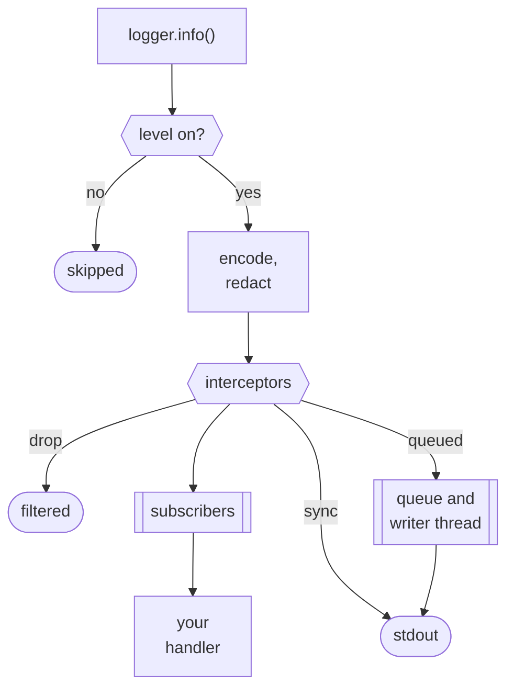

1. **Check.** At compile time, every field must have a type the logger can
   write and a name that is valid and not reserved; fields named like secrets
   are marked for redaction. A mistake is a compile error at the call.
2. **Filter.** The call compares its level with the threshold of its scope.
   Below it, the record is skipped.
3. **Encode.** The record becomes one line of JSON (or of text) of at most
   `max_record_bytes`, with every secret written as `[REDACTED]`.
4. **Hook.** Interceptors may drop the record; subscribers that want its level
   get a copy in queues of their own.
5. **Write.** In sync mode, the call writes the line before it returns. In
   queued mode, it copies the line into a queue and returns; a writer thread
   writes the queue to stdout in batches.

## Installation

Add Zefir to your `build.zig.zon`; log ships since v0.3.0:

```sh
zig fetch --save git+https://github.com/vkiryakov/zefir#v0.4.0
```

Then import the `zefir-log` module in `build.zig`:

```zig
const zefir = b.dependency("zefir", .{
    .target = target,
    .optimize = optimize,
});

const exe = b.addExecutable(.{
    .name = "app",
    .root_module = b.createModule(.{
        .root_source_file = b.path("src/main.zig"),
        .target = target,
        .optimize = optimize,
        .imports = &.{
            .{ .name = "log", .module = zefir.module("zefir-log") },
        },
    }),
});
```

> [!TIP]
> log is also part of the umbrella module: with `zefir.module("zefir")`
> imported as `zefir`, it is `@import("zefir").log`.

## Getting started

A whole program: create the logger at the start of `main`, then log.

**`src/main.zig`**

```zig
const std = @import("std");
const log = @import("log");

pub fn main(init: std.process.Init) !void {
    const logger: log.Logger = try .init(init.gpa, init.io, .{
        .service = .{ .name = "user-service", .version = "1.0.0" },
    });
    defer logger.deinit();

    logger.info("Application started", .{ .port = 9000 });

    const users = logger.scoped("users");
    users.info("User created", .{ .user_id = 42, .email = "ada@example.com", .password = "hunter2" });
    users.warn("Slow query", .{ .table = "users", .ms = 1250 });

    logger.err("Payment failed", .{ .order_id = 1001, .reason = error.CardDeclined });
}
```

Line by line:

- `Logger.init(init.gpa, init.io, …)` creates the logger. It allocates what it
  needs here, once; logging never allocates after this line. `init.io` gives
  it the clock and stdout.
- `.service` names your program. Every JSON record carries it, so the log
  store can tell your services apart.
- `defer logger.deinit()` frees the logger when `main` returns.
- `logger.info("Application started", .{ .port = 9000 })` writes a record at
  the `info` level: the constant message, then the fields.
- `logger.scoped("users")` returns a handle whose records carry
  `"scope":"users"`: they come from the users part of the program.
- `.password` comes out as `[REDACTED]`: its name says it is a secret (see
  [Secrets](#secrets)). An error, such as `error.CardDeclined`, is written by
  its name.

Run it. Each record is one line of JSON:

```text
$ zig build run
{"timestamp":"2026-10-12T09:41:07.415Z","level":"info","message":"Application started","service.name":"user-service","service.version":"1.0.0","port":9000}
{"timestamp":"2026-10-12T09:41:07.415Z","level":"info","message":"User created","service.name":"user-service","service.version":"1.0.0","scope":"users","user_id":42,"email":"ada@example.com","password":"[REDACTED]"}
{"timestamp":"2026-10-12T09:41:07.416Z","level":"warn","message":"Slow query","service.name":"user-service","service.version":"1.0.0","scope":"users","table":"users","ms":1250}
{"timestamp":"2026-10-12T09:41:07.416Z","level":"error","message":"Payment failed","service.name":"user-service","service.version":"1.0.0","order_id":1001,"reason":"CardDeclined"}
```

Lines like these are meant for programs. To read one yourself, pipe the output
through `jq`:

```text
$ zig build run | jq 'select(.message == "User created")'
{
  "timestamp": "2026-10-12T09:41:07.415Z",
  "level": "info",
  "message": "User created",
  "service.name": "user-service",
  "service.version": "1.0.0",
  "scope": "users",
  "user_id": 42,
  "email": "ada@example.com",
  "password": "[REDACTED]"
}
```

Or switch the logger to text with `.format = .text`, which reads well in a
terminal (the service fields are left out):

```text
$ zig build run
2026-10-12T09:41:07.415Z INFO  Application started port=9000
2026-10-12T09:41:07.415Z INFO  [users] User created user_id=42 email=ada@example.com password=[REDACTED]
2026-10-12T09:41:07.416Z WARN  [users] Slow query table=users ms=1250
2026-10-12T09:41:07.416Z ERROR Payment failed order_id=1001 reason=CardDeclined
```

### What a record holds

The keys always come in this order:

| Key                                                                                     | Comes from                                                                    |
| --------------------------------------------------------------------------------------- | ----------------------------------------------------------------------------- |
| `timestamp`                                                                             | the clock of your `io`: RFC 3339, in UTC, with milliseconds                   |
| `level`                                                                                 | the method: `trace`, `debug`, `info`, `warn`, or `err` as `"error"`           |
| `message`                                                                               | the compile-time constant you pass                                            |
| `service.name`, `service.instance.id`, `service.version`, `deployment.environment.name` | `Options.service`, under OpenTelemetry names; empty ones are left out         |
| `scope`                                                                                 | `logger.scoped("users")`, see [Scopes and levels](#scopes-and-levels)         |
| `source`                                                                                | `.src = @src()` among the fields, see [Tracing a request](#tracing-a-request) |
| `trace_id`, `span_id`                                                                   | `logger.withContext(ctx)`, see [Tracing a request](#tracing-a-request)        |
| your fields                                                                             | the fields, in the order you write them                                       |
| `truncated`                                                                             | `true` when the record was cut to `max_record_bytes`, see [Output](#output)   |

## Levels

Every record has a level, which says how important it is:

| Method  | In JSON   | Use it for                                 | For example                          |
| ------- | --------- | ------------------------------------------ | ------------------------------------ |
| `trace` | `"trace"` | the finest detail, while you hunt a bug    | each step of a parser                |
| `debug` | `"debug"` | what helps a developer follow a flow       | a cache miss, why a retry was chosen |
| `info`  | `"info"`  | the normal events of the service           | a user created, an order placed      |
| `warn`  | `"warn"`  | something unusual that the service handled | a slow query, a retry                |
| `err`   | `"error"` | a failure that someone should look at      | a payment failed                     |

The logger writes a record only when its level reaches the threshold, which
is `info` by default. In production, `trace` and `debug` records are skipped.
The threshold can change while the program runs: for the whole program (see
[Changing the level while the program runs](#changing-the-level-while-the-program-runs)),
or for one part of it (see [Scopes and levels](#scopes-and-levels)).

```zig
const logger: log.Logger = try .init(init.gpa, init.io, .{ .level = .info }); // the default
logger.debug("Cache miss", .{ .key = key }); // below the threshold: skipped
```

> [!TIP]
> A skipped record costs one check, but its field values are computed before
> the call, like any arguments. Guard costly ones:
> `if (logger.enabled(.debug)) logger.debug("Cache state", .{ .entries = cache.count() });`

In text, the levels are written as `TRACE`, `DEBUG`, `INFO`, `WARN` and
`ERROR`. A few more things about the calls:

- The message must be a compile-time constant; anything that varies goes in
  the fields.
- A `Logger` is a small handle: copy it, pass it by value and share it between
  threads. `scoped` and `withContext` make more handles of the same logger.
  Call `deinit` once, on any of them.
- Logging never fails and is never a cancelation point: what goes wrong is
  counted in [`stats()`](#failures-and-stats).
- `logger.emergency(...)` writes an error record to stderr at once, for when
  the regular output is stuck; see [Emergency records](#emergency-records).

### Changing the level while the program runs

The threshold is not fixed at start. `logger.setLevel` changes it while the
program runs, from any thread, and every handle sees the change at once. A
common pattern: start verbose, at `debug`, to see every step of the start-up,
then raise the threshold to `info` once the service is up:

```zig
const std = @import("std");
const log = @import("log");

pub fn main(init: std.process.Init) !void {
    const logger: log.Logger = try .init(init.gpa, init.io, .{
        .service = .{ .name = "user-service", .version = "1.0.0" },
        .level = .debug, // start verbose: see every step of the start-up
    });
    defer logger.deinit();

    logger.debug("Reading configuration", .{ .path = "config.json" });
    logger.debug("Connecting to the database", .{ .host = "postgres.internal" });
    logger.info("Application started", .{ .port = 9000 });

    logger.setLevel(.info); // started: from now on, info and above only

    logger.debug("Cache miss", .{ .key = "user:42" }); // below info: not written
    logger.info("User created", .{ .user_id = 42 });
}
```

```text
$ zig build run
{"timestamp":"2026-10-12T09:41:07.415Z","level":"debug","message":"Reading configuration","service.name":"user-service","service.version":"1.0.0","path":"config.json"}
{"timestamp":"2026-10-12T09:41:07.415Z","level":"debug","message":"Connecting to the database","service.name":"user-service","service.version":"1.0.0","host":"postgres.internal"}
{"timestamp":"2026-10-12T09:41:07.416Z","level":"info","message":"Application started","service.name":"user-service","service.version":"1.0.0","port":9000}
{"timestamp":"2026-10-12T09:41:07.416Z","level":"info","message":"User created","service.name":"user-service","service.version":"1.0.0","user_id":42}
```

Both start-up steps are in the log, and `Cache miss` is not: after
`setLevel(.info)`, debug records are skipped.

- The same call goes the other way: `logger.setLevel(.debug)` turns the
  details back on while the service runs, for example from an admin endpoint
  or when the configuration is reloaded. No restart is needed.
- The starting threshold can come from the configuration. With confy, declare
  `log_level: log.Level = .info` in the configuration struct and pass
  `.level = config.log_level`.
- `setLevel` changes the global threshold only: a scope with a rule of its own
  keeps it (see [Scopes and levels](#scopes-and-levels)).

## Fields

Fields carry the data of a record. Write them as a struct literal after the
message, `.{ .user_id = id, .email = email }`: each field becomes a key of the
JSON object, in the order you write them. The logger works out at compile time
how to write each value, from its type:

| Zig type                                             | JSON                                                                 | Text                             |
| ---------------------------------------------------- | -------------------------------------------------------------------- | -------------------------------- |
| `bool`, integers up to 64 bits                       | `true`, `42`                                                         | the same                         |
| wider integers (`u128`…)                             | `"340282366920938463463374607431768211455"`                          | the digits                       |
| floats                                               | the shortest form; NaN and infinities as `"NaN"`, `"+Inf"`, `"-Inf"` | without quotes                   |
| strings (`[]const u8`, `[N]u8`, sentinel-terminated) | escaped; invalid UTF-8 as U+FFFD                                     | bare when safe, else quoted      |
| bytes                                                | `log.hex(&digest)` gives lowercase hex                               | the same                         |
| optionals                                            | `null` or the value                                                  | the same                         |
| enums, errors                                        | by name: `"active"`, `"NotFound"`                                    | the same                         |
| `union(enum)`                                        | `{"running":3}`                                                      | `state.running=3`                |
| structs                                              | objects, in declaration order                                        | dotted keys: `config.db.host=pg` |
| arrays, slices, tuples, vectors                      | arrays                                                               | `[1,2,3]`                        |
| pointers                                             | the value they point to                                              | the same                         |
| `type`                                               | its name                                                             | the same                         |
| a type with `format` (as `{f}` uses it)              | its text, escaped                                                    | the same                         |
| a type with `pub fn logValue(self) U`                | the value it returns, logged by these rules                          | the same                         |

A struct is written whole, nested structs included. Logging the whole
configuration at start-up is a common way to see what a service runs with:

```zig
logger.info("Configuration loaded", .{ .config = config });
```

```json
{"timestamp":"2026-10-12T09:41:07.415Z","level":"info","message":"Configuration loaded","service.name":"billing","service.version":"2.1.0","config":{"port":9000,"database":{"host":"postgres.internal","password":"[REDACTED]","pool":{"min":2,"max":16}},"vault_key":"[REDACTED]","regions":["eu-west","us-east"]}}
```

In text, a struct spreads into dotted keys:

```text
2026-10-12T09:41:07.415Z INFO  Configuration loaded config.port=9000 config.database.host=postgres.internal config.database.password=[REDACTED] config.database.pool.min=2 config.database.pool.max=16 config.vault_key=[REDACTED] config.regions=[eu-west,us-east]
```

Nesting deeper than 8 levels is written as `"[MAX_DEPTH]"`, so a cycle through
pointers ends. A pointer to an opaque type is logged through the type's
`format` or `logValue`, which take `self: *const @This()`.

The logger checks the fields when the program compiles. A field it cannot
write, a field without a name or a name that records use themselves stops the
build, and the error names the field and says what to do:

```zig
logger.info("User created", .{user_id}); // a field without a name
logger.info("Listening", .{ .port = port }); // port is an anyerror!u16
logger.info("Request", .{ .level = 3 }); // a name records use themselves
```

```text
error: zefir.log: fields need names: write .{ .user_id = id }, not .{ id }
error: zefir.log: field 'port': cannot log error union 'anyerror!u16'; handle it with try or catch first, then log the payload or the error
error: zefir.log: field name 'level' is reserved for record metadata; rename it, e.g. 'user_level'
```

<details>
<summary>Everything that is a compile error</summary>

- untagged unions, many-item and C pointers, functions, error unions, `void`
  and `undefined`;
- pointers to opaque types without `format` or `logValue`, such as
  `*anyopaque`;
- positional tuples (`.{ id }`) and names outside `[A-Za-z0-9_.-]`;
- a `core.Context` as a field or as the fields: it goes in
  `withContext(ctx)`;
- a `format` or `logValue` of another form than these, including a `format`
  that can return an error other than `error.WriteFailed` and a `logValue`
  that returns an error union or its own type: it is refused rather than
  skipped, since it may be there to hide fields;
- a marked type, or one with its own form, passed as the whole fields: log it
  as one field, `.{ .key = key }`.

</details>

<details>
<summary>Reserved names</summary>

Names that records use themselves are reserved, also as a dotted path
(`.service = .{ .name = … }` is `service.name`): `timestamp`, `level`,
`message`, `service.name`, `service.instance.id`, `service.version`,
`deployment.environment.name`, `scope`, `source`, `trace_id`, `span_id`,
`truncated`, `request_id`, `correlation_id`, `tenant_id`, `pid`,
`thread_id`, `labels`, `suppressed`, and `src`, which is the call site
(`.source = @src()` is an error that points to `.src`). The subfields of
`source`, `labels` and `src` are reserved too (`.@"source.file"` is an
error); other `service.` names, such as `service.namespace`, are free.

</details>

## Secrets

Logs travel far: to log stores, dashboards, chat alerts, the laptops of
whoever is on call. A password that reaches a log is a leaked password. The
logger hides secrets by two rules, both decided when the program compiles:

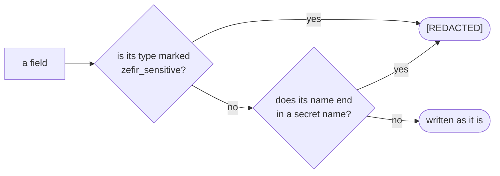

| In your code                                              | In the record                                         |
| --------------------------------------------------------- | ----------------------------------------------------- |
| `.password = "hunter2"`                                   | `"password":"[REDACTED]"`                             |
| `.db_password = pw`, `.newPassword = pw`, `.api_keys = k` | `"[REDACTED]"`, by the name                           |
| `.key = key`, where `key` is a `confy.Secret`             | `"key":"[REDACTED]"`, by the type                     |
| `.config = config`, with `config.database.password`       | `"config":{"database":{…,"password":"[REDACTED]",…}}` |
| `.dsn = uri`, a `std.Uri` with a password                 | `"dsn":"postgres://app:[REDACTED]@db:5432/main"`      |
| `.password_hash = hash`, `.api = .{ .key = k }`           | written as they are                                   |

**By type.** Mark your own secret types with `pub const zefir_sensitive = true;`:

```zig
/// A key from a vault: marked, so the logger never writes it.
const ApiKey = struct {
    value: []const u8,

    pub const zefir_sensitive = true;
};

// A missing or private marker would leak the key: check it at compile time.
comptime {
    std.debug.assert(log.isSensitive(ApiKey));
}

const key: ApiKey = .{ .value = "sk-live-123" };
const backup: ?ApiKey = null;
logger.info("Vault keys loaded", .{ .vault = "payments", .key = key, .backup = backup, .all = &[_]ApiKey{ key, key } });
```

The record (formatted here):

```json
{
  "timestamp": "2026-10-12T09:41:07.416Z",
  "level": "info",
  "message": "Vault keys loaded",
  "service.name": "billing",
  "service.version": "2.1.0",
  "vault": "payments",
  "key": "[REDACTED]",
  "backup": "[REDACTED]",
  "all": "[REDACTED]"
}
```

None of these names is a secret name: the type alone hides them. A marked
value is written as `"[REDACTED]"` also inside an optional, a pointer, a slice
or an array, so neither its presence nor a count leaks: `backup` is `null` and
`all` holds two keys, yet the record shows neither. `confy.Secret` carries the
marker, so a configuration loaded by confy can be logged as it is.

> [!IMPORTANT]
> The marker must be `pub`: the logger cannot see a private one, and the type
> is then written in full. `log.isSensitive(T)` in a `comptime` block, as
> above, turns that mistake into a build error.

**By name.** This rule is a safety net for secrets that lost their type, such
as a password read into a plain `[]const u8`. A field is redacted at any depth
when its name, or one dot-separated part of it, ends in one of these names or
its plural, in any case and with or without `_` and `-`:

> `password` `passwd` `secret` `client_secret` `secret_key`
> `secret_access_key` `aws_secret_access_key` `api_key` `apikey`
> `access_token` `refresh_token` `id_token` `auth_token` `authorization`
> `cookie` `set_cookie` `private_key`

So `db_password`, `newPassword`, `X-Api-Key`, `api_keys`, `db.password` and a
nested `.db = .{ .password = … }` are redacted. The name must start a word: at
the start, after `_` or `-`, or at a capital letter. Other names are written as
they are, close ones too: `password_hash`, `secret_name`, `dbpassword`,
`token`, and `api.key` or `.api = .{ .key = … }`, since a dot or a nested
struct separates names. Give such values a marked type, such as
`confy.Secret`.

> [!WARNING]
> The text a type's own `format` writes is trusted and not redacted; only
> `std.Uri`'s password is, wherever the URL sits. Neither is what std.log
> formats: std.fmt knows no marker, so `{any}` prints a marked type's fields.
> A string you take out of a secret yourself cannot be protected either.

## Scopes and levels

A scope is a name for a part of your program: `db`, `http`, `payments`. Its
records carry it, so in the log store you can look at one part at a time, and
each scope can have a threshold of its own. A dot builds a tree: `db.pool` is
a part of `db`.

Why that matters: production is slow, and you suspect the database pool. You
want its `debug` records, but not those of the whole service, which would
flood the log. So you lower the threshold for `db` alone, while the service
runs, and raise it again when you are done:

```zig
const logger: log.Logger = try .init(init.gpa, init.io, .{
    .service = .{ .name = "user-service", .version = "1.0.0" },
    .level = .info,
    .scopes = &.{.{ .prefix = "db", .level = .warn }},
});
defer logger.deinit();

const pool = logger.scoped("db.pool");
pool.info("Connection opened", .{ .connections = 1 }); // db logs from warn: not written
pool.warn("Pool is almost full", .{ .connections = 19, .max = 20 });

try logger.setScopeLevel("db", .debug); // say, from an admin endpoint
pool.debug("Waiting for a connection", .{ .waiting_ms = 340 });

try logger.setScopeLevel("db", null); // back to the global threshold
pool.debug("Connection reused", .{ .connections = 19 }); // not written again
```

```text
{"timestamp":"2026-10-12T09:41:07.415Z","level":"warn","message":"Pool is almost full","service.name":"user-service","service.version":"1.0.0","scope":"db.pool","connections":19,"max":20}
{"timestamp":"2026-10-12T09:41:07.416Z","level":"debug","message":"Waiting for a connection","service.name":"user-service","service.version":"1.0.0","scope":"db.pool","waiting_ms":340}
```

The threshold of a scope comes from the longest rule that matches its name;
a scope without a rule uses the global threshold:

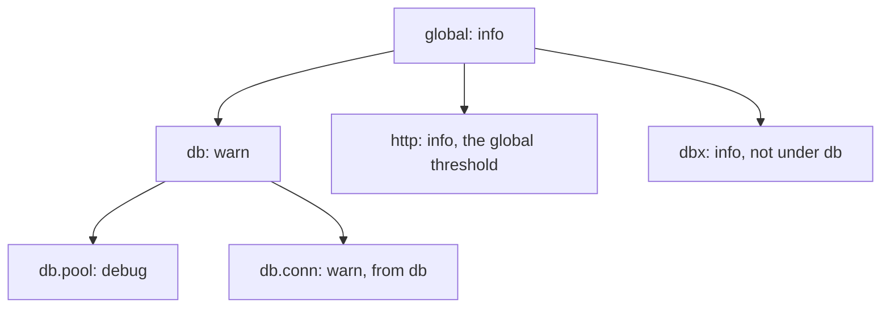

| Call                                 | Does                                                                                                                      |
| ------------------------------------ | ------------------------------------------------------------------------------------------------------------------------- |
| `logger.scoped("db.pool")`           | a handle whose records carry `"scope":"db.pool"`                                                                          |
| `logger.setLevel(.debug)`            | changes the global threshold, see [Changing the level while the program runs](#changing-the-level-while-the-program-runs) |
| `logger.setScopeLevel("db", .err)`   | a rule for `db` and `db.*` (not `dbx`)                                                                                    |
| `logger.setScopeLevel("db", null)`   | removes the rule: back to the global threshold                                                                            |
| `.scopes = &.{ ... }` in the options | the rules the logger starts with                                                                                          |

- Every handle sees a change at once, from any thread. A trailing dot in a
  prefix is ignored.
- The starting rules can come from the configuration: confy can read
  `.scopes` like any other option.
- `scoped` copies the name, so it need not outlive the handle. A handle holds
  one scope, and `scoped` replaces it.

## Tracing a request

A request often crosses several services: a gateway calls the users service,
which calls billing. When something fails, you want every record of that one
request, from every service. W3C Trace Context makes that possible: the first
service picks a trace id, and every service passes it on in the `traceparent`
header, adding a span id of its own.

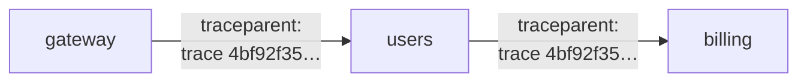

core reads that header into a `core.Context` (see the
[core guide](../../core/examples/README.md)). `withContext(ctx)` gives a handle
whose records carry the ids, and `.src = @src()` among the fields adds where in
the code the record was logged:

```zig
const users = logger.scoped("users").withContext(ctx);
users.info("User created", .{ .src = @src(), .user_id = 42 });
```

```json
{"timestamp":"2026-10-12T09:41:07.416Z","level":"info","message":"User created","service.name":"user-service","service.version":"1.0.0","scope":"users","source":{"file":"users.zig","line":12},"trace_id":"4bf92f3577b34da6a3ce929d0e0e4736","span_id":"00f067aa0ba902b7","user_id":42}
```

Now `trace_id = 4bf92f3577b34da6a3ce929d0e0e4736` in the log store finds this
record together with the gateway's and billing's records of the same request.

- `withContext` copies the trace and span ids of the context; a context
  without a trace gives a handle without them. The context's deadline and
  cancellation do not affect logging.
- It is the way to log a context: a `core.Context` among the fields is a
  compile error.
- `.source` in the options sets how much of the call site each level writes:

| `.source`                  | Writes                                      |
| -------------------------- | ------------------------------------------- |
| `.none`                    | nothing                                     |
| `.file_line` (the default) | `"source":{"file":"users.zig","line":12}`   |
| `.full`                    | the column, the function and the module too |

```zig
.source = .{ .default = .none, .err = .full }, // the call site of error records only, in full
```

## std.log

Libraries, and std itself, log through std.log. Route it into the logger, and
their records land in the same JSON stream, under the same levels and scope
rules:

```zig
pub const std_options: std.Options = .{ .logFn = log.stdLogFn };
...
logger.installStdLog(); // std.log goes to the logger from here on
std.log.scoped(.cache).info("warmed up {d} entries", .{128});
```

```json
{"timestamp":"2026-10-12T09:41:07.416Z","level":"info","message":"warmed up 128 entries","service.name":"billing","service.version":"2.1.0","scope":"cache"}
```

- std.log's scope becomes the record's scope and its formatted text the
  message.
- `deinit` removes the bridge once the logger's threads have exited, so what
  handlers log through std.log while it waits for them still reaches the
  logger. `log.uninstallStdLog()` removes it earlier.
- Both wait for the calls still inside the logger, so `uninstallStdLog` must
  not be called from inside a log call.

> [!NOTE]
> std's own compile-time filter runs first: outside Debug builds,
> `std.log.debug` is compiled out unless `std_options` also sets
> `.log_level = .debug` (or a `.log_scope_levels` entry). std.log's arguments
> are formatted by std.fmt, so redaction does not reach inside them.

## Output

| Option              | Default     | Meaning                                                                 |
| ------------------- | ----------- | ----------------------------------------------------------------------- |
| `.format`           | `.json`     | `.text` writes one line for people, without the service fields          |
| `.output`           | `.stdout`   | `.{ .writer = &writer }` sends records to a writer you own, as tests do |
| `.max_record_bytes` | 4096        | the longest record, `'\n'` included; at most 16384                      |
| `.oversize`         | `.truncate` | what happens to a longer record: `.truncate` or `.drop`                 |

A record that does not fit is cut: the message loses its end, between
characters, the fields that do not fit are left out (the call site too, when
not even the cut message leaves room for it), and the record ends with
`"truncated":true`. Here a 400-byte body did not fit a limit of 320 bytes:

```json
{"timestamp":"2026-10-12T09:41:07.416Z","level":"info","message":"Request received","path":"/v1/users","truncated":true}
```

With `.oversize = .drop`, such a record is not written and is counted
instead.

- `init` refuses a limit too small for what every record may need: 304 bytes
  in JSON plus the service fields as JSON writes them
  (`,"service.name":"api"` adds 21), and 250 in text.
- Every record stays one line of valid JSON: quotes, control characters, line
  and paragraph separators and bidi controls are escaped.

## Sync and queued modes

The mode decides who writes a record to stdout: the thread that logs it, or a
thread of the logger's own.

### Sync mode

`.mode = .sync`, the default. The call encodes the record and writes it to
stdout itself, before it returns. There is no queue and no extra thread, and
when the call returns, the record is out, even if the process crashes right
after. The price: the caller waits for stdout, and callers on different
threads take turns on one lock, so a slow reader of stdout (a terminal, a full
pipe to a log collector) slows down every call.

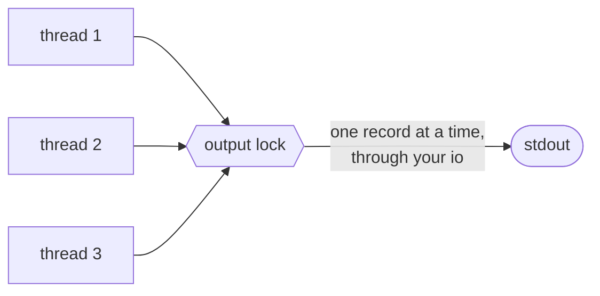

Everything happens on your thread, inside the call:

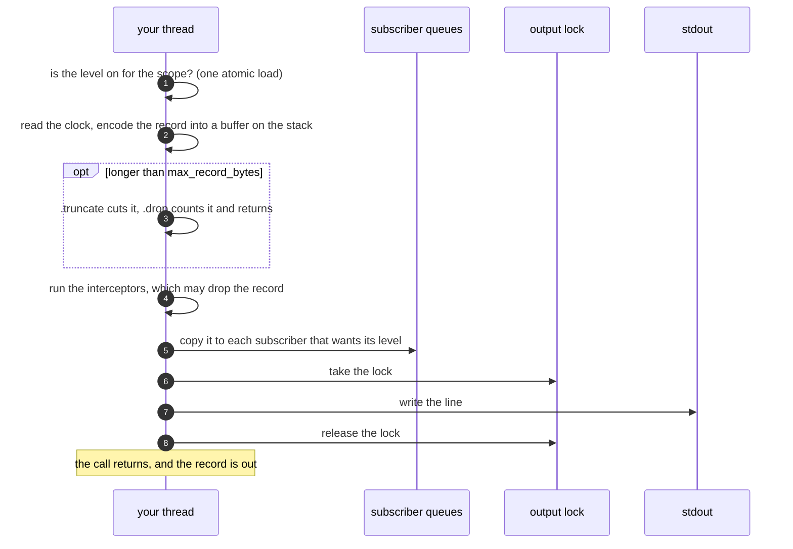

A failed write is counted in `dropped.write_failed`, and the next record
starts on a new line; see [Failures and stats](#failures-and-stats). Use sync
mode for tests, command-line tools and short programs.

### Queued mode

`.mode = .{ .queued = .{} }`. The call encodes the record, copies it into a
lock-free queue in memory and returns at once. A writer thread of the logger
takes the records from the queue and writes them to stdout in batches, one
write for many records. The caller does not wait for stdout (unless the queue
is full and `.overflow = .block`). The price: the queue takes memory, 17 MiB
with the defaults, and the records still in it are lost if the process ends
without [`shutdown`](#stopping).

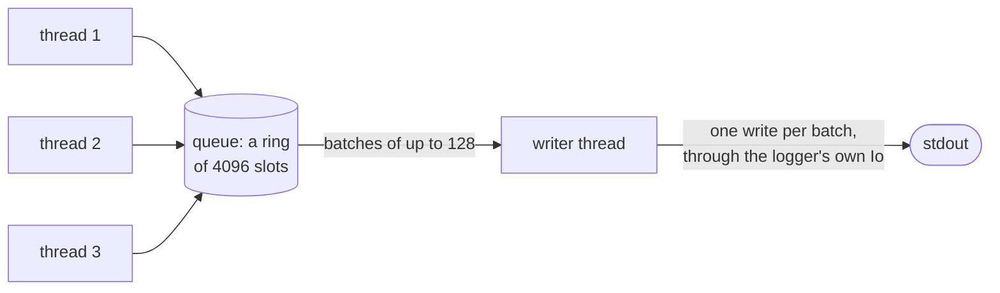

Your thread puts the record into the queue, and the writer thread takes it out:

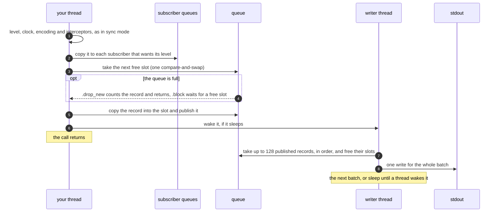

The writer thread runs this loop until `shutdown` has closed the queue and
everything in it is written:

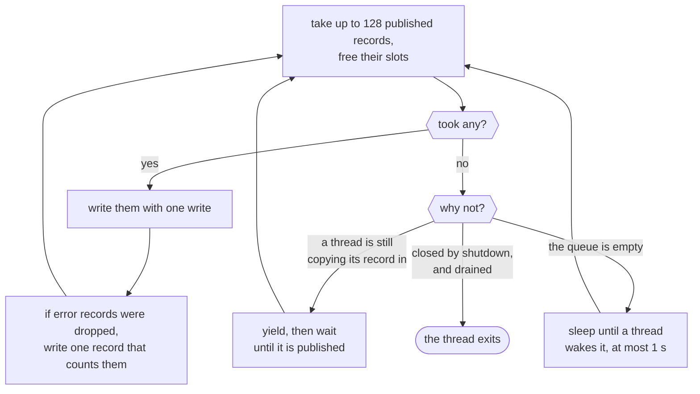

Freeing slots wakes the threads that wait for room in `.block` mode. The record
that counts the dropped error records also goes out before the writer thread
sleeps. Use queued mode for services: a request handler never waits for
stdout.

### Side by side

|                  | `.sync` (default)                           | `.{ .queued = .{} }`                                                   |
| ---------------- | ------------------------------------------- | ---------------------------------------------------------------------- |
| Who writes       | the calling thread, before the call returns | a writer thread of the logger, in batches                              |
| The caller waits | for stdout                                  | only for a copy into the queue                                         |
| Through          | the application's `io`, under a lock        | the logger's own Io; a `.writer` output is called on the writer thread |
| After a crash    | every record that was logged is out         | the records still in the queue are lost                                |
| Memory           | no queue                                    | `Options.queueBytes()`: 17 MiB with the defaults                       |
| Good for         | tests, command-line tools, short programs   | services                                                               |

The queue is set up by these options:

```zig
.mode = .{ .queued = .{
    .capacity = 4096, // records the queue holds: a power of two, at least 2
    .batch_size = 128, // records per write
    .overflow = .drop_new, // or .block
} },
```

| `.overflow`           | When the queue is full                                    |
| --------------------- | --------------------------------------------------------- |
| `.drop_new` (default) | the record is dropped and counted in `dropped.queue_full` |
| `.block`              | the caller waits for room                                 |

> [!WARNING]
> `.block` blocks an OS thread: it is not for event loops, zio tasks or RPC
> workers, and it is not fair among waiters.

Records of one thread keep their order. Records of different threads are
ordered as they took their slots, so timestamps can go back a little between
threads.

<details>
<summary>How the queue works</summary>

A queued call takes a slot with one compare-and-swap, copies the record in and
publishes it: no lock and no system call, unless the writer thread (or the
thread of a subscriber that takes the record) sleeps and has to be woken,
which at low rates is almost every record. Only a producer stopped between
taking a slot and filling it holds back the records after it: they wait, and
none is lost.

</details>

## Stopping

A service is stopped all the time: by a deploy, by scaling down, by a restart.
Kubernetes, for one, sends the process SIGTERM, waits 30 seconds, and then
kills it. In queued mode, the last records may still sit in the queue when the
stop comes, so a service stops in this order:

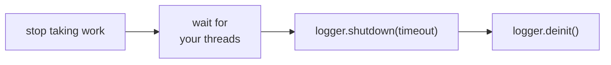

```zig
const deadline: core.Deadline = .after(std.Io.Clock.awake.now(io), .fromSeconds(5));
logger.shutdown(deadline.toTimeout()) catch |e| switch (e) {
    error.Timeout => std.debug.print("log: {d} records not written\n", .{logger.stats().pending}),
};
logger.deinit();
```

`shutdown` refuses new records, lets the subscribers finish, writes the queue
and stops the logger's threads, all within the timeout you give it:

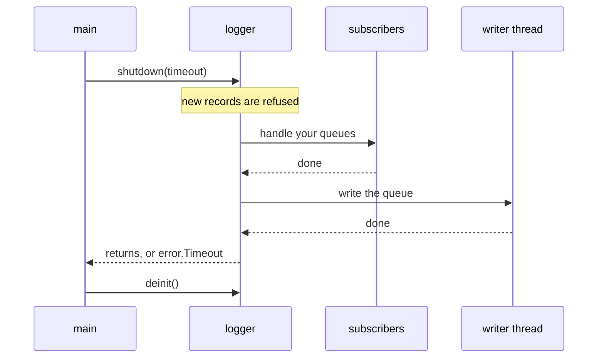

| Call                | Waits until                                                                                                                           | In sync mode                   |
| ------------------- | ------------------------------------------------------------------------------------------------------------------------------------- | ------------------------------ |
| `flush(timeout)`    | every record logged before it is written                                                                                              | returns at once                |
| `shutdown(timeout)` | the subscribers have handled their queues, then the queue is written; later records are refused (`dropped.closed`)                    | waits only for the subscribers |
| `deinit()`          | everything queued is written, with no time limit; after a `shutdown` that timed out, only the write and the handler calls in progress | the same                       |

- `flush` and `shutdown` return `error.Timeout` when the timeout passes first;
  `stats().pending` and `stats().alert_pending` tell what is left. Another
  `shutdown` may wait again.
- If stdout is stuck for good, exit without `deinit`.
- Called from a handler or the writer thread, `flush` and `shutdown` panic in
  safe builds, in sync mode too.

> [!CAUTION]
> Records still queued are lost when the process ends without these steps:
> `std.process.exit`, a panic, a signal. [`emergency`](#emergency-records)
> writes what must be seen even then, before `std.process.exit` or from a panic
> handler. Do not log from a signal handler, `emergency` included: a sync
> record, a queued one in `.block` mode or an emergency record may wait for a
> lock or for room that the interrupted thread holds. Set a flag there, and log
> from a thread of your own.

## Failures and stats

Logging never stops your program. When something goes wrong (the queue is
full, stdout is closed, a write fails), the logger does not return an error to
the code that logged: it counts what happened. `stats()` returns the counters,
from any thread; a service usually shows them on its metrics endpoint.

Say a burst of 10 000 records hits a queue of 64 slots:

```zig
const logger: log.Logger = try .init(init.gpa, init.io, .{
    .mode = .{ .queued = .{ .capacity = 64 } },
});
defer logger.deinit();

for (0..10_000) |i| logger.info("Cache refreshed", .{ .entry = i });
logger.flush(.{ .duration = .{ .raw = .fromSeconds(5), .clock = .awake } }) catch {};

const s = logger.stats();
std.debug.print("accepted {d}, written {d}, dropped because the queue was full {d}\n", .{ s.accepted, s.written, s.dropped.queue_full });
```

```text
accepted 10000, written 9975, dropped because the queue was full 25
```

The writer thread kept up with all but 25 records; a bigger `.capacity`, or
`.overflow = .block`, would have kept them too. All the counters:

| Field                                       | Counts                                                                                                              |
| ------------------------------------------- | ------------------------------------------------------------------------------------------------------------------- |
| `accepted`                                  | records that passed the level filter                                                                                |
| `written`                                   | records that reached the output whole                                                                               |
| `dropped.oversize`                          | too long, with `.oversize = .drop` (error records count in `dropped.err`)                                           |
| `dropped.write_failed`                      | the write failed, or stdout was closed                                                                              |
| `dropped.queue_full`                        | the queue was full, with `.drop_new`                                                                                |
| `dropped.closed`                            | logged after `shutdown`                                                                                             |
| `dropped.err`                               | error records refused for a full queue or after `shutdown`, or too long for `.oversize = .drop`                     |
| `write_errors`, `torn_lines`                | failed writes, and lines they cut short                                                                             |
| `truncated`                                 | records cut to `max_record_bytes`                                                                                   |
| `queue_depth`, `queue_capacity`, `pending`  | records in the queue, its size, records not yet written                                                             |
| `scopes_overflow`, `scope_names_truncated`  | lookups of a scope name past the full table, or cut to 128 bytes: each `scoped` call and each std.log record counts |
| `emergency_written`, `emergency_suppressed` | emergency records written, and left out                                                                             |
| `alert_pending`                             | records waiting in the subscribers' queues                                                                          |
| `alert_dropped`, `alert_failures`           | records a subscriber's queue had no room for, handler errors                                                        |
| `filtered`, `hook_errors`                   | records interceptors dropped on purpose; records dropped because a hook logged them                                 |

Error records are never lost silently. When the queue refuses one, the writer
thread writes a record in its place that counts them, so the log itself says
that errors are missing:

```json
{"timestamp":"2026-10-12T09:41:07.416Z","level":"error","message":"Upstream timeout","attempt":0}
{"timestamp":"2026-10-12T09:41:07.416Z","level":"error","message":"zefir.log: error records dropped","suppressed":28}
{"timestamp":"2026-10-12T09:41:07.416Z","level":"error","message":"Upstream timeout","attempt":1}
```

<details>
<summary>The details</summary>

- The writer thread writes the count after its current batch, or at once when
  it is idle (`flush` does not wait for it). An error record too long for
  `.oversize = .drop` is counted the same way. `shutdown` and `deinit` note on
  stderr the ones it could not report, and in sync mode, which has no writer
  thread, all of them.
- A record dropped for its size reaches no interceptor and no subscriber:
  there is no line to give them.
- A write that fails mid-line tears that line only: the next record written
  starts on a new line. The records of a failed write that did not go out
  whole are dropped and counted in `dropped.write_failed`: in sync mode that
  record, in queued mode the rest of its batch. A `.writer` with a buffer does
  not tell how much went out when it fails, so then all the records of that
  write count as dropped.
- If stdout is closed, the logger notes it once on stderr and drops the
  records that follow; that needs SIGPIPE ignored, as
  `main(init: std.process.Init)` does.
- Apart from these notes, a caller in queued mode never writes to stderr.

</details>

## Emergency records

Sometimes the regular output itself is the problem: stdout is stuck behind a
dead log collector, or the process is about to exit and the queue may never be
written. An emergency record skips everything and goes straight to stderr,
before the call returns:

```zig
logger.emergency("Disk full", .{ .path = "/var/lib/app", .free_bytes = 0 });
```

```text
stderr:
{"timestamp":"2026-10-12T09:41:07.416Z","level":"error","message":"Disk full","path":"/var/lib/app","free_bytes":0}
```

- The record goes past the queue, the interceptors and the subscribers, also
  after `shutdown`, through the logger's own Io.
- At most 100 go out at once and 100 per second after that; the next one
  written tells how many were left out with `"suppressed":N`. A record that
  fits whole is never cut to make room for that count: the next one tells it
  then.
- Not from a signal handler: it takes locks that the interrupted thread may
  hold.

## Subscribers

Most records are read later, when somebody searches the log. Some need a
reaction now: a payment failed, the database is down. A subscriber is your
function that the logger calls for each record of the levels you choose, and,
if you like, of one part of the program. It runs on a thread of its own, so
the code that logged the record does not wait for it. Typical subscribers post
to Slack or to a pager, count errors for a metrics endpoint, or keep the last
errors for a debug page.

### Example: payment errors to Slack

The payments part of an orders service logs an error when a charge fails. The
team wants each such error in a Slack channel. Slack gives a channel an
incoming webhook: a URL, and whatever JSON is posted to it appears in the
channel. Anyone who has the URL can post to the channel, so it is a secret:
the program reads it with [confy](../../confy/examples/README.md), as a
`confy.Secret`, together with the log level. Add confy to the imports in
`build.zig`, next to log:

```zig
.{ .name = "confy", .module = zefir.module("zefir-confy") },
```

The whole program:

```zig
const std = @import("std");
const confy = @import("confy");
const log = @import("log");

const Config = struct {
    log_level: log.Level = .info,
    slack: struct {
        webhook_url: confy.Secret,
    },
};

/// Posts error records to a Slack channel through an incoming webhook.
const SlackAlerts = struct {
    gpa: std.mem.Allocator,
    http: std.http.Client,
    webhook_url: confy.Secret,

    /// The handler. The logger calls it on the subscriber's own thread, once
    /// per record, so a slow post holds up no request.
    fn send(context: ?*anyopaque, event: *const log.Event) anyerror!void {
        const slack: *SlackAlerts = @ptrCast(@alignCast(context.?));
        // event.line is the record as stdout gets it, secrets already redacted.
        const text = try std.fmt.allocPrint(slack.gpa, ":rotating_light: *{s}* in `{s}`\n```{s}```", .{ event.message, event.scope, event.line });
        defer slack.gpa.free(text);
        const body = try std.json.Stringify.valueAlloc(slack.gpa, .{ .text = text }, .{});
        defer slack.gpa.free(body);
        const response = try slack.http.fetch(.{
            .location = .{ .url = slack.webhook_url.expose() },
            .payload = body, // a payload makes it a POST
            .headers = .{ .content_type = .{ .override = "application/json" } },
        });
        if (response.status != .ok) return error.SlackRejected;
    }
};

pub fn main(init: std.process.Init) !void {
    var config: Config = undefined;
    confy.loadOrExit(init.arena.allocator(), &config, .{
        .io = init.io,
        .environ = init.environ_map,
        .env_prefix = "APP_",
        .sources = &.{ .env(".env"), .osEnv() },
    });

    const logger: log.Logger = try .init(init.gpa, init.io, .{
        .service = .{ .name = "orders", .version = "3.0.0" },
        .level = config.log_level,
        .mode = .{ .queued = .{} },
    });
    defer logger.deinit();

    var slack: SlackAlerts = .{
        .gpa = init.gpa,
        .http = .{ .allocator = init.gpa, .io = init.io },
        .webhook_url = config.slack.webhook_url,
    };
    defer slack.http.deinit();

    const alerts = try logger.subscribe(.{
        .levels = &.{.err}, // error records only
        .scope = "payments", // from payments and its subscopes only
        .context = &slack,
        .handler = SlackAlerts.send,
    });
    defer logger.unsubscribe(alerts); // runs first: before the client and the logger go

    const payments = logger.scoped("payments");
    payments.info("Charge started", .{ .order_id = 7, .amount_cents = 4200 });
    payments.err("Charge declined", .{ .order_id = 7, .reason = "card_expired" });
    logger.scoped("http").err("Upstream timeout", .{ .path = "/v1/orders" }); // another scope: not sent
}
```

Put the URL Slack gave you in `.env`, next to the program, and keep that file
out of git:

```sh
APP_SLACK_WEBHOOK_URL=https://hooks.slack.com/services/T000/B000/XXXX
```

Run it:

```text
$ zig build run
{"timestamp":"2026-10-12T09:41:07.415Z","level":"info","message":"Charge started","service.name":"orders","service.version":"3.0.0","scope":"payments","order_id":7,"amount_cents":4200}
{"timestamp":"2026-10-12T09:41:07.416Z","level":"error","message":"Charge declined","service.name":"orders","service.version":"3.0.0","scope":"payments","order_id":7,"reason":"card_expired"}
{"timestamp":"2026-10-12T09:41:07.416Z","level":"error","message":"Upstream timeout","service.name":"orders","service.version":"3.0.0","scope":"http","path":"/v1/orders"}
```

stdout gets all three records, as always. The webhook gets one post, for the
error in `payments`:

```json
{"text":":rotating_light: *Charge declined* in `payments`\n```{\"timestamp\":\"2026-10-12T09:41:07.416Z\",\"level\":\"error\",\"message\":\"Charge declined\",\"service.name\":\"orders\",\"service.version\":\"3.0.0\",\"scope\":\"payments\",\"order_id\":7,\"reason\":\"card_expired\"}```"}
```

And the channel shows:

```text
🚨 Charge declined in `payments`
{"timestamp":"2026-10-12T09:41:07.416Z","level":"error","message":"Charge declined","service.name":"orders","service.version":"3.0.0","scope":"payments","order_id":7,"reason":"card_expired"}
```

Without the URL, the service does not start, and confy says what to set:

```text
$ zig build run
error(confy): 1 configuration problem:
  slack.webhook_url: missing (set APP_SLACK_WEBHOOK_URL)
```

What happens, step by step:

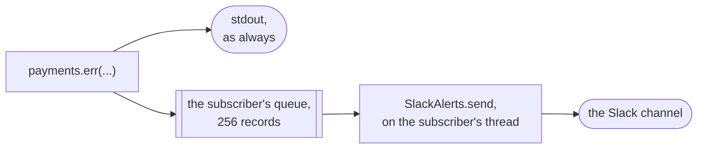

1. `confy.loadOrExit` reads `.env` and the environment into `Config`. The URL
   stays a `confy.Secret`: logging `config` would write it as `[REDACTED]`.
2. `subscribe` registers the handler with its filter, `.err` records of
   `payments` and its subscopes, starts the subscriber's thread and gives it a
   queue of 256 records.
3. `payments.err(...)` goes through the level filter and the encoding as
   usual. The logger sees that this subscriber wants the record and copies it
   into the subscriber's queue (a copy, no waiting), then writes it to stdout.
4. The subscriber's thread takes the record from its queue and calls
   `SlackAlerts.send`. The post takes as long as Slack needs; the code that
   logged the error has long gone on.
5. The `http` error reaches no subscriber: its scope is not `payments`.
6. At the end of `main`, `unsubscribe` waits until the queue is empty, so the
   last alert is posted, and stops the thread.

The handler gets an `Event`, valid only during the call:

| Field                 | Holds                                                                     |
| --------------------- | ------------------------------------------------------------------------- |
| `level`               | the record's level                                                        |
| `timestamp`           | when the record was logged                                                |
| `scope`               | the scope, as the record writes it; empty without one                     |
| `message`             | the message, as the record writes it: escaped, and cut when the record is |
| `trace_id`, `span_id` | the trace ids, when the record has them                                   |
| `line`                | the whole record, without its final `'\n'`, redacted as the output is     |

When things go wrong:

- **Slack is down, or answers with an error.** The handler returns the error;
  the logger counts it in `stats().alert_failures` and goes on with the next
  record. It does not retry: retry in the handler if you need to.
- **Errors come faster than Slack takes them.** The subscriber's queue fills
  up, and the subscriber misses the records that find no room (counted in
  `stats().alert_dropped`); stdout still gets every one. Raise `.capacity` in
  the subscription for bursts.
- **The record is too long for `.oversize = .drop`.** No subscriber gets it:
  there is no line to give.

The rules:

- A subscriber gets the records of its levels (and scope, with its subscopes)
  that pass the logger's level filter. It gets them before the output, so an
  error record reaches it even when the queue refuses it or stdout is closed.
- Each subscriber has a queue (`capacity`, 256 records by default; a slot is
  `max_record_bytes` + 112 bytes, rounded up to 128) and a thread of its own,
  so a slow handler holds up nobody else.
- `unsubscribe` waits until the subscriber has handled its queue (with no time
  limit while the logger runs; once `shutdown` has begun, only for the call in
  hand). After it returns, the handler is never called again. Call it before
  the context goes, and before `deinit`. A logger takes 8 subscribers in its
  life.

> [!WARNING]
> A handler may log: what it logs on its own thread goes to the output only,
> never back to the subscribers, so its records cannot trigger it again (while
> `shutdown` waits for the subscribers, they still go out). Threads and Io
> tasks it hands work to (`io.async`, `io.concurrent`, a worker of yours) log
> like any caller, so their error records do reach the subscribers and can
> loop: log such a failure from the handler after `await`, or return it. A
> handler must not call `unsubscribe`, `flush` or `shutdown`: that panics in
> safe builds.

> [!NOTE]
> The handler runs on the subscriber's thread, which is not a task of your
> `io`. The example uses `init.io`, a `std.Io.Threaded`, which serves any
> thread. Under an evented `io`, give the notifier a `std.Io.Threaded` of its
> own; see [Threads and Io](#threads-and-io).

## Interceptors

An interceptor sees every record before it is written, and decides whether it
is written at all. Use one to drop noise: health checks, a chatty library, the
records of a test tenant.

### Example: drop health checks

Kubernetes checks a service by calling `GET /health` every few seconds. If the
service logs every request, the log fills up with health checks. Drop them:

```zig
const std = @import("std");
const log = @import("log");

/// Kubernetes asks GET /health every few seconds: these records are noise.
fn dropHealthChecks(_: ?*anyopaque, event: *const log.Event) bool {
    return !std.mem.eql(u8, event.scope, "http.health"); // false drops the record
}

pub fn main(init: std.process.Init) !void {
    const logger: log.Logger = try .init(init.gpa, init.io, .{
        .service = .{ .name = "orders", .version = "3.0.0" },
    });
    defer logger.deinit();
    try logger.use(.{ .filter = dropHealthChecks });

    const health = logger.scoped("http.health");
    const orders = logger.scoped("orders");
    health.info("GET /health", .{ .status = 200 });
    orders.info("Order placed", .{ .order_id = 7, .total_cents = 4200 });
    health.info("GET /health", .{ .status = 200 });

    std.debug.print("filtered: {d}\n", .{logger.stats().filtered});
}
```

```text
$ zig build run
{"timestamp":"2026-10-12T09:41:07.415Z","level":"info","message":"Order placed","service.name":"orders","service.version":"3.0.0","scope":"orders","order_id":7,"total_cents":4200}
filtered: 2
```

Only the order is written; both health checks were dropped and counted.

- An interceptor runs at the caller, for every record that passes the level
  filter, once the record is encoded (a record too long for
  `.oversize = .drop` never is), in the order they were added.
- `false` drops the record everywhere: no subscriber and no output get it.
  It is counted in `filtered`.
- It must be quick and must not block or log: a record logged from it is
  dropped (`hook_errors`).
- It stays until `deinit`, as none can be removed: its context, and whatever
  its filter reads, must outlive the logger. A logger takes 8.

Subscribers and interceptors side by side:

|                   | Subscriber                          | Interceptor                               |
| ----------------- | ----------------------------------- | ----------------------------------------- |
| Runs              | later, on a thread of its own       | at once, inside the log call              |
| Sees              | the records of its levels and scope | every record that passes the level filter |
| Can drop a record | no                                  | yes, everywhere                           |
| May be slow       | yes                                 | no                                        |
| Typical use       | Slack, a pager, metrics             | dropping noise                            |

## Threads and Io

The logger works with the `std.Io` you give it, and with threads of its own:

- **Your `io`** reads the clock and, in sync mode, writes stdout. Log from
  threads or tasks of that `io`; with `std.Io.Threaded`, which
  `main(init: std.process.Init)` gives you, that is any thread.
- **The logger's own threads**, the writer thread and one per subscriber, run
  on a `std.Io.Threaded` the logger creates for itself, and so do its waits
  for them; those waits keep a cancel request for the caller's task.
- **A handler that logs** writes through that own Io too. In sync mode, under
  an application `io` that is not a `std.Io.Threaded` (an evented one), it
  could not share the output lock with the application's tasks, so those
  records are dropped and counted in `hook_errors`: use queued mode there.
- **One logger per process.** Two loggers on one stdout do not coordinate
  their writes.

> [!IMPORTANT]
> The logger's threads are not tasks of your `io`: a handler runs on its
> subscriber's thread, and in queued mode the writer thread calls a `.writer`
> output. Under an evented `io`, make their calls through an `Io` that serves
> any thread, such as a `std.Io.Threaded` of their own: a handler must not post
> through the evented `io`, and a `File.Writer` made with it must not be the
> queued output.

## Limits

| Limit                     | Value                                                                                                            |
| ------------------------- | ---------------------------------------------------------------------------------------------------------------- |
| Record                    | at most 16384 bytes with `'\n'`, 4096 by default; at least 304 in JSON, plus the service fields, and 250 in text |
| Service fields            | 1 KiB together                                                                                                   |
| Scope names               | 256 per logger, 128 bytes each (longer ones are cut)                                                             |
| Scope rules               | 64                                                                                                               |
| Nesting                   | 8 levels                                                                                                         |
| Queue                     | a power of two, at least 2 records                                                                               |
| Subscribers, interceptors | 8 subscribers and 8 interceptors in the logger's life                                                            |
| Emergency records         | 100 at once, then 100 per second                                                                                 |
| Targets                   | 64-bit: the counters and queue positions are 64-bit atomics                                                      |

## Performance

```sh
zig build bench
```

builds `src/log/bench.zig` with ReleaseFast and runs it; it also runs core's
benchmarks. The scenarios cover sync and queued modes with 1 to 16 producers,
real outputs, record sizes, batch sizes, hooks and bursts. For each, it prints
the calls per second, the records written per second, the latency of one call
(p50, p99, p99.9), the records dropped, the CPU time per call and the memory
the logger allocated. A record goes to a writer that throws it away unless a
scenario says otherwise, so the numbers measure the logger rather than a
terminal. The typical record is a request log of 185 bytes of JSON.

> [!NOTE]
> The numbers will be published here once they are measured on an idle
> machine: the first run shared the machine with other heavy work, so its
> numbers said more about that load than about the logger. Until then, run the
> command on your machine.
