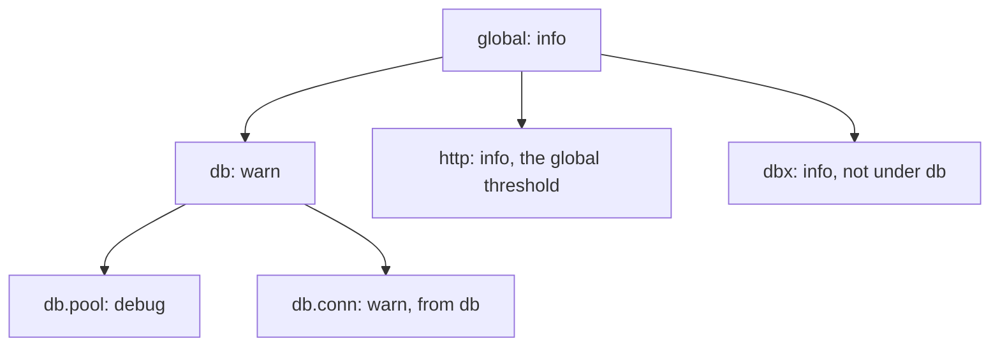
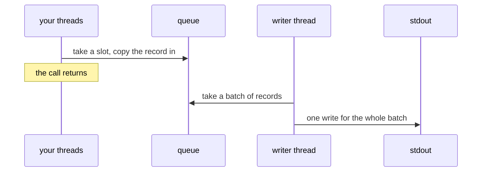
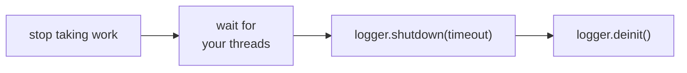
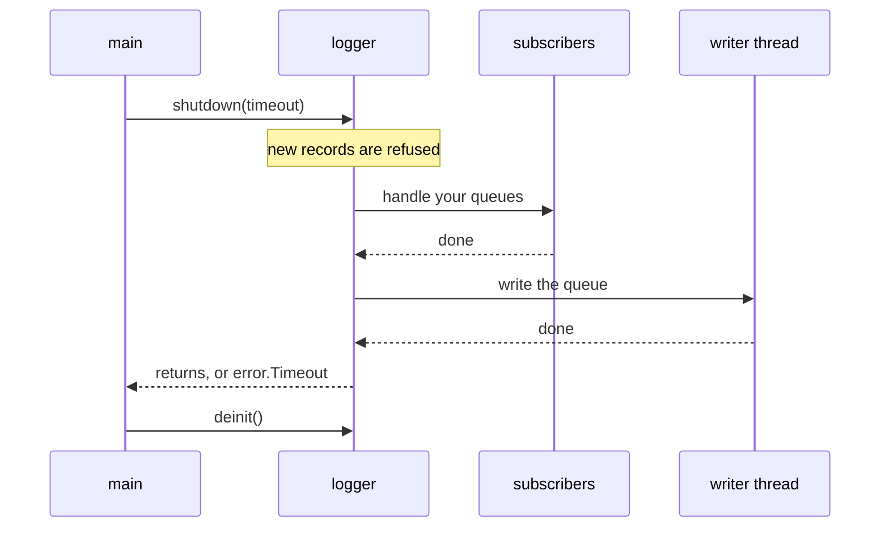
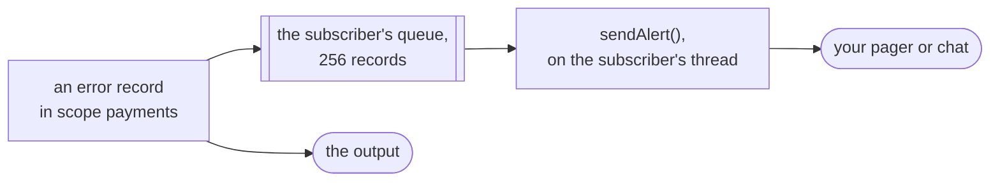

# log

**Structured logging for Zig services.** Every record is one line of JSON on
stdout, the format log collectors read: a constant message and typed fields.
Fields are checked when the program compiles, secrets come out as
`[REDACTED]`, and levels change while the service runs. In production, a
lock-free queue and a writer thread keep stdout off your request path.

```zig
const logger: log.Logger = try .init(init.gpa, init.io, .{
    .service = .{ .name = "user-service", .version = "1.0.0" },
    .mode = .{ .queued = .{} },
});
defer logger.deinit();

const users = logger.scoped("users");
users.info("User created", .{ .user_id = 42, .email = "ada@example.com", .password = password });
```

The record, one line on stdout (formatted here):

```json
{
  "timestamp": "2026-10-12T09:41:07.416Z",
  "level": "info",
  "message": "User created",
  "service.name": "user-service",
  "service.version": "1.0.0",
  "scope": "users",
  "user_id": 42,
  "email": "ada@example.com",
  "password": "[REDACTED]"
}
```

- **Checked at compile time.** A value that cannot be logged, a field without
  a name or a reserved name fails the build, and the error names the field.
- **Secrets stay out.** `confy.Secret`, any type marked sensitive, and fields
  named like `password` or `api_key` are written as `[REDACTED]`.
- **Live levels.** Change the global level, or one scope's, from any thread;
  every handle sees it at once.
- **Out of the way.** Logging never allocates after `init` and never returns
  an error. In queued mode, a call copies the record into a queue and goes on.
- **Alerts and filters.** Subscribers get error records on threads of their
  own; interceptors drop the noise before it is written.
- **One stream.** std.log, from your code and from your libraries, goes
  through the same logger.

## Contents

- [How it works](#how-it-works)
- [Installation](#installation)
- [Getting started](#getting-started)
- [Logging](#logging)
- [Fields](#fields)
- [Secrets](#secrets)
- [Scopes and levels](#scopes-and-levels)
- [Context and call site](#context-and-call-site)
- [std.log](#stdlog)
- [Output](#output)
- [Sync and queued modes](#sync-and-queued-modes)
- [Stopping](#stopping)
- [Failures and stats](#failures-and-stats)
- [Emergency records](#emergency-records)
- [Subscribers](#subscribers)
- [Interceptors](#interceptors)
- [Threads and Io](#threads-and-io)
- [Limits](#limits)
- [Performance](#performance)

Examples that `zig build test` compiles and runs:
[a service's main](service.zig) · [nested configuration, std.log and a trace](config.zig) · [queued mode with alerts](alerts.zig)

## How it works


1. **Check.** At compile time, every field must have a type the logger can
   write and a name that is valid and not reserved; fields named like secrets
   are marked for redaction. A mistake is a compile error at the call.
2. **Filter.** The call compares its level with the threshold of its scope.
   Below it, the record is skipped.
3. **Encode.** The record becomes one line of JSON (or of text) of at most
   `max_record_bytes`, with every secret written as `[REDACTED]`.
4. **Hook.** Interceptors may drop the record; subscribers that want its level
   get a copy in queues of their own.
5. **Write.** In sync mode, the call writes the line before it returns. In
   queued mode, it copies the line into a queue and returns; a writer thread
   writes the queue to stdout in batches.

## Installation

Add Zefir to your `build.zig.zon`. The log module is on the `dev` branch
until the next release:

```sh
zig fetch --save git+https://github.com/vkiryakov/zefir#dev
```

Then import the `zefir-log` module in `build.zig`:

```zig
const zefir = b.dependency("zefir", .{
    .target = target,
    .optimize = optimize,
});

const exe = b.addExecutable(.{
    .name = "app",
    .root_module = b.createModule(.{
        .root_source_file = b.path("src/main.zig"),
        .target = target,
        .optimize = optimize,
        .imports = &.{
            .{ .name = "log", .module = zefir.module("zefir-log") },
        },
    }),
});
```

> [!TIP]
> log is also part of the umbrella module: with `zefir.module("zefir")`
> imported as `zefir`, it is `@import("zefir").log`.

## Getting started

Create the logger at the start of `main` and log with constant messages and
named fields:

**`src/main.zig`**

```zig
const std = @import("std");
const log = @import("log");

pub fn main(init: std.process.Init) !void {
    const logger: log.Logger = try .init(init.gpa, init.io, .{
        .service = .{ .name = "user-service", .version = "1.0.0" },
    });
    defer logger.deinit();

    logger.info("Application started", .{ .port = 9000 });

    const users = logger.scoped("users");
    users.info("User created", .{ .user_id = 42, .email = "ada@example.com", .password = "hunter2" });
    users.warn("Slow query", .{ .table = "users", .ms = 1250 });

    logger.err("Payment failed", .{ .order_id = 1001, .reason = error.CardDeclined });
}
```

Each record is one line of JSON, ready for a log collector:

```text
$ zig build run
{"timestamp":"2026-10-12T09:41:07.415Z","level":"info","message":"Application started","service.name":"user-service","service.version":"1.0.0","port":9000}
{"timestamp":"2026-10-12T09:41:07.415Z","level":"info","message":"User created","service.name":"user-service","service.version":"1.0.0","scope":"users","user_id":42,"email":"ada@example.com","password":"[REDACTED]"}
{"timestamp":"2026-10-12T09:41:07.416Z","level":"warn","message":"Slow query","service.name":"user-service","service.version":"1.0.0","scope":"users","table":"users","ms":1250}
{"timestamp":"2026-10-12T09:41:07.416Z","level":"error","message":"Payment failed","service.name":"user-service","service.version":"1.0.0","order_id":1001,"reason":"CardDeclined"}
```

One record, through `jq`:

```text
$ zig build run | jq 'select(.message == "User created")'
{
  "timestamp": "2026-10-12T09:41:07.415Z",
  "level": "info",
  "message": "User created",
  "service.name": "user-service",
  "service.version": "1.0.0",
  "scope": "users",
  "user_id": 42,
  "email": "ada@example.com",
  "password": "[REDACTED]"
}
```

With `.format = .text`, the same records read well in a terminal (the service
fields are left out):

```text
$ zig build run
2026-10-12T09:41:07.415Z INFO  Application started port=9000
2026-10-12T09:41:07.415Z INFO  [users] User created user_id=42 email=ada@example.com password=[REDACTED]
2026-10-12T09:41:07.416Z WARN  [users] Slow query table=users ms=1250
2026-10-12T09:41:07.416Z ERROR Payment failed order_id=1001 reason=CardDeclined
```

### What a record holds

The keys always come in this order:

| Key                                                                                     | Comes from                                                            |
| --------------------------------------------------------------------------------------- | --------------------------------------------------------------------- |
| `timestamp`                                                                             | the clock of your `io`: RFC 3339, in UTC, with milliseconds           |
| `level`                                                                                 | the method: `trace`, `debug`, `info`, `warn`, or `err` as `"error"`   |
| `message`                                                                               | the compile-time constant you pass                                    |
| `service.name`, `service.instance.id`, `service.version`, `deployment.environment.name` | `Options.service`, under OpenTelemetry names; empty ones are left out |
| `scope`                                                                                 | `logger.scoped("users")`                                              |
| `source`                                                                                | `.src = @src()` among the fields                                      |
| `trace_id`, `span_id`                                                                   | `logger.withContext(ctx)`                                             |
| your fields                                                                             | the fields, in declaration order                                      |
| `truncated`                                                                             | `true` when the record was cut to `max_record_bytes`                  |

## Logging

```zig
logger.info("User created", .{ .user_id = id });
```

| Method  | JSON      | Text    |
| ------- | --------- | ------- |
| `trace` | `"trace"` | `TRACE` |
| `debug` | `"debug"` | `DEBUG` |
| `info`  | `"info"`  | `INFO`  |
| `warn`  | `"warn"`  | `WARN`  |
| `err`   | `"error"` | `ERROR` |

- The message is a compile-time constant; anything that varies goes in the
  fields, a struct literal.
- `Logger.init(gpa, io, options)` creates the logger, and logging allocates
  nothing after it (only `subscribe` allocates again). `deinit` frees it;
  call it once, on any handle.
- A `Logger` is a small handle: copy it, pass it by value and share it between
  threads. `scoped` and `withContext` derive more of them.
- Logging never fails and is never a cancelation point: problems are counted
  in [`stats()`](#failures-and-stats).
- `logger.enabled(.debug)` tells whether a record at that level would be
  written; `logger.emergency(...)` writes an error record to stderr at once,
  see [Emergency records](#emergency-records).

> [!TIP]
> Field values are computed even when the level is off. Check
> `logger.enabled(level)` before costly ones.

## Fields

| Zig type                                             | JSON                                                                 | Text                             |
| ---------------------------------------------------- | -------------------------------------------------------------------- | -------------------------------- |
| `bool`, integers up to 64 bits                       | `true`, `42`                                                         | the same                         |
| wider integers (`u128`…)                             | `"340282366920938463463374607431768211455"`                          | the digits                       |
| floats                                               | the shortest form; NaN and infinities as `"NaN"`, `"+Inf"`, `"-Inf"` | without quotes                   |
| strings (`[]const u8`, `[N]u8`, sentinel-terminated) | escaped; invalid UTF-8 as U+FFFD                                     | bare when safe, else quoted      |
| bytes                                                | `log.hex(&digest)` gives lowercase hex                               | the same                         |
| optionals                                            | `null` or the value                                                  | the same                         |
| enums, errors                                        | by name: `"active"`, `"NotFound"`                                    | the same                         |
| `union(enum)`                                        | `{"running":3}`                                                      | `state.running=3`                |
| structs                                              | objects, in declaration order                                        | dotted keys: `config.db.host=pg` |
| arrays, slices, tuples, vectors                      | arrays                                                               | `[1,2,3]`                        |
| pointers                                             | the value they point to                                              | the same                         |
| `type`                                               | its name                                                             | the same                         |
| a type with `format` (as `{f}` uses it)              | its text, escaped                                                    | the same                         |
| a type with `pub fn logValue(self) U`                | the value it returns, logged by these rules                          | the same                         |

A struct is written whole, nested structs included:

```zig
logger.info("Configuration loaded", .{ .config = config });
```

```json
{"timestamp":"2026-10-12T09:41:07.415Z","level":"info","message":"Configuration loaded","service.name":"billing","service.version":"2.1.0","config":{"port":9000,"database":{"host":"postgres.internal","password":"[REDACTED]","pool":{"min":2,"max":16}},"vault_key":"[REDACTED]","regions":["eu-west","us-east"]}}
```

```text
2026-10-12T09:41:07.415Z INFO  Configuration loaded config.port=9000 config.database.host=postgres.internal config.database.password=[REDACTED] config.database.pool.min=2 config.database.pool.max=16 config.vault_key=[REDACTED] config.regions=[eu-west,us-east]
```

Nesting deeper than 8 levels is written as `"[MAX_DEPTH]"`, so a cycle through
pointers ends. A pointer to an opaque type is logged through the type's
`format` or `logValue`, which take `self: *const @This()`.

What cannot be logged is a compile error at the call, and the error names the
field:

```zig
logger.info("User created", .{user_id}); // a field without a name
logger.info("Listening", .{ .port = port }); // port is an anyerror!u16
logger.info("Request", .{ .level = 3 }); // a name records use themselves
```

```text
error: zefir.log: fields need names: write .{ .user_id = id }, not .{ id }
error: zefir.log: field 'port': cannot log error union 'anyerror!u16'; handle it with try or catch first, then log the payload or the error
error: zefir.log: field name 'level' is reserved for record metadata; rename it, e.g. 'user_level'
```

<details>
<summary>Everything that is a compile error</summary>

- untagged unions, many-item and C pointers, functions, error unions, `void`
  and `undefined`;
- pointers to opaque types without `format` or `logValue`, such as
  `*anyopaque`;
- positional tuples (`.{ id }`) and names outside `[A-Za-z0-9_.-]`;
- a `core.Context` as a field or as the fields: it goes in
  `withContext(ctx)`;
- a `format` or `logValue` of another form than these, including a `format`
  that can return an error other than `error.WriteFailed` and a `logValue`
  that returns an error union or its own type: it is refused rather than
  skipped, since it may be there to hide fields;
- a marked type, or one with its own form, passed as the whole fields: log it
  as one field, `.{ .key = key }`.

</details>

<details>
<summary>Reserved names</summary>

Names that records use themselves are reserved, also as a dotted path
(`.service = .{ .name = … }` is `service.name`): `timestamp`, `level`,
`message`, `service.name`, `service.instance.id`, `service.version`,
`deployment.environment.name`, `scope`, `source`, `trace_id`, `span_id`,
`truncated`, `request_id`, `correlation_id`, `tenant_id`, `pid`,
`thread_id`, `labels`, `suppressed`, and `src`, which is the call site
(`.source = @src()` is an error that points to `.src`). The subfields of
`source`, `labels` and `src` are reserved too (`.@"source.file"` is an
error); other `service.` names, such as `service.namespace`, are free.

</details>

## Secrets

Two rules decide what is hidden, both when the program compiles:


| In your code                                              | In the record                                         |
| --------------------------------------------------------- | ----------------------------------------------------- |
| `.password = "hunter2"`                                   | `"password":"[REDACTED]"`                             |
| `.db_password = pw`, `.newPassword = pw`, `.api_keys = k` | `"[REDACTED]"`, by the name                           |
| `.key = key`, where `key` is a `confy.Secret`             | `"key":"[REDACTED]"`, by the type                     |
| `.config = config`, with `config.database.password`       | `"config":{"database":{…,"password":"[REDACTED]",…}}` |
| `.dsn = uri`, a `std.Uri` with a password                 | `"dsn":"postgres://app:[REDACTED]@db:5432/main"`      |
| `.password_hash = hash`, `.api = .{ .key = k }`           | written as they are                                   |

**By type.** A type marked `pub const zefir_sensitive = true;` is written as
`"[REDACTED]"`, also inside an optional, a pointer, a slice or an array, so
neither its presence nor a count leaks. `confy.Secret` carries the marker, and
`log.isSensitive(T)` tells whether a type has it.

**By name.** A field is redacted at any depth when its name, or one
dot-separated part of it, ends in one of these names or its plural, in any
case and with or without `_` and `-`:

> `password` `passwd` `secret` `client_secret` `secret_key`
> `secret_access_key` `aws_secret_access_key` `api_key` `apikey`
> `access_token` `refresh_token` `id_token` `auth_token` `authorization`
> `cookie` `set_cookie` `private_key`

So `db_password`, `newPassword`, `X-Api-Key`, `api_keys`, `db.password` and a
nested `.db = .{ .password = … }` are redacted. The name must start a word: at
the start, after `_` or `-`, or at a capital letter. Other names are written as
they are, close ones too: `password_hash`, `secret_name`, `dbpassword`,
`token`, and `api.key` or `.api = .{ .key = … }`, since a dot or a nested
struct separates names. Give such values a marked type, such as
`confy.Secret`.

> [!WARNING]
> The text a type's own `format` writes is trusted and not redacted; only
> `std.Uri`'s password is, wherever the URL sits. Neither is what std.log
> formats: std.fmt knows no marker, so `{any}` prints a marked type's fields.
> A string you take out of a secret yourself cannot be protected either.

## Scopes and levels

Each record is written when its level reaches the threshold of its scope. The
longest matching prefix sets the threshold, and scopes without a rule use the
global one:



```zig
const logger: log.Logger = try .init(init.gpa, init.io, .{
    .level = .info,
    .scopes = &.{
        .{ .prefix = "db", .level = .warn },
        .{ .prefix = "db.pool", .level = .debug },
    },
});

const pool = logger.scoped("db.pool"); // records carry "scope":"db.pool"
logger.setLevel(.debug); // the global threshold
try logger.setScopeLevel("db", .err); // db and db.*; not dbx
try logger.setScopeLevel("db", null); // back to the global threshold
```

- Every handle sees a change at once, from any thread. A trailing dot in a
  prefix is ignored.
- The rules can start in the options, which confy can read from the
  configuration.
- `scoped` copies the name, so it need not outlive the handle. A handle holds
  one scope, and `scoped` replaces it.

## Context and call site

```zig
const users = logger.scoped("users").withContext(ctx);
users.info("User created", .{ .src = @src(), .user_id = 42 });
```

```json
{"timestamp":"2026-10-12T09:41:07.416Z","level":"info","message":"User created","service.name":"user-service","service.version":"1.0.0","scope":"users","source":{"file":"users.zig","line":12},"trace_id":"4bf92f3577b34da6a3ce929d0e0e4736","span_id":"00f067aa0ba902b7","user_id":42}
```

- `withContext(ctx)` copies the trace and span ids of a `core.Context`; a
  context without a trace gives a handle without them. Its deadline and
  cancellation do not affect logging.
- It is the way to log a context: a `core.Context` among the fields is a
  compile error.
- `.src = @src()` among the fields adds the call site. `.source` in the
  options sets how much of it each level writes:

| `.source`                  | Writes                                      |
| -------------------------- | ------------------------------------------- |
| `.none`                    | nothing                                     |
| `.file_line` (the default) | `"source":{"file":"users.zig","line":12}`   |
| `.full`                    | the column, the function and the module too |

```zig
.source = .{ .default = .none, .err = .full }, // the call site of error records only, in full
```

## std.log

```zig
pub const std_options: std.Options = .{ .logFn = log.stdLogFn };
...
logger.installStdLog(); // std.log goes to the logger from here on
std.log.scoped(.cache).info("warmed up {d} entries", .{128});
```

```json
{"timestamp":"2026-10-12T09:41:07.416Z","level":"info","message":"warmed up 128 entries","service.name":"billing","service.version":"2.1.0","scope":"cache"}
```

- std.log's scope becomes the record's scope and its formatted text the
  message; the logger's levels and scope rules apply.
- `deinit` removes the bridge once the logger's threads have exited, so what
  handlers log through std.log while it waits for them still reaches the
  logger. `log.uninstallStdLog()` removes it earlier.
- Both wait for the calls still inside the logger, so `uninstallStdLog` must
  not be called from inside a log call.

> [!NOTE]
> std's own compile-time filter runs first: outside Debug builds,
> `std.log.debug` is compiled out unless `std_options` also sets
> `.log_level = .debug` (or a `.log_scope_levels` entry). std.log's arguments
> are formatted by std.fmt, so redaction does not reach inside them.

## Output

| Option              | Default     | Meaning                                                                 |
| ------------------- | ----------- | ----------------------------------------------------------------------- |
| `.format`           | `.json`     | `.text` writes one line for people, without the service fields          |
| `.output`           | `.stdout`   | `.{ .writer = &writer }` sends records to a writer you own, as tests do |
| `.max_record_bytes` | 4096        | the longest record, `'\n'` included; at most 16384                      |
| `.oversize`         | `.truncate` | what happens to a longer record: `.truncate` or `.drop`                 |

A record that does not fit is cut: the message loses its end, between
characters, the fields that do not fit are left out (the call site too, when
not even the cut message leaves room for it), and the record ends with
`"truncated":true`:

```json
{"timestamp":"2026-10-12T09:41:07.416Z","level":"info","message":"Request received","path":"/v1/users","truncated":true}
```

With `.oversize = .drop`, it is not written and is counted instead.

- `init` refuses a limit too small for what every record may need: 304 bytes
  in JSON plus the service fields as JSON writes them
  (`,"service.name":"api"` adds 21), and 250 in text.
- Every record stays one line of valid JSON: quotes, control characters, line
  and paragraph separators and bidi controls are escaped.

## Sync and queued modes



|          | `.sync` (default)                                                 | `.{ .queued = .{} }`                                                                           |
| -------- | ----------------------------------------------------------------- | ---------------------------------------------------------------------------------------------- |
| The call | encodes the record and writes it before it returns                | encodes the record and copies it into a queue                                                  |
| Output   | through the application's `io`, under a lock                      | a writer thread, in batches, through the logger's own Io; a `.writer` is called on that thread |
| Good for | tests, tools, CLIs: a record is out even if the process dies next | services: a caller never waits for stdout                                                      |
| Memory   | none                                                              | `Options.queueBytes()`: 17 MiB with the defaults                                               |

```zig
.mode = .{ .queued = .{
    .capacity = 4096, // records the queue holds: a power of two, at least 2
    .batch_size = 128, // records per write
    .overflow = .drop_new, // or .block
} },
```

| `.overflow`           | When the queue is full                                    |
| --------------------- | --------------------------------------------------------- |
| `.drop_new` (default) | the record is dropped and counted in `dropped.queue_full` |
| `.block`              | the caller waits for room                                 |

> [!WARNING]
> `.block` blocks an OS thread: it is not for event loops, zio tasks or RPC
> workers, and it is not fair among waiters.

Records of one thread keep their order. Records of different threads are
ordered as they took their slots, so timestamps can go back a little between
threads.

<details>
<summary>How the queue works</summary>

A queued call takes a slot with one compare-and-swap, copies the record in and
publishes it: no lock and no system call, unless the writer thread (or the
thread of a subscriber that takes the record) sleeps and has to be woken,
which at low rates is almost every record. Only a producer stopped between
taking a slot and filling it holds back the records after it: they wait, and
none is lost.

</details>

## Stopping

Stop in this order:



```zig
const deadline: core.Deadline = .after(std.Io.Clock.awake.now(io), .fromSeconds(5));
logger.shutdown(deadline.toTimeout()) catch |e| switch (e) {
    error.Timeout => std.debug.print("log: {d} records not written\n", .{logger.stats().pending}),
};
logger.deinit();
```

`shutdown` refuses new records, lets the subscribers finish, writes the queue
and stops the logger's threads:



| Call                | Waits until                                                                                                                           | In sync mode                   |
| ------------------- | ------------------------------------------------------------------------------------------------------------------------------------- | ------------------------------ |
| `flush(timeout)`    | every record logged before it is written                                                                                              | returns at once                |
| `shutdown(timeout)` | the subscribers have handled their queues, then the queue is written; later records are refused (`dropped.closed`)                    | waits only for the subscribers |
| `deinit()`          | everything queued is written, with no time limit; after a `shutdown` that timed out, only the write and the handler calls in progress | the same                       |

- `flush` and `shutdown` return `error.Timeout` when the timeout passes first;
  `stats().pending` and `stats().alert_pending` tell what is left. Another
  `shutdown` may wait again.
- If stdout is stuck for good, exit without `deinit`.
- Called from a handler or the writer thread, `flush` and `shutdown` panic in
  safe builds, in sync mode too.

> [!CAUTION]
> Records still queued are lost when the process ends without these steps:
> `std.process.exit`, a panic, a signal. [`emergency`](#emergency-records)
> writes what must be seen even then, before `std.process.exit` or from a panic
> handler. Do not log from a signal handler, `emergency` included: a sync
> record, a queued one in `.block` mode or an emergency record may wait for a
> lock or for room that the interrupted thread holds. Set a flag there, and log
> from a thread of your own.

## Failures and stats

Logging never fails: what goes wrong is counted. `stats()` returns the counters
since `init`, from any thread:

| Field                                       | Counts                                                                                                              |
| ------------------------------------------- | ------------------------------------------------------------------------------------------------------------------- |
| `accepted`                                  | records that passed the level filter                                                                                |
| `written`                                   | records that reached the output whole                                                                               |
| `dropped.oversize`                          | too long, with `.oversize = .drop` (error records count in `dropped.err`)                                           |
| `dropped.write_failed`                      | the write failed, or stdout was closed                                                                              |
| `dropped.queue_full`                        | the queue was full, with `.drop_new`                                                                                |
| `dropped.closed`                            | logged after `shutdown`                                                                                             |
| `dropped.err`                               | error records refused for a full queue or after `shutdown`, or too long for `.oversize = .drop`                     |
| `write_errors`, `torn_lines`                | failed writes, and lines they cut short                                                                             |
| `truncated`                                 | records cut to `max_record_bytes`                                                                                   |
| `queue_depth`, `queue_capacity`, `pending`  | records in the queue, its size, records not yet written                                                             |
| `scopes_overflow`, `scope_names_truncated`  | lookups of a scope name past the full table, or cut to 128 bytes: each `scoped` call and each std.log record counts |
| `emergency_written`, `emergency_suppressed` | emergency records written, and left out                                                                             |
| `alert_pending`                             | records waiting in the subscribers' queues                                                                          |
| `alert_dropped`, `alert_failures`           | records a subscriber's queue had no room for, handler errors                                                        |
| `filtered`, `hook_errors`                   | records interceptors dropped on purpose; records dropped because a hook logged them                                 |

Error records are never lost silently. When the queue refuses one, the writer
thread writes a record in its place that counts them:

```json
{"timestamp":"2026-10-12T09:41:07.416Z","level":"error","message":"Upstream timeout","attempt":0}
{"timestamp":"2026-10-12T09:41:07.416Z","level":"error","message":"zefir.log: error records dropped","suppressed":28}
{"timestamp":"2026-10-12T09:41:07.416Z","level":"error","message":"Upstream timeout","attempt":1}
```

<details>
<summary>The details</summary>

- The writer thread writes the count after its current batch, or at once when
  it is idle (`flush` does not wait for it). An error record too long for
  `.oversize = .drop` is counted the same way. `shutdown` and `deinit` note on
  stderr the ones it could not report, and in sync mode, which has no writer
  thread, all of them.
- A record dropped for its size reaches no interceptor and no subscriber:
  there is no line to give them.
- A write that fails mid-line tears that line only: the next record written
  starts on a new line. The records of a failed write that did not go out
  whole are dropped and counted in `dropped.write_failed`: in sync mode that
  record, in queued mode the rest of its batch. A `.writer` with a buffer does
  not tell how much went out when it fails, so then all the records of that
  write count as dropped.
- If stdout is closed, the logger notes it once on stderr and drops the
  records that follow; that needs SIGPIPE ignored, as
  `main(init: std.process.Init)` does.
- Apart from these notes, a caller in queued mode never writes to stderr.

</details>

## Emergency records

For what must be seen when the regular output is stuck:

```zig
logger.emergency("Disk full", .{ .path = "/var/lib/app", .free_bytes = 0 });
```

```text
stderr:
{"timestamp":"2026-10-12T09:41:07.416Z","level":"error","message":"Disk full","path":"/var/lib/app","free_bytes":0}
```

- The record goes to stderr before the call returns, past the queue, the
  interceptors and the subscribers, also after `shutdown`, and through the
  logger's own Io.
- At most 100 go out at once and 100 per second after that; the next one
  written tells how many were left out with `"suppressed":N`. A record that
  fits whole is never cut to make room for that count: the next one tells it
  then.
- Not from a signal handler: it takes locks that the interrupted thread may
  hold.

## Subscribers

A subscriber gets the records of its levels on a thread of its own: the place
for alerts.



```zig
const id = try logger.subscribe(.{
    .levels = &.{.err},
    .scope = "payments", // and its subscopes; null for any
    .context = &alerter,
    .handler = sendAlert,
});
...
logger.unsubscribe(id); // before `alerter` goes, and before `deinit`

fn sendAlert(context: ?*anyopaque, event: *const log.Event) anyerror!void {
    const alerter: *Alerter = @ptrCast(@alignCast(context.?));
    try alerter.post(event.line); // the redacted record, as the output has it
}
```

- Each subscriber has a queue (`capacity`, 256 records by default; a slot is
  `max_record_bytes` + 112 bytes, rounded up to 128) and a thread of its own,
  so a slow handler holds up nobody else.
- It gets the records of its levels that pass the logger's level filter,
  before the output: an error record reaches it even when the queue refuses
  it or stdout is closed. A record too long for `.oversize = .drop` reaches no
  subscriber.
- A full subscriber queue drops the record (`alert_dropped`); a handler error
  is counted (`alert_failures`) and not retried.
- The `Event` gives the level, the timestamp, the scope and the message as the
  record writes them (escaped, and cut when the record is), the trace ids and
  the whole line. It is valid only during the call.
- `unsubscribe` waits until the subscriber has handled its queue (with no time
  limit while the logger runs; once `shutdown` has begun, only for the call in
  hand). After it returns, the handler is never called again. Call it before
  `deinit`. A logger takes 8 subscribers in its life.

> [!WARNING]
> A handler may log: what it logs on its own thread goes to the output only,
> never back to the subscribers, so its records cannot trigger it again (while
> `shutdown` waits for the subscribers, they still go out). Threads and Io
> tasks it hands work to (`io.async`, `io.concurrent`, a worker of yours) log
> like any caller, so their error records do reach the subscribers and can
> loop: log such a failure from the handler after `await`, or return it. A
> handler must not call `unsubscribe`, `flush` or `shutdown`: that panics in
> safe builds.

## Interceptors

An interceptor sees every record before it is written and can drop it:

```zig
try logger.use(.{ .filter = dropHealthChecks });

fn dropHealthChecks(_: ?*anyopaque, event: *const log.Event) bool {
    return !std.mem.eql(u8, event.scope, "http.health");
}
```

- It runs at the caller for every record that passes the level filter, once
  the record is encoded (a record too long for `.oversize = .drop` never is),
  in the order they were added. `false` drops the record everywhere
  (`filtered`).
- It must not block or log: a record logged from it is dropped
  (`hook_errors`).
- It stays until `deinit`, as none can be removed: its context, and whatever
  its filter reads, must outlive the logger. A logger takes 8.

## Threads and Io

- The application's `io` reads the clock and does the sync writes, so log only
  from threads or tasks of that `io` (under `std.Io.Threaded`, any thread).
- The logger's own threads (the writer, the subscribers) and every wait for
  them run on a `std.Io.Threaded` of the logger's own, and those waits keep a
  cancel request for the caller's task.
- A handler that logs writes through that own Io too. In sync mode, under an
  application `io` that is not a `std.Io.Threaded` (an evented one), it could
  not share the output lock with the application's tasks, so those records are
  dropped and counted in `hook_errors`: use queued mode there.
- Two loggers on one stdout do not coordinate their writes: use one per
  process.

> [!IMPORTANT]
> The logger's threads are not tasks of your `io`: a handler runs on its
> subscriber's thread, and in queued mode the writer thread calls a `.writer`
> output. Under an evented `io`, make their calls through an `Io` that serves
> any thread, such as a `std.Io.Threaded` of their own: a handler must not post
> through the evented `io`, and a `File.Writer` made with it must not be the
> queued output.

## Limits

| Limit                     | Value                                                                                                            |
| ------------------------- | ---------------------------------------------------------------------------------------------------------------- |
| Record                    | at most 16384 bytes with `'\n'`, 4096 by default; at least 304 in JSON, plus the service fields, and 250 in text |
| Service fields            | 1 KiB together                                                                                                   |
| Scope names               | 256 per logger, 128 bytes each (longer ones are cut)                                                             |
| Scope rules               | 64                                                                                                               |
| Nesting                   | 8 levels                                                                                                         |
| Queue                     | a power of two, at least 2 records                                                                               |
| Subscribers, interceptors | 8 subscribers and 8 interceptors in the logger's life                                                            |
| Emergency records         | 100 at once, then 100 per second                                                                                 |
| Targets                   | 64-bit: the counters and queue positions are 64-bit atomics                                                      |

## Performance

```sh
zig build bench
```

builds `src/log/bench.zig` with ReleaseFast and runs it; it also runs core's
benchmarks. The scenarios cover sync and queued modes with 1 to 16 producers,
real outputs, record sizes, batch sizes, hooks and bursts. For each, it prints
the calls per second, the records written per second, the latency of one call
(p50, p99, p99.9), the records dropped, the CPU time per call and the memory
the logger allocated. A record goes to a writer that throws it away unless a
scenario says otherwise, so the numbers measure the logger rather than a
terminal. The typical record is a request log of 185 bytes of JSON.

> [!NOTE]
> The numbers will be published here once they are measured on an idle
> machine: the first run shared the machine with other heavy work, so its
> numbers said more about that load than about the logger. Until then, run the
> command on your machine.
