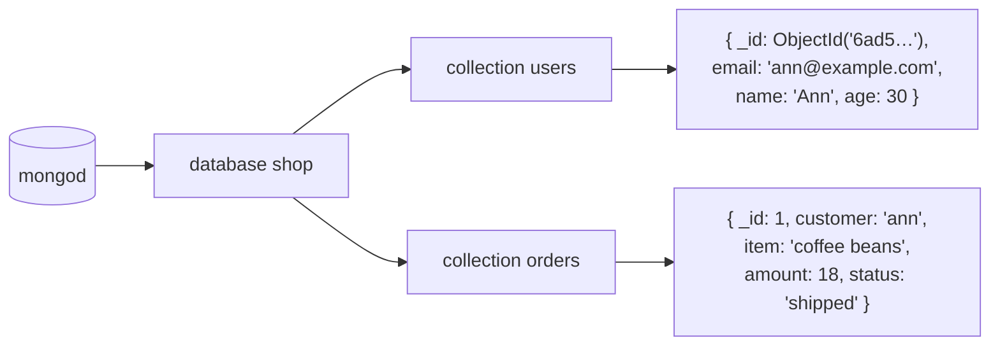
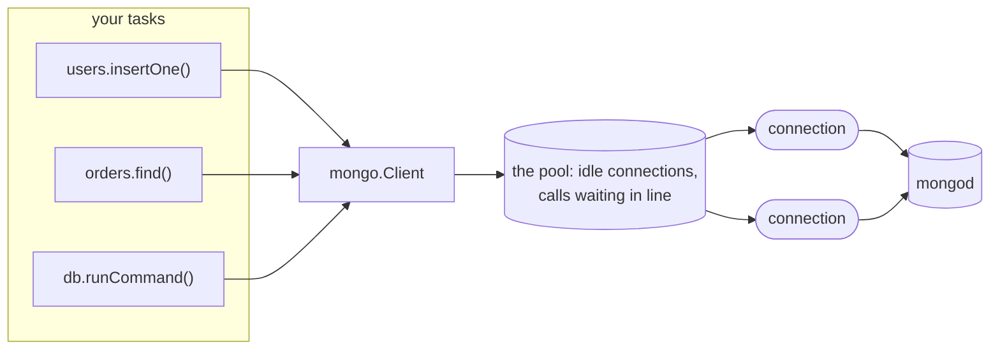

# zefir-mongo: an async MongoDB driver for Zig

**A MongoDB driver for Zig services.** MongoDB is a database of
*documents*: records like JSON objects, kept in *collections*, such as the
customers or the orders of a shop. A service sends it *commands*: insert
these documents, find those, change them, count them. This module is the
client side: it connects to a mongod, keeps a pool of connections that
every task of the service shares, authenticates them, reads and writes
BSON, the format of MongoDB's documents, and gives you databases and
collections with the operations of MongoDB's CRUD specification:
`insertOne`, `find`, `updateMany`, `aggregate` and the rest. It is written against
`std.Io` only, and runs on [zio](https://github.com/lalinsky/zio) in
production.

> [!WARNING]
> **No TLS yet: use it only in a network you trust.** zefir-mongo speaks
> plain TCP. SCRAM, the way it authenticates, never sends the password
> itself, but every command and every document travels unencrypted, and
> whoever records a SCRAM exchange can try to guess the password offline.
> Until the driver has TLS, keep mongod and its services in a closed
> network, give each service a user of its own with a long random
> password, and across a network you do not trust, use a tunnel:
> WireGuard, SSH or a service mesh.

> [!IMPORTANT]
> **Not implemented yet (TODO):**
>
> - **One standalone mongod only.** Replica sets and sharded clusters come
>   later. A client refuses any other server when it connects, with
>   `Unsupported` and the kind of the server.
> - **TLS**, see above.
> - **Authentication other than SCRAM.** SCRAM-SHA-256 and SCRAM-SHA-1
>   work; X.509, LDAP, Kerberos, AWS and OIDC do not. SCRAM-SHA-256 takes a
>   password of printable ASCII only, as the driver does not prepare other
>   passwords (SASLprep) yet: for a user that has SCRAM-SHA-256, another
>   password is `Unsupported` at `connect`, and such a user needs
>   SCRAM-SHA-1 credentials and `authMechanism=SCRAM-SHA-1`, see
>   [Users and passwords](#users-and-passwords).
> - **Retries.** The client never repeats a command by itself.
>   `mongo.outcome` tells which failed calls are safe to make again,
>   [Errors and what is safe to retry](#errors-and-what-is-safe-to-retry)
>   which of them are worth it, and your code decides.
> - **Sessions, transactions and change streams**, and compression of
>   messages.
> - **A strict connection string.** An option that would change what the
>   client does, and that it cannot do yet, is refused rather than skipped:
>   `retryWrites=true`, `w=majority`, `readPreference`, `replicaSet`,
>   `tls=true` and others. A string copied from elsewhere may need
>   trimming, see [The connection string](#the-connection-string).
> - **MongoDB 7.0 or later.**
> - **No TCP keepalive.** `std.Io.net` has no socket options yet. A
>   connection that a firewall drops while it is idle shows broken at its
>   next use; `maxIdleTimeMS` below the firewall's limit avoids that.
> - **`close` on Windows.** Under zio on Windows, `close` cannot cut a read
>   that already waits for the server: such a call ends with the server's
>   reply or at its own deadline.
> - **A part of the CRUD API.** No `bulkWrite` and no `watch`; no read
>   concern in the options of operations; no `createCollection` or
>   `renameCollection`, which `Database.runCommand` does, see
>   [Reports, indexes and collections](#reports-indexes-and-collections).

From [the quick start](#quick-start): a customer in, three more, and the
adults out, the oldest first.

```zig
// A customer; the insert makes the _id, and says which.
const ann = try users.insertOne(io, op, User{ .email = "ann@example.com", .name = "Ann", .age = 30 }, .{ .allocator = arena });
app.info("Signed up", .{ .name = "Ann", ._id = ann.inserted_id.object_id });
// Three more, in one command.
const more = [_]User{
    .{ .email = "bob@example.com", .name = "Bob", .age = 17 },
    .{ .email = "cleo@example.com", .name = "Cleo", .age = 41 },
    .{ .email = "dan@example.com", .name = "Dan", .age = 25 },
};
const signed = try users.insertMany(io, op, &more, .{ .allocator = arena });
app.info("Signed up", .{ .inserted = signed.inserted });

// The adults, the oldest first. The cursor brings the documents batch
// by batch; each one is read into a User.
var adults = try users.find(io, op, .{ .age = .{ .@"$gte" = 18 } }, .{ .allocator = arena, .sort = bson.literal(.{ .age = -1 }) });
defer adults.deinit(io);
while (try adults.next(io, op)) |doc| {
    const user = try bson.decode(User, arena, doc, .{});
    app.info("Adult", .{ .name = user.name, .age = user.age });
}
```

- **One client for the whole service.** Any task may call it at once; its
  pool of connections serves them, first come first served, and every
  connection authenticates by itself.
- **The operations of MongoDB's CRUD specification.** Insert, find with
  cursors, update, replace, delete, `findOneAnd*`, aggregate, counts,
  distinct, indexes, collections and any command, as the specification
  has them, for one standalone server.
- **Documents three ways.** A struct of yours, an anonymous literal such
  as `.{ .age = .{ .@"$gte" = 18 } }`, or raw BSON. An insert gives a
  document without `_id` an ObjectId, and says which.
- **Errors that say whether to retry.** Every error is one of 16 names,
  and each tells whether the server may have run the call; the details,
  the server's code and message among them, are in `mongo.Diagnostics`.
- **Deadlines of zefir-core.** A call takes a `mongo.OperationContext`,
  which `.of(ctx)` makes of a `core.Context`: its deadline becomes the
  server's `maxTimeMS`, and its token is checked before sending and after
  the reply. The token is no alarm: to cut a call that waits, cancel its
  task.
- **Tests without MongoDB.** `mongo.testing.FakeServer` plays a script on
  loopback, and your code talks to it through a real client.
- **No dependencies.** Only the standard library; zio comes from your
  build, not from Zefir.

## Contents

- [How MongoDB keeps data](#how-mongodb-keeps-data)
- [How the client works](#how-the-client-works)
- [Installation](#installation)
- [Quick start](#quick-start)
- [Connecting](#connecting)
- [Databases and collections](#databases-and-collections)
- [Documents: zefir-mongo-bson](#documents-zefir-mongo-bson)
- [Errors and what is safe to retry](#errors-and-what-is-safe-to-retry)
- [Durable writes](#durable-writes)
- [Deadlines and cancellation](#deadlines-and-cancellation)
- [The pool, closing and statistics](#the-pool-closing-and-statistics)
- [Under zefir.App](#under-zefirapp)
- [Logs](#logs)
- [Tests without MongoDB](#tests-without-mongodb)
- [Under zefir-odm](#under-zefir-odm)

Every example of this guide is shown whole, and every program with what it
printed. The programs that talk to a mongod:
[quick start](#quick-start) · [connecting](#what-can-go-wrong-at-the-start) ·
[orders](#writing-and-reading-documents) · [reports](#reports-indexes-and-collections) · [errors](#errors-and-what-is-safe-to-retry) ·
[durable writes](#durable-writes) · [under zefir.App](#under-zefirapp).
The examples that need no server:
[documents](#documents-zefir-mongo-bson) · [a write cut short](#a-write-cut-short) ·
[deadlines](#deadlines-and-cancellation) · [tests of an application](#tests-without-mongodb).

## How MongoDB keeps data

Picture the shop of this guide. Its customers are documents in the
collection `users`, its orders documents in the collection `orders`, and
both collections are in the database `shop` of one mongod:



- **Documents.** A document is a set of named fields, like a JSON object,
  with more types than JSON has: 32- and 64-bit integers, dates,
  ObjectIds, binary data, decimals. On the wire and on disk it is BSON, a
  binary form of it, which zefir-mongo reads and writes with
  zefir-mongo-bson, see
  [Documents: zefir-mongo-bson](#documents-zefir-mongo-bson).
- **`_id`.** Every document has an `_id`, unique in its collection. An
  insert gives a document without one an *ObjectId*: 12 bytes made of the
  time, a random part and a counter, so that services make unique ids
  without asking anyone. The orders above have numbers of the shop's own
  instead.
- **No fixed schema.** Two documents of a collection may have different
  fields: the application keeps them in shape. An *index* makes looking
  documents up fast, and a unique one refuses a second document with the
  same value, such as the same e-mail.
- **Commands.** Everything a client asks is a command, itself a document
  sent to a database: `{find: "users", filter: {age: {$gte: 18}}}`. The
  collection API builds them for you, and `runCommand` sends one of your
  own.

## How the client works

One `mongo.Client` talks to one mongod. The tasks of a service call it at
once, and it keeps a pool of connections for them:



1. **A call takes a connection:** an idle one from the pool, or a new one
   when none is idle and the pool has room, up to `maxPoolSize` (100), at
   most `maxConnecting` (2) opening at once. A call that finds neither
   waits in line, first come first served, until its deadline.
2. **A new connection introduces itself.** It sends *hello*, and the
   server says what it is: anything but a standalone mongod of MongoDB 7.0
   or later is refused. When the connection string names a user, the
   connection authenticates with SCRAM, which starts in that same round
   trip where it can.
3. **The command goes out and the reply comes back** on that connection,
   each as one OP_MSG, MongoDB's message on TCP. A write of many documents
   goes in batches, by the limits that the server named in hello; a cursor
   brings the documents of a `find` batch by batch, with `getMore`.
4. **The connection goes back to the pool**, unless the exchange broke it.

The client has no tasks of its own: everything happens in the calls of
your tasks. `mongo.Database` and `mongo.Collection` are plain values over
the client, which build the commands; copy them and keep them anywhere.

## Installation

Add Zefir to your `build.zig.zon`. mongo ships since v0.9.0, and
mongo-bson, which the build below imports for documents, since v0.11.0:
v0.9.0 and v0.10.0 had BSON inside mongo, as `mongo.bson`.

```sh
zig fetch --save git+https://github.com/vkiryakov/zefir#dev
```

This guide is on the `dev` branch, so the command fetches its latest commit; `--save` pins that commit. For the latest release, v0.11.0, fetch `#v0.11.0` instead.

A service runs on [zio](https://github.com/lalinsky/zio). zio has no
release for Zig 0.17 yet, so pin the commit Zefir is tested with:

```sh
zig fetch --save git+https://github.com/lalinsky/zio#d15034f1a4d9ddaa42829aae8f7e02d37cd1093a
```

Then import the modules in `build.zig`: mongo, and mongo-bson for its
documents. The programs of this guide also use Zefir's confy for
settings, log for records and core for deadlines:

```zig
// build.zig
const std = @import("std");

pub fn build(b: *std.Build) void {
    const target = b.standardTargetOptions(.{});
    const optimize = b.standardOptimizeOption(.{});
    const zefir = b.dependency("zefir", .{ .target = target, .optimize = optimize });
    const zio = b.dependency("zio", .{ .target = target, .optimize = optimize });

    const exe = b.addExecutable(.{
        .name = "shop",
        .root_module = b.createModule(.{
            .root_source_file = b.path("src/main.zig"),
            .target = target,
            .optimize = optimize,
            .imports = &.{
                .{ .name = "mongo", .module = zefir.module("zefir-mongo") },
                .{ .name = "mongo-bson", .module = zefir.module("zefir-mongo-bson") },
                .{ .name = "zio", .module = zio.module("zio") },
                .{ .name = "confy", .module = zefir.module("zefir-confy") },
                .{ .name = "log", .module = zefir.module("zefir-log") },
                .{ .name = "core", .module = zefir.module("zefir-core") },
            },
        }),
    });
    b.installArtifact(exe);
    b.step("run", "Run the service").dependOn(&b.addRunArtifact(exe).step);
}
```

> [!TIP]
> zefir-mongo is also part of the umbrella module: with
> `zefir.module("zefir")` imported as `zefir`, it is
> `@import("zefir").mongo`, and its BSON `@import("zefir").mongo_bson`.
> It imports only zefir-core, zefir-mongo-bson, zefir-odm, which brings
> zefir-validator, and zefir-scheduler, whose store it implements; zio
> comes from your build.

You need a mongod to talk to. With Docker:

```sh
docker run --rm -p 27017:27017 mongo:9.0.4
```

## Quick start

The customers of the shop, in `quick_start.zig`. The program connects,
makes the e-mail of a customer unique, signs four customers up, finds the
adults, gives one a birthday, lets one go, and counts the adults again:

```zig
//! The quick start of the guide: the customers of a shop, in the
//! collection "users" of the database "shop". It connects, makes the
//! e-mail of a customer unique, signs customers up, finds the adults among
//! them, gives one a birthday, lets one go, and counts the adults again.
//! Each run starts from an empty collection.
//!
//! Settings, from the environment:
//!
//!   APP_MONGO_URI        the server; mongodb://127.0.0.1:27017 by default
//!   APP_MONGO_PASSWORD   the password of the user that the URI names, if
//!                        it names one

const std = @import("std");
const confy = @import("confy");
const core = @import("core");
const log = @import("log");
const mongo = @import("mongo");
const zio = @import("zio");
const bson = @import("mongo-bson");

/// The client logs through std.log; this sends its records to the logger.
pub const std_options: std.Options = .{ .logFn = log.stdLogFn };

const Config = struct {
    mongo: struct {
        uri: []const u8 = "mongodb://127.0.0.1:27017",
        /// Kept out of the URI, and out of every log.
        password: ?confy.Secret = null,
    } = .{},
};

/// A customer, as the collection keeps it.
const User = struct {
    /// null: the insert makes an ObjectId.
    _id: ?bson.ObjectId = null,
    email: []const u8,
    name: []const u8,
    age: i32,
};

pub fn main(init: std.process.Init) !void {
    var config: Config = undefined;
    confy.loadOrExit(init.arena.allocator(), &config, .{
        .io = init.io,
        .environ = init.environ_map,
        .env_prefix = "APP_",
        .sources = &.{.osEnv()},
    });
    // The logger outlives the runtime, so it takes `init.io`, through which
    // the tasks of the runtime may log too.
    const logger: log.Logger = try .init(init.gpa, init.io, .{ .format = .text });
    defer logger.deinit();
    logger.installStdLog();
    const app = logger.scoped("app");

    // One runtime for the program, with an executor per CPU core: the
    // client and the tasks that call it run on its `io`.
    const rt = try zio.Runtime.init(init.gpa, .{ .executors = .auto });
    defer rt.deinit();
    const io = rt.io();

    // One client for the whole program, which any task may call. init
    // checks the options and does no I/O; connect opens the first
    // connection and says why when it cannot. From then on the client
    // stays where it is.
    var client: mongo.Client = try .init(init.gpa, io, .{
        .uri = config.mongo.uri,
        .password = if (config.mongo.password) |password| password.expose() else null,
    });
    defer client.deinit();
    var diagnostics: mongo.Diagnostics = .{};
    client.connect(io, within(io, .fromSeconds(10)), &diagnostics) catch |err| {
        app.err("Cannot connect", .{ .reason = err, .details = diagnostics.message() });
        return err;
    };
    defer client.close(io);
    app.info("Connected", .{});

    // Where inserts take the _id of a document that has none: one source
    // for the application.
    var ids: bson.ObjectId.Generator = .init(io);
    const db: mongo.Database = .init(&client, "shop", &ids);
    try run(io, init.gpa, db, app);

    const stats = client.stats();
    app.info("Done", .{ .connections = stats.connections, .in_use = stats.in_use, .open_cursors = stats.open_cursors });
}

/// A context whose deadline is `budget` away.
fn within(io: std.Io, budget: std.Io.Duration) core.Context {
    return core.Context.root.withDeadline(.after(std.Io.Clock.awake.now(io), budget));
}

/// The application: it sees the database, not the client.
fn run(io: std.Io, gpa: std.mem.Allocator, db: mongo.Database, app: log.Logger) !void {
    // The memory of the results, all freed at the end.
    var arena_state: std.heap.ArenaAllocator = .init(gpa);
    defer arena_state.deinit();
    const arena = arena_state.allocator();
    // Five seconds for all of it: each call has what is left of them.
    const op: mongo.OperationContext = .of(within(io, .fromSeconds(5)));
    const users = db.collection("users");

    // Start afresh, and make the e-mail of a customer unique.
    try users.drop(io, op, .{ .allocator = arena });
    const indexes = try users.createIndexes(io, op, &.{.{ .keys = bson.literal(.{ .email = 1 }), .unique = true }}, .{ .allocator = arena });
    app.info("Index made", .{ .name = indexes[0] });

    // A customer; the insert makes the _id, and says which.
    const ann = try users.insertOne(io, op, User{ .email = "ann@example.com", .name = "Ann", .age = 30 }, .{ .allocator = arena });
    app.info("Signed up", .{ .name = "Ann", ._id = ann.inserted_id.object_id });
    // Three more, in one command.
    const more = [_]User{
        .{ .email = "bob@example.com", .name = "Bob", .age = 17 },
        .{ .email = "cleo@example.com", .name = "Cleo", .age = 41 },
        .{ .email = "dan@example.com", .name = "Dan", .age = 25 },
    };
    const signed = try users.insertMany(io, op, &more, .{ .allocator = arena });
    app.info("Signed up", .{ .inserted = signed.inserted });

    // The adults, the oldest first. The cursor brings the documents batch
    // by batch; each one is read into a User.
    var adults = try users.find(io, op, .{ .age = .{ .@"$gte" = 18 } }, .{ .allocator = arena, .sort = bson.literal(.{ .age = -1 }) });
    defer adults.deinit(io);
    while (try adults.next(io, op)) |doc| {
        const user = try bson.decode(User, arena, doc, .{});
        app.info("Adult", .{ .name = user.name, .age = user.age });
    }

    // Bob has a birthday.
    const birthday = try users.updateOne(io, op, .{ .email = "bob@example.com" }, .{ .@"$inc" = .{ .age = 1 } }, .{ .allocator = arena });
    app.info("Birthday", .{ .matched = birthday.matched, .modified = birthday.modified });
    // Dan leaves the shop.
    const left = try users.deleteOne(io, op, .{ .email = "dan@example.com" }, .{ .allocator = arena });
    app.info("Left", .{ .deleted = left.deleted });
    const count = try users.countDocuments(io, op, .{ .age = .{ .@"$gte" = 18 } }, .{ .allocator = arena });
    app.info("Adults now", .{ .count = count });
}
```

Start a mongod as in [Installation](#installation), then the program:

```text
$ zig build run
2026-10-19T01:24:16.268Z INFO  [app] Connected
2026-10-19T01:24:16.271Z INFO  [app] Index made name=email_1
2026-10-19T01:24:16.272Z INFO  [app] Signed up name=Ann _id=6ad571408b9f503e4a218a8b
2026-10-19T01:24:16.273Z INFO  [app] Signed up inserted=3
2026-10-19T01:24:16.273Z INFO  [app] Adult name=Cleo age=41
2026-10-19T01:24:16.273Z INFO  [app] Adult name=Ann age=30
2026-10-19T01:24:16.273Z INFO  [app] Adult name=Dan age=25
2026-10-19T01:24:16.274Z INFO  [app] Birthday matched=1 modified=1
2026-10-19T01:24:16.275Z INFO  [app] Left deleted=1
2026-10-19T01:24:16.276Z INFO  [app] Adults now count=3
2026-10-19T01:24:16.276Z INFO  [app] Done connections=1 in_use=0 open_cursors=0
```

What happens, from the top:

- **Settings.** `confy.loadOrExit` fills `Config` from the environment:
  `APP_MONGO_URI` is `mongo.uri`, and `APP_MONGO_PASSWORD` is
  `mongo.password`. The password is a `confy.Secret`, which no log prints:
  it stays out of the connection string, and `expose()` hands it to the
  client.
- **Logs.** The client writes its warnings to `std.log.scoped(.mongo)`;
  `std_options` with `log.stdLogFn` and `logger.installStdLog()` send them
  to zefir-log, see [Logs](#logs).
- **The runtime.** Everything runs on the `std.Io` of zio, `rt.io()`,
  with an executor per CPU core. The logger takes `init.io`, so that any
  thread may log.
- **The client.** `init` checks the options and the connection string,
  and does no I/O. `connect` opens the first connection under its
  deadline: a server that is not there, a wrong password or a server of
  the wrong kind shows here, at the start, with the reason in
  `diagnostics`. From then on the client must stay where it is. `close`
  ends its work and `deinit` frees it; [Connecting](#connecting) has the
  rest.
- **The database.** `mongo.Database.init` takes the client, the name of
  the database and the generator of ObjectIds, one for the application, so
  that the `_id`s it makes are unique. `db.collection("users")` is a
  collection of it.
- **One context for the work.** `.of(ctx)` makes the
  `mongo.OperationContext` of a call from a `core.Context`: here five
  seconds for all the calls of `run`, each with what is left of them.
- **Memory.** The results come from the arena of `.allocator`, and go all
  at once at the end. The cursor of `find` keeps its batches in the
  client's memory: `deinit` it.
- **Reading documents.** The cursor gives `bson.RawDocument`s, borrowed
  until its next call; `bson.decode` reads one into a `User`, with its
  strings copied into the arena.
- **The end.** `stats` shows one connection, idle: the calls went one
  after another, and the pool kept the connection that `connect` opened.

## Connecting

### The connection string

```text
mongodb://[user[:password]@]host[:port][/database][?option=value&…]
```

One host, and the port 27017 unless the string names one. The user and
the password are percent-encoded: `@` is `%40`, `:` is `%3A`, `/` is
`%2F` and `%` is `%25`, so `mongodb://app:p%40ss@db` is the user `app`
with the password `p@ss`. Better still, keep the password out of the
string and give it in `Options.password`, from a `confy.Secret`. The
database of the path is where the user is defined, unless `authSource`
names another; without either, it is `admin`.

| Option | What it does |
|---|---|
| `authSource` | the database the user is defined in |
| `authMechanism` | `SCRAM-SHA-256` or `SCRAM-SHA-1`; by default, what the server says the user has |
| `appName` | the application's name in the server's logs, up to 128 bytes |
| `connectTimeoutMS` | DNS, TCP, hello and SCRAM of a new connection: 10 000 by default |
| `serverSelectionTimeoutMS` | how long a call waits for a connection: 30 000 by default |
| `timeoutMS` | the deadline of a call whose context has none; none by default |
| `maxPoolSize`, `maxConnecting`, `maxIdleTimeMS` | the pool: 100 connections, 2 opening at once, idle ones kept for good (0); `maxPoolSize=0` is `InvalidArgument` |
| `minPoolSize` | 0 only: connections open when calls need them |
| `directConnection` | either value: there is one host |
| `tls`, `ssl`, `retryWrites`, `retryReads`, `loadBalanced` | `false` only |

The client is stricter than MongoDB's specification of connection
strings, which lets a driver warn about an option it cannot honor and go
on without it. zefir-mongo refuses such an option at `init`, with
`Unsupported` and a text that says what to do instead, so that a copied
string never quietly means something else. Refused: `tls=true`,
`ssl=true` and every `tls…` option; `replicaSet`, `readPreference` and its
tags; `retryWrites=true` and `retryReads=true`; `w`, `journal`,
`wTimeoutMS` and `readConcernLevel`; `socketTimeoutMS` and
`waitQueueTimeoutMS`; other mechanisms and `authMechanismProperties`;
`mongodb+srv://`, several hosts, UNIX sockets and proxies. Skipped with a
warning in the log, as they change nothing that the client does:
`compressors`, `zlibCompressionLevel`, `heartbeatFrequencyMS`,
`serverMonitoringMode`, `localThresholdMS`, `serverSelectionTryOnce`,
`uuidRepresentation`, and the options that the client does not know.

`mongo.Client.Options` holds the rest; only `uri` has no default:

| Field | Default | What it does |
|---|---|---|
| `uri` | none, required | the connection string |
| `password` | null | the password of the user of `uri`, when the string has none |
| `start_timeout` | 10 s | how long `start`, under [zefir.App](#under-zefirapp), waits for the first connection |
| `close_timeout` | 5 s | how long `close` lets the calls in flight finish |
| `cursor_close_timeout` | 1 s | the budget of the `killCursors` that closing a cursor sends |
| `diagnostics` | null | why `init` refused the options; it never shows the password |

`init` keeps copies of the strings, so they may go once the client is
made; `deinit` wipes its copy of the password.

### Users and passwords

With a user in the connection string, every new connection authenticates
with SCRAM: the client proves that it knows the password without sending
it. The mechanism is the one `authMechanism` names; without it, the client
asks the server in hello which mechanisms the user has, and takes
SCRAM-SHA-256 when the list names it, SCRAM-SHA-1 when it does not. SCRAM
derives keys from the password with thousands of rounds of hashing; the
client keeps them, so only its first connection pays for that.
SCRAM-SHA-256 takes a password of printable ASCII only, for now: another
one is `Unsupported` before anything is sent, and such a user needs
SCRAM-SHA-1 credentials and `authMechanism=SCRAM-SHA-1`.

In production the password comes from wherever the service keeps its
secrets: confy reads it from the environment, as here, or from a `.env`
file, and holds it as a `confy.Secret`, so that a log of the settings
shows `[REDACTED]`.

### What can go wrong at the start

`connect.zig` connects as a user, then tries a wrong password, a server
that is not there, and connection strings that the client refuses:

```zig
//! Connecting, and what the client says when the start goes wrong. It
//! connects as the user of the connection string, with the password of
//! the settings; then it tries a wrong password, a server that is not
//! there, and connection strings that the client refuses.
//!
//! Settings, from the environment:
//!
//!   APP_MONGO_URI        the server and the user, such as
//!                        mongodb://admin@127.0.0.1:27017
//!   APP_MONGO_PASSWORD   the user's password

const std = @import("std");
const confy = @import("confy");
const core = @import("core");
const log = @import("log");
const mongo = @import("mongo");
const zio = @import("zio");

/// The client logs through std.log; this sends its records to the logger.
pub const std_options: std.Options = .{ .logFn = log.stdLogFn };

const Config = struct {
    mongo: struct {
        uri: []const u8,
        password: confy.Secret,
    },
};

pub fn main(init: std.process.Init) !void {
    var config: Config = undefined;
    confy.loadOrExit(init.arena.allocator(), &config, .{
        .io = init.io,
        .environ = init.environ_map,
        .env_prefix = "APP_",
        .sources = &.{.osEnv()},
    });
    const logger: log.Logger = try .init(init.gpa, init.io, .{ .format = .text });
    defer logger.deinit();
    logger.installStdLog();
    const app = logger.scoped("app");
    const rt = try zio.Runtime.init(init.gpa, .{ .executors = .auto });
    defer rt.deinit();
    const io = rt.io();

    // The user of the URI, with the password of the settings: the client
    // authenticates every connection it opens with them.
    try connect(io, init.gpa, app, .{ .uri = config.mongo.uri, .password = config.mongo.password.expose() });
    // The same user with another password.
    try connect(io, init.gpa, app, .{ .uri = config.mongo.uri, .password = "not-the-password" });
    // A server that is not there: nothing listens on port 1.
    try connect(io, init.gpa, app, .{ .uri = "mongodb://127.0.0.1:1" });

    // Connection strings copied from elsewhere: init refuses what the
    // client cannot do, rather than skip it.
    for ([_][]const u8{
        "mongodb://127.0.0.1:27017/?retryWrites=true&w=majority",
        "mongodb://127.0.0.1:27017/?tls=true",
        "mongodb://db1.example.com:27017,db2.example.com:27017/?replicaSet=rs0",
    }) |uri| {
        var refused: mongo.Diagnostics = .{};
        var client = mongo.Client.init(init.gpa, io, .{ .uri = uri, .diagnostics = &refused }) catch |err| {
            app.warn("Refused", .{ .reason = err, .details = refused.message() });
            continue;
        };
        client.deinit();
    }
}

/// Connects a client of `options`, and logs how it went.
fn connect(io: std.Io, gpa: std.mem.Allocator, app: log.Logger, options: mongo.Client.Options) !void {
    var client: mongo.Client = try .init(gpa, io, options);
    defer client.deinit();
    const ctx = core.Context.root.withDeadline(.after(std.Io.Clock.awake.now(io), .fromSeconds(10)));
    var diagnostics: mongo.Diagnostics = .{};
    client.connect(io, ctx, &diagnostics) catch |err| {
        app.warn("Cannot connect", .{
            .reason = err,
            .outcome = mongo.outcome(err),
            .details = diagnostics.message(),
            // A server that may be overloaded, or gone: a retry later may
            // find it.
            .retryable = if (diagnostics.server) |server| server.labels.contains(.retryable_error) else false,
        });
        return;
    };
    defer client.close(io);
    app.info("Connected", .{});
}
```

It needs a mongod with a user. The image of mongo makes a root user from
two variables; this one listens on 27018, next to the server of the other
programs:

```sh
docker run --rm -p 27018:27017 -e MONGO_INITDB_ROOT_USERNAME=admin -e MONGO_INITDB_ROOT_PASSWORD=change-me mongo:9.0.4
```

```text
$ APP_MONGO_URI=mongodb://admin@127.0.0.1:27018 APP_MONGO_PASSWORD=change-me zig build run
2026-10-19T01:24:16.989Z INFO  [app] Connected
2026-10-19T01:24:17.018Z WARN  [mongo] 127.0.0.1:27018 refused a connection: AuthenticationFailed: Authentication failed.
2026-10-19T01:24:17.018Z WARN  [app] Cannot connect reason=AuthenticationFailed outcome=not_sent details="Authentication failed." retryable=false
2026-10-19T01:24:17.019Z WARN  [app] Cannot connect reason=Unavailable outcome=not_sent details="cannot connect to 127.0.0.1:1: ConnectionRefused" retryable=true
2026-10-19T01:24:17.019Z WARN  [app] Refused reason=Unsupported details="retryWrites=true: v0.1 retries nothing; set retryWrites=false or leave it out"
2026-10-19T01:24:17.019Z WARN  [app] Refused reason=Unsupported details="tls=true: TLS is not supported in v0.1; use a trusted network"
2026-10-19T01:24:17.019Z WARN  [app] Refused reason=Unsupported details="the connection string names several hosts, and v0.1 connects to one standalone mongod: give one host"
```

- **Connected:** as the user of the URI, with the password of the
  settings.
- **A wrong password** is `AuthenticationFailed`, with the server's
  message, and `not_sent`: nothing ran. The client logs the refusal too,
  as a warning with the address of the server, never with the password.
  In a running service a refused user also clears the pool, as the server
  would refuse every connection alike.
- **A server that is not there** is `Unavailable`, and so is one that
  does not answer within `connectTimeoutMS`. Their diagnostics carry the
  labels `SystemOverloadedError` and `RetryableError`, which the client
  gives a connection that could not open: the server may be overloaded or
  restarting, and the call may go again later. A host name that does not
  resolve gets no labels: it is the name that is wrong.
- **Connection strings** that ask for what the client cannot do yet stop
  at `init`, with what to do instead. The client's messages say v0.1: the
  first version of zefir-mongo, which came with zefir v0.9.0.
- `connect` may be called again after a failure; until it succeeds, a call
  is `Unavailable`: "connect() has not succeeded". A server of another
  kind is refused here too: a member of a replica set, a mongos or a
  server older than 7.0 is `Unsupported`, with its kind, such as "the
  server at db:27017 is a replica set member (RSPrimary, setName=rs0);
  v0.1 supports standalone mongod only". A server that wants TLS closes
  the plain connection during hello: `Unavailable`, with a message that
  says it may want TLS.

### The composition root

`main` of [the quick start](#quick-start) builds the parts of a service in
the order their lives need, and its `defer`s take them down in the reverse
one:

1. the settings, then the logger, on `init.io`;
2. the zio runtime, whose `io` the client and every task take;
3. the client: `init`, then `connect` under a deadline;
   `defer client.deinit()` comes before `defer client.close(io)`, so that
   `close` runs first;
4. the generator of ObjectIds, and the `mongo.Database` of the
   application;
5. the code of the application, which gets the database.

The client must not move once connected: keep it in a `var` of `main`, or
in a struct that stays where it is, and hand out `&client`. In safe builds
a call on a moved copy panics, and so does a call with another `std.Io`
than the one of `init`.

## Databases and collections

### Writing and reading documents

`orders.zig` takes the orders of a day and works on them with the
operations that write documents and read them back:

```zig
//! The orders of the shop, in the collection "orders": the operations
//! that write documents and read them back. It takes orders in, finds a
//! customer's, ships them, looks one up by its number, takes a phone
//! order if it is not in yet, replaces one, raises one and shows it as it
//! is now, takes one back, and drops the cancelled ones. Each run starts
//! from an empty collection.
//!
//! Settings, from the environment:
//!
//!   APP_MONGO_URI        the server; mongodb://127.0.0.1:27017 by default
//!   APP_MONGO_PASSWORD   the password of the user that the URI names, if
//!                        it names one

const std = @import("std");
const confy = @import("confy");
const core = @import("core");
const log = @import("log");
const mongo = @import("mongo");
const zio = @import("zio");
const bson = @import("mongo-bson");

pub const std_options: std.Options = .{ .logFn = log.stdLogFn };

const Config = struct {
    mongo: struct {
        uri: []const u8 = "mongodb://127.0.0.1:27017",
        password: ?confy.Secret = null,
    } = .{},
};

const Status = enum { placed, shipped, cancelled };

/// An order, under the number the shop gives it: the `_id` is the shop's,
/// so no insert makes one.
const Order = struct {
    _id: i32,
    customer: []const u8,
    item: []const u8,
    amount: i32,
    status: Status = .placed,
};

/// What a customer sees of an order: a projection of it.
const Line = struct {
    _id: i32,
    item: []const u8,
    amount: i32,
};

pub fn main(init: std.process.Init) !void {
    var config: Config = undefined;
    confy.loadOrExit(init.arena.allocator(), &config, .{
        .io = init.io,
        .environ = init.environ_map,
        .env_prefix = "APP_",
        .sources = &.{.osEnv()},
    });
    const logger: log.Logger = try .init(init.gpa, init.io, .{ .format = .text });
    defer logger.deinit();
    logger.installStdLog();
    const app = logger.scoped("app");
    const rt = try zio.Runtime.init(init.gpa, .{ .executors = .auto });
    defer rt.deinit();
    const io = rt.io();

    var client: mongo.Client = try .init(init.gpa, io, .{
        .uri = config.mongo.uri,
        .password = if (config.mongo.password) |password| password.expose() else null,
    });
    defer client.deinit();
    const ctx = core.Context.root.withDeadline(.after(std.Io.Clock.awake.now(io), .fromSeconds(10)));
    try client.connect(io, ctx, null);
    defer client.close(io);
    var ids: bson.ObjectId.Generator = .init(io);
    const db: mongo.Database = .init(&client, "shop", &ids);

    var arena_state: std.heap.ArenaAllocator = .init(init.gpa);
    defer arena_state.deinit();
    const arena = arena_state.allocator();
    const op: mongo.OperationContext = .of(ctx);
    const orders = db.collection("orders");
    try orders.drop(io, op, .{ .allocator = arena });

    // insertMany: the orders of the day, with the shop's own numbers.
    const day = [_]Order{
        .{ ._id = 1, .customer = "ann", .item = "coffee beans", .amount = 18 },
        .{ ._id = 2, .customer = "bob", .item = "grinder", .amount = 95 },
        .{ ._id = 3, .customer = "ann", .item = "kettle", .amount = 40 },
        .{ ._id = 4, .customer = "cleo", .item = "mugs", .amount = 24 },
        .{ ._id = 5, .customer = "ann", .item = "filters", .amount = 6 },
        .{ ._id = 6, .customer = "bob", .item = "scale", .amount = 31, .status = .cancelled },
    };
    const taken = try orders.insertMany(io, op, &day, .{ .allocator = arena });
    app.info("Orders taken", .{ .inserted = taken.inserted });

    // find: Ann's open orders, the dearest first, two in a batch; only the
    // fields she sees.
    var anns = try orders.find(io, op, .{ .customer = "ann", .status = .placed }, .{
        .allocator = arena,
        .sort = bson.literal(.{ .amount = -1 }),
        .projection = bson.literal(.{ .item = 1, .amount = 1 }),
        .batch_size = 2,
    });
    defer anns.deinit(io);
    while (try anns.next(io, op)) |doc| {
        const line = try bson.decode(Line, arena, doc, .{});
        app.info("Ann's order", .{ .number = line._id, .item = line.item, .amount = line.amount });
    }

    // updateMany: everything Ann ordered goes out today.
    const shipped = try orders.updateMany(io, op, .{ .customer = "ann", .status = .placed }, .{ .@"$set" = .{ .status = .shipped } }, .{ .allocator = arena });
    app.info("Shipped", .{ .matched = shipped.matched, .modified = shipped.modified });

    // findOne: an order by its number.
    if (try orders.findOne(io, op, .{ ._id = 2 }, .{ .allocator = arena })) |doc| {
        const order = try bson.decode(Order, arena, doc.raw(), .{});
        app.info("Order 2", .{ .customer = order.customer, .item = order.item, .status = order.status });
    }

    // updateOne with upsert: a phone order, taken twice by mistake; the
    // second time it is there already, and nothing changes.
    for (0..2) |_| {
        const phone = try orders.updateOne(io, op, .{ ._id = 7 }, .{ .@"$setOnInsert" = .{ .customer = "dan", .item = "tea", .amount = 12, .status = .placed } }, .{ .allocator = arena, .upsert = true });
        if (phone.upserted_id) |id| {
            app.info("Phone order taken", .{ .number = try id.asI64() });
        } else app.info("Phone order there already", .{ .matched = phone.matched, .modified = phone.modified });
    }

    // replaceOne: Bob takes another grinder; the order keeps its number.
    const replaced = try orders.replaceOne(io, op, .{ ._id = 2 }, .{ .customer = "bob", .item = "hand grinder", .amount = 60, .status = .placed }, .{ .allocator = arena });
    app.info("Order 2 replaced", .{ .matched = replaced.matched, .modified = replaced.modified });

    // findOneAndUpdate: Cleo takes two more mugs, and the shop shows her
    // the order as it is after the change.
    const raised = try orders.findOneAndUpdate(io, op, .{ ._id = 4 }, .{ .@"$inc" = .{ .amount = 12 } }, .{ .allocator = arena, .return_document = .after }) orelse
        return error.OrderNotFound;
    const mugs = try bson.decode(Order, arena, raised.raw(), .{});
    app.info("Order 4 now", .{ .item = mugs.item, .amount = mugs.amount });

    // findOneAndDelete: Dan calls back; his order goes, and the shop sees
    // what it was.
    const dropped = try orders.findOneAndDelete(io, op, .{ .customer = "dan" }, .{ .allocator = arena }) orelse
        return error.OrderNotFound;
    const tea = try bson.decode(Order, arena, dropped.raw(), .{});
    app.info("Order taken back", .{ .number = tea._id, .item = tea.item });

    // deleteMany: the cancelled orders go at the end of the day.
    const cleared = try orders.deleteMany(io, op, .{ .status = .cancelled }, .{ .allocator = arena });
    app.info("Cancelled orders cleared", .{ .deleted = cleared.deleted });
    app.info("Orders left", .{ .count = try orders.countDocuments(io, op, .{}, .{ .allocator = arena }) });
}
```

```text
$ zig build run
2026-10-19T01:24:17.714Z INFO  [app] Orders taken inserted=6
2026-10-19T01:24:17.715Z INFO  [app] Ann's order number=3 item=kettle amount=40
2026-10-19T01:24:17.715Z INFO  [app] Ann's order number=1 item="coffee beans" amount=18
2026-10-19T01:24:17.715Z INFO  [app] Ann's order number=5 item=filters amount=6
2026-10-19T01:24:17.716Z INFO  [app] Shipped matched=3 modified=3
2026-10-19T01:24:17.716Z INFO  [app] Order 2 customer=bob item=grinder status=placed
2026-10-19T01:24:17.717Z INFO  [app] Phone order taken number=7
2026-10-19T01:24:17.717Z INFO  [app] Phone order there already matched=1 modified=0
2026-10-19T01:24:17.717Z INFO  [app] Order 2 replaced matched=1 modified=1
2026-10-19T01:24:17.718Z INFO  [app] Order 4 now item=mugs amount=36
2026-10-19T01:24:17.718Z INFO  [app] Order taken back number=7 item=tea
2026-10-19T01:24:17.718Z INFO  [app] Cancelled orders cleared deleted=1
2026-10-19T01:24:17.719Z INFO  [app] Orders left count=5
```

- **`insertMany`** takes a list: a slice, an array or a tuple of
  documents. These orders have `_id`s of the shop's own, which go as they
  are; a document without one would get an ObjectId first. `inserted`
  counts what the server took.
- **`find`** gives a `mongo.Cursor`. The filter picks the documents,
  `.sort` orders them, `.projection` names the fields to bring, and
  `.batch_size` how many come at once: here Ann's three orders come in two
  batches, the second by a `getMore` that the cursor sends by itself when
  `next` reaches the end of the first. `.skip` and `.limit` page through
  the results. A cursor serves one task at a time; `deinit` it, and a
  cursor that ends before its last batch tells the server to drop it. An
  error of `next` leaves its details in the cursor itself, see
  [the operations](#the-operations).
- **`updateMany`** changes every document that the filter matches,
  `updateOne` the first. The update is a document of update operators,
  such as `$set`, `$inc` or `$push`, or a pipeline; `matched` and
  `modified` say how many documents matched and how many changed.
- **`findOne`** gives the first match, a copy in `.allocator`, or null.
- **An upsert** inserts a document when none matches: `upserted_id` is its
  `_id`. The fields of `$setOnInsert` go only into a document that the
  upsert makes, so the second phone order changes nothing.
- **`replaceOne`** puts a whole new document in place of the first match,
  which keeps its `_id`. Its first field must not be an update operator.
- **`findOneAndUpdate`, `findOneAndReplace` and `findOneAndDelete`**
  change one document and give it back: as it was, or as it is now with
  `.return_document = .after`; null when none matched. `.sort` picks which
  one when several match.
- **`deleteMany`** deletes every match, `deleteOne` the first. The filter
  `.{}` matches every document.

### Reports, indexes and collections

`reports.zig` works out a report over a week of orders, makes an index for
it, and makes a collection with a command of the server:

```zig
//! The reports of the shop over its orders: the operations that compute
//! from documents, and those of indexes and collections. It sums each
//! customer's spending, counts orders two ways, lists the customers once
//! each, makes an index for the reports and lists it, and makes a capped
//! collection with a command of the server. Each run starts afresh.
//!
//! Settings, from the environment:
//!
//!   APP_MONGO_URI        the server; mongodb://127.0.0.1:27017 by default
//!   APP_MONGO_PASSWORD   the password of the user that the URI names, if
//!                        it names one

const std = @import("std");
const confy = @import("confy");
const core = @import("core");
const log = @import("log");
const mongo = @import("mongo");
const zio = @import("zio");
const bson = @import("mongo-bson");

pub const std_options: std.Options = .{ .logFn = log.stdLogFn };

const Config = struct {
    mongo: struct {
        uri: []const u8 = "mongodb://127.0.0.1:27017",
        password: ?confy.Secret = null,
    } = .{},
};

const Order = struct {
    _id: i32,
    customer: []const u8,
    amount: i32,
    status: enum { placed, shipped, cancelled },
};

/// A row of the report: what `$group` makes of a customer's orders.
const Spending = struct {
    _id: []const u8,
    total: i32,
    orders: i32,
};

pub fn main(init: std.process.Init) !void {
    var config: Config = undefined;
    confy.loadOrExit(init.arena.allocator(), &config, .{
        .io = init.io,
        .environ = init.environ_map,
        .env_prefix = "APP_",
        .sources = &.{.osEnv()},
    });
    const logger: log.Logger = try .init(init.gpa, init.io, .{ .format = .text });
    defer logger.deinit();
    logger.installStdLog();
    const app = logger.scoped("app");
    const rt = try zio.Runtime.init(init.gpa, .{ .executors = .auto });
    defer rt.deinit();
    const io = rt.io();

    var client: mongo.Client = try .init(init.gpa, io, .{
        .uri = config.mongo.uri,
        .password = if (config.mongo.password) |password| password.expose() else null,
    });
    defer client.deinit();
    const ctx = core.Context.root.withDeadline(.after(std.Io.Clock.awake.now(io), .fromSeconds(10)));
    try client.connect(io, ctx, null);
    defer client.close(io);
    var ids: bson.ObjectId.Generator = .init(io);
    const db: mongo.Database = .init(&client, "shop", &ids);

    var arena_state: std.heap.ArenaAllocator = .init(init.gpa);
    defer arena_state.deinit();
    const arena = arena_state.allocator();
    const op: mongo.OperationContext = .of(ctx);
    const orders = db.collection("orders");
    try orders.drop(io, op, .{ .allocator = arena });
    const week = [_]Order{
        .{ ._id = 1, .customer = "ann", .amount = 18, .status = .shipped },
        .{ ._id = 2, .customer = "bob", .amount = 95, .status = .shipped },
        .{ ._id = 3, .customer = "ann", .amount = 40, .status = .shipped },
        .{ ._id = 4, .customer = "cleo", .amount = 24, .status = .placed },
        .{ ._id = 5, .customer = "bob", .amount = 31, .status = .cancelled },
        .{ ._id = 6, .customer = "ann", .amount = 6, .status = .placed },
    };
    _ = try orders.insertMany(io, op, &week, .{ .allocator = arena });

    // aggregate: what each customer spent, but for cancelled orders, by
    // name. The pipeline is a tuple of stages.
    var spending = try orders.aggregate(io, op, .{
        .{ .@"$match" = .{ .status = .{ .@"$ne" = "cancelled" } } },
        .{ .@"$group" = .{ ._id = "$customer", .total = .{ .@"$sum" = "$amount" }, .orders = .{ .@"$sum" = 1 } } },
        .{ .@"$sort" = .{ ._id = 1 } },
    }, .{ .allocator = arena });
    defer spending.deinit(io);
    while (try spending.next(io, op)) |doc| {
        const row = try bson.decode(Spending, arena, doc, .{});
        app.info("Spent", .{ .customer = row._id, .total = row.total, .orders = row.orders });
    }

    // countDocuments counts the matching documents one by one;
    // estimatedDocumentCount reads the size the collection keeps.
    const open = try orders.countDocuments(io, op, .{ .status = .placed }, .{ .allocator = arena });
    const all = try orders.estimatedDocumentCount(io, op, .{ .allocator = arena });
    app.info("Counted", .{ .open = open, .all = all });

    // distinct: each customer once. The values come in a BSON array.
    const customers = try orders.distinct(io, op, "customer", .{}, .{ .allocator = arena });
    var names = customers.raw().iterator();
    while (try names.next()) |element| app.info("Customer", .{ .name = element.value.string });

    // An index for the reports: by customer, the dearest orders first. Its
    // name comes from its keys.
    const made = try orders.createIndexes(io, op, &.{.{ .keys = bson.literal(.{ .customer = 1, .amount = -1 }) }}, .{ .allocator = arena });
    app.info("Index made", .{ .name = made[0] });
    var indexes = try orders.listIndexes(io, op, .{ .allocator = arena });
    defer indexes.deinit(io);
    while (try indexes.next(io, op)) |index| app.info("Index", .{ .name = (try index.get("name")).?.string });
    try orders.dropIndex(io, op, made[0], .{ .allocator = arena });

    // runCommand: any command of the server, such as create, which the
    // collection API has no operation for. A capped collection keeps the
    // newest documents only, within its size.
    const audit = db.collection("audit");
    try audit.drop(io, op, .{ .allocator = arena });
    const created = try db.runCommand(io, op, .{ .create = "audit", .capped = true, .size = 4096 }, .{ .allocator = arena });
    app.info("Collection made", .{ .name = "audit", .ok = try (try created.raw().get("ok")).?.asF64() });
    // listCollections: the collections of the database, here only "audit".
    var found = try db.listCollections(io, op, .{ .allocator = arena, .filter = bson.literal(.{ .name = "audit" }) });
    defer found.deinit(io);
    while (try found.next(io, op)) |info| {
        app.info("Collection", .{ .name = (try info.get("name")).?.string, .capped = (try info.getPath("options.capped")).?.boolean });
    }
    try audit.drop(io, op, .{ .allocator = arena });
}
```

```text
$ zig build run
2026-10-19T01:24:18.426Z INFO  [app] Spent customer=ann total=64 orders=3
2026-10-19T01:24:18.426Z INFO  [app] Spent customer=bob total=95 orders=1
2026-10-19T01:24:18.426Z INFO  [app] Spent customer=cleo total=24 orders=1
2026-10-19T01:24:18.427Z INFO  [app] Counted open=2 all=6
2026-10-19T01:24:18.428Z INFO  [app] Customer name=ann
2026-10-19T01:24:18.428Z INFO  [app] Customer name=bob
2026-10-19T01:24:18.428Z INFO  [app] Customer name=cleo
2026-10-19T01:24:18.431Z INFO  [app] Index made name=customer_1_amount_-1
2026-10-19T01:24:18.431Z INFO  [app] Index name=_id_
2026-10-19T01:24:18.431Z INFO  [app] Index name=customer_1_amount_-1
2026-10-19T01:24:18.434Z INFO  [app] Collection made name=audit ok=1
2026-10-19T01:24:18.435Z INFO  [app] Collection name=audit capped=true
```

- **`aggregate`** runs a pipeline of stages on the server, a tuple here:
  `$match` keeps the orders that count, `$group` sums them per customer,
  `$sort` orders the rows. Its cursor gives the documents of the last
  stage.
- **Two counts.** `countDocuments` counts the documents that a filter
  matches, one by one: exact. `estimatedDocumentCount` reads the number
  that the collection keeps, without a filter: fast, but after an unclean
  shutdown of the server it may be off for a while.
- **`distinct`** gives each value of a field once, in a BSON array: a
  document whose keys are "0", "1", …, which `iterator()` walks.
- **Indexes.** `createIndexes` takes `IndexModel`s: the keys, and
  `unique`, `sparse`, `expire_after_seconds`, `partial_filter_expression`,
  `collation` and `hidden`. An index without a name gets one made of its
  keys, `customer_1_amount_-1`. `listIndexes` lists them, with `_id_`,
  which every collection has; `dropIndex` drops one, and `dropIndexes`
  all but `_id_`.
- **Any command.** `db.runCommand` sends a command as it is, with the
  database's `$db`, and gives the reply; `db.runCursorCommand` does the
  same for a command that answers with a cursor. Here `create` makes a
  capped collection, which keeps only its newest documents within its
  size: the collection API has no `createCollection`.
- **Collections.** `db.listCollections` lists the collections of the
  database, with a `filter` on what it says of each; `collection.drop`
  drops one, and `db.drop` the database. A collection that is not there
  drops without an error.

### The operations

| Operation | What it does | Result |
|---|---|---|
| `insertOne(document)`, `insertMany(documents)` | inserts; a document without `_id` gets an ObjectId first | `InsertOneResult{ inserted_id }`, `InsertManyResult{ inserted_ids, inserted, answered }` |
| `updateOne`, `updateMany(filter, update)` | changes the first match, or all; `.upsert` inserts when none matches | `UpdateResult{ matched, modified, upserted_id }` |
| `replaceOne(filter, replacement)` | puts a new document in place of the first match | `UpdateResult` |
| `deleteOne`, `deleteMany(filter)` | deletes the first match, or all | `DeleteResult{ deleted }` |
| `find(filter)` | the matches; `.sort`, `.projection`, `.skip`, `.limit`, `.batch_size`, `.hint` | `mongo.Cursor` |
| `findOne(filter)` | the first match | `?bson.OwnedDocument` |
| `findOneAndUpdate`, `findOneAndReplace`, `findOneAndDelete` | changes one document and gives it back | `?bson.OwnedDocument` |
| `aggregate(pipeline)` | runs a pipeline | `mongo.Cursor` |
| `countDocuments(filter)`, `estimatedDocumentCount()` | counts | `u64` |
| `distinct(field, filter)` | each value of the field once | `bson.OwnedDocument`, an array |
| `createIndexes(models)`, `listIndexes()`, `dropIndex(name)`, `dropIndexes()` | the indexes | the names, a cursor, nothing |
| `drop()` | drops the collection | nothing |
| `Database.listCollections()`, `Database.drop()` | the collections, the database | a cursor, nothing |
| `Database.runCommand(command)`, `Database.runCursorCommand(command)` | any command | the reply, a cursor |

Every operation takes `io`, the `mongo.OperationContext` of the call, its
documents, and a struct of options whose fields have defaults, such as
`mongo.Collection.FindOptions`. Each has `allocator`, required: the memory
of the result, and of the call's scratch, which the call frees before it
returns. Each has `diagnostics`, where an error leaves its details, and
`failure_reply`, where a refusal of the server leaves its whole reply.
For an operation that gives a cursor, such as `find`, they serve the call
that opens it: the cursor never writes to them once that call returned.
The errors of its `next` stay in the cursor: `cursor.diagnostics()` holds
the details of the latest, and `cursor.failureReply()` the reply of a
`getMore` that the server refused, until the next call of the cursor.

All but the options of `runCommand` and `runCursorCommand`, whose command
holds its own, have `comment`: a value that the server writes into its
logs and its profiler next to the command. The writes have `partial` too,
see [A write cut short](#a-write-cut-short); they and the `findOneAnd*`
have `write_concern`, see [Durable writes](#durable-writes). An option at
its default is not sent, and none of them is `maxTimeMS`: the deadline
comes from the context. A collection name is checked before every
operation: an empty one, one with `$` or NUL, or one that is not UTF-8,
is `InvalidArgument`, and nothing is sent.

## Documents: zefir-mongo-bson

MongoDB's documents, and the commands that carry them, are BSON.
zefir-mongo reads and writes them with zefir-mongo-bson, the module of
Zefir for BSON. The build of [Installation](#installation) imports it as
`mongo-bson`, and the programs of this guide name it `bson`:
`const bson = @import("mongo-bson");`. Through the umbrella module it is
`@import("zefir").mongo_bson`. It imports nothing but the standard
library, so a program that only makes or reads documents needs neither
zefir-mongo nor a server; zefir-odm writes its documents with it too.

`documents.zig` writes a customer of the shop in each of the forms that
the operations take, and prints the documents as Extended JSON, the text
MongoDB's tools show them in. It needs no server:

```zig
//! Documents three ways. Every operation of zefir-mongo takes its
//! documents in one of three forms: a struct or an anonymous literal,
//! which the codec writes by the types of its fields; a document built
//! field by field with `bson.Builder`; or a `bson.RawDocument`, bytes that
//! are a document already. This program writes a customer of the shop in
//! each form and prints the documents as Extended JSON, the text MongoDB's
//! tools show them in. It needs zefir-mongo-bson only, and no server.

const std = @import("std");
const bson = @import("mongo-bson");

const Status = enum { active, suspended };

const Address = struct {
    city: []const u8,
    zip: ?[]const u8 = null,
};

/// A customer of the shop, as the collection "users" keeps it.
const User = struct {
    _id: bson.ObjectId,
    email: []const u8,
    name: []const u8,
    age: i32,
    status: Status = .active,
    address: Address,
    tags: []const []const u8 = &.{},
    joined: bson.DateTime,
};

pub fn main(init: std.process.Init) !void {
    const gpa = init.gpa;
    var buffer: [4096]u8 = undefined;
    var stdout = std.Io.File.stdout().writerStreaming(init.io, &buffer);
    const out = &stdout.interface;

    // 1. A struct: its fields in their order, an enum by the name of its
    // tag, a null as BSON null.
    const ann: User = .{
        ._id = try .parseHex("65f0c0ffee0000000000a001"),
        .email = "ann@example.com",
        .name = "Ann",
        .age = 30,
        .address = .{ .city = "Lisbon" },
        .tags = &.{"vip"},
        .joined = .{ .milliseconds = 1_760_000_000_000 },
    };
    const doc = try bson.encode(gpa, ann, .{});
    defer doc.deinit();
    try out.print("a struct:      {f}\n", .{doc.raw()});
    // The same struct without its null fields.
    const lean = try bson.encode(gpa, ann, .{ .skip_nulls = true });
    defer lean.deinit();
    try out.print("without nulls: {f}\n", .{lean.raw()});
    // And back. decode copies the strings into the arena: the user lives as
    // long as the arena, not as long as the document.
    var arena: std.heap.ArenaAllocator = .init(gpa);
    defer arena.deinit();
    const back = try bson.decode(User, arena.allocator(), doc.raw(), .{});
    try out.print("decoded:       {s}, {d}, from {s}, {t}\n", .{ back.name, back.age, back.address.city, back.status });

    // 2. Anonymous literals: filters and updates, written where they go.
    // An operator is a field named with @"…", a path too.
    const adults = try bson.encode(gpa, .{ .age = .{ .@"$gte" = 18 }, .status = .active, .@"address.city" = "Lisbon" }, .{});
    defer adults.deinit();
    try out.print("a filter:      {f}\n", .{adults.raw()});
    // A tuple is an array.
    const tagged = try bson.encode(gpa, .{ .tags = .{ .@"$in" = .{ "vip", "staff" } } }, .{});
    defer tagged.deinit();
    try out.print("with a tuple:  {f}\n", .{tagged.raw()});
    // .{} is the empty document: as a filter, it matches every document.
    const everyone = try bson.encode(gpa, .{}, .{});
    defer everyone.deinit();
    try out.print("empty:         {f}\n", .{everyone.raw()});
    // A null goes as BSON null, so a filter of an optional that is null
    // matches the documents whose field is null or missing, never all.
    const nickname: ?[]const u8 = null;
    const unnamed = try bson.encode(gpa, .{ .nickname = nickname }, .{});
    defer unnamed.deinit();
    try out.print("a null:        {f}\n", .{unnamed.raw()});

    // 3. bson.literal: a document known when the program compiles, in
    // static bytes, with no allocator and no try. For sorts, projections
    // and the keys of indexes.
    const by_age = bson.literal(.{ .age = -1, .name = 1 });
    try out.print("a literal:     {f}\n", .{by_age});

    // 4. A Builder: field by field, when the fields are known only as the
    // program runs.
    var b: bson.Builder = .init(gpa);
    defer b.deinit();
    try b.putString("email", "bob@example.com");
    try b.putInt32("age", 17);
    try b.beginArray("tags");
    for ([_][]const u8{ "new", "student" }) |tag| try b.putString("", tag);
    try b.end();
    const built = try b.finish();
    defer built.deinit();
    try out.print("built:         {f}\n", .{built.raw()});

    // 5. A RawDocument: bytes that are a document already, such as a reply
    // or a file. init checks the length, validate the rest; reading takes
    // no copy.
    const raw = try bson.RawDocument.init(doc.bytes);
    try raw.validate();
    const city = (try raw.getPath("address.city")).?;
    try out.print("read:          address.city is {s}; the keys:", .{city.string});
    var it = raw.iterator();
    while (try it.next()) |element| try out.print(" {s}", .{element.key});
    try out.print("\n", .{});
    // Bytes that are no document never make a reader panic.
    if (bson.RawDocument.init(doc.bytes[0..20])) |_| {
        try out.print("cut short:     a document\n", .{});
    } else |err| try out.print("cut short:     error.{t}\n", .{err});
    try out.flush();
}
```

```text
$ zig build run
a struct:      {"_id":{"$oid":"65f0c0ffee0000000000a001"},"email":"ann@example.com","name":"Ann","age":30,"status":"active","address":{"city":"Lisbon","zip":null},"tags":["vip"],"joined":{"$date":"2025-10-09T08:53:20Z"}}
without nulls: {"_id":{"$oid":"65f0c0ffee0000000000a001"},"email":"ann@example.com","name":"Ann","age":30,"status":"active","address":{"city":"Lisbon"},"tags":["vip"],"joined":{"$date":"2025-10-09T08:53:20Z"}}
decoded:       Ann, 30, from Lisbon, active
a filter:      {"age":{"$gte":18},"status":"active","address.city":"Lisbon"}
with a tuple:  {"tags":{"$in":["vip","staff"]}}
empty:         {}
a null:        {"nickname":null}
a literal:     {"age":-1,"name":1}
built:         {"email":"bob@example.com","age":17,"tags":["new","student"]}
read:          address.city is Lisbon; the keys: _id email name age status address tags joined
cut short:     error.InvalidBson
```

1. **A struct**, through the codec: `bson.encode` writes its fields in
   their order, and `bson.decode` reads a document back into it. The types
   map so:

   | Zig | BSON |
   |---|---|
   | `bool` | boolean |
   | `i8`–`i32`, `u8`–`u31`: the integers whose values all fit int32 | int32 |
   | `i33`–`i64`, `u32`–`u63` | int64 |
   | `f32`, `f64` | double |
   | `[]const u8` | string, UTF-8 checked both ways |
   | an exhaustive `enum` | string, the name of its tag |
   | `?T` | null, or the value |
   | a struct | document |
   | `[]const T`, `[N]T` | array |
   | a tuple | array, written only: `decode` reads an array into a slice or an `[N]T` |
   | `bson.ObjectId`, `bson.DateTime`, `bson.Binary`, `bson.Decimal128`, `bson.Timestamp`, `bson.Regex`, `bson.Null`, `bson.MinKey`, `bson.MaxKey`, `bson.Value`, `bson.RawDocument` | as they are |
   | `bson.OwnedDocument` | document, written only: `decode` reads a document into a `bson.RawDocument` |
   | `bson.DbPointer`, `bson.JavaScriptWithScope` | as they are, read only: deprecated types, never written |

   `u64`, `usize`, `isize` and the C integer types, such as `c_int`, stop
   the build, as BSON's integers are signed and of fixed sizes; so do
   integers of more than 64 bits, floats other than `f32` and `f64`,
   non-exhaustive enums, `??T`, unions, pointers other than slices, and a
   type that holds itself. `bson.encode` also takes a pointer to an array
   or to a tuple, such as a string literal or `&.{ a, b }`; `bson.decode`
   does not. The message names the field and says what to use instead.

   This table holds wherever zefir-mongo-bson writes or reads a struct,
   so for every operation of zefir-mongo. zefir-odm narrows it for its
   models: for one, it refuses `f32`, which a double would round, and it
   never writes a null, as an optional that is null stays out of the
   document. Its own table is in
   [Types of fields](../../odm/examples/README.md#types-of-fields) of the
   guide of odm.
2. **Null.** A null optional goes as BSON null, and `.skip_nulls = true`
   leaves such fields out. In a filter the null stays: `.{ .email =
   maybe_email }` with a null matches the documents whose `email` is null
   or missing. Without the field the filter would match every document,
   and a `deleteMany` with it would delete them all. A null `_id` is the
   exception: an insert makes the `_id` there.
3. **Decoding.** A field that the document lacks takes its default, an
   optional one null; any other missing field is `error.MissingField`.
   Fields that the struct lacks are skipped, since servers add fields to
   their replies; `.unknown_fields = .fail` refuses them. An integer field
   takes an int32, an int64 or a whole double that fits it: a number that
   does not fit is an error, never a panic. Strings are copied into the
   arena; `.copy_strings = false` leaves them pointing into the document.
4. **Anonymous literals** are written where they go, with operators and
   paths as fields named `.@"$gte"` and `.@"address.city"`. A literal
   integer is an int32, or an int64 when it does not fit; a float literal,
   such as `1.0`, is a double. A tuple is an array, so the stages of a
   pipeline go as `.{ stage1, stage2 }`. `.{}` is the empty document,
   which as a filter matches everything; in the place of a list it is the
   empty list.
5. **`bson.literal`** makes a document when the program compiles, in
   static bytes: no allocator and no `try`. It is for what does not
   change, such as a sort, a projection or the keys of an index.
6. **`bson.Builder`** writes a document field by field, for fields known
   only as the program runs: `put…` for each type, `beginDocument`,
   `beginArray` and `end` for what nests, `put(key, value)` for any value
   that the codec takes, and `finish` for the `bson.OwnedDocument`.
7. **`bson.RawDocument`** is a document where it lies, in bytes that it
   borrows: a document of a cursor, a reply, a file. `init` checks the
   length, `validate` all of it, and `get`, `getPath` and `iterator` read
   without copying. No bytes make a reader panic or read out of bounds:
   broken ones are `error.InvalidBson`. `dupe` copies a document into a
   `bson.OwnedDocument`, which frees its bytes with `deinit`.
8. **Extended JSON** is what `{f}` prints of a `bson.RawDocument`, as in
   the run above: Relaxed Extended JSON, the text of MongoDB's tools, for
   logs and test messages. It goes one way only: zefir-mongo-bson
   writes Extended JSON and reads none, so a document comes from the
   codec, `bson.literal`, a `bson.Builder` or BSON bytes.

Every operation takes its documents in any of these forms: a
`bson.RawDocument`, a `bson.OwnedDocument`, or a struct or a literal that
the codec takes. A type it does not take stops the build, with the name of
the operation and the path of the field. The documents inside options,
such as `.sort` and `.projection`, are `bson.RawDocument`s: a
`bson.literal`, or `raw()` of an encoded one.

## Errors and what is safe to retry

Every call fails with one of 16 errors, `mongo.Error`, and
`mongo.outcome(err)` says whether the server may have run the call:

- `.not_sent`: nothing reached the server, and the call is safe to make
  again;
- `.may_have_executed`: the server may have run it, wholly or in part:
  make it again only if running it twice does no harm.

Safe to make again is not the same as worth making again. A call that
is `.not_sent` goes through only once what stopped it has changed:

- **`Unavailable` and `PoolExhausted`** are worth a retry after a pause:
  the server may be back, or a connection free, by then;
- **`DeadlineExceeded` and `Cancelled`** only with a new context: under
  the same one the call stops again at once;
- **`InvalidArgument`, `Unsupported`, `Closed` and
  `AuthenticationFailed`** fail the same way however often the call
  goes, until the call, the options, the client or the user changes.

| Error | Outcome | When |
|---|---|---|
| `InvalidArgument` | not sent | the call breaks a rule of the client: a bad name, an update without an operator, an empty `insertMany`, a document no message can hold, a bad connection string |
| `Unsupported` | not sent | what the client does not do yet: an option of the connection string, a server other than a standalone mongod of 7.0 or later, a password that SCRAM-SHA-256 cannot take |
| `Closed` | not sent | the client or the cursor was closed |
| `Unavailable` | not sent | no connection: the server is not there, or closed the connection while it opened; the pool is paused after a clear; `connect` has not succeeded |
| `AuthenticationFailed` | not sent | the server refused the user |
| `PoolExhausted` | not sent | the deadline came while the call waited for a connection |
| `DeadlineExceeded` | not sent | the deadline passed before sending, or left less than 1 ms or a round trip, or passed while a connection opened |
| `Cancelled` | not sent | the token, or the task, was canceled before sending |
| `ConnectionLost` | may have run | the connection broke after the command started to go out, or `close` cut it |
| `Timeout` | may have run | the deadline passed after the command went out, or the server answered MaxTimeMSExpired (50) |
| `Interrupted` | may have run | the task, or the token, was canceled while the command was out |
| `IncompleteWrite` | may have run | a write of several batches stopped after a batch that the server had answered |
| `ProtocolViolation` | may have run | the reply broke MongoDB's protocol |
| `CommandFailed` | may have run | the server answered `ok: 0` |
| `WriteFailed` | may have run | a write ran to its end, but the server refused documents or its write concern |
| `OutOfMemory` | may have run | always: where the memory ran out is unknown |

A Zig error carries no data, so the details go to the `mongo.Diagnostics`
that a call gets in `.diagnostics`: `message()`, the server's errmsg or
the client's own text; `server`, the server's code, codeName and
errorLabels; `phase`, where it happened; and for writes `batch_offset` and
`reason`, see [A write cut short](#a-write-cut-short). Every call starts
it afresh. A cursor keeps one of its own, `cursor.diagnostics()`, for the
errors of its `next`, see [the operations](#the-operations). The client's own texts never hold documents or passwords; the
server's errmsg may quote a value of a document, as code 11000 quotes the
duplicate key, so log it where such values may go.

`errors.zig` makes the shop's customers sign up twice:

```zig
//! The errors of the collection API, against mongod: what each says, and
//! whether the call is safe to make again. The shop's customers have
//! unique e-mails, and some of them sign up twice. Each run starts from an
//! empty collection.
//!
//! Settings, from the environment:
//!
//!   APP_MONGO_URI        the server; mongodb://127.0.0.1:27017 by default
//!   APP_MONGO_PASSWORD   the password of the user that the URI names, if
//!                        it names one

const std = @import("std");
const confy = @import("confy");
const core = @import("core");
const log = @import("log");
const mongo = @import("mongo");
const zio = @import("zio");
const bson = @import("mongo-bson");

pub const std_options: std.Options = .{ .logFn = log.stdLogFn };

const Config = struct {
    mongo: struct {
        uri: []const u8 = "mongodb://127.0.0.1:27017",
        password: ?confy.Secret = null,
    } = .{},
};

const User = struct {
    _id: ?bson.ObjectId = null,
    email: []const u8,
};

pub fn main(init: std.process.Init) !void {
    var config: Config = undefined;
    confy.loadOrExit(init.arena.allocator(), &config, .{
        .io = init.io,
        .environ = init.environ_map,
        .env_prefix = "APP_",
        .sources = &.{.osEnv()},
    });
    const logger: log.Logger = try .init(init.gpa, init.io, .{ .format = .text });
    defer logger.deinit();
    logger.installStdLog();
    const app = logger.scoped("app");
    const rt = try zio.Runtime.init(init.gpa, .{ .executors = .auto });
    defer rt.deinit();
    const io = rt.io();

    var client: mongo.Client = try .init(init.gpa, io, .{
        .uri = config.mongo.uri,
        .password = if (config.mongo.password) |password| password.expose() else null,
    });
    defer client.deinit();
    const ctx = core.Context.root.withDeadline(.after(std.Io.Clock.awake.now(io), .fromSeconds(10)));
    try client.connect(io, ctx, null);
    defer client.close(io);
    var ids: bson.ObjectId.Generator = .init(io);
    const db: mongo.Database = .init(&client, "shop", &ids);

    var arena_state: std.heap.ArenaAllocator = .init(init.gpa);
    defer arena_state.deinit();
    const arena = arena_state.allocator();
    const op: mongo.OperationContext = .of(ctx);
    const users = db.collection("users");
    try users.drop(io, op, .{ .allocator = arena });
    _ = try users.createIndexes(io, op, &.{.{ .keys = bson.literal(.{ .email = 1 }), .unique = true }}, .{ .allocator = arena });
    _ = try users.insertOne(io, op, User{ .email = "ann@example.com" }, .{ .allocator = arena });

    var d: mongo.Diagnostics = .{};

    // WriteFailed: the write ran to its end, and the server refused a
    // document. Its error is in the diagnostics: 11000, a duplicate key.
    if (users.insertOne(io, op, User{ .email = "ann@example.com" }, .{ .allocator = arena, .diagnostics = &d })) |_| {
        app.info("Signed up again", .{});
    } else |err| report(app, "A second sign-up", err, &d);

    // An unordered insertMany goes on past a refused document: partial
    // holds what was written and which documents were refused.
    const newcomers = [_]User{
        .{ .email = "bob@example.com" },
        .{ .email = "ann@example.com" },
        .{ .email = "cleo@example.com" },
        .{ .email = "bob@example.com" },
        .{ .email = "dan@example.com" },
    };
    var partial: mongo.Collection.InsertManyResult = .{};
    if (users.insertMany(io, op, &newcomers, .{ .allocator = arena, .ordered = false, .partial = &partial, .diagnostics = &d })) |_| {
        app.info("All signed up", .{});
    } else |err| {
        report(app, "An import", err, &d);
        app.info("Imported", .{ .inserted = partial.inserted, .answered = partial.answered });
        for (partial.write_errors) |refused| app.info("Refused", .{ .index = refused.index, .code = refused.code });
    }

    // CommandFailed: the server answered ok: 0. The whole reply can come
    // too, for what the diagnostics do not keep.
    var reply: ?bson.OwnedDocument = null;
    if (db.runCommand(io, op, .{ .frobnicate = 1 }, .{ .allocator = arena, .diagnostics = &d, .failure_reply = &reply })) |_| {
        app.info("Frobnicated", .{});
    } else |err| {
        report(app, "A command", err, &d);
        app.info("Its reply", .{ .code_name = (try reply.?.raw().get("codeName")).?.string });
    }

    // InvalidArgument: the client stops a call against its rules, before
    // anything goes out. An update starts with an update operator, such as
    // $set; a document without one replaces, with replaceOne.
    if (users.updateOne(io, op, .{ .email = "ann@example.com" }, .{ .email = "ann@example.org" }, .{ .allocator = arena, .diagnostics = &d })) |_| {
        app.info("Updated", .{});
    } else |err| report(app, "An update", err, &d);
    if (db.collection("users$").countDocuments(io, op, .{}, .{ .allocator = arena, .diagnostics = &d })) |_| {
        app.info("Counted", .{});
    } else |err| report(app, "A count", err, &d);
}

/// Logs `err` of `what`, its details, and whether the call may have run.
fn report(app: log.Logger, comptime what: []const u8, err: mongo.Error, d: *const mongo.Diagnostics) void {
    app.warn(what ++ " failed", .{
        .reason = err,
        .outcome = mongo.outcome(err),
        .code = if (d.server) |server| server.code else 0,
        .details = d.message(),
    });
}
```

```text
$ zig build run
2026-10-19T01:24:19.162Z WARN  [app] A second sign-up failed reason=WriteFailed outcome=may_have_executed code=11000 details="E11000 duplicate key error collection: shop.users index: email_1 dup key: { email: \"ann@example.com\" }"
2026-10-19T01:24:19.162Z WARN  [app] An import failed reason=WriteFailed outcome=may_have_executed code=11000 details="E11000 duplicate key error collection: shop.users index: email_1 dup key: { email: \"ann@example.com\" }"
2026-10-19T01:24:19.162Z INFO  [app] Imported inserted=3 answered=5
2026-10-19T01:24:19.162Z INFO  [app] Refused index=1 code=11000
2026-10-19T01:24:19.162Z INFO  [app] Refused index=3 code=11000
2026-10-19T01:24:19.163Z WARN  [app] A command failed reason=CommandFailed outcome=may_have_executed code=59 details="no such command: 'frobnicate'"
2026-10-19T01:24:19.163Z INFO  [app] Its reply code_name=CommandNotFound
2026-10-19T01:24:19.163Z WARN  [app] An update failed reason=InvalidArgument outcome=not_sent code=0 details="the update starts with 'email', not with an update operator such as $set: to replace the whole document, use replaceOne"
2026-10-19T01:24:19.163Z WARN  [app] A count failed reason=InvalidArgument outcome=not_sent code=0 details="a collection name holds no '$' and no NUL; this one holds a '$' at byte 5"
```

- **`WriteFailed`** means that the write ran to its end and the server
  refused documents. The diagnostics hold the first refusal: 11000, a
  duplicate key of the unique index. Nothing of a refused document was
  written, so there is nothing to undo; whether to try again with another
  e-mail is the application's call.
- **An unordered `insertMany`** goes on past a refused document. `partial`
  holds what was written, `inserted`; how many documents had an answer,
  `answered`; and each refused one, with its index in the list and its
  code. An ordered one, the default, stops at the first refusal, and the
  documents after it are not sent.
- **`CommandFailed`** is a reply with `ok: 0`: its code and codeName are
  in `diagnostics.server`, and the whole reply in `failure_reply`, from
  `.allocator`. The slot holds null when the call begins: the call fills
  it, and never frees what is there.
- **`InvalidArgument`** stops a call before anything goes out: here an
  update without an operator, and a collection name with `$`.

### A write cut short

A write of many documents goes in batches, by the limits of the server.
When it stops after the server has answered a batch, as the connection
broke, the deadline came or the task was canceled, the call is
`IncompleteWrite`: some documents are in, and the write must not go again
as a whole. `partial` and the diagnostics say how far it came:

- `partial.answered`: how many documents went in batches that the server
  answered, and `partial.inserted`: how many of them it took;
- `diagnostics.batch_offset`: the index of the first document of the batch
  where the write stopped;
- `diagnostics.reason`: the error it stopped at, whose outcome says
  whether that batch went out: after `ConnectionLost` or `Timeout` it may
  be in, after `Cancelled` or `PoolExhausted` it never went.

The documents after `answered` may or may not be in. `partial.inserted_ids`
holds the `_id` of every document, made before the first batch: look the
doubtful ones up by them, with `.{ ._id = .{ .@"$in" = ids } }`, and send
only the missing ones. A test, `import_test.zig`, shows it, with a server
that goes away at the third batch:

```zig
//! An import of ten customers, cut in the middle: what insertMany says
//! when a write of several batches stops after the server has answered
//! some of them. The server is a script on `mongo.testing.FakeServer`,
//! as in users_test.zig, that goes away at the third batch.

const std = @import("std");
const mongo = @import("mongo");
const bson = @import("mongo-bson");
const testing = std.testing;
const FakeServer = mongo.testing.FakeServer;
const Script = mongo.testing.Script;

/// Answers the batches of a write as mongod does, and closes the
/// connection when the third comes: a server that goes away mid-write.
const CutAtThirdBatch = struct {
    write: Script.Write = .{},
    batches: std.atomic.Value(u32) = .init(0),

    pub fn answer(h: *CutAtThirdBatch, io: std.Io, arena: std.mem.Allocator, request: *const Script.Request) Script.HandlerError!Script.Answer {
        if (h.batches.fetchAdd(1, .monotonic) == 2) return .close_connection;
        return h.write.answer(io, arena, request);
    }
};

const Customer = struct {
    _id: ?bson.ObjectId = null,
    number: i32,
};

test "an import cut at its third batch is IncompleteWrite, and partial says how far it came" {
    const io = testing.io;
    var cut: CutAtThirdBatch = .{};
    var script: Script = .init(testing.allocator, .init(&cut));
    defer script.deinit();
    // The server takes 3 documents a batch: 10 go in 4 batches.
    script.hello.max_write_batch_size = 3;
    var listener = try FakeServer.listen(io);
    defer listener.deinit(io);
    var server = try io.concurrent(FakeServer.serve, .{ io, &listener, &script });
    defer server.cancel(io) catch {};
    var uri: [64]u8 = undefined;
    var client: mongo.Client = try .init(testing.allocator, io, .{ .uri = try FakeServer.uri(&listener, &uri) });
    defer client.deinit();
    try client.connect(io, .root, null);
    var ids: bson.ObjectId.Generator = .init(io);
    const customers = mongo.Database.init(&client, "shop", &ids).collection("customers");

    var list: [10]Customer = undefined;
    for (&list, 1..) |*customer, number| customer.* = .{ .number = @intCast(number) };
    var partial: mongo.Collection.InsertManyResult = .{};
    defer partial.deinit(testing.allocator);
    var d: mongo.Diagnostics = .{};
    try testing.expectError(error.IncompleteWrite, customers.insertMany(io, .of(.root), &list, .{
        .allocator = testing.allocator,
        .partial = &partial,
        .diagnostics = &d,
    }));
    // The server answered two batches: 6 customers are in.
    try testing.expectEqual(@as(usize, 6), partial.answered);
    try testing.expectEqual(@as(u64, 6), partial.inserted);
    // The write stopped at the batch that begins with the seventh
    // customer, index 6, as its connection was lost: that batch went out
    // and may be in. The last one never went.
    try testing.expectEqual(@as(?usize, 6), d.batch_offset);
    const reason = d.reason orelse return error.TestUnexpectedResult;
    try testing.expectEqual(error.ConnectionLost, reason);
    try testing.expectEqual(mongo.Outcome.may_have_executed, mongo.outcome(reason));
    try testing.expectEqual(@as(usize, 3), script.count(io, "insert"));
    // The _ids of all ten were made before the first batch: the customers
    // after `answered` can be looked up by them before they are sent again.
    try testing.expectEqual(@as(usize, 10), partial.inserted_ids.len);
    for (partial.inserted_ids) |id| try testing.expect(id == .object_id);
}
```

## Durable writes

When mongod answers a write, the write is in its memory. To disk it goes
through the *journal*, the log that mongod replays after a crash, and a
standalone mongod writes its journal to disk every 100 ms. If mongod
stops hard between two of those writes, as when it crashes, is killed or
its machine loses power, the changes since the last one are lost, though
their calls succeeded. For a page view that is fine; for an order that a
customer has paid, it is not.

`write_concern`, a `mongo.WriteConcern` in the options of a write, says
when the server may answer. `insertOne`, `insertMany`, `updateOne`,
`updateMany`, `replaceOne`, `deleteOne`, `deleteMany` and the three
`findOneAnd*` take it:

| `write_concern` | The command carries | mongod answers once the write is |
|---|---|---|
| null, the default | nothing | in its memory |
| `.{ .journal = true }` | `writeConcern: {w: 1, j: true}` | in its journal on disk |
| `.{ .w = .majority }` | `writeConcern: {w: "majority"}` | on a majority of the servers: a standalone mongod is a majority of one, and answers once the write is in its journal |
| `.{ .w = .majority, .journal = true }` | `writeConcern: {w: "majority", j: true}` | in the journals of a majority of the servers |

`durable.zig` takes an order and its payment, so that a crash of mongod
loses neither:

```zig
//! Durable writes: the shop takes an order and the payment for it, and a
//! crash of mongod must lose neither. The order goes in with `journal`:
//! mongod answers once it is in its journal on disk. The payment asks for
//! a majority of the servers too; a standalone mongod is a majority of
//! one. Each run starts from an empty collection.
//!
//! Settings, from the environment:
//!
//!   APP_MONGO_URI        the server; mongodb://127.0.0.1:27017 by default
//!   APP_MONGO_PASSWORD   the password of the user that the URI names, if
//!                        it names one
//!
//! In tests/mongo, `zig build example-durable` runs it against the servers
//! of the repository's docker-compose.yml.

const std = @import("std");
const confy = @import("confy");
const core = @import("core");
const log = @import("log");
const mongo = @import("mongo");
const zio = @import("zio");
const bson = @import("mongo-bson");

pub const std_options: std.Options = .{ .logFn = log.stdLogFn };

const Config = struct {
    mongo: struct {
        uri: []const u8 = "mongodb://127.0.0.1:27017",
        password: ?confy.Secret = null,
    } = .{},
};

const Status = enum { placed, paid };

/// An order, under the number the shop gives it.
const Order = struct {
    _id: i32,
    customer: []const u8,
    amount: i32,
    status: Status = .placed,
};

pub fn main(init: std.process.Init) !void {
    var config: Config = undefined;
    confy.loadOrExit(init.arena.allocator(), &config, .{
        .io = init.io,
        .environ = init.environ_map,
        .env_prefix = "APP_",
        .sources = &.{.osEnv()},
    });
    const logger: log.Logger = try .init(init.gpa, init.io, .{ .format = .text });
    defer logger.deinit();
    logger.installStdLog();
    const app = logger.scoped("app");
    const rt = try zio.Runtime.init(init.gpa, .{ .executors = .auto });
    defer rt.deinit();
    const io = rt.io();

    var client: mongo.Client = try .init(init.gpa, io, .{
        .uri = config.mongo.uri,
        .password = if (config.mongo.password) |password| password.expose() else null,
    });
    defer client.deinit();
    const ctx = core.Context.root.withDeadline(.after(std.Io.Clock.awake.now(io), .fromSeconds(10)));
    try client.connect(io, ctx, null);
    defer client.close(io);
    var ids: bson.ObjectId.Generator = .init(io);
    const db: mongo.Database = .init(&client, "shop", &ids);

    var arena_state: std.heap.ArenaAllocator = .init(init.gpa);
    defer arena_state.deinit();
    const arena = arena_state.allocator();
    const op: mongo.OperationContext = .of(ctx);
    const orders = db.collection("orders");
    try orders.drop(io, op, .{ .allocator = arena });

    // The order: mongod answers once it is in the journal on disk, so a
    // crash after this call cannot lose it.
    const placed = try orders.insertOne(io, op, Order{ ._id = 1, .customer = "ann", .amount = 18 }, .{
        .allocator = arena,
        .write_concern = .{ .journal = true },
    });
    app.info("Order placed", .{ .number = try placed.inserted_id.asI64() });

    // The payment: a placed order becomes paid, acknowledged by a majority
    // of the servers, each with it in its journal. The filter takes only a
    // placed order, so a payment sent again changes nothing.
    const paid = try orders.findOneAndUpdate(io, op, .{ ._id = 1, .status = .placed }, .{ .@"$set" = .{ .status = .paid } }, .{
        .allocator = arena,
        .return_document = .after,
        .write_concern = .{ .w = .majority, .journal = true },
    }) orelse return error.OrderNotFound;
    const order = try bson.decode(Order, arena, paid.raw(), .{});
    app.info("Order paid", .{ .number = order._id, .customer = order.customer, .amount = order.amount, .status = order.status });
}
```

```text
$ zig build run
2026-10-27T09:17:45.264Z INFO  [app] Order placed number=1
2026-10-27T09:17:45.265Z INFO  [app] Order paid number=1 customer=ann amount=18 status=paid
```

- **What `journal` costs.** mongod writes its journal to disk at once,
  rather than at its next 100 ms, and answers after that: the call waits
  for a write to the disk, which a call without it does not. Writes that
  wait at the same time share one.
- **`.majority`** on one standalone mongod waits for its journal, as
  `journal` does. It is for data that must outlive the loss of a whole
  server: a replica set, which the client does not support yet, keeps
  such a write on most of its members before the call returns.
- **A durable write may still have run.** When a call fails with
  `ConnectionLost` or `Timeout`, the server may have the write, in its
  journal too, see [Errors and what is safe to retry](#errors-and-what-is-safe-to-retry).
  The filter of the payment takes only a placed order, so sending it
  again changes nothing once the first one went through.
- **A write concern that fails** is `WriteFailed`, though the write ran:
  the server applied it, but could not acknowledge it as asked. The
  diagnostics hold its code and message; MaxTimeMSExpired (50) there is
  `Timeout`.
- **No `wtimeout` and no `w: 0`.** A standalone mongod never applies a
  `wtimeout`, and the client waits for the reply of every write. The
  connection string takes no write concern: `w`, `journal` and
  `wTimeoutMS` there are `Unsupported`, and point to `write_concern`.

## Deadlines and cancellation

A call takes a `mongo.OperationContext`, whose `ctx` is the
`core.Context` of the work it belongs to: a deadline, a cancellation token
and a trace. `.of(ctx)` makes one.

- **The deadline.** Before sending, the client checks it: less than 1 ms
  left, or less than the shortest round trip to the server, is
  `DeadlineExceeded`, and nothing goes out. Otherwise the command goes
  with `maxTimeMS`, the time left, so that the server stops working on it
  then too, and the client waits for the reply no longer than the
  deadline: after it, `Timeout`, and that connection closes. A context
  without a deadline sends no `maxTimeMS`, unless `timeoutMS` of the
  connection string gives a default deadline.
- **The token** is no alarm. The client checks it before the call and
  before sending, which is `Cancelled`, and once more after the reply: a
  token canceled while the call was out makes the call `Interrupted`, and
  the reply is dropped, as whoever canceled no longer wants it.
- **The task.** Canceling the task that waits, with the cancelation of
  `io`, ends the wait at once: `Cancelled` before sending, `Interrupted`
  after. The task stays canceled, so that its next cancelation point sees
  it too.
- **The line of the pool.** A call that waits for a connection leaves the
  line at its deadline, `PoolExhausted`, or at `serverSelectionTimeoutMS`
  without one.

One deadline covers all the calls made under it: in the handler of a
request, every call takes what is left of the request's time. The tests
of `deadlines_test.zig`, against a scripted server that holds its
replies, show each case:

```zig
//! Deadlines and cancellation, against a scripted server whose replies
//! wait as long as a test says: what each call returns, whether it went
//! out, and what it left for the server. Each test starts
//! `mongo.testing.FakeServer` and a client of it, as users_test.zig does.

const std = @import("std");
const core = @import("core");
const mongo = @import("mongo");
const bson = @import("mongo-bson");
const testing = std.testing;
const FakeServer = mongo.testing.FakeServer;
const Script = mongo.testing.Script;

/// A command of the shop: how many orders there are.
const count: mongo.Command = .{ .database = "shop", .body = bson.literal(.{ .count = "orders" }) };

/// A context whose deadline is `ms` milliseconds away.
fn within(io: std.Io, ms: i64) core.Context {
    return core.Context.root.withDeadline(.after(std.Io.Clock.awake.now(io), .fromMilliseconds(ms)));
}

test "a reply that comes after the deadline is Timeout: the command went out, with maxTimeMS from the deadline" {
    const io = testing.io;
    // The server holds its reply for 2 s.
    var queue: Script.Queue = .{ .answers = &.{.{ .delayed = .{ .after = .fromSeconds(2), .reply = bson.literal(.{ .n = 3, .ok = 1.0 }) } }} };
    var script: Script = .init(testing.allocator, queue.handler());
    defer script.deinit();
    var listener = try FakeServer.listen(io);
    defer listener.deinit(io);
    var server = try io.concurrent(FakeServer.serve, .{ io, &listener, &script });
    defer server.cancel(io) catch {};
    var uri: [64]u8 = undefined;
    var client: mongo.Client = try .init(testing.allocator, io, .{ .uri = try FakeServer.uri(&listener, &uri) });
    defer client.deinit();
    try client.connect(io, .root, null);

    var d: mongo.Diagnostics = .{};
    try testing.expectError(error.Timeout, client.runCommand(io, .of(within(io, 200)), count, .{ .allocator = testing.allocator, .diagnostics = &d }));
    try testing.expectEqualStrings("the deadline passed before the reply came", d.message());
    // The command went out, so the server may have run it.
    try testing.expectEqual(mongo.Outcome.may_have_executed, mongo.outcome(error.Timeout));
    // With it went maxTimeMS, the time left: the server gives up then too.
    const sent = try script.entry(io, 0);
    const max_time = try sent.body.get("maxTimeMS") orelse return error.TestUnexpectedResult;
    const max_time_ms = try max_time.asI64();
    try testing.expect(max_time_ms >= 1 and max_time_ms <= 200);
}

test "a deadline that has passed, or a canceled token, stops a call before anything goes out" {
    const io = testing.io;
    var queue: Script.Queue = .{ .answers = &.{} };
    var script: Script = .init(testing.allocator, queue.handler());
    defer script.deinit();
    var listener = try FakeServer.listen(io);
    defer listener.deinit(io);
    var server = try io.concurrent(FakeServer.serve, .{ io, &listener, &script });
    defer server.cancel(io) catch {};
    var uri: [64]u8 = undefined;
    var client: mongo.Client = try .init(testing.allocator, io, .{ .uri = try FakeServer.uri(&listener, &uri) });
    defer client.deinit();
    try client.connect(io, .root, null);

    try testing.expectError(error.DeadlineExceeded, client.runCommand(io, .of(within(io, 0)), count, .{ .allocator = testing.allocator }));
    // The caller went away: whoever owns the token canceled it.
    var token: core.CancellationToken = .init;
    token.cancel();
    try testing.expectError(error.Cancelled, client.runCommand(io, .of(core.Context.root.withCancellation(&token)), count, .{ .allocator = testing.allocator }));
    // Neither went out, so both are safe to make again.
    try testing.expectEqual(@as(usize, 0), script.received(io));
    try testing.expectEqual(mongo.Outcome.not_sent, mongo.outcome(error.DeadlineExceeded));
    try testing.expectEqual(mongo.Outcome.not_sent, mongo.outcome(error.Cancelled));
}

/// Cancels `token` as the command comes, and answers it: the caller's
/// token is canceled while its call is out, as when the caller goes away
/// in the middle.
const CancelOnArrival = struct {
    token: *core.CancellationToken,

    pub fn answer(h: *CancelOnArrival, io: std.Io, arena: std.mem.Allocator, request: *const Script.Request) Script.HandlerError!Script.Answer {
        _ = io;
        _ = arena;
        _ = request;
        h.token.cancel();
        return .{ .reply = bson.literal(.{ .n = 3, .ok = 1.0 }) };
    }
};

test "a token canceled while the call is out is Interrupted: the server ran it, and the reply is dropped" {
    const io = testing.io;
    var token: core.CancellationToken = .init;
    var canceler: CancelOnArrival = .{ .token = &token };
    var script: Script = .init(testing.allocator, .init(&canceler));
    defer script.deinit();
    var listener = try FakeServer.listen(io);
    defer listener.deinit(io);
    var server = try io.concurrent(FakeServer.serve, .{ io, &listener, &script });
    defer server.cancel(io) catch {};
    var uri: [64]u8 = undefined;
    var client: mongo.Client = try .init(testing.allocator, io, .{ .uri = try FakeServer.uri(&listener, &uri) });
    defer client.deinit();
    try client.connect(io, .root, null);

    try testing.expectError(error.Interrupted, client.runCommand(io, .of(core.Context.root.withCancellation(&token)), count, .{ .allocator = testing.allocator }));
    try testing.expectEqual(@as(usize, 1), script.received(io));
    try testing.expectEqual(mongo.Outcome.may_have_executed, mongo.outcome(error.Interrupted));
}

/// Runs `count` with `ms` milliseconds for it, and frees the reply.
fn countWithin(io: std.Io, client: *mongo.Client, ms: i64) mongo.Error!void {
    const reply = try client.runCommand(io, .of(within(io, ms)), count, .{ .allocator = testing.allocator });
    reply.deinit();
}

/// Waits until `client` has `n` connections in use, for 5 s at most.
fn awaitInUse(io: std.Io, client: *mongo.Client, n: usize) !void {
    const give_up: core.Deadline = .after(std.Io.Clock.awake.now(io), .fromSeconds(5));
    while (client.stats().in_use != n) {
        if (give_up.isExpired(std.Io.Clock.awake.now(io))) return error.TestTimedOut;
        try io.sleep(.fromMilliseconds(1), .awake);
    }
}

test "a call that waits for a connection past its deadline is PoolExhausted, and never goes out" {
    const io = testing.io;
    // The server holds its reply for 1 s.
    var queue: Script.Queue = .{ .answers = &.{.{ .delayed = .{ .after = .fromSeconds(1), .reply = bson.literal(.{ .n = 3, .ok = 1.0 }) } }} };
    var script: Script = .init(testing.allocator, queue.handler());
    defer script.deinit();
    var listener = try FakeServer.listen(io);
    defer listener.deinit(io);
    var server = try io.concurrent(FakeServer.serve, .{ io, &listener, &script });
    defer server.cancel(io) catch {};
    // A pool of one connection.
    var uri: [96]u8 = undefined;
    var client: mongo.Client = try .init(testing.allocator, io, .{ .uri = try std.fmt.bufPrint(&uri, "mongodb://127.0.0.1:{d}/?maxPoolSize=1", .{FakeServer.port(&listener)}) });
    defer client.deinit();
    try client.connect(io, .root, null);

    // A call takes the connection, and waits for the held reply.
    var first = try io.concurrent(countWithin, .{ io, &client, 10_000 });
    defer first.cancel(io) catch {};
    try awaitInUse(io, &client, 1);
    // The next one waits in line for it, until its deadline.
    var d: mongo.Diagnostics = .{};
    try testing.expectError(error.PoolExhausted, client.runCommand(io, .of(within(io, 100)), count, .{ .allocator = testing.allocator, .diagnostics = &d }));
    try testing.expectEqual(mongo.Outcome.not_sent, mongo.outcome(error.PoolExhausted));
    try first.await(io);
    // The server got the first call only.
    try testing.expectEqual(@as(usize, 1), script.received(io));
}
```

## The pool, closing and statistics

The pool keeps the connections of a client, up to `maxPoolSize`, and
opens them as calls need them; nothing opens them ahead. A call that finds
no idle connection and no room waits in line, first come first served,
until its deadline: `PoolExhausted`.

A connection that breaks clears the pool, as a server that broke one may
have broken all. So does a failed authentication, which would fail for
every connection, and a server that says it is shutting down (codes 11600
and 91). A clear closes the idle connections, closes the ones in use when
they come back, and pauses the pool: until a new connection opens, calls
get `Unavailable` at once, and one call at most every 500 ms tries to open
one. A connection that timed out closes alone, and an error while a
connection opens clears nothing: it gets the labels of overload, as
[What can go wrong at the start](#what-can-go-wrong-at-the-start) shows.

`close(io)` ends the client's work, in this order:

1. new calls, and the calls that wait for a connection, get `Closed`;
2. the calls in flight get `close_timeout` (5 s) to end, and then their
   exchanges are cut: `ConnectionLost`;
3. the cursors that the server still holds get `killCursors`, within
   `cursor_close_timeout` (1 s), and their `next` is `Closed`;
4. the connections close.

A second `close` waits for the first. `deinit` closes the client if
`close` has not, and frees it, wiping its copy of the password and the
keys of SCRAM. `deinit` every cursor before the client: in safe builds a
cursor left panics, and so do a client moved after `connect`, a call on
another `std.Io`, and a cursor used by two tasks at once.

`client.stats()` takes a snapshot, for tests and diagnostics, as the last
line of [the quick start](#quick-start) shows:

| Field | What it counts |
|---|---|
| `connections` | open connections: `idle` ones and those `in_use` by a call |
| `opening` | connections being opened |
| `waiting` | calls waiting for a connection |
| `generation`, `clears` | the generation of the pool, and how many times it was cleared |
| `open_cursors` | cursors that the server holds |

## Under zefir.App

A service with a server next to its client of MongoDB, or with clients of
MongoDB and NATS, hands their lifecycle to `zefir.App` of zefir-core: App
builds the beans of the service out of modules, starts them in order,
watches them, and stops them all within one deadline. The client is a bean
as it is. The guides of the modules write App `core.App`: it is
`zefir.App` of the umbrella module.

`app.zig` signs a user up under App. Its module declares what App
builds. `Mongo` is a struct of factories, whose functions make beans:
`mongoClient` the client, from the config that `main` hands to `init`;
`usersDb` the database of the users, from that client and the generator
of ObjectIds. The generator and the repository `Users` are providers,
built by their `init`, whose parameters App passes by their types:

```zig
//! The users of the shop under zefir.App: a module declares the client of
//! MongoDB and the database of the users, which factories make, the
//! generator of ObjectIds and the repository of the users; App builds them
//! in the order of their dependencies, starts the client, and closes it at
//! the stop. The program signs a user up, finds them, and stops. Each run
//! starts from an empty collection.
//!
//! Settings, from the environment:
//!
//!   APP_MONGO_URI        the server; mongodb://127.0.0.1:27017 by default
//!   APP_MONGO_PASSWORD   the password of the user that the URI names, if
//!                        it names one

const std = @import("std");
const confy = @import("confy");
const core = @import("core");
const log = @import("log");
const mongo = @import("mongo");
const zio = @import("zio");
const bson = @import("mongo-bson");

/// App and the client log through std.log; this sends their records to
/// the logger.
pub const std_options: std.Options = .{ .logFn = log.stdLogFn };

const Config = struct {
    mongo: struct {
        uri: []const u8 = "mongodb://127.0.0.1:27017",
        /// Kept out of the URI, and out of every log.
        password: ?confy.Secret = null,
    } = .{},
};

/// The database of the users. App gives every dependency by its type, so a
/// database has a type of its own: a second one would be a second struct
/// like this.
pub const UsersDb = struct { db: mongo.Database };

/// The users of the shop, in the collection "users" of their database.
pub const Users = struct {
    collection: mongo.Collection,

    pub const User = struct {
        /// null: the insert makes an ObjectId.
        _id: ?bson.ObjectId = null,
        email: []const u8,
        name: []const u8,
    };

    /// App passes the database it built.
    pub fn init(users_db: *UsersDb) Users {
        return .{ .collection = users_db.db.collection("users") };
    }

    /// Signs `user` up, and returns the `_id` that the insert made.
    pub fn signUp(users: *Users, io: std.Io, op: mongo.OperationContext, arena: std.mem.Allocator, user: User) mongo.Error!bson.ObjectId {
        const inserted = try users.collection.insertOne(io, op, user, .{ .allocator = arena });
        return inserted.inserted_id.object_id;
    }

    /// The user with `email`, or null; its strings live in `arena`.
    pub fn byEmail(users: *Users, io: std.Io, op: mongo.OperationContext, arena: std.mem.Allocator, email: []const u8) (mongo.Error || bson.DecodeError)!?User {
        const doc = try users.collection.findOne(io, op, .{ .email = email }, .{ .allocator = arena }) orelse return null;
        return try bson.decode(User, arena, doc.raw(), .{});
    }
};

/// What App builds: the generator of ObjectIds, whose init takes only io,
/// the users, and the client and the database, which factories make.
pub const AppModule = struct {
    pub const module: core.app.Module = .{
        .providers = &.{ bson.ObjectId.Generator, Users },
        .factories = &.{Mongo},
        .values = &.{*const Config},
    };

    pub const Mongo = struct {
        /// The client: App starts it (`start`, a connect) before the beans
        /// that take it, and closes it (`shutdown`) after them.
        pub fn mongoClient(gpa: std.mem.Allocator, io: std.Io, config: *const Config) !mongo.Client {
            return .init(gpa, io, .{
                .uri = config.mongo.uri,
                .password = if (config.mongo.password) |password| password.expose() else null,
            });
        }

        /// The database "shop", on the client App built.
        pub fn usersDb(client: *mongo.Client, ids: *bson.ObjectId.Generator) UsersDb {
            return .{ .db = .init(client, "shop", ids) };
        }
    };
};

pub fn main(init: std.process.Init) !void {
    var config: Config = undefined;
    confy.loadOrExit(init.arena.allocator(), &config, .{
        .io = init.io,
        .environ = init.environ_map,
        .env_prefix = "APP_",
        .sources = &.{.osEnv()},
    });
    // The logger outlives the runtime, so it takes `init.io`, through which
    // the tasks of the runtime may log too.
    const logger: log.Logger = try .init(init.gpa, init.io, .{ .format = .text });
    defer logger.deinit();
    logger.installStdLog();
    const app_log = logger.scoped("app");

    // One runtime for the program: App, the client and their tasks run on
    // its `io`.
    const rt = try zio.Runtime.init(init.gpa, .{ .executors = .auto });
    defer rt.deinit();
    const io = rt.io();

    // Builds the beans, then starts the client: it is connected once start
    // returns. App's own deinit comes before the runtime's.
    var app = try core.App(AppModule).init(init.gpa, io, .{&config}, .{});
    defer app.deinit();
    try app.start();

    var arena_state: std.heap.ArenaAllocator = .init(init.gpa);
    defer arena_state.deinit();
    const arena = arena_state.allocator();
    const op: mongo.OperationContext = .of(core.Context.root.withDeadline(.after(std.Io.Clock.awake.now(io), .fromSeconds(5))));
    const users: *Users = app.get(Users);
    // Start afresh.
    try users.collection.drop(io, op, .{ .allocator = arena });
    const id = try users.signUp(io, op, arena, .{ .email = "ann@example.com", .name = "Ann" });
    app_log.info("Signed up", .{ .name = "Ann", ._id = id });
    const ann = (try users.byEmail(io, op, arena, "ann@example.com")) orelse return error.UserNotFound;
    app_log.info("Found", .{ .name = ann.name, .email = ann.email });

    // What a signal does in a service: App closes the client within its
    // shutdown_timeout, and wait returns.
    app.requestStop();
    try app.wait();
    app_log.info("Stopped", .{ .state = app.state() });
}
```

```text
$ zig build run
2026-10-22T01:27:42.720Z INFO  [zefir_app] AppModule.Mongo.mongoClient started
2026-10-22T01:27:42.728Z INFO  [app] Signed up name=Ann _id=6ad9668e16082487fdc6816d
2026-10-22T01:27:42.729Z INFO  [app] Found name=Ann email=ann@example.com
2026-10-22T01:27:42.729Z INFO  [zefir_app] stopping
2026-10-22T01:27:42.729Z INFO  [zefir_app] AppModule.Mongo.mongoClient stopped
2026-10-22T01:27:42.729Z INFO  [zefir_app] stopped
2026-10-22T01:27:42.729Z INFO  [app] Stopped state=stopped
```

- **One type, one bean.** App gives a dependency by its type, so the
  database goes in a struct of its own, `UsersDb`, and `Users` takes
  `*UsersDb`. A second database of the same client would be a second
  struct, `ReportsDb { db: mongo.Database }`, made by a second factory.
- **`start`** is `connect` under a deadline of `start_timeout`, 10 s by
  default. App starts the client before every bean that takes it; when
  the client cannot connect, App starts nothing more, and `start` writes
  why to the log, as a warning of the scope `mongo`:
  `start failed: error.Unavailable: …`, with the message that
  `Diagnostics` would hold. A program that wants the `Diagnostics` calls
  `connect` itself.
- **`shutdown(io, deadline)`** is `close`, cut by the deadline of App's
  stop, `.shutdown_timeout`, 25 s by default: the calls in flight get
  `close_timeout` to end, then the `killCursors` get
  `cursor_close_timeout`, each no longer than what is left 250 ms before
  the deadline, so App has time for the rest. App closes the client after
  the beans that use it, the reverse of their creation.
- The client has no `wait`: it does not stop by itself. A pool that
  cannot reach the server is no failure of the service; its calls get
  `Unavailable`, as [the pool](#the-pool-closing-and-statistics) says.

## Logs

The client logs to `std.log.scoped(.mongo)`, as warnings, what an operator
needs to know: the options of the connection string that it skips, the
clears of the pool, and the servers that refuse a connection. It never
logs the bodies of commands, documents, passwords or the replies of
authentication. To send the records to zefir-log, the root file of the
program names the bridge:

```zig
pub const std_options: std.Options = .{ .logFn = log.stdLogFn };
```

and the logger installs itself as the target of std.log:

```zig
logger.installStdLog();
```

The records then have the scope `mongo`, as in the run of
[connect.zig](#what-can-go-wrong-at-the-start):

```text
2026-10-19T01:23:03.182Z WARN  [mongo] 127.0.0.1:27018 refused a connection: AuthenticationFailed: Authentication failed.
```

Without the bridge they go where std.log writes by default, to stderr. The
errors of your own calls are yours to log: the error with
`diagnostics.message()`, as the programs here do.

## Tests without MongoDB

`mongo.testing` runs the tests of your code without a MongoDB server, on
the real client:

- **`Script`** is what the server does: a *handler* answers every
  command, `hello` says what the server is and what its limits are, and a
  *journal* keeps every command that came.
- **`FakeServer`** plays a script on loopback: `listen` takes a port,
  `serve` answers connections in a task of its own, and `uri` gives the
  connection string, `mongodb://127.0.0.1:<port>`. It answers the
  handshake, `ping` and `endSessions` itself, and refuses authentication,
  as it has no users: connect without one.

The ready handlers cover what tests need most:

- `Script.Queue` gives its answers in order, one per command;
- `Script.Cursor` serves a cursor from a list of batches, with its
  `getMore` and `killCursors`;
- `Script.Write` answers the batches of writes as mongod does, and refuses
  the documents of `.refuse`, by their index in all the writes it gets,
  with code 11000 unless a refusal names another.

A handler of your own is a struct with `pub fn answer(self, io, arena,
request) Script.HandlerError!Script.Answer`, passed as `.init(&handler)`,
as in the tests of [deadlines](#deadlines-and-cancellation) and of
[a write cut short](#a-write-cut-short). An answer is a reply, a reply
after a delay, a connection closed without a reply, a server that goes
away and refuses new connections, or a reply that breaks the protocol.
`script.hello` sets the limits of the server, such as
`max_write_batch_size = 3`, with which a write of ten documents goes in
four batches.

The journal gives `received(io)`, the number of commands that came;
`entry(io, i)`, command number `i`: its `name`, `database` and `body`,
the `sequence` of its documents for a write, and the number of the
`connection` it came on, or `error.NotReceived` while fewer commands
came; and `count(io, name)`, the commands of one name. With it a test
checks what your code sent, and that it sent nothing twice.

`Users.zig`: the users of the shop, as an application keeps them:

```zig
//! The users of the shop, as the application keeps them in the collection
//! "users": a sign-up, which a second one with the same e-mail cannot
//! take, and a look-up by e-mail. It sees a `mongo.Database` only, so the
//! same code runs against mongod and, in users_test.zig, against a
//! scripted server.

const std = @import("std");
const mongo = @import("mongo");
const bson = @import("mongo-bson");
const Users = @This();

collection: mongo.Collection,

pub const User = struct {
    /// null: the insert makes an ObjectId.
    _id: ?bson.ObjectId = null,
    email: []const u8,
    name: []const u8,
};

pub const SignUpError = mongo.Error || error{EmailTaken};
pub const LookUpError = mongo.Error || bson.DecodeError;

pub fn init(db: mongo.Database) Users {
    return .{ .collection = db.collection("users") };
}

/// Makes the e-mail of a user unique, so that a second sign-up with it
/// fails: once, as the service starts. An index that is there already is
/// no error.
pub fn setUp(users: Users, io: std.Io, op: mongo.OperationContext, arena: std.mem.Allocator) mongo.Error!void {
    _ = try users.collection.createIndexes(io, op, &.{.{ .keys = bson.literal(.{ .email = 1 }), .unique = true }}, .{ .allocator = arena });
}

/// Signs `user` up, and returns the `_id` that the insert made for it. An
/// e-mail that another user has is `error.EmailTaken`.
pub fn signUp(users: Users, io: std.Io, op: mongo.OperationContext, arena: std.mem.Allocator, user: User) SignUpError!bson.ObjectId {
    var diagnostics: mongo.Diagnostics = .{};
    const inserted = users.collection.insertOne(io, op, user, .{ .allocator = arena, .diagnostics = &diagnostics }) catch |err| {
        // 11000 (DuplicateKey): the unique index refused the e-mail.
        if (err == error.WriteFailed and diagnostics.server != null and diagnostics.server.?.code == 11000) return error.EmailTaken;
        return err;
    };
    return inserted.inserted_id.object_id;
}

/// The user with `email`, or null; its strings live in `arena`.
pub fn byEmail(users: Users, io: std.Io, op: mongo.OperationContext, arena: std.mem.Allocator, email: []const u8) LookUpError!?User {
    const doc = try users.collection.findOne(io, op, .{ .email = email }, .{ .allocator = arena }) orelse return null;
    return try bson.decode(User, arena, doc.raw(), .{});
}
```

And their tests, `users_test.zig`:

```zig
//! Tests of the users of the shop without MongoDB. Each runs `Users` on a
//! real `mongo.Client`, connected to `mongo.testing.FakeServer`: a server
//! on loopback that plays a `mongo.testing.Script`, which says what to
//! answer and keeps a journal of what came.

const std = @import("std");
const mongo = @import("mongo");
const Users = @import("Users.zig");
const bson = @import("mongo-bson");
const testing = std.testing;
const FakeServer = mongo.testing.FakeServer;
const Script = mongo.testing.Script;

// These tests check each optional and the tag of each union before they
// take the value inside: `.?` or a field of a union of another tag would
// stop a test with a panic, where a regression has to fail it.

/// The string `value` of a document; the test fails on anything else.
fn stringOf(value: ?bson.Value) ![]const u8 {
    return switch (value orelse return error.TestUnexpectedResult) {
        .string => |text| text,
        else => error.TestUnexpectedResult,
    };
}

/// The ObjectId `value` of a document; the test fails on anything else.
fn objectIdOf(value: ?bson.Value) !bson.ObjectId {
    return switch (value orelse return error.TestUnexpectedResult) {
        .object_id => |id| id,
        else => error.TestUnexpectedResult,
    };
}

/// The boolean `value` of a document; the test fails on anything else.
fn boolOf(value: ?bson.Value) !bool {
    return switch (value orelse return error.TestUnexpectedResult) {
        .boolean => |flag| flag,
        else => error.TestUnexpectedResult,
    };
}

/// The integer `value` of a document, an int32, an int64 or a double
/// without a fraction; the test fails on anything else.
fn i64Of(value: ?bson.Value) !i64 {
    return (value orelse return error.TestUnexpectedResult).asI64();
}

test "a sign-up is one insert of one document, with the _id made first" {
    const io = testing.io;
    // The script: answer each insert as mongod does, {n: 1, ok: 1}.
    var write: Script.Write = .{};
    var script: Script = .init(testing.allocator, write.handler());
    defer script.deinit();
    // The server plays it on loopback, in a task of its own.
    var listener = try FakeServer.listen(io);
    defer listener.deinit(io);
    var server = try io.concurrent(FakeServer.serve, .{ io, &listener, &script });
    defer server.cancel(io) catch {};
    // A client of it, as of any mongod.
    var uri: [64]u8 = undefined;
    var client: mongo.Client = try .init(testing.allocator, io, .{ .uri = try FakeServer.uri(&listener, &uri) });
    defer client.deinit();
    try client.connect(io, .root, null);
    var ids: bson.ObjectId.Generator = .init(io);
    const users: Users = .init(.init(&client, "shop", &ids));
    var arena: std.heap.ArenaAllocator = .init(testing.allocator);
    defer arena.deinit();

    const id = try users.signUp(io, .of(.root), arena.allocator(), .{ .email = "ann@example.com", .name = "Ann" });

    // The journal: one command came, an insert into shop.users.
    try testing.expectEqual(@as(usize, 1), script.received(io));
    const insert = try script.entry(io, 0);
    try testing.expectEqualStrings("insert", insert.name);
    try testing.expectEqualStrings("shop", insert.database);
    try testing.expectEqualStrings("users", try stringOf(try insert.body.get("insert")));
    // Its documents go in a section of their own: here, one.
    const sequence = insert.sequence orelse return error.TestUnexpectedResult;
    var documents = sequence.documents();
    const sent = documents.next() orelse return error.TestUnexpectedResult;
    try testing.expect(documents.next() == null);
    // The _id that the insert made comes first, and signUp returned it.
    const first = try sent.first() orelse return error.TestUnexpectedResult;
    try testing.expectEqualStrings("_id", first.key);
    try testing.expectEqualSlices(u8, &id.bytes, &(try objectIdOf(first.value)).bytes);
    try testing.expectEqualStrings("ann@example.com", try stringOf(try sent.get("email")));
}

test "a second sign-up with the same e-mail is EmailTaken, and nothing is sent again" {
    const io = testing.io;
    // The server refuses the second document of all the inserts it gets,
    // as the unique index of mongod refuses a duplicate key: code 11000.
    var write: Script.Write = .{ .refuse = &.{.{ .index = 1 }} };
    var script: Script = .init(testing.allocator, write.handler());
    defer script.deinit();
    var listener = try FakeServer.listen(io);
    defer listener.deinit(io);
    var server = try io.concurrent(FakeServer.serve, .{ io, &listener, &script });
    defer server.cancel(io) catch {};
    var uri: [64]u8 = undefined;
    var client: mongo.Client = try .init(testing.allocator, io, .{ .uri = try FakeServer.uri(&listener, &uri) });
    defer client.deinit();
    try client.connect(io, .root, null);
    var ids: bson.ObjectId.Generator = .init(io);
    const users: Users = .init(.init(&client, "shop", &ids));
    var arena: std.heap.ArenaAllocator = .init(testing.allocator);
    defer arena.deinit();

    _ = try users.signUp(io, .of(.root), arena.allocator(), .{ .email = "ann@example.com", .name = "Ann" });
    try testing.expectError(error.EmailTaken, users.signUp(io, .of(.root), arena.allocator(), .{ .email = "ann@example.com", .name = "Ann B." }));
    // Two sign-ups, two inserts: the client retries nothing.
    try testing.expectEqual(@as(usize, 2), script.count(io, "insert"));
}

test "byEmail asks for one document by its e-mail, and reads it into a User" {
    const io = testing.io;
    // The server answers find with a cursor of one batch, of one user.
    const found = [_]bson.RawDocument{bson.literal(.{ .email = "ann@example.com", .name = "Ann" })};
    var cursor: Script.Cursor = .{ .ns = "shop.users", .batches = &.{&found} };
    var script: Script = .init(testing.allocator, cursor.handler());
    defer script.deinit();
    var listener = try FakeServer.listen(io);
    defer listener.deinit(io);
    var server = try io.concurrent(FakeServer.serve, .{ io, &listener, &script });
    defer server.cancel(io) catch {};
    var uri: [64]u8 = undefined;
    var client: mongo.Client = try .init(testing.allocator, io, .{ .uri = try FakeServer.uri(&listener, &uri) });
    defer client.deinit();
    try client.connect(io, .root, null);
    var ids: bson.ObjectId.Generator = .init(io);
    const users: Users = .init(.init(&client, "shop", &ids));
    var arena: std.heap.ArenaAllocator = .init(testing.allocator);
    defer arena.deinit();

    const ann = try users.byEmail(io, .of(.root), arena.allocator(), "ann@example.com") orelse return error.TestUnexpectedResult;
    try testing.expectEqualStrings("Ann", ann.name);
    try testing.expect(ann._id == null);

    // findOne is a find of the e-mail, for one document in one batch.
    const find = try script.entry(io, 0);
    try testing.expectEqualStrings("find", find.name);
    try testing.expectEqualStrings("ann@example.com", try stringOf(try find.body.getPath("filter.email")));
    try testing.expectEqual(@as(i64, 1), try i64Of(try find.body.get("limit")));
    try testing.expect(try boolOf(try find.body.get("singleBatch")));
}
```

- The client is real and talks to the server over loopback, so the
  deadlines, the cancellation and the errors in a test are those of
  production.
- The script comes before the server, and the server before the client,
  so that their `defer`s end the client first and the script last.
- They need no MongoDB: they run with the other tests of your project,
  with no server to start, as do the tests of
  [deadlines](#deadlines-and-cancellation) and of
  [a write cut short](#a-write-cut-short).

## Under zefir-odm

zefir-mongo is also the reference driver of zefir-odm, the typed ODM of
Zefir: models as structs, filters and updates that the compiler checks,
and tenants with databases of their own on shared servers or on servers
of their own, whose connections change their credentials while requests
go on. odm reaches a database only through its driver contract, and
`mongo.OdmDriver` implements that contract on `mongo.Client` and
`mongo.Collection`. A service makes one,
`var driver: mongo.OdmDriver = .init(gpa);`, and gives `driver.driver()`
to `odm.Registry.init`; the driver lives longer than the registry.

- **A client per connection.** Each connection of odm's registry, and
  each generation of it, is a `mongo.Client` of its own, with its pool,
  SCRAM and the options of its connection string, as this guide
  describes them. The driver opens it with a `close_timeout` of 0: odm
  waits for the sessions of a generation itself before it closes it.
- **The operations are those of this guide.** odm's insert is an ordered
  `insertMany`; its updates are `updateOne`, `updateMany` and
  `replaceOne`; its deletes `deleteOne` and `deleteMany`; its find is
  `find`, or `findOne` when it asks for one document; then
  `countDocuments`, `createIndexes`, `aggregate` and `runCommand`. odm
  builds the BSON, and the driver builds one command of its own, the
  `{ping: 1}` of odm's `ping`.
- **The errors keep their names**, and their diagnostics their texts and
  codes; a write that a unique index refused, codes 11000, 11001 and
  12582, is odm's `DuplicateKey`, with the index of the document.
- **It is zefir compatible**: it passes both groups of odm's conformance
  suite against mongod: group C, the rules of the contract, such as
  deadlines, cancellation, closing, memory and secrets, and group D, the
  data, from inserts and indexes to queries, updates, deletes, counts,
  aggregations and commands. Against `mongo.testing.FakeServer`, which
  keeps no data, it passes group C.

[The guide of zefir-odm](../../odm/examples/README.md) starts from its
quick start.
