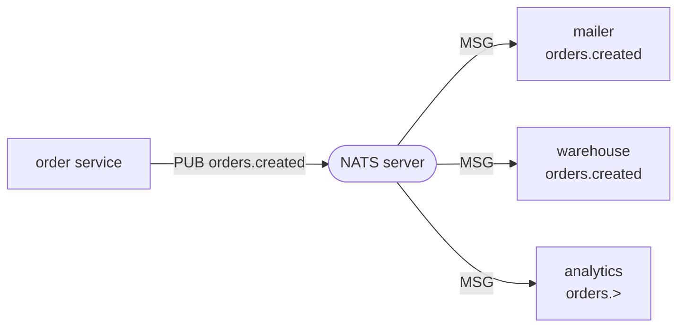
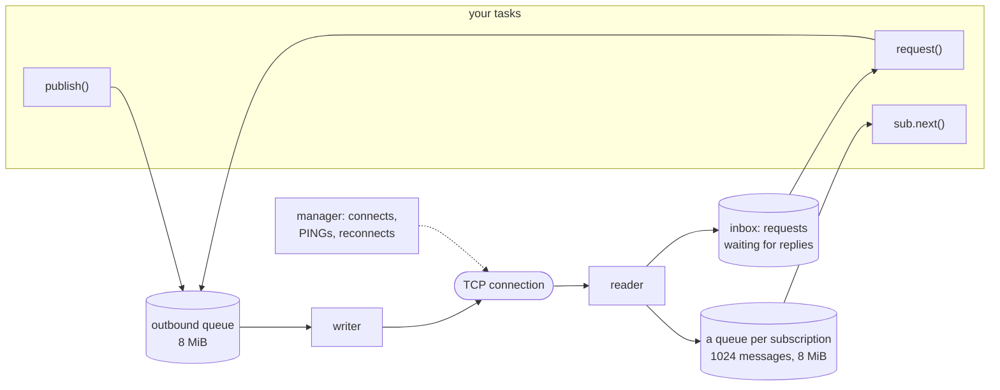
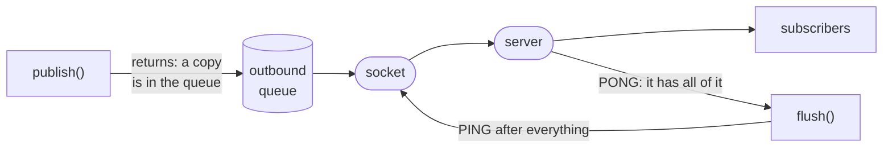
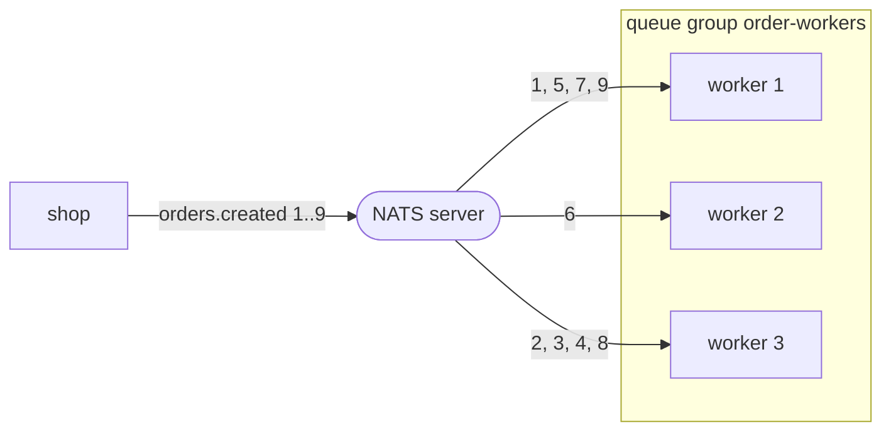
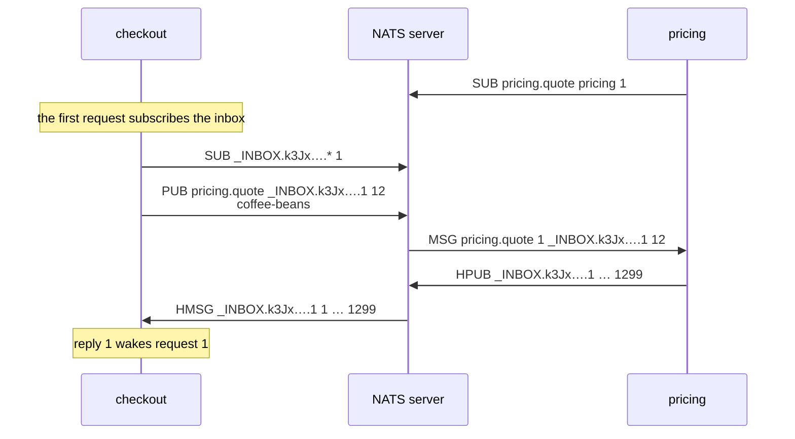
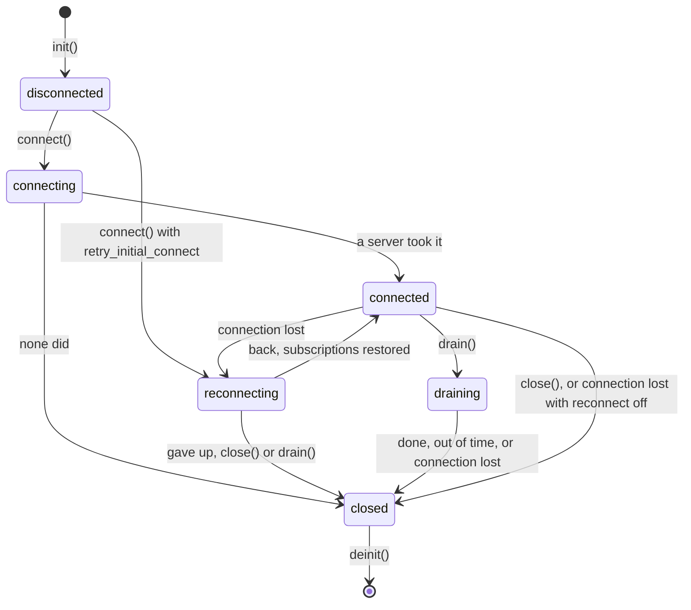
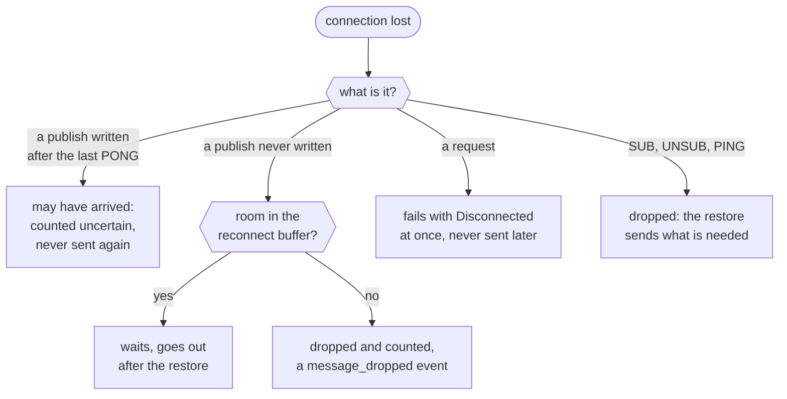
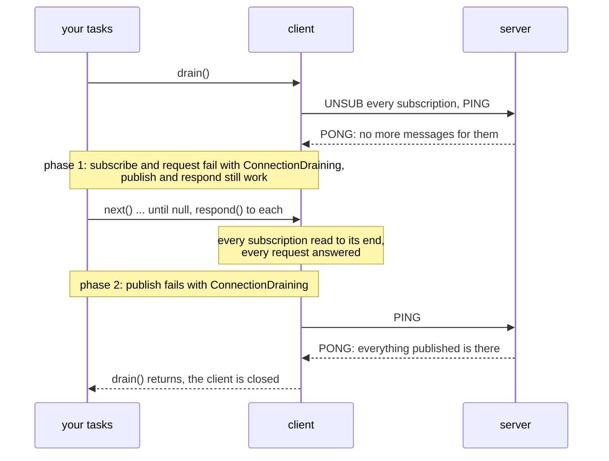

# zefir-nats: a NATS client for Zig

**A NATS client for Zig services.** NATS is a message server that lets
services talk without knowing where the others run. A service *publishes* a
message to a *subject*, a name such as `orders.created`; every service that
*subscribes* to that subject gets a copy. A service can also send a
*request* and wait for one *reply*, as with a remote call. This module is the
client side: it connects to a NATS server, keeps the connection alive, and
gives your tasks publish, subscribe, request and reply. It is written
against `std.Io` only, and runs on [zio](https://github.com/lalinsky/zio).

> [!IMPORTANT]
> **Not implemented yet (TODO):**
>
> - **JetStream**: streams, consumers, the key-value and object stores.
> - **Authentication other than a user and a password**: no token, NKey,
>   JWT or credentials files. Without authentication, or with a user and a
>   password, it works.
> - **TLS and mTLS**: the client speaks plaintext TCP only, so passwords
>   and messages travel unencrypted. Use it on a network you trust.
> - **WebSocket** and the **services API** (`$SRV`).

A first look: connect to a server, subscribe to every order event, publish
one, and take it:

```zig
var client: nats.Client = try .init(gpa, io, .{ .servers = &.{"nats://127.0.0.1:4222"} });
defer client.deinit();
try client.connect();

const sub = try client.subscribe("orders.>", .{});
defer sub.deinit();
try client.publish("orders.created", "{\"id\":1001}");

var msg = (try sub.next(.{})) orelse return;
defer msg.deinit();
std.log.info("{s}: {s}", .{ msg.subject, msg.payload });
```

- **Core NATS, all of it.** Publish with headers, subscriptions with
  wildcards and queue groups, request/reply through one shared inbox,
  scatter and gather, drain, events and statistics.
- **Bounded memory.** Every queue has a limit: what does not fit is dropped
  and counted, or waits for room. Nothing grows without bound, and while
  the client runs, nothing is lost without a count.
- **Survives the network.** When the connection drops, the client
  reconnects to the same server or another one of the cluster, subscribes
  again, and sends what waited. Nothing is ever sent twice.
- **Honest about delivery.** `publish` puts a copy in a queue; `flush`
  tells you when the server has it. A request that loses its connection
  fails at once instead of hanging.
- **No dependencies.** Only the standard library; zio comes from your
  build, not from Zefir.

## Contents

- [How NATS works](#how-nats-works)
- [How the client works](#how-the-client-works)
- [Installation](#installation)
- [Quick start](#quick-start)
- [The examples](#the-examples)
- [Publish and subscribe](#publish-and-subscribe)
- [Delivery guarantees](#delivery-guarantees)
- [Queue groups](#queue-groups)
- [Request and reply](#request-and-reply)
- [Scatter and gather](#scatter-and-gather)
- [Memory and limits](#memory-and-limits)
- [Reconnect and the fate of data](#reconnect-and-the-fate-of-data)
- [Drain](#drain)
- [Under zefir.App](#under-zefirapp)
- [Events](#events)
- [Statistics](#statistics)
- [Errors](#errors)
- [Security](#security)
- [Running on zio](#running-on-zio)
- [Logs](#logs)
- [Compatibility](#compatibility)
- [Protocol coverage](#protocol-coverage)

## How NATS works

Picture a shop built of small services. When a customer places an order,
the order service *publishes* a message to the subject `orders.created`.
It does not know who listens: the mailer sends a confirmation, the
warehouse reserves the goods, the analytics service counts the sale. Each
of them *subscribed* to `orders.created`, or to `orders.>`, which matches
every subject that starts with `orders.`. The NATS server in the middle
hands every message to every subscriber.



Three more ideas build on that:

- **Queue groups.** Workers that subscribe in the same *queue group*
  share the messages: each message goes to one of them. Start more
  workers, and each does less. See [Queue groups](#queue-groups).
- **Request and reply.** A message can carry a *reply subject*. The
  checkout asks `pricing.quote` for a price; the pricing service answers
  to the reply subject; the checkout waits for that one answer. See
  [Request and reply](#request-and-reply).
- **No storage.** Core NATS keeps nothing: a message that reaches no
  subscriber is gone, and a subscriber that comes later does not see it.
  That makes it fast and simple; when you need messages stored and
  replayed, that is JetStream, which this client does not do.

Subjects are tokens separated by dots. In a subscription, `*` matches
exactly one token (`orders.*` matches `orders.created`, not
`orders.created.eu`) and `>` matches one or more at the end
(`orders.>` matches both).

## How the client works

One `nats.Client` keeps one TCP connection to one server; the other
servers you list are for failover. Your tasks call the client; three tasks
of the client's own do the network work:



1. **Publish.** `publish` checks the subject and the size, copies the
   message into the outbound queue and returns. When the queue is full,
   it waits for room.
2. **Write.** The writer task takes what waits in the queue and writes it
   to the socket in large batches.
3. **Read.** The reader task reads what the server sends: each message
   goes into the queue of its subscription, or to the request that waits
   for it. `sub.next()` takes the oldest one.
4. **Watch.** The manager task PINGs the server every `ping_interval`. A
   server that got two PINGs and answered neither counts as gone: the
   manager takes the connection down and connects again. A PING still
   waiting behind what a slow link has not sent yet does not count, since
   the server has not seen it; a server that takes nothing at all for two
   intervals while data waits counts as gone too.

All of it runs on the `std.Io` you give the client: on zio, these three
tasks are coroutines on its executors, next to the tasks of your service.
See [Running on zio](#running-on-zio).

### Connection options

`nats.Options` describes the connection. Only `servers` has no default. A
service usually names its connection too, so that the server's monitoring
shows who is who:

```zig
var client: nats.Client = try .init(gpa, io, .{
    .servers = &.{ "nats://10.0.0.1:4222", "nats://10.0.0.2:4222" },
    .name = "orders-service",
    .connect_timeout = .fromSeconds(2),
    .no_echo = true,
});
defer client.deinit();
```

| Option                      | Default        | What it does                                                                                      |
| --------------------------- | -------------- | ------------------------------------------------------------------------------------------------- |
| `servers`                   | none, required | `nats://host:port`, `host:port` or `[::1]:4222`, port 4222 if left out; up to 64, for failover    |
| `name`                      | null           | the connection's name in the server's monitoring and logs                                         |
| `auth`                      | `.none`        | a user and a password, see [Security](#security)                                                  |
| `connect_timeout`           | 5 s            | one attempt on one server: DNS, TCP and the handshake                                             |
| `ping_interval`             | 30 s           | how often the client PINGs the server to check the connection                                     |
| `max_outstanding_pings`     | 2              | PINGs the server got and left unanswered before the connection counts as gone                     |
| `no_echo`                   | false          | true: the server does not send the client's own messages back to its subscriptions                |
| `no_responders`             | true           | a request no one subscribes to fails at once with `NoResponders`; false: it waits for its timeout |
| `verbose`                   | false          | the server confirms every operation with `+OK`; for debugging only                                |
| `pedantic`                  | false          | the server checks subjects and the protocol more strictly                                         |
| `randomize_servers`         | true           | try the servers in random order, so that clients spread over a cluster                            |
| `ignore_discovered_servers` | false          | use only `servers`, not the servers the cluster announces                                         |
| `retry_initial_connect`     | false          | `connect()` returns at once and keeps trying in the background                                    |
| `reconnect`                 | `.{}`          | see [When it reconnects](#when-it-reconnects)                                                     |
| `limits`                    | `.{}`          | see [Memory and limits](#memory-and-limits)                                                       |

`no_echo` is for a service that publishes to a subject it also subscribes
to: price updates that every instance sends and every instance listens to,
say. With it, an instance hears the others, not itself.

## Installation

Add Zefir to your `build.zig.zon`; nats ships since v0.5.0:

```sh
zig fetch --save git+https://github.com/vkiryakov/zefir#dev
```

This guide is on the `dev` branch, so the command fetches its latest commit; `--save` pins that commit. For the latest release, v0.11.0, fetch `#v0.11.0` instead.

The client runs on zio, which comes from your build, not from Zefir. zio
has no release for Zig 0.17 yet, so pin the commit Zefir is tested with:

```sh
zig fetch --save git+https://github.com/lalinsky/zio#d15034f1a4d9ddaa42829aae8f7e02d37cd1093a
```

Then import the modules in `build.zig`. The examples also use Zefir's
confy for settings, log for records and core for deadlines:

```zig
// build.zig
const std = @import("std");

pub fn build(b: *std.Build) void {
    const target = b.standardTargetOptions(.{});
    const optimize = b.standardOptimizeOption(.{});
    const zefir = b.dependency("zefir", .{ .target = target, .optimize = optimize });
    const zio = b.dependency("zio", .{ .target = target, .optimize = optimize });

    const exe = b.addExecutable(.{
        .name = "app",
        .root_module = b.createModule(.{
            .root_source_file = b.path("src/main.zig"),
            .target = target,
            .optimize = optimize,
            .imports = &.{
                .{ .name = "nats", .module = zefir.module("zefir-nats") },
                .{ .name = "zio", .module = zio.module("zio") },
                .{ .name = "confy", .module = zefir.module("zefir-confy") },
                .{ .name = "log", .module = zefir.module("zefir-log") },
                .{ .name = "core", .module = zefir.module("zefir-core") },
            },
        }),
    });
    b.installArtifact(exe);
    const run = b.addRunArtifact(exe);
    b.step("run", "Run the app").dependOn(&run.step);
}
```

Each program of this guide is a whole `src/main.zig`, and `zig build run`
runs it.

> [!TIP]
> nats is also part of the umbrella module: with `zefir.module("zefir")`
> imported as `zefir`, it is `@import("zefir").nats`. nats itself imports
> nothing from Zefir, and zio only from your build.

You need a NATS server to talk to. With Docker:

```sh
docker run --rm -p 4222:4222 nats:2.15.0-alpine
```

## Quick start

Two services of a shop. The **mailer** subscribes to every order event and
sends an email for each; the **shop** publishes an event for every order a
customer places, and one when an order is cancelled. In production each is
a program of its own. Here both run in one program, each with its own
client, so that one run shows both sides: `pub_sub.zig`, as your
`src/main.zig`.

```zig
//! Publish and subscribe. The shop publishes an event for every order a
//! customer places; the mailer subscribes to every order event and sends
//! an email for each. Two services, two clients: each would be its own
//! program in production.
//!
//! Settings, from the environment:
//!
//!   APP_NATS_URL   the server; nats://127.0.0.1:4222 by default

const std = @import("std");
const confy = @import("confy");
const log = @import("log");
const nats = @import("nats");
const zio = @import("zio");

/// The client logs through std.log; this sends its records to the logger.
pub const std_options: std.Options = .{ .logFn = log.stdLogFn };

const Config = struct {
    nats: struct {
        url: []const u8 = "nats://127.0.0.1:4222",
    } = .{},
};

/// An order event, in JSON on the wire. A cancellation carries the id only.
const Order = struct { id: u32, customer: ?[]const u8 = null, total: ?[]const u8 = null };

const orders = [_]Order{
    .{ .id = 1001, .customer = "ada@example.com", .total = "42.50" },
    .{ .id = 1002, .customer = "alan@example.com", .total = "7.99" },
    .{ .id = 1003, .customer = "grace@example.com", .total = "120.00" },
};

pub fn main(init: std.process.Init) !void {
    var config: Config = undefined;
    confy.loadOrExit(init.arena.allocator(), &config, .{
        .io = init.io,
        .environ = init.environ_map,
        .env_prefix = "APP_",
        .sources = &.{.osEnv()},
    });

    // The logger outlives the runtime, so it takes `init.io`, through which
    // any thread may log: the tasks of the runtime too.
    const logger: log.Logger = try .init(init.gpa, init.io, .{ .format = .text });
    defer logger.deinit();
    logger.installStdLog();

    // One runtime for the whole program: the clients run their tasks on it.
    const rt = try zio.Runtime.init(init.gpa, .{});
    defer rt.deinit();
    const io = rt.io();

    // The mailer subscribes first: NATS keeps no message for a subscriber
    // that comes later.
    var mailer: nats.Client = try .init(init.gpa, io, .{ .servers = &.{config.nats.url}, .name = "mailer" });
    defer mailer.deinit();
    try mailer.connect();
    // `>` matches one token or more: orders.created, orders.cancelled, ...
    const order_events = try mailer.subscribe("orders.>", .{});
    defer order_events.deinit();
    // Once flush returns, the server has the subscription.
    try mailer.flush(.{});

    var shop: nats.Client = try .init(init.gpa, io, .{ .servers = &.{config.nats.url}, .name = "shop" });
    defer shop.deinit();
    try shop.connect();
    const shop_log = logger.scoped("shop");
    for (orders) |order| {
        var buffer: [128]u8 = undefined;
        const event = try std.fmt.bufPrint(&buffer, "{f}", .{std.json.fmt(order, .{})});
        // The client copies the payload into its queue: `buffer` may be reused at once.
        try shop.publish("orders.created", event);
        shop_log.info("Order placed", .{ .order_id = order.id });
    }
    // Headers travel next to the payload, like HTTP headers.
    try shop.publishMessage(.{
        .subject = "orders.cancelled",
        .headers = &.{.{ .name = "Reason", .value = "out-of-stock" }},
        .payload = "{\"id\":1002}",
    });
    shop_log.info("Order cancelled", .{ .order_id = 1002 });
    // publish only queued the events; flush returns once the server has them.
    try shop.flush(.{});

    const mailer_log = logger.scoped("mailer");
    for (0..orders.len + 1) |_| {
        var msg = (try order_events.next(.{ .timeout = seconds(5) })) orelse break;
        defer msg.deinit();
        const event = try std.json.parseFromSlice(Order, init.gpa, msg.payload, .{});
        defer event.deinit();
        // The subject says what happened; a wildcard subscription gets them all.
        if (std.mem.eql(u8, msg.subject, "orders.created")) {
            mailer_log.info("Confirmation sent", .{ .order_id = event.value.id, .to = event.value.customer, .total = event.value.total });
        } else {
            mailer_log.info("Cancellation sent", .{ .order_id = event.value.id, .reason = msg.headers.get("Reason") });
        }
    }
}

fn seconds(n: i64) std.Io.Timeout {
    return .{ .duration = .{ .raw = .fromSeconds(n), .clock = .awake } };
}
```

Line by line:

- `confy.loadOrExit` fills `Config` from the environment: `APP_NATS_URL`
  sets the server, and without it the default stays. A bad value stops
  the program with a message before it does anything.
- The logger writes one line per record; `installStdLog` sends the
  clients' own records, which go through std.log, to it as well.
- `zio.Runtime.init` starts the runtime that runs every task of the
  program, the clients' tasks included. `rt.io()` is its `std.Io`.
- `nats.Client.init` checks the options and copies them; nothing touches
  the network yet. `connect()` connects, and from then on the client must
  stay where it is: see [Running on zio](#running-on-zio).
- The mailer subscribes before the shop publishes: NATS keeps no message
  for a subscriber that comes later. `subscribe("orders.>", .{})` returns
  a subscription that the client owns; `deinit()` ends it.
- `flush` waits until the server has processed everything sent before it.
  For the mailer that is the subscription: from then on the server sends
  it every order event.
- `publish` returns once a copy of the message is in the shop's queue;
  `publishMessage` sends headers with it. The shop's `flush` waits until
  the server has them all: without it, the program could go on with
  events still in the queue.
- `next` waits for the next message, here five seconds at most, and the
  mailer takes the four events. The message is yours: `deinit()` frees
  it.

Against the server from [Installation](#installation):

```text
$ zig build run
2026-10-27T20:48:48.342Z INFO  [shop] Order placed order_id=1001
2026-10-27T20:48:48.342Z INFO  [shop] Order placed order_id=1002
2026-10-27T20:48:48.342Z INFO  [shop] Order placed order_id=1003
2026-10-27T20:48:48.342Z INFO  [shop] Order cancelled order_id=1002
2026-10-27T20:48:48.352Z INFO  [mailer] Confirmation sent order_id=1001 to=ada@example.com total=42.50
2026-10-27T20:48:48.352Z INFO  [mailer] Confirmation sent order_id=1002 to=alan@example.com total=7.99
2026-10-27T20:48:48.352Z INFO  [mailer] Confirmation sent order_id=1003 to=grace@example.com total=120.00
2026-10-27T20:48:48.353Z INFO  [mailer] Cancellation sent order_id=1002 reason=out-of-stock
```

The mailer reads only once the shop's `flush` has returned, so the shop's
lines come first. A real mailer would go on waiting for events until the
service stops; [Drain](#drain) shows how a service stops without losing
the work it took.

## The examples

Every example of this guide is a whole program that reads its settings
with confy and logs with zefir-log. Each is shown whole in its chapter,
with a run. They connect to `nats://127.0.0.1:4222`, the server of
[Installation](#installation), unless `APP_NATS_URL` names another.

| Example                  | Chapter                                           | What it shows                                                                       |
| ------------------------ | ------------------------------------------------- | ----------------------------------------------------------------------------------- |
| `pub_sub.zig`            | [Quick start](#quick-start)                       | publish, publish with headers, a wildcard subscription, `flush`                     |
| `queue_group.zig`        | [Queue groups](#queue-groups)                     | three workers share the orders in a queue group, then drain                         |
| `request_reply.zig`      | [Request and reply](#request-and-reply)           | a pricing service answers requests within a deadline; no responders                 |
| `scatter_gather.zig`     | [Scatter and gather](#scatter-and-gather)         | one request, an answer from every warehouse; stopping early                         |
| `user_password_auth.zig` | [Security](#security)                             | a user and a password from the configuration, the password a `confy.Secret`         |
| `zio_app.zig`            | [A whole service on zio](#a-whole-service-on-zio) | a whole service: one runtime, one shared client, events, Ctrl+C and drain, restarts |

## Publish and subscribe

Publishing is how a service says that something happened. Subscribing is
how other services hear it.

### Publishing

```zig
try client.publish("orders.created", "{\"id\":1001}");
```

`publish` takes the subject and the payload, which are bytes: JSON, text,
protobuf, anything. Both are borrowed for the call only: the client copies
them, and you may reuse the memory as soon as it returns.

`publishMessage` does the same with a reply subject or headers. Headers are
name and value pairs that travel next to the payload, like HTTP headers: a
trace id, a content type, a reason. A name may repeat, and the order and
case you give are kept.

```zig
try client.publishMessage(.{
    .subject = "orders.cancelled",
    .headers = &.{
        .{ .name = "Reason", .value = "out-of-stock" },
        .{ .name = "Trace-Id", .value = "4bf92f3577b34da6" },
    },
    .payload = "{\"id\":1002}",
});
```

Before anything is queued, the client checks:

| Check                                                                                           | Error                |
| ----------------------------------------------------------------------------------------------- | -------------------- |
| a subject or reply subject with spaces, control bytes, an empty token, or `*` or `>` as a token | `InvalidSubject`     |
| a header name that is not printable ASCII or has `:`; a value with CR or LF                     | `InvalidHeader`      |
| headers on a server that does not support them                                                  | `UnsupportedFeature` |
| headers and payload together larger than the server's `max_payload` (1 MiB by default)          | `PayloadTooLarge`    |
| a protocol line longer than `limits.max_control_line_bytes` (subject, reply and sizes)          | `InvalidSubject`     |

`a*b` and `a>b` are ordinary subjects: a wildcard is always a whole token.
Bytes from 0x80 up are allowed, so subjects may be UTF-8.

The `max_payload` checked is the one the server gave this client. A
server with accounts may give a lower one than its own: nats-server sends
it in an INFO right after the handshake, and when that INFO comes with the
handshake's last reply, as it usually does, it applies before `connect()`
returns. Only a publish made in the instant before a later INFO is
checked against the server's own limit, and the server closes the
connection if it is over the account's.

### Subscribing

```zig
const sub = try client.subscribe("orders.*", .{});
defer sub.deinit();
while (true) {
    var msg = (try sub.next(.{})) orelse break;
    defer msg.deinit();
    std.log.info("{s}: {s}", .{ msg.subject, msg.payload });
}
```

A message carries:

| Field                   | What it holds                                                              |
| ----------------------- | -------------------------------------------------------------------------- |
| `subject`               | the subject it was published to; with a wildcard, the one that matched     |
| `payload`               | the bytes                                                                  |
| `reply_to`              | where the publisher wants a reply, or null                                 |
| `headers`               | the headers: `get(name)` for the first value, `getAll(name)` for every one |
| `status`, `description` | a status the server set, such as 503 "no responders"                       |

All of it lives in one allocation that `msg.deinit()` frees, so keep the
message as long as you use its slices. Header names are case-sensitive:
`get("Trace-Id")` does not find `trace-id`.

`next` waits as long as it takes; give it a timeout to wait less:

```zig
var msg = (sub.next(.{ .timeout = .{ .duration = .{ .raw = .fromSeconds(1), .clock = .awake } } }) catch |err| switch (err) {
    error.Timeout => return, // nothing came within a second
    else => |e| return e,
}) orelse return;
defer msg.deinit();
```

`next` returns null once the subscription has ended normally: after
`unsubscribe()`, after `max_messages`, or at the end of a drain. Once the
client has closed, it returns `ConnectionClosed` at once, and the messages
still waiting in the subscription are freed unread. One task at a time may
wait in `next`; a second one gets `ConcurrentReceive`. Any task may call
`unsubscribe()` or `drain()`.

The subscription options:

| Option          | Default             | What it does                                                                             |
| --------------- | ------------------- | ---------------------------------------------------------------------------------------- |
| `.queue`        | null                | join a [queue group](#queue-groups)                                                      |
| `.max_messages` | null                | end after this many messages; the server stops sending then                              |
| `.pending`      | the client's limits | how many messages and bytes may wait for `next()`                                        |
| `.overflow`     | `.drop_newest`      | what happens to a message that does not fit, see [Memory and limits](#memory-and-limits) |
| `.timeout`      | `.none`             | how long `subscribe` waits for room, see [Memory and limits](#memory-and-limits)         |

> [!IMPORTANT]
> Read a subscription with `next()` until it returns null, or `deinit()`
> it. A message counts as handled once its reader asks for the next one,
> and a [drain](#drain) waits for that. The reader may `deinit()` the
> subscription as soon as `next()` returns null, as above, even while
> another task's `sub.drain()` is about to return: `deinit()` waits for it.

<details>
<summary>How the client reads what other publishers send</summary>

The server passes headers on without checking them, so a message from
another client may carry a malformed header block. Reading never fails on
it: a line without a colon is skipped, a block without the `NATS/1.0` line
is read from its first line, and a status is read only from a well-formed
`NATS/1.0 503` line. Headers you send are checked strictly. A message
whose payload holds `\r\nMSG ...` is read whole: the size on its line says
where it ends.

</details>

## Delivery guarantees

Core NATS delivers *at most once*. Knowing exactly what each call promises
saves you from surprises:



- **`publish` returns when a copy is in the client's queue.** Not when it
  is sent, not when the server has it, never when a subscriber has it.
- **`flush` is a barrier.** It sends a PING behind everything queued and
  returns when the server answers with PONG. The server handles one
  connection in order, so by then it has processed every message before
  the PING. It does not mean any subscriber got them. A PONG that came
  counts even when the connection drops right after it: the flush
  succeeds, and a `Disconnected` from `flush` means the server did not
  confirm.
- **No subscriber, no message.** A message nobody subscribes to is gone,
  and that is not an error.
- **Nothing is sent twice.** When a connection drops, a message written
  after the last PONG may or may not have reached the server. The client
  does not send it again; it counts it in
  `stats().uncertain_outbound_frames`. What was never written waits in the
  reconnect buffer or is counted in `dropped_messages`; see
  [Reconnect and the fate of data](#reconnect-and-the-fate-of-data).
- **Requests are never retried.** A request whose connection drops fails
  with `Disconnected`, and its message is not sent later. Retrying is up to
  you, if the operation is safe to repeat.

When you need a message stored, acknowledged and redelivered, use
JetStream, through a client that has it.

## Queue groups

A queue group spreads work. Workers that subscribe to the same subject in
the same queue group share the messages: the server gives each message to
one member, at random. Add workers when the work grows, remove them when it
shrinks; the publisher does not change.



In `queue_group.zig`, three workers join the group, the shop places nine
orders, and the workers drain. Each worker subscribes with the same queue
group:

```zig
for (&subs) |*sub| {
    // Same subject, same queue group: each order goes to one of them.
    sub.* = try workers.subscribe("orders.created", .{ .queue = "order-workers" });
    subscribed += 1;
}
```

and takes its orders in a task of its own:

```zig
/// One worker: handles orders until its subscription ends. Returns how
/// many it handled.
fn work(io: std.Io, worker_log: log.Logger, sub: *nats.Subscription, number: usize) nats.Subscription.NextError!u32 {
    var handled: u32 = 0;
    while (true) {
        var order = (try sub.next(.{})) orelse break;
        defer order.deinit();
        // The work an order takes.
        try io.sleep(.fromMilliseconds(20), .awake);
        handled += 1;
        worker_log.info("Order handled", .{ .worker = number, .order_id = order.payload });
    }
    worker_log.info("Worker done", .{ .worker = number, .orders = handled });
    return handled;
}
```

The whole program, `queue_group.zig`:

```zig
//! Queue groups. Three workers share the orders: the server hands each
//! order to one member of the group `order-workers`, so every order is
//! handled once, and more workers handle more orders. At the end the
//! workers drain: they finish the orders they took, then stop.
//!
//! Settings, from the environment:
//!
//!   APP_NATS_URL   the server; nats://127.0.0.1:4222 by default

const std = @import("std");
const confy = @import("confy");
const log = @import("log");
const nats = @import("nats");
const zio = @import("zio");

/// The client logs through std.log; this sends its records to the logger.
pub const std_options: std.Options = .{ .logFn = log.stdLogFn };

const Config = struct {
    nats: struct {
        url: []const u8 = "nats://127.0.0.1:4222",
    } = .{},
};

const worker_count = 3;
const order_count = 9;

pub fn main(init: std.process.Init) !void {
    var config: Config = undefined;
    confy.loadOrExit(init.arena.allocator(), &config, .{
        .io = init.io,
        .environ = init.environ_map,
        .env_prefix = "APP_",
        .sources = &.{.osEnv()},
    });

    // The logger outlives the runtime, so it takes `init.io`, through which
    // any thread may log: the tasks of the runtime too.
    const logger: log.Logger = try .init(init.gpa, init.io, .{ .format = .text });
    defer logger.deinit();
    logger.installStdLog();

    // Four executors: the workers really run at the same time.
    const rt = try zio.Runtime.init(init.gpa, .{ .executors = .exact(4) });
    defer rt.deinit();
    const io = rt.io();

    // The workers' client. Here the three workers share it; in production
    // each is usually a process of its own, and the group works the same.
    var workers: nats.Client = try .init(init.gpa, io, .{ .servers = &.{config.nats.url}, .name = "order-workers" });
    defer workers.deinit();
    try workers.connect();

    var subs: [worker_count]*nats.Subscription = undefined;
    var subscribed: usize = 0;
    defer for (subs[0..subscribed]) |sub| sub.deinit();
    for (&subs) |*sub| {
        // Same subject, same queue group: each order goes to one of them.
        sub.* = try workers.subscribe("orders.created", .{ .queue = "order-workers" });
        subscribed += 1;
    }
    try workers.flush(.{});

    const worker_log = logger.scoped("worker");
    var tasks: [worker_count]std.Io.Future(nats.Subscription.NextError!u32) = undefined;
    var started: usize = 0;
    defer for (tasks[0..started]) |*task| {
        _ = task.cancel(io) catch 0;
    };
    for (subs, 1..) |sub, number| {
        tasks[started] = try io.concurrent(work, .{ io, worker_log, sub, number });
        started += 1;
    }

    // The shop, another service, places the orders.
    var shop: nats.Client = try .init(init.gpa, io, .{ .servers = &.{config.nats.url}, .name = "shop" });
    defer shop.deinit();
    try shop.connect();
    for (1..order_count + 1) |id| {
        var buffer: [16]u8 = undefined;
        try shop.publish("orders.created", try std.fmt.bufPrint(&buffer, "{d}", .{id}));
    }
    // Once the server has the orders, they are on their way to the workers.
    try shop.flush(.{});

    // The workers stop taking orders, finish the ones they have, and the
    // client closes; each `next()` then returns null.
    try workers.drain(.{});
    var total: u32 = 0;
    for (tasks[0..started]) |*task| total += try task.await(io);
    logger.scoped("shop").info("All orders handled", .{ .orders = total });
}

/// One worker: handles orders until its subscription ends. Returns how
/// many it handled.
fn work(io: std.Io, worker_log: log.Logger, sub: *nats.Subscription, number: usize) nats.Subscription.NextError!u32 {
    var handled: u32 = 0;
    while (true) {
        var order = (try sub.next(.{})) orelse break;
        defer order.deinit();
        // The work an order takes.
        try io.sleep(.fromMilliseconds(20), .awake);
        handled += 1;
        worker_log.info("Order handled", .{ .worker = number, .order_id = order.payload });
    }
    worker_log.info("Worker done", .{ .worker = number, .orders = handled });
    return handled;
}
```

The server hands the orders out at random, so every run splits them
differently. One run printed:

```text
$ zig build run
2026-10-13T18:08:27.232Z INFO  [worker] Order handled worker=2 order_id=6
2026-10-13T18:08:27.232Z INFO  [worker] Order handled worker=1 order_id=5
2026-10-13T18:08:27.232Z INFO  [worker] Order handled worker=3 order_id=1
2026-10-13T18:08:27.232Z INFO  [worker] Worker done worker=2 orders=1
2026-10-13T18:08:27.252Z INFO  [worker] Order handled worker=3 order_id=2
2026-10-13T18:08:27.252Z INFO  [worker] Order handled worker=1 order_id=7
2026-10-13T18:08:27.273Z INFO  [worker] Order handled worker=3 order_id=3
2026-10-13T18:08:27.273Z INFO  [worker] Order handled worker=1 order_id=9
2026-10-13T18:08:27.273Z INFO  [worker] Worker done worker=1 orders=3
2026-10-13T18:08:27.293Z INFO  [worker] Order handled worker=3 order_id=4
2026-10-13T18:08:27.314Z INFO  [worker] Order handled worker=3 order_id=8
2026-10-13T18:08:27.314Z INFO  [worker] Worker done worker=3 orders=5
2026-10-13T18:08:27.319Z INFO  [shop] All orders handled orders=9
```

Here the workers share one client, which is fine: every method of a client
may be called from any task. In production each worker is usually a
process of its own, and the group works the same. A queue group name has
no spaces or control bytes; another one is `InvalidOptions`.

## Request and reply

Request and reply is a remote call over NATS. The caller publishes a
request with a reply subject of its own and waits; a service that
subscribes to the request's subject answers to that reply subject. Several
instances of the service in one queue group share the requests.

The client gives all its requests one reply subscription, its *inbox*:
`_INBOX.<22 random characters>.*`. Each request gets its own reply subject
under it, `_INBOX.<…>.<number>`, and the number tells the reader which
waiting request a reply belongs to. Ten thousand requests at once still
take one subscription on the server.



In `request_reply.zig`, the checkout prices a cart, with 500 ms for the
whole checkout. Each quote gets what is left of that time: a
`core.Context` deadline turns into the request's timeout.

```zig
// The checkout has 500 ms in all; each quote gets what is left of it.
const ctx = core.Context.root.withDeadline(.after(std.Io.Clock.awake.now(io), .fromMilliseconds(500)));
var total: u32 = 0;
for ([_][]const u8{ "coffee-beans", "grinder", "filter-papers" }) |sku| {
    var reply = try checkout.request("pricing.quote", sku, .{ .timeout = ctx.deadline.?.toTimeout() });
    defer reply.deinit();
    const cents = try std.fmt.parseInt(u32, reply.payload, 10);
    total += cents;
    checkout_log.info("Quote received", .{ .sku = sku, .cents = cents, .currency = reply.headers.get("Currency") });
}
checkout_log.info("Cart priced", .{ .items = 3, .total_cents = total });
```

The pricing service answers with `respond`, which publishes to the
request's reply subject; `respondMessage` adds headers:

```zig
var buffer: [16]u8 = undefined;
// The reply goes to the request's reply subject, the requester's inbox.
try client.respondMessage(&request, .{
    .headers = &.{.{ .name = "Currency", .value = "EUR" }},
    .payload = try std.fmt.bufPrint(&buffer, "{d}", .{cents}),
});
```

When no one subscribes to a subject, the server answers at once with a
"no responders" status, and the request fails with `NoResponders` instead
of waiting for its timeout:

```zig
// No one serves `shipping.quote`: the server says so at once, and the
// request fails with NoResponders instead of waiting for its timeout.
if (checkout.request("shipping.quote", "berlin", .{})) |reply| {
    var unexpected = reply;
    unexpected.deinit();
} else |err| switch (err) {
    error.NoResponders => checkout_log.warn("No shipping service, shipping priced later", .{}),
    else => return err,
}
```

The whole program, `request_reply.zig`: the pricing service and the
checkout in one process, each with its own client, as two services would
be.

```zig
//! Request and reply. The pricing service answers `pricing.quote`
//! requests with the price of a product. The checkout prices a cart: it
//! asks for a quote for every item, all within the deadline of the
//! checkout itself, and learns at once when no service listens.
//!
//! Settings, from the environment:
//!
//!   APP_NATS_URL   the server; nats://127.0.0.1:4222 by default

const std = @import("std");
const confy = @import("confy");
const core = @import("core");
const log = @import("log");
const nats = @import("nats");
const zio = @import("zio");

/// The client logs through std.log; this sends its records to the logger.
pub const std_options: std.Options = .{ .logFn = log.stdLogFn };

const Config = struct {
    nats: struct {
        url: []const u8 = "nats://127.0.0.1:4222",
    } = .{},
};

/// The pricing service's catalog: price in cents by product.
const catalog = [_]struct { sku: []const u8, cents: u32 }{
    .{ .sku = "coffee-beans", .cents = 1299 },
    .{ .sku = "grinder", .cents = 4900 },
    .{ .sku = "filter-papers", .cents = 399 },
};

pub fn main(init: std.process.Init) !void {
    var config: Config = undefined;
    confy.loadOrExit(init.arena.allocator(), &config, .{
        .io = init.io,
        .environ = init.environ_map,
        .env_prefix = "APP_",
        .sources = &.{.osEnv()},
    });

    // The logger outlives the runtime, so it takes `init.io`, through which
    // any thread may log: the tasks of the runtime too.
    const logger: log.Logger = try .init(init.gpa, init.io, .{ .format = .text });
    defer logger.deinit();
    logger.installStdLog();

    const rt = try zio.Runtime.init(init.gpa, .{});
    defer rt.deinit();
    const io = rt.io();

    // The pricing service. Its subscription joins the queue group
    // `pricing`: run more instances, and each request goes to one of them.
    var pricing: nats.Client = try .init(init.gpa, io, .{ .servers = &.{config.nats.url}, .name = "pricing" });
    defer pricing.deinit();
    try pricing.connect();
    const quotes = try pricing.subscribe("pricing.quote", .{ .queue = "pricing" });
    defer quotes.deinit();
    try pricing.flush(.{});
    var service = try io.concurrent(servePrices, .{ &pricing, quotes, logger.scoped("pricing") });
    defer service.cancel(io) catch {};

    // The checkout.
    var checkout: nats.Client = try .init(init.gpa, io, .{ .servers = &.{config.nats.url}, .name = "checkout" });
    defer checkout.deinit();
    try checkout.connect();
    const checkout_log = logger.scoped("checkout");

    // The checkout has 500 ms in all; each quote gets what is left of it.
    const ctx = core.Context.root.withDeadline(.after(std.Io.Clock.awake.now(io), .fromMilliseconds(500)));
    var total: u32 = 0;
    for ([_][]const u8{ "coffee-beans", "grinder", "filter-papers" }) |sku| {
        var reply = try checkout.request("pricing.quote", sku, .{ .timeout = ctx.deadline.?.toTimeout() });
        defer reply.deinit();
        const cents = try std.fmt.parseInt(u32, reply.payload, 10);
        total += cents;
        checkout_log.info("Quote received", .{ .sku = sku, .cents = cents, .currency = reply.headers.get("Currency") });
    }
    checkout_log.info("Cart priced", .{ .items = 3, .total_cents = total });

    // No one serves `shipping.quote`: the server says so at once, and the
    // request fails with NoResponders instead of waiting for its timeout.
    if (checkout.request("shipping.quote", "berlin", .{})) |reply| {
        var unexpected = reply;
        unexpected.deinit();
    } else |err| switch (err) {
        error.NoResponders => checkout_log.warn("No shipping service, shipping priced later", .{}),
        else => return err,
    }

    // The pricing service stops: its subscription ends once it has
    // answered what it took, and the client closes.
    try pricing.drain(.{});
    try service.await(io);
}

const ServeError = nats.Subscription.NextError || nats.Client.RespondError || std.fmt.BufPrintError;

/// Answers every request of `quotes` with the price of the product it
/// names, until the subscription ends.
fn servePrices(client: *nats.Client, quotes: *nats.Subscription, pricing_log: log.Logger) ServeError!void {
    while (true) {
        var request = (try quotes.next(.{})) orelse return;
        defer request.deinit();
        const cents = for (catalog) |item| {
            if (std.mem.eql(u8, item.sku, request.payload)) break item.cents;
        } else {
            pricing_log.warn("Unknown product", .{ .sku = request.payload });
            try client.respondMessage(&request, .{ .headers = &.{.{ .name = "Error", .value = "unknown-sku" }} });
            continue;
        };
        var buffer: [16]u8 = undefined;
        // The reply goes to the request's reply subject, the requester's inbox.
        try client.respondMessage(&request, .{
            .headers = &.{.{ .name = "Currency", .value = "EUR" }},
            .payload = try std.fmt.bufPrint(&buffer, "{d}", .{cents}),
        });
        pricing_log.info("Quote sent", .{ .sku = request.payload, .cents = cents });
    }
}
```

```text
$ zig build run
2026-10-27T20:48:48.462Z INFO  [pricing] Quote sent sku=coffee-beans cents=1299
2026-10-27T20:48:48.474Z INFO  [checkout] Quote received sku=coffee-beans cents=1299 currency=EUR
2026-10-27T20:48:48.483Z INFO  [pricing] Quote sent sku=grinder cents=4900
2026-10-27T20:48:48.489Z INFO  [checkout] Quote received sku=grinder cents=4900 currency=EUR
2026-10-27T20:48:48.492Z INFO  [pricing] Quote sent sku=filter-papers cents=399
2026-10-27T20:48:48.494Z INFO  [checkout] Quote received sku=filter-papers cents=399 currency=EUR
2026-10-27T20:48:48.494Z INFO  [checkout] Cart priced items=3 total_cents=6598
2026-10-27T20:48:48.497Z WARN  [checkout] No shipping service, shipping priced later
```

Every request ends. The timeout, 2 seconds unless you give another, covers
the whole request, the wait for room in the outbound queue included;
`.none` is refused with `InvalidOptions`. How a request can end:

| Result                   | When                                                                                  |
| ------------------------ | ------------------------------------------------------------------------------------- |
| the reply, a `Message`   | the first reply came; free it with `deinit()`                                         |
| `Timeout`                | no reply in time; a reply that comes later is dropped and counted in `late_responses` |
| `NoResponders`           | no one subscribes to the subject                                                      |
| `Disconnected`           | the connection dropped while it waited; its message is never sent later               |
| `Canceled`               | its task was canceled through `std.Io`                                                |
| `TooManyPendingRequests` | `limits.max_pending_requests` (65,536) requests wait already                          |
| `PermissionDenied`       | the server refused the subscription of the inbox, see below                           |
| `ConnectionClosed`       | the client was closed                                                                 |

<details>
<summary>The fine print of requests</summary>

- `requestMessage` sends headers too. Its message must have no `reply_to`:
  the reply subject is the client's, and one of yours is refused with
  `InvalidOptions` rather than replaced without a word.
- A reply larger than `limits.max_inbound_frame_bytes`, or with a header
  block larger than `limits.max_header_bytes`, is dropped and counted,
  and so is one there is no memory for: a `message_dropped` event with no
  `sid` says so, and a warning, one per run of drops. The request then
  waits on: it ends with `Timeout`, unless another responder's reply
  comes in time.
- A request whose timeout has passed by the time its message would go
  into the outbound queue, such as one with a zero timeout, sends nothing
  and ends with `Timeout`: no responder works on an answer nobody waits
  for.
- An account that sends requests needs permission to subscribe to
  `_INBOX.>`. When the server refuses the inbox subscription, every
  waiting request and every new one fails with `PermissionDenied` at once,
  and the connection stays.
- When the server refuses to let you publish to the request's subject
  (`Permissions Violation for Publish`), the request waits until its
  timeout: the server's error names only the subject, and several waiting
  requests may share it.
- A request made while the client reconnects waits in the reconnect buffer
  and goes out with the next connection; its timeout runs meanwhile. With
  `reconnect.buffer_bytes = 0` it fails at once with `Disconnected`, and so
  it does when the next server would refuse it: larger than that server's
  `max_payload`, or with headers it does not take.
- There is no PING barrier before the first request or after a reconnect:
  the server handles a connection in order, so the inbox subscription,
  sent first, is in place before the request.

</details>

## Scatter and gather

Sometimes one request should reach many services, and you want every
answer: ask every warehouse how many units it has, ask every instance for
its health. That is *scatter and gather*. `requestMany` sends one request
and returns a stream of the responses as they come.

In `scatter_gather.zig`, three warehouses subscribe to `inventory.stock`
without a queue group, so each of them gets every request, and the shop
adds their answers up as they come:

```zig
// Everyone's answer: the stream ends after three replies, or after two
// seconds, whichever comes first.
{
    const replies = try shop.requestMany("inventory.stock", "sku-42", .{
        .timeout = .{ .duration = .{ .raw = .fromSeconds(2), .clock = .awake } },
        .max_responses = warehouses.len,
    });
    defer replies.deinit();
    var total: u32 = 0;
    var count: u32 = 0;
    while (true) {
        var reply = (try replies.next(.{})) orelse break;
        defer reply.deinit();
        const units = try std.fmt.parseInt(u32, reply.payload, 10);
        total += units;
        count += 1;
        shop_log.info("Stock reported", .{ .warehouse = reply.headers.get("Warehouse"), .units = units });
    }
    shop_log.info("Stock counted", .{ .sku = "sku-42", .warehouses = count, .units = total });
}
```

To stop earlier, on a condition of your own, leave the loop: the stream's
`deinit` drops the replies that come later.

```zig
// Enough is enough: stop at the first replies that cover 20 units. The
// stream's deinit drops the replies that come later.
{
    const replies = try shop.requestMany("inventory.stock", "sku-42", .{
        .timeout = .{ .duration = .{ .raw = .fromSeconds(2), .clock = .awake } },
    });
    defer replies.deinit();
    var found: u32 = 0;
    while (found < 20) {
        var reply = (try replies.next(.{})) orelse break;
        defer reply.deinit();
        found += try std.fmt.parseInt(u32, reply.payload, 10);
    }
    shop_log.info("Enough stock found", .{ .needed = 20, .found = found });
}
```

The whole program, `scatter_gather.zig`. Each warehouse is a service with
a client of its own, and answers a while after a request: Berlin after
100 ms, Paris after 400 and Madrid after 700, so their answers always come
in that order.

```zig
//! Scatter and gather: one request, many replies. The shop asks every
//! warehouse how many units of a product it has and adds the answers up
//! as they come. Then it asks again, but stops as soon as enough units
//! are found.
//!
//! Settings, from the environment:
//!
//!   APP_NATS_URL   the server; nats://127.0.0.1:4222 by default

const std = @import("std");
const confy = @import("confy");
const log = @import("log");
const nats = @import("nats");
const zio = @import("zio");

/// The client logs through std.log; this sends its records to the logger.
pub const std_options: std.Options = .{ .logFn = log.stdLogFn };

const Config = struct {
    nats: struct {
        url: []const u8 = "nats://127.0.0.1:4222",
    } = .{},
};

/// The warehouses: their stock of the product, and how long they take to
/// answer. Their answers come 300 ms apart, so they always come in this
/// order.
const Warehouse = struct { name: []const u8, units: u32, delay_ms: i64 };

const warehouses = [_]Warehouse{
    .{ .name = "berlin", .units = 12, .delay_ms = 100 },
    .{ .name = "paris", .units = 30, .delay_ms = 400 },
    .{ .name = "madrid", .units = 0, .delay_ms = 700 },
};

pub fn main(init: std.process.Init) !void {
    var config: Config = undefined;
    confy.loadOrExit(init.arena.allocator(), &config, .{
        .io = init.io,
        .environ = init.environ_map,
        .env_prefix = "APP_",
        .sources = &.{.osEnv()},
    });

    // The logger outlives the runtime, so it takes `init.io`, through which
    // any thread may log: the tasks of the runtime too.
    const logger: log.Logger = try .init(init.gpa, init.io, .{ .format = .text });
    defer logger.deinit();
    logger.installStdLog();

    const rt = try zio.Runtime.init(init.gpa, .{});
    defer rt.deinit();
    const io = rt.io();

    // Every warehouse is a service of its own, with its own client. They
    // subscribe without a queue group, so each of them gets every request.
    var clients: [warehouses.len]nats.Client = undefined;
    var subs: [warehouses.len]*nats.Subscription = undefined;
    var tasks: [warehouses.len]std.Io.Future(ServeError!void) = undefined;
    var started: usize = 0;
    defer for (clients[0..started], subs[0..started], tasks[0..started]) |*client, sub, *task| {
        task.cancel(io) catch {};
        sub.deinit();
        client.deinit();
    };
    for (warehouses, &clients, &subs, &tasks) |warehouse, *client, *sub, *task| {
        client.* = try .init(init.gpa, io, .{ .servers = &.{config.nats.url}, .name = warehouse.name });
        errdefer client.deinit();
        try client.connect();
        sub.* = try client.subscribe("inventory.stock", .{});
        errdefer sub.*.deinit();
        try client.flush(.{});
        task.* = try io.concurrent(serveStock, .{ io, client, sub.*, warehouse });
        started += 1;
    }

    var shop: nats.Client = try .init(init.gpa, io, .{ .servers = &.{config.nats.url}, .name = "shop" });
    defer shop.deinit();
    try shop.connect();
    const shop_log = logger.scoped("shop");

    // Everyone's answer: the stream ends after three replies, or after two
    // seconds, whichever comes first.
    {
        const replies = try shop.requestMany("inventory.stock", "sku-42", .{
            .timeout = .{ .duration = .{ .raw = .fromSeconds(2), .clock = .awake } },
            .max_responses = warehouses.len,
        });
        defer replies.deinit();
        var total: u32 = 0;
        var count: u32 = 0;
        while (true) {
            var reply = (try replies.next(.{})) orelse break;
            defer reply.deinit();
            const units = try std.fmt.parseInt(u32, reply.payload, 10);
            total += units;
            count += 1;
            shop_log.info("Stock reported", .{ .warehouse = reply.headers.get("Warehouse"), .units = units });
        }
        shop_log.info("Stock counted", .{ .sku = "sku-42", .warehouses = count, .units = total });
    }

    // Enough is enough: stop at the first replies that cover 20 units. The
    // stream's deinit drops the replies that come later.
    {
        const replies = try shop.requestMany("inventory.stock", "sku-42", .{
            .timeout = .{ .duration = .{ .raw = .fromSeconds(2), .clock = .awake } },
        });
        defer replies.deinit();
        var found: u32 = 0;
        while (found < 20) {
            var reply = (try replies.next(.{})) orelse break;
            defer reply.deinit();
            found += try std.fmt.parseInt(u32, reply.payload, 10);
        }
        shop_log.info("Enough stock found", .{ .needed = 20, .found = found });
    }

    // The warehouses stop: each answers what it took, then closes.
    for (clients[0..started]) |*client| try client.drain(.{});
    for (tasks[0..started]) |*task| try task.await(io);
}

const ServeError = nats.Subscription.NextError || nats.Client.RespondError || std.fmt.BufPrintError;

/// Answers every stock request with the warehouse's units, until the
/// subscription ends.
fn serveStock(io: std.Io, client: *nats.Client, requests: *nats.Subscription, warehouse: Warehouse) ServeError!void {
    while (true) {
        var request = (try requests.next(.{})) orelse return;
        defer request.deinit();
        // Looking the product up takes a while.
        try io.sleep(.fromMilliseconds(warehouse.delay_ms), .awake);
        var buffer: [16]u8 = undefined;
        try client.respondMessage(&request, .{
            .headers = &.{.{ .name = "Warehouse", .value = warehouse.name }},
            .payload = try std.fmt.bufPrint(&buffer, "{d}", .{warehouse.units}),
        });
    }
}
```

```text
$ zig build run
2026-10-27T20:48:48.661Z INFO  [shop] Stock reported warehouse=berlin units=12
2026-10-27T20:48:48.959Z INFO  [shop] Stock reported warehouse=paris units=30
2026-10-27T20:48:49.260Z INFO  [shop] Stock reported warehouse=madrid units=0
2026-10-27T20:48:49.260Z INFO  [shop] Stock counted sku=sku-42 warehouses=3 units=42
2026-10-27T20:48:49.694Z INFO  [shop] Enough stock found needed=20 found=42
```

The second time the shop stops at Paris: Berlin's 12 units and Paris's 30
cover the 20 it needs, and Madrid's answer, which comes later, is dropped.

The stream ends at its deadline (`timeout`, 2 seconds by default, never
`.none`) or after `max_responses` responses (32 by default), whichever comes
first; then `next` hands out what came and returns null. `next` takes its
own timeout too, for "no answer for a while": a `Timeout` there leaves the
stream going. The first response being a "no responders" status gives
`NoResponders`; a dropped connection gives what came, then
`Disconnected`, unless the stream's deadline had passed already: then it
had ended, and gives what came, then null. Any task may call `cancel()`:
what waits is dropped, and `next` returns null.

<details>
<summary>The fine print of requestMany</summary>

- The responses waiting to be taken are bounded by `max_responses` and
  by `max_bytes` (the client's `limits.subscription_bytes` by default); a
  response that does not fit is dropped.
- `max_responses` counts every response that came, the dropped ones
  included, as the server counts for its own limits.
- A stream stops counting against `max_pending_requests` once its last
  response came (`max_responses`, or a "no responders" first), or once
  `next` returned null or an error after its deadline. A stream past its
  deadline that nobody reads keeps its place until its `deinit()`, though
  `stats().pending_requests` no longer counts it and a drain does not wait
  for it. Every stream needs its `deinit()`, which frees it;
  `Client.deinit` frees the streams you forgot.
- After a [drain](#drain), the responses a stream received and its owner
  has not read stay readable: `next` hands them out, then null.
- When the server refuses the inbox while `requestMany` waits for room to
  send, it sends nothing and fails with `PermissionDenied`, as `request`
  does.

</details>

## Memory and limits

Every queue in the client has a limit, so a burst, a slow reader or a
server that stops reading never makes the client grow without bound. When
something does not fit, the client either waits for room or drops and
counts; while it runs, it never loses a message silently. When it closes,
what its subscriptions still hold goes with it, see
[What happens to the data](#what-happens-to-the-data).

> [!WARNING]
> **A burst can overflow a subscription.** What does not fit in its queue
> is dropped: see [A subscriber that falls behind](#a-subscriber-that-falls-behind).

| Limit                            | Default | When it is reached                                                 |
| -------------------------------- | ------- | ------------------------------------------------------------------ |
| `limits.outbound_bytes`          | 8 MiB   | `publish` and `subscribe` wait for room, in the order they came    |
| `limits.subscription_messages`   | 1024    | the subscription's overflow policy drops messages                  |
| `limits.subscription_bytes`      | 8 MiB   | the same; a single message larger than this is dropped as it comes |
| `limits.max_pending_requests`    | 65,536  | `request` and `requestMany` fail with `TooManyPendingRequests`     |
| `limits.max_subscriptions`       | 65,536  | `subscribe` fails with `TooManySubscriptions`                      |
| `limits.max_inbound_frame_bytes` | 64 MiB  | a larger incoming message is read past, dropped and counted        |
| `limits.max_header_bytes`        | 64 KiB  | the same for a larger header block                                 |
| `limits.max_control_line_bytes`  | 4096    | a longer subject line to send is `InvalidSubject`                  |
| `limits.max_event_queue`         | 1024    | newer events are dropped and counted in `dropped_events`           |
| `reconnect.buffer_bytes`         | 8 MiB   | while reconnecting, `publish` and `request` fail with `BufferFull` |

The wait for room in the outbound queue has no limit of its own: while
the server does not read, a `publish` or a `subscribe` waits until it
does, until the client closes, or until its task is canceled. A caller
with a deadline of its own, such as an RPC call, bounds the wait.
`publishMessageTimeout` publishes the way `publishMessage` does, but waits
no longer than its timeout, and a subscription takes a `.timeout`. When
the time is up, either fails with `Timeout` and queues nothing: no
message goes out later, and no subscription is left behind.

```zig
const two_seconds: std.Io.Timeout = .{ .duration = .{ .raw = .fromSeconds(2), .clock = .awake } };
client.publishMessageTimeout(.{ .subject = "orders.created", .payload = "{\"id\":1003}" }, two_seconds) catch |err| switch (err) {
    // The queue stayed full for two seconds: nothing was queued.
    error.Timeout => std.log.warn("orders.created was not published", .{}),
    else => |e| return e,
};
const refunds = try client.subscribe("refunds.>", .{ .timeout = two_seconds });
defer refunds.deinit();
```

What happens to a message that does not fit in a subscription is its
`.overflow` policy:

| Policy                | What is dropped                                                              |
| --------------------- | ---------------------------------------------------------------------------- |
| `.drop_newest`        | the message that came; what waits stays (the default)                        |
| `.drop_oldest`        | the oldest messages, until the new one fits                                  |
| `.close_subscription` | nothing more comes: `next` hands out what waits, then returns `SlowConsumer` |

Every dropped message counts in `sub.stats().dropped` and in the client's
`stats().dropped_messages`; a run of drops gives one `slow_consumer`
event and one warning in the log.

```zig
// A subscription that may fall behind by 100,000 messages or 256 MiB in a
// burst, and keeps the newest messages when it does.
const audit = try client.subscribe("audit.>", .{
    .pending = .{ .messages = 100_000, .bytes = 256 * 1024 * 1024 },
    .overflow = .drop_oldest,
});
defer audit.deinit();
```

### A subscriber that falls behind

A subscription is a queue in your program's memory. The client's reader
takes each message for it off the connection and puts it in that queue;
your code takes the messages out with `next()`, one at a time. By
default the queue holds 1024 messages or 8 MiB, whichever fills first.

The server does not wait for a slow reader. Core NATS has no way to tell
the server to slow down for one subscriber: it sends every message the
moment it is published. The client cannot stop reading either: the same
connection carries every subscription and every reply, and a server that
cannot write to a client for long enough cuts it off as a slow consumer.
So when a subscription's queue is full, the client drops what does not
fit, counts it, and goes on reading.

An example. The mailer takes 10 ms to send an email, so it handles 100
order events a second. At a sale, the shop publishes 10,000 orders within
a second. In that second the mailer handles about 100 of them, 1024 wait
in its queue, and the other 8,900 or so are dropped: those customers get
no email.

Here is the extreme case, in one program with a mailer and a shop client
set up as in the [quick start](#quick-start): the mailer reads none of the
burst.

```zig
// The default limits: 1024 messages and 8 MiB.
const order_events = try mailer.subscribe("orders.>", .{});
defer order_events.deinit();
try mailer.flush(.{});

// A sale: the shop publishes 10,000 orders at once, and the mailer is
// busy with something else and reads none of them yet.
for (0..10_000) |i| {
    var buffer: [32]u8 = undefined;
    try shop.publish("orders.created", try std.fmt.bufPrint(&buffer, "{{\"id\":{d}}}", .{i}));
}
try shop.flush(.{});
// The server answers this flush after every order it sent the mailer,
// so when it returns, the client has taken all of them in.
try mailer.flush(.{});

const stats = order_events.stats();
mailer_log.info("Burst over", .{
    .received = stats.received,
    .waiting = order_events.pending().messages,
    .dropped = stats.dropped,
});
```

A run of it logged:

```text
2026-10-14T15:33:39.622Z WARN  [nats] subscription 1 is a slow consumer: messages dropped
2026-10-14T15:33:40.060Z INFO  [mailer] Burst over received=10000 waiting=1024 dropped=8976
```

10,000 orders came, 1024 wait for the mailer, and 8,976 are gone. While
the program runs, a drop shows in three places:

- the log: one warning for each run of drops, as above;
- the events: a `slow_consumer` event, see [Events](#events);
- the counts: `sub.stats().dropped` for the subscription and
  `client.stats().dropped_messages` for the whole client, see
  [Statistics](#statistics).

What to do depends on the subscription:

- **Make room for the burst.** Raise `.pending` for that subscription, as
  in the example above. Memory pays for it: 100,000 waiting messages of
  1 KiB take about 100 MiB.
- **Read faster.** Several readers in a queue group share the messages:
  the server hands each message to one of them, so four readers keep up
  with about four times as many. See [Queue groups](#queue-groups).
- **Choose what is lost.** With `.overflow = .drop_oldest` the newest
  messages stay. With `.close_subscription` the subscription stops at the
  first message that does not fit, and `next()` tells your code with
  `SlowConsumer`. See the policies above.
- **Lose nothing.** Core NATS keeps no message: one that finds no room, or
  no subscriber, is gone. Keeping every message until it is read is
  JetStream, which this client does not have yet.

<details>
<summary>How the limits count</summary>

- `outbound_bytes` is a soft limit: a publish waits while the queue holds
  that much or more, then goes in whole. So a message larger than the
  limit never waits forever, and the queue holds at most the limit plus
  one message. Each queued message also counts a record of 32 bytes (on a
  64-bit target).
- The bytes of a subscription are what its messages take in memory:
  subject, reply subject, headers and payload.
- Each message takes one allocation, freed by its `deinit()`; nothing
  points into the client's read buffer.
- A message over `max_inbound_frame_bytes` or `max_header_bytes` is read
  past without allocating; the connection stays. Each such drop, and each
  message there is no memory for, gives a `message_dropped` event; the
  first of a run of drops also gives a warning in the log, the others
  stay at debug until a message is kept.
- `max_control_line_bytes` is the server's `max_control_line`: the longest
  arguments of a line the client sends, such as a subject with its reply
  subject. If your server allows longer lines, raise both together. It
  must hold the client's CONNECT line too, which the server checks
  against the same limit. Lines from the server may be longer than any
  client's: an MQTT topic, a subject mapping or a JetStream reply makes a
  message line longer than its publisher's. The client reads any line of
  up to 64 KiB, or four times `max_control_line_bytes` when that is more,
  since a `-ERR` quotes a refused subject with every byte that does not
  print escaped as four; the read buffer is that size.
- The server takes at most nine digits for a size, so a message of
  1,000,000,000 bytes or more is `PayloadTooLarge` even when the server
  gave no `max_payload`.

</details>

## Reconnect and the fate of data

Networks fail, servers restart, clusters move clients around. The client is
built to live through it: when the connection drops, it connects again,
subscribes to everything again, and carries on. What happened to each
message in flight is counted, never guessed.



Here is [a whole service on zio](#a-whole-service-on-zio), `zio_app.zig`,
taking orders for seven seconds from a server on port 14230, while a
`docker restart` of that server's container runs in another terminal. A
run of it, with the lines in between left out:

```text
$ APP_NATS_URL=nats://127.0.0.1:14230 APP_RUN_SECONDS=7 zig build run
2026-10-13T18:39:04.191Z INFO  [app] Started server=127.0.0.1:14230
2026-10-13T18:39:04.191Z INFO  [events] Connected server=127.0.0.1:14230
2026-10-13T18:39:04.394Z INFO  [orders] Order taken order_id=1 cart=coffee-beans,grinder
2026-10-13T18:39:04.395Z INFO  [customers] Order confirmed order_id=1
...
2026-10-13T18:39:06.221Z INFO  [orders] Order taken order_id=10 cart=coffee-beans,grinder
2026-10-13T18:39:06.225Z INFO  [customers] Order confirmed order_id=10
2026-10-13T18:39:06.293Z WARN  [events] Disconnected server=127.0.0.1:14230 reason=closed_by_server
2026-10-13T18:39:06.765Z INFO  [events] Reconnecting server=127.0.0.1:14230 attempt=1
2026-10-13T18:39:06.767Z INFO  [events] Reconnected server=127.0.0.1:14230
2026-10-13T18:39:06.767Z INFO  [orders] Order taken order_id=11 cart=coffee-beans,grinder
2026-10-13T18:39:06.768Z INFO  [customers] Order confirmed order_id=11
...
2026-10-13T18:39:11.036Z INFO  [customers] Order confirmed order_id=32
2026-10-13T18:39:11.192Z INFO  [app] Stopping
2026-10-13T18:39:11.200Z INFO  [events] Closed reason=drained
2026-10-13T18:39:11.200Z INFO  [app] Stopped messages_in=64 messages_out=96 reconnects=1
```

The order placed while the server was down waited in the reconnect buffer
and went out with the new connection: not one order failed.

### What happens to the data

When the connection drops, every message that has not been confirmed
goes one way or the other:



- **Uncertain.** A publish written to the socket after the PING that the
  last PONG answered may or may not have reached the server.
  `stats().uncertain_outbound_frames` counts them (publishes, responses and
  requests); they are never sent again. `flush` now and then keeps that
  number small.
- **Buffered.** A publish never written waits in the reconnect buffer, 8
  MiB by default, as long as it has room: it goes out once the new
  connection has subscribed again, in the order it was published. One
  that does not fit is dropped, counted in `dropped_messages` and reported
  by a `message_dropped` event. The publishes the lost connection never
  sent keep their room ahead of those published after the loss: a later
  publish gets `BufferFull` rather than push an earlier one out. When the
  new connection is up, a buffered publish its server would refuse, over
  its `max_payload` or with headers it does not take, is dropped and
  counted the same way instead of closing that connection.
- **Requests.** Every request waiting for a reply fails with
  `Disconnected` at once, and its message is not sent later: otherwise a
  service could act on a request whose caller was already told it failed.
- **Received, not read yet.** Messages waiting in a subscription stay
  there while the client reconnects, and `next()` hands them out. When
  the client closes instead, whether by `close()`, with
  `reconnect.enabled = false`, after `max_attempts`, after refused
  credentials, or because the connection was lost during a drain, `next()`
  returns `ConnectionClosed` at once, and what the subscription still held
  is freed unread. No counter or event counts these messages: to keep
  them, read every subscription to its end before the client closes, as
  [drain](#drain) does.

While the client reconnects:

| Call                                         | What it does                                                            |
| -------------------------------------------- | ----------------------------------------------------------------------- |
| `publish`, `request`                         | go into the reconnect buffer; `BufferFull` when it has no room, at once |
| `publish`, `request` with `buffer_bytes = 0` | fail with `Disconnected` at once                                        |
| `subscribe`                                  | works: the subscription is sent with the restore                        |
| `flush`, `rtt`                               | fail with `Disconnected`: there is no server to confirm anything        |
| `sub.next()`                                 | keeps waiting; the messages come again after the restore                |

A new connection first brings the server up to date, before anything
that waited: a SUB for every subscription with the same id as before, the
inbox, and an `UNSUB` with the rest of every `max_messages`. Only then do
the buffered messages go out, and then the new ones. There is no PING
barrier: the server handles the connection in order.

### When it reconnects

The first attempt is immediate after a connection that lasted at least
`reconnect.max_delay` (10 s), or that left a server in lame duck mode
after at least `reconnect.min_delay`. After a shorter one, and after a
failed attempt, the client waits:
`reconnect.min_delay` (500 ms), then twice that, and so on, up to
`reconnect.max_delay`, which it never exceeds. That is why the restart
above took about half a second: the connection had lasted only two. With `jitter` on (the
default), every wait is cut by a random part of up to a fifth, so a
hundred clients that lost the same server do not come back in the same
millisecond.

- It goes round the servers: those you listed and those the cluster
  announced, in random order unless `randomize_servers = false`.
- A connection that lasted less than `max_delay` sets the pace as a
  failed attempt does: a server that accepts and drops every connection
  is tried again after growing waits, never in a tight loop.
- `reconnect.max_attempts` (null: forever) gives up after that many
  attempts in a row that did not connect; the client then closes with
  reason `reconnect_failed`. Every connection that gets through the
  handshake starts the count again, however short it was, so a server
  that keeps dropping the client right after the handshake is tried
  forever, with waits that grow up to `max_delay`.
- A server going away gracefully (lame duck mode, `ldm` in its INFO) is
  left at once for another server of the pool, with a `lame_duck` event,
  once the connection lasted `min_delay`. A server that says so as soon
  as the client connects, on every connection, is paced like any that
  drops it. A [drain](#drain) under way finishes on the server it is on.
- An attempt for which the `io` cannot start a task fails like any
  other: the client tries again after the next wait, and a reader or
  writer that cannot start ends the new connection the same way.
- `reconnect.enabled = false` closes the client when the connection drops.
- `retry_initial_connect = true` makes `connect()` return at once and keep
  trying in the background, as if reconnecting: publishes and
  subscriptions made meanwhile go out once connected.

> [!NOTE]
> **Refused credentials.** On the first connect, a refused user or
> password fails `connect()` with `AuthenticationFailed`. When
> reconnecting, the client stops after a server refuses it twice the same
> way in a row (reason `auth_failed`), unless
> `reconnect.abort_on_auth_error = false`. A refusal on a live connection,
> as when the password changes on the server and its configuration is
> reloaded, counts as the first: with a single server, the client stops at
> the first refused reconnect.

<details>
<summary>The fine print of the reconnect buffer and the counts</summary>

- `reconnect.buffer_bytes` counts each message with a record of 32 bytes,
  as the outbound queue does. A message larger than the whole
  buffer fails with `BufferFull` at once.
- A buffered request still has its own timeout; a request that ends while
  buffered gives its room back, and its message is not sent. So does a
  `requestMany` stream past its deadline that nobody reads, as soon as a
  publish needs the room.
- Moving the buffered messages, when requests end or a connection comes
  back, allocates nothing: no message is lost for lack of memory there.
- A message written in part when the connection dropped never reached the
  server whole: it counts as dropped.
- `close()` counts what never went out in `dropped_messages`, and what was
  written but not confirmed in `uncertain_outbound_frames`, as a lost
  connection does. What the subscriptions still hold is freed unread, and
  not counted.
- The servers announced by a cluster (`connect_urls` in INFO) join the
  pool, up to 64 servers in all; they leave it when the cluster stops
  announcing them, the current one aside. `ignore_discovered_servers`
  keeps only yours. `discoveredServers(buffer)` lists them.

</details>

## Drain

`close()` stops at once: what is still queued is not sent, and every task
waiting in the client gets `ConnectionClosed`. A service that stops for a
deploy wants more: finish the work it took, answer the requests it
received, then go. That is `drain()`.



1. The subscriptions stop. The server gets an `UNSUB` for each, and once
   it confirms them, no new message comes. Messages already on their way
   still come out of `next()`, then null. A `subscribe` that has not got
   its subscription in when the drain begins fails with
   `ConnectionDraining`, and so does every later one.
2. The client waits until every subscription is read to its end and every
   request it sent got its answer. Publishes and responds still work, so a
   handler can answer the request it took.
3. Publishes stop too. What was published goes out and is confirmed, and
   the client closes, with reason `drained`. A publish still waiting for
   room in the outbound queue at that moment fails with
   `ConnectionDraining`: every publish that returned was confirmed.

Throughout, the connection is up: `isConnected()` is true and
`connectedServer()` names the server. Responses that a `requestMany`
stream received and its owner has not read stay readable after the
drain. A drain that begins while the client is about to leave a server in
lame duck mode stays and finishes on that server.

`drain(.{})` gives it 30 seconds; at the deadline it closes anyway and
returns `Timeout`. A connection lost during a drain closes the client too,
with `Disconnected`, and what the subscriptions still held is freed unread,
as with `close()`. From [a whole service on zio](#a-whole-service-on-zio):

```zig
app_log.info("Stopping", .{});
// No new orders; then the service answers the ones it took and closes.
customers.cancel(io) catch {};
try client.drain(.{});
try service.await(io);
try events.await(io);
```

The handler that takes orders loops on `next()` until null, which the
drain brings:

```zig
while (true) {
    var order = (try orders.next(.{})) orelse return;
    defer order.deinit();
```

> [!IMPORTANT]
> A message counts as handled once its reader comes back to `next()` for
> the next one, so a handler that loops on `next()` answers its last
> message before publishing stops. A subscription that nobody reads holds
> the drain until its timeout: read every subscription until null, or
> `deinit()` it.

`sub.drain(.{})` does the same for one subscription: the server stops
sending, what came is handed out, and it returns once the reader came back
for more. Another task must be reading, and it may `deinit()` the
subscription as soon as `next()` returns null: `deinit()` waits until the
drain has returned. At its timeout the drain returns `Timeout`, and the
subscription has ended anyway; without a connection it ends at once. A
second `sub.drain()` while one runs, or one during the client's
`drain()`, adds nothing: it waits until that drain ends the subscription,
so nothing on its way is lost.

## Under zefir.App

A service whose servers use NATS, such as an rpc server on
[rpc-nats](../../rpc-nats/examples/README.md), hands its client to
`zefir.App` of zefir-core with the rest of its beans: App connects the
client before the servers that take it, watches it while they run, and
drains it after they have stopped. The client is a bean as it is, made by
a factory such as
`pub fn natsClient(gpa: std.mem.Allocator, io: std.Io, config: *const Config) !nats.Client`,
which returns `.init(gpa, io, .{ .servers = &.{config.nats.url}, .name = "users" })`.
App drives it with three of its methods, and frees it with `deinit`:

| Method | What it does |
| --- | --- |
| `start(io)` | `connect()`, before every bean that takes the client: after a failed connect App starts nothing more and stops what it started |
| `wait(io)` | waits until the client closes, then says why: `{}` after `close`, `drain` or `shutdown`; `error.ConnectionLost`, `error.AuthenticationFailed` or `error.ReconnectFailed` when it closed by itself, which stops the whole App |
| `shutdown(io, deadline)` | `drain()` by the deadline, then closed, after the servers that use the client have stopped |

- **A reconnect is no failure.** While the client reconnects, `wait`
  waits on, and an rpc server on it is not ready meanwhile. With the
  default `reconnect` the client never gives up; with
  `reconnect.max_attempts` it gives up after that many failed attempts in
  a row, and `wait` returns `error.ReconnectFailed`: App stops the
  service, and `app.failure()` names the client, or the rpc server whose
  subscriptions ended with it, whichever told App first.
- **The drain keeps to the deadline.** `shutdown` ends the drain 250 ms
  before App's deadline at the latest, so that App has time for the rest;
  a drain that does not finish by then returns `error.Timeout`, and the
  client closes anyway, with no task left. A client without a connection
  at that moment, as while it reconnects, has nothing to drain: it closes
  at once and returns `{}`, and so does one whose connection is lost
  during the drain.
- **No `requestStop`.** The servers need NATS until their own drain ends:
  their failures and last responses go out through it. App shuts the
  beans with `requestStop`, the servers, down first, all together, and
  the other beans after them, in the reverse order of their creation: so
  the client is drained after the servers.
- `connect`, `drain` and `close` stay as they are, for a client that a
  program drives itself, as the examples of this guide do.

The [guide of rpc-nats](../../rpc-nats/examples/README.md#under-zefirapp)
runs a whole service under App against a NATS server: the client, the
transport of rpc on it, and an rpc server.

## Events

The connection lives a life of its own between your calls: it drops, comes
back, moves to another server; a server refuses a subject; a slow
subscriber drops messages. The client tells you through events:

```zig
/// Logs what happens to the connection, until the client has closed.
fn logEvents(client: *nats.Client, events_log: log.Logger) nats.Client.NextEventError!void {
    while (try client.nextEvent(.{})) |event| switch (event) {
        .connected => |server| events_log.info("Connected", .{ .server = server }),
        .disconnected => |lost| events_log.warn("Disconnected", .{ .server = lost.server, .reason = lost.reason }),
        .reconnecting => |attempt| events_log.info("Reconnecting", .{ .server = attempt.server, .attempt = attempt.attempt }),
        .reconnected => |server| events_log.info("Reconnected", .{ .server = server }),
        .closed => |reason| events_log.info("Closed", .{ .reason = reason }),
        else => events_log.info("Event", .{ .kind = std.meta.activeTag(event) }),
    };
}
```

| Event               | Carries                                      | When                                                              |
| ------------------- | -------------------------------------------- | ----------------------------------------------------------------- |
| `connected`         | the server                                   | the first connection is up                                        |
| `disconnected`      | the server and the reason                    | the connection dropped: by the server, stale, an error, lame duck |
| `reconnecting`      | the server and the attempt number            | an attempt begins                                                 |
| `reconnected`       | the server                                   | back, with the subscriptions restored                             |
| `server_discovered` | the server                                   | the cluster announced a server                                    |
| `server_removed`    | the server                                   | the cluster stopped announcing one                                |
| `lame_duck`         | the server                                   | the server is about to go away                                    |
| `slow_consumer`     | the subscription's id                        | a subscription began dropping messages, once per run              |
| `message_dropped`   | why, how many, the subscription, if any      | messages were lost: unsent, too large, no memory                  |
| `permission_denied` | the operation, the subject, the subscription | the server refused a subject                                      |
| `auth_error`        | the server                                   | the server refused the credentials                                |
| `protocol_error`    | the server                                   | the server broke the protocol, or says the client did             |
| `server_error`      | the server's text                            | an error after which the connection stays                         |
| `closed`            | the reason                                   | the client closed: always the last event                          |

One task at a time may wait in `nextEvent`. The client keeps
`limits.max_event_queue` events (1024); while that many wait, newer ones
are dropped and counted in `stats().dropped_events`, except `closed`, which
always comes, and so are events there is no memory for. After `close()`,
`nextEvent` hands out what waits, then `closed`, then null. An event owns
no memory: a text in it is cut to 128 bytes. The texts of `server_error`
and `permission_denied` are the server's bytes as it sent them: escape
them before you print them, as the client does in its own log. A
`message_dropped` names a subscription only for messages of one: none for
publishes, nor for replies to requests.

The reasons a client closes, `nats.CloseReason`: `closed` (by `close()` or
`deinit()`, by `drain()` before the first connection, or by canceling the
`connect()` that started it), `drained`, `drain_failed`, `connect_failed`,
`connection_lost` (reconnect off, or lost while draining), `auth_failed`
and `reconnect_failed`.

## Statistics

`client.stats()` returns a snapshot of counters that cover the client's
whole life, across connections; `sub.stats()` and `sub.pending()` do the
same for one subscription.

```zig
const stats = client.stats();
std.log.info("in {d}, out {d}, dropped {d}, uncertain {d}, reconnects {d}", .{
    stats.messages_in, stats.messages_out, stats.dropped_messages, stats.uncertain_outbound_frames, stats.reconnects,
});
```

| Field                               | Counts                                                                        |
| ----------------------------------- | ----------------------------------------------------------------------------- |
| `messages_in`, `bytes_in`           | messages from the server, dropped ones included; bytes of headers and payload |
| `messages_out`, `bytes_out`         | publishes, responses and requests the client accepted                         |
| `active_subscriptions`              | subscriptions that take messages now                                          |
| `pending_requests`                  | requests and requestMany streams waiting                                      |
| `pending_outbound_bytes`            | what waits to be written, or for the next connection                          |
| `pending_subscription_bytes`        | what the subscriptions hold for `next()`                                      |
| `reconnects`                        | connections made again after one was lost                                     |
| `request_timeouts`, `no_responders` | requests that ended so                                                        |
| `dropped_messages`                  | incoming messages dropped, and publishes never sent; not those freed at close |
| `uncertain_outbound_frames`         | messages written to a connection lost or closed before the server confirmed them |
| `late_responses`                    | replies that came after their request ended                                   |
| `dropped_events`                    | events the full queue dropped, or there was no memory for                     |
| `rtt`                               | the round trip of the last `flush` or `rtt`                                   |
| `connected_for`                     | how long the current connection has been up                                   |

> [!NOTE]
> Each counter is an atomic, read on its own while the client works, so a
> snapshot is not one instant: a message counted in `messages_in` may not
> show in `pending_subscription_bytes` yet. Each number is exact; the sums
> between them may be a message apart.

## Errors

Every function lists the errors it returns: a subset of `nats.Error`, plus
errors of `std.Io` that pass through unchanged, the network errors such as
`ConnectionRefused`, and `EntropyUnavailable` from `request` and
`requestMany`. Switch on them by name:

| Error                                            | Meaning                                                         |
| ------------------------------------------------ | --------------------------------------------------------------- |
| `InvalidOptions`                                 | an option breaks a rule; checked before anything connects       |
| `InvalidSubject`                                 | a subject that cannot be used, or a line too long               |
| `InvalidHeader`                                  | a header name or value that cannot be sent                      |
| `PayloadTooLarge`                                | headers and payload exceed the server's `max_payload`           |
| `BufferFull`                                     | the reconnect buffer has no room                                |
| `SlowConsumer`                                   | a `.close_subscription` subscription dropped messages and ended |
| `PermissionDenied`                               | the server refused the subject                                  |
| `ConcurrentReceive`                              | another task already waits in `next` or `nextEvent`             |
| `NoReplySubject`                                 | `respond` to a message without a reply subject                  |
| `TooManySubscriptions`, `TooManyPendingRequests` | a limit of the client                                           |
| `Timeout`                                        | the time ran out                                                |
| `NoResponders`                                   | no one subscribes to the request's subject                      |
| `Canceled`                                       | the task was canceled through `std.Io`                          |
| `Disconnected`                                   | no connection at the moment                                     |
| `ConnectionClosed`                               | the client is closed                                            |
| `ConnectionDraining`                             | the client drains and takes no new work                         |
| `AuthenticationFailed`                           | the server refused the user or the password                     |
| `ConnectionLost`                                 | `wait`: the connection was lost and the client closed           |
| `ReconnectFailed`                                | `wait`: `reconnect.max_attempts` attempts in a row failed       |
| `UnsupportedSecurityFeature`                     | the server wants TLS                                            |
| `UnsupportedFeature`                             | the server cannot do what was asked, such as headers            |
| `ProtocolError`                                  | the server broke the protocol, or says the client did           |
| `ConcurrencyUnavailable`                         | the `std.Io` cannot run the client's tasks                      |
| `OutOfMemory`                                    | no memory                                                       |
| `EntropyUnavailable` (from `std.Io`)             | no secure randomness for the inbox name of the first request    |

Errors the server reports later, outside any call, such as a refused
subscription, come as [events](#events). A subscription the server
refuses ends: its `next()` returns `PermissionDenied`. To know it before
any message is due, flush after subscribing and ask the subscription. The
server answers a SUB before the PONG of a later PING, so once `flush()`
has returned, `isDenied()` tells, without taking a message:

```zig
const payments = try client.subscribe("payments.>", .{});
defer payments.deinit();
try client.flush(.{});
// The permissions of this user do not let it read payments.
if (payments.isDenied()) return error.PaymentsNotAllowed;
```

<details>
<summary>What InvalidOptions catches</summary>

No server, more than 64, or one that does not parse; a URL with a scheme
other than `nats://` (`tls://`, `ws://`), or with a user and password in it;
an empty `name`, or a name, user or password that is not UTF-8; an empty
user or password; a zero duration, limit or `max_outstanding_pings`;
`max_delay` below `min_delay`; `max_attempts = 0`; `retry_initial_connect`
without reconnect; `max_control_line_bytes` over 64 KiB or too short for
the client's own CONNECT; `max_header_bytes` over `max_inbound_frame_bytes`.

</details>

## Security

This version is for a network you trust.

- **Plaintext only.** Everything travels unencrypted, the password
  included. Over an untrusted network, put the connection in a tunnel
  (WireGuard, an SSH tunnel, a service mesh) or wait for TLS.
- **No authentication, or a user and a password.** No token, NKey, JWT or
  credentials file.
- **A server that requires TLS** says so in its first message; the client
  refuses with `UnsupportedSecurityFeature` before the password is ever
  sent.
- **A TLS-first server** sends nothing until a TLS handshake, which never
  comes, and hangs up after its own TLS timeout, 2 seconds by default:
  `connect()` fails with `Disconnected`. With a `connect_timeout` shorter
  than the server's TLS timeout, it fails with `Timeout`.
- **The password stays secret.** It never appears in logs, events or
  errors. The client keeps its own copy of the credentials and wipes it
  with `std.crypto.secureZero` when it is freed.
- **The server cannot write your log.** Text from the server that the
  client logs, a `-ERR` or a server address it cannot use, has every byte
  that does not print (CR, LF, ESC, bytes from 0x80) written as `\xNN`,
  and is cut after 256 bytes, so neither the server nor anyone on the
  plaintext connection can forge a log line or send your terminal a
  sequence.

`user_password_auth.zig` connects as a user with a password. Both come
from the configuration, the password as a `confy.Secret`:

```zig
const Config = struct {
    nats: struct {
        url: []const u8 = "nats://127.0.0.1:4222",
        user: []const u8,
        password: confy.Secret,
    },
};
```

The whole configuration goes to the log, where the password comes out as
`[REDACTED]`, and the client gets the password through `expose()`:

```zig
// The whole configuration may be logged: the password comes out as [REDACTED].
logger.info("Connecting", .{ .config = config });
var client: nats.Client = try .init(init.gpa, io, .{
    .servers = &.{config.nats.url},
    .name = "billing",
    .auth = .{ .user_password = .{
        .username = config.nats.user,
        .password = config.nats.password.expose(),
    } },
});
defer client.deinit();
client.connect() catch |err| switch (err) {
    // A wrong user or password. Not worth retrying with the same ones.
    // Returning, rather than exiting, lets `deinit` wipe the client's
    // copy of the credentials.
    error.AuthenticationFailed => {
        logger.err("The server refused the user or the password", .{ .user = config.nats.user });
        return 1;
    },
    else => return err,
};
logger.info("Connected", .{ .user = config.nats.user });
```

The whole program, `user_password_auth.zig`:

```zig
//! A server that wants a user and a password. Both come from the
//! configuration, the password as a `confy.Secret`: the logger writes it
//! as [REDACTED], and the program reads it with `expose()` only where the
//! client gets it. The client keeps its own copy of the credentials and
//! wipes it when it is freed.
//!
//! The password travels in plaintext, as this client does not do TLS: use
//! it on a trusted network only.
//!
//! Settings, from the environment or a `.env` file in the working
//! directory:
//!
//!   APP_NATS_URL        the server; nats://127.0.0.1:4222 by default
//!   APP_NATS_USER       the user
//!   APP_NATS_PASSWORD   the password

const std = @import("std");
const confy = @import("confy");
const log = @import("log");
const nats = @import("nats");
const zio = @import("zio");

/// The client logs through std.log; this sends its records to the logger.
pub const std_options: std.Options = .{ .logFn = log.stdLogFn };

const Config = struct {
    nats: struct {
        url: []const u8 = "nats://127.0.0.1:4222",
        user: []const u8,
        password: confy.Secret,
    },
};

pub fn main(init: std.process.Init) !u8 {
    var config: Config = undefined;
    // A missing user or password stops the program here, and says which.
    confy.loadOrExit(init.arena.allocator(), &config, .{
        .io = init.io,
        .environ = init.environ_map,
        .env_prefix = "APP_",
        .sources = &.{ .env(".env"), .osEnv() },
    });

    // The logger outlives the runtime, so it takes `init.io`, through which
    // any thread may log: the tasks of the runtime too.
    const logger: log.Logger = try .init(init.gpa, init.io, .{ .format = .text });
    defer logger.deinit();
    logger.installStdLog();

    const rt = try zio.Runtime.init(init.gpa, .{});
    defer rt.deinit();
    const io = rt.io();

    // The whole configuration may be logged: the password comes out as [REDACTED].
    logger.info("Connecting", .{ .config = config });
    var client: nats.Client = try .init(init.gpa, io, .{
        .servers = &.{config.nats.url},
        .name = "billing",
        .auth = .{ .user_password = .{
            .username = config.nats.user,
            .password = config.nats.password.expose(),
        } },
    });
    defer client.deinit();
    client.connect() catch |err| switch (err) {
        // A wrong user or password. Not worth retrying with the same ones.
        // Returning, rather than exiting, lets `deinit` wipe the client's
        // copy of the credentials.
        error.AuthenticationFailed => {
            logger.err("The server refused the user or the password", .{ .user = config.nats.user });
            return 1;
        },
        else => return err,
    };
    logger.info("Connected", .{ .user = config.nats.user });

    const round_trip = try client.rtt(.{});
    logger.info("Server reached", .{ .rtt_us = round_trip.toMicroseconds() });
    try client.drain(.{});
    return 0;
}
```

To try it, start a second server next to the one of
[Installation](#installation), on port 14223, that wants the user `alice`
with the password `secret`:

```sh
docker run --rm -p 14223:4222 nats:2.15.0-alpine nats-server --user alice --pass secret
```

With that password, the client connects, and `rtt` measures a round trip
to the server:

```text
$ APP_NATS_URL=nats://127.0.0.1:14223 APP_NATS_USER=alice APP_NATS_PASSWORD=secret zig build run
2026-10-27T20:48:50.024Z INFO  Connecting config.nats.url=nats://127.0.0.1:14223 config.nats.user=alice config.nats.password=[REDACTED]
2026-10-27T20:48:50.032Z INFO  Connected user=alice
2026-10-27T20:48:50.035Z INFO  Server reached rtt_us=3381
```

With a wrong one, the server refuses the client, and the program ends with
exit code 1, which `zig build run` reports after these lines:

```text
$ APP_NATS_URL=nats://127.0.0.1:14223 APP_NATS_USER=alice APP_NATS_PASSWORD=wrong zig build run
2026-10-27T20:48:50.056Z INFO  Connecting config.nats.url=nats://127.0.0.1:14223 config.nats.user=alice config.nats.password=[REDACTED]
2026-10-27T20:48:50.060Z ERROR The server refused the user or the password user=alice
```

Without a password, confy stops the program before it connects, and says
which setting is missing; the exit code is 1 again:

```text
$ APP_NATS_URL=nats://127.0.0.1:14223 APP_NATS_USER=alice zig build run
error(confy): 1 configuration problem:
  nats.password: missing (set APP_NATS_PASSWORD)
```

## Running on zio

The client starts tasks of its own: the reader, the writer and the
manager of [How the client works](#how-the-client-works). It runs them on
the `std.Io` it is given, and zio runs them as coroutines, each with a
small stack, on its executors, next to the tasks of your service: a
service may have thousands of tasks waiting in a client at once. Create
one runtime for the whole application in `main`, and give its `io` to
every part of it, as [the whole service](#a-whole-service-on-zio) below
does:

```zig
// One runtime for the application, with an executor per CPU core. The
// parts of the service take its `io`: the client and the tasks.
const rt = try zio.Runtime.init(init.gpa, .{ .executors = .auto });
defer rt.deinit();
const io = rt.io();
```

`.executors = .auto` starts an executor per CPU core, or as many as a
container's CPU limit allows. Most programs of this guide pass `.{}`, one
executor, on which every task takes its turn; `queue_group.zig` asks for
four, so that its workers run at the same time. A connection is one
stream of bytes that one task writes, so a client publishes about as fast
on one executor as on several: more executors pay off when your own work
needs the cores.

**Host names.** A server given by its name, such as
`nats://nats.internal:4222`, is looked up again on each attempt to
connect, within the attempt's `connect_timeout`. zio looks a name up
without blocking a thread: on Linux with a resolver of its own, which
reads `/etc/hosts` and `/etc/resolv.conf`, and on macOS and Windows
through the system's asynchronous lookup. When `connect_timeout` runs
out, or `close()` or a cancel ends the attempt, the lookup stops with it.

> [!WARNING]
> **A connected client must not move.** `connect()` starts tasks that keep
> a pointer to the client. Do not copy it, and do not return it from a
> function by value after `connect()`: the tasks would go on using the old
> place, and the program would crash or hang. In Debug and ReleaseSafe
> builds, a method called on a moved client panics with
> `nats.Client moved after connect(): keep it where connect() ran (see the guide)`.
> Initialize it where it will live, `var client: nats.Client = try .init(…)`
> in the function that uses it, or through a pointer, as below.

A function that connects a client in the place where its caller keeps it:

```zig
/// Connects `client` where it will stay: once connected, a client must not move.
fn connectInPlace(client: *nats.Client, gpa: std.mem.Allocator, io: std.Io, url: []const u8) !void {
    client.* = try .init(gpa, io, .{ .servers = &.{url} });
    errdefer client.deinit();
    try client.connect();
}
```

and the caller, in whose function the client lives:

```zig
var client: nats.Client = undefined;
try connectInPlace(&client, gpa, io, "nats://127.0.0.1:4222");
defer client.deinit();
```

A few more rules:

- **Any task, any method.** Every method of a client may be called from
  any task at the same time. A subscription has one reader at a time in
  `next()`; any task may `unsubscribe()` or `drain()` it.
- **A thread-safe allocator.** The client allocates from its tasks, so the
  allocator must be thread-safe: `init.gpa`, `std.heap.smp_allocator`.
- **Free in order.** `sub.deinit()` only while no task waits in its
  `next()`, and every subscription and stream before `client.deinit()`.
  A `sub.deinit()` waits for a `sub.drain()` of it in another task to
  return. `client.deinit()` closes the client first if needed; calling it twice
  is fine. After `close()`, `connect()` returns `ConnectionClosed`: make a
  new client to connect again.
- **Canceling works.** Every wait in the client is a cancelation point of
  `std.Io`: cancel the task, and the call returns `Canceled`. Canceling
  the `connect()` that started connecting closes the client; another
  `connect()` that waited for it just returns.

### A whole service on zio

`zio_app.zig` is the order service of a shop, whole: one runtime on every
CPU core, one client that every task shares, a task that takes orders in
a queue group, one that logs the events of the connection, and, for the
demo, customers who place an order every 200 ms. It runs until Ctrl+C or
SIGTERM, or for `APP_RUN_SECONDS` seconds, then drains.
[Reconnect and the fate of data](#reconnect-and-the-fate-of-data) shows a
run of it through a restart of its server.

```zig
//! A whole service on zio: the order service of a shop. One zio runtime
//! runs everything on all CPU cores; one NATS client serves every task of
//! the service: one takes orders, one logs what happens to the
//! connection. The demo plays the customers too: a task places an order
//! every 200 ms.
//!
//! The service runs until Ctrl+C or SIGTERM, then drains: it answers the
//! orders it took, and closes. A server restart does not stop it: the
//! client reconnects and subscribes again, and the customers' orders go
//! through once it is back.
//!
//! Settings, from the environment:
//!
//!   APP_NATS_URL      the server; nats://127.0.0.1:4222 by default
//!   APP_RUN_SECONDS   stop after this many seconds, as if Ctrl+C came

const std = @import("std");
const confy = @import("confy");
const log = @import("log");
const nats = @import("nats");
const zio = @import("zio");

/// The client logs through std.log; this sends its records to the logger.
pub const std_options: std.Options = .{ .logFn = log.stdLogFn };

const Config = struct {
    nats: struct {
        url: []const u8 = "nats://127.0.0.1:4222",
    } = .{},
    run_seconds: ?u32 = null,
};

pub fn main(init: std.process.Init) !void {
    var config: Config = undefined;
    confy.loadOrExit(init.arena.allocator(), &config, .{
        .io = init.io,
        .environ = init.environ_map,
        .env_prefix = "APP_",
        .sources = &.{.osEnv()},
    });

    // The logger outlives the runtime, so it takes `init.io`, through which
    // any thread may log: the tasks of the runtime too.
    const logger: log.Logger = try .init(init.gpa, init.io, .{ .format = .text });
    defer logger.deinit();
    logger.installStdLog();

    // One runtime for the application, with an executor per CPU core. The
    // parts of the service take its `io`: the client and the tasks.
    const rt = try zio.Runtime.init(init.gpa, .{ .executors = .auto });
    defer rt.deinit();
    const io = rt.io();
    const app_log = logger.scoped("app");

    // One client for the whole service: every method may be called from
    // any task at once. It must not move once connected.
    var client: nats.Client = try .init(init.gpa, io, .{ .servers = &.{config.nats.url}, .name = "order-service" });
    defer client.deinit();
    try client.connect();
    app_log.info("Started", .{ .server = client.connectedServer() });

    var events = try io.concurrent(logEvents, .{ &client, logger.scoped("events") });
    defer events.cancel(io) catch {};

    // Every instance of the service joins the queue group: start three,
    // and each order goes to one of them.
    const orders = try client.subscribe("orders.place", .{ .queue = "order-service" });
    defer orders.deinit();
    try client.flush(.{});
    var service = try io.concurrent(takeOrders, .{ &client, orders, logger.scoped("orders") });
    defer service.cancel(io) catch {};

    var customers = try io.concurrent(placeOrders, .{ io, &client, logger.scoped("customers") });
    defer customers.cancel(io) catch {};

    // Until Ctrl+C, SIGTERM, or the run time is over.
    var stop: std.Io.Event = .unset;
    var on_interrupt = try io.concurrent(stopOnSignal, .{ io, &stop, .interrupt });
    defer on_interrupt.cancel(io) catch {};
    var on_terminate = try io.concurrent(stopOnSignal, .{ io, &stop, .terminate });
    defer on_terminate.cancel(io) catch {};
    var timer: ?std.Io.Future(std.Io.Cancelable!void) = if (config.run_seconds) |seconds|
        try io.concurrent(stopAfter, .{ io, &stop, seconds })
    else
        null;
    defer if (timer) |*t| t.cancel(io) catch {};
    try stop.wait(io);

    app_log.info("Stopping", .{});
    // No new orders; then the service answers the ones it took and closes.
    customers.cancel(io) catch {};
    try client.drain(.{});
    try service.await(io);
    try events.await(io);
    const stats = client.stats();
    app_log.info("Stopped", .{ .messages_in = stats.messages_in, .messages_out = stats.messages_out, .reconnects = stats.reconnects });
}

const TakeError = nats.Subscription.NextError || nats.Client.PublishError || nats.Client.RespondError || std.fmt.BufPrintError;

/// The order service: confirms every order, and publishes an
/// `orders.created` event for the rest of the shop.
fn takeOrders(client: *nats.Client, orders: *nats.Subscription, orders_log: log.Logger) TakeError!void {
    var next_id: u32 = 1;
    while (true) {
        var order = (try orders.next(.{})) orelse return;
        defer order.deinit();
        const id = next_id;
        next_id += 1;
        var buffer: [64]u8 = undefined;
        const event = try std.fmt.bufPrint(&buffer, "{{\"id\":{d},\"cart\":\"{s}\"}}", .{ id, order.payload });
        try client.publish("orders.created", event);
        try client.respond(&order, try std.fmt.bufPrint(&buffer, "{d}", .{id}));
        orders_log.info("Order taken", .{ .order_id = id, .cart = order.payload });
    }
}

const PlaceError = nats.Client.RequestError || std.Io.Cancelable;

/// The customers of the demo: an order every 200 ms. A lost connection
/// fails the orders waiting at that moment; the next ones go through once
/// the client is back.
fn placeOrders(io: std.Io, client: *nats.Client, customers_log: log.Logger) PlaceError!void {
    while (true) {
        try io.sleep(.fromMilliseconds(200), .awake);
        var confirmation = client.request("orders.place", "coffee-beans,grinder", .{}) catch |err| switch (err) {
            // Restarting, or no instance of the service up yet: try again later.
            error.Disconnected, error.Timeout, error.NoResponders, error.BufferFull => {
                customers_log.warn("Order failed", .{ .reason = err });
                continue;
            },
            else => |e| return e,
        };
        defer confirmation.deinit();
        customers_log.info("Order confirmed", .{ .order_id = confirmation.payload });
    }
}

/// Logs what happens to the connection, until the client has closed.
fn logEvents(client: *nats.Client, events_log: log.Logger) nats.Client.NextEventError!void {
    while (try client.nextEvent(.{})) |event| switch (event) {
        .connected => |server| events_log.info("Connected", .{ .server = server }),
        .disconnected => |lost| events_log.warn("Disconnected", .{ .server = lost.server, .reason = lost.reason }),
        .reconnecting => |attempt| events_log.info("Reconnecting", .{ .server = attempt.server, .attempt = attempt.attempt }),
        .reconnected => |server| events_log.info("Reconnected", .{ .server = server }),
        .closed => |reason| events_log.info("Closed", .{ .reason = reason }),
        else => events_log.info("Event", .{ .kind = std.meta.activeTag(event) }),
    };
}

fn stopOnSignal(io: std.Io, stop: *std.Io.Event, kind: zio.SignalKind) !void {
    var signal = try zio.Signal.init(kind);
    defer signal.deinit();
    try signal.wait();
    stop.set(io);
}

fn stopAfter(io: std.Io, stop: *std.Io.Event, seconds: u32) std.Io.Cancelable!void {
    try io.sleep(.fromSeconds(seconds), .awake);
    stop.set(io);
}
```

## Logs

The client logs through `std.log`, under the scope `nats`: routine steps
(connecting, reconnecting, closing) at `debug`, and at `warn` what you
should know about: an error the server reported, a broken protocol, data
lost (one warning per run of drops, not one per message). Payloads,
headers and credentials are never logged, and text from the server is
escaped (see [Security](#security)). The examples send these records
to zefir-log:

```zig
/// The client logs through std.log; this sends its records to the logger.
pub const std_options: std.Options = .{ .logFn = log.stdLogFn };
```

With `.format = .text`, they come out as `WARN  [nats] ...` lines among
your own records; std.log's scope becomes the record's scope.

## Compatibility

- **NATS server 2.2 or later**: headers, which "no responders" needs, came
  in 2.2. Tested against 2.15.0 (`nats:2.15.0-alpine`); the parser's test
  frames come from 2.15.1.
- **Zig 0.17.0.**
- **zio** at commit `d15034f`, the one [Installation](#installation) pins.
- **Linux, macOS and Windows.** On all three the client is tested against
  a server that the tests play themselves; against real servers, on Linux
  and macOS only.

<details>
<summary>Windows: a stack trace after closing, in Debug builds</summary>

On Windows, after the client shuts its own socket down, the last read
ends with a status that std does not map to an error, and in Debug builds
std prints it with a stack trace. The client takes that read as the end of
the connection, so nothing is wrong; to hide the print, turn the tracing
off in your root file, next to what you set there already, such as the
examples' `logFn`:

```zig
pub const std_options: std.Options = .{ .logFn = log.stdLogFn, .unexpected_error_tracing = false };
```

</details>

<details>
<summary>A server with a longer max_control_line</summary>

The server limits the arguments of a protocol line, such as a subject with
its reply subject, to `max_control_line`, 4096 bytes by default, and closes
the connection of a client that sends a longer one. The client checks its
lines against `limits.max_control_line_bytes` before it sends them. If
your server allows longer lines, raise both together.

</details>

## Protocol coverage

Everything a Core NATS client sends and receives:

| Operation     | Direction | Supported | Notes                                                                                                            |
| ------------- | --------- | --------- | ---------------------------------------------------------------------------------------------------------------- |
| `INFO`        | received  | ✅         | at connect and any time later; unknown fields ignored; up to 64 KiB, more with a longer control line             |
| `CONNECT`     | sent      | ✅         | `verbose`, `pedantic`, `echo`, `name`, `lang`, `version`, `protocol`, `headers`, `no_responders`, `user`, `pass` |
| `PUB`         | sent      | ✅         | `publish`, `respond`, requests                                                                                   |
| `HPUB`        | sent      | ✅         | headers                                                                                                          |
| `SUB`         | sent      | ✅         | with and without a queue group                                                                                   |
| `UNSUB`       | sent      | ✅         | with and without a message count                                                                                 |
| `MSG`         | received  | ✅         |                                                                                                                  |
| `HMSG`        | received  | ✅         | headers, status codes such as 503                                                                                |
| `PING`/`PONG` | both      | ✅         | the server's PING is answered ahead of the queue                                                                 |
| `+OK`         | received  | ✅         | with `verbose`; read and ignored                                                                                 |
| `-ERR`        | received  | ✅         | fatal ones end the connection; permission errors become events                                                   |

| Feature                                            | Supported             |
| -------------------------------------------------- | --------------------- |
| subjects with `*` and `>` wildcards                | ✅                     |
| queue groups                                       | ✅                     |
| headers, multi-valued, case kept                   | ✅                     |
| request/reply through one inbox subscription       | ✅                     |
| no responders (status 503)                         | ✅                     |
| scatter and gather (`requestMany`)                 | ✅                     |
| auto-unsubscribe after `max_messages`              | ✅                     |
| `max_payload` checked before sending               | ✅                     |
| no echo of the client's own messages (`no_echo`)   | ✅                     |
| cluster discovery (`connect_urls`)                 | ✅                     |
| reconnect with restored subscriptions and a buffer | ✅                     |
| lame duck mode                                     | ✅                     |
| drain of the client and of a subscription          | ✅                     |
| no authentication, user and password               | ✅                     |
| TLS, mTLS                                          | ❌ TODO                |
| token, NKey, JWT and credentials files             | ❌ TODO                |
| WebSocket                                          | ❌ TODO                |
| JetStream, key-value and object stores             | ❌ TODO                |
| the services API (`$SRV`)                          | ❌ TODO                |
