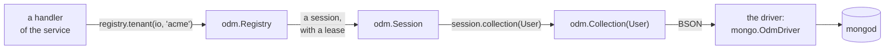
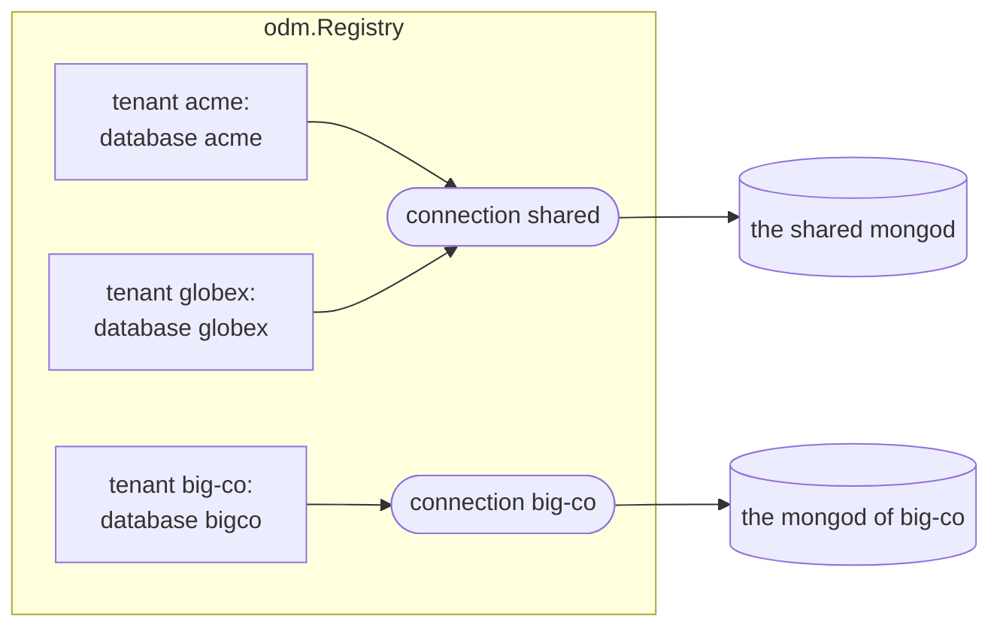
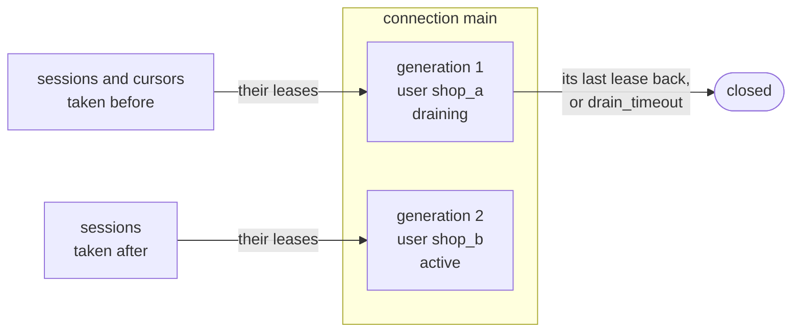

# odm

> [!WARNING]
> **No TLS yet: use it only in a network you trust.** odm reaches
> MongoDB through zefir-mongo, which speaks plain TCP. SCRAM, the way it
> logs in, never sends a password, but the commands and the documents of
> every tenant travel unencrypted. Keep mongod and the service in a closed
> network, the servers of tenants with servers of their own too, and give
> each connection a user of its own with a long random password; across a
> network you do not trust, use a tunnel: WireGuard, SSH or a service
> mesh.

**A typed ODM for MongoDB, for Zig services with many tenants.** MongoDB
keeps *documents*, records like JSON objects, in *collections*. An ODM, an
object-document mapper, maps them to the types of a program. With
zefir-odm a model is a plain Zig struct; a filter, an update or a sort is
a literal that the compiler checks against it, so that a typo in a field
name, or a string where a number goes, stops the build instead of finding
nothing at run time; and what a query finds comes back as that struct.
One registry keeps the connections and the tenants of a service: each
tenant has a database of its own, on a shared server or on a server of
its own, tenants come and go while the service runs, and a connection
changes its credentials without a failed request. It is written against
`std.Io` only, runs on [zio](https://github.com/lalinsky/zio) in
production, and reaches MongoDB through zefir-mongo.

> [!IMPORTANT]
> **Not in v1 (TODO):**
>
> - **Replica sets and sharded clusters**, with their discovery of servers
>   and failover: zefir-mongo connects to one standalone mongod.
> - **TLS and `mongodb+srv://`** in zefir-mongo, see above.
> - **Transactions and change streams.**
> - **A registry shared by the instances of a service, or kept on
>   disk**: each process builds its own from the events it hears.
> - **Tenants in one shared collection**, told apart by a field such as
>   `tenant_id`: a tenant is a database.
> - **A typed language of aggregations**: `aggregateRaw` takes BSON as it
>   is.
> - **A typed `$match` in `aggregateRaw`.**
> - **Closing idle connections and tenants**: a connection stays until
>   `removeConnection`.
> - **Migrations** of documents and indexes, beyond `ensureIndexes`.
> - **Subscriptions to the events of tenants**, over NATS or anything
>   else: the service hears them and calls `provisionTenant`.
> - **Active Record**: a model is data, and a collection does the work.
> - **Timestamps that odm keeps**, such as `created_at` and `updated_at`.
> - **BSON names inside nested structs**: there a key is the Zig name of
>   its field.
> - **`findOneAndUpdate`, `findOneAndReplace`, `findOneAndDelete`,
>   `distinct`, `estimatedDocumentCount`, `bulkWrite`, `listIndexes` and
>   `dropIndex`**: `runCommand` sends them.
> - **The modifiers of `$push`**, `$slice`, `$sort` and `$position`, and
>   **`$currentDate`**.
> - **The options `hint`, `collation`, `comment`, `allow_disk_use` and
>   `let`**, an unordered `insertMany`, and the partial result of a write
>   that failed.
> - **The rules of `field_rules` on updates**: they check whole documents.
> - **Versions of `removeTenant`**, and a memory of the tenants removed.
> - **A tenant taken from the context of a request**: the handler names
>   it.
> - **Histograms of durations, an exporter of metrics, a span per
>   operation**: `stats()` takes snapshots.
> - **A driver of another author as a package of its own, built by CI**:
>   `FakeDriver` is the second implementation of the contract.
> - **`upsertOne` with conditions built at run time**, an `odm.Filter` or
>   an `odm.Update`, or with `in`, `nin` or `all` in its filter: use
>   `updateOne`, then `insertOne`.
> - **Partial indexes** (`partialFilterExpression`): a unique optional in
>   a compound index with a required key cannot be expressed: such an
>   index compiles, and the documents without the optional collide on the
>   other keys.

From [the quick start](#quick-start): a session of the tenant acme, a
customer in, three more, and the adults out, the oldest first.

```zig
// A session on the tenant's database, for this task, and the
// collection of User in it.
var acme = try registry.tenant(io, "acme");
defer acme.deinit(io);
const users = acme.collection(User);

// Start afresh, and make the e-mail of a customer unique.
_ = try users.deleteMany(io, ctx, .{});
try users.ensureIndexes(io, ctx);

// A customer; odm makes the id, and says which.
const ann = try users.insertOne(io, ctx, .{ .email = "ann@example.com", .name = "Ann", .age = 30 });
app.info("Signed up", .{ .name = "Ann", .id = ann.id });
// Three more, in one request.
const more = [_]User{
    .{ .email = "bob@example.com", .name = "Bob", .age = 17 },
    .{ .email = "cleo@example.com", .name = "Cleo", .age = 41 },
    .{ .email = "dan@example.com", .name = "Dan", .age = 25 },
};
const signed = try users.insertMany(io, ctx, &more, arena);
app.info("Signed up", .{ .count = signed.ids.len });

// The adults, the oldest first. The cursor brings them batch by batch,
// each one decoded into a User in the arena.
var adults = try users.find(io, ctx, .{ .age = .{ .gte = 18 } }, .{ .sort = .{ .age = .desc } });
defer adults.deinit(io);
while (try adults.next(io, ctx, arena)) |user| app.info("Adult", .{ .name = user.name, .age = user.age });
```

- **Models are plain structs.** No base type and no generated code: the
  schema and the rules are declarations in the struct.
- **Queries that the compiler checks.** A field that is not there, an
  operator that does not fit its type, a value of the wrong type, a
  change that would leave a document the model cannot read: each stops
  the build, with a message that says what to write instead.
- **Tenants, shared and on servers of their own, at once.** One registry
  binds each tenant to a connection and a database; tenants come and go
  by events with versions, while the service runs.
- **Credentials that change on the fly.** A connection moves to a new
  login, and its old generation drains: no request fails.
- **Errors that say whether to retry.** Each says whether the server may
  have run the call; the details are in the diagnostics of the session.
- **Tests without MongoDB.** `odm.testing.FakeDriver` answers what a test
  tells it to, and keeps a journal of what odm sent.
- **Any driver.** odm reaches a database through its driver contract
  only; zefir-mongo's `mongo.OdmDriver` is the reference, and a driver
  that passes `odm.testing.conformance` works with the same code.

## Contents

- [What an ODM is](#what-an-odm-is)
- [Installation](#installation)
- [Quick start](#quick-start)
- [Models](#models)
- [Writing documents](#writing-documents)
- [Reading and changing documents](#reading-and-changing-documents)
- [Queries at run time](#queries-at-run-time)
- [Aggregation and commands](#aggregation-and-commands)
- [Tenants](#tenants)
- [Connections and credentials](#connections-and-credentials)
- [Errors and what is safe to retry](#errors-and-what-is-safe-to-retry)
- [Shutdown, statistics and logs](#shutdown-statistics-and-logs)
- [Under zefir.App](#under-zefirapp)
- [Security](#security)
- [Tests without MongoDB](#tests-without-mongodb)
- [For authors of drivers](#for-authors-of-drivers)

Programs that `zig build e2e` in `tests/odm` builds and runs against
mongod, checking what they print against this guide:
[quick start](quick_start.zig) · [tenants](tenants.zig) ·
[rotation](rotation.zig) · [errors](errors.zig).
Programs that `zig build test-odm` runs without a server:
[models](models.zig) · [queries](queries.zig) · [under App](app.zig).
Tests that it runs:
[the tests of an application](users_test.zig) ·
[the conformance suite](conformance_test.zig).

## What an ODM is

A request of a service goes this way:



- **`odm.Registry`** holds the connections of the service and its
  tenants. A *connection* is one server and one login: one client of the
  driver, with its pool of network connections. A *tenant* is a customer
  of the service, with a database of its own on a connection. The service
  makes one registry at the start, and every task calls it.
- **`odm.Session`** is what a request gets from `registry.tenant(io, id)`:
  the tenant's database, for one task at a time. It holds a *lease* on the
  connection, so that a connection replaced meanwhile closes only once its
  sessions are done with it; `session.deinit(io)` gives the lease back.
- **`odm.Collection(User)`** is the collection of the model `User` in that
  database, with its typed operations: `insertOne`, `find`, `updateOne`,
  `upsertOne` and the rest. Each checks its literals when the program
  compiles, writes them as BSON, the binary form of MongoDB's documents,
  and hands that to the driver. A collection is a view of its session,
  and so are a query and a repository made of it, such as `Users` in
  [the tests](#tests-without-mongodb): they work while the session lives,
  and the session stays where it is meanwhile, a `var` of the request.
  Make them for each request, and for work in parallel take a session for
  each task. A session kept for long holds its generation: a replacement
  of the connection waits for it until `drain_timeout`, then closes the
  generation by force, and every call through the session gets `Closed`.
- **The driver** talks to the server. odm itself has no network code: it
  reaches a database only through its *driver contract*, `odm.Driver`.
  zefir-mongo's `mongo.OdmDriver` is the reference driver;
  `odm.testing.FakeDriver`, a driver without a network, runs the tests of
  an application, see [Tests without MongoDB](#tests-without-mongodb).

The code of a request sees a session and its collections, never a server
or a password, and a session reaches only its tenant's database.

## Installation

Add Zefir to your `build.zig.zon`:

```sh
zig fetch --save git+https://github.com/vkiryakov/zefir#dev
```

zefir-odm is on the `dev` branch until the next release. The command
fetches the latest commit of `dev`; `--save` pins that commit. The latest
release, v0.10.0, came before zefir-odm, so `#v0.10.0` does not have it.

A service runs on [zio](https://github.com/lalinsky/zio). zio has no
release for Zig 0.17 yet, so pin the commit Zefir is tested with:

```sh
zig fetch --save git+https://github.com/lalinsky/zio#d15034f1a4d9ddaa42829aae8f7e02d37cd1093a
```

Then import the modules in `build.zig`: odm; mongo, whose `OdmDriver`
talks to the server; and mongo-bson, for the types of documents, such as
`bson.ObjectId`. A model with `field_rules` uses validator, and the
programs of this guide also use Zefir's confy for settings, log for
records and core for deadlines:

```zig
// build.zig
const zefir = b.dependency("zefir", .{ .target = target, .optimize = optimize });
const zio = b.dependency("zio", .{ .target = target, .optimize = optimize });

const exe = b.addExecutable(.{
    .name = "shop",
    .root_module = b.createModule(.{
        .root_source_file = b.path("src/main.zig"),
        .target = target,
        .optimize = optimize,
        .imports = &.{
            .{ .name = "odm", .module = zefir.module("zefir-odm") },
            .{ .name = "mongo", .module = zefir.module("zefir-mongo") },
            .{ .name = "mongo-bson", .module = zefir.module("zefir-mongo-bson") },
            .{ .name = "validator", .module = zefir.module("zefir-validator") },
            .{ .name = "zio", .module = zio.module("zio") },
            .{ .name = "confy", .module = zefir.module("zefir-confy") },
            .{ .name = "log", .module = zefir.module("zefir-log") },
            .{ .name = "core", .module = zefir.module("zefir-core") },
        },
    }),
});
b.installArtifact(exe);
b.step("run", "Run the service").dependOn(&b.addRunArtifact(exe).step);
```

> [!TIP]
> zefir-odm is also part of the umbrella module: with
> `zefir.module("zefir")` imported as `zefir`, it is `@import("zefir").odm`.
> odm imports zefir-core, zefir-validator and zefir-mongo-bson, and no
> driver: zefir-mongo imports odm, to implement its contract. A package
> that only declares models, shared by several services, needs odm and
> mongo-bson alone.

You need a mongod to talk to. With Docker:

```sh
docker run --rm -p 27017:27017 mongo:9.0.4
```

## Quick start

The customers of the shop of one tenant, acme. The program connects,
makes the e-mail of a customer unique, signs four customers up, finds the
adults, gives one a birthday, lets one go, and counts the adults again:

```zig
//! The quick start of the guide: the customers of a shop, for the tenant
//! "acme", in the collection "users" of its database. It connects, makes
//! the e-mail of a customer unique, signs customers up, finds the adults
//! among them, gives one a birthday, lets one go, and counts the adults
//! again. Each run starts from an empty collection.
//!
//! Settings, from the environment:
//!
//!   APP_MONGO_URI        the server; mongodb://127.0.0.1:27017 by default
//!   APP_MONGO_PASSWORD   the password of the user that the URI names, if
//!                        it names one
//!
//! In tests/odm, `zig build example-quick_start` runs it against the
//! servers of the repository's docker-compose.yml.

const std = @import("std");
const confy = @import("confy");
const core = @import("core");
const log = @import("log");
const mongo = @import("mongo");
const odm = @import("odm");
const zio = @import("zio");
const bson = @import("mongo-bson");

/// odm and the driver log through std.log; this sends their records to
/// the logger.
pub const std_options: std.Options = .{ .logFn = log.stdLogFn };

const Config = struct {
    mongo: struct {
        uri: []const u8 = "mongodb://127.0.0.1:27017",
        /// Kept out of the URI, and out of every log.
        password: ?confy.Secret = null,
    } = .{},
};

/// A customer of the shop, as the collection keeps it.
const User = struct {
    /// null: odm makes an ObjectId when it inserts the customer.
    id: ?bson.ObjectId = null,
    email: []const u8,
    name: []const u8,
    age: u32 = 0,

    pub const odm_schema: odm.Schema(User) = .{
        .collection = "users",
        .id = .id,
        .indexes = &.{.{ .keys = &.{.{ .email = .asc }}, .unique = true }},
    };
};

pub fn main(init: std.process.Init) !void {
    var config: Config = undefined;
    confy.loadOrExit(init.arena.allocator(), &config, .{
        .io = init.io,
        .environ = init.environ_map,
        .env_prefix = "APP_",
        .sources = &.{.osEnv()},
    });
    // The logger outlives the runtime, so it takes `init.io`, through which
    // the tasks of the runtime may log too.
    const logger: log.Logger = try .init(init.gpa, init.io, .{ .format = .text });
    defer logger.deinit();
    logger.installStdLog();
    const app = logger.scoped("app");

    // One runtime for the program, with an executor per CPU core. The
    // registry and every call of it run on its `io`.
    const rt = try zio.Runtime.init(init.gpa, .{ .executors = .auto });
    defer rt.deinit();
    const io = rt.io();

    // The driver and the registry: one of each for the whole program.
    // Neither does I/O yet.
    var driver: mongo.OdmDriver = .init(init.gpa);
    var registry: odm.Registry = .init(init.gpa, io, driver.driver(), .{});
    defer registry.deinit(io);
    // A connection: this server, with this login. Registering it opens a
    // client of the driver without the network; connect opens the first
    // network connection and logs in, under its deadline.
    try registry.registerConnection(io, "main", .{
        .uri = config.mongo.uri,
        .password = if (config.mongo.password) |password| password.expose() else null,
    });
    registry.connect(io, within(io, .fromSeconds(10)), "main") catch |err| {
        const stats = try registry.connectionStats(io, "main");
        app.err("Cannot connect", .{ .reason = err, .details = if (stats.last_failure) |*failure| failure.message() else "" });
        return err;
    };
    app.info("Connected", .{});
    // A tenant: acme, whose database is "acme", on that connection.
    try registry.provisionTenant(io, within(io, .fromSeconds(10)), .{
        .tenant = "acme",
        .connection = .{ .existing = "main" },
        .database = "acme",
        .version = 1,
    });

    try run(io, init.gpa, &registry, app);

    const stats = registry.stats(io);
    app.info("Done", .{ .tenants = stats.tenants, .operations = stats.operations, .leases = stats.leases });
}

/// A context whose deadline is `budget` away.
fn within(io: std.Io, budget: std.Io.Duration) core.Context {
    return core.Context.root.withDeadline(.after(std.Io.Clock.awake.now(io), budget));
}

/// The application: it asks the registry for its tenant, and sees a
/// collection, not the connection.
fn run(io: std.Io, gpa: std.mem.Allocator, registry: *odm.Registry, app: log.Logger) !void {
    // The memory of the results, all freed at the end.
    var arena_state: std.heap.ArenaAllocator = .init(gpa);
    defer arena_state.deinit();
    const arena = arena_state.allocator();
    // Five seconds for all of it: each call has what is left of them.
    const ctx = within(io, .fromSeconds(5));

    // A session on the tenant's database, for this task, and the
    // collection of User in it.
    var acme = try registry.tenant(io, "acme");
    defer acme.deinit(io);
    const users = acme.collection(User);

    // Start afresh, and make the e-mail of a customer unique.
    _ = try users.deleteMany(io, ctx, .{});
    try users.ensureIndexes(io, ctx);

    // A customer; odm makes the id, and says which.
    const ann = try users.insertOne(io, ctx, .{ .email = "ann@example.com", .name = "Ann", .age = 30 });
    app.info("Signed up", .{ .name = "Ann", .id = ann.id });
    // Three more, in one request.
    const more = [_]User{
        .{ .email = "bob@example.com", .name = "Bob", .age = 17 },
        .{ .email = "cleo@example.com", .name = "Cleo", .age = 41 },
        .{ .email = "dan@example.com", .name = "Dan", .age = 25 },
    };
    const signed = try users.insertMany(io, ctx, &more, arena);
    app.info("Signed up", .{ .count = signed.ids.len });

    // The adults, the oldest first. The cursor brings them batch by batch,
    // each one decoded into a User in the arena.
    var adults = try users.find(io, ctx, .{ .age = .{ .gte = 18 } }, .{ .sort = .{ .age = .desc } });
    defer adults.deinit(io);
    while (try adults.next(io, ctx, arena)) |user| app.info("Adult", .{ .name = user.name, .age = user.age });

    // Bob has a birthday.
    const birthday = try users.updateOne(io, ctx, .{ .email = "bob@example.com" }, .{ .inc = .{ .age = 1 } });
    app.info("Birthday", .{ .matched = birthday.matched, .modified = birthday.modified });
    // Dan leaves the shop.
    const left = try users.deleteOne(io, ctx, .{ .email = "dan@example.com" });
    app.info("Left", .{ .deleted = left.deleted });
    const count = try users.count(io, ctx, .{ .age = .{ .gte = 18 } });
    app.info("Adults now", .{ .count = count });
}
```

Start a mongod as in [Installation](#installation), then the program:

```text
$ zig build run
2026-10-22T14:48:18.011Z INFO  [app] Connected
2026-10-22T14:48:18.014Z INFO  [app] Signed up name=Ann id=6ada22329d273800a4779333
2026-10-22T14:48:18.014Z INFO  [app] Signed up count=3
2026-10-22T14:48:18.015Z INFO  [app] Adult name=Cleo age=41
2026-10-22T14:48:18.015Z INFO  [app] Adult name=Ann age=30
2026-10-22T14:48:18.015Z INFO  [app] Adult name=Dan age=25
2026-10-22T14:48:18.016Z INFO  [app] Birthday matched=1 modified=1
2026-10-22T14:48:18.017Z INFO  [app] Left deleted=1
2026-10-22T14:48:18.018Z INFO  [app] Adults now count=3
2026-10-22T14:48:18.019Z INFO  [app] Done tenants=1 operations=8 leases=0
```

What happens, from the top:

- **Settings.** `confy.loadOrExit` fills `Config` from the environment:
  `APP_MONGO_URI` is `mongo.uri`, and `APP_MONGO_PASSWORD` is
  `mongo.password`, a `confy.Secret`, which no log prints. It stays out
  of the connection string, and `expose()` hands it to the registry,
  which passes it to the driver and keeps no copy.
- **Logs.** odm writes its warnings to `std.log.scoped(.odm)`, and the
  driver to `.mongo`; `std_options` with `log.stdLogFn` and
  `logger.installStdLog()` send them to zefir-log, see
  [Shutdown, statistics and logs](#shutdown-statistics-and-logs).
- **The runtime.** Everything runs on the `std.Io` of zio, `rt.io()`,
  with an executor per CPU core. The registry takes that `io` at `init`,
  and every call of the registry, of its sessions and of their
  collections comes on it: in safe builds a call on another `std.Io`
  panics, `rt.blockingIo()` of the same runtime too.
- **The driver and the registry.** `mongo.OdmDriver` opens the clients
  that the registry asks for, and lives longer than the registry.
  `odm.Registry.init` does no I/O and starts no task: the registry works
  in the calls of your tasks only.
- **The connection.** `registerConnection` names it "main" and opens a
  client of the driver, without the network; `connect` opens the first
  network connection and logs in, under its deadline. A server that is
  not there, or a wrong password, shows here, at the start:
  `connectionStats(io, "main").last_failure` holds the driver's text.
- **The tenant.** `provisionTenant` binds acme to the connection "main"
  and to its database, "acme"; version 1 is its first event, see
  [Tenants](#tenants).
- **A session.** `registry.tenant(io, "acme")` gives a session on acme's
  database, with a lease of the connection, and `acme.collection(User)`
  the collection of the model in it. `defer acme.deinit(io)` gives the
  lease back.
- **Contexts.** Each call takes a `core.Context`: here five seconds for
  all the calls of `run`, each with what is left of them.
- **Memory.** The strings of the users that `next` decodes, and the ids
  of `insertMany`, live in the arena, which goes all at once at the end.
  A cursor needs its `deinit`.
- **The end.** `stats` counts the eight operations, and no lease is out:
  the session went back. `registry.deinit(io)` closes the connection and
  frees the registry; a service shuts it down first, with a deadline, see
  [Shutdown, statistics and logs](#shutdown-statistics-and-logs).

## Models

A model is a struct with two declarations in it: `odm_schema`, what odm
needs to know of its collection, and `field_rules`, the rules of
zefir-validator that each document must keep. `models.zig` declares the
models of a shop and shows what odm writes of them. It needs no server:
odm gets `odm.testing.FakeDriver`, which runs no query and keeps a journal
of what it got, and the program prints those documents as Extended JSON,
the text form of BSON that MongoDB's tools show:

```zig
//! Models, without a server: the users, the visits and the products of a
//! shop, and what odm writes of them. A model is a plain struct with two
//! declarations: `odm_schema`, its collection, id, BSON names and indexes,
//! and `field_rules`, the rules of zefir-validator. The program hands odm
//! `odm.testing.FakeDriver`, a driver that runs no query and keeps a
//! journal of what odm sent it, and prints those documents as Extended
//! JSON, the text MongoDB's tools show them in. `zig build test-odm` runs
//! it.

const std = @import("std");
const core = @import("core");
const odm = @import("odm");
const v = @import("validator");
const bson = @import("mongo-bson");

/// A user of the shop, in the collection "users".
pub const User = struct {
    /// null: odm makes an ObjectId when it inserts the user.
    id: ?bson.ObjectId = null,
    email: []const u8,
    name: []const u8,
    /// A field with a default may stay out of an insert, and a document
    /// without it reads as the default.
    age: u32 = 0,
    status: Status = .active,
    /// An optional is null by default, and odm never writes a null: a user
    /// without a nickname has no field "nickname" at all.
    nickname: ?[]const u8 = null,
    /// A struct is a document inside the document.
    address: Address,
    profile: ?Profile = null,
    tags: []const []const u8 = &.{},
    created_at: bson.DateTime,

    pub const Status = enum { active, blocked };
    pub const Address = struct { city: []const u8, country: []const u8 };
    pub const Profile = struct { bio: []const u8, site: ?[]const u8 = null };

    pub const odm_schema: odm.Schema(User) = .{
        .collection = "users",
        // The field that is _id in the database.
        .id = .id,
        // The BSON names of top-level fields, where they are not the Zig
        // ones.
        .names = .{ .created_at = "createdAt" },
        .indexes = &.{
            .{ .keys = &.{.{ .email = .asc }}, .unique = true },
            // Unique on an optional needs sparse: the users without a
            // nickname stay out of the index, instead of colliding there.
            .{ .keys = &.{.{ .nickname = .asc }}, .unique = true, .sparse = true },
            // A compound index: its keys in their order.
            .{ .keys = &.{ .{ .status = .asc }, .{ .created_at = .desc } } },
        },
    };

    pub const field_rules = .{
        .email = .{ v.email, v.maxLength(254) },
        .name = .{ v.minLength(1), v.maxLength(100) },
        .age = v.range(0, 150),
    };
};

/// A visit to a page, whose id odm always makes: its insert takes an
/// `odm.Insert(Visit)`, the struct without the field `id`.
pub const Visit = struct {
    id: bson.ObjectId,
    user: bson.ObjectId,
    page: []const u8,
    at: bson.DateTime,

    pub const odm_schema: odm.Schema(Visit) = .{
        .collection = "visits",
        .id = .id,
        // A TTL index: the server deletes a visit 30 days after `at`.
        .indexes = &.{.{ .keys = &.{.{ .at = .asc }}, .expire_after_seconds = 30 * 24 * 3600 }},
    };
};

/// A product, whose id the shop gives: its code.
pub const Product = struct {
    id: []const u8,
    title: []const u8,
    price_cents: u32,

    pub const odm_schema: odm.Schema(Product) = .{ .collection = "products", .id = .id };
};

pub fn main(init: std.process.Init) !void {
    const io = init.io;
    var buffer: [4096]u8 = undefined;
    var stdout = std.Io.File.stdout().writerStreaming(io, &buffer);
    const out = &stdout.interface;

    // A driver that runs no query, and a registry with one tenant on it,
    // "acme", whose database is "acme".
    var fake: odm.testing.FakeDriver = .init(init.gpa);
    defer fake.deinit();
    var registry: odm.Registry = .init(init.gpa, io, fake.driver(), .{});
    defer registry.deinit(io);
    try registry.registerConnection(io, "main", .{ .uri = "fake://shop" });
    try registry.provisionTenant(io, .root, .{ .tenant = "acme", .connection = .{ .existing = "main" }, .database = "acme", .version = 1 });
    var acme = try registry.tenant(io, "acme");
    defer acme.deinit(io);
    // No deadline: the fake answers at once. A request of a service has
    // one, as the quick start shows.
    const ctx: core.Context = .root;
    const joined: bson.DateTime = .{ .milliseconds = 1_760_000_000_000 };
    const lisbon: User.Address = .{ .city = "Lisbon", .country = "PT" };

    // The indexes of the schema, created by one call: as the service
    // starts, and again for each new tenant.
    const users = acme.collection(User);
    try users.ensureIndexes(io, ctx);
    for (lastCall(&fake, io).create_indexes.indexes) |index| {
        try out.print("index {s}: {f}{s}{s}\n", .{ index.name, index.keys, if (index.unique) " unique" else "", if (index.sparse) " sparse" else "" });
    }
    try acme.collection(Visit).ensureIndexes(io, ctx);
    const ttl = lastCall(&fake, io).create_indexes.indexes[0];
    try out.print("index {s}: {f} expires after {d} s\n", .{ ttl.name, ttl.keys, ttl.expire_after_seconds.? });

    // An insert: odm makes the id, writes it as _id, and leaves the
    // optionals that are null out.
    const ann = try users.insertOne(io, ctx, .{ .email = "ann@example.com", .name = "Ann", .address = lisbon, .created_at = joined });
    try out.print("ann's id: {f}\n", .{ann.id});
    try out.print("inserted: {f}\n", .{lastCall(&fake, io).insert.documents[0]});
    // The same with the optionals there.
    _ = try users.insertOne(io, ctx, .{
        .email = "bob@example.com",
        .name = "Bob",
        .age = 17,
        .nickname = "bobby",
        .address = .{ .city = "Lyon", .country = "FR" },
        .profile = .{ .bio = "Tea and trains" },
        .tags = &.{"student"},
        .created_at = joined,
    });
    try out.print("inserted: {f}\n", .{lastCall(&fake, io).insert.documents[0]});

    // A Visit is inserted without an id: odm.Insert(Visit) has none, and
    // odm makes one every time.
    const visit = try acme.collection(Visit).insertOne(io, ctx, .{ .user = ann.id, .page = "/tea", .at = joined });
    try out.print("visit {f}: {f}\n", .{ visit.id, lastCall(&fake, io).insert.documents[0] });
    // A Product brings its own id.
    const tea = try acme.collection(Product).insertOne(io, ctx, .{ .id = "tea-01", .title = "Green tea", .price_cents = 450 });
    try out.print("product {s}: {f}\n", .{ tea.id, lastCall(&fake, io).insert.documents[0] });

    // The rules of the model come first: a document that breaks one is
    // ValidationFailed, the session's diagnostics say which rule and where,
    // and nothing goes out.
    const sent = fake.journal(io).len;
    if (users.insertOne(io, ctx, .{ .email = "ann at example", .name = "Ann", .address = lisbon, .created_at = joined })) |_| {
        try out.print("inserted a bad e-mail\n", .{});
    } else |err| {
        const d = acme.diagnostics();
        try out.print("refused: {t}, {s}: {s} ({s}); sent {d} more\n", .{ err, d.path(), d.message(), d.violation.?.code, fake.journal(io).len - sent });
    }

    // Reading: a document that another program wrote, without age and
    // profile, with a nickname that is null. The fake answers the next find
    // with it.
    var arena: std.heap.ArenaAllocator = .init(init.gpa);
    defer arena.deinit();
    const theirs = try bson.encode(arena.allocator(), .{
        ._id = ann.id,
        .email = "cy@example.com",
        .name = "Cy",
        .nickname = null,
        .address = .{ .city = "Porto", .country = "PT" },
        .createdAt = joined,
    }, .{});
    try fake.reply("fake://shop", .{ .documents = &.{theirs.raw()} });
    const cy = (try users.findOne(io, ctx, .{ .email = "cy@example.com" }, .{}, arena.allocator())).?;
    try out.print("read: {s}, age {d}, {t}, nickname {?s}, profile {s}\n", .{ cy.name, cy.age, cy.status, cy.nickname, if (cy.profile == null) "null" else "set" });
    try out.flush();
}

/// The latest call that odm sent the fake.
fn lastCall(fake: *odm.testing.FakeDriver, io: std.Io) odm.testing.FakeDriver.Call {
    const journal = fake.journal(io);
    return journal[journal.len - 1].call;
}
```

```text
$ zig build run
index email_1: {"email":1} unique
index nickname_1: {"nickname":1} unique sparse
index status_1_createdAt_-1: {"status":1,"createdAt":-1}
index at_1: {"at":1} expires after 2592000 s
ann's id: 6ada20638d052629b4bfaceb
inserted: {"_id":{"$oid":"6ada20638d052629b4bfaceb"},"email":"ann@example.com","name":"Ann","age":0,"status":"active","address":{"city":"Lisbon","country":"PT"},"tags":[],"createdAt":{"$date":"2025-10-09T08:53:20Z"}}
inserted: {"_id":{"$oid":"6ada20638d052629b4bfacec"},"email":"bob@example.com","name":"Bob","age":17,"status":"active","nickname":"bobby","address":{"city":"Lyon","country":"FR"},"profile":{"bio":"Tea and trains"},"tags":["student"],"createdAt":{"$date":"2025-10-09T08:53:20Z"}}
visit 6ada20638d052629b4bfaced: {"_id":{"$oid":"6ada20638d052629b4bfaced"},"user":{"$oid":"6ada20638d052629b4bfaceb"},"page":"/tea","at":{"$date":"2025-10-09T08:53:20Z"}}
product tea-01: {"_id":"tea-01","title":"Green tea","price_cents":450}
refused: ValidationFailed, email: odm: email: must be a valid email address (validation.email); sent 0 more
read: Cy, age 0, active, nickname null, profile null
```

### The id

Every document of a collection has an `_id`, unique in it.
`odm_schema.id` names the field of the model that holds it, and odm writes
that field as `_id`, wherever it stands in the struct. Its type says who
makes it:

| The field | `odm.Insert(T)`, what an insert takes | On insert |
|---|---|---|
| `id: ?bson.ObjectId = null`, as in `User` | `T` itself | null: odm makes an ObjectId; a value goes as it is, as in an import of documents that have ids |
| `id: bson.ObjectId`, as in `Visit` | `T` without `id` | odm makes an ObjectId every time |
| any other type, not optional, as in `Product`; not an array or a `bson.Regex`, which the server refuses as an `_id`, so a UUID is a `bson.Binary` | `T` itself | the application gives it |

An ObjectId is 12 bytes made of the time, a random part and a counter, so
that services make unique ones without asking anyone; odm makes them with
the generator of its registry. `insertOne` returns the id of the
document, of type `odm.Id(T)`: in the run, `ann's id` is the `_id` of the
first insert, and the visit's `user` holds it.

### Names

A field is written under its Zig name, unless `odm_schema.names` gives
another: `created_at` is `createdAt` in the database, as code in other
languages may read the same collection. Names apply to the fields of the
model itself; inside a struct, such as `address`, a key is the Zig name of
its field, which may be any, such as `@"zip-code"`. Filters, sorts and
updates use the Zig names, and odm writes the BSON ones.

### Indexes

`odm_schema.indexes` lists the indexes of the collection. An index makes
finding by its keys fast; a *unique* one refuses a second document with
the same key, such as the same e-mail. The keys are a list, as the order
of a compound index matters: `status_1_createdAt_-1` finds the users of
one status, the newest first. An index without a `.name` gets MongoDB's,
made of its keys. `.expire_after_seconds` makes a TTL index, on one key of
a `bson.DateTime`: the server deletes a visit 30 days after its `at`.

odm creates indexes when it is told to, never on its own:
`collection.ensureIndexes(io, ctx)` sends all of a model's in one call,
and the same indexes again are no error. Call it as the service starts,
and for each new tenant, whose database starts empty, see
[Tenants](#tenants).

### Optionals and null

MongoDB has two ways to say "no value": a field that is null, and no
field at all. odm keeps one of them: **it never writes a null.**

- **Writing.** An optional that is null stays out of the document, at any
  depth: Ann has no `nickname` and no `profile`, and Bob's `profile` has
  no `site`. A null item of a list, `[]const ?E`, stays: it is an item,
  not a field.
- **Reading.** A field that is not there reads as its default: the `age`
  of Cy is 0. An optional that is not there reads as null, and so does a
  null that another program wrote, as Cy's `nickname`. A required field
  that is not there is an error, `DecodeFailed`, with the field in the
  diagnostics.
- **The default of an optional is null.** Any other default would come
  back for every document without the field, so the compiler refuses it.
- **A unique index on an optional needs `sparse`.** A sparse index leaves
  out the documents without its key. Without it, every user without a
  nickname would be in the index as null, and the second one would
  collide with the first.
- **In a compound unique index with a required key, `sparse` leaves out
  nothing.** A sparse index of several keys takes every document that has
  one of them, and the required key is in every document: the documents
  without the optional are in it with null, and two of them collide on
  the other keys, such as two users of one shop without a nickname under
  `.{ .shop = .asc }, .{ .nickname = .asc }`. Partial indexes are not in
  v1 (see the list at the top): keep such a uniqueness on optional keys
  only, or check it in the application. A null that another program
  wrote is in a sparse index too, so two such documents collide even in
  a unique sparse index of one key.
- **Filters and updates** follow from it: `.nickname = null` finds both
  kinds, and an update clears a field with `unset`, see
  [null and missing fields](#null-and-missing-fields).

### Types of fields

| Zig | BSON |
|---|---|
| `bool` | boolean |
| `i8`–`i32`, `u8`–`u16` | int32 |
| `i33`–`i64`, `u32`–`u63` | int64 |
| `f64` | double |
| `[]const u8` | string, in UTF-8 |
| an exhaustive enum | string: the name of the tag |
| a struct | document |
| `[]const T`, `[N]T` | array |
| `?T` | the value, or no field |
| `bson.ObjectId`, `bson.DateTime`, `bson.Timestamp`, `bson.Binary`, `bson.Decimal128`, `bson.Regex`, `bson.RawDocument`, `bson.Value` | their own types |

The compiler refuses the rest: `u64` and `usize`, as the integers of BSON
are signed; `f32`, which a double would round; unions, pointers, `??T`,
and a struct inside itself. At any depth it refuses a field name with a
dot, which odm reads as a step of a path, and a name of a document that
starts with `$` or is not UTF-8.

### What the compiler catches

odm checks a model where the program uses it, and every literal where the
program passes it. A mistake stops the build with a message that names
the model, the field and what to do instead. The model's name is
`@typeName`, here `models.User`, as `User` is in `models.zig`:

```text
// rating: f32 = 0, in User
error: odm: models.User.rating is f32: a BSON double has 64 bits, and decoding one into f32 rounds it; use f64

// nickname: ?[]const u8 = "none", in User
error: odm: models.User.nickname is optional, and its default is not null: odm leaves a null optional out of the document, and a field that is not there reads back as its default; make the default null

// .{ .keys = &.{.{ .nickname = .asc }}, .unique = true }, in the indexes of User
error: odm: models.User.odm_schema.indexes[1] is unique on models.User.nickname, which is optional: odm leaves null out, and the documents without the field would collide in the index as null; add .sparse = true
```

The chapters below show the messages of filters and updates. Zig compiles
only the code that a program uses, so a model that nothing uses yet is not
checked; `odm.assertModel(User)` in a test of the package checks it all
the same, as [the tests of the shop](#tests-without-mongodb) do.

## Writing documents

`insertOne` writes one document, `insertMany` a list in one request.
Both go in three steps:

1. **The rules.** The `field_rules` of the model are checked first, by
   zefir-validator. A document that breaks one is `ValidationFailed`, the
   session's diagnostics name the field and the rule, and nothing is
   sent: in the run of `models.zig`, `email` and `validation.email`.
   `insertMany` checks every document before it sends any, and
   `diagnostics().index` names the first bad one.
2. **The BSON**, with the id made where odm makes it, and without the
   optionals that are null.
3. **One request** to the driver. A unique index that refuses a document
   is `DuplicateKey`, with the place of the document in
   `diagnostics().index`. In an `insertMany` the documents before it went
   in, and the ones after it did not.

The rules check whole documents: inserts and `replaceOne`. Updates and
upserts change parts of a document, which zefir-validator cannot check
on their own, so a handler checks a new value before it sends it. The
transforms of zefir-validator, such as `v.trim`, do not run here either:
they belong to the edge of a request, and the rules check a document as
it is.

Every call starts the session's diagnostics afresh, so that
`session.diagnostics()` tells the details of the latest call's error, and
nothing after a success:

| Field | What it holds |
|---|---|
| `message()` | the server's errmsg, the driver's text, or odm's own |
| `code` | the server's code: 11000 for a duplicate key, 13 for a login without the rights |
| `index` | the document of a write that the server refused, or that broke a rule |
| `violation` | the rule of zefir-validator: its `code` and `message` |
| `path()` | the field: of a rule, or of a document that did not decode |
| `cause` | the error of the decoder, such as `MissingField` or `WrongType` |

## Reading and changing documents

`queries.zig` reads and changes the users of `models.zig`, one call of
each kind, and prints what odm sent for it:

```zig
//! Reading and changing documents, without a server: filters, sorts,
//! cursors, projections, updates, upserts, queries built at run time and
//! the raw paths, on the users of models.zig. odm writes each typed call as
//! BSON and hands it to the driver; here the driver is
//! `odm.testing.FakeDriver`, and the program prints what it got, as
//! Extended JSON. `zig build test-odm` runs it.

const std = @import("std");
const core = @import("core");
const odm = @import("odm");
const bson = @import("mongo-bson");
const User = @import("models.zig").User;
const FakeDriver = odm.testing.FakeDriver;

/// A part of a user: the fields of a list on a page.
const Preview = struct { name: []const u8, email: []const u8 };

/// The optional conditions of a search, as a handler of zefir-http takes
/// them from the query string of a request.
const Search = struct {
    min_age: ?u32 = null,
    city: ?[]const u8 = null,
    status: ?User.Status = null,
};

/// The users that `search` asks for, the oldest first, 50 at a time. Each
/// condition that is there narrows it: several `where` are an AND.
fn search(users: odm.Collection(User), io: std.Io, ctx: core.Context, arena: std.mem.Allocator, s: Search) !odm.Cursor(User) {
    var q = users.query(arena);
    if (s.min_age) |age| q = q.where(.{ .age = .{ .gte = age } });
    if (s.city) |city| q = q.where(.{ .address = .{ .city = city } });
    if (s.status) |status| q = q.where(.{ .status = status });
    return q.sort(.{ .age = .desc }).limit(50).execute(io, ctx);
}

pub fn main(init: std.process.Init) !void {
    const io = init.io;
    var buffer: [4096]u8 = undefined;
    var stdout = std.Io.File.stdout().writerStreaming(io, &buffer);
    const out = &stdout.interface;

    var fake: FakeDriver = .init(init.gpa);
    defer fake.deinit();
    var registry: odm.Registry = .init(init.gpa, io, fake.driver(), .{});
    defer registry.deinit(io);
    try registry.registerConnection(io, "main", .{ .uri = "fake://shop" });
    try registry.provisionTenant(io, .root, .{ .tenant = "acme", .connection = .{ .existing = "main" }, .database = "acme", .version = 1 });
    var acme = try registry.tenant(io, "acme");
    defer acme.deinit(io);
    const users = acme.collection(User);
    const ctx: core.Context = .root;
    // The memory of what comes back: strings of documents, ids, the
    // conditions of queries. One arena for the whole program here; a
    // service takes one per request.
    var arena_state: std.heap.ArenaAllocator = .init(init.gpa);
    defer arena_state.deinit();
    const arena = arena_state.allocator();
    const lyon: User.Address = .{ .city = "Lyon", .country = "FR" };
    const joined: bson.DateTime = .{ .milliseconds = 1_760_000_000_000 };

    // Reading. The fake answers the next find with two users.
    try fake.reply("fake://shop", .{ .documents = &.{
        (try bson.encode(arena, .{ .email = "cleo@example.com", .name = "Cleo", .age = 41, .address = lyon, .createdAt = joined }, .{})).raw(),
        (try bson.encode(arena, .{ .email = "ann@example.com", .name = "Ann", .age = 30, .address = lyon, .createdAt = joined }, .{})).raw(),
    } });
    var adults = try users.find(io, ctx, .{ .status = .active, .age = .{ .gte = 18 } }, .{ .sort = .{ .age = .desc }, .limit = 100 });
    defer adults.deinit(io);
    try show(out, &fake, io, "adults");
    // Each document is decoded into the arena: the user lives as long as
    // the arena does, not as long as the cursor.
    while (try adults.next(io, ctx, arena)) |user| try out.print("  {s}, {d}\n", .{ user.name, user.age });

    // null matches a field that is null or missing; only missing is exists.
    var some = try users.find(io, ctx, .{ .nickname = null }, .{});
    some.deinit(io);
    try show(out, &fake, io, "null");
    some = try users.find(io, ctx, .{ .nickname = .{ .exists = false } }, .{});
    some.deinit(io);
    try show(out, &fake, io, "missing");
    // A literal of fields of a struct: conditions on its paths. The whole
    // document only with eq.
    some = try users.find(io, ctx, .{ .address = .{ .city = "Lyon" } }, .{});
    some.deinit(io);
    try show(out, &fake, io, "path");
    some = try users.find(io, ctx, .{ .address = .{ .eq = lyon } }, .{});
    some.deinit(io);
    try show(out, &fake, io, "whole");
    // Lists: an item, all of these items, a size.
    some = try users.find(io, ctx, .{ .tags = "vip" }, .{});
    some.deinit(io);
    try show(out, &fake, io, "item");
    some = try users.find(io, ctx, .{ .tags = .{ .all = .{ "vip", "staff" } }, .profile = .{ .exists = true } }, .{});
    some.deinit(io);
    try show(out, &fake, io, "all");
    // Either condition, and a pattern.
    some = try users.find(io, ctx, .{ .@"or" = .{ .{ .age = .{ .lt = 18 } }, .{ .status = .blocked } } }, .{ .skip = 20, .limit = 10 });
    some.deinit(io);
    try show(out, &fake, io, "or");
    // A projection: the server sends only the fields of Preview.
    _ = try users.findOneAs(Preview, io, ctx, .{ .email = .{ .regex = "@example\\.com$" } }, .{ .sort = .{ .name = .asc } }, arena);
    try show(out, &fake, io, "preview");
    _ = try users.count(io, ctx, .{ .status = .blocked });
    try show(out, &fake, io, "count");

    // Changing. An id that a find gave, say Ann's.
    const ann = try bson.ObjectId.parseHex("6ad571408b9f503e4a218a8b");
    _ = try users.updateOne(io, ctx, .{ .id = ann }, .{ .set = .{ .status = .blocked }, .inc = .{ .age = 1 } });
    try show(out, &fake, io, "block");
    // An optional is set to a value, and cleared by unset: odm writes no
    // null.
    _ = try users.updateOne(io, ctx, .{ .id = ann }, .{ .set = .{ .nickname = "annie" } });
    try show(out, &fake, io, "nickname");
    _ = try users.updateOne(io, ctx, .{ .id = ann }, .{ .unset = .{.nickname} });
    try show(out, &fake, io, "unset");
    // A path into a struct that is always there; an optional struct only
    // whole.
    _ = try users.updateOne(io, ctx, .{ .id = ann }, .{ .set = .{ .address = .{ .city = "Porto" }, .profile = User.Profile{ .bio = "Green tea" } } });
    try show(out, &fake, io, "move");
    // Lists: items in, items out; each path once per update.
    _ = try users.updateOne(io, ctx, .{ .id = ann }, .{ .add_to_set = .{ .tags = .{ .each = &.{ "vip", "staff" } } } });
    try show(out, &fake, io, "tags");
    _ = try users.updateOne(io, ctx, .{ .id = ann }, .{ .pull = .{ .tags = "student" } });
    try show(out, &fake, io, "untag");
    _ = try users.updateMany(io, ctx, .{ .status = .blocked }, .{ .set = .{ .status = .active } });
    try show(out, &fake, io, "unblock");
    // Dan in, unless he is there: the filter's equality, set and
    // set_on_insert give every required field of the document it may
    // insert.
    _ = try users.upsertOne(io, ctx, .{ .email = "dan@example.com" }, .{
        .set = .{ .name = "Dan", .address = lyon },
        .set_on_insert = .{ .created_at = joined },
    });
    try show(out, &fake, io, "upsert");
    _ = try users.replaceOne(io, ctx, .{ .id = ann }, .{ .email = "ann@example.org", .name = "Ann", .address = lyon, .created_at = joined });
    try show(out, &fake, io, "replace");
    _ = try users.deleteMany(io, ctx, .{ .status = .blocked, .created_at = .{ .lt = joined } });
    try show(out, &fake, io, "delete");

    // At run time: a search whose conditions come from a request, and a
    // change of the fields that a form sent.
    var found = try search(users, io, ctx, arena, .{ .min_age = 18, .city = "Lyon" });
    found.deinit(io);
    try show(out, &fake, io, "search");
    const new_name: ?[]const u8 = "Ann B.";
    const new_city: ?[]const u8 = null;
    var change = odm.Update(User).init(arena);
    if (new_name) |name| change = change.with(.{ .set = .{ .name = name } });
    if (new_city) |city| change = change.with(.{ .set = .{ .address = .{ .city = city } } });
    _ = try users.updateOne(io, ctx, .{ .id = ann }, change);
    try show(out, &fake, io, "form");

    // The raw paths: a pipeline and a command, which odm passes on as they
    // are, and does not check against the model.
    var groups = try users.aggregateRaw(struct { _id: []const u8, n: i32 }, io, ctx, .{
        .{ .@"$match" = .{ .age = .{ .@"$gte" = 18 } } },
        .{ .@"$group" = .{ ._id = "$status", .n = .{ .@"$sum" = 1 } } },
    });
    groups.deinit(io);
    try show(out, &fake, io, "groups");
    const stats = try acme.runCommand(io, ctx, .{ .collStats = "users" }, arena);
    try show(out, &fake, io, "command");
    try out.print("  the reply: {f}\n", .{stats});
    try out.flush();
}

/// Prints the latest call that odm sent the fake, after `label`.
fn show(out: *std.Io.Writer, fake: *FakeDriver, io: std.Io, label: []const u8) !void {
    const journal = fake.journal(io);
    try out.print("{s}: ", .{label});
    switch (journal[journal.len - 1].call) {
        .find => |f| {
            try out.print("find {f}", .{f.filter});
            if (f.sort) |sort| try out.print(" sort {f}", .{sort});
            if (f.projection) |projection| try out.print(" projection {f}", .{projection});
            if (f.skip != 0) try out.print(" skip {d}", .{f.skip});
            if (f.limit != 0) try out.print(" limit {d}", .{f.limit});
        },
        .count => |c| try out.print("count {f}", .{c.filter}),
        .update => |u| try out.print("update {t}{s} {f} {f}", .{ u.mode, if (u.upsert) " upsert" else "", u.filter, u.update }),
        .delete => |d| try out.print("delete {s} {f}", .{ if (d.many) "many" else "one", d.filter }),
        .aggregate => |a| {
            try out.writeAll("aggregate");
            for (a.pipeline) |stage| try out.print(" {f}", .{stage});
        },
        .command => |c| try out.print("command {f}", .{c.body}),
        else => |call| try out.print("{t}", .{call}),
    }
    try out.writeAll("\n");
}
```

```text
$ zig build run
adults: find {"status":"active","age":{"$gte":18}} sort {"age":-1} limit 100
  Cleo, 41
  Ann, 30
null: find {"nickname":null}
missing: find {"nickname":{"$exists":false}}
path: find {"address.city":"Lyon"}
whole: find {"address":{"city":"Lyon","country":"FR"}}
item: find {"tags":"vip"}
all: find {"tags":{"$all":["vip","staff"]},"profile":{"$exists":true}}
or: find {"$or":[{"age":{"$lt":18}},{"status":"blocked"}]} skip 20 limit 10
preview: find {"email":{"$regex":"@example\\.com$"}} sort {"name":1} projection {"name":1,"email":1,"_id":0} limit 1
count: count {"status":"blocked"}
block: update one {"_id":{"$oid":"6ad571408b9f503e4a218a8b"}} {"$set":{"status":"blocked"},"$inc":{"age":1}}
nickname: update one {"_id":{"$oid":"6ad571408b9f503e4a218a8b"}} {"$set":{"nickname":"annie"}}
unset: update one {"_id":{"$oid":"6ad571408b9f503e4a218a8b"}} {"$unset":{"nickname":""}}
move: update one {"_id":{"$oid":"6ad571408b9f503e4a218a8b"}} {"$set":{"address.city":"Porto","profile":{"bio":"Green tea"}}}
tags: update one {"_id":{"$oid":"6ad571408b9f503e4a218a8b"}} {"$addToSet":{"tags":{"$each":["vip","staff"]}}}
untag: update one {"_id":{"$oid":"6ad571408b9f503e4a218a8b"}} {"$pull":{"tags":"student"}}
unblock: update many {"status":"blocked"} {"$set":{"status":"active"}}
upsert: update one upsert {"email":"dan@example.com"} {"$set":{"name":"Dan","address":{"city":"Lyon","country":"FR"}},"$setOnInsert":{"createdAt":{"$date":"2025-10-09T08:53:20Z"}}}
replace: update replace {"_id":{"$oid":"6ad571408b9f503e4a218a8b"}} {"email":"ann@example.org","name":"Ann","age":0,"status":"active","address":{"city":"Lyon","country":"FR"},"tags":[],"createdAt":{"$date":"2025-10-09T08:53:20Z"}}
delete: delete many {"status":"blocked","createdAt":{"$lt":{"$date":"2025-10-09T08:53:20Z"}}}
search: find {"$and":[{"age":{"$gte":18}},{"address.city":"Lyon"}]} sort {"age":-1} limit 50
form: update one {"_id":{"$oid":"6ad571408b9f503e4a218a8b"}} {"$set":{"name":"Ann B."}}
groups: aggregate {"$match":{"age":{"$gte":18}}} {"$group":{"_id":"$status","n":{"$sum":1}}}
command: command {"collStats":"users"}
  the reply: {"ok":1.0}
```

Each line is a label of the program and the request that the driver
got: the filter, and the sort, projection, skip and limit of a find, or
the filter and the update of an update.

### Filters

A filter is an anonymous literal of the fields of the model. A field
holds a value, for equality, or a literal of operators:
`.age = .{ .gte = 18 }` is `{"age":{"$gte":18}}`. The fields of one
literal are an AND; `.@"or"`, `.@"and"` and `.nor` take a tuple of
filters, as on the line `or`. `.{}` matches every document. The operators
that a field takes depend on its type:

| Type of the field | `eq` `ne` | `gt` `gte` `lt` `lte` | `in` `nin` | `exists` | `regex` | `not` | `all` `size` `elem_match` |
|---|---|---|---|---|---|---|---|
| `bool`, an enum, `bson.Binary` | yes | | yes | yes | | yes | |
| integers, `f64`, `bson.Decimal128` | yes | yes | yes | yes | | yes | |
| `[]const u8` | yes | yes | yes | yes | yes | yes | |
| `bson.ObjectId`, `bson.DateTime`, `bson.Timestamp` | yes | yes | yes | yes | | yes | |
| a struct | the whole document | | | yes | | | paths to its fields |
| a list | an item, or the whole list | on the items | items | yes | on strings | yes | yes |
| `bson.RawDocument`, `bson.Value` | yes | | | yes | | | |
| `bson.Regex` | `eq` only | | | yes | | | |

- **A value fits its field without a cast:** an integer of the same sign
  and no wider, a string for a string, a tag of the field's enum. A value
  known when the program compiles is checked itself: `200` fits the
  `u32` of `age`, `-1` does not. odm writes a condition as a value of the
  field's type, so a number for `age` is always an int64.
- `regex` takes a pattern, as a string or a `bson.Regex`; `exists` a
  bool; `size` a count; `not` a literal of operators; `in`, `nin` and
  `all` a tuple or a slice.
- Several conditions on one field go in one literal:
  `.age = .{ .gte = 18, .lt = 65 }`.
- A list of documents or of values of any type,
  `[]const bson.RawDocument` or `[]const bson.Value`, takes no `in`, `nin`
  or `all`: an item of theirs could read as operators, or as a pattern.
  Match each item by equality in `.@"or"`.
- MongoDB takes no regular expression in `$ne`: the documents whose
  `bson.Regex` does not equal one take the equality in `.nor`.

The compiler names what does not fit:

```text
// .{ .agee = .{ .gte = 18 } }
error: odm: models.User has no field 'agee'; did you mean 'age'?

// .{ .age = .{ .gte = "18" } }
error: odm: gte on models.User.age needs a u32; got *const [2:0]u8

// .{ .status = .actve }
error: odm: models.User.status is models.User.Status, which has no tag 'actve'; did you mean 'active'?

// find(io, ctx, .{}, .{ .limt = 10 })
error: odm: find has no option 'limt'; did you mean 'limit'?
```

### null and missing fields

odm writes no null, so a user without a nickname has no field
`nickname`. In MongoDB `{"nickname":null}` matches both a field that is
null and a field that is missing: `.nickname = null`, the line `null`,
finds the users without a nickname, whoever wrote them. Only the missing
ones: `.{ .exists = false }`, the line `missing`. null is a condition on
an optional only: on a required field it would match nothing, and the
compiler says so.

### Fields of structs: paths and whole documents

A literal of the fields of a struct is a condition on their paths:
`.address = .{ .city = "Lyon" }` is `{"address.city":"Lyon"}`, the users
who live in Lyon, whatever their country. A whole document takes `.eq`,
as on the line `whole`, and the server matches it only with the same
fields, of the same values, in the same order. odm writes the fields of
a struct in the order of its declaration, and without nulls, so the
documents that odm wrote match, and those that another program wrote
with the fields in another order do not. A struct without `.eq` does not
compile, so that a path never turns into a whole document by accident:

```text
// .{ .address = lyon }
error: odm: models.User.address is a document: match its fields, .{ .address = .{ .city = ... } }, or the whole document with .{ .eq = value }
```

An equality with a value of `bson.RawDocument`, `bson.Value` or
`bson.Regex` goes under `$eq`: `{"f":{"$eq":…}}`. A document whose first
key starts with `$` stays a value then, not operators, and a regular
expression is compared, not matched. `pull` of a whole struct from a
list of structs writes `$eq` the same way: a plain document in `$pull`
would remove every item that holds its fields, whatever the others.

### Lists

An item matches a list that holds it: `.tags = "vip"`, the line `item`,
finds the users tagged "vip". `all` takes the lists that hold each of its
items, `size` those of a length, and `elem_match` those with one item
that meets all its conditions at once. In a list of structs, a literal of
the fields of the item, without `elem_match`, is a path through the list,
which any item may meet. A whole list is `.eq` with a slice.

### Sorts, pages and cursors

`find` takes its options in a literal: `sort`, `skip`, `limit` and
`batch_size`. A sort is a literal of paths, each `.asc` or `.desc`, or an
`odm.Direction` known at run time; the order of its keys is the order of
the sort. `findOne` takes `sort` and `skip`, and asks the server for one
document only.

`find` returns an `odm.Cursor(User)`. The server sends the documents in
batches, and the cursor asks for the next batch when one runs out.
`next(io, ctx, arena)` decodes the next user into the arena, which holds
copies of its strings: the user lives as long as the arena, not as long
as the cursor. A service takes an arena per request and frees it at the
end. A cursor holds a lease of its own, so it may outlive its session;
`deinit` it, which also closes it on the server.

### Projections

A projection asks the server for some of the fields. odm takes it from
the type of the result: `findOneAs(Preview, …)` and `findAs(Preview, …)`
ask for the fields of `Preview`, as on the line `preview`. A field of a
projection is a field of the model of the same type, or its optional; a
struct in it is a projection of that struct's fields. When the id is not
among them, odm asks for `"_id":0`.

### Updates

An update is a literal of operators, each with a literal of the paths it
changes:

| Operator | Fields | Value |
|---|---|---|
| `set`, `set_on_insert` | any but the id; `set_on_insert` in `upsertOne` only, where it may give the id | of the field's type; for `?F`, a value of `F` |
| `unset` | optionals, and fields with a default | a tuple of paths: `.{ .nickname, .profile }` |
| `inc`, `mul` | integers and `f64` | a number of the field's type |
| `min`, `max` | numbers, strings, `bson.DateTime`, `bson.ObjectId` | of the field's type |
| `push`, `add_to_set` | lists, not `[N]T` | an item, or `.{ .each = items }` |
| `pull` | lists, not `[N]T` | an item, or conditions on the items, as in `elem_match` |
| `pop` | lists, not `[N]T` | `.first` or `.last` |

- **An optional is set to a value, and cleared by `unset`**: the lines
  `nickname` and `unset`. `set` to null does not compile, as odm writes no
  null:

  ```text
  error: odm: set of models.User.nickname to null: odm does not store null; clear the field with .unset = .{.nickname}
  ```

- **A path into a struct that is always there** changes one of its
  fields: `address.city` on the line `move`. Every user has an address,
  so the city lands in a whole one.
- **An optional struct changes whole**, as `profile` on the same line. A
  path into it does not compile in an operator that creates fields
  (`set`, `set_on_insert`, `inc`, `mul`, `min`, `max`, `push`,
  `add_to_set`): in a document without a profile it would make one with
  a `site` and no `bio`, which the model cannot read:

  ```text
  error: odm: set of models.User.profile.site goes into models.User.profile, which is optional: in a document without profile it would create an incomplete models.User.Profile; set the whole models.User.Profile, .{ .set = .{ .profile = value } }, or unset profile
  ```

- **Numbers and lists of optionals** take their operators too. An
  optional that is null has no field, and the server does with it what
  MongoDB does with a missing field: `inc`, `min` and `max` create it
  with their value, `mul` with 0, `push` and `add_to_set` create the
  list, `pull` and `pop` do nothing. A null that another program wrote is
  not missing: these operators fail on it, with `WriteFailed`.
- **A step of `inc` and `mul` is checked against the BSON integer of the
  field, not its range.** A `u32` is an int64 in BSON, and `inc` takes
  any step that fits an int64, -1 too: on a `stock: u32` of 0 that writes
  -1, and the next read of the document is `DecodeFailed`, an overflow in
  `stock`; 256 steps of 1 on a `u8` the same. Keep counters in `i64`, and
  let the filter guard a step down, `.stock = .{ .gte = 1 }`.
- **An array of a fixed length**, `[N]T`, changes whole, with `set`:
  `push`, `add_to_set`, `pull` and `pop` would change its length, and the
  model would not read the document again, so they do not compile.
- **One update changes a path once**, as MongoDB refuses two changes of
  one path, or of a struct and its field:

  ```text
  // .{ .push = .{ .tags = "vip" }, .pull = .{ .tags = "student" } }
  error: odm: the update changes models.User.tags twice: in push and in pull
  ```

- **The id** never changes: an update that names it does not compile, and
  `replaceOne` keeps the `_id` of the document.

### upsertOne

`upsertOne` changes the first document that its filter matches, and
inserts one when none does. The server builds that document itself: it
takes the equalities of the filter and applies the update to them. So
the compiler checks that the document it may insert is one that `User`
can read:

- **The filter and the update are literals.** Their values may come at
  run time, but their shape is known when the program compiles; an
  `odm.Filter` or an `odm.Update` does not compile here.
- **Every required field gets a value**: from an equality of the filter,
  `set`, `set_on_insert`, or an operator that creates the field, such as
  `inc` or `push`. On the line `upsert` the e-mail comes from the filter,
  `name` and `address` from `set`, and `created_at` from `set_on_insert`,
  which the server applies only when it inserts. The message names what
  is missing:

  ```text
  // upsertOne(io, ctx, .{ .email = "dan@example.com" }, .{ .set = .{ .name = "Dan" } })
  error: odm: upsertOne of models.User may insert a document without its required fields 'address', 'created_at': give each by equality in the filter, in set, in set_on_insert, or with an operator that creates it, such as inc or push
  ```

- **The equalities of the filter go into the document**, so they follow
  the rules of `set`: no null, no optional value, no item where a list
  goes, no path through a list, and no `and`, `or` or `nor`, whose
  equalities odm cannot see.
- **No `in`, `nin` or `all` in the filter.** The server copies one item of
  `in` or `all` into the document as an equality, an item where a list
  goes too, and with no item at all it inserts none of the filter's
  equalities: in either case a document that the model cannot read.
  `nin` copies nothing, and stays out with them, so that the rule is one:

  ```text
  // upsertOne(io, ctx, .{ .email = "dan@example.com", .status = .{ .in = .{ .active, .blocked } } }, changes)
  error: odm: upsertOne of models.User: the filter's in on models.User.status: in, nin and all stay out of the filter of an upsert, since the server copies one item of in or all into the document it may insert, an item where a list goes too, and with no item it inserts none of the filter's equalities; match by equality, or use updateOne, then insertOne when it matched nothing
  ```

- **The id.** The server makes an ObjectId id when the filter and
  `set_on_insert` give none; an id of another type comes from an equality
  of the filter or from `set_on_insert`. `upserted_id` of the result is
  the id of the document inserted, or null when one matched.
- **The rules of `field_rules` do not run**: the server builds the
  document. Check the values in the handler, as for an update.

When the conditions come at run time, use `updateOne`, and `insertOne`
when it matched nothing. Two requests may race to insert the same user;
a unique index on the e-mail lets one in, the other gets `DuplicateKey`,
and its `updateOne` then finds the user.

### replaceOne and deleting

`replaceOne` puts a whole new document in the place of the first that
the filter matches, after the `field_rules`. It sends the document
without `_id`, as the line `replace` shows, and the server keeps the old
one; an optional that is null leaves the document. `deleteOne` deletes
the first document that the filter matches, `deleteMany` every one, and
`deleteMany` with `.{}` the whole collection.

## Queries at run time

A literal is fixed when the program compiles. A search form is not: each
of its conditions may be there or not. `users.query(arena)` builds a find
step by step: `where` adds a condition, and several are an AND; `sort`,
`skip`, `limit` and `batchSize` set the options; `execute`, `executeAs`,
`first` and `count` send it. `search` of `queries.zig` is what a handler
of zefir-http calls with the fields of a query string:

```zig
fn search(users: odm.Collection(User), io: std.Io, ctx: core.Context, arena: std.mem.Allocator, s: Search) !odm.Cursor(User) {
    var q = users.query(arena);
    if (s.min_age) |age| q = q.where(.{ .age = .{ .gte = age } });
    if (s.city) |city| q = q.where(.{ .address = .{ .city = city } });
    if (s.status) |status| q = q.where(.{ .status = status });
    return q.sort(.{ .age = .desc }).limit(50).execute(io, ctx);
}
```

- Each `where` is a literal, checked at compile time like any other, and
  written into the arena at once: its values may come at run time, and
  the query keeps no reference to them.
- A `where` that fails, for a string that is not UTF-8, keeps its error
  in the query, and `execute` returns it: the chain needs no `try`
  between its steps.
- The query is sent only by `execute`, `executeAs`, `first` and `count`,
  as the line `search` shows: two conditions of the four, in an `$and`.

Changes work the same way: `odm.Update(User).init(arena).with(…)` adds
the operators of a literal, and two `with` of `set` make one `$set`. On
the line `form` only the name came in the form:

```zig
var change = odm.Update(User).init(arena);
if (new_name) |name| change = change.with(.{ .set = .{ .name = name } });
if (new_city) |city| change = change.with(.{ .set = .{ .address = .{ .city = city } } });
_ = try users.updateOne(io, ctx, .{ .id = ann }, change);
```

`odm.Filter(User).init(arena).where(…)` builds a filter the same way.
Any operation but `upsertOne` takes them where it takes a literal. The
compiler sees one literal at a time, so a path that two `with` change, or
an `Update` without a change, is `InvalidArgument` when it is used.

## Aggregation and commands

Two paths take BSON as it is, and check nothing against the model:

- **`aggregateRaw(R, io, ctx, pipeline)`** sends an aggregation, a
  pipeline of stages written as literals with their `$` names, as on the
  line `groups`. The results decode into `R` by its field names.
- **`session.runCommand(io, ctx, command, arena)`** sends any command to
  the tenant's database, as on the line `command`, and copies the reply
  into the arena.

They reach what the login of the connection may reach: a `$out` or
`$merge` stage, or a command, may name another database. Keep the input
of users out of them, see [Security](#security).

## Tenants

A *tenant* is a customer of the service: here a company with its shop.
Each tenant has a database of its own, and its requests reach only that
database. The registry takes tenants in two modes, which a service may
mix:

- **Mode A: a shared connection.** Many tenants on one server with one
  login, each in its own database. One pool serves them all. The login
  reaches all their databases, so the registry keeps them apart: by the
  binding of each tenant to its database.
- **Mode B: a connection of the tenant's own**, a server of its own for a
  big customer, or a login of its own on the shared server. The rights of
  that login keep the tenant in its database on the server itself.



`tenants.zig` serves three shops this way:

```zig
//! Tenants: the shops of three companies in one service. acme and globex
//! share a server and its login, each with a database of its own; big-co
//! has a server and a login of its own. The service hears of its tenants
//! by events with versions, applies them to the registry as they come,
//! late and twice included, and serves the requests of each tenant in its
//! own database, after it checked that the caller may use that tenant.
//! Each run starts from empty collections.
//!
//! Settings, from the environment:
//!
//!   APP_SHARED_URI        the shared server; mongodb://127.0.0.1:27017 by
//!                         default
//!   APP_SHARED_PASSWORD   the password of the user of APP_SHARED_URI, if
//!                         it names one
//!   APP_BIG_URI           the server of big-co and its user, such as
//!                         mongodb://admin@127.0.0.1:27018
//!   APP_BIG_PASSWORD      that user's password
//!   APP_BIG_DATABASE      the database of big-co; bigco by default
//!
//! In tests/odm, `zig build example-tenants` runs it against the servers
//! of the repository's docker-compose.yml.

const std = @import("std");
const confy = @import("confy");
const core = @import("core");
const log = @import("log");
const mongo = @import("mongo");
const odm = @import("odm");
const zio = @import("zio");
const bson = @import("mongo-bson");

pub const std_options: std.Options = .{ .logFn = log.stdLogFn };

const Config = struct {
    shared: struct {
        uri: []const u8 = "mongodb://127.0.0.1:27017",
        password: ?confy.Secret = null,
    } = .{},
    big: struct {
        uri: []const u8,
        password: ?confy.Secret = null,
        database: []const u8 = "bigco",
    },
};

/// An order of a shop, in the collection "orders" of its tenant.
const Order = struct {
    id: ?bson.ObjectId = null,
    customer: []const u8,
    item: []const u8,
    cents: u32,

    pub const odm_schema: odm.Schema(Order) = .{
        .collection = "orders",
        .id = .id,
        .indexes = &.{.{ .keys = &.{.{ .customer = .asc }} }},
    };
};

/// Who calls: the subject of the request's token and the tenants it may
/// use, as the authentication of the service finds them.
const Caller = struct { name: []const u8, tenants: []const []const u8 };

pub fn main(init: std.process.Init) !void {
    var config: Config = undefined;
    confy.loadOrExit(init.arena.allocator(), &config, .{
        .io = init.io,
        .environ = init.environ_map,
        .env_prefix = "APP_",
        .sources = &.{.osEnv()},
    });
    const logger: log.Logger = try .init(init.gpa, init.io, .{ .format = .text });
    defer logger.deinit();
    logger.installStdLog();
    const app = logger.scoped("app");
    const rt = try zio.Runtime.init(init.gpa, .{ .executors = .auto });
    defer rt.deinit();
    const io = rt.io();

    var driver: mongo.OdmDriver = .init(init.gpa);
    var registry: odm.Registry = .init(init.gpa, io, driver.driver(), .{});
    defer registry.deinit(io);
    // The shared server, as the service starts.
    try registry.registerConnection(io, "shared", .{
        .uri = config.shared.uri,
        .password = if (config.shared.password) |password| password.expose() else null,
    });
    try registry.connect(io, within(io, .fromSeconds(10)), "shared");

    // The events of the tenants, as they come: two on the shared
    // connection, each in its own database, and one with a connection of
    // its own, which the provisioning registers and connects.
    apply(&registry, io, app, .{ .tenant = "acme", .connection = .{ .existing = "shared" }, .database = "acme", .version = 1 });
    apply(&registry, io, app, .{ .tenant = "globex", .connection = .{ .existing = "shared" }, .database = "globex", .version = 1 });
    apply(&registry, io, app, .{
        .tenant = "big-co",
        .connection = .{ .new = .{
            .id = "big-co",
            .uri = config.big.uri,
            .password = if (config.big.password) |password| password.expose() else null,
        } },
        .database = config.big.database,
        .version = 1,
    });
    // The same event again, as a queue may deliver it twice: nothing
    // changes. The same version with other settings is a conflict; a newer
    // one applies; an older one that came late changes nothing.
    apply(&registry, io, app, .{ .tenant = "acme", .connection = .{ .existing = "shared" }, .database = "acme", .version = 1 });
    apply(&registry, io, app, .{ .tenant = "acme", .connection = .{ .existing = "shared" }, .database = "acme-eu", .version = 1 });
    apply(&registry, io, app, .{ .tenant = "acme", .connection = .{ .existing = "shared" }, .database = "acme", .version = 2 });
    apply(&registry, io, app, .{ .tenant = "acme", .connection = .{ .existing = "shared" }, .database = "acme", .version = 1 });

    // Each run starts afresh.
    for ([_][]const u8{ "acme", "globex", "big-co" }) |tenant_id| {
        var session = try registry.tenant(io, tenant_id);
        defer session.deinit(io);
        _ = try session.collection(Order).deleteMany(io, within(io, .fromSeconds(5)), .{});
    }

    // Requests. Ann works for acme, Bo for big-co.
    const ann: Caller = .{ .name = "ann", .tenants = &.{"acme"} };
    const bo: Caller = .{ .name = "bo", .tenants = &.{"big-co"} };
    const ops: Caller = .{ .name = "ops", .tenants = &.{ "acme", "globex", "big-co", "initech" } };
    serve(&registry, io, app, ann, "acme", .{ .customer = "cleo", .item = "green tea", .cents = 450 });
    serve(&registry, io, app, ann, "globex", .{ .customer = "cleo", .item = "black tea", .cents = 390 });
    serve(&registry, io, app, bo, "big-co", .{ .customer = "dan", .item = "oolong", .cents = 820 });
    serve(&registry, io, app, ops, "initech", .{ .customer = "eve", .item = "sencha", .cents = 610 });

    // Each tenant sees its own orders only.
    for ([_][]const u8{ "acme", "globex", "big-co" }) |tenant_id| {
        var session = try registry.tenant(io, tenant_id);
        defer session.deinit(io);
        const orders = try session.collection(Order).count(io, within(io, .fromSeconds(5)), .{});
        app.info("Orders", .{ .tenant = tenant_id, .count = orders });
    }

    // globex leaves: new requests do not find it.
    try registry.removeTenant(io, "globex");
    serve(&registry, io, app, ops, "globex", .{ .customer = "cleo", .item = "black tea", .cents = 390 });

    const stats = registry.stats(io);
    app.info("Done", .{ .active = stats.connections.active, .tenants = stats.tenants, .leases = stats.leases });
}

/// A context whose deadline is `budget` away.
fn within(io: std.Io, budget: std.Io.Duration) core.Context {
    return core.Context.root.withDeadline(.after(std.Io.Clock.awake.now(io), budget));
}

/// Applies an event of a tenant to the registry, and makes the indexes of
/// its database, which starts empty. The same event again changes nothing,
/// and so does an older one: the queue of the events may take both as
/// done.
fn apply(registry: *odm.Registry, io: std.Io, app: log.Logger, event: odm.Provision) void {
    var d: odm.Diagnostics = .{};
    var request = event;
    request.diagnostics = &d;
    const ctx = within(io, .fromSeconds(10));
    registry.provisionTenant(io, ctx, request) catch |err| {
        app.warn("Event not applied", .{ .tenant = event.tenant, .version = event.version, .reason = err, .details = d.message() });
        return;
    };
    var session = registry.tenant(io, event.tenant) catch return;
    defer session.deinit(io);
    session.collection(Order).ensureIndexes(io, ctx) catch |err| {
        app.warn("No indexes", .{ .tenant = event.tenant, .reason = err, .details = session.diagnostics().message() });
        return;
    };
    app.info("Event applied", .{ .tenant = event.tenant, .version = event.version });
}

/// Serves a request and logs how it went.
fn serve(registry: *odm.Registry, io: std.Io, app: log.Logger, caller: Caller, tenant_id: []const u8, order: Order) void {
    const id = placeOrder(registry, io, within(io, .fromSeconds(5)), caller, tenant_id, order) catch |err| {
        app.warn("Refused", .{ .tenant = tenant_id, .caller = caller.name, .reason = err });
        return;
    };
    app.info("Order placed", .{ .tenant = tenant_id, .caller = caller.name, .id = id });
}

const PlaceError = odm.Error || error{Forbidden};

/// The handler of `POST /tenants/{tenant}/orders`, with the fields of the
/// request as its parameters. The tenant id comes from the path, which the
/// caller wrote: the handler checks that the caller may use that tenant
/// before it asks the registry, which takes any id it knows.
fn placeOrder(registry: *odm.Registry, io: std.Io, ctx: core.Context, caller: Caller, tenant_id: []const u8, order: Order) PlaceError!bson.ObjectId {
    for (caller.tenants) |allowed| {
        if (std.mem.eql(u8, allowed, tenant_id)) break;
    } else return error.Forbidden;
    var session = try registry.tenant(io, tenant_id);
    defer session.deinit(io);
    const placed = try session.collection(Order).insertOne(io, ctx, order);
    return placed.id;
}
```

It needs a second mongod, with a user. The image of mongo makes a root
user from two variables; this one listens on 27018, next to the shared
one:

```sh
docker run --rm -p 27018:27017 -e MONGO_INITDB_ROOT_USERNAME=admin -e MONGO_INITDB_ROOT_PASSWORD=change-me mongo:9.0.4
```

```text
$ APP_BIG_URI=mongodb://admin@127.0.0.1:27018 APP_BIG_PASSWORD=change-me zig build run
2026-10-22T14:48:18.755Z INFO  [app] Event applied tenant=acme version=1
2026-10-22T14:48:18.755Z INFO  [app] Event applied tenant=globex version=1
2026-10-22T14:48:18.781Z INFO  [app] Event applied tenant=big-co version=1
2026-10-22T14:48:18.782Z INFO  [app] Event applied tenant=acme version=1
2026-10-22T14:48:18.782Z WARN  [app] Event not applied tenant=acme version=1 reason=ProvisioningConflict details="odm: version 1 is the tenant's version, with other settings"
2026-10-22T14:48:18.783Z INFO  [app] Event applied tenant=acme version=2
2026-10-22T14:48:18.783Z WARN  [app] Event not applied tenant=acme version=1 reason=StaleVersion details="odm: version 1 is older than the tenant's version 2"
2026-10-22T14:48:18.785Z INFO  [app] Order placed tenant=acme caller=ann id=6ada22325be6de08a0e53a72
2026-10-22T14:48:18.785Z WARN  [app] Refused tenant=globex caller=ann reason=Forbidden
2026-10-22T14:48:18.786Z INFO  [app] Order placed tenant=big-co caller=bo id=6ada22325be6de08a0e53a73
2026-10-22T14:48:18.786Z WARN  [app] Refused tenant=initech caller=ops reason=TenantNotFound
2026-10-22T14:48:18.787Z INFO  [app] Orders tenant=acme count=1
2026-10-22T14:48:18.787Z INFO  [app] Orders tenant=globex count=0
2026-10-22T14:48:18.788Z INFO  [app] Orders tenant=big-co count=1
2026-10-22T14:48:18.788Z WARN  [app] Refused tenant=globex caller=ops reason=TenantNotFound
2026-10-22T14:48:18.788Z INFO  [app] Done active=2 tenants=2 leases=0
```

### Events and versions

A service hears of its tenants from elsewhere: a queue, a call of another
service, its own settings. Each event of a tenant has a version, which
grows with each change of the tenant, and `provisionTenant` applies it by
this table:

| The tenant | The version of the event | Its settings | What happens |
|---|---|---|---|
| unknown | any | | the tenant is bound |
| known | lower than the tenant's | | `StaleVersion`, and nothing changes |
| known | the tenant's | the same | success, and nothing changes |
| known | the tenant's | other | `ProvisioningConflict` |
| known | higher | any | the tenant is bound anew |

The settings are the same when the database and the connection are:
`.existing` of the same id, or `.new` of the same id, URI and password.
The form counts too: at the tenant's version, `.existing` of a connection
that the tenant's `.new` made is other settings, `ProvisioningConflict`,
and so is the other way round, so a service repeats an event as it came
first. A queue may deliver an event twice, and an old one late. The same event
again succeeds and changes nothing; an old one is `StaleVersion` and
changes nothing; so the service may take both as done, as the run does
with the second event of acme at version 1 and the last one. Two events
of one tenant at once take turns.

`.new` makes the tenant's own connection: the registry registers it and
connects it. When that fails, for a wrong password or a server that is
not there, the registry removes it again, and the tenant stays as it was.
A `.new` with the id of a connection that is there already reuses it when
its URI and password are the same, and is `ProvisioningConflict` when
they are not, as the connection has them once an operation on it in
progress, such as a replacement, is done: credentials change with
`replaceConnection`, see
[Connections and credentials](#connections-and-credentials).

The registry publishes a binding whole, once its connection works: a
request sees the tenant as it was before the event or as it is after it,
never half of each. A session taken before keeps its database and its
connection until its `deinit`.

`removeTenant(io, id)` unbinds a tenant, and later requests get
`TenantNotFound`, as the last request for globex does. Its connection
stays: `removeConnection` removes a connection once no tenant is bound to
it. Removing takes no version, and the registry keeps no memory of the
tenants it removed: an old event that comes after a removal binds the
tenant again. Where that matters, the service keeps the events of a
tenant in order.

A new tenant's database starts empty, so `apply` makes the indexes of
the model after each event; the same indexes again cost a call and change
nothing.

### Who may use a tenant

The registry trusts the id it gets: `registry.tenant(io, id)` gives a
session of any tenant it knows. Which tenants a caller may use is for the
application to decide, at the edge of the request, before it asks the
registry. `placeOrder` is a handler of zefir-http with the fields of its
request as parameters: the tenant id of the path, the caller that the
authentication of the service found, and the order of the body. Ann may
use acme only, so her order for globex is `Forbidden` before the registry
sees the id. An id that the caller may use, but that the registry does
not know, is `TenantNotFound`.

What keeps one tenant out of another's data, and what does not, is in
[Security](#security).


## Connections and credentials

A connection lives in *generations*. A generation is one client of the
driver, with its own pool of network connections and its own login.
`registerConnection` makes generation 1; each replacement makes the next,
and the old one *drains*: the sessions and cursors taken from it go on
there, and once the last of them comes back, it closes.

| State | What it means |
|---|---|
| `registered` | the settings are taken, and the client is open, but there was no network yet |
| `connecting` | a `connect` is on its way |
| `active` | the current generation is connected: `tenant()` gives sessions of it |
| `failed` | the last `connect` failed; the client stays, and `connect` may come again |
| `removing` | `removeConnection` is on its way: the id is gone, and the generation drains |

### Generations and leases

A *lease* is what keeps a generation open: each session holds one, each
cursor one of its own, and `connect`, `ping` and `connectionStats` one
for the time of their call. `replaceConnection(io, ctx, id, config)` goes
this way:



1. It opens a new generation with `config`, and connects it: the new
   login is checked here. When that fails, the new generation closes, the
   current one stays, and the call returns the error; the reason is in
   `config.diagnostics` and in `connectionStats(io, id).last_failure`.
2. It publishes the new generation at once: from now on `tenant()` gives
   sessions of it, for every tenant of the connection.
3. It waits, in the caller's task, until the leases of the old generation
   come back, then closes it, and returns. The registry has no task of its
   own: whatever waits, waits in a call of yours.
4. When `Registry.Options.drain_timeout` (30 s by default) passes first,
   it closes the old generation by force and logs a warning: the calls in
   flight on it are cut (`ConnectionLost` or `Interrupted`), and the
   sessions and cursors left get `Closed`. Their memory stays until they
   come back, so nothing uses freed memory.

Giving a lease back never does I/O: the task that ends a request does not
wait for the network to close a generation. Take a session per request,
and the old generation empties as fast as requests end.

### Rotating credentials

A password expires, or leaks, and the service gets new credentials for a
connection. `rotation.zig` changes the user of a connection twice while
four tasks serve requests through it:

```zig
//! New credentials on the fly. The connection of the tenant acme changes
//! its user twice while four tasks serve requests through it, and none
//! of them fails. The program plays two parts: the secrets system of the
//! service, which makes and drops the users of mongod through zefir-mongo,
//! and the service, which replaces its connection through odm. Then it
//! repeats the last rotation, which changes nothing, and tries a password
//! that the server does not know yet, which the registry refuses and rolls
//! back. Each run makes users of its own, and drops them at the end.
//!
//! Settings, from the environment:
//!
//!   APP_MONGO_SERVER     the host and port of mongod, which checks logins;
//!                        127.0.0.1:27017 by default
//!   APP_ADMIN_URI        a user who may make users, for the secrets
//!                        system, such as mongodb://admin@127.0.0.1:27017
//!   APP_ADMIN_PASSWORD   that user's password
//!
//! In tests/odm, `zig build example-rotation` runs it against the servers
//! of the repository's docker-compose.yml.

const std = @import("std");
const confy = @import("confy");
const core = @import("core");
const log = @import("log");
const mongo = @import("mongo");
const odm = @import("odm");
const zio = @import("zio");
const bson = @import("mongo-bson");

pub const std_options: std.Options = .{ .logFn = log.stdLogFn };

const Config = struct {
    mongo: struct {
        server: []const u8 = "127.0.0.1:27017",
    } = .{},
    admin: struct {
        uri: []const u8,
        password: confy.Secret,
    },
};

/// A note of the shop, which the requests write and count.
const Note = struct {
    id: ?bson.ObjectId = null,
    text: []const u8,

    pub const odm_schema: odm.Schema(Note) = .{ .collection = "notes", .id = .id };
};

pub fn main(init: std.process.Init) !void {
    var config: Config = undefined;
    confy.loadOrExit(init.arena.allocator(), &config, .{
        .io = init.io,
        .environ = init.environ_map,
        .env_prefix = "APP_",
        .sources = &.{.osEnv()},
    });
    const logger: log.Logger = try .init(init.gpa, init.io, .{ .format = .text });
    defer logger.deinit();
    logger.installStdLog();
    const app = logger.scoped("app");
    const rt = try zio.Runtime.init(init.gpa, .{ .executors = .auto });
    defer rt.deinit();
    const io = rt.io();

    // The secrets system, with a user who may make users. The users of an
    // earlier run go first.
    var secrets: Secrets = .{
        .client = try .init(init.gpa, io, .{ .uri = config.admin.uri, .password = config.admin.password.expose() }),
        .ids = .init(io),
        .server = config.mongo.server,
        .gpa = init.gpa,
    };
    defer secrets.client.deinit();
    try secrets.client.connect(io, within(io, .fromSeconds(10)), null);
    defer secrets.client.close(io);
    try secrets.dropUser(io, "shop_a");
    try secrets.dropUser(io, "shop_b");

    // The service: its connection logs in as shop_a.
    var a: Credentials = undefined;
    var b: Credentials = undefined;
    try secrets.newUser(io, "shop_a", &a);
    var driver: mongo.OdmDriver = .init(init.gpa);
    var registry: odm.Registry = .init(init.gpa, io, driver.driver(), .{});
    defer registry.deinit(io);
    try registry.registerConnection(io, "main", a.config());
    try registry.connect(io, within(io, .fromSeconds(10)), "main");
    try registry.provisionTenant(io, within(io, .fromSeconds(10)), .{ .tenant = "acme", .connection = .{ .existing = "main" }, .database = "acme", .version = 1 });
    {
        var acme = try registry.tenant(io, "acme");
        defer acme.deinit(io);
        _ = try acme.collection(Note).deleteMany(io, within(io, .fromSeconds(5)), .{});
    }

    // Four tasks serve requests while the credentials change.
    var calls: Calls = .{};
    var tasks: std.Io.Group = .init;
    defer tasks.cancel(io);
    for (0..4) |_| try tasks.concurrent(io, serve, .{ &registry, io, &calls });

    // A rotation: a second user, the connection moves to it, and the
    // first user goes once the call returned. Then back, to shop_a with a
    // new password.
    try rotate(&registry, io, &secrets, app, "shop_a", "shop_b", &b);
    try rotate(&registry, io, &secrets, app, "shop_b", "shop_a", &a);
    try tasks.await(io);
    app.info("Requests during the rotations", .{ .made = calls.made.load(.monotonic), .failed = calls.failed.load(.monotonic) });

    // The same rotation again, as a queue may deliver its event twice: the
    // settings of the current generation, so nothing changes.
    try registry.replaceConnection(io, within(io, .fromSeconds(10)), "main", a.config());
    app.info("The same rotation again", .{ .generation = (try registry.connectionStats(io, "main")).generation });

    // A new password that the server does not know yet: the new generation
    // cannot log in, and the connection keeps the one it has.
    var d: odm.Diagnostics = .{};
    var early = a.config();
    early.password = "not-set-on-the-server";
    early.diagnostics = &d;
    if (registry.replaceConnection(io, within(io, .fromSeconds(10)), "main", early)) |_| {
        app.info("Rotated", .{});
    } else |err| {
        app.warn("Not rotated", .{ .reason = err, .details = d.message(), .generation = (try registry.connectionStats(io, "main")).generation });
    }

    // The service stops, and the secrets system drops its users.
    try registry.shutdown(io, .fromNow(io, .{ .raw = .fromSeconds(10), .clock = .awake }));
    try secrets.dropUser(io, "shop_a");
    const stats = registry.stats(io);
    app.info("Done", .{ .leases = stats.leases, .forced = stats.forced });
}

/// A context whose deadline is `budget` away.
fn within(io: std.Io, budget: std.Io.Duration) core.Context {
    return core.Context.root.withDeadline(.after(std.Io.Clock.awake.now(io), budget));
}

/// Moves the connection "main" from the user `from` to a new user `to`,
/// whose credentials go to `next`, and drops `from` once the old
/// generation of the connection is closed.
fn rotate(registry: *odm.Registry, io: std.Io, secrets: *Secrets, app: log.Logger, from: []const u8, to: []const u8, next: *Credentials) !void {
    try secrets.newUser(io, to, next);
    // It returns once the leases of the old generation came back, or
    // drain_timeout passed, and the old generation is closed.
    try registry.replaceConnection(io, within(io, .fromSeconds(40)), "main", next.config());
    try secrets.dropUser(io, from);
    app.info("Rotated", .{ .user = to, .generation = (try registry.connectionStats(io, "main")).generation });
}

/// How the requests went.
const Calls = struct {
    made: std.atomic.Value(u32) = .init(0),
    failed: std.atomic.Value(u32) = .init(0),
};

/// A task of the service: 50 requests of the tenant, 10 ms apart.
fn serve(registry: *odm.Registry, io: std.Io, calls: *Calls) void {
    for (0..50) |_| {
        request(registry, io) catch {
            _ = calls.failed.fetchAdd(1, .monotonic);
        };
        _ = calls.made.fetchAdd(1, .monotonic);
        io.sleep(.fromMilliseconds(10), .awake) catch return;
    }
}

/// One request: a session of its own, as a handler takes one, and two
/// calls through it.
fn request(registry: *odm.Registry, io: std.Io) !void {
    var acme = try registry.tenant(io, "acme");
    defer acme.deinit(io);
    const notes = acme.collection(Note);
    const ctx = within(io, .fromSeconds(5));
    _ = try notes.insertOne(io, ctx, .{ .text = "hello" });
    _ = try notes.count(io, ctx, .{});
}

/// The URI and the password of a user of the connection.
const Credentials = struct {
    uri_buffer: [128]u8,
    uri_len: usize,
    password: [32]u8,

    fn config(c: *const Credentials) odm.ConnectionConfig {
        return .{ .uri = c.uri_buffer[0..c.uri_len], .password = &c.password };
    }
};

/// The secrets system of the service, as this program plays it: a client
/// of zefir-mongo, as a user who may make and drop the users of the
/// database "acme".
const Secrets = struct {
    client: mongo.Client,
    ids: bson.ObjectId.Generator,
    server: []const u8,
    gpa: std.mem.Allocator,

    /// A new user `name` of the database "acme", which it may read and
    /// write, with a random password; its credentials go to `out`.
    fn newUser(s: *Secrets, io: std.Io, name: []const u8, out: *Credentials) !void {
        var bytes: [16]u8 = undefined;
        io.random(&bytes);
        out.password = std.fmt.bytesToHex(bytes, .lower);
        out.uri_len = (try std.fmt.bufPrint(&out.uri_buffer, "mongodb://{s}@{s}/acme", .{ name, s.server })).len;
        try s.command(io, .{ .createUser = name, .pwd = @as([]const u8, &out.password), .roles = .{.{ .role = "readWrite", .db = "acme" }} });
    }

    /// Drops the user `name` of "acme"; one that is not there is no error.
    fn dropUser(s: *Secrets, io: std.Io, name: []const u8) !void {
        s.command(io, .{ .dropUser = name }) catch |err| switch (err) {
            error.UserNotFound => {},
            else => return err,
        };
    }

    fn command(s: *Secrets, io: std.Io, body: anytype) !void {
        const db: mongo.Database = .init(&s.client, "acme", &s.ids);
        var d: mongo.Diagnostics = .{};
        const reply = db.runCommand(io, .of(within(io, .fromSeconds(10))), body, .{ .allocator = s.gpa, .diagnostics = &d }) catch |err| {
            // 11: UserNotFound.
            if (err == error.CommandFailed and d.server != null and d.server.?.code == 11) return error.UserNotFound;
            return err;
        };
        reply.deinit();
    }
};
```

It needs a mongod that checks logins, as the second one of
[Tenants](#tenants), and a user who may make users:

```text
$ APP_MONGO_SERVER=127.0.0.1:27018 APP_ADMIN_URI=mongodb://admin@127.0.0.1:27018 APP_ADMIN_PASSWORD=change-me zig build run
2026-10-22T14:53:12.785Z INFO  [app] Rotated user=shop_b generation=2
2026-10-22T14:53:12.823Z INFO  [app] Rotated user=shop_a generation=3
2026-10-22T14:53:13.421Z INFO  [app] Requests during the rotations made=200 failed=0
2026-10-22T14:53:13.421Z INFO  [app] The same rotation again generation=3
2026-10-22T14:53:13.453Z WARN  [mongo] 127.0.0.1:27118 refused a connection: AuthenticationFailed: Authentication failed.
2026-10-22T14:53:13.453Z WARN  [odm] connection main: connect failed: AuthenticationFailed: Authentication failed.
2026-10-22T14:53:13.453Z WARN  [app] Not rotated reason=AuthenticationFailed details="Authentication failed." generation=3
2026-10-22T14:53:13.454Z INFO  [app] Done leases=0 forced=0
```

**Rotate by a second user.** The secrets system, a program of its own in
a real service, makes a second user with the same rights; the service
calls `replaceConnection` with its URI and password; once the call
returned, the old generation is closed, and the secrets system drops the
first user. Until then both users log in: the old generation may still
open network connections, as its pool needs them, and they still get in.
So no request fails: 200 here, with two rotations, there and back. The
end-to-end tests of odm make about 5 500 calls of 16 tasks through three
rotations, and none fails.

**Not a new password of the same user.** When the secrets system changes
the password of the user in place, the server refuses the old password to
every new connection from that moment on. The old generation still serves
its calls until it drains, and opens a new connection when its pool needs
one: under a growing load, after `maxIdleTimeMS`, after a connection
broke. Its first refused login clears its pool and pauses it, so its calls
get `AuthenticationFailed`, and the ones after `Unavailable`, until
`replaceConnection` returns. In the end-to-end test of this case, with
idle connections closed after 50 ms, each run saw about 3
`AuthenticationFailed` and 50 `Unavailable` in that window, and no error
after it. How many calls fall in the window depends on the load, so no
test promises a number for it. The other order fails too: while the
server does not know the new password, the new generation cannot log in,
and the replacement rolls back, as the last part of `rotation.zig` shows:
the driver's warning, the registry's, and generation 3 kept.

**The same event again changes nothing.** `replaceConnection` with the
settings of the current generation succeeds without a new generation, so
a rotation event that a queue delivers twice is no harm: generation 3
stays. The registry tells settings apart by a keyed hash of the URI and
the password, and keeps no password itself. A connection that is
`registered` or `failed` gets a fresh client even with the same settings.

### Connecting, removing and health

- **`connect`** works on a connection that is `registered` or `failed`,
  and does nothing on one that is `active`. A failed `connect` keeps the
  client: its error and the driver's text stay in
  `connectionStats(io, id).last_failure`, the registry logs a warning,
  and `connect` may come again.
- **One operation at a time** works on a connection: `connect`,
  `replaceConnection`, `removeConnection`, and a provisioning that
  connects it. The next one waits for its turn within the deadline of its
  context.
- **`removeConnection(io, id)`** refuses with `ConnectionInUse` while
  tenants are bound to the connection: remove them first. Then it drains
  and closes the connection, as a replacement does.
- **Health is not a state.** A connection whose server went down stays
  `active`: its calls get `Unavailable` from the driver, and
  `registry.ping(io, ctx, id)` and `connectionStats(io, id).pool` show it.

## Errors and what is safe to retry

Every call fails with one of the names of `odm.Error`: the 17 of the
driver, `odm.DriverError`, and 11 of odm's own. `odm.outcome(err)` says
whether the server may have run the call:

- `.not_sent`: nothing reached the server, and the call is safe to make
  again;
- `.may_have_executed`: the server may have run it, wholly or in part:
  make it again only if running it twice does no harm.

Safe to make again is not the same as worth making again. Of the calls
that did not reach the server, only those that met a passing condition go
through later: `Unavailable` and `PoolExhausted`, after a pause.
`DeadlineExceeded` and `Cancelled` go through with a new context only,
and the rest fail the same way until the call, the tenant or the settings
change. odm makes no call twice by itself.

| Error | Outcome | When |
|---|---|---|
| `InvalidArgument` | not sent | the request breaks a rule of odm or of the driver: an empty `insertMany`, a bad name or id, an empty `odm.Update`, two `with` that change one path |
| `Unsupported` | not sent | the driver lacks the operation, or a setting: `minPoolSize=5`, `tls=true` |
| `Closed` | not sent | the generation was closed by force, or the registry shut down |
| `Unavailable` | not sent | no connection to the server: it is down, the pool is paused, the connection never connected |
| `AuthenticationFailed` | not sent | the server refused the login |
| `PoolExhausted` | not sent | no connection of the pool came free in time |
| `DeadlineExceeded` | not sent | less than 1 ms of the deadline was left before sending, or it passed while the call waited for its turn |
| `Cancelled` | not sent | the token, or the task, was canceled before sending |
| `ValidationFailed` | not sent | a document broke the `field_rules` |
| `EncodeFailed` | not sent | a value did not become BSON: a string that is not UTF-8, documents nested deeper than 100 |
| `TenantNotFound` | not sent | no such tenant |
| `ConnectionNotFound`, `ConnectionExists`, `ConnectionInUse` | not sent | no such connection; the id is taken; tenants are bound to it |
| `StaleVersion`, `ProvisioningConflict` | not sent | see [Events and versions](#events-and-versions) |
| `ShuttingDown` | not sent | the registry is shutting down |
| `ConnectionLost` | may have run | the link broke after sending began, or a forced close cut the call |
| `Timeout` | may have run | the deadline passed after sending, or the server answered MaxTimeMSExpired |
| `Interrupted` | may have run | the call was canceled while it was on the server |
| `IncompleteWrite` | may have run | a write of several batches stopped in the middle |
| `ProtocolViolation` | may have run | the reply broke MongoDB's protocol |
| `CommandFailed` | may have run | the server answered `ok: 0`; its code is in the diagnostics |
| `DuplicateKey` | may have run | a unique index refused a document: code 11000; the documents before it went in |
| `WriteFailed` | may have run | the server refused a document for another reason |
| `InvalidBson`, `DecodeFailed` | may have run | a document of the server is broken, or does not fit the model |
| `OutOfMemory` | may have run | always: where it ran out is unknown |

A Zig error carries no data, so the details go elsewhere: a call of a
collection into `session.diagnostics()`, a cursor's `next` into
`cursor.diagnostics()`, a provisioning into `Provision.diagnostics`, the
settings of a connection into `ConnectionConfig.diagnostics`, and a
failed `connect` or replacement into `connectionStats(io, id)
.last_failure`. No text of odm holds a password or a connection string;
the server's errmsg may quote a value of a document, as code 11000 quotes
the duplicate key, so log it where such values may go.

`errors.zig` makes the customers of acme sign up twice, and more:

```zig
//! The errors of odm against mongod: what each says, whether the call may
//! have run on the server, and whether it is worth making again. The
//! customers of the tenant acme have unique e-mails, some sign up twice,
//! and another program leaves a document that the model cannot read. Each
//! run starts from an empty collection.
//!
//! Settings, from the environment:
//!
//!   APP_MONGO_URI        the server; mongodb://127.0.0.1:27017 by default
//!   APP_MONGO_PASSWORD   the password of the user that the URI names, if
//!                        it names one
//!
//! In tests/odm, `zig build example-errors` runs it against the servers of
//! the repository's docker-compose.yml.

const std = @import("std");
const confy = @import("confy");
const core = @import("core");
const log = @import("log");
const mongo = @import("mongo");
const odm = @import("odm");
const v = @import("validator");
const zio = @import("zio");
const bson = @import("mongo-bson");

pub const std_options: std.Options = .{ .logFn = log.stdLogFn };

const Config = struct {
    mongo: struct {
        uri: []const u8 = "mongodb://127.0.0.1:27017",
        password: ?confy.Secret = null,
    } = .{},
};

const Customer = struct {
    id: ?bson.ObjectId = null,
    email: []const u8,
    name: []const u8,

    pub const odm_schema: odm.Schema(Customer) = .{
        .collection = "customers",
        .id = .id,
        .indexes = &.{.{ .keys = &.{.{ .email = .asc }}, .unique = true }},
    };
    pub const field_rules = .{ .email = v.email };
};

pub fn main(init: std.process.Init) !void {
    var config: Config = undefined;
    confy.loadOrExit(init.arena.allocator(), &config, .{
        .io = init.io,
        .environ = init.environ_map,
        .env_prefix = "APP_",
        .sources = &.{.osEnv()},
    });
    const logger: log.Logger = try .init(init.gpa, init.io, .{ .format = .text });
    defer logger.deinit();
    logger.installStdLog();
    const app = logger.scoped("app");
    const rt = try zio.Runtime.init(init.gpa, .{ .executors = .auto });
    defer rt.deinit();
    const io = rt.io();

    var driver: mongo.OdmDriver = .init(init.gpa);
    var registry: odm.Registry = .init(init.gpa, io, driver.driver(), .{});
    defer registry.deinit(io);
    try registry.registerConnection(io, "main", .{
        .uri = config.mongo.uri,
        .password = if (config.mongo.password) |password| password.expose() else null,
    });
    try registry.connect(io, within(io, .fromSeconds(10)), "main");
    try registry.provisionTenant(io, within(io, .fromSeconds(10)), .{ .tenant = "acme", .connection = .{ .existing = "main" }, .database = "acme", .version = 1 });

    var arena_state: std.heap.ArenaAllocator = .init(init.gpa);
    defer arena_state.deinit();
    const arena = arena_state.allocator();
    const ctx = within(io, .fromSeconds(10));
    var acme = try registry.tenant(io, "acme");
    defer acme.deinit(io);
    const customers = acme.collection(Customer);
    _ = try customers.deleteMany(io, ctx, .{});
    try customers.ensureIndexes(io, ctx);
    _ = try customers.insertOne(io, ctx, .{ .email = "ann@example.com", .name = "Ann" });
    const d = acme.diagnostics();

    // DuplicateKey: the unique index refused the e-mail. The write reached
    // the server, so it may have run: here it did not, as the index
    // refused it, but odm cannot tell that from the error alone.
    if (customers.insertOne(io, ctx, .{ .email = "ann@example.com", .name = "Ann B." })) |_| {
        app.info("Signed up again", .{});
    } else |err| report(app, "A second sign-up", err, d);

    // In insertMany the documents before the refused one went in, and the
    // ones after it did not: the index says which.
    const newcomers = [_]Customer{
        .{ .email = "bob@example.com", .name = "Bob" },
        .{ .email = "ann@example.com", .name = "Ann" },
        .{ .email = "cleo@example.com", .name = "Cleo" },
    };
    if (customers.insertMany(io, ctx, &newcomers, arena)) |_| {
        app.info("All signed up", .{});
    } else |err| {
        report(app, "An import", err, d);
        app.info("Refused", .{ .index = d.index.?, .customers = try customers.count(io, ctx, .{}) });
    }

    // ValidationFailed: the rules of the model; nothing was sent.
    if (customers.insertOne(io, ctx, .{ .email = "dan", .name = "Dan" })) |_| {
        app.info("Signed up", .{});
    } else |err| report(app, "A sign-up", err, d);

    // DecodeFailed: another program wrote a customer without a name. The
    // cursor reports it, and goes on with the next document.
    _ = try acme.runCommand(io, ctx, .{ .insert = "customers", .documents = .{.{ .email = "eve@example.com" }} }, arena);
    var all = try customers.find(io, ctx, .{}, .{ .sort = .{ .email = .asc } });
    defer all.deinit(io);
    while (true) {
        const customer = all.next(io, ctx, arena) catch |err| {
            const cd = all.diagnostics();
            app.warn("A document failed", .{ .reason = err, .outcome = odm.outcome(err), .path = cd.path(), .cause = cd.cause.? });
            continue;
        } orelse break;
        app.info("Customer", .{ .email = customer.email, .name = customer.name });
    }

    // CommandFailed: the server answered ok: 0, with its code.
    if (acme.runCommand(io, ctx, .{ .frobnicate = 1 }, arena)) |_| {
        app.info("Frobnicated", .{});
    } else |err| report(app, "A command", err, d);

    // InvalidArgument: an update built at run time with no change.
    if (customers.updateOne(io, ctx, .{ .email = "ann@example.com" }, odm.Update(Customer).init(arena))) |_| {
        app.info("Updated", .{});
    } else |err| report(app, "An update", err, d);

    // DeadlineExceeded: no time left before sending.
    if (customers.count(io, within(io, .zero), .{})) |_| {
        app.info("Counted", .{});
    } else |err| report(app, "A count", err, d);

    // TenantNotFound, from the registry.
    if (registry.tenant(io, "initech")) |found| {
        var session = found;
        session.deinit(io);
    } else |err| app.warn("No session", .{ .reason = err, .outcome = odm.outcome(err), .retry = worthRetry(err) });

    // Unavailable: a server that is not there, as a connection finds it.
    try registry.registerConnection(io, "away", .{ .uri = "mongodb://127.0.0.1:1" });
    if (registry.connect(io, within(io, .fromSeconds(5)), "away")) |_| {
        app.info("Connected", .{});
    } else |err| {
        const stats = try registry.connectionStats(io, "away");
        app.warn("Cannot connect", .{ .reason = err, .retry = worthRetry(err), .state = stats.state, .details = if (stats.last_failure) |*failure| failure.message() else "" });
    }
}

/// A context whose deadline is `budget` away.
fn within(io: std.Io, budget: std.Io.Duration) core.Context {
    return core.Context.root.withDeadline(.after(std.Io.Clock.awake.now(io), budget));
}

/// Whether a call that failed with `err` is worth making again after a
/// pause: it did not reach the server, and what stopped it may pass. The
/// others that did not reach it fail the same way again until the call,
/// its context, the tenant or the settings change.
fn worthRetry(err: odm.Error) bool {
    if (odm.outcome(err) != .not_sent) return false;
    return switch (err) {
        error.Unavailable, error.PoolExhausted => true,
        else => false,
    };
}

/// Logs `err` of `what`, its details, and whether the call may have run.
fn report(app: log.Logger, comptime what: []const u8, err: odm.Error, d: *const odm.Diagnostics) void {
    app.warn(what ++ " failed", .{
        .reason = err,
        .outcome = odm.outcome(err),
        .retry = worthRetry(err),
        .code = d.code orelse 0,
        .details = d.message(),
    });
}
```

```text
$ zig build run
2026-10-22T14:53:14.166Z WARN  [app] A second sign-up failed reason=DuplicateKey outcome=may_have_executed retry=false code=11000 details="E11000 duplicate key error collection: acme.customers index: email_1 dup key: { email: \"ann@example.com\" }"
2026-10-22T14:53:14.167Z WARN  [app] An import failed reason=DuplicateKey outcome=may_have_executed retry=false code=11000 details="E11000 duplicate key error collection: acme.customers index: email_1 dup key: { email: \"ann@example.com\" }"
2026-10-22T14:53:14.168Z INFO  [app] Refused index=1 customers=2
2026-10-22T14:53:14.168Z WARN  [app] A sign-up failed reason=ValidationFailed outcome=not_sent retry=false code=0 details="odm: email: must be a valid email address"
2026-10-22T14:53:14.170Z INFO  [app] Customer email=ann@example.com name=Ann
2026-10-22T14:53:14.170Z INFO  [app] Customer email=bob@example.com name=Bob
2026-10-22T14:53:14.170Z WARN  [app] A document failed reason=DecodeFailed outcome=may_have_executed path=name cause=MissingField
2026-10-22T14:53:14.170Z WARN  [app] A command failed reason=CommandFailed outcome=may_have_executed retry=false code=59 details="no such command: 'frobnicate'"
2026-10-22T14:53:14.170Z WARN  [app] An update failed reason=InvalidArgument outcome=not_sent retry=false code=0 details="odm: the odm.Update(errors.Customer) changes nothing: it has no with"
2026-10-22T14:53:14.170Z WARN  [app] A count failed reason=DeadlineExceeded outcome=not_sent retry=false code=0 details="less than 1 ms was left of the deadline before the call"
2026-10-22T14:53:14.170Z WARN  [app] No session reason=TenantNotFound outcome=not_sent retry=false
2026-10-22T14:53:14.170Z WARN  [odm] connection away: connect failed: Unavailable: cannot connect to 127.0.0.1:1: ConnectionRefused
2026-10-22T14:53:14.171Z WARN  [app] Cannot connect reason=Unavailable retry=true state=failed details="cannot connect to 127.0.0.1:1: ConnectionRefused"
```

- **`DuplicateKey`** is a write that reached the server, so its outcome is
  `may_have_executed`, though the index refused the document. In an
  `insertMany` the index tells which document it refused: Bob, before it,
  went in; Cleo, after it, did not, so the collection holds 2.
- **`ValidationFailed`** stops a document before anything goes out:
  `not_sent`, and the diagnostics name the field and the rule.
- **`DecodeFailed`** is a document of the server that the model cannot
  read; the diagnostics of the cursor say where, by the BSON key, and
  why. The cursor goes on with the next document.
- **`CommandFailed`** is a reply with `ok: 0`: 59 is CommandNotFound.
- **`InvalidArgument`** and **`DeadlineExceeded`** stop a call before it
  goes out; the second is worth a retry with a new context only.
- **`TenantNotFound`** comes from the registry, before any I/O.
- **`Unavailable`**, a server that is not there, is the one worth a retry
  after a pause; the connection is `failed`, and `connect` may come
  again. The registry logs the failure itself, as a warning with the id
  of the connection.

## Shutdown, statistics and logs

`registry.shutdown(io, deadline)` stops the registry, in this order:

1. New calls get `ShuttingDown`: `tenant()`, registering, connecting,
   replacing and provisioning; the calls that wait for their turn too.
2. The generations that never connected close at once. Every other one
   drains until the deadline, one after another, each with what is left
   of it, and closes.
3. Leases left at the deadline: their generations are closed by force,
   the registry logs a warning, and `shutdown` returns
   `error.ShutdownTimeout`. The tasks that hold them are still alive, and
   their calls get `Closed`; a service treats that as fatal.

A second `shutdown` waits for the first and returns its result. Then
`registry.deinit(io)` frees the registry, after a shutdown by now when
none came before, as in the quick start. Give every session and cursor
back first: in safe builds one left panics, and so do a registry moved
after its first `registerConnection` and a call on another `std.Io` than
the one of `init`. In safe builds a session or a cursor that two tasks
call at once panics as well, and so do a collection used after the
`deinit` of its session and a second `deinit` of a session or a cursor.

Each close also closes the cursors that the server holds for the client,
within a budget of the driver's own (zefir-mongo: `cursor_close_timeout`,
1 s), and the closes go one after another: a forced shutdown may return
that long past its deadline for each connection with such cursors.

On Windows, under zio, closing cannot cut a read that already waits for
the server's reply: such a call ends with the reply or at its own
deadline.

`registry.stats(io)` takes a snapshot of the registry, for tests and
dashboards:

| Field | What it counts |
|---|---|
| `connections` | connections by state: `registered`, `connecting`, `active`, `failed`, `removing`; once the shutdown began, only the removals in progress |
| `draining` | old generations whose leases are not back yet |
| `forced` | generations closed by force since `init` |
| `leases` | sessions, cursors and calls of `connect`, `ping` and `connectionStats` out |
| `tenants` | tenants bound |
| `operations`, `operation_errors` | calls of collections, queries and `runCommand`, and those that failed |

`registry.connectionStats(io, id)` takes one of a connection: its
`state`, the number of its current `generation`, its `leases`, its
generations `draining`, its `tenants`, the `pool` of its driver
(connections, idle, in use, waiting), and `last_failure`.

odm logs to `std.log.scoped(.odm)`, warnings only, three kinds:

```text
WARN  [odm] connection main: generation 2 closed by force with 3 leases left after 30s
WARN  [odm] connection main: connect failed: AuthenticationFailed: Authentication failed.
WARN  [odm] shutdown: 3 leases left at the deadline; their generations were closed by force
```

They never hold a tenant id, a database name, a connection string, a
password, a document or a filter: an id of a connection is of letters,
digits and `_ - . :` only. The driver logs to `std.log.scoped(.mongo)`.
To send both to zefir-log, the root file of the program names the bridge,

```zig
pub const std_options: std.Options = .{ .logFn = log.stdLogFn };
```

and the logger installs itself as the target of std.log:

```zig
logger.installStdLog();
```

The records then have the scopes `odm` and `mongo`, as in the runs of
`rotation.zig` and `errors.zig`. Without the bridge they go where std.log
writes by default, to stderr.


## Under zefir.App

A service hands the lifecycle of its parts to `zefir.App` of zefir-core:
App builds the beans of the service out of modules, starts them in order,
and stops them all within one deadline. The registry is a bean as it is:
its `init` makes no call to the network and starts no task,
`shutdown(io, deadline)` is its stop, and `deinit(io)` frees it. The
guides of the modules write App `core.App`: it is `zefir.App` of the
umbrella module.

The module below declares what App builds: the driver, the registry,
which the factory `Odm.registry` makes on it, and `Tenants`, the bean of
the service that binds its tenants in its `start`:

```zig
//! The registry under zefir.App, without a server: a module declares the
//! driver, the registry, which a factory makes on it, and the tenants of
//! the service, a bean whose `start` binds them. App builds the beans in
//! the order of their dependencies, starts the tenants, and at the stop
//! shuts the registry down within its deadline, then frees it. The driver
//! is `odm.testing.FakeDriver`, which runs no query; a service declares
//! `mongo.OdmDriver` in its place. `zig build test-odm` runs it.

const std = @import("std");
const core = @import("core");
const log = @import("log");
const odm = @import("odm");
const bson = @import("mongo-bson");

/// App and odm log through std.log; this sends their records to the
/// logger.
pub const std_options: std.Options = .{ .logFn = log.stdLogFn };

/// The settings of the service; a service reads them with confy, as the
/// quick start does.
const Config = struct {
    /// The connection string of the shared server.
    uri: []const u8,
    /// The tenants that the service knows when it starts.
    tenants: []const []const u8,
};

/// A customer of a tenant.
const Customer = struct {
    id: ?bson.ObjectId = null,
    name: []const u8,

    pub const odm_schema: odm.Schema(Customer) = .{ .collection = "customers", .id = .id };
};

/// The tenants of the service. App builds it by its fields and starts it
/// once the registry is built: the connection of the settings, and a
/// tenant on it for each name, in a database of that name. The events of
/// tenants that come later call `provisionTenant` the same way.
pub const Tenants = struct {
    registry: *odm.Registry,
    config: *const Config,

    pub fn start(tenants: *Tenants, io: std.Io) !void {
        const registry = tenants.registry;
        try registry.registerConnection(io, "main", .{ .uri = tenants.config.uri });
        // The network, under a deadline.
        const ctx = core.Context.root.withDeadline(.after(std.Io.Clock.awake.now(io), .fromSeconds(10)));
        try registry.connect(io, ctx, "main");
        for (tenants.config.tenants) |name| {
            try registry.provisionTenant(io, ctx, .{ .tenant = name, .connection = .{ .existing = "main" }, .database = name, .version = 1 });
        }
    }
};

/// What App builds: the driver and the tenants, by their `init` and their
/// fields, and the registry, which a factory makes.
pub const AppModule = struct {
    pub const module: core.app.Module = .{
        .providers = &.{ odm.testing.FakeDriver, Tenants },
        .factories = &.{Odm},
        .values = &.{*const Config},
    };

    pub const Odm = struct {
        /// The registry on the driver App built. App shuts it down
        /// (`shutdown`) at the stop, after the beans that take it, and
        /// frees it (`deinit`).
        pub fn registry(gpa: std.mem.Allocator, io: std.Io, driver: *odm.testing.FakeDriver) odm.Registry {
            return .init(gpa, io, driver.driver(), .{});
        }
    };
};

pub fn main(init: std.process.Init) !void {
    const io = init.io;
    const logger: log.Logger = try .init(init.gpa, io, .{ .format = .text });
    defer logger.deinit();
    logger.installStdLog();
    const app_log = logger.scoped("app");

    const config: Config = .{ .uri = "fake://shop", .tenants = &.{ "acme", "globex" } };
    var app = try core.App(AppModule).init(init.gpa, io, .{&config}, .{});
    defer app.deinit();
    // Once start returns, the tenants are bound.
    try app.start();
    const registry: *odm.Registry = app.get(odm.Registry);
    app_log.info("Started", .{ .tenants = registry.stats(io).tenants });

    // A request of the tenant acme, as a handler makes it.
    {
        var acme = try registry.tenant(io, "acme");
        defer acme.deinit(io);
        const ann = try acme.collection(Customer).insertOne(io, .root, .{ .name = "Ann" });
        app_log.info("Signed up", .{ .tenant = "acme", .id = ann.id });
    }

    // What a signal does in a service: App shuts the registry down within
    // its shutdown_timeout, and wait returns.
    app.requestStop();
    try app.wait();
    app_log.info("Stopped", .{ .state = app.state() });
}
```

```text
$ zig build run
2026-10-22T16:07:03.782Z INFO  [zefir_app] AppModule.Tenants started
2026-10-22T16:07:03.783Z INFO  [app] Started tenants=2
2026-10-22T16:07:03.783Z INFO  [app] Signed up tenant=acme id=6ada34a7f1daad5214062bf8
2026-10-22T16:07:03.783Z INFO  [zefir_app] stopping
2026-10-22T16:07:03.783Z INFO  [zefir_app] AppModule.Odm.registry stopped
2026-10-22T16:07:03.783Z INFO  [zefir_app] stopped
2026-10-22T16:07:03.783Z INFO  [app] Stopped state=stopped
```

- **The driver is a bean too.** A service declares `mongo.OdmDriver`
  among its providers in place of the fake, built by its `init(gpa)`, and
  the factory takes `*mongo.OdmDriver`. App keeps its beans where it built
  them, as both need: the driver while the registry uses it, the registry
  from its first `registerConnection` on.
- **The tenants are the service's.** The registry has no `start`:
  registering a connection, connecting it and provisioning tenants are
  calls of the service, with its settings and its deadlines. A bean such
  as `Tenants` makes them in its `start`, which App calls once the
  registry is built; when it fails, App stops what it started, the
  registry with it, and `start` returns the error. The events of tenants
  that come later call `provisionTenant` on the same registry, from any
  task.
- **The stop.** App calls `registry.shutdown(io, deadline)` with the
  deadline of its stop, `.shutdown_timeout` of `App.init`, 25 s by
  default: after the servers stopped and after the beans that take the
  registry, the reverse of their creation, so the sessions of the last
  requests come back first. Leases left at the deadline are closed by
  force, and `shutdown` returns `error.ShutdownTimeout`, which App takes
  as fatal: `run` ends the process with code 1. `app.deinit()` then
  calls `registry.deinit(io)`.
- **One `io`.** App hands the factory the `io` of `App.init`, and every
  call of the registry comes on it: under zio, `rt.io()`, as the quick
  start says.

## Security

### Tenants apart

- **A session is one connection and one database.** A collection is the
  collection of its model in that database, and has no parameter that
  names another; a session cannot change its database.
- **No default and no fallback.** An unknown tenant is `TenantNotFound`.
  There is no "current tenant" of a task, a thread or the process: each
  request names its tenant.
- **The id of a tenant is trusted input.** The registry gives a session of
  any tenant it knows; the application checks that the caller may use
  it, see [Who may use a tenant](#who-may-use-a-tenant).
- **Mode A keeps tenants apart by the binding only:** the login of a
  shared connection reaches the databases of all its tenants. A login of
  the tenant's own, a `.new` connection to the same server with a user
  whose rights end at the tenant's database, adds the server's own check.
  Give one to tenants that do not trust each other.
- **The typed API cannot reach another database; the raw paths can.**
  `aggregateRaw` with `$out` or `$merge`, and `runCommand`, reach what the
  login of the connection may reach. Build them from constants of your
  code, never from the input of a request.
- **The databases `admin`, `local` and `config`**, in any case, are never
  bound to a tenant.

### Secrets

- **The registry keeps no password.** `ConnectionConfig` and `Provision`
  are borrowed for the call: the settings go to the driver at once, which
  keeps the one copy in its client and wipes it in `deinit`. The registry
  tells settings apart by an HMAC-SHA256 of them, with a key of 32 random
  bytes of its own.
- **Both are marked `zefir_sensitive`**, so zefir-log writes them as
  `[REDACTED]`. `{any}` of `std.fmt` prints their fields all the same: do
  not format them, and take a password from `confy.Secret.expose()` in
  the call itself, as the programs of this guide do.
- **No text of odm holds a connection string or a password**, and by its
  contract no text of a driver holds the password. The logs of odm never
  hold a tenant id, a database name, a document or a filter.

### Names

Every name is checked before any I/O, and a bad one is `InvalidArgument`:

| Name | What it may be |
|---|---|
| a database | 1 to 63 bytes of UTF-8, without `/ \ . " $`, a space or NUL; never `admin`, `local` or `config` |
| a tenant id | 1 to 128 bytes of visible ASCII, 0x21 to 0x7E |
| a connection id | 1 to 64 bytes of `A–Z a–z 0–9 _ - . :` |
| a collection | 1 to 191 bytes of UTF-8, without `$` or NUL, not `system.…`; checked when the program compiles |

### The network

There is no TLS: a network you trust only, for the shared server and the
servers of tenants alike, see the warning at the top. Logins go by SCRAM,
which never sends the password, and a mechanism that the driver does not
know is `Unsupported`.

## Tests without MongoDB

`odm.testing.FakeDriver` is a driver without a network, for the tests of
an application: the registry, the sessions and the collections are the
real ones, and only the driver under them is not.

- **`plan(uri, plan)`** says how the clients of a connection string open
  and connect: the error of `open`, the results of the connects in order
  (null is a success; the last one repeats), a delay of `connect`, and a
  `Gate`, which holds the calls until the test opens it.
- **`reply(uri, reply)`** queues the answer of the next operation of those
  clients: the documents of a find or an aggregate, the counts of a
  write, a count, the reply of a command, or a failure with its error,
  code, index and text. Without one, a find gives no documents, a write
  zeros, a count 0, and a command `{ok: 1.0}`.
- **`journal(io)`** holds every call that went out, in order, with copies
  of its BSON, for the test to check what odm sent.
- **`counts(io)`** counts the clients that opened, connected, closed and
  were freed, and the cursors open.

It keeps the rules of the contract as a driver must: with less than 1 ms
to the deadline a call is `DeadlineExceeded`, with a canceled token
`Cancelled`, before a `connect` succeeded `Unavailable`, after `close`
`Closed`.

The users of the shop, as an application keeps them, on the `User` of
[models.zig](#models):

```zig
//! The users of a shop, as the application keeps them: a sign-up, which a
//! second one with the same e-mail cannot take, a look-up by e-mail, and a
//! new name. It sees an `odm.Collection(User)` only, so the same code runs
//! against mongod and, in users_test.zig, against
//! `odm.testing.FakeDriver`.

const std = @import("std");
const core = @import("core");
const odm = @import("odm");
const bson = @import("mongo-bson");
const User = @import("models.zig").User;
const Users = @This();

collection: odm.Collection(User),

/// What a sign-up form brings.
pub const SignUp = struct {
    email: []const u8,
    name: []const u8,
    address: User.Address,
};

pub const SignUpError = odm.Error || error{EmailTaken};

/// The users of the tenant of `session`.
pub fn init(session: *odm.Session) Users {
    return .{ .collection = session.collection(User) };
}

/// Makes the indexes of the users, so that a second sign-up with an
/// e-mail fails: as the service starts, and for each new tenant.
pub fn setUp(users: Users, io: std.Io, ctx: core.Context) odm.Error!void {
    try users.collection.ensureIndexes(io, ctx);
}

/// Signs a user up, and returns the id that odm made for it. An e-mail
/// that another user has is `error.EmailTaken`.
pub fn signUp(users: Users, io: std.Io, ctx: core.Context, form: SignUp, now: bson.DateTime) SignUpError!bson.ObjectId {
    const inserted = users.collection.insertOne(io, ctx, .{
        .email = form.email,
        .name = form.name,
        .address = form.address,
        .created_at = now,
    }) catch |err| switch (err) {
        // The unique index of the e-mail refused it: of the indexes of
        // User, only that one can, as a sign-up has no nickname.
        error.DuplicateKey => return error.EmailTaken,
        else => return err,
    };
    return inserted.id;
}

/// The user with `email`, or null; its strings live in `arena`.
pub fn byEmail(users: Users, io: std.Io, ctx: core.Context, arena: std.mem.Allocator, email: []const u8) odm.Error!?User {
    return users.collection.findOne(io, ctx, .{ .email = email }, .{}, arena);
}

/// Gives the user `id` a new name; false when there is no such user.
pub fn rename(users: Users, io: std.Io, ctx: core.Context, id: bson.ObjectId, name: []const u8) odm.Error!bool {
    const result = try users.collection.updateOne(io, ctx, .{ .id = id }, .{ .set = .{ .name = name } });
    return result.matched == 1;
}
```

And their tests:

```zig
//! Tests of the users of the shop without MongoDB. Each runs `Users` on a
//! registry whose driver is `odm.testing.FakeDriver`: it runs no query,
//! answers an operation with the reply that the test queued, and keeps a
//! journal of what odm sent it, for the test to check.

const std = @import("std");
const odm = @import("odm");
const bson = @import("mongo-bson");
const models = @import("models.zig");
const Users = @import("Users.zig");
const testing = std.testing;
const FakeDriver = odm.testing.FakeDriver;

const now: bson.DateTime = .{ .milliseconds = 1_760_000_000_000 };
const ann: Users.SignUp = .{ .email = "ann@example.com", .name = "Ann", .address = .{ .city = "Lisbon", .country = "PT" } };

test "the models of the shop are well formed" {
    // Zig checks only the code that is used: this checks every model, used
    // or not, as a build of the service would.
    comptime {
        odm.assertModel(models.User);
        odm.assertModel(models.Visit);
        odm.assertModel(models.Product);
    }
}

/// A registry on the fake, with the tenant acme on the database "acme", as
/// the service sets it up. `init` it in place, and give its sessions back
/// before its `deinit`.
const Shop = struct {
    fake: FakeDriver,
    registry: odm.Registry,

    fn init(shop: *Shop, io: std.Io) !void {
        shop.fake = .init(testing.allocator);
        errdefer shop.fake.deinit();
        shop.registry = .init(testing.allocator, io, shop.fake.driver(), .{});
        errdefer shop.registry.deinit(io);
        try shop.registry.registerConnection(io, "main", .{ .uri = "fake://shop" });
        try shop.registry.provisionTenant(io, .root, .{ .tenant = "acme", .connection = .{ .existing = "main" }, .database = "acme", .version = 1 });
    }

    fn deinit(shop: *Shop, io: std.Io) void {
        shop.registry.deinit(io);
        shop.fake.deinit();
    }

    /// The latest call that odm sent the driver.
    fn last(shop: *Shop, io: std.Io) !FakeDriver.Call {
        const journal = shop.fake.journal(io);
        if (journal.len == 0) return error.TestUnexpectedResult;
        return journal[journal.len - 1].call;
    }
};

// A test that reads what odm sent checks each optional and the tag of each
// union before it takes the value inside: `.?` or a field of a union of
// another tag would stop the test with a panic, where a regression has to
// fail it.

/// The string `value` of a document; the test fails on anything else.
fn stringOf(value: ?bson.Value) ![]const u8 {
    return switch (value orelse return error.TestUnexpectedResult) {
        .string => |text| text,
        else => error.TestUnexpectedResult,
    };
}

/// The ObjectId `value` of a document; the test fails on anything else.
fn objectIdOf(value: ?bson.Value) !bson.ObjectId {
    return switch (value orelse return error.TestUnexpectedResult) {
        .object_id => |id| id,
        else => error.TestUnexpectedResult,
    };
}

test "a sign-up is one insert of one document, with the id that odm made" {
    const io = testing.io;
    var shop: Shop = undefined;
    try shop.init(io);
    defer shop.deinit(io);
    var acme = try shop.registry.tenant(io, "acme");
    defer acme.deinit(io);
    const users: Users = .init(&acme);

    const id = try users.signUp(io, .root, ann, now);

    // One insert into acme.users, of one document.
    const insert = switch (try shop.last(io)) {
        .insert => |request| request,
        else => return error.TestUnexpectedResult,
    };
    try testing.expectEqualStrings("acme", insert.ns.database);
    try testing.expectEqualStrings("users", insert.ns.collection);
    try testing.expectEqual(@as(usize, 1), insert.documents.len);
    // Its _id comes first, and signUp returned it.
    const doc = insert.documents[0];
    const first = try doc.first() orelse return error.TestUnexpectedResult;
    try testing.expectEqualStrings("_id", first.key);
    try testing.expectEqualSlices(u8, &id.bytes, &(try objectIdOf(first.value)).bytes);
    try testing.expectEqualStrings("ann@example.com", try stringOf(try doc.get("email")));
    // No null went out: Ann has no nickname.
    try testing.expectEqual(@as(?bson.Value, null), try doc.get("nickname"));
}

test "a second sign-up with the same e-mail is EmailTaken" {
    const io = testing.io;
    var shop: Shop = undefined;
    try shop.init(io);
    defer shop.deinit(io);
    var acme = try shop.registry.tenant(io, "acme");
    defer acme.deinit(io);
    const users: Users = .init(&acme);

    // The fake refuses the next write, as the unique index of mongod does.
    try shop.fake.reply("fake://shop", .{ .failure = .{
        .err = error.DuplicateKey,
        .code = 11000,
        .index = 0,
        .message = "E11000 duplicate key error collection: acme.users index: email_1",
    } });
    try testing.expectError(error.EmailTaken, users.signUp(io, .root, ann, now));
    // The session keeps what the driver said.
    try testing.expectEqual(@as(?i32, 11000), acme.diagnostics().code);
}

test "a bad e-mail is refused before anything goes out" {
    const io = testing.io;
    var shop: Shop = undefined;
    try shop.init(io);
    defer shop.deinit(io);
    var acme = try shop.registry.tenant(io, "acme");
    defer acme.deinit(io);
    const users: Users = .init(&acme);
    const sent = shop.fake.journal(io).len;

    var bad = ann;
    bad.email = "ann at example";
    try testing.expectError(error.ValidationFailed, users.signUp(io, .root, bad, now));
    try testing.expectEqualStrings("email", acme.diagnostics().path());
    try testing.expectEqual(sent, shop.fake.journal(io).len);
}

test "byEmail asks for one user by e-mail, and reads it into a User" {
    const io = testing.io;
    var shop: Shop = undefined;
    try shop.init(io);
    defer shop.deinit(io);
    var acme = try shop.registry.tenant(io, "acme");
    defer acme.deinit(io);
    const users: Users = .init(&acme);
    var arena: std.heap.ArenaAllocator = .init(testing.allocator);
    defer arena.deinit();

    // The fake answers the next find with Ann, as another program wrote
    // her: without an id or a nickname.
    const doc = try bson.encode(arena.allocator(), .{
        .email = "ann@example.com",
        .name = "Ann",
        .address = .{ .city = "Lisbon", .country = "PT" },
        .createdAt = now,
    }, .{});
    try shop.fake.reply("fake://shop", .{ .documents = &.{doc.raw()} });
    const found = try users.byEmail(io, .root, arena.allocator(), "ann@example.com") orelse return error.TestUnexpectedResult;
    try testing.expectEqualStrings("Ann", found.name);
    try testing.expectEqualStrings("Lisbon", found.address.city);
    try testing.expectEqual(@as(?[]const u8, null), found.nickname);

    // findOne is a find of the e-mail, for one document.
    const find = switch (try shop.last(io)) {
        .find => |request| request,
        else => return error.TestUnexpectedResult,
    };
    try testing.expectEqualStrings("ann@example.com", try stringOf(try find.filter.get("email")));
    try testing.expectEqual(@as(u32, 1), find.limit);
}

test "rename says whether the user was there" {
    const io = testing.io;
    var shop: Shop = undefined;
    try shop.init(io);
    defer shop.deinit(io);
    var acme = try shop.registry.tenant(io, "acme");
    defer acme.deinit(io);
    const users: Users = .init(&acme);
    const id = try bson.ObjectId.parseHex("6ad571408b9f503e4a218a8b");

    // Without a reply the fake answers a write with zeros: no user matched.
    try testing.expect(!try users.rename(io, .root, id, "Ann B."));
    try shop.fake.reply("fake://shop", .{ .write = .{ .matched = 1, .modified = 1 } });
    try testing.expect(try users.rename(io, .root, id, "Ann B."));

    // An update of the user's id, which sets the name.
    const update = switch (try shop.last(io)) {
        .update => |request| request,
        else => return error.TestUnexpectedResult,
    };
    try testing.expectEqualSlices(u8, &id.bytes, &(try objectIdOf(try update.filter.get("_id"))).bytes);
    try testing.expectEqualStrings("Ann B.", try stringOf(try update.update.getPath("$set.name")));
}
```

- `Users` sees an `odm.Collection(User)`, so the same code runs on
  `mongo.OdmDriver` in the service and on the fake here.
- A test checks what went out in the journal, and the answer of the
  server is a `reply` queued before the call.
- A check takes the value of an optional or of a union only once it has
  seen that the value is there, with `orelse` or a `switch`: a regression
  then fails the test, where `.?` or a field of another tag would stop it
  with a panic.
- The first test checks every model of the shop with `odm.assertModel`,
  as the compiler checks only the code that is used.
- `zig build test-odm` runs these tests, in the build of zefir.

## For authors of drivers

odm reaches a database through its driver contract only, three
interfaces:

- **`odm.Driver`** has a `name` and `open(io, config)`, which gives an
  `odm.Client` for the settings of a connection, without the network.
- **`odm.Client`** has `connect`, `ping`, `close`, `deinit`, `stats`,
  `insert`, `update`, `delete` and `find`, and, by its `capabilities`,
  `aggregate`, `count`, `createIndexes` and `command`. odm makes the BSON
  of every request before the driver gets it.
- **`odm.RawCursor`** has `next`, which gives a document borrowed until
  its next call, and `deinit`.

A driver writes them as structs, and `odm.Driver.init(&driver)`,
`odm.Client.init(&client)` and `odm.RawCursor.init(&cursor)` make the
interfaces. The compiler checks each method against the contract, and
the capabilities against the methods: a capability that is true needs
its method, and a method needs its capability. A missing method names
what to write:

```text
error: odm.Client.init: my_driver.Client has no method insert; expected pub fn insert(self: *@This(), io: std.Io, ctx: core.Context, request: *const odm.Client.InsertRequest, options: odm.Client.CallOptions) odm.DriverError!odm.Client.InsertResult
```

The rules of the contract, which the header of `src/odm/driver.zig`
holds in full:

1. A client is called from any task at once; a cursor serves one task at
   a time.
2. Every wait goes through the `io` that `open` got.
3. `open` does no network I/O. `connect` checks the link and the login,
   may come again after a failure, and does nothing once connected.
4. With less than 1 ms to the deadline of `ctx`, a call is
   `DeadlineExceeded` and sends nothing; once sent, the deadline is
   `Timeout`.
5. A canceled token is `Cancelled` before sending, and `Interrupted` after
   it.
6. A request is borrowed until the call returns; what a result points to
   comes from `options.allocator`, during the call only.
7. The documents of an insert come with their `_id`, and go as they are,
   in order, up to the first that the server refuses: `DuplicateKey`
   with its index for a unique index, `WriteFailed` for anything else. A
   replacement comes without `_id`.
8. A find with `limit = 1` leaves no cursor open on the server, and a
   `batch_size` is the most documents of one batch.
9. `close` refuses new calls with `Closed`, cuts the calls in flight at
   once, and closes the cursors on the server within a short budget; the
   `next` of a cursor after it is `Closed`, without I/O.
10. `deinit` frees memory only, after `close` and after the `deinit` of
    every cursor of the client.
11. The errors are those of `odm.DriverError`, and no text holds a
    password.
12. Nothing is sent twice: whether to retry is for the application to
    decide, by `odm.outcome`.
13. The capabilities are exactly the optional methods that the client
    has.

The conformance suite, `odm.testing.conformance`, checks them. A driver
that passes it is "zefir compatible":

| Check | What it proves |
|---|---|
| C1 | `open` does no I/O; `connect` to a server that is not there fails within its deadline |
| C2 | `connect` succeeds, again does nothing, and is `Closed` after `close` |
| C3 | a login that the server refuses is `AuthenticationFailed` |
| C4 | with less than 1 ms left, every operation is `DeadlineExceeded`, and nothing is sent |
| C5 | with a canceled token, every operation is `Cancelled`, and nothing is sent |
| C6 | `close` from two tasks and again: the call in flight is cut within 2 s, new calls are `Closed` |
| C7 | after `close` of the client its cursors are `Closed`, and their `deinit` works |
| C8 | nothing is left after `deinit`; results come only from the allocator of the call, during it |
| C9 | 16 tasks of 20 `ping` and `find` each, at once |
| C10 | the password is in no text after errors of the settings, the login and the network |
| D1 | `insert` and `find`: documents with an `_id` of ObjectId, string and int64 come back the same |
| D2 | a repeated `_id` is `DuplicateKey` with its index, and the documents before it are in |
| D3 | indexes: again is no error; a unique one refuses a second key; a sparse one lets documents without it in |
| D4 | `find`: equality, `$gte`, `$in`, `$regex`, two sort keys, skip, limit, projection, batches, limit 1 |
| D5 | a deadline before `getMore` is `DeadlineExceeded`, and the cursor goes on with a new context |
| D6 | `update`: matched and modified, none matched, the `_id` of an upsert; a replacement keeps `_id` |
| D7 | `delete` of one and of many; `count` with a filter |
| D8 | `aggregate` with `$match` and `$group` |
| D9 | `command`: `ping`; an unknown command is `CommandFailed` with code 59 |
| D10 | a document of `next` stays whole until the next call of its cursor, while another cursor works |

Group C checks the contract without data; group D needs a server that runs
the queries. The author of a driver runs the suite in the tests of the
driver's package, through a harness, as here for `FakeDriver`:

```zig
//! A driver is "zefir compatible" when it passes the conformance suite of
//! odm, `odm.testing.conformance`. The author of a driver runs it in the
//! tests of the driver's package, through a harness that sets the driver
//! up for each check. Here the driver is `odm.testing.FakeDriver`, which
//! has no server, so the suite runs group C, the rules of the contract; a
//! driver with a server runs group D, the data, too.

const std = @import("std");
const odm = @import("odm");
const conformance = odm.testing.conformance;
const FakeDriver = odm.testing.FakeDriver;

/// What the suite needs of the driver: a fresh setup for each check, and
/// the hooks that the driver can give.
const Harness = struct {
    fake: FakeDriver = undefined,
    gate: FakeDriver.Gate = .{},

    /// The driver, the settings of a server that works, and an empty
    /// database on it. The driver takes its memory from `gpa`, which the
    /// suite counts: what is left after `tearDown` is a leak.
    pub fn setUp(h: *Harness, io: std.Io, gpa: std.mem.Allocator) !conformance.Setup {
        _ = io;
        h.fake = .init(gpa);
        errdefer h.fake.deinit();
        h.gate = .{};
        // The plans of the fake stand for a server that is not there and
        // for a login that the server refuses.
        try h.fake.plan("fake://away", .{ .connects = &.{error.Unavailable} });
        try h.fake.plan("fake://refused", .{ .connects = &.{error.AuthenticationFailed} });
        return .{ .driver = h.fake.driver(), .config = .{ .uri = "fake://shop" }, .database = "conformance" };
    }

    /// Frees what `setUp` made; the harness of a driver with a server drops
    /// the database here too.
    pub fn tearDown(h: *Harness, io: std.Io, setup: conformance.Setup) void {
        _ = setup;
        h.gate.open(io);
        h.fake.deinit();
    }

    /// A login that the server refuses. Its password is the one that the
    /// suite looks for in every text of the driver.
    pub fn badCredentials(h: *Harness) odm.ConnectionConfig {
        _ = h;
        return .{ .uri = "fake://refused", .password = conformance.secret };
    }

    /// A server that is not there.
    pub fn unreachableServer(h: *Harness) odm.ConnectionConfig {
        _ = h;
        return .{ .uri = "fake://away" };
    }

    /// Makes the next find of the clients of `setup` hang on the server,
    /// so that the suite can check that `close` cuts a call in flight.
    pub fn stall(h: *Harness, io: std.Io, setup: conformance.Setup) !void {
        _ = io;
        try h.fake.plan(setup.config.uri, .{ .gate = &h.gate });
    }
};

test "the driver is zefir compatible" {
    var harness: Harness = .{};
    var report = try conformance.run(std.testing.io, std.testing.allocator, &harness, .{ .data = false });
    defer report.deinit();
    if (report.failedCount() > 0) {
        std.debug.print("{f}", .{&report});
        return error.TestUnexpectedResult;
    }
    try std.testing.expectEqual(@as(usize, 10), report.passedCount());
}
```

- **`setUp`** gives the driver, the settings of a server that works, and
  a fresh, empty database on it, for each check; **`tearDown`** frees
  what it made, and drops the database.
- **The hooks** are optional, and a check that needs a missing one is
  skipped, with the reason in the report: `badCredentials` for C3 and
  C10, `unreachableServer` for C1 and C10 (without it the suite tries
  `127.0.0.1:1`), and `stall`, which makes the next find hang on the
  server, for C6.
- **`run`** returns a report rather than failing a test itself, so any
  test runner can call it; `{f}` prints it, a line per check. Each check
  runs in a task of its own, within 60 s; `Options.time_scale` stretches
  the times for a slow machine, and `.data = false` leaves out group D.

`mongo.OdmDriver` passes both groups against mongod in `tests/odm`, and
`FakeDriver` group C in the build of zefir, in this test.
