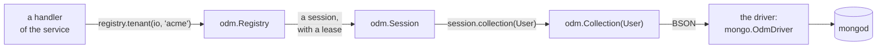

# odm

**A typed ODM for MongoDB, for Zig services with many tenants.** MongoDB
keeps *documents*, records like JSON objects, in *collections*. An ODM, an
object-document mapper, maps them to the types of a program. With
zefir-odm a model is a plain Zig struct; a filter, an update or a sort is
a literal that the compiler checks against it, so that a typo in a field
name, or a string where a number goes, stops the build instead of finding
nothing at run time; and what a query finds comes back as that struct.
One registry keeps the connections and the tenants of a service: each
tenant has a database of its own, on a shared server or on a server of
its own, tenants come and go while the service runs, and a connection
changes its credentials without a failed request. It is written against
`std.Io` only, runs on [zio](https://github.com/lalinsky/zio) in
production, and reaches MongoDB through zefir-mongo.

## Contents

- [What an ODM is](#what-an-odm-is)
- [Installation](#installation)
- [Quick start](#quick-start)
- [Models](#models)
- [Writing documents](#writing-documents)
- [Reading and changing documents](#reading-and-changing-documents)
- [Queries at run time](#queries-at-run-time)
- [Aggregation and commands](#aggregation-and-commands)
- [Tenants](#tenants)
- [Connections and credentials](#connections-and-credentials)
- [Errors and what is safe to retry](#errors-and-what-is-safe-to-retry)
- [Shutdown, statistics and logs](#shutdown-statistics-and-logs)
- [Security](#security)
- [Tests without MongoDB](#tests-without-mongodb)
- [For authors of drivers](#for-authors-of-drivers)

Programs that `zig build e2e` in `tests/odm` builds and runs against
mongod, checking what they print against this guide:
[quick start](quick_start.zig) · [tenants](tenants.zig).
Programs that `zig build test-odm` runs without a server:
[models](models.zig) · [queries](queries.zig).

## What an ODM is

A request of a service goes this way:



- **`odm.Registry`** holds the connections of the service and its
  tenants. A *connection* is one server and one login: one client of the
  driver, with its pool of network connections. A *tenant* is a customer
  of the service, with a database of its own on a connection. The service
  makes one registry at the start, and every task calls it.
- **`odm.Session`** is what a request gets from `registry.tenant(io, id)`:
  the tenant's database, for one task at a time. It holds a *lease* on the
  connection, so that a connection replaced meanwhile closes only once its
  sessions are done with it; `session.deinit(io)` gives the lease back.
- **`odm.Collection(User)`** is the collection of the model `User` in that
  database, with its typed operations: `insertOne`, `find`, `updateOne`,
  `upsertOne` and the rest. Each checks its literals when the program
  compiles, writes them as BSON, the binary form of MongoDB's documents,
  and hands that to the driver.
- **The driver** talks to the server. odm itself has no network code: it
  reaches a database only through its *driver contract*, `odm.Driver`.
  zefir-mongo's `mongo.OdmDriver` is the reference driver;
  `odm.testing.FakeDriver`, a driver without a network, runs the tests of
  an application, see [Tests without MongoDB](#tests-without-mongodb).

The code of a request sees a session and its collections, never a server
or a password, and a session reaches only its tenant's database.

## Installation

Add Zefir to your `build.zig.zon`:

```sh
zig fetch --save git+https://github.com/vkiryakov/zefir#dev
```

zefir-odm is on the `dev` branch until the next release. The command
fetches the latest commit of `dev`; `--save` pins that commit. The latest
release, v0.9.0, came before zefir-odm, so `#v0.9.0` does not have it.

A service runs on [zio](https://github.com/lalinsky/zio). zio has no
release for Zig 0.17 yet, so pin the commit Zefir is tested with:

```sh
zig fetch --save git+https://github.com/lalinsky/zio#d15034f1a4d9ddaa42829aae8f7e02d37cd1093a
```

Then import the modules in `build.zig`: odm; mongo, whose `OdmDriver`
talks to the server; and mongo-bson, for the types of documents, such as
`bson.ObjectId`. A model with `field_rules` uses validator, and the
programs of this guide also use Zefir's confy for settings, log for
records and core for deadlines:

```zig
// build.zig
const zefir = b.dependency("zefir", .{ .target = target, .optimize = optimize });
const zio = b.dependency("zio", .{ .target = target, .optimize = optimize });

const exe = b.addExecutable(.{
    .name = "shop",
    .root_module = b.createModule(.{
        .root_source_file = b.path("src/main.zig"),
        .target = target,
        .optimize = optimize,
        .imports = &.{
            .{ .name = "odm", .module = zefir.module("zefir-odm") },
            .{ .name = "mongo", .module = zefir.module("zefir-mongo") },
            .{ .name = "mongo-bson", .module = zefir.module("zefir-mongo-bson") },
            .{ .name = "validator", .module = zefir.module("zefir-validator") },
            .{ .name = "zio", .module = zio.module("zio") },
            .{ .name = "confy", .module = zefir.module("zefir-confy") },
            .{ .name = "log", .module = zefir.module("zefir-log") },
            .{ .name = "core", .module = zefir.module("zefir-core") },
        },
    }),
});
b.installArtifact(exe);
b.step("run", "Run the service").dependOn(&b.addRunArtifact(exe).step);
```

> [!TIP]
> zefir-odm is also part of the umbrella module: with
> `zefir.module("zefir")` imported as `zefir`, it is `@import("zefir").odm`.
> odm imports zefir-core, zefir-validator and zefir-mongo-bson, and no
> driver: zefir-mongo imports odm, to implement its contract. A package
> that only declares models, shared by several services, needs odm and
> mongo-bson alone.

You need a mongod to talk to. With Docker:

```sh
docker run --rm -p 27017:27017 mongo:9.0.4
```

## Quick start

The customers of the shop of one tenant, acme. The program connects,
makes the e-mail of a customer unique, signs four customers up, finds the
adults, gives one a birthday, lets one go, and counts the adults again:

```zig
//! The quick start of the guide: the customers of a shop, for the tenant
//! "acme", in the collection "users" of its database. It connects, makes
//! the e-mail of a customer unique, signs customers up, finds the adults
//! among them, gives one a birthday, lets one go, and counts the adults
//! again. Each run starts from an empty collection.
//!
//! Settings, from the environment:
//!
//!   APP_MONGO_URI        the server; mongodb://127.0.0.1:27017 by default
//!   APP_MONGO_PASSWORD   the password of the user that the URI names, if
//!                        it names one
//!
//! In tests/odm, `zig build example-quick_start` runs it against the
//! servers of the repository's docker-compose.yml.

const std = @import("std");
const confy = @import("confy");
const core = @import("core");
const log = @import("log");
const mongo = @import("mongo");
const odm = @import("odm");
const zio = @import("zio");
const bson = @import("mongo-bson");

/// odm and the driver log through std.log; this sends their records to
/// the logger.
pub const std_options: std.Options = .{ .logFn = log.stdLogFn };

const Config = struct {
    mongo: struct {
        uri: []const u8 = "mongodb://127.0.0.1:27017",
        /// Kept out of the URI, and out of every log.
        password: ?confy.Secret = null,
    } = .{},
};

/// A customer of the shop, as the collection keeps it.
const User = struct {
    /// null: odm makes an ObjectId when it inserts the customer.
    id: ?bson.ObjectId = null,
    email: []const u8,
    name: []const u8,
    age: u32 = 0,

    pub const odm_schema: odm.Schema(User) = .{
        .collection = "users",
        .id = .id,
        .indexes = &.{.{ .keys = &.{.{ .email = .asc }}, .unique = true }},
    };
};

pub fn main(init: std.process.Init) !void {
    var config: Config = undefined;
    confy.loadOrExit(init.arena.allocator(), &config, .{
        .io = init.io,
        .environ = init.environ_map,
        .env_prefix = "APP_",
        .sources = &.{.osEnv()},
    });
    // The logger outlives the runtime, so it takes `init.io`, through which
    // the tasks of the runtime may log too.
    const logger: log.Logger = try .init(init.gpa, init.io, .{ .format = .text });
    defer logger.deinit();
    logger.installStdLog();
    const app = logger.scoped("app");

    // One runtime for the program, with an executor per CPU core. The
    // registry and every call of it run on its `io`.
    const rt = try zio.Runtime.init(init.gpa, .{ .executors = .auto });
    defer rt.deinit();
    const io = rt.io();

    // The driver and the registry: one of each for the whole program.
    // Neither does I/O yet.
    var driver: mongo.OdmDriver = .init(init.gpa);
    var registry: odm.Registry = .init(init.gpa, io, driver.driver(), .{});
    defer registry.deinit(io);
    // A connection: this server, with this login. Registering it opens a
    // client of the driver without the network; connect opens the first
    // network connection and logs in, under its deadline.
    try registry.registerConnection(io, "main", .{
        .uri = config.mongo.uri,
        .password = if (config.mongo.password) |password| password.expose() else null,
    });
    registry.connect(io, within(io, .fromSeconds(10)), "main") catch |err| {
        const stats = try registry.connectionStats(io, "main");
        app.err("Cannot connect", .{ .reason = err, .details = if (stats.last_failure) |*failure| failure.message() else "" });
        return err;
    };
    app.info("Connected", .{});
    // A tenant: acme, whose database is "acme", on that connection.
    try registry.provisionTenant(io, within(io, .fromSeconds(10)), .{
        .tenant = "acme",
        .connection = .{ .existing = "main" },
        .database = "acme",
        .version = 1,
    });

    try run(io, init.gpa, &registry, app);

    const stats = registry.stats(io);
    app.info("Done", .{ .tenants = stats.tenants, .operations = stats.operations, .leases = stats.leases });
}

/// A context whose deadline is `budget` away.
fn within(io: std.Io, budget: std.Io.Duration) core.Context {
    return core.Context.root.withDeadline(.after(std.Io.Clock.awake.now(io), budget));
}

/// The application: it asks the registry for its tenant, and sees a
/// collection, not the connection.
fn run(io: std.Io, gpa: std.mem.Allocator, registry: *odm.Registry, app: log.Logger) !void {
    // The memory of the results, all freed at the end.
    var arena_state: std.heap.ArenaAllocator = .init(gpa);
    defer arena_state.deinit();
    const arena = arena_state.allocator();
    // Five seconds for all of it: each call has what is left of them.
    const ctx = within(io, .fromSeconds(5));

    // A session on the tenant's database, for this task, and the
    // collection of User in it.
    var acme = try registry.tenant(io, "acme");
    defer acme.deinit(io);
    const users = acme.collection(User);

    // Start afresh, and make the e-mail of a customer unique.
    _ = try users.deleteMany(io, ctx, .{});
    try users.ensureIndexes(io, ctx);

    // A customer; odm makes the id, and says which.
    const ann = try users.insertOne(io, ctx, .{ .email = "ann@example.com", .name = "Ann", .age = 30 });
    app.info("Signed up", .{ .name = "Ann", .id = ann.id });
    // Three more, in one request.
    const more = [_]User{
        .{ .email = "bob@example.com", .name = "Bob", .age = 17 },
        .{ .email = "cleo@example.com", .name = "Cleo", .age = 41 },
        .{ .email = "dan@example.com", .name = "Dan", .age = 25 },
    };
    const signed = try users.insertMany(io, ctx, &more, arena);
    app.info("Signed up", .{ .count = signed.ids.len });

    // The adults, the oldest first. The cursor brings them batch by batch,
    // each one decoded into a User in the arena.
    var adults = try users.find(io, ctx, .{ .age = .{ .gte = 18 } }, .{ .sort = .{ .age = .desc } });
    defer adults.deinit(io);
    while (try adults.next(io, ctx, arena)) |user| app.info("Adult", .{ .name = user.name, .age = user.age });

    // Bob has a birthday.
    const birthday = try users.updateOne(io, ctx, .{ .email = "bob@example.com" }, .{ .inc = .{ .age = 1 } });
    app.info("Birthday", .{ .matched = birthday.matched, .modified = birthday.modified });
    // Dan leaves the shop.
    const left = try users.deleteOne(io, ctx, .{ .email = "dan@example.com" });
    app.info("Left", .{ .deleted = left.deleted });
    const count = try users.count(io, ctx, .{ .age = .{ .gte = 18 } });
    app.info("Adults now", .{ .count = count });
}
```

Start a mongod as in [Installation](#installation), then the program:

```text
$ zig build run
2026-10-22T14:48:18.011Z INFO  [app] Connected
2026-10-22T14:48:18.014Z INFO  [app] Signed up name=Ann id=6ada22329d273800a4779333
2026-10-22T14:48:18.014Z INFO  [app] Signed up count=3
2026-10-22T14:48:18.015Z INFO  [app] Adult name=Cleo age=41
2026-10-22T14:48:18.015Z INFO  [app] Adult name=Ann age=30
2026-10-22T14:48:18.015Z INFO  [app] Adult name=Dan age=25
2026-10-22T14:48:18.016Z INFO  [app] Birthday matched=1 modified=1
2026-10-22T14:48:18.017Z INFO  [app] Left deleted=1
2026-10-22T14:48:18.018Z INFO  [app] Adults now count=3
2026-10-22T14:48:18.019Z INFO  [app] Done tenants=1 operations=8 leases=0
```

What happens, from the top:

- **Settings.** `confy.loadOrExit` fills `Config` from the environment:
  `APP_MONGO_URI` is `mongo.uri`, and `APP_MONGO_PASSWORD` is
  `mongo.password`, a `confy.Secret`, which no log prints. It stays out
  of the connection string, and `expose()` hands it to the registry,
  which passes it to the driver and keeps no copy.
- **Logs.** odm writes its warnings to `std.log.scoped(.odm)`, and the
  driver to `.mongo`; `std_options` with `log.stdLogFn` and
  `logger.installStdLog()` send them to zefir-log, see
  [Shutdown, statistics and logs](#shutdown-statistics-and-logs).
- **The runtime.** Everything runs on the `std.Io` of zio, `rt.io()`,
  with an executor per CPU core. The registry takes that `io` at `init`,
  and every call of the registry, of its sessions and of their
  collections comes on it: in safe builds a call on another `std.Io`
  panics, `rt.blockingIo()` of the same runtime too.
- **The driver and the registry.** `mongo.OdmDriver` opens the clients
  that the registry asks for, and lives longer than the registry.
  `odm.Registry.init` does no I/O and starts no task: the registry works
  in the calls of your tasks only.
- **The connection.** `registerConnection` names it "main" and opens a
  client of the driver, without the network; `connect` opens the first
  network connection and logs in, under its deadline. A server that is
  not there, or a wrong password, shows here, at the start:
  `connectionStats(io, "main").last_failure` holds the driver's text.
- **The tenant.** `provisionTenant` binds acme to the connection "main"
  and to its database, "acme"; version 1 is its first event, see
  [Tenants](#tenants).
- **A session.** `registry.tenant(io, "acme")` gives a session on acme's
  database, with a lease of the connection, and `acme.collection(User)`
  the collection of the model in it. `defer acme.deinit(io)` gives the
  lease back.
- **Contexts.** Each call takes a `core.Context`: here five seconds for
  all the calls of `run`, each with what is left of them.
- **Memory.** The strings of the users that `next` decodes, and the ids
  of `insertMany`, live in the arena, which goes all at once at the end.
  A cursor needs its `deinit`.
- **The end.** `stats` counts the eight operations, and no lease is out:
  the session went back. `registry.deinit(io)` closes the connection and
  frees the registry; a service shuts it down first, with a deadline, see
  [Shutdown, statistics and logs](#shutdown-statistics-and-logs).

## Models

A model is a struct with two declarations in it: `odm_schema`, what odm
needs to know of its collection, and `field_rules`, the rules of
zefir-validator that each document must keep. `models.zig` declares the
models of a shop and shows what odm writes of them. It needs no server:
odm gets `odm.testing.FakeDriver`, which runs no query and keeps a journal
of what it got, and the program prints those documents as Extended JSON,
the text form of BSON that MongoDB's tools show:

```zig
//! Models, without a server: the users, the visits and the products of a
//! shop, and what odm writes of them. A model is a plain struct with two
//! declarations: `odm_schema`, its collection, id, BSON names and indexes,
//! and `field_rules`, the rules of zefir-validator. The program hands odm
//! `odm.testing.FakeDriver`, a driver that runs no query and keeps a
//! journal of what odm sent it, and prints those documents as Extended
//! JSON, the text MongoDB's tools show them in. `zig build test-odm` runs
//! it.

const std = @import("std");
const core = @import("core");
const odm = @import("odm");
const v = @import("validator");
const bson = @import("mongo-bson");

/// A user of the shop, in the collection "users".
pub const User = struct {
    /// null: odm makes an ObjectId when it inserts the user.
    id: ?bson.ObjectId = null,
    email: []const u8,
    name: []const u8,
    /// A field with a default may stay out of an insert, and a document
    /// without it reads as the default.
    age: u32 = 0,
    status: Status = .active,
    /// An optional is null by default, and odm never writes a null: a user
    /// without a nickname has no field "nickname" at all.
    nickname: ?[]const u8 = null,
    /// A struct is a document inside the document.
    address: Address,
    profile: ?Profile = null,
    tags: []const []const u8 = &.{},
    created_at: bson.DateTime,

    pub const Status = enum { active, blocked };
    pub const Address = struct { city: []const u8, country: []const u8 };
    pub const Profile = struct { bio: []const u8, site: ?[]const u8 = null };

    pub const odm_schema: odm.Schema(User) = .{
        .collection = "users",
        // The field that is _id in the database.
        .id = .id,
        // The BSON names of top-level fields, where they are not the Zig
        // ones.
        .names = .{ .created_at = "createdAt" },
        .indexes = &.{
            .{ .keys = &.{.{ .email = .asc }}, .unique = true },
            // Unique on an optional needs sparse: the users without a
            // nickname stay out of the index, instead of colliding there.
            .{ .keys = &.{.{ .nickname = .asc }}, .unique = true, .sparse = true },
            // A compound index: its keys in their order.
            .{ .keys = &.{ .{ .status = .asc }, .{ .created_at = .desc } } },
        },
    };

    pub const field_rules = .{
        .email = .{ v.email, v.maxLength(254) },
        .name = .{ v.minLength(1), v.maxLength(100) },
        .age = v.range(0, 150),
    };
};

/// A visit to a page, whose id odm always makes: its insert takes an
/// `odm.Insert(Visit)`, the struct without the field `id`.
pub const Visit = struct {
    id: bson.ObjectId,
    user: bson.ObjectId,
    page: []const u8,
    at: bson.DateTime,

    pub const odm_schema: odm.Schema(Visit) = .{
        .collection = "visits",
        .id = .id,
        // A TTL index: the server deletes a visit 30 days after `at`.
        .indexes = &.{.{ .keys = &.{.{ .at = .asc }}, .expire_after_seconds = 30 * 24 * 3600 }},
    };
};

/// A product, whose id the shop gives: its code.
pub const Product = struct {
    id: []const u8,
    title: []const u8,
    price_cents: u32,

    pub const odm_schema: odm.Schema(Product) = .{ .collection = "products", .id = .id };
};

pub fn main(init: std.process.Init) !void {
    const io = init.io;
    var buffer: [4096]u8 = undefined;
    var stdout = std.Io.File.stdout().writerStreaming(io, &buffer);
    const out = &stdout.interface;

    // A driver that runs no query, and a registry with one tenant on it,
    // "acme", whose database is "acme".
    var fake: odm.testing.FakeDriver = .init(init.gpa);
    defer fake.deinit();
    var registry: odm.Registry = .init(init.gpa, io, fake.driver(), .{});
    defer registry.deinit(io);
    try registry.registerConnection(io, "main", .{ .uri = "fake://shop" });
    try registry.provisionTenant(io, .root, .{ .tenant = "acme", .connection = .{ .existing = "main" }, .database = "acme", .version = 1 });
    var acme = try registry.tenant(io, "acme");
    defer acme.deinit(io);
    // No deadline: the fake answers at once. A request of a service has
    // one, as the quick start shows.
    const ctx: core.Context = .root;
    const joined: bson.DateTime = .{ .milliseconds = 1_760_000_000_000 };
    const lisbon: User.Address = .{ .city = "Lisbon", .country = "PT" };

    // The indexes of the schema, created by one call: as the service
    // starts, and again for each new tenant.
    const users = acme.collection(User);
    try users.ensureIndexes(io, ctx);
    for (lastCall(&fake, io).create_indexes.indexes) |index| {
        try out.print("index {s}: {f}{s}{s}\n", .{ index.name, index.keys, if (index.unique) " unique" else "", if (index.sparse) " sparse" else "" });
    }
    try acme.collection(Visit).ensureIndexes(io, ctx);
    const ttl = lastCall(&fake, io).create_indexes.indexes[0];
    try out.print("index {s}: {f} expires after {d} s\n", .{ ttl.name, ttl.keys, ttl.expire_after_seconds.? });

    // An insert: odm makes the id, writes it as _id, and leaves the
    // optionals that are null out.
    const ann = try users.insertOne(io, ctx, .{ .email = "ann@example.com", .name = "Ann", .address = lisbon, .created_at = joined });
    try out.print("ann's id: {f}\n", .{ann.id});
    try out.print("inserted: {f}\n", .{lastCall(&fake, io).insert.documents[0]});
    // The same with the optionals there.
    _ = try users.insertOne(io, ctx, .{
        .email = "bob@example.com",
        .name = "Bob",
        .age = 17,
        .nickname = "bobby",
        .address = .{ .city = "Lyon", .country = "FR" },
        .profile = .{ .bio = "Tea and trains" },
        .tags = &.{"student"},
        .created_at = joined,
    });
    try out.print("inserted: {f}\n", .{lastCall(&fake, io).insert.documents[0]});

    // A Visit is inserted without an id: odm.Insert(Visit) has none, and
    // odm makes one every time.
    const visit = try acme.collection(Visit).insertOne(io, ctx, .{ .user = ann.id, .page = "/tea", .at = joined });
    try out.print("visit {f}: {f}\n", .{ visit.id, lastCall(&fake, io).insert.documents[0] });
    // A Product brings its own id.
    const tea = try acme.collection(Product).insertOne(io, ctx, .{ .id = "tea-01", .title = "Green tea", .price_cents = 450 });
    try out.print("product {s}: {f}\n", .{ tea.id, lastCall(&fake, io).insert.documents[0] });

    // The rules of the model come first: a document that breaks one is
    // ValidationFailed, the session's diagnostics say which rule and where,
    // and nothing goes out.
    const sent = fake.journal(io).len;
    if (users.insertOne(io, ctx, .{ .email = "ann at example", .name = "Ann", .address = lisbon, .created_at = joined })) |_| {
        try out.print("inserted a bad e-mail\n", .{});
    } else |err| {
        const d = acme.diagnostics();
        try out.print("refused: {t}, {s}: {s} ({s}); sent {d} more\n", .{ err, d.path(), d.message(), d.violation.?.code, fake.journal(io).len - sent });
    }

    // Reading: a document that another program wrote, without age and
    // profile, with a nickname that is null. The fake answers the next find
    // with it.
    var arena: std.heap.ArenaAllocator = .init(init.gpa);
    defer arena.deinit();
    const theirs = try bson.encode(arena.allocator(), .{
        ._id = ann.id,
        .email = "cy@example.com",
        .name = "Cy",
        .nickname = null,
        .address = .{ .city = "Porto", .country = "PT" },
        .createdAt = joined,
    }, .{});
    try fake.reply("fake://shop", .{ .documents = &.{theirs.raw()} });
    const cy = (try users.findOne(io, ctx, .{ .email = "cy@example.com" }, .{}, arena.allocator())).?;
    try out.print("read: {s}, age {d}, {t}, nickname {?s}, profile {s}\n", .{ cy.name, cy.age, cy.status, cy.nickname, if (cy.profile == null) "null" else "set" });
    try out.flush();
}

/// The latest call that odm sent the fake.
fn lastCall(fake: *odm.testing.FakeDriver, io: std.Io) odm.testing.FakeDriver.Call {
    const journal = fake.journal(io);
    return journal[journal.len - 1].call;
}
```

```text
$ zig build run
index email_1: {"email":1} unique
index nickname_1: {"nickname":1} unique sparse
index status_1_createdAt_-1: {"status":1,"createdAt":-1}
index at_1: {"at":1} expires after 2592000 s
ann's id: 6ada20638d052629b4bfaceb
inserted: {"_id":{"$oid":"6ada20638d052629b4bfaceb"},"email":"ann@example.com","name":"Ann","age":0,"status":"active","address":{"city":"Lisbon","country":"PT"},"tags":[],"createdAt":{"$date":"2025-10-09T08:53:20Z"}}
inserted: {"_id":{"$oid":"6ada20638d052629b4bfacec"},"email":"bob@example.com","name":"Bob","age":17,"status":"active","nickname":"bobby","address":{"city":"Lyon","country":"FR"},"profile":{"bio":"Tea and trains"},"tags":["student"],"createdAt":{"$date":"2025-10-09T08:53:20Z"}}
visit 6ada20638d052629b4bfaced: {"_id":{"$oid":"6ada20638d052629b4bfaced"},"user":{"$oid":"6ada20638d052629b4bfaceb"},"page":"/tea","at":{"$date":"2025-10-09T08:53:20Z"}}
product tea-01: {"_id":"tea-01","title":"Green tea","price_cents":450}
refused: ValidationFailed, email: odm: email: must be a valid email address (validation.email); sent 0 more
read: Cy, age 0, active, nickname null, profile null
```

### The id

Every document of a collection has an `_id`, unique in it.
`odm_schema.id` names the field of the model that holds it, and odm writes
that field as `_id`, wherever it stands in the struct. Its type says who
makes it:

| The field | `odm.Insert(T)`, what an insert takes | On insert |
|---|---|---|
| `id: ?bson.ObjectId = null`, as in `User` | `T` itself | null: odm makes an ObjectId; a value goes as it is, as in an import of documents that have ids |
| `id: bson.ObjectId`, as in `Visit` | `T` without `id` | odm makes an ObjectId every time |
| any other type, not optional, as in `Product` | `T` itself | the application gives it |

An ObjectId is 12 bytes made of the time, a random part and a counter, so
that services make unique ones without asking anyone; odm makes them with
the generator of its registry. `insertOne` returns the id of the
document, of type `odm.Id(T)`: in the run, `ann's id` is the `_id` of the
first insert, and the visit's `user` holds it.

### Names

A field is written under its Zig name, unless `odm_schema.names` gives
another: `created_at` is `createdAt` in the database, as code in other
languages may read the same collection. Names apply to the fields of the
model itself; inside a struct, such as `address`, a key is the Zig name of
its field, which may be any, such as `@"zip-code"`. Filters, sorts and
updates use the Zig names, and odm writes the BSON ones.

### Indexes

`odm_schema.indexes` lists the indexes of the collection. An index makes
finding by its keys fast; a *unique* one refuses a second document with
the same key, such as the same e-mail. The keys are a list, as the order
of a compound index matters: `status_1_createdAt_-1` finds the users of
one status, the newest first. An index without a `.name` gets MongoDB's,
made of its keys. `.expire_after_seconds` makes a TTL index, on one key of
a `bson.DateTime`: the server deletes a visit 30 days after its `at`.

odm creates indexes when it is told to, never on its own:
`collection.ensureIndexes(io, ctx)` sends all of a model's in one call,
and the same indexes again are no error. Call it as the service starts,
and for each new tenant, whose database starts empty, see
[Tenants](#tenants).

### Optionals and null

MongoDB has two ways to say "no value": a field that is null, and no
field at all. odm keeps one of them: **it never writes a null.**

- **Writing.** An optional that is null stays out of the document, at any
  depth: Ann has no `nickname` and no `profile`, and Bob's `profile` has
  no `site`. A null item of a list, `[]const ?E`, stays: it is an item,
  not a field.
- **Reading.** A field that is not there reads as its default: the `age`
  of Cy is 0. An optional that is not there reads as null, and so does a
  null that another program wrote, as Cy's `nickname`. A required field
  that is not there is an error, `DecodeFailed`, with the field in the
  diagnostics.
- **The default of an optional is null.** Any other default would come
  back for every document without the field, so the compiler refuses it.
- **A unique index on an optional needs `sparse`.** A sparse index leaves
  out the documents without its key. Without it, every user without a
  nickname would be in the index as null, and the second one would
  collide with the first.
- **Filters and updates** follow from it: `.nickname = null` finds both
  kinds, and an update clears a field with `unset`, see
  [null and missing fields](#null-and-missing-fields).

### Types of fields

| Zig | BSON |
|---|---|
| `bool` | boolean |
| `i8`–`i32`, `u8`–`u16` | int32 |
| `i33`–`i64`, `u32`–`u63` | int64 |
| `f64` | double |
| `[]const u8` | string, in UTF-8 |
| an exhaustive enum | string: the name of the tag |
| a struct | document |
| `[]const T`, `[N]T` | array |
| `?T` | the value, or no field |
| `bson.ObjectId`, `bson.DateTime`, `bson.Timestamp`, `bson.Binary`, `bson.Decimal128`, `bson.Regex`, `bson.RawDocument`, `bson.Value` | their own types |

The compiler refuses the rest: `u64` and `usize`, as the integers of BSON
are signed; `f32`, which a double would round; unions, pointers, `??T`,
and a struct inside itself.

### What the compiler catches

odm checks a model where the program uses it, and every literal where the
program passes it. A mistake stops the build with a message that names
the model, the field and what to do instead. The model's name is
`@typeName`, here `models.User`, as `User` is in `models.zig`:

```text
// rating: f32 = 0, in User
error: odm: models.User.rating is f32: a BSON double has 64 bits, and decoding one into f32 rounds it; use f64

// nickname: ?[]const u8 = "none", in User
error: odm: models.User.nickname is optional, and its default is not null: odm leaves a null optional out of the document, and a field that is not there reads back as its default; make the default null

// .{ .keys = &.{.{ .nickname = .asc }}, .unique = true }, in the indexes of User
error: odm: models.User.odm_schema.indexes[1] is unique on models.User.nickname, which is optional: odm leaves null out, and the documents without the field would collide in the index as null; add .sparse = true
```

The chapters below show the messages of filters and updates. Zig compiles
only the code that a program uses, so a model that nothing uses yet is not
checked; `odm.assertModel(User)` in a test of the package checks it all
the same, as [the tests of the shop](#tests-without-mongodb) do.

## Writing documents

`insertOne` writes one document, `insertMany` a list in one request.
Both go in three steps:

1. **The rules.** The `field_rules` of the model are checked first, by
   zefir-validator. A document that breaks one is `ValidationFailed`, the
   session's diagnostics name the field and the rule, and nothing is
   sent: in the run of `models.zig`, `email` and `validation.email`.
   `insertMany` checks every document before it sends any, and
   `diagnostics().index` names the first bad one.
2. **The BSON**, with the id made where odm makes it, and without the
   optionals that are null.
3. **One request** to the driver. A unique index that refuses a document
   is `DuplicateKey`, with the place of the document in
   `diagnostics().index`. In an `insertMany` the documents before it went
   in, and the ones after it did not.

The rules check whole documents: inserts and `replaceOne`. Updates and
upserts change parts of a document, which zefir-validator cannot check
on their own, so a handler checks a new value before it sends it. The
transforms of zefir-validator, such as `v.trim`, do not run here either:
they belong to the edge of a request, and the rules check a document as
it is.

Every call starts the session's diagnostics afresh, so that
`session.diagnostics()` tells the details of the latest call's error, and
nothing after a success:

| Field | What it holds |
|---|---|
| `message()` | the server's errmsg, the driver's text, or odm's own |
| `code` | the server's code: 11000 for a duplicate key, 13 for a login without the rights |
| `index` | the document of a write that the server refused, or that broke a rule |
| `violation` | the rule of zefir-validator: its `code` and `message` |
| `path()` | the field: of a rule, or of a document that did not decode |
| `cause` | the error of the decoder, such as `MissingField` or `WrongType` |

## Reading and changing documents

`queries.zig` reads and changes the users of `models.zig`, one call of
each kind, and prints what odm sent for it:

```zig
//! Reading and changing documents, without a server: filters, sorts,
//! cursors, projections, updates, upserts, queries built at run time and
//! the raw paths, on the users of models.zig. odm writes each typed call as
//! BSON and hands it to the driver; here the driver is
//! `odm.testing.FakeDriver`, and the program prints what it got, as
//! Extended JSON. `zig build test-odm` runs it.

const std = @import("std");
const core = @import("core");
const odm = @import("odm");
const bson = @import("mongo-bson");
const User = @import("models.zig").User;
const FakeDriver = odm.testing.FakeDriver;

/// A part of a user: the fields of a list on a page.
const Preview = struct { name: []const u8, email: []const u8 };

/// The optional conditions of a search, as a handler of zefir-http takes
/// them from the query string of a request.
const Search = struct {
    min_age: ?u32 = null,
    city: ?[]const u8 = null,
    status: ?User.Status = null,
};

/// The users that `search` asks for, the oldest first, 50 at a time. Each
/// condition that is there narrows it: several `where` are an AND.
fn search(users: odm.Collection(User), io: std.Io, ctx: core.Context, arena: std.mem.Allocator, s: Search) !odm.Cursor(User) {
    var q = users.query(arena);
    if (s.min_age) |age| q = q.where(.{ .age = .{ .gte = age } });
    if (s.city) |city| q = q.where(.{ .address = .{ .city = city } });
    if (s.status) |status| q = q.where(.{ .status = status });
    return q.sort(.{ .age = .desc }).limit(50).execute(io, ctx);
}

pub fn main(init: std.process.Init) !void {
    const io = init.io;
    var buffer: [4096]u8 = undefined;
    var stdout = std.Io.File.stdout().writerStreaming(io, &buffer);
    const out = &stdout.interface;

    var fake: FakeDriver = .init(init.gpa);
    defer fake.deinit();
    var registry: odm.Registry = .init(init.gpa, io, fake.driver(), .{});
    defer registry.deinit(io);
    try registry.registerConnection(io, "main", .{ .uri = "fake://shop" });
    try registry.provisionTenant(io, .root, .{ .tenant = "acme", .connection = .{ .existing = "main" }, .database = "acme", .version = 1 });
    var acme = try registry.tenant(io, "acme");
    defer acme.deinit(io);
    const users = acme.collection(User);
    const ctx: core.Context = .root;
    // The memory of what comes back: strings of documents, ids, the
    // conditions of queries. One arena for the whole program here; a
    // service takes one per request.
    var arena_state: std.heap.ArenaAllocator = .init(init.gpa);
    defer arena_state.deinit();
    const arena = arena_state.allocator();
    const lyon: User.Address = .{ .city = "Lyon", .country = "FR" };
    const joined: bson.DateTime = .{ .milliseconds = 1_760_000_000_000 };

    // Reading. The fake answers the next find with two users.
    try fake.reply("fake://shop", .{ .documents = &.{
        (try bson.encode(arena, .{ .email = "cleo@example.com", .name = "Cleo", .age = 41, .address = lyon, .createdAt = joined }, .{})).raw(),
        (try bson.encode(arena, .{ .email = "ann@example.com", .name = "Ann", .age = 30, .address = lyon, .createdAt = joined }, .{})).raw(),
    } });
    var adults = try users.find(io, ctx, .{ .status = .active, .age = .{ .gte = 18 } }, .{ .sort = .{ .age = .desc }, .limit = 100 });
    defer adults.deinit(io);
    try show(out, &fake, io, "adults");
    // Each document is decoded into the arena: the user lives as long as
    // the arena does, not as long as the cursor.
    while (try adults.next(io, ctx, arena)) |user| try out.print("  {s}, {d}\n", .{ user.name, user.age });

    // null matches a field that is null or missing; only missing is exists.
    var some = try users.find(io, ctx, .{ .nickname = null }, .{});
    some.deinit(io);
    try show(out, &fake, io, "null");
    some = try users.find(io, ctx, .{ .nickname = .{ .exists = false } }, .{});
    some.deinit(io);
    try show(out, &fake, io, "missing");
    // A literal of fields of a struct: conditions on its paths. The whole
    // document only with eq.
    some = try users.find(io, ctx, .{ .address = .{ .city = "Lyon" } }, .{});
    some.deinit(io);
    try show(out, &fake, io, "path");
    some = try users.find(io, ctx, .{ .address = .{ .eq = lyon } }, .{});
    some.deinit(io);
    try show(out, &fake, io, "whole");
    // Lists: an item, all of these items, a size.
    some = try users.find(io, ctx, .{ .tags = "vip" }, .{});
    some.deinit(io);
    try show(out, &fake, io, "item");
    some = try users.find(io, ctx, .{ .tags = .{ .all = .{ "vip", "staff" } }, .profile = .{ .exists = true } }, .{});
    some.deinit(io);
    try show(out, &fake, io, "all");
    // Either condition, and a pattern.
    some = try users.find(io, ctx, .{ .@"or" = .{ .{ .age = .{ .lt = 18 } }, .{ .status = .blocked } } }, .{ .skip = 20, .limit = 10 });
    some.deinit(io);
    try show(out, &fake, io, "or");
    // A projection: the server sends only the fields of Preview.
    _ = try users.findOneAs(Preview, io, ctx, .{ .email = .{ .regex = "@example\\.com$" } }, .{ .sort = .{ .name = .asc } }, arena);
    try show(out, &fake, io, "preview");
    _ = try users.count(io, ctx, .{ .status = .blocked });
    try show(out, &fake, io, "count");

    // Changing. An id that a find gave, say Ann's.
    const ann = try bson.ObjectId.parseHex("6ad571408b9f503e4a218a8b");
    _ = try users.updateOne(io, ctx, .{ .id = ann }, .{ .set = .{ .status = .blocked }, .inc = .{ .age = 1 } });
    try show(out, &fake, io, "block");
    // An optional is set to a value, and cleared by unset: odm writes no
    // null.
    _ = try users.updateOne(io, ctx, .{ .id = ann }, .{ .set = .{ .nickname = "annie" } });
    try show(out, &fake, io, "nickname");
    _ = try users.updateOne(io, ctx, .{ .id = ann }, .{ .unset = .{.nickname} });
    try show(out, &fake, io, "unset");
    // A path into a struct that is always there; an optional struct only
    // whole.
    _ = try users.updateOne(io, ctx, .{ .id = ann }, .{ .set = .{ .address = .{ .city = "Porto" }, .profile = User.Profile{ .bio = "Green tea" } } });
    try show(out, &fake, io, "move");
    // Lists: items in, items out; each path once per update.
    _ = try users.updateOne(io, ctx, .{ .id = ann }, .{ .add_to_set = .{ .tags = .{ .each = &.{ "vip", "staff" } } } });
    try show(out, &fake, io, "tags");
    _ = try users.updateOne(io, ctx, .{ .id = ann }, .{ .pull = .{ .tags = "student" } });
    try show(out, &fake, io, "untag");
    _ = try users.updateMany(io, ctx, .{ .status = .blocked }, .{ .set = .{ .status = .active } });
    try show(out, &fake, io, "unblock");
    // Dan in, unless he is there: the filter's equality, set and
    // set_on_insert give every required field of the document it may
    // insert.
    _ = try users.upsertOne(io, ctx, .{ .email = "dan@example.com" }, .{
        .set = .{ .name = "Dan", .address = lyon },
        .set_on_insert = .{ .created_at = joined },
    });
    try show(out, &fake, io, "upsert");
    _ = try users.replaceOne(io, ctx, .{ .id = ann }, .{ .email = "ann@example.org", .name = "Ann", .address = lyon, .created_at = joined });
    try show(out, &fake, io, "replace");
    _ = try users.deleteMany(io, ctx, .{ .status = .blocked, .created_at = .{ .lt = joined } });
    try show(out, &fake, io, "delete");

    // At run time: a search whose conditions come from a request, and a
    // change of the fields that a form sent.
    var found = try search(users, io, ctx, arena, .{ .min_age = 18, .city = "Lyon" });
    found.deinit(io);
    try show(out, &fake, io, "search");
    const new_name: ?[]const u8 = "Ann B.";
    const new_city: ?[]const u8 = null;
    var change = odm.Update(User).init(arena);
    if (new_name) |name| change = change.with(.{ .set = .{ .name = name } });
    if (new_city) |city| change = change.with(.{ .set = .{ .address = .{ .city = city } } });
    _ = try users.updateOne(io, ctx, .{ .id = ann }, change);
    try show(out, &fake, io, "form");

    // The raw paths: a pipeline and a command, which odm passes on as they
    // are, and does not check against the model.
    var groups = try users.aggregateRaw(struct { _id: []const u8, n: i32 }, io, ctx, .{
        .{ .@"$match" = .{ .age = .{ .@"$gte" = 18 } } },
        .{ .@"$group" = .{ ._id = "$status", .n = .{ .@"$sum" = 1 } } },
    });
    groups.deinit(io);
    try show(out, &fake, io, "groups");
    const stats = try acme.runCommand(io, ctx, .{ .collStats = "users" }, arena);
    try show(out, &fake, io, "command");
    try out.print("  the reply: {f}\n", .{stats});
    try out.flush();
}

/// Prints the latest call that odm sent the fake, after `label`.
fn show(out: *std.Io.Writer, fake: *FakeDriver, io: std.Io, label: []const u8) !void {
    const journal = fake.journal(io);
    try out.print("{s}: ", .{label});
    switch (journal[journal.len - 1].call) {
        .find => |f| {
            try out.print("find {f}", .{f.filter});
            if (f.sort) |sort| try out.print(" sort {f}", .{sort});
            if (f.projection) |projection| try out.print(" projection {f}", .{projection});
            if (f.skip != 0) try out.print(" skip {d}", .{f.skip});
            if (f.limit != 0) try out.print(" limit {d}", .{f.limit});
        },
        .count => |c| try out.print("count {f}", .{c.filter}),
        .update => |u| try out.print("update {t}{s} {f} {f}", .{ u.mode, if (u.upsert) " upsert" else "", u.filter, u.update }),
        .delete => |d| try out.print("delete {s} {f}", .{ if (d.many) "many" else "one", d.filter }),
        .aggregate => |a| {
            try out.writeAll("aggregate");
            for (a.pipeline) |stage| try out.print(" {f}", .{stage});
        },
        .command => |c| try out.print("command {f}", .{c.body}),
        else => |call| try out.print("{t}", .{call}),
    }
    try out.writeAll("\n");
}
```

```text
$ zig build run
adults: find {"status":"active","age":{"$gte":18}} sort {"age":-1} limit 100
  Cleo, 41
  Ann, 30
null: find {"nickname":null}
missing: find {"nickname":{"$exists":false}}
path: find {"address.city":"Lyon"}
whole: find {"address":{"city":"Lyon","country":"FR"}}
item: find {"tags":"vip"}
all: find {"tags":{"$all":["vip","staff"]},"profile":{"$exists":true}}
or: find {"$or":[{"age":{"$lt":18}},{"status":"blocked"}]} skip 20 limit 10
preview: find {"email":{"$regex":"@example\\.com$"}} sort {"name":1} projection {"name":1,"email":1,"_id":0} limit 1
count: count {"status":"blocked"}
block: update one {"_id":{"$oid":"6ad571408b9f503e4a218a8b"}} {"$set":{"status":"blocked"},"$inc":{"age":1}}
nickname: update one {"_id":{"$oid":"6ad571408b9f503e4a218a8b"}} {"$set":{"nickname":"annie"}}
unset: update one {"_id":{"$oid":"6ad571408b9f503e4a218a8b"}} {"$unset":{"nickname":""}}
move: update one {"_id":{"$oid":"6ad571408b9f503e4a218a8b"}} {"$set":{"address.city":"Porto","profile":{"bio":"Green tea"}}}
tags: update one {"_id":{"$oid":"6ad571408b9f503e4a218a8b"}} {"$addToSet":{"tags":{"$each":["vip","staff"]}}}
untag: update one {"_id":{"$oid":"6ad571408b9f503e4a218a8b"}} {"$pull":{"tags":"student"}}
unblock: update many {"status":"blocked"} {"$set":{"status":"active"}}
upsert: update one upsert {"email":"dan@example.com"} {"$set":{"name":"Dan","address":{"city":"Lyon","country":"FR"}},"$setOnInsert":{"createdAt":{"$date":"2025-10-09T08:53:20Z"}}}
replace: update replace {"_id":{"$oid":"6ad571408b9f503e4a218a8b"}} {"email":"ann@example.org","name":"Ann","age":0,"status":"active","address":{"city":"Lyon","country":"FR"},"tags":[],"createdAt":{"$date":"2025-10-09T08:53:20Z"}}
delete: delete many {"status":"blocked","createdAt":{"$lt":{"$date":"2025-10-09T08:53:20Z"}}}
search: find {"$and":[{"age":{"$gte":18}},{"address.city":"Lyon"}]} sort {"age":-1} limit 50
form: update one {"_id":{"$oid":"6ad571408b9f503e4a218a8b"}} {"$set":{"name":"Ann B."}}
groups: aggregate {"$match":{"age":{"$gte":18}}} {"$group":{"_id":"$status","n":{"$sum":1}}}
command: command {"collStats":"users"}
  the reply: {"ok":1.0}
```

Each line is a label of the program and the request that the driver
got: the filter, and the sort, projection, skip and limit of a find, or
the filter and the update of an update.

### Filters

A filter is an anonymous literal of the fields of the model. A field
holds a value, for equality, or a literal of operators:
`.age = .{ .gte = 18 }` is `{"age":{"$gte":18}}`. The fields of one
literal are an AND; `.@"or"`, `.@"and"` and `.nor` take a tuple of
filters, as on the line `or`. `.{}` matches every document. The operators
that a field takes depend on its type:

| Type of the field | `eq` `ne` | `gt` `gte` `lt` `lte` | `in` `nin` | `exists` | `regex` | `not` | `all` `size` `elem_match` |
|---|---|---|---|---|---|---|---|
| `bool`, an enum, `bson.Binary` | yes | | yes | yes | | yes | |
| integers, `f64`, `bson.Decimal128` | yes | yes | yes | yes | | yes | |
| `[]const u8` | yes | yes | yes | yes | yes | yes | |
| `bson.ObjectId`, `bson.DateTime`, `bson.Timestamp` | yes | yes | yes | yes | | yes | |
| a struct | the whole document | | | yes | | | paths to its fields |
| a list | an item, or the whole list | on the items | items | yes | on strings | yes | yes |
| `bson.RawDocument`, `bson.Value` | yes | | | yes | | | |

- **A value fits its field without a cast:** an integer of the same sign
  and no wider, a string for a string, a tag of the field's enum. A value
  known when the program compiles is checked itself: `200` fits the
  `u32` of `age`, `-1` does not. odm writes a condition as a value of the
  field's type, so a number for `age` is always an int64.
- `regex` takes a pattern, as a string or a `bson.Regex`; `exists` a
  bool; `size` a count; `not` a literal of operators; `in`, `nin` and
  `all` a tuple or a slice.
- Several conditions on one field go in one literal:
  `.age = .{ .gte = 18, .lt = 65 }`.

The compiler names what does not fit:

```text
// .{ .agee = .{ .gte = 18 } }
error: odm: models.User has no field 'agee'; did you mean 'age'?

// .{ .age = .{ .gte = "18" } }
error: odm: gte on models.User.age needs a u32; got *const [2:0]u8

// .{ .status = .actve }
error: odm: models.User.status is models.User.Status, which has no tag 'actve'; did you mean 'active'?

// find(io, ctx, .{}, .{ .limt = 10 })
error: odm: find has no option 'limt'; did you mean 'limit'?
```

### null and missing fields

odm writes no null, so a user without a nickname has no field
`nickname`. In MongoDB `{"nickname":null}` matches both a field that is
null and a field that is missing: `.nickname = null`, the line `null`,
finds the users without a nickname, whoever wrote them. Only the missing
ones: `.{ .exists = false }`, the line `missing`. null is a condition on
an optional only: on a required field it would match nothing, and the
compiler says so.

### Fields of structs: paths and whole documents

A literal of the fields of a struct is a condition on their paths:
`.address = .{ .city = "Lyon" }` is `{"address.city":"Lyon"}`, the users
who live in Lyon, whatever their country. A whole document takes `.eq`,
as on the line `whole`, and the server matches it only with the same
fields, of the same values, in the same order. odm writes the fields of
a struct in the order of its declaration, and without nulls, so the
documents that odm wrote match, and those that another program wrote
with the fields in another order do not. A struct without `.eq` does not
compile, so that a path never turns into a whole document by accident:

```text
// .{ .address = lyon }
error: odm: models.User.address is a document: match its fields, .{ .address = .{ .city = ... } }, or the whole document with .{ .eq = value }
```

An equality with a value of `bson.RawDocument`, `bson.Value` or
`bson.Regex` goes under `$eq`: `{"f":{"$eq":…}}`. A document whose first
key starts with `$` stays a value then, not operators, and a regular
expression is compared, not matched. `pull` of a whole struct from a
list of structs writes `$eq` the same way: a plain document in `$pull`
would remove every item that holds its fields, whatever the others.

### Lists

An item matches a list that holds it: `.tags = "vip"`, the line `item`,
finds the users tagged "vip". `all` takes the lists that hold each of its
items, `size` those of a length, and `elem_match` those with one item
that meets all its conditions at once. In a list of structs, a literal of
the fields of the item, without `elem_match`, is a path through the list,
which any item may meet. A whole list is `.eq` with a slice.

### Sorts, pages and cursors

`find` takes its options in a literal: `sort`, `skip`, `limit` and
`batch_size`. A sort is a literal of paths, each `.asc` or `.desc`, or an
`odm.Direction` known at run time; the order of its keys is the order of
the sort. `findOne` takes `sort` and `skip`, and asks the server for one
document only.

`find` returns an `odm.Cursor(User)`. The server sends the documents in
batches, and the cursor asks for the next batch when one runs out.
`next(io, ctx, arena)` decodes the next user into the arena, which holds
copies of its strings: the user lives as long as the arena, not as long
as the cursor. A service takes an arena per request and frees it at the
end. A cursor holds a lease of its own, so it may outlive its session;
`deinit` it, which also closes it on the server.

### Projections

A projection asks the server for some of the fields. odm takes it from
the type of the result: `findOneAs(Preview, …)` and `findAs(Preview, …)`
ask for the fields of `Preview`, as on the line `preview`. A field of a
projection is a field of the model of the same type, or its optional; a
struct in it is a projection of that struct's fields. When the id is not
among them, odm asks for `"_id":0`.

### Updates

An update is a literal of operators, each with a literal of the paths it
changes:

| Operator | Fields | Value |
|---|---|---|
| `set`, `set_on_insert` | any but the id; `set_on_insert` in `upsertOne` only | of the field's type; for `?F`, a value of `F` |
| `unset` | optionals, and fields with a default | a tuple of paths: `.{ .nickname, .profile }` |
| `inc`, `mul` | integers and `f64` | a number of the field's type |
| `min`, `max` | numbers, strings, `bson.DateTime`, `bson.ObjectId` | of the field's type |
| `push`, `add_to_set` | lists | an item, or `.{ .each = items }` |
| `pull` | lists | an item, or conditions on the items, as in `elem_match` |
| `pop` | lists | `.first` or `.last` |

- **An optional is set to a value, and cleared by `unset`**: the lines
  `nickname` and `unset`. `set` to null does not compile, as odm writes no
  null:

  ```text
  error: odm: set of models.User.nickname to null: odm does not store null; clear the field with .unset = .{.nickname}
  ```

- **A path into a struct that is always there** changes one of its
  fields: `address.city` on the line `move`. Every user has an address,
  so the city lands in a whole one.
- **An optional struct changes whole**, as `profile` on the same line. A
  path into it does not compile in an operator that creates fields
  (`set`, `set_on_insert`, `inc`, `mul`, `min`, `max`, `push`,
  `add_to_set`): in a document without a profile it would make one with
  a `site` and no `bio`, which the model cannot read:

  ```text
  error: odm: set of models.User.profile.site goes into models.User.profile, which is optional: in a document without profile it would create an incomplete models.User.Profile; set the whole models.User.Profile, .{ .set = .{ .profile = value } }, or unset profile
  ```

- **Numbers and lists of optionals** take their operators too. An
  optional that is null has no field, and the server does with it what
  MongoDB does with a missing field: `inc`, `min` and `max` create it
  with their value, `mul` with 0, `push` and `add_to_set` create the
  list, `pull` and `pop` do nothing. A null that another program wrote is
  not missing: these operators fail on it, with `WriteFailed`.
- **One update changes a path once**, as MongoDB refuses two changes of
  one path, or of a struct and its field:

  ```text
  // .{ .push = .{ .tags = "vip" }, .pull = .{ .tags = "student" } }
  error: odm: the update changes models.User.tags twice: in push and in pull
  ```

- **The id** never changes: an update that names it does not compile, and
  `replaceOne` keeps the `_id` of the document.

### upsertOne

`upsertOne` changes the first document that its filter matches, and
inserts one when none does. The server builds that document itself: it
takes the equalities of the filter and applies the update to them. So
the compiler checks that the document it may insert is one that `User`
can read:

- **The filter and the update are literals.** Their values may come at
  run time, but their shape is known when the program compiles; an
  `odm.Filter` or an `odm.Update` does not compile here.
- **Every required field gets a value**: from an equality of the filter,
  `set`, `set_on_insert`, or an operator that creates the field, such as
  `inc` or `push`. On the line `upsert` the e-mail comes from the filter,
  `name` and `address` from `set`, and `created_at` from `set_on_insert`,
  which the server applies only when it inserts. The message names what
  is missing:

  ```text
  // upsertOne(io, ctx, .{ .email = "dan@example.com" }, .{ .set = .{ .name = "Dan" } })
  error: odm: upsertOne of models.User may insert a document without its required fields 'address', 'created_at': give each by equality in the filter, in set, in set_on_insert, or with an operator that creates it, such as inc or push
  ```

- **The equalities of the filter go into the document**, so they follow
  the rules of `set`: no null, no optional value, no item where a list
  goes, no path through a list, and no `and`, `or` or `nor`, whose
  equalities odm cannot see.
- **No `in`, `nin` or `all` in the filter.** The server copies one item of
  `in` or `all` into the document as an equality, an item where a list
  goes too, and with no item at all it inserts none of the filter's
  equalities: in either case a document that the model cannot read.
  `nin` copies nothing, and stays out with them, so that the rule is one:

  ```text
  // upsertOne(io, ctx, .{ .email = "dan@example.com", .status = .{ .in = .{ .active, .blocked } } }, changes)
  error: odm: upsertOne of models.User: the filter's in on models.User.status: in, nin and all stay out of the filter of an upsert, since the server copies one item of in or all into the document it may insert, an item where a list goes too, and with no item it inserts none of the filter's equalities; match by equality, or use updateOne, then insertOne when it matched nothing
  ```

- **The id.** The server makes an ObjectId id when the filter and
  `set_on_insert` give none; an id of another type comes from an equality
  of the filter or from `set_on_insert`. `upserted_id` of the result is
  the id of the document inserted, or null when one matched.
- **The rules of `field_rules` do not run**: the server builds the
  document. Check the values in the handler, as for an update.

When the conditions come at run time, use `updateOne`, and `insertOne`
when it matched nothing. Two requests may race to insert the same user;
a unique index on the e-mail lets one in, the other gets `DuplicateKey`,
and its `updateOne` then finds the user.

### replaceOne and deleting

`replaceOne` puts a whole new document in the place of the first that
the filter matches, after the `field_rules`. It sends the document
without `_id`, as the line `replace` shows, and the server keeps the old
one; an optional that is null leaves the document. `deleteOne` deletes
the first document that the filter matches, `deleteMany` every one, and
`deleteMany` with `.{}` the whole collection.

## Queries at run time

A literal is fixed when the program compiles. A search form is not: each
of its conditions may be there or not. `users.query(arena)` builds a find
step by step: `where` adds a condition, and several are an AND; `sort`,
`skip`, `limit` and `batchSize` set the options; `execute`, `executeAs`,
`first` and `count` send it. `search` of `queries.zig` is what a handler
of zefir-http calls with the fields of a query string:

```zig
fn search(users: odm.Collection(User), io: std.Io, ctx: core.Context, arena: std.mem.Allocator, s: Search) !odm.Cursor(User) {
    var q = users.query(arena);
    if (s.min_age) |age| q = q.where(.{ .age = .{ .gte = age } });
    if (s.city) |city| q = q.where(.{ .address = .{ .city = city } });
    if (s.status) |status| q = q.where(.{ .status = status });
    return q.sort(.{ .age = .desc }).limit(50).execute(io, ctx);
}
```

- Each `where` is a literal, checked at compile time like any other, and
  written into the arena at once: its values may come at run time, and
  the query keeps no reference to them.
- A `where` that fails, for a string that is not UTF-8, keeps its error
  in the query, and `execute` returns it: the chain needs no `try`
  between its steps.
- The query is sent only by `execute`, `executeAs`, `first` and `count`,
  as the line `search` shows: two conditions of the four, in an `$and`.

Changes work the same way: `odm.Update(User).init(arena).with(…)` adds
the operators of a literal, and two `with` of `set` make one `$set`. On
the line `form` only the name came in the form:

```zig
var change = odm.Update(User).init(arena);
if (new_name) |name| change = change.with(.{ .set = .{ .name = name } });
if (new_city) |city| change = change.with(.{ .set = .{ .address = .{ .city = city } } });
_ = try users.updateOne(io, ctx, .{ .id = ann }, change);
```

`odm.Filter(User).init(arena).where(…)` builds a filter the same way.
Any operation but `upsertOne` takes them where it takes a literal. The
compiler sees one literal at a time, so a path that two `with` change, or
an `Update` without a change, is `InvalidArgument` when it is used.

## Aggregation and commands

Two paths take BSON as it is, and check nothing against the model:

- **`aggregateRaw(R, io, ctx, pipeline)`** sends an aggregation, a
  pipeline of stages written as literals with their `$` names, as on the
  line `groups`. The results decode into `R` by its field names.
- **`session.runCommand(io, ctx, command, arena)`** sends any command to
  the tenant's database, as on the line `command`, and copies the reply
  into the arena.

They reach what the login of the connection may reach: a `$out` or
`$merge` stage, or a command, may name another database. Keep the input
of users out of them, see [Security](#security).

## Tenants

A *tenant* is a customer of the service: here a company with its shop.
Each tenant has a database of its own, and its requests reach only that
database. The registry takes tenants in two modes, which a service may
mix:

- **Mode A: a shared connection.** Many tenants on one server with one
  login, each in its own database. One pool serves them all. The login
  reaches all their databases, so the registry keeps them apart: by the
  binding of each tenant to its database.
- **Mode B: a connection of the tenant's own**, a server of its own for a
  big customer, or a login of its own on the shared server. The rights of
  that login keep the tenant in its database on the server itself.


`tenants.zig` serves three shops this way:

```zig
//! Tenants: the shops of three companies in one service. acme and globex
//! share a server and its login, each with a database of its own; big-co
//! has a server and a login of its own. The service hears of its tenants
//! by events with versions, applies them to the registry as they come,
//! late and twice included, and serves the requests of each tenant in its
//! own database, after it checked that the caller may use that tenant.
//! Each run starts from empty collections.
//!
//! Settings, from the environment:
//!
//!   APP_SHARED_URI        the shared server; mongodb://127.0.0.1:27017 by
//!                         default
//!   APP_SHARED_PASSWORD   the password of the user of APP_SHARED_URI, if
//!                         it names one
//!   APP_BIG_URI           the server of big-co and its user, such as
//!                         mongodb://admin@127.0.0.1:27018
//!   APP_BIG_PASSWORD      that user's password
//!   APP_BIG_DATABASE      the database of big-co; bigco by default
//!
//! In tests/odm, `zig build example-tenants` runs it against the servers
//! of the repository's docker-compose.yml.

const std = @import("std");
const confy = @import("confy");
const core = @import("core");
const log = @import("log");
const mongo = @import("mongo");
const odm = @import("odm");
const zio = @import("zio");
const bson = @import("mongo-bson");

pub const std_options: std.Options = .{ .logFn = log.stdLogFn };

const Config = struct {
    shared: struct {
        uri: []const u8 = "mongodb://127.0.0.1:27017",
        password: ?confy.Secret = null,
    } = .{},
    big: struct {
        uri: []const u8,
        password: ?confy.Secret = null,
        database: []const u8 = "bigco",
    },
};

/// An order of a shop, in the collection "orders" of its tenant.
const Order = struct {
    id: ?bson.ObjectId = null,
    customer: []const u8,
    item: []const u8,
    cents: u32,

    pub const odm_schema: odm.Schema(Order) = .{
        .collection = "orders",
        .id = .id,
        .indexes = &.{.{ .keys = &.{.{ .customer = .asc }} }},
    };
};

/// Who calls: the subject of the request's token and the tenants it may
/// use, as the authentication of the service finds them.
const Caller = struct { name: []const u8, tenants: []const []const u8 };

pub fn main(init: std.process.Init) !void {
    var config: Config = undefined;
    confy.loadOrExit(init.arena.allocator(), &config, .{
        .io = init.io,
        .environ = init.environ_map,
        .env_prefix = "APP_",
        .sources = &.{.osEnv()},
    });
    const logger: log.Logger = try .init(init.gpa, init.io, .{ .format = .text });
    defer logger.deinit();
    logger.installStdLog();
    const app = logger.scoped("app");
    const rt = try zio.Runtime.init(init.gpa, .{ .executors = .auto });
    defer rt.deinit();
    const io = rt.io();

    var driver: mongo.OdmDriver = .init(init.gpa);
    var registry: odm.Registry = .init(init.gpa, io, driver.driver(), .{});
    defer registry.deinit(io);
    // The shared server, as the service starts.
    try registry.registerConnection(io, "shared", .{
        .uri = config.shared.uri,
        .password = if (config.shared.password) |password| password.expose() else null,
    });
    try registry.connect(io, within(io, .fromSeconds(10)), "shared");

    // The events of the tenants, as they come: two on the shared
    // connection, each in its own database, and one with a connection of
    // its own, which the provisioning registers and connects.
    apply(&registry, io, app, .{ .tenant = "acme", .connection = .{ .existing = "shared" }, .database = "acme", .version = 1 });
    apply(&registry, io, app, .{ .tenant = "globex", .connection = .{ .existing = "shared" }, .database = "globex", .version = 1 });
    apply(&registry, io, app, .{
        .tenant = "big-co",
        .connection = .{ .new = .{
            .id = "big-co",
            .uri = config.big.uri,
            .password = if (config.big.password) |password| password.expose() else null,
        } },
        .database = config.big.database,
        .version = 1,
    });
    // The same event again, as a queue may deliver it twice: nothing
    // changes. The same version with other settings is a conflict; a newer
    // one applies; an older one that came late changes nothing.
    apply(&registry, io, app, .{ .tenant = "acme", .connection = .{ .existing = "shared" }, .database = "acme", .version = 1 });
    apply(&registry, io, app, .{ .tenant = "acme", .connection = .{ .existing = "shared" }, .database = "acme-eu", .version = 1 });
    apply(&registry, io, app, .{ .tenant = "acme", .connection = .{ .existing = "shared" }, .database = "acme", .version = 2 });
    apply(&registry, io, app, .{ .tenant = "acme", .connection = .{ .existing = "shared" }, .database = "acme", .version = 1 });

    // Each run starts afresh.
    for ([_][]const u8{ "acme", "globex", "big-co" }) |tenant_id| {
        var session = try registry.tenant(io, tenant_id);
        defer session.deinit(io);
        _ = try session.collection(Order).deleteMany(io, within(io, .fromSeconds(5)), .{});
    }

    // Requests. Ann works for acme, Bo for big-co.
    const ann: Caller = .{ .name = "ann", .tenants = &.{"acme"} };
    const bo: Caller = .{ .name = "bo", .tenants = &.{"big-co"} };
    const ops: Caller = .{ .name = "ops", .tenants = &.{ "acme", "globex", "big-co", "initech" } };
    serve(&registry, io, app, ann, "acme", .{ .customer = "cleo", .item = "green tea", .cents = 450 });
    serve(&registry, io, app, ann, "globex", .{ .customer = "cleo", .item = "black tea", .cents = 390 });
    serve(&registry, io, app, bo, "big-co", .{ .customer = "dan", .item = "oolong", .cents = 820 });
    serve(&registry, io, app, ops, "initech", .{ .customer = "eve", .item = "sencha", .cents = 610 });

    // Each tenant sees its own orders only.
    for ([_][]const u8{ "acme", "globex", "big-co" }) |tenant_id| {
        var session = try registry.tenant(io, tenant_id);
        defer session.deinit(io);
        const orders = try session.collection(Order).count(io, within(io, .fromSeconds(5)), .{});
        app.info("Orders", .{ .tenant = tenant_id, .count = orders });
    }

    // globex leaves: new requests do not find it.
    try registry.removeTenant(io, "globex");
    serve(&registry, io, app, ops, "globex", .{ .customer = "cleo", .item = "black tea", .cents = 390 });

    const stats = registry.stats(io);
    app.info("Done", .{ .active = stats.connections.active, .tenants = stats.tenants, .leases = stats.leases });
}

/// A context whose deadline is `budget` away.
fn within(io: std.Io, budget: std.Io.Duration) core.Context {
    return core.Context.root.withDeadline(.after(std.Io.Clock.awake.now(io), budget));
}

/// Applies an event of a tenant to the registry, and makes the indexes of
/// its database, which starts empty. The same event again changes nothing,
/// and so does an older one: the queue of the events may take both as
/// done.
fn apply(registry: *odm.Registry, io: std.Io, app: log.Logger, event: odm.Provision) void {
    var d: odm.Diagnostics = .{};
    var request = event;
    request.diagnostics = &d;
    const ctx = within(io, .fromSeconds(10));
    registry.provisionTenant(io, ctx, request) catch |err| {
        app.warn("Event not applied", .{ .tenant = event.tenant, .version = event.version, .reason = err, .details = d.message() });
        return;
    };
    var session = registry.tenant(io, event.tenant) catch return;
    defer session.deinit(io);
    session.collection(Order).ensureIndexes(io, ctx) catch |err| {
        app.warn("No indexes", .{ .tenant = event.tenant, .reason = err, .details = session.diagnostics().message() });
        return;
    };
    app.info("Event applied", .{ .tenant = event.tenant, .version = event.version });
}

/// Serves a request and logs how it went.
fn serve(registry: *odm.Registry, io: std.Io, app: log.Logger, caller: Caller, tenant_id: []const u8, order: Order) void {
    const id = placeOrder(registry, io, within(io, .fromSeconds(5)), caller, tenant_id, order) catch |err| {
        app.warn("Refused", .{ .tenant = tenant_id, .caller = caller.name, .reason = err });
        return;
    };
    app.info("Order placed", .{ .tenant = tenant_id, .caller = caller.name, .id = id });
}

const PlaceError = odm.Error || error{Forbidden};

/// The handler of `POST /tenants/{tenant}/orders`, with the fields of the
/// request as its parameters. The tenant id comes from the path, which the
/// caller wrote: the handler checks that the caller may use that tenant
/// before it asks the registry, which takes any id it knows.
fn placeOrder(registry: *odm.Registry, io: std.Io, ctx: core.Context, caller: Caller, tenant_id: []const u8, order: Order) PlaceError!bson.ObjectId {
    for (caller.tenants) |allowed| {
        if (std.mem.eql(u8, allowed, tenant_id)) break;
    } else return error.Forbidden;
    var session = try registry.tenant(io, tenant_id);
    defer session.deinit(io);
    const placed = try session.collection(Order).insertOne(io, ctx, order);
    return placed.id;
}
```

It needs a second mongod, with a user. The image of mongo makes a root
user from two variables; this one listens on 27018, next to the shared
one:

```sh
docker run --rm -p 27018:27017 -e MONGO_INITDB_ROOT_USERNAME=admin -e MONGO_INITDB_ROOT_PASSWORD=change-me mongo:9.0.4
```

```text
$ APP_BIG_URI=mongodb://admin@127.0.0.1:27018 APP_BIG_PASSWORD=change-me zig build run
2026-10-22T14:48:18.755Z INFO  [app] Event applied tenant=acme version=1
2026-10-22T14:48:18.755Z INFO  [app] Event applied tenant=globex version=1
2026-10-22T14:48:18.781Z INFO  [app] Event applied tenant=big-co version=1
2026-10-22T14:48:18.782Z INFO  [app] Event applied tenant=acme version=1
2026-10-22T14:48:18.782Z WARN  [app] Event not applied tenant=acme version=1 reason=ProvisioningConflict details="odm: version 1 is the tenant's version, with other settings"
2026-10-22T14:48:18.783Z INFO  [app] Event applied tenant=acme version=2
2026-10-22T14:48:18.783Z WARN  [app] Event not applied tenant=acme version=1 reason=StaleVersion details="odm: version 1 is older than the tenant's version 2"
2026-10-22T14:48:18.785Z INFO  [app] Order placed tenant=acme caller=ann id=6ada22325be6de08a0e53a72
2026-10-22T14:48:18.785Z WARN  [app] Refused tenant=globex caller=ann reason=Forbidden
2026-10-22T14:48:18.786Z INFO  [app] Order placed tenant=big-co caller=bo id=6ada22325be6de08a0e53a73
2026-10-22T14:48:18.786Z WARN  [app] Refused tenant=initech caller=ops reason=TenantNotFound
2026-10-22T14:48:18.787Z INFO  [app] Orders tenant=acme count=1
2026-10-22T14:48:18.787Z INFO  [app] Orders tenant=globex count=0
2026-10-22T14:48:18.788Z INFO  [app] Orders tenant=big-co count=1
2026-10-22T14:48:18.788Z WARN  [app] Refused tenant=globex caller=ops reason=TenantNotFound
2026-10-22T14:48:18.788Z INFO  [app] Done active=2 tenants=2 leases=0
```

### Events and versions

A service hears of its tenants from elsewhere: a queue, a call of another
service, its own settings. Each event of a tenant has a version, which
grows with each change of the tenant, and `provisionTenant` applies it by
this table:

| The tenant | The version of the event | Its settings | What happens |
|---|---|---|---|
| unknown | any | | the tenant is bound |
| known | lower than the tenant's | | `StaleVersion`, and nothing changes |
| known | the tenant's | the same | success, and nothing changes |
| known | the tenant's | other | `ProvisioningConflict` |
| known | higher | any | the tenant is bound anew |

The settings are the same when the database and the connection are:
`.existing` of the same id, or `.new` of the same id, URI and password. A
queue may deliver an event twice, and an old one late. The same event
again succeeds and changes nothing; an old one is `StaleVersion` and
changes nothing; so the service may take both as done, as the run does
with the second event of acme at version 1 and the last one. Two events
of one tenant at once take turns.

`.new` makes the tenant's own connection: the registry registers it and
connects it. When that fails, for a wrong password or a server that is
not there, the registry removes it again, and the tenant stays as it was.
A `.new` with the id of a connection that is there already reuses it when
its URI and password are the same, and is `ProvisioningConflict` when
they are not: credentials change with `replaceConnection`, see
[Connections and credentials](#connections-and-credentials).

The registry publishes a binding whole, once its connection works: a
request sees the tenant as it was before the event or as it is after it,
never half of each. A session taken before keeps its database and its
connection until its `deinit`.

`removeTenant(io, id)` unbinds a tenant, and later requests get
`TenantNotFound`, as the last request for globex does. Its connection
stays: `removeConnection` removes a connection once no tenant is bound to
it. Removing takes no version, and the registry keeps no memory of the
tenants it removed: an old event that comes after a removal binds the
tenant again. Where that matters, the service keeps the events of a
tenant in order.

A new tenant's database starts empty, so `apply` makes the indexes of
the model after each event; the same indexes again cost a call and change
nothing.

### Who may use a tenant

The registry trusts the id it gets: `registry.tenant(io, id)` gives a
session of any tenant it knows. Which tenants a caller may use is for the
application to decide, at the edge of the request, before it asks the
registry. `placeOrder` is a handler of zefir-http with the fields of its
request as parameters: the tenant id of the path, the caller that the
authentication of the service found, and the order of the body. Ann may
use acme only, so her order for globex is `Forbidden` before the registry
sees the id. An id that the caller may use, but that the registry does
not know, is `TenantNotFound`.

What keeps one tenant out of another's data, and what does not, is in
[Security](#security).

