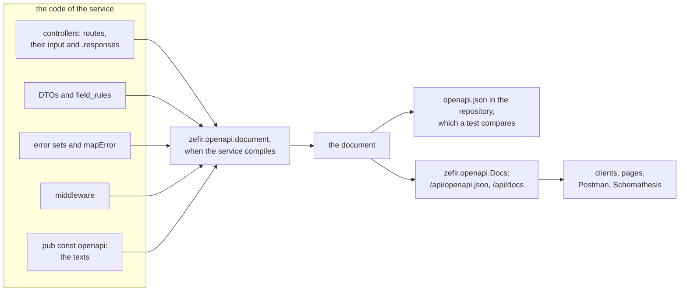
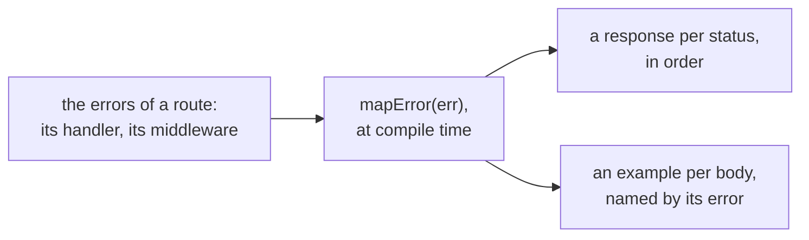

# openapi

**The OpenAPI document of your API, built by the compiler from the types
your server runs on.** An OpenAPI document is a JSON file that describes a
REST API to those who call it without its code: each path and method, the
parameters, the bodies of the requests and the responses, the errors, and
how a client says who it is. Generators of clients write the code that
calls the API from it (openapi-generator, openapi-typescript, orval,
Kiota), pages of documentation show it (Scalar, Swagger UI, Redoc), Postman
imports it, and tests of contracts, such as Schemathesis, check a server
against it. zefir-openapi builds that document when the service compiles,
from the same types its zefir-http server works with: the routes of the
controllers and what they declare, what the handlers return, the DTOs with
their `field_rules`, the errors of each route as the error handler's
`mapError` answers them, and the middleware of each route. So the document
cannot list a route that is not there, leave out an error that a route
returns, or forget a rule of a field. What the compiler cannot see, the
texts, each type declares next to its code, in a typed `pub const openapi`:
a mistake there is an ordinary error of Zig, at the line of your code. A
test keeps the file `openapi.json` of the repository up to date, and the
controller `zefir.openapi.Docs` serves the document with a page of it.

> [!IMPORTANT]
> **Not implemented yet (TODO):**
>
> - **Code from a document.** The document comes from the code, never the
>   other way: no Zig code is generated from a document.
> - **Clients.** zefir generates none; the generators of clients make them
>   from the document.
> - **The headers of responses.** A response is described by its status and
>   its body: `Location`, `ETag` and the other headers it sends are not in
>   the document.
> - **A text for each value of an enum.** An enum is in the document with
>   its values, without a description of each.
> - **Responses of the error handler.** A response that `handle` of the
>   error handler writes in place of an error is declared in `.responses` of
>   the route where it happens.
> - **A hidden field or route.** Every field of a DTO is on the wire, so it
>   is in the document; a whole controller is left out with `.exclude`.
> - **Webhooks and callbacks, AsyncAPI and WebSocket.**
> - **A raw body.** `ctx.body()` reads bytes that the document does not
>   describe.
> - **A check of compatibility** between two versions of the document: a
>   change of the API shows in `openapi.json` in a review, not as a failure.
> - **Extensions `x-…`.** The document holds only what OpenAPI defines, so
>   that a strict tool reads it.
> - **u64 and i64 as strings.** They are JSON numbers, as zefir-http writes
>   them (see [For integrators](#for-integrators)).
> - **`Docs` under zefir.App.** The http server of an App cannot serve
>   `Docs` yet: App builds the controllers of its modules itself, and
>   `Docs` needs its document and a `deinit`. Serve it from an http server
>   built with `http.Server.init`, as in this guide.

## Contents

- [How a document is built](#how-a-document-is-built)
- [Installation](#installation)
- [The small application](#the-small-application)
- [What the compiler catches](#what-the-compiler-catches)
- [Declarations](#declarations)
- [Types and rules](#types-and-rules)
- [Errors](#errors)
- [Security](#security)
- [Server-sent events](#server-sent-events)
- [Serving the document](#serving-the-document)
- [The file in the repository](#the-file-in-the-repository)
- [The document of the http guide's service](#the-document-of-the-http-guides-service)
- [The Debug check](#the-debug-check)
- [For integrators](#for-integrators)

`zig build test-openapi` runs the test of the small application of this
guide, which compares its document with its `openapi.json`, and checks this
guide against the files it shows.

## How a document is built



The server of a zefir-http service is built in one function of the
application, `Service.start`, which `main` and the tests both call. It puts
the parts of the server together, `.controllers`, `.middleware`,
`.error_handler`, and `zefir.openapi.document(@TypeOf(parts), .{ … })`
builds the document from the type of those parts at compile time: that
type names every controller, every middleware and the error handler, and
through them every route, every DTO and every error. The server that `main`
runs is the one the document describes.

- **Every check happens when the service compiles.** A route the document
  cannot describe, or a text that does not fit, stops the build with a
  message that says what to write.
- **The same program gives the same bytes**: the paths in the order of the
  controllers and their methods, the schemas, the responses and the
  examples sorted by name and status. The file in the repository changes
  only when the API does.
- **An application that builds no document pays nothing for it**: Zig
  compiles only what a program uses.

## Installation

Add Zefir to your `build.zig.zon`; openapi ships since v0.11.0:

```sh
zig fetch --save git+https://github.com/vkiryakov/zefir#dev
```

This guide is on the `dev` branch, so the command fetches its latest commit; `--save` pins that commit. For the latest release, v0.11.0, fetch `#v0.11.0` instead.

The service runs on zio. zio has no release for Zig 0.17 yet, so pin the
commit Zefir is tested with:

```sh
zig fetch --save git+https://github.com/lalinsky/zio#d15034f1a4d9ddaa42829aae8f7e02d37cd1093a
```

Then import the umbrella module `zefir` in `build.zig`. Its test compares
the document with `openapi.json`, and `zig build openapi` runs that test to
write the file:

```zig
// build.zig of the small application
const std = @import("std");

pub fn build(b: *std.Build) void {
    const target = b.standardTargetOptions(.{});
    const optimize = b.standardOptimizeOption(.{});
    const zefir = b.dependency("zefir", .{ .target = target, .optimize = optimize });
    const zio = b.dependency("zio", .{ .target = target, .optimize = optimize });

    const exe = b.addExecutable(.{
        .name = "todos",
        .root_module = b.createModule(.{
            .root_source_file = b.path("src/main.zig"),
            .target = target,
            .optimize = optimize,
            .imports = &.{
                .{ .name = "zefir", .module = zefir.module("zefir") },
                .{ .name = "zio", .module = zio.module("zio") },
            },
        }),
    });
    b.installArtifact(exe);
    b.step("run", "Run the service").dependOn(&b.addRunArtifact(exe).step);

    const tests = b.addTest(.{
        .root_module = b.createModule(.{
            .root_source_file = b.path("src/service_test.zig"),
            .target = target,
            .optimize = optimize,
            .imports = &.{.{ .name = "zefir", .module = zefir.module("zefir") }},
        }),
    });
    // The test finds openapi.json, next to build.zig, by the path the
    // build gives it.
    const paths = b.addOptions();
    paths.addOptionPathUntracked("openapi_json", b.path("openapi.json"));
    tests.root_module.addOptions("paths", paths);
    const run_tests = b.addRunArtifact(tests);
    // openapi.json is an input of the run: Zig runs the test again when
    // the file changes, not only when the code does.
    run_tests.addFileInput(b.path("openapi.json"));
    b.step("test", "Run the tests").dependOn(&run_tests.step);

    // zig build openapi: the same test, which then writes openapi.json. It
    // has side effects, so it runs every time, never from the cache.
    const update = b.addRunArtifact(tests);
    update.setEnvironmentVariable("ZEFIR_OPENAPI_UPDATE", "1");
    update.has_side_effects = true;
    b.step("openapi", "Rewrite openapi.json from the code").dependOn(&update.step);
}
```

> [!TIP]
> Write the declarations through the umbrella module, as
> `zefir.openapi.Doc(@This())`. In a type, the name `openapi` is its
> declaration, `pub const openapi`, so the module needs another name in
> the file. zefir-openapi imports only http and validator, and nothing
> outside Zefir: the browser loads Scalar, the page of the document.

## The small application

One controller and one route, `GET /api/v1/todos/{id}`, from its DTOs to
the whole document. Every file is code of the application.

**`src/dto.zig`**, what a request brings in and a response sends out:

```zig
//! What a request brings in and what a response sends out. Each type
//! carries the texts of the document next to its fields, in
//! `pub const openapi`; the constraints come from its `field_rules`.

const zefir = @import("zefir");
const v = zefir.validator;
const TodoRepository = @import("TodoRepository.zig");

/// The path /v1/todos/{id}: the field `id` reads the parameter `{id}`.
pub const TodoIdPath = struct {
    id: u64,

    pub const field_rules = .{ .id = v.positive };

    // A DTO of a path brings the texts of its fields: each field is a
    // parameter of the document.
    pub const openapi: zefir.openapi.Doc(@This()) = .{
        .fields = .{ .id = .{ .description = "The id of the todo.", .example = 1 } },
    };
};

pub const TodoResponse = struct {
    id: u64,
    title: []const u8,
    done: bool,

    pub const openapi: zefir.openapi.Doc(@This()) = .{
        .description = "A todo, as the API shows it.",
        .fields = .{
            .id = .{ .description = "The id of the todo." },
            .title = .{ .description = "What to do." },
            .done = .{ .description = "Whether it is done." },
        },
    };

    pub fn from(todo: TodoRepository.Todo) TodoResponse {
        return .{ .id = todo.id, .title = todo.title, .done = todo.done };
    }
};
```

- **`pub const openapi: zefir.openapi.Doc(@This())`** holds the texts of a
  type: its description, a text for each field, examples. The type of the
  declaration is made from the type itself, so a field that is not there,
  or an example of the wrong type, does not build.
- **No constraint is written there.** `minimum: 1` of the id comes from
  `v.positive` in `field_rules`, and its type, `integer` of the format
  `uint64`, from `u64`.

**`src/TodoRepository.zig`**, the todos:

```zig
//! The todos, a list in memory: the application's own code, which knows
//! nothing of HTTP.

const TodoRepository = @This();

pub const Todo = struct { id: u64, title: []const u8, done: bool };

todos: []const Todo,

pub fn find(repo: *const TodoRepository, id: u64) ?Todo {
    for (repo.todos) |todo| if (todo.id == id) return todo;
    return null;
}
```

**`src/TodosController.zig`**, the route and its texts:

```zig
//! GET /api/v1/todos/{id}: one route, and its texts for the document.

const zefir = @import("zefir");
const http = zefir.http;
const dto = @import("dto.zig");
const TodoRepository = @import("TodoRepository.zig");

const TodosController = @This();

repo: *const TodoRepository,

// The route has a name, so that the handler reads its input through what
// it declares.
const Get = http.get("/{id}", .{ .path = dto.TodoIdPath });

pub const http_routes = http.routes(.{
    .prefix = "/v1/todos",
    .methods = .{ .get = Get },
});

// The texts of the document: the tag of the controller, and an entry for
// each method of .methods.
pub const openapi: zefir.openapi.ControllerDoc(@This()) = .{
    .tag = "Todos",
    .routes = .{ .get = .{ .summary = "Get a todo" } },
};

pub fn get(self: *TodosController, ctx: *http.Context) !http.Json(dto.TodoResponse) {
    const in = try ctx.input(Get); // in.path is a dto.TodoIdPath, as Get declares
    const todo = self.repo.find(in.path.id) orelse return error.TodoNotFound;
    return .{ .value = .from(todo) };
}
```

- **`const Get = http.get(…)`** gives the route a name. A route is a type,
  so the same name goes in `.methods` and into the handler, and
  `ctx.input(Get)` reads exactly what `Get` declares: `in.path`, a
  `dto.TodoIdPath`.
- **`.path = dto.TodoIdPath`** tells the server, and the document, what the
  route reads: its parameter `id`, with its type, its rules and its texts.
- **`pub const openapi: zefir.openapi.ControllerDoc(@This())`** holds the
  tag of the controller and an entry for each method of `.methods`, with a
  `.summary` at least.

**`src/errors.zig`**, the error handler:

```zig
//! The error handler: every error of a route becomes a problem+json body
//! of RFC 9457. The compiler calls `mapError` for each error a route can
//! return, and the document shows what it answers.

const http = @import("zefir").http;

pub const AppErrors = struct {
    pub fn mapError(err: anyerror) http.ErrorResponse(http.Problem) {
        return switch (err) {
            error.TodoNotFound => .{ .status = 404, .body = .{ .title = "Todo not found", .status = 404, .code = "todos.not_found" } },
            else => .fallback(err, .{ .title = http.defaultTitle(err), .status = http.defaultStatus(err), .code = http.defaultCode(err) }),
        };
    }
};
```

**`src/Service.zig`**, the one place where the server is built:

```zig
//! Builds the server for main and for the tests. The document is built
//! here too: its routes from the type of the same parts, so they cannot
//! differ from the server's, and its prefix from the same const.

const std = @import("std");
const zefir = @import("zefir");
const http = zefir.http;
const AppErrors = @import("errors.zig").AppErrors;
const TodosController = @import("TodosController.zig");

const Service = @This();

todos: TodosController,
docs: zefir.openapi.Docs(.{}) = undefined, // GET /api/openapi.json and the page GET /api/docs
app_errors: AppErrors = .{},
server: http.Server = undefined,

pub fn start(s: *Service, gpa: std.mem.Allocator, io: std.Io, backend: http.Backend) !void {
    const parts = .{
        .controllers = .{ &s.todos, &s.docs },
        .error_handler = &s.app_errors,
    };
    const prefix = "/api";
    // The compiler builds the document from the type of the parts: the
    // controllers, their routes, the DTOs, the errors of the handlers and
    // mapError. `init` writes its JSON, once.
    s.docs = try .init(gpa, comptime zefir.openapi.document(@TypeOf(parts), .{
        .info = .{ .title = "Todos API", .version = "1.0.0" },
        .prefix = prefix,
    }));
    errdefer s.docs.deinit(gpa);
    s.server = try .init(gpa, parts, .{ .listen = .{ .backend = backend }, .prefix = prefix });
    errdefer s.server.deinit(io);
    try s.server.start(io);
}

pub fn deinit(s: *Service, gpa: std.mem.Allocator, io: std.Io) void {
    s.server.deinit(io);
    s.docs.deinit(gpa);
}
```

- **`@TypeOf(parts)` is known at compile time**, although `parts` holds
  pointers that exist only at run time: the document needs only the types.
- **The prefix goes to both**: to the server in its `http.Server.Options`,
  and to the document, which puts it in `servers`. The settings of a
  server are values, which no type holds.
- **`docs` is a controller of zefir-openapi**, in `.controllers` like the
  others. Its type, `zefir.openapi.Docs(.{})`, does not depend on `parts`,
  so the parts can name it. `init` writes the JSON of the document once;
  `deinit` frees it.

**`src/main.zig`**, the service on the network:

```zig
//! The service on the network: zio runs it, `http.native` serves it on
//! port 8080, and SIGTERM stops it gracefully.

const std = @import("std");
const zio = @import("zio");
const http = @import("zefir").http;
const Service = @import("Service.zig");
const TodoRepository = @import("TodoRepository.zig");

pub fn main(init: std.process.Init) !void {
    const rt = try zio.Runtime.init(init.gpa, .{ .executors = .auto });
    defer rt.deinit();
    const io = rt.io();

    const repo: TodoRepository = .{ .todos = &.{.{ .id = 1, .title = "Buy milk", .done = false }} };

    var native: http.native.Backend = try .init(init.gpa, .{ .port = 8080 });
    defer native.deinit();

    var service: Service = .{ .todos = .{ .repo = &repo } };
    try service.start(init.gpa, io, native.backend());
    defer service.deinit(init.gpa, io);

    // SIGTERM begins a graceful stop; wait returns once it is over.
    var on_terminate = try io.concurrent(stopOnSignal, .{ io, &service.server });
    defer on_terminate.cancel(io) catch {};
    try service.server.wait(io);
}

fn stopOnSignal(io: std.Io, server: *http.Server) !void {
    var signal = try zio.Signal.init(.terminate);
    defer signal.deinit();
    try signal.wait();
    server.requestStop(io);
}
```

**`src/service_test.zig`**, the test that keeps `openapi.json` up to date:

```zig
//! The test of the service: its document against the file openapi.json of
//! the repository. `zig build test` fails when the API changed and the file
//! did not; `zig build openapi` runs it to write the file.

const std = @import("std");
const testing = std.testing;
const zefir = @import("zefir");
const http = zefir.http;
const Service = @import("Service.zig");
const TodoRepository = @import("TodoRepository.zig");
/// The path of openapi.json, next to build.zig, as the build gives it.
const openapi_json = @import("paths").openapi_json;

const repo: TodoRepository = .{ .todos = &.{.{ .id = 1, .title = "Buy milk", .done = false }} };

test "openapi.json matches the code" {
    var backend: http.testing.Backend = .init(testing.allocator);
    defer backend.deinit();
    var service: Service = .{ .todos = .{ .repo = &repo } };
    try service.start(testing.allocator, testing.io, backend.backend());
    defer service.deinit(testing.allocator, testing.io);
    // Compares the document with the file; with ZEFIR_OPENAPI_UPDATE=1 it
    // writes the file instead.
    try zefir.openapi.testing.expectFile(testing.io, service.docs.document, openapi_json);
}
```

`zig build openapi` writes `openapi.json` next to `build.zig`, and
`zig build test` passes while the code and the file agree. Once the API
changes and the file does not, say the summary of the route becomes "Get
one todo", the test fails with the first line that differs:

```text
$ zig build test
error: 'service_test.test.openapi.json matches the code' failed:
       openapi.json:24: the file and the document differ
         file:             "summary": "Get a todo",
         document:         "summary": "Get one todo",
       error: openapi.json is out of date; run `zig build openapi`
```

`zig build run` serves the API on port 8080: the document at
`http://localhost:8080/api/openapi.json`, and a page of it at
`http://localhost:8080/api/docs`.

**`openapi.json`, whole.** Nobody wrote it by hand:

```json
{
  "openapi": "3.1.2",
  "info": {
    "title": "Todos API",
    "version": "1.0.0"
  },
  "servers": [
    {
      "url": "/api"
    }
  ],
  "tags": [
    {
      "name": "Todos"
    }
  ],
  "paths": {
    "/v1/todos/{id}": {
      "get": {
        "operationId": "Todos.get",
        "tags": [
          "Todos"
        ],
        "summary": "Get a todo",
        "parameters": [
          {
            "name": "id",
            "in": "path",
            "required": true,
            "description": "The id of the todo.",
            "example": 1,
            "schema": {
              "type": "integer",
              "format": "uint64",
              "minimum": 1
            }
          }
        ],
        "responses": {
          "200": {
            "description": "OK",
            "content": {
              "application/json": {
                "schema": {
                  "$ref": "#/components/schemas/TodoResponse"
                }
              }
            }
          },
          "400": {
            "description": "Bad Request",
            "content": {
              "application/problem+json": {
                "schema": {
                  "$ref": "#/components/schemas/Problem"
                },
                "examples": {
                  "InvalidRequest": {
                    "value": {
                      "type": "about:blank",
                      "title": "Bad Request",
                      "status": 400,
                      "code": "invalid_request",
                      "errors": []
                    }
                  }
                }
              }
            }
          },
          "404": {
            "description": "Not Found",
            "content": {
              "application/problem+json": {
                "schema": {
                  "$ref": "#/components/schemas/Problem"
                },
                "examples": {
                  "TodoNotFound": {
                    "value": {
                      "type": "about:blank",
                      "title": "Todo not found",
                      "status": 404,
                      "code": "todos.not_found",
                      "errors": []
                    }
                  }
                }
              }
            }
          },
          "422": {
            "description": "Unprocessable Content",
            "content": {
              "application/problem+json": {
                "schema": {
                  "$ref": "#/components/schemas/Problem"
                },
                "examples": {
                  "ValidationFailed": {
                    "value": {
                      "type": "about:blank",
                      "title": "Unprocessable Content",
                      "status": 422,
                      "code": "validation_failed",
                      "errors": []
                    }
                  }
                }
              }
            }
          },
          "500": {
            "description": "Internal Server Error",
            "content": {
              "application/problem+json": {
                "schema": {
                  "$ref": "#/components/schemas/Problem"
                },
                "examples": {
                  "internal": {
                    "value": {
                      "type": "about:blank",
                      "title": "Internal Server Error",
                      "status": 500,
                      "code": "internal",
                      "errors": []
                    }
                  }
                }
              }
            }
          }
        }
      }
    }
  },
  "components": {
    "schemas": {
      "Problem": {
        "type": "object",
        "required": [
          "type",
          "title",
          "status",
          "code",
          "errors"
        ],
        "properties": {
          "type": {
            "type": "string"
          },
          "title": {
            "type": "string"
          },
          "status": {
            "type": "integer",
            "format": "uint16",
            "minimum": 0,
            "maximum": 65535
          },
          "detail": {
            "type": "string"
          },
          "instance": {
            "type": "string"
          },
          "code": {
            "type": "string"
          },
          "errors": {
            "type": "array",
            "items": {
              "$ref": "#/components/schemas/Violation"
            }
          }
        }
      },
      "TodoResponse": {
        "type": "object",
        "description": "A todo, as the API shows it.",
        "required": [
          "id",
          "title",
          "done"
        ],
        "properties": {
          "id": {
            "type": "integer",
            "format": "uint64",
            "description": "The id of the todo.",
            "minimum": 0
          },
          "title": {
            "type": "string",
            "description": "What to do."
          },
          "done": {
            "type": "boolean",
            "description": "Whether it is done."
          }
        }
      },
      "Violation": {
        "type": "object",
        "required": [
          "code",
          "message"
        ],
        "properties": {
          "code": {
            "type": "string"
          },
          "message": {
            "type": "string"
          },
          "field": {
            "type": "string"
          }
        }
      }
    }
  }
}
```

Where each part of it comes from:

| In the document | From |
| --- | --- |
| `"openapi": "3.1.2"` | the version by default; `.version = .@"3.2"` gives 3.2.1 |
| `info` | `.info` of the call of `document` |
| `servers`, `"/api"` | `.prefix` of the call of `document`, the prefix of the server: the paths of the document are within it |
| `tags`, `"Todos"` | `.tag` of the `ControllerDoc` |
| the path `/v1/todos/{id}` | the prefix of the controller and the path of the route |
| `"operationId": "Todos.get"` | the name of the controller without `Controller`, and its method |
| `"summary"` | the entry of `get` in the `ControllerDoc` |
| the parameter `id` | `.path = dto.TodoIdPath`: its field, by its outside name; `u64` and `v.positive`; the text and the example of its `Doc` |
| `200` | the handler returns `http.Json(dto.TodoResponse)` |
| `400` and `422` | the errors of `ctx.input(Get)`, `InvalidRequest` and `ValidationFailed`, through the `.fallback` of `mapError` |
| `404` | `error.TodoNotFound` and its branch of `mapError` |
| `500` | `OutOfMemory`, which `ctx.input` may return too, through `.fallback`: one example, `internal` |
| `Problem` and `Violation` | the body of `mapError`, `http.Problem`, and its list of violations |
| `TodoResponse` | the type of the response, and its `Doc` |

- **Every error a route can return is in its document**, as the
  error handler answers it: the status, the media type, here
  `application/problem+json`, the schema of the body, and an example of
  each body that `mapError` gives.
- **`detail` and `instance` of `Problem` are not required.** The server
  leaves out a null field of a problem+json body, so the schema does not
  require them, and the examples do not show them.
- **The routes of `docs` are not in the document**: it describes the API,
  not itself.

## What the compiler catches

The declarations are typed, and the document checks the rest, so a mistake
is an error of the build. Four mistakes in the small application, and what
`zig build test` says. A route without its summary,
`.routes = .{ .get = .{} }`:

```text
$ zig build test
src/TodosController.zig:25:26: error: missing struct field: summary
```

A key with a typo in the `Doc` of the path, `.descripton`:

```text
$ zig build test
src/dto.zig:18:32: error: no field named 'descripton' in struct 'openapi.FieldDoc(u64)'
```

A path whose parameter has no field in the DTO of the path,
`http.get("/{todo_id}", .{ .path = dto.TodoIdPath })`. The compiler names
the line of zefir where the check stops the build, and the notes under it
lead to your line, the call of `document` in `Service.zig`:

```text
$ zig build test
error: zefir.http: TodosController.get: {todo_id} in "/v1/todos/{todo_id}" has no field in .path = TodoIdPath
src/Service.zig:27:60: note: called at comptime here
```

A declaration without its type, `pub const openapi = .{ … }`:

```text
$ zig build test
error: zefir.openapi: TodosController.openapi must be of type zefir.openapi.ControllerDoc(TodosController)
```

The first two are errors of Zig itself: the type of the declaration has no
such field, or needs one. A literal without a type would be checked by
zefir's code, so the error would show at a line of zefir, and ZLS could not
complete its keys: so a declaration has its type, and one without it is an
error. The other checks of the document are in the chapters below:

| The build stops when | Chapter |
| --- | --- |
| a route has no entry in the `ControllerDoc`, or an entry has no `.summary` | [Declarations](#declarations) |
| a path parameter has no field in the DTO of the path, or a field no parameter | [Declarations](#declarations) |
| a type has no JSON Schema, or writes itself without saying how | [Types and rules](#types-and-rules) |
| two types have one name of schema | [Types and rules](#types-and-rules) |
| an example breaks the rules of its type | [Types and rules](#types-and-rules) |
| two routes have one operationId, or a tag has two descriptions | [Declarations](#declarations) |
| `mapError` gives an error of a route a status outside 200 to 599 | [Errors](#errors) |
| a route requires a scheme that no middleware before it declares | [Security](#security) |
| a controller of the server has no declaration and is not left out | [The document of the http guide's service](#the-document-of-the-http-guides-service) |

## Declarations

Everything the compiler cannot see sits next to the code it describes, in a
`pub const openapi` of a typed declaration. The examples here come from the
service of the [http guide](../../http/examples/README.md), a list of todos
for each user, with security, several statuses, a form, CSV and
server-sent events.

**A DTO: `zefir.openapi.Doc(T)`.** Its texts, and examples:

```zig
/// The body of POST /v1/todos. A field it does not name is refused:
/// `{"titel": …}` is a 422.
pub const CreateTodoRequest = struct {
    title: []const u8,
    priority: Priority = .normal,
    due_date: ?[]const u8 = null,
    tags: []const []const u8 = &.{},

    // The transforms run before the rules: notBlank and maxLength see the
    // trimmed title.
    pub const field_rules = .{
        .title = .{ v.trim, v.notBlank, v.maxLength(200) },
        .due_date = .{ v.rename("dueDate"), v.trim, v.date },
        .tags = v.each(.{ v.trim, v.toLower, v.notBlank, v.maxLength(30) }),
    };

    // An example is a value of the type, so the compiler checks it, and
    // its rules too: an example that breaks them does not build.
    pub const openapi: zefir.openapi.Doc(@This()) = .{
        .description = "A new todo of the signed-in user.",
        .example = .{ .title = "Buy milk", .due_date = "2026-10-30", .tags = &.{"home"} },
        .fields = .{
            .title = .{ .description = "What to do." },
            .priority = .{ .description = "How urgent it is." },
            .due_date = .{ .description = "The day it is due." },
            .tags = .{ .description = "Labels of the todo, to find it by." },
        },
    };
};
```

- **`.description`**, and **`.example`**: a value of the type itself, so
  the compiler checks its fields, and the rules of the type too. In the
  document the example is written as the server would write it: by the
  outside names of its fields, `dueDate`.
- **`.fields`** has an entry for each field: `.description`, `.example`,
  `.examples` and `.deprecated`. A name that is not a field is an error at
  your line.
- **`.examples`** gives named examples, each a `.name`, a `.summary` and
  a `.value` of the type, which go with the requests and the responses of
  the type; **`.deprecated`** marks the type; **`.name`** gives its schema
  another name.
- **Of a DTO of a path, a query, the headers or the cookies**, only the
  texts of the fields go in the document: each field is a parameter, and
  the type itself has no place there.

**A controller: `zefir.openapi.ControllerDoc(C)`.** The tag of its routes,
and an entry for each method of its `.methods`:

```zig
// The texts of the OpenAPI document: the tag of the controller, and an
// entry for each method of .methods, with a summary at least.
pub const openapi: zefir.openapi.ControllerDoc(@This()) = .{
    .tag = "Todos",
    .description = "The todos of the signed-in user.",
    .routes = .{
        .list = .{ .summary = "List todos", .description = "A page of the todos that pass the filter of the query." },
        .get = .{ .summary = "Get a todo" },
        .create = .{
            .summary = "Create a todo",
            .description = "A retry with the same Idempotency-Key returns the todo it made.",
            .responses = .{ .ok = .{ .description = "The todo that the first request with this key made." } },
        },
        .update = .{ .summary = "Change a todo" },
        .delete = .{ .summary = "Delete a todo" },
        .exportCsv = .{
            .summary = "Export todos as CSV",
            .responses = .{ .ok = .{ .description = "All todos, a row each." } },
        },
        .events = .{
            .summary = "Live updates",
            .description = "Server-sent events: each change of the user's todos, as it happens. A browser's EventSource sends the cookie session.",
        },
    },
};
```

- **`.tag`** is the tag of every route of the controller, its name without
  `Controller` when there is none; **`.description`** is the text of the
  tag. Two controllers may share a tag; two descriptions of one tag stop
  the build.
- **`.routes`** has an entry for each method, without a default: a route
  without one is `missing struct field`, and one that is not a route is
  `no field named`.
- **An entry** has a `.summary`, which it must have, and `.description`,
  `.deprecated`, `.operation_id`, and `.responses`, the texts of the
  statuses of the route: the description of a response is the phrase of its
  status otherwise, "OK" or "Created".
- **The operationId** is `<the controller without Controller>.<the method>`,
  here `TodosV1.create`. Generators of clients name their methods by it, so
  it changes only with the name of the controller or of the method, or with
  `.operation_id`; two routes of one operationId stop the build.
- **A generic controller** is named as the schemas of generics are: the
  tag of `CrudController(Item)` is `Crud_Item`, and the operationId of its
  `list` is `Crud_Item.list`. A controller of an anonymous type, such as
  `CrudController(struct { id: u64 })`, has no name that stays the same as
  the program changes, so the build stops until its `ControllerDoc` gives
  it a `.tag`, and each of its routes an `.operation_id`.

**A middleware: `zefir.openapi.MiddlewareDoc`.** How a client says who it
is, what a route behind it requires, and what it reads and answers itself:
see [Security](#security).

**The input of a route** is in the options of the route: `.path`,
`.query`, `.headers` and `.cookies` become parameters, `.body` a request
body of `application/json`, and `.form` one of
`application/x-www-form-urlencoded`:

```zig
// A route with a name: its handler reads all it declares with
// ctx.input(Create).
const Create = http.post("", .{
    .body = dto.CreateTodoRequest,
    .headers = dto.CreateTodoHeaders,
    // 201 for a new todo, 200 for a retry with the same Idempotency-Key.
    .responses = .{ .created = .{}, .ok = .{} },
    .middleware = .{.plans},
    .max_body_bytes = 16 * 1024,
});
```

- **The path and its DTO are checked both ways**: each `{x}` of the whole
  path is a field of the DTO whose outside name is `x`, and each field
  without a default that is not `?T` is a `{x}` of the path. A path that
  declares no `.path` has its parameters as strings, without texts.
- **`ctx.input(Create)`** reads all the route declares, in one call: what
  the handler reads is what the document says.
- **The middleware of a route** may declare what it reads too: its
  `.query`, `.headers` and `.cookies` are parameters of every route behind
  it.

**The statuses of a route** are its `.responses`, when it answers with
something else than one 200 of `http.Json(T)`, or the 204 of `!void`:

| The handler | `.responses` | In the document |
| --- | --- | --- |
| returns `http.Json(T)` | none | 200, `application/json`, `T` |
| returns `http.Json(T)` | `.{ .created = .{}, .ok = .{} }` | 201 and 200, both `T` |
| returns `http.Json(T)` | `.{ .ok = .{}, .no_content = .{} }` | 200 with `T`, and 204 without content |
| returns `void` and writes nothing | none | 204 |
| writes a stream, a file or HTML | `.{ .ok = .{ .content_type = "text/csv" } }` | 200, `text/csv`, a string |
| writes JSON with `ctx.response.json` | `.{ .ok = .{ .json = U } }` | 200, `application/json`, `U` |
| redirects | `.{ .see_other = .{} }` | 303, no body |

204, 205 and 304 never have content, in the document or on the wire, even
on a route of `http.Json(T)`, so a `.content_type` or a `.json` on one of
them does not build:

```text
error: zefir.http: http.put("/sync"): .responses.no_content declares a body, but a 204 response has none; write .no_content = .{}
```

The answers to errors are not listed in `.responses`: `mapError` gives
them (see [Errors](#errors)).

**The document itself**, in the call of `document`:

```zig
s.docs = try .init(gpa, comptime zefir.openapi.document(@TypeOf(parts), .{
    .info = .{
        .title = "Todos API",
        .version = "1.0.0",
        .description = "The todos of each user: made, changed, deleted, exported as CSV and followed live.",
    },
    // The server's prefix, in the servers of the document.
    .prefix = prefix,
    // The health check of the load balancer is no part of the API.
    .exclude = &.{HealthController},
}));
```

- **`.info`**: `.title` and `.version`, which it must have, `.description`,
  `.contact` and `.license`.
- **`.version`**: `.@"3.1"`, by default, gives OpenAPI 3.1.2, which every
  generator of clients reads; `.@"3.2"` gives 3.2.1, whose streams of
  events have a schema (see [Server-sent events](#server-sent-events)).
- **`.include` or `.exclude`**: the types of the controllers in the
  document, or those left out. Two documents, a public and an internal one
  say, are two calls and two `Docs` on two paths.
- **`.prefix`**: the prefix of the server, the value its
  `http.Server.Options` get too, which the document puts in `servers`.
  Without it, as for a prefix that comes from the settings, the document
  has no `servers` and `Docs` puts the prefix in as it serves the document
  (see [Serving the document](#serving-the-document)). In a Debug build,
  `Docs` compares it with the prefix of its own route: a document of
  another prefix gets the server's 500, and a line in the log names both.
- **`.unknown_fields`**: the `.unknown_fields` of the server, the value its
  `http.Server.Options` get too, when it is not the default: with
  `.body = .ignore` the schemas of the bodies allow keys their DTOs do not
  know (see [Types and rules](#types-and-rules)).
- **`.servers`**: the servers of the document, in place of the prefix of
  the server.

The settings of a server are values of the program that runs, which the
type of the parts does not hold, so the document gets the two it needs,
`.prefix` and `.unknown_fields`, from the call. The application gives the
same values to the server and to the document, from one const, as
`Service.start` does with its `prefix`.

## Types and rules

A schema says what the codec of zefir-http does, not how Zig holds a value:
what `ctx.json` reads, and what a response writes.

| Zig | JSON Schema |
| --- | --- |
| `bool` | `boolean` |
| `u8` … `u32`, `i8` … `i32` | `integer`, its `format` (`uint8` … `int32`), its `minimum` and `maximum` |
| `u64`, `i64` | `integer`, `uint64` or `int64`; `minimum: 0` if unsigned |
| `f32`, `f64` | `number`, `float` or `double` |
| an enum | `string` with the names of its values in `enum` |
| `[]const u8` | `string` |
| `[]const T` | `array` of `T` |
| `[N]T` | `array` with `minItems` and `maxItems` of `N` |
| a tuple | `array` with `prefixItems` |
| a struct | `object`, its fields by their outside names |
| `union(enum)` | `oneOf` of objects of one key, the name of a variant |
| `?T` | `T` or `null`: `"type": ["string", "null"]`, or `oneOf` with a `$ref` |
| `std.json.Value` | any JSON: `{}` |

- **What is required.** Of input, a field without a default that is not
  `?T`; a default goes in `default`. Of output, every field: zefir writes
  each, a `?T` as `null`, but in a problem+json body, which leaves out its
  null fields.
- **Unknown fields.** The schema of a body that refuses them, as a body
  does by default, has `"additionalProperties": false`; an output never
  has it, so that a client still reads a response that gains a field.
- **One type, two schemas.** A type whose input and output differ, by what
  is required or by a default, gets two schemas, `<name>-Input` and
  `<name>-Output`; else one.
- **Names.** A schema is named by the type: `TodoResponse`, and
  `Page_TodoResponse` for `Page(TodoResponse)`. Two types of one name stop
  the build, with a hint to `.name`. An anonymous type, such as
  `struct { id: u64 }` written in place, and a generic of one,
  `Page(struct { id: u64 })`, have no name that stays the same as the
  program changes: their schema is written where they are used, never as
  a component, unless a `Doc` gives it a `.name`.
- **A type that writes itself**, with its own `jsonStringify`, says what it
  looks like, or the build stops:

```text
error: zefir.openapi: Money writes itself with jsonStringify, so the document does not know its JSON; say what it looks like: pub const openapi: zefir.openapi.Doc(Money) = .{ .as = []const u8 }
```

- **`std.json.ArrayHashMap(V)`** writes itself too, and needs nothing: it
  is an object of any keys, each value a `V`,
  `{"type": "object", "additionalProperties": <the schema of V>}`. Its
  values are written by `std.json`, which knows no `v.rename`: a struct
  with a renamed field, inside such a map, goes out with the field's name
  in Zig, not the name its schema shows.
- **A type that JSON cannot hold** stops the build:

```text
error: zefir.openapi: Reading.value: f128 has no JSON Schema: a value of the document is a bool, an integer, a float of up to 64 bits, an enum, a string, a struct, a union(enum), a slice, an array, a tuple or ?T of them
```

**The rules of `field_rules`** become keywords of JSON Schema: zefir-validator
gives each rule as keywords with `v.schemaOf`. The body of a todo of the
http guide, and its schema in the document:

```json
"CreateTodoRequest": {
  "type": "object",
  "description": "A new todo of the signed-in user.",
  "required": [
    "title"
  ],
  "properties": {
    "title": {
      "type": "string",
      "description": "What to do. Leading and trailing spaces are removed.",
      "pattern": "[^\t\n\u000b\f\r \u0085\u00a0\u1680\u2000-\u200a\u2028\u2029\u202f\u205f\u3000]",
      "maxLength": 200
    },
    "priority": {
      "$ref": "#/components/schemas/Priority",
      "description": "How urgent it is.",
      "default": "normal"
    },
    "dueDate": {
      "type": [
        "string",
        "null"
      ],
      "description": "The day it is due. Leading and trailing spaces are removed.",
      "format": "date",
      "pattern": "^(?:[0-9]{4}-(?:(?:0[13578]|1[02])-(?:0[1-9]|[12][0-9]|3[01])|(?:0[469]|11)-(?:0[1-9]|[12][0-9]|30)|02-(?:0[1-9]|1[0-9]|2[0-8]))|(?:[0-9]{2}(?:0[48]|[2468][048]|[13579][26])|(?:[02468][048]|[13579][26])00)-02-29)$",
      "default": null
    },
    "tags": {
      "type": "array",
      "description": "Labels of the todo, to find it by.",
      "default": [],
      "items": {
        "type": "string",
        "description": "Leading and trailing spaces are removed. Converted to lowercase.",
        "pattern": "[^\t\n\u000b\f\r \u0085\u00a0\u1680\u2000-\u200a\u2028\u2029\u202f\u205f\u3000]",
        "maxLength": 30
      }
    }
  },
  "additionalProperties": false,
  "examples": [
    {
      "title": "Buy milk",
      "priority": "normal",
      "dueDate": "2026-10-30",
      "tags": [
        "home"
      ]
    }
  ]
},
```

- **`v.maxLength(200)`** is `maxLength: 200`, `v.positive` on a `u64` is
  `minimum: 1`, `v.oneOf` is `enum`, `v.each(…)` the keywords of `items`.
- **`v.notBlank`** is a `pattern` that needs a character that is not a
  space, with the same list of spaces as the validator; **`v.date`** is
  `format: date` and a `pattern` of the days that exist. Each pattern of
  the document is in the part of regular expressions that JavaScript and
  Go read alike.
- **`v.rename("dueDate")`** gives the name of the property.
- **A transform is no constraint**: the rules are written as they are, and
  the transform as a sentence of the description, "Leading and trailing
  spaces are removed.". So the schema may be stricter than the server,
  never looser: with `v.trim` and `v.maxLength(200)`, a title of 201
  characters with a space at its end passes the server, not the schema.
- **A rule that JSON Schema cannot say**, such as `v.custom`, `v.uniqueBy`,
  `v.minDate` or `v.maxDate`, and one it says only roughly, are a sentence
  of the description too: "Checked by the server: …".
- **The rules of an output** are written too: they are a contract of the
  data, though the server does not check a response.

**Examples are checked by the rules of their type too.** An example of a
DTO whose title has `v.maxLength(20)`, with a longer title, does not build:

```text
error: zefir.openapi: CreateTodoRequest.openapi.example: title must be at most 20 characters (validation.max_length); give an example that passes the rules of CreateTodoRequest
```

## Errors

The responses to errors come from the same places as the strict error
check of zefir-http: the error set of the handler, the `run` of each
middleware of the route, and the transforms of its response. The compiler
gives each error to `mapError` and gets its status and its body:



The `409` of creating a todo in the http guide, `error.TodoLimitReached`:

```json
"409": {
  "description": "Conflict",
  "content": {
    "application/json": {
      "schema": {
        "$ref": "#/components/schemas/ApiError"
      },
      "examples": {
        "TodoLimitReached": {
          "value": {
            "code": "todos.limit_reached",
            "message": "The plan allows no more todos",
            "details": [],
            "traceId": ""
          }
        }
      }
    }
  }
},
```

- **One response per status**, the statuses in order, each with the phrase
  of RFC 9110 for a description.
- **The schema of the body** is the type of the body of `mapError`, here
  `ApiError` of the application under `application/json`, or `http.Problem`
  under `application/problem+json`. The schema describes the whole body,
  with what `handle` adds; the example shows what is known at compile
  time: `traceId` is empty there.
- **An example per body**, named by its error; errors of one body share
  one example, under the first name.
- **500 is never a list of the inside of the service**: its examples are
  the branches of `mapError` that name an error, and one `internal` for all
  that go to `.fallback`, without the names of `OutOfMemory` and the like.
- **What the server answers itself is not in an operation**: 404 and 405 of
  the router, 503 of a server that takes no more, 504 of the server's own
  deadline. They are no errors of a route, and any route may get them.
- **The errors of a route are all it can return by its code**: every `try`
  brings every error of the function it calls. A status that never
  happens in practice is still listed, which is better than one that is
  missing; an error set written out narrows it.
- **A status of `mapError` is a final status of HTTP**, 200 to 599. The
  server answers 500 in place of any other, so another one, such as
  `error.Teapot => 600`, stops the build:

```text
error: zefir.openapi: AppErrors.mapError(error.Teapot) gives the status 600, which is not a final status of HTTP; give it one of 200 to 599
```

## Security

The code that checks who calls, the middleware of the application,
describes it too, in a `pub const openapi: zefir.openapi.MiddlewareDoc`.
The middleware of the http guide is code of the application: zefir ships
no middleware, only the way to declare it. `TokenAuth`, which knows a user
by a bearer token or by the cookie `session`:

```zig
// The two ways a client says who it is: the security schemes of the
// document, which the routes behind requireUser require.
pub const openapi: zefir.openapi.MiddlewareDoc = .{
    .security_schemes = &.{
        .{ .name = "bearer", .description = "The token of a user: Authorization: Bearer <token>.", .kind = .{ .http = .{ .scheme = "bearer" } } },
        .{ .name = "session", .description = "The token of a user in the cookie session, which POST /api/session sets.", .kind = .{ .api_key = .{ .in = .cookie, .param = "session" } } },
    },
};
```

`requireUser`, which answers 401 without a user, and `requirePermission`,
which answers 403 without a permission:

```zig
/// 401 without a signed-in user: `error.Unauthenticated`, which the
/// framework answers with 401. The application's error handler adds
/// `WWW-Authenticate`, as RFC 9110 asks of every 401. A type with `run`,
/// not a function, since only a type can declare `pub const openapi`.
pub const requireUser = struct {
    // A route behind it requires one of the schemes that the middleware
    // before it declare: bearer or session.
    pub const openapi: zefir.openapi.MiddlewareDoc = .{ .security = .any };

    pub fn run(ctx: *http.Context) !http.MiddlewareResult {
        _ = ctx.locals.get(CurrentUser) orelse return error.Unauthenticated;
        return .next;
    }
};
```

```zig
pub const name = "requirePermission(" ++ permission ++ ")";
// The permission is a role of the security requirement of every
// route behind it.
pub const openapi: zefir.openapi.MiddlewareDoc = .{ .roles = &.{permission} };
```

- **`.security_schemes`** are the ways a client says who it is. Each has a
  `.name`, its key in the document, a `.description`, and a `.kind`: one of
  `.http = .{ .scheme, .bearer_format }`; `.api_key = .{ .in, .param }`,
  where `.in` is `.header`, `.query` or `.cookie`; `.oauth2 = .{ .flows }`;
  `.open_id_connect = .{ .url }`; and `.mutual_tls`.
- **`.security = .any`** makes a route behind the middleware require one
  of the schemes declared before it in the chain of the route; or name
  them: `.security = .{ .schemes = &.{"bearer"} }`.
- **`.roles`** adds roles to each requirement: in OpenAPI 3.1, the list of
  a scheme that is not OAuth holds its roles.
- **A middleware that declares one is a type** with `pub fn run`: a
  function cannot carry a declaration, which is why `requireUser` is a
  type.

The chain of `DELETE /api/v1/todos/{id}` is `TokenAuth`, `requireUser`,
`requirePermission("todos")` and `requirePermission("todos:delete")`, so it
requires a scheme with both roles:

```json
"security": [
  {
    "bearer": [
      "todos",
      "todos:delete"
    ]
  },
  {
    "session": [
      "todos",
      "todos:delete"
    ]
  }
],
```

And the schemes, in `components`:

```json
"securitySchemes": {
  "bearer": {
    "type": "http",
    "description": "The token of a user: Authorization: Bearer <token>.",
    "scheme": "bearer"
  },
  "session": {
    "type": "apiKey",
    "description": "The token of a user in the cookie session, which POST /api/session sets.",
    "name": "session",
    "in": "cookie"
  }
}
```

A route without `.security` in its chain is open, without `security`, as
the sign-in of the guide is. The checks, from left to right along the
chain:

- **A requirement needs a scheme before it.** With `requireUser` before
  every middleware that declares a scheme:

```text
error: zefir.openapi: TodosController.list: requireUser requires any scheme declared before it, but no middleware before it declares one; declare them in the .security_schemes of a middleware before it
```

- **Roles need a requirement before them:**

```text
error: zefir.openapi: TodosController.list: requirePermission(todos) adds the roles todos, but no middleware before it requires a scheme; put one with .security, such as .security = .any, before it
```

- **One name, one scheme**: two middleware may declare the same scheme,
  but two different schemes of one name stop the build.

A middleware may also declare what it answers itself, with `.handled`, in
its `.responses`, such as a 304 of a cache or a 429 of a limit: those
responses are in every route behind it, as are the parameters of its
`.query`, `.headers` and `.cookies`.

## Server-sent events

A stream of events declares its events as a `union(enum)`, the name of a
variant the name of an event and its type the data:

```zig
/// The events of the stream of live updates, /v1/todos/events: the name of
/// a variant is the name of its event, and its value is the data, written
/// as JSON as a response is.
pub const LiveEvent = union(enum) {
    @"todo.created": TodoResponse,
    @"todo.updated": TodoResponse,
    @"todo.deleted": TodoIdPath,
};
```

```zig
.events = http.sse.get("/events", .{ .events = dto.LiveEvent, .heartbeat = std.Io.Duration.fromSeconds(15), .on_close = .eventsClosed }),
```

In OpenAPI 3.1 a stream is a string of `text/event-stream`, so the
document names each event and the schema of its data in the description,
and has those schemas in `components`, for the generators of clients. A
204 without content follows, in every stream: a handler that returns
without `subscribe` answers 204, which tells an `EventSource` to stop
reconnecting:

```json
"200": {
  "description": "The events of the stream, each with the schema of its data: todo.created (TodoResponse), todo.updated (TodoResponse), todo.deleted (TodoIdPath).",
  "content": {
    "text/event-stream": {
      "schema": {
        "type": "string"
      }
    }
  }
},
"204": {
  "description": "No Content"
},
```

OpenAPI 3.2 describes each event with a schema, `itemSchema`: with
`.version = .@"3.2"`, a variant is an object with its `event` and its
`data`, which is JSON of the schema of its type, and an optional `id` and
`retry`. A stream of the tests of zefir-openapi,
[secure-3.2.json](../tests/golden/secure-3.2.json), whose event
`todo.created` carries a `TodoResponse` too:

```json
"text/event-stream": {
  "itemSchema": {
    "oneOf": [
      {
        "type": "object",
        "required": [
          "event",
          "data"
        ],
        "properties": {
          "event": {
            "type": "string",
            "const": "todo.created"
          },
          "data": {
            "type": "string",
            "contentMediaType": "application/json",
            "contentSchema": {
              "$ref": "#/components/schemas/TodoResponse"
            }
          },
          "id": {
            "type": "string"
          },
          "retry": {
            "type": "integer",
            "format": "uint64",
            "minimum": 0
          }
        }
      },
```

3.1 is the default, since every generator of clients reads it; 3.2 is for
the tools of your integrators that read 3.2. The rest of the document is
the same in both.

## Serving the document

`zefir.openapi.Docs(.{})` is a controller: the application keeps one as a
field, puts it in `.controllers`, and gives it the document, as
`Service.start` of the small application does:

```zig
docs: zefir.openapi.Docs(.{}) = undefined, // GET /api/openapi.json and the page GET /api/docs
```

```zig
s.docs = try .init(gpa, comptime zefir.openapi.document(@TypeOf(parts), .{
    .info = .{ .title = "Todos API", .version = "1.0.0" },
    .prefix = prefix,
}));
errdefer s.docs.deinit(gpa);
```

- **`GET /openapi.json`**, within the prefix of the server, is the document
  as `application/json`: the same bytes as `openapi.json` in the
  repository, with their `ETag` and `Cache-Control: no-cache`. A client
  asks each time, and gets 304 without a body while the document has not
  changed. The service of the http guide, whose document is in
  [its chapter](#the-document-of-the-http-guides-service), serves it so,
  with the fields its middleware adds, such as `x-request-id`:

```text
$ curl -I localhost:8080/api/openapi.json
HTTP/1.1 200 OK
content-type: application/json
x-request-id: 9e0c8a5d2b7f41c6a3d8e5f1b2c7a940
etag: "c352f36245194471"
cache-control: no-cache
x-content-type-options: nosniff
vary: Origin
Date: Sat, 17 Oct 2026 20:02:45 GMT
Content-Length: 54633
```

- **`GET /docs`** is the page of [Scalar](https://scalar.com), a reference
  of the API in the browser, in which each route can be tried out. The
  browser loads Scalar from jsDelivr, a release that zefir pins, checked by
  its hash (Subresource Integrity), so no JavaScript of it is in zefir. A
  `Content-Security-Policy` of the application must allow on that page the
  scripts of `https://cdn.jsdelivr.net`, the `<style>` elements that
  Scalar adds to the page, `style-src 'unsafe-inline'`, and the fonts it
  loads, `font-src https://fonts.scalar.com`. A route tried out there,
  with "Try it", is a request from the browser straight to the API, never
  through a proxy, so the `connect-src` of a strict policy must allow the
  origin of the API. The page has no AI panel, which would send the
  document and a developer's questions to Scalar's servers.
- **The paths are options**: `zefir.openapi.Docs(.{ .json = "/openapi.json",
  .page = "/docs" })` by default; `.page = null` leaves the page out.
- **A prefix that comes from the settings**, at run time, the document
  does not get: it is not in the document, nor in its file, and `Docs`
  puts it in `servers` as it serves the document, from the path of its own
  route.
- **No document holds the routes of `Docs`**, and the Debug check does not
  check them.

## The file in the repository

`zefir.openapi.testing.expectFile(io, document, path)` compares the
document with its file, as `service_test.zig` does:

- **The same bytes pass**, and a file with `\r\n`, as Git may check it out
  on Windows.
- **Another file fails the test** with the first line that differs, its
  number and both texts, and
  ``error: openapi.json is out of date; run `zig build openapi` ``.
- **With `ZEFIR_OPENAPI_UPDATE=1`** in its environment it writes the file
  instead: that is `zig build openapi`.

So a change of the API shows in the review of a pull request, as a change
of `openapi.json`, and the tests fail until the file shows it. The check
is a test and not a part of the build: a build that failed after every
change of a DTO, until the file was written anew, would stop the work it
describes.

## The document of the http guide's service

The service of the [http guide](../../http/examples/README.md) has nine
routes in its document, with the texts of its DTOs, its controllers and its
middleware. `Service.start` builds it, and leaves out the health check of
the load balancer with `.exclude = &.{HealthController}`. Without that, the
build stops, since a controller of a document has its declaration:

```text
error: zefir.openapi: HealthController has no pub const openapi: zefir.openapi.ControllerDoc(HealthController); add one, or leave it out with .exclude = &.{HealthController}
```

`POST /api/v1/todos`, the head of its operation and its two statuses of
success:

```json
"post": {
  "operationId": "TodosV1.create",
  "tags": [
    "Todos"
  ],
  "summary": "Create a todo",
  "description": "A retry with the same Idempotency-Key returns the todo it made.",
  "security": [
    {
      "bearer": [
        "todos"
      ]
    },
    {
      "session": [
        "todos"
      ]
    }
  ],
  "parameters": [
    {
      "name": "Idempotency-Key",
      "in": "header",
      "required": false,
      "description": "Send the same key again to get the todo made the first time, not a second one. Leading and trailing spaces are removed.",
      "example": "3f2b9c1e-7d4a-4f0e-9a61-2c8d5b7e1f30",
      "schema": {
        "type": "string",
        "pattern": "[^\t\n\u000b\f\r \u0085\u00a0\u1680\u2000-\u200a\u2028\u2029\u202f\u205f\u3000]",
        "maxLength": 64
      }
    }
  ],
  "requestBody": {
    "required": true,
    "content": {
      "application/json": {
        "schema": {
          "$ref": "#/components/schemas/CreateTodoRequest"
        }
      }
    }
  },
  "responses": {
    "200": {
      "description": "The todo that the first request with this key made.",
      "content": {
        "application/json": {
          "schema": {
            "$ref": "#/components/schemas/TodoResponse"
          }
        }
      }
    },
    "201": {
      "description": "Created",
      "content": {
        "application/json": {
          "schema": {
            "$ref": "#/components/schemas/TodoResponse"
          }
        }
      }
    },
```

- **`security`** comes from `requireUser` and `requirePermission("todos")`
  in the middleware of the controller, the schemes from `TokenAuth` in the
  middleware of the server.
- **`Idempotency-Key`** is the field `idempotency_key` of `.headers`: its
  text, its example, and the `pattern` and `maxLength` of its rules.
- **`200` and `201`** are the `.responses` of the route, `200` with the text
  of the `ControllerDoc`.
- **The statuses that follow**, `400` to `504`, are the errors of the route:
  of `ctx.input`, of `requireUser` and `requirePermission`, of `PlanLookup`,
  of the repository, and `TodoLimitReached`, the `409` of
  [Errors](#errors).

A route that the `ControllerDoc` forgets does not build. Without the entry
of `exportCsv`:

```text
$ zig build test
src/TodosV1Controller.zig:62:16: error: missing struct field: exportCsv
```

The tests of the guide reach every route, under the Debug check, and
compare the document with
[src/http/examples/openapi.json](../../http/examples/openapi.json). In
`tests/http`, `zig build schemathesis` starts the service on the network
and runs Schemathesis against it in Docker: it sends each route but the
stream of events requests that the document allows, and checks every
response against the document, its status, its media type and its body.
It also checks that every request of valid data is taken, with one answer
more on the three routes of `/v1/todos/{id}`: 422 to an id above
2^64 − 1, which passes the schema of a `u64` (see
[For integrators](#for-integrators)).

## The Debug check

The compiler cannot see everything: the status a handler returns is a
number at run time, and a handler may read a DTO with a call of its own,
`ctx.query(T)`, rather than through `ctx.input`. So, on the routes of a
controller with `pub const openapi`, a Debug build of the server compares
what the route does with what it declares:

- **each input call**: its type must be what the route, or a middleware of
  its chain, declares for that source. The input calls of the error
  handler are not compared: what it reads to choose its answer, a header
  of the request say, is no input of the route;
- **each response**, from the handler, from a middleware that answers
  itself, or from the error handler: its status and its media type must be
  in the document of the route. The answers that `mapError` gives the
  errors of the route are the error handler's alone: a handler or a
  middleware that answers such a status itself, a 409 with a body of its
  own say, declares it, in the `.responses` of the route or in those of
  the middleware's `openapi`. An SSE route answers with its stream, or
  with 204 when its handler returns without `subscribe`;
- **`subscribe`** of `http.sse.Manager(E)`: `E` must be the `.events` of
  the route.

A call works as usual. A mismatch is not what the client gets: right
before the head of the response goes out, the server answers 500 with its
own problem+json, and logs a line:

```text
zefir.http: GET /api/v1/todos (TodosV1Controller.list) reads the query as ListQuery, but declares .query = ListTodosQuery
zefir.http: POST /api/v1/todos (TodosV1Controller.create) answered 202, which it does not declare in .responses
```

An SSE route has no `.responses`, so its line says what the route may
answer and where to declare more. Say a middleware of the application,
one that limits the streams of a user, answered 429 itself on the stream
of events, without the 429 in its `openapi`:

```text
zefir.http: GET /api/v1/todos/events (TodosV1Controller.events) answered 429, which it does not declare: an SSE route answers with its stream, 204 and what mapError gives its errors; declare it in the .responses of the openapi of the middleware that answers, or keep the handler and the error handler to those
```

A test on `http.testing` sees the 500 and fails, so tests that reach every
route check every declaration. Nothing panics. What the server answers
itself, 404 and 405 of the router, 503 and 504, the 408 and 400 of a body
that did not come whole, the automatic `OPTIONS`, is not checked. A
controller without `pub const openapi` is not checked, and in ReleaseSafe
and ReleaseFast none of this is compiled.

## For integrators

What a client of the document should know of zefir-http:

- **u64 and i64 are JSON numbers.** Above 2^53 JavaScript reads them
  inexactly; a client in JavaScript reads such a field as a `BigInt`, or
  the API keeps its numbers below 2^53. For the same reason their schema
  has no `maximum`, and that of an `i64` no `minimum`: a number above
  2^64 − 1 passes the schema of a `u64`, one above 2^63 − 1 or below −2^63
  that of an `i64`, and the server answers it with 422.
- **An integer is written without a fraction.** JSON Schema counts `1.0` as
  an integer, but zefir-http refuses `1.0` for an integer field: 422.
- **NaN and the infinities go out as `null`**, which a float field of an
  output does not declare.
- **A list in a header** is read from one line of the header per item,
  `X-Tag: a` and `X-Tag: b`, while OpenAPI sends one line of the items with
  commas; the description of such a parameter says so.
- **A list in a query** is the parameter again, `?tags=a&tags=b`: `style:
  form` and `explode: true`.
- **`{*rest}`**, the rest of a path, is a parameter that may hold `/`; its
  description says so.
