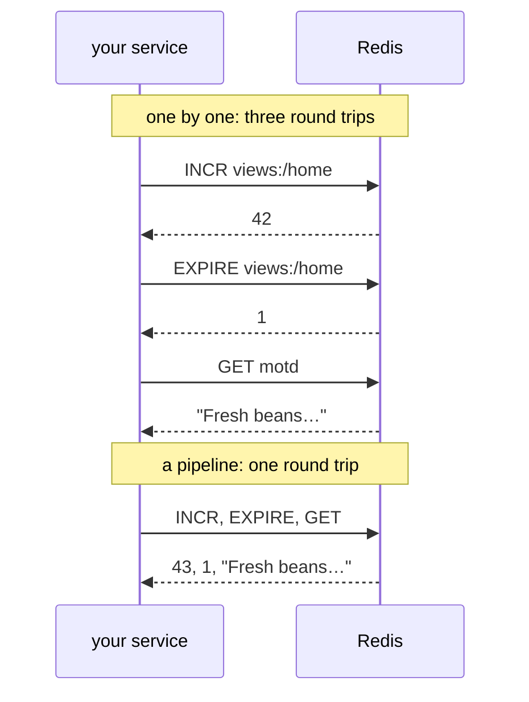

# redis

> [!WARNING]
> **No TLS yet: use it only in a network you trust.** zefir-redis speaks
> plain TCP. The password goes to the server as it is, in the HELLO of
> every new connection, and so does every command and every value: whoever
> can read the traffic reads them all. Until the client has TLS, keep
> Redis and its services in a closed network, give each service a user of
> its own with a long random password, and across a network you do not
> trust, use a tunnel: WireGuard, SSH or a service mesh.

**A Redis client for Zig services.**

## Pipelines

Every call is a round trip: the command goes to the server, and the call
waits for its reply. Across a network a round trip takes far longer than
Redis takes to run a command, so a service that sends ten commands one
after another mostly waits. A *pipeline* sends them all in one write and
reads their replies in order: one round trip for the ten.



`client.pipeline(io, op, commands, options)` takes either:

- **a tuple of commands** of any types, as [the quick start](#quick-start)
  does: the result is a tuple with a `redis.CommandError!T` for each
  command in its order, `T` the type of its reply, so `try r[0]` gives the
  first;
- **many commands of one type**, a slice of them or a pointer to their
  array, such as the thousand keys of an import: the result is a slice of
  `redis.CommandError!T`, from `options.allocator`, which the call then
  needs.

The rules:

- One connection of the pool carries the whole pipeline. On the server,
  the commands of other clients may run between its commands: a pipeline
  is no transaction, see [Transactions and WATCH](#transactions-and-watch).
- An error of one command, `ServerError` or `UnexpectedReply`, is the
  value in its place, and the other commands go on.
  `diagnostics.command` is the index of the first command with an error.
- Every command is checked before anything goes out: one that breaks a
  rule of the client, such as an empty list, fails the whole pipeline with
  `InvalidArgument`, and nothing is sent. So does a pipeline of no
  commands.
- An error of the exchange itself, a connection that broke or a deadline
  that passed, is the error of the call, and an unknown part of the
  commands ran: `diagnostics.answered` says how many replies came. Those
  commands surely ran; the others may have.
- The server holds the replies of a pipeline in memory until it sends
  them: keep a pipeline to about 10 000 commands, and send more in several.
- A blocking command holds the commands after it; give a pipeline one at
  most, and last, see [Blocking commands](#blocking-commands-and-the-reliable-queue).

The tests show each case, against a server that the test scripts (see
[Tests without Redis](#tests-without-redis)):

```zig
//! Pipelines against `redis.testing.FakeServer`: commands of several types
//! in a tuple, with the error of one in its place while the others go on;
//! many commands of one type in a slice; and a pipeline whose connection
//! breaks in the middle, which says how many of its commands surely ran.
//! Each test starts a server and a client of it, as profiles_test.zig does.

const std = @import("std");
const redis = @import("redis");
const cmd = redis.cmd;
const testing = std.testing;
const FakeServer = redis.testing.FakeServer;

test "an error of one command is the value in its place, and the commands after it go on" {
    const io = testing.io;
    var server: FakeServer = try .start(testing.allocator, io, &.{
        .expect(.{ "INCR", "views:/home" }, .{ .integer = 41 }),
        .expect(.{ "LPUSH", "motd", "Closed on Monday" }, .{ .err = "WRONGTYPE Operation against a key holding the wrong kind of value" }),
        .expect(.{ "GET", "motd" }, .{ .string = "Fresh beans from Ethiopia" }),
    });
    defer server.stop(io);
    var client: redis.Client = try .init(testing.allocator, io, .{ .url = server.url() });
    defer client.deinit();
    try client.connect(io, .root, null);
    defer client.close(io);
    var arena: std.heap.ArenaAllocator = .init(testing.allocator);
    defer arena.deinit();

    // Three commands in one exchange; motd is a string, not a list.
    var d: redis.Diagnostics = .{};
    const r = try client.pipeline(io, .of(.root), .{
        cmd.incr("views:/home"),
        cmd.lpush("motd", .{"Closed on Monday"}),
        cmd.get([]const u8, "motd"),
    }, .{ .allocator = arena.allocator(), .diagnostics = &d });
    try testing.expectEqual(41, try r[0]);
    try testing.expectError(error.ServerError, r[1]);
    try testing.expectEqualStrings("Fresh beans from Ethiopia", (try r[2]).?);
    // The diagnostics hold the first error: the command's index, and the
    // server's code.
    try testing.expectEqual(1, d.command.?);
    try testing.expect(d.isCode("WRONGTYPE"));
    try server.finish(io);
}

test "many commands of one type go as a slice, and their results come in a slice from .allocator" {
    const io = testing.io;
    var server: FakeServer = try .start(testing.allocator, io, &.{
        .expect(.{ "SET", "price:espresso", "2.5", "PX", "600000" }, .ok),
        .expect(.{ "SET", "price:latte", "3.2", "PX", "600000" }, .ok),
        .expect(.{ "SET", "price:mocha", "3.8", "PX", "600000" }, .ok),
    });
    defer server.stop(io);
    var client: redis.Client = try .init(testing.allocator, io, .{ .url = server.url() });
    defer client.deinit();
    try client.connect(io, .root, null);
    defer client.close(io);
    var arena: std.heap.ArenaAllocator = .init(testing.allocator);
    defer arena.deinit();

    // The prices of the menu, each kept for ten minutes.
    const menu = [_]redis.KeyValue{
        .{ .key = "price:espresso", .value = "2.5" },
        .{ .key = "price:latte", .value = "3.2" },
        .{ .key = "price:mocha", .value = "3.8" },
    };
    var commands: [menu.len]cmd.Set([]const u8) = undefined;
    for (&commands, menu) |*c, price| c.* = cmd.set(price.key, price.value, .{ .ttl = .fromSeconds(600) });
    const done = try client.pipeline(io, .of(.root), &commands, .{ .allocator = arena.allocator() });
    try testing.expectEqual(menu.len, done.len);
    for (done) |each| try each;
    try server.finish(io);
}

test "a connection that breaks in the middle of a pipeline is ConnectionLost, and answered says how many commands surely ran" {
    const io = testing.io;
    // The server answers two INCRs, reads the third and goes away.
    var server: FakeServer = try .start(testing.allocator, io, &.{
        .expect(.{ "INCR", "stock:coffee" }, .{ .integer = 1 }),
        .expect(.{ "INCR", "stock:coffee" }, .{ .integer = 2 }),
        .expect(.{ "INCR", "stock:coffee" }, .close_connection),
    });
    defer server.stop(io);
    var client: redis.Client = try .init(testing.allocator, io, .{ .url = server.url() });
    defer client.deinit();
    try client.connect(io, .root, null);
    defer client.close(io);
    var arena: std.heap.ArenaAllocator = .init(testing.allocator);
    defer arena.deinit();

    // The client logs the clear of its pool that a broken connection
    // causes, as a warning: this test expects it, so it stays out of the
    // test's output.
    const level = testing.log_level;
    testing.log_level = .err;
    defer testing.log_level = level;

    const restock: [4]cmd.Incr = @splat(cmd.incr("stock:coffee"));
    var d: redis.Diagnostics = .{};
    try testing.expectError(error.ConnectionLost, client.pipeline(io, .of(.root), &restock, .{ .allocator = arena.allocator(), .diagnostics = &d }));
    // Two replies came: those two INCRs ran. The other two may have run,
    // or not: the pipeline must not go again as a whole.
    try testing.expectEqual(2, d.answered.?);
    try testing.expectEqual(redis.Outcome.may_have_executed, redis.outcome(error.ConnectionLost));
    try server.finish(io);
}
```

## Deadlines and cancellation

A call takes a `redis.OperationContext`, whose `ctx` is the
`core.Context` of the work it belongs to: a deadline, a cancellation token
and a trace. `.of(ctx)` makes one.

- **The deadline.** A call's deadline is its context's, else `timeout` of
  the options from the start of the call, 5 s by default; `.timeout =
  null` leaves a call without a deadline of its context with none at all.
  The deadline bounds the whole call: the line of the pool, the opening of
  a connection, the write and the reply. With less than 1 ms left before
  sending, or less than the shortest round trip that the client has seen
  to the server, the call is `DeadlineExceeded`, and nothing goes out.
  Once the command went out, the deadline is `Timeout`, and that
  connection closes: its reply may still come, and no later call must read
  it.
- **The token** is no alarm. The client checks it before the call and
  before it sends: `Cancelled`. It never checks it after the reply: the
  reply of `LPOP`, `GETDEL`, `BLMOVE` or `XREADGROUP` has taken its data
  off the server already, and to drop it would lose the data. The reply
  comes back, and the next call sees the token.
- **The task.** Canceling the task that waits, with the cancelation of
  `io`, ends the wait at once: `Cancelled` before sending, `Interrupted`
  after, and that connection closes. The task stays canceled, so that its
  next cancelation point sees it too.
- **The line of the pool.** A call that waits for a connection leaves the
  line at its deadline: `PoolExhausted`, and nothing went out.
- **A blocking command** takes the timeout it sends the server from the
  deadline, see [Blocking commands](#blocking-commands-and-the-reliable-queue).

One deadline covers all the calls made under it: in the handler of a
request, every call takes what is left of the request's time. Tests
against a server whose replies wait as long as the test says show each
case:

```zig
//! Deadlines and cancellation, against `redis.testing.FakeServer`, whose
//! replies wait as long as a test says: what each call returns, whether
//! its command went out, and what a blocking command gave the server as its
//! timeout. Each test starts a server and a client of it, as
//! profiles_test.zig does.

const std = @import("std");
const core = @import("core");
const redis = @import("redis");
const cmd = redis.cmd;
const testing = std.testing;
const FakeServer = redis.testing.FakeServer;

/// A context whose deadline is `ms` milliseconds away.
fn within(io: std.Io, ms: i64) core.Context {
    return core.Context.root.withDeadline(.after(std.Io.Clock.awake.now(io), .fromMilliseconds(ms)));
}

/// What the server answers LLEN with, two seconds late.
const three: FakeServer.Reply = .{ .integer = 3 };

test "a reply that comes after the deadline is Timeout: the command went out, and its connection closed" {
    const io = testing.io;
    var server: FakeServer = try .start(testing.allocator, io, &.{
        .expect(.{ "LLEN", "orders:paid" }, .{ .delayed = .{ .after = .fromSeconds(2), .reply = &three } }),
    });
    defer server.stop(io);
    var client: redis.Client = try .init(testing.allocator, io, .{ .url = server.url() });
    defer client.deinit();
    try client.connect(io, .root, null);
    defer client.close(io);

    var d: redis.Diagnostics = .{};
    try testing.expectError(error.Timeout, client.run(io, .of(within(io, 200)), cmd.llen("orders:paid"), .{ .diagnostics = &d }));
    try testing.expectEqualStrings("the deadline passed before the reply came", d.message());
    // The command went out, so the server may have run it.
    try testing.expectEqual(redis.Outcome.may_have_executed, redis.outcome(error.Timeout));
    try testing.expectEqual(1, server.received(io));
    // Its reply may still come: the connection closed rather than go back
    // to the pool with it.
    try testing.expectEqual(0, client.stats().connections);
}

test "a deadline that has passed, or a canceled token, stops a call before anything goes out" {
    const io = testing.io;
    var server: FakeServer = try .start(testing.allocator, io, &.{});
    defer server.stop(io);
    var client: redis.Client = try .init(testing.allocator, io, .{ .url = server.url() });
    defer client.deinit();
    try client.connect(io, .root, null);
    defer client.close(io);

    try testing.expectError(error.DeadlineExceeded, client.run(io, .of(within(io, 0)), cmd.llen("orders:paid"), .{}));
    // The caller went away: whoever owns the token canceled it.
    var token: core.CancellationToken = .init;
    token.cancel();
    try testing.expectError(error.Cancelled, client.run(io, .of(core.Context.root.withCancellation(&token)), cmd.llen("orders:paid"), .{}));
    // Neither went out, so both are safe to make again.
    try testing.expectEqual(0, server.received(io));
    try testing.expectEqual(redis.Outcome.not_sent, redis.outcome(error.DeadlineExceeded));
    try testing.expectEqual(redis.Outcome.not_sent, redis.outcome(error.Cancelled));
}

/// Cancels `token` as the command comes, and answers it: the caller's
/// token is canceled while its call is out, as when the caller goes away
/// in the middle.
const CancelOnArrival = struct {
    token: *core.CancellationToken,

    pub fn answer(h: *CancelOnArrival, _: std.Io, _: std.mem.Allocator, _: *const FakeServer.Request) FakeServer.Handler.Error!FakeServer.Reply {
        h.token.cancel();
        return .{ .string = "order:1001" };
    }
};

test "a token canceled while the command is out does not drop its reply: LPOP has taken the order off the server" {
    const io = testing.io;
    var token: core.CancellationToken = .init;
    var canceler: CancelOnArrival = .{ .token = &token };
    var server: FakeServer = try .startWith(testing.allocator, io, .{ .handler = .init(&canceler) });
    defer server.stop(io);
    var client: redis.Client = try .init(testing.allocator, io, .{ .url = server.url() });
    defer client.deinit();
    try client.connect(io, .root, null);
    defer client.close(io);
    var arena: std.heap.ArenaAllocator = .init(testing.allocator);
    defer arena.deinit();

    const op: redis.OperationContext = .of(core.Context.root.withCancellation(&token));
    const order = try client.run(io, op, cmd.lpop([]const u8, "orders:paid"), .{ .allocator = arena.allocator() });
    try testing.expectEqualStrings("order:1001", order.?);
    // The next call sees the token before it sends.
    try testing.expectError(error.Cancelled, client.run(io, op, cmd.lpop([]const u8, "orders:paid"), .{ .allocator = arena.allocator() }));
    try testing.expectEqual(1, server.received(io));
}

/// LLEN orders:paid, without a deadline of the context: the 5 s of
/// `Options.timeout`.
fn countPaid(io: std.Io, client: *redis.Client) redis.Error!u64 {
    return client.run(io, .of(.root), cmd.llen("orders:paid"), .{});
}

test "a task canceled while its command waits for the reply is Interrupted, and the connection closes" {
    const io = testing.io;
    var server: FakeServer = try .start(testing.allocator, io, &.{
        .expect(.{ "LLEN", "orders:paid" }, .{ .delayed = .{ .after = .fromSeconds(2), .reply = &three } }),
    });
    defer server.stop(io);
    var client: redis.Client = try .init(testing.allocator, io, .{ .url = server.url() });
    defer client.deinit();
    try client.connect(io, .root, null);
    defer client.close(io);

    var call = try io.concurrent(countPaid, .{ io, &client });
    // Wait until the command is out, for 5 s at most.
    const give_up: core.Deadline = .after(std.Io.Clock.awake.now(io), .fromSeconds(5));
    while (server.received(io) == 0) {
        if (give_up.isExpired(std.Io.Clock.awake.now(io))) return error.TestTimedOut;
        try io.sleep(.fromMilliseconds(1), .awake);
    }
    try testing.expectError(error.Interrupted, call.cancel(io));
    try testing.expectEqual(redis.Outcome.may_have_executed, redis.outcome(error.Interrupted));
    try testing.expectEqual(0, client.stats().connections);
}

/// Answers every command with null, as BLMOVE of an empty list answers
/// once its timeout is over.
const Empty = struct {
    pub fn answer(_: *Empty, _: std.Io, _: std.mem.Allocator, _: *const FakeServer.Request) FakeServer.Handler.Error!FakeServer.Reply {
        return .nil;
    }
};

test "a blocking command gives the server what the deadline leaves beyond 150 ms, or its own timeout when that is shorter" {
    const io = testing.io;
    var empty: Empty = .{};
    var server: FakeServer = try .startWith(testing.allocator, io, .{ .handler = .init(&empty) });
    defer server.stop(io);
    var client: redis.Client = try .init(testing.allocator, io, .{ .url = server.url() });
    defer client.deinit();
    try client.connect(io, .root, null);
    defer client.close(io);
    var arena: std.heap.ArenaAllocator = .init(testing.allocator);
    defer arena.deinit();

    // A second for the call; the command would wait for an order forever.
    const start = std.Io.Clock.awake.now(io);
    const order = try client.run(io, .of(within(io, 1000)), cmd.blmove([]const u8, "orders:paid", "orders:packing", .left, .right, .forever), .{ .allocator = arena.allocator() });
    try testing.expect(order == null);
    const elapsed = start.durationTo(std.Io.Clock.awake.now(io)).toMilliseconds();
    // BLMOVE orders:paid orders:packing LEFT RIGHT <seconds>: the deadline
    // less 150 ms, so 0.85 s at most, and less only by the time that passed
    // before the command went out.
    const sent = (try server.entry(io, 0)).args;
    try testing.expectEqualStrings("BLMOVE", sent[0]);
    const timeout_ms: i64 = @intFromFloat(@round(try std.fmt.parseFloat(f64, sent[5]) * 1000));
    try testing.expect(timeout_ms <= 850);
    try testing.expect(timeout_ms + elapsed + 1 >= 850);

    // Its own timeout, when the deadline leaves more: 300 ms.
    _ = try client.run(io, .of(within(io, 1000)), cmd.blmove([]const u8, "orders:paid", "orders:packing", .left, .right, .{ .at_most = .fromMilliseconds(300) }), .{ .allocator = arena.allocator() });
    try testing.expectEqualStrings("0.3", (try server.entry(io, 1)).args[5]);
}

test "a blocking command with 150 ms or less left of its deadline is DeadlineExceeded, and nothing goes out" {
    const io = testing.io;
    var server: FakeServer = try .start(testing.allocator, io, &.{});
    defer server.stop(io);
    var client: redis.Client = try .init(testing.allocator, io, .{ .url = server.url() });
    defer client.deinit();
    try client.connect(io, .root, null);
    defer client.close(io);
    var arena: std.heap.ArenaAllocator = .init(testing.allocator);
    defer arena.deinit();

    var d: redis.Diagnostics = .{};
    try testing.expectError(error.DeadlineExceeded, client.run(io, .of(within(io, 100)), cmd.blmove([]const u8, "orders:paid", "orders:packing", .left, .right, .forever), .{ .allocator = arena.allocator(), .diagnostics = &d }));
    // The text says why, and names the command that does not block.
    try testing.expect(std.mem.startsWith(u8, d.message(), "a blocking command needs more than 150 ms left of the deadline"));
    try testing.expect(std.mem.endsWith(u8, d.message(), "for a shorter wait, use redis.cmd.lmove"));
    try testing.expectEqual(0, server.received(io));
}
```

## Tests without Redis

`redis.testing.FakeServer` runs the tests of your code without a Redis
server, on the real client: it listens on loopback, plays a script, and
your code talks to it through a `redis.Client`, as to any Redis.

- **`FakeServer.start(gpa, io, steps)`** listens on 127.0.0.1, on a port
  that the system picks, and serves in tasks of its own; `url()` gives
  `redis://127.0.0.1:<port>`, for `Options.url`, and `stop(io)` ends it.
- **A step** `.expect(.{ "HGETALL", "user:42" }, reply)` waits for that
  command, its name in any case and its arguments byte for byte, and
  answers it with `reply`; `.send(reply)` sends a reply without a request,
  right after the step before it, on its connection: a message to a
  subscriber. The steps run in the order the commands come, on all the
  connections together.
- **A reply** is data: `.ok`, `.nil`, `.integer`, `.string`, `.double`,
  `.boolean`, `.array`, `.set`, `.pairs` for a map, `.push`, `.err` with
  its code first; `.map(…)` of strings, as HGETALL answers, and
  `.subscribed(channels)` and `.message(channel, payload)` for a
  subscriber. Or it is what a server does: `.delayed` answers after a
  pause, `.close_connection` reads the command and closes without a reply,
  `.refuse_connections` closes every connection and refuses new ones until
  `acceptConnections(io)`, a server that went away; `.malformed` breaks
  RESP3, and `.raw` sends bytes as they are.
- **The handshake** the server answers itself: HELLO, CLIENT SETINFO,
  SELECT, and PING, which goes to the journal. `startWith(gpa, io,
  .{ .hello = .{ .password = "…" } })` makes it want a password, and
  `.hello` can make it say that it is another server; `.handler`, a type
  of yours with `pub fn answer(self, io, arena, request)
  FakeServer.Handler.Error!FakeServer.Reply`, answers the commands that the
  steps do not expect, for tests whose commands come in no set order, as
  in [the deadlines](#deadlines-and-cancellation).
- **`finish(io)`** fails when a step has not run, or a command came that
  no step expected, and says which. Such a command gets an error from the
  server: `-ERR zefir FakeServer: unexpected command …`.
- **The journal** gives `received(io)`, the number of commands that came;
  `entry(io, i)`, command number `i`, its `args` and the number of the
  `connection` it came on; and `count(io, name)`, the commands of one name.
  With it a test checks what your code sent, and that it sent nothing
  twice.

The profiles of the shop's customers, as an application keeps them:

```zig
//! The profiles of the shop's customers, as the application keeps them: a
//! hash `user:<id>` for each customer, whose fields are those of
//! `Profile`. It sees a `*redis.Client` only, so the same code runs against
//! Redis and, in profiles_test.zig, against `redis.testing.FakeServer`.

const std = @import("std");
const redis = @import("redis");
const cmd = redis.cmd;
const Profiles = @This();

client: *redis.Client,

pub const Profile = struct {
    name: []const u8,
    age: u8,
    plan: enum { free, pro } = .free,
    /// How many times the customer came, as `visit` counts them.
    visits: i64 = 0,
};

pub fn init(client: *redis.Client) Profiles {
    return .{ .client = client };
}

/// Keeps `profile` as the profile of the customer `id`: a field of the
/// hash for each field of the struct.
pub fn save(profiles: Profiles, io: std.Io, op: redis.OperationContext, id: u64, profile: Profile) redis.Error!void {
    var buffer: [32]u8 = undefined;
    try profiles.client.run(io, op, cmd.hset(key(&buffer, id), profile), .{});
}

/// The profile of the customer `id`, its strings in `arena`; null when the
/// customer has none.
pub fn byId(profiles: Profiles, io: std.Io, op: redis.OperationContext, arena: std.mem.Allocator, id: u64) redis.Error!?Profile {
    var buffer: [32]u8 = undefined;
    return profiles.client.run(io, op, cmd.hgetall(Profile, key(&buffer, id)), .{ .allocator = arena });
}

/// Counts a visit of the customer `id`, and returns how many there were.
pub fn visit(profiles: Profiles, io: std.Io, op: redis.OperationContext, id: u64) redis.Error!i64 {
    var buffer: [32]u8 = undefined;
    return profiles.client.run(io, op, cmd.hincrby(key(&buffer, id), "visits", 1), .{});
}

/// "user:<id>", in `buffer`: "user:" and the 20 digits of the largest u64
/// fit.
fn key(buffer: *[32]u8, id: u64) []const u8 {
    return std.fmt.bufPrint(buffer, "user:{d}", .{id}) catch unreachable;
}
```

And their tests:

```zig
//! Tests of the profiles of the shop without Redis. Each runs `Profiles`
//! on a real `redis.Client`, connected to `redis.testing.FakeServer`: a
//! server on loopback that plays a script, the commands it expects and
//! what it answers them, and keeps a journal of what came.

const std = @import("std");
const redis = @import("redis");
const Profiles = @import("Profiles.zig");
const testing = std.testing;
const FakeServer = redis.testing.FakeServer;

test "a profile is read from its hash" {
    const io = testing.io;
    const gpa = testing.allocator;
    // The script: HGETALL user:42, answered with the fields of a hash.
    var server: FakeServer = try .start(gpa, io, &.{
        .expect(.{ "HGETALL", "user:42" }, .map(&.{ .{ "name", "Ann" }, .{ "age", "30" }, .{ "plan", "pro" } })),
    });
    defer server.stop(io);
    // A client of it, as of any Redis.
    var client: redis.Client = try .init(gpa, io, .{ .url = server.url() });
    defer client.deinit();
    try client.connect(io, .root, null);
    defer client.close(io);
    var arena: std.heap.ArenaAllocator = .init(gpa);
    defer arena.deinit();

    const profiles: Profiles = .init(&client);
    const ann = (try profiles.byId(io, .of(.root), arena.allocator(), 42)).?;
    try testing.expectEqualStrings("Ann", ann.name);
    try testing.expectEqual(30, ann.age);
    try testing.expectEqual(.pro, ann.plan);
    // A field that the hash lacks takes its default.
    try testing.expectEqual(0, ann.visits);
    try server.finish(io); // the script ran to its end, and nothing else came
}

test "a customer without a profile has none: HGETALL of a key that is not there answers an empty map" {
    const io = testing.io;
    const gpa = testing.allocator;
    var server: FakeServer = try .start(gpa, io, &.{
        .expect(.{ "HGETALL", "user:7" }, .{ .pairs = &.{} }),
    });
    defer server.stop(io);
    var client: redis.Client = try .init(gpa, io, .{ .url = server.url() });
    defer client.deinit();
    try client.connect(io, .root, null);
    defer client.close(io);
    var arena: std.heap.ArenaAllocator = .init(gpa);
    defer arena.deinit();

    const profiles: Profiles = .init(&client);
    try testing.expect(try profiles.byId(io, .of(.root), arena.allocator(), 7) == null);
    try server.finish(io);
}

test "a profile is saved as a field of the hash for each field of the struct, and a visit counts in its field" {
    const io = testing.io;
    const gpa = testing.allocator;
    // The fields go in the order of the struct, the enum as its name; the
    // server answers HSET with how many fields were new.
    var server: FakeServer = try .start(gpa, io, &.{
        .expect(.{ "HSET", "user:42", "name", "Ann", "age", "30", "plan", "pro", "visits", "0" }, .{ .integer = 4 }),
        .expect(.{ "HINCRBY", "user:42", "visits", "1" }, .{ .integer = 1 }),
    });
    defer server.stop(io);
    var client: redis.Client = try .init(gpa, io, .{ .url = server.url() });
    defer client.deinit();
    try client.connect(io, .root, null);
    defer client.close(io);

    const profiles: Profiles = .init(&client);
    try profiles.save(io, .of(.root), 42, .{ .name = "Ann", .age = 30, .plan = .pro });
    try testing.expectEqual(1, try profiles.visit(io, .of(.root), 42));
    // The journal: what came, in order, byte for byte.
    try testing.expectEqual(2, server.received(io));
    try testing.expectEqualStrings("HINCRBY", (try server.entry(io, 1)).args[0]);
    try server.finish(io);
}
```

- The client is real and talks to the server over loopback, so the
  deadlines, the cancellation and the errors in a test are those of
  production.
- The server comes before the client, and `defer client.deinit()` before
  `defer client.close(io)`, so that their `defer`s close the client first
  and stop the server last.
- The build of zefir runs these tests, and those of
  [pipelines](#pipelines) and of [deadlines](#deadlines-and-cancellation),
  in `zig build test-redis`.
