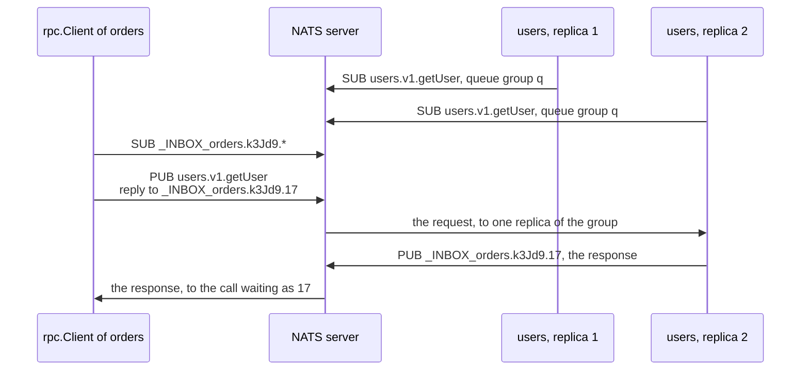

# rpc-nats

> [!WARNING]
> **No TLS yet: run rpc over NATS only in a network you trust.** zefir-nats
> speaks plain TCP, so the link to the broker carries the bodies of calls,
> the tokens of their credentials and the passwords of the connections
> unencrypted. Until it has TLS, put it only in a closed network, and give
> every service NATS credentials and permissions of its own, as
> [Permissions](#permissions) shows.

**The calls of zefir-rpc over NATS.** [NATS](../../nats/examples/README.md)
is a message server: services publish messages to *subjects* and subscribe
to them, and a message can carry a *reply subject* for an answer. That is
all a call needs. The server of a service subscribes to the subject of each
of its methods; a client publishes the request there with a reply subject
in an inbox of its own, and the response comes back to it. The replicas of a
service share its calls, and no address of a service appears anywhere: the
client knows the name of the method, and the broker finds a server. This
module is the transport of [rpc](../../rpc/examples/README.md) on NATS:
everything else, the contract, the handlers, middleware, the stop, is the
same as on any transport.

> [!IMPORTANT]
> **Not implemented yet (TODO):**
>
> - **TLS**, see above.
> - **Other credentials of a connection.** zefir-nats has a user and a
>   password only: no tokens, NKeys, JWT or credentials files.
> - **A denied publish is not `AccessDenied`.** The broker drops a publish
>   that the permissions deny and reports it as an error of the connection,
>   so a call to a route its service may not publish to ends with
>   `DeadlineExceeded`.
> - **No cancel over NATS.** NATS has no signal that a client gave up, so a
>   handler runs until its own deadline.
> - **Core NATS only.** No JetStream: a call is delivered at most once, and
>   kept nowhere.



- **Subjects.** A method lives on `<service>.v<version>.<method>`, such as
  `users.v1.getUser`, with `subject_prefix.` in front when the transport
  has one. Every replica subscribes in the queue group `q`, so each call
  goes to one of them.
- **Inboxes.** All calls of a transport share one subscription,
  `<inbox_prefix>.<random token>.*`; a call waits for the reply subject that
  ends in its own number.
- **Headers.** The request carries its id, the budget left of its
  deadline, its metadata and its credentials as NATS headers; a failure
  comes back in the headers of the NATS Service API (ADR-32), so `nats req`
  and NATS clients in other languages can call a zefir service, see
  [The NATS CLI](#the-nats-cli).
- **Discovery.** Every contract of a server is a NATS micro service:
  `nats micro ls` lists the replicas, `nats micro stats` counts their calls.

## Contents

- [Installation](#installation)
- [Getting started](#getting-started)
- [The transport](#the-transport)
- [Permissions](#permissions)
- [The NATS CLI](#the-nats-cli)
- [On the wire](#on-the-wire)
- [Errors of the connection](#errors-of-the-connection)
- [Memory](#memory)
- [Tests and other NATS libraries](#tests-and-other-nats-libraries)

Examples that `zig build e2e` in `tests/rpc-nats` builds and runs against
the NATS servers of the repository's `docker-compose.yml`, checking what
they print against this guide:
[the users service on NATS](getting_started.zig) · [two services with permissions of their own](two_services.zig)

## Installation

Add Zefir to your `build.zig.zon`; rpc-nats ships since v0.6.0:

```sh
zig fetch --save git+https://github.com/vkiryakov/zefir#dev
```

This guide is on the `dev` branch, so the command fetches its latest commit; `--save` pins that commit. For the latest release, v0.6.0, fetch `#v0.6.0` instead.

A service runs on [zio](https://github.com/lalinsky/zio). zio has no release
for Zig 0.17 yet, so pin the commit Zefir is tested with:

```sh
zig fetch --save git+https://github.com/lalinsky/zio#d15034f1a4d9ddaa42829aae8f7e02d37cd1093a
```

Then import the modules in `build.zig`: rpc and rpc-nats, nats for the
connection, zio, and confy, log and core, which the examples use too. The
examples serve the users service of the [guide of rpc](../../rpc/examples/README.md),
whose files come with zefir, as two modules: its contract, `users-api`, and
its handler and repository, `users-service`. In a service of your own, the
contract is a package of its own, as
[Installation](../../rpc/examples/README.md#installation) of the guide of
rpc shows, and the handler is a file of the service.

```zig
// build.zig of the users service
const zefir = b.dependency("zefir", .{ .target = target, .optimize = optimize });
const zio = b.dependency("zio", .{ .target = target, .optimize = optimize });

// The users service of the guide of rpc, from the files of zefir.
const users_api = b.createModule(.{
    .root_source_file = zefir.path("src/rpc/examples/users_api.zig"),
    .target = target,
    .optimize = optimize,
    .imports = &.{
        .{ .name = "rpc", .module = zefir.module("zefir-rpc") },
        .{ .name = "validator", .module = zefir.module("zefir-validator") },
    },
});
const users_service = b.createModule(.{
    .root_source_file = zefir.path("src/rpc/examples/users_service.zig"),
    .target = target,
    .optimize = optimize,
    .imports = &.{
        .{ .name = "rpc", .module = zefir.module("zefir-rpc") },
        .{ .name = "core", .module = zefir.module("zefir-core") },
        .{ .name = "users-api", .module = users_api },
    },
});

const exe = b.addExecutable(.{
    .name = "user-service",
    .root_module = b.createModule(.{
        .root_source_file = b.path("src/main.zig"),
        .target = target,
        .optimize = optimize,
        .imports = &.{
            .{ .name = "rpc", .module = zefir.module("zefir-rpc") },
            .{ .name = "rpc-nats", .module = zefir.module("zefir-rpc-nats") },
            .{ .name = "nats", .module = zefir.module("zefir-nats") },
            .{ .name = "zio", .module = zio.module("zio") },
            .{ .name = "confy", .module = zefir.module("zefir-confy") },
            .{ .name = "log", .module = zefir.module("zefir-log") },
            .{ .name = "core", .module = zefir.module("zefir-core") },
            .{ .name = "users-api", .module = users_api },
            .{ .name = "users-service", .module = users_service },
        },
    }),
});
b.installArtifact(exe);
b.step("run", "Run the service").dependOn(&b.addRunArtifact(exe).step);
```

> [!TIP]
> rpc-nats is also part of the umbrella module: with `zefir.module("zefir")`
> imported as `zefir`, it is `@import("zefir").rpc_nats`.

You need a NATS server. With Docker:

```sh
docker run --rm -p 4222:4222 nats:2.15.0-alpine
```

## Getting started

The users service of the guide of rpc, served on NATS, and a client that
calls it through the broker:

```zig
//! The users service of the guide of rpc, on NATS: the same handler and
//! repository, served by `rpc.Server` on `rpc_nats.Transport`, and a client
//! that calls it through the broker. A real client lives in another
//! service, with a connection of its own; here both share one.
//!
//! Settings, from the environment:
//!
//!   APP_NATS_URL        the NATS server; nats://127.0.0.1:4222 by default
//!   APP_SERVE_SECONDS   how long it goes on serving after its calls, for
//!                       the NATS CLI; 0 by default
//!
//! In tests/rpc-nats, `zig build example-getting_started` runs it against
//! the servers of the repository's docker-compose.yml.

const std = @import("std");
const confy = @import("confy");
const log = @import("log");
const nats = @import("nats");
const rpc = @import("rpc");
const rpc_nats = @import("rpc-nats");
const zio = @import("zio");
const api = @import("users-api");
const users = @import("users-service");

/// The NATS client and the transport log through std.log; this sends their
/// records to the logger.
pub const std_options: std.Options = .{ .logFn = log.stdLogFn };

const Config = struct {
    nats: struct {
        url: []const u8 = "nats://127.0.0.1:4222",
    } = .{},
    serve_seconds: u32 = 0,
};

pub fn main(init: std.process.Init) !void {
    var config: Config = undefined;
    confy.loadOrExit(init.arena.allocator(), &config, .{
        .io = init.io,
        .environ = init.environ_map,
        .env_prefix = "APP_",
        .sources = &.{.osEnv()},
    });
    // The logger outlives the runtime, so it takes `init.io`, through
    // which the tasks of the runtime may log too.
    const logger: log.Logger = try .init(init.gpa, init.io, .{ .format = .text });
    defer logger.deinit();
    logger.installStdLog();
    const app = logger.scoped("app");

    // One runtime for the whole program: the NATS client, the transport and
    // the server run their tasks on it.
    const rt = try zio.Runtime.init(init.gpa, .{});
    defer rt.deinit();
    const io = rt.io();
    const gpa = init.gpa;

    // The connection to NATS, which the program owns; the adapter gives the
    // transport what it needs of it; the transport carries the calls of the
    // server and of the clients alike. Each stays where it is from here on.
    var nc: nats.Client = try .init(gpa, io, .{ .servers = &.{config.nats.url}, .name = "user-service" });
    defer nc.deinit();
    try nc.connect();
    var adapter: rpc_nats.ZefirNats = .{ .client = &nc };
    var bus: rpc_nats.Transport = try .init(gpa, adapter.conn(), .{});
    defer bus.deinit(io); // after the server's deinit, before the connection's

    var repo: users.UserRepository = .init(gpa);
    defer repo.deinit();
    var handler: users.UserHandler = .{ .repo = &repo };
    var server = try rpc.Server.init(gpa, .{
        .transport = bus.serverTransport(),
        .handlers = .{&handler},
    });
    defer server.deinit(io);
    // Subscribes to users.v1.createUser and the other methods; returns once
    // the broker has the subscriptions.
    try server.start(io);
    app.info("Serving", .{ .service = "users", .version = 1 });

    var client = try rpc.Client.init(gpa, .{ .transport = bus.clientTransport() });
    defer client.deinit();

    var created = try client.call(io, .root, api.UserApi.createUser, .{ .name = "Ada Lovelace", .email = "ada@example.com" }, .{});
    defer created.deinit();
    switch (created.outcome) {
        .ok => |user| app.info("User created", .{ .id = user.id, .name = user.name }),
        .failure => |failure| app.warn("Call failed", .{ .code = failure.code, .app_code = failure.app_code }),
    }
    var missing = try client.call(io, .root, api.UserApi.getUser, .{ .id = 42 }, .{});
    defer missing.deinit();
    switch (missing.outcome) {
        .ok => |user| app.info("User found", .{ .id = user.id, .name = user.name }),
        .failure => |failure| app.warn("Call failed", .{ .code = failure.code, .app_code = failure.app_code }),
    }
    // A method that no server serves: on NATS no one takes the request.
    var other = client.call(io, .root, OtherApi.ping, .{}, .{});
    if (other) |*result| result.deinit() else |err| app.warn("Call not taken", .{ .route = "billing.v1.ping", .reason = err });

    if (config.serve_seconds > 0) {
        app.info("Serving on", .{ .seconds = config.serve_seconds });
        try io.sleep(.fromSeconds(config.serve_seconds), .awake);
    }
}

/// A contract that nobody serves here.
const OtherApi = rpc.Contract(.{
    .name = "billing",
    .version = 1,
    .methods = .{ .ping = rpc.method(struct {}, void) },
});
```

What is new, next to the memory transport of the guide of rpc:

- **The connection.** `nats.Client` is the connection to the broker, and
  the program owns it: `connect` happens once, here, before anything uses
  it, and it stays where it is from then on. The
  [guide of nats](../../nats/examples/README.md) has all of its options:
  servers, reconnects, limits.
- **The adapter.** `rpc_nats.ZefirNats` gives the transport the six
  operations it needs of a connection (publish, subscribe, next message,
  flush, drain, unsubscribe). One adapter serves one transport: a second
  `adapter.conn()` panics in safe builds, and a second transport on the
  same connection takes an adapter of its own.
- **The transport.** `rpc_nats.Transport` is both sides of rpc on that
  connection: `serverTransport()` for `rpc.Server`, `clientTransport()` for
  `rpc.Client`. Its `deinit` comes after the server's and before the
  connection's.
- **The runtime.** Everything runs on the `std.Io` of zio, `rt.io()`; the
  logger takes `init.io`, so that any thread may log.
- **Starting.** `server.start` subscribes to the subject of every method
  and returns once the broker has confirmed the subscriptions: a subject
  the permissions deny fails it with `error.AccessDenied`.

Start a NATS server as in [Installation](#installation), then the program:

```text
$ zig build run
2026-10-16T10:09:09.892Z INFO  [app] Serving service=users version=1
2026-10-16T10:09:09.895Z INFO  [app] User created id=1 name="Ada Lovelace"
2026-10-16T10:09:09.896Z WARN  [app] Call failed code=not_found app_code=users.not_found
2026-10-16T10:09:09.897Z WARN  [app] Call not taken route=billing.v1.ping reason=Unavailable
```

The last call goes to `billing.v1.ping`, which no server serves: NATS
answers at once that no one took the request, and the call fails with
`error.Unavailable`, which also tells that the call did not run. A typo in
a route, or a version no server has, ends the same way.

With `APP_SERVE_SECONDS=60`, the program goes on serving for a minute after
its calls: time to call it from [the NATS CLI](#the-nats-cli).

## The transport

`rpc_nats.Transport.init(gpa, adapter.conn(), options)` copies its options;
nothing happens on the network until the server starts or the first call
goes out.

| Option | What | Default |
| --- | --- | --- |
| `subject_prefix` | the first tokens of every subject, such as "shop": then a method lives on `shop.users.v1.getUser`. For systems that share a NATS cluster without NATS accounts; a server and its clients need the same prefix | none |
| `queue_group` | the queue group of the server's subscriptions: its replicas share the calls | `"q"` |
| `inbox_prefix` | the first tokens of the client's inbox, such as `"_INBOX_orders"`: the permissions can then give every service an inbox of its own | `"_INBOX"` |
| `reply_prefixes` | the server answers only to a reply subject whose first token starts with one of these, so no one can send its responses elsewhere; `_INBOX` takes `_INBOX_orders` too | `&.{"_INBOX"}` |
| `flush_timeout` | how long `start` waits for the broker to confirm the subscriptions, and the stop for the last responses | 5 s |
| `publish_timeout` | how long a response waits for room to be published | 5 s |
| `max_pending` | calls of the client that wait for responses at once | 1024 |
| `discovery.enabled` | every contract of the server is a NATS micro service | `true` |

The values are typed here, so `.flush_timeout = .fromSeconds(2)` works.

- The NATS micro subscriptions (`$SRV.PING`, `$SRV.INFO`, `$SRV.STATS`)
  take no `subject_prefix`: the tools of NATS look for them there.
- The client publishes a request only while the link to the broker is up.
  Without it, a call fails at once with `Unavailable`: a request kept in a
  buffer through a reconnect would reach the server with a stale budget.
  A call that waits through a reconnect may still get its response.
- A request needs no headers of zefir: one from `nats req`, or from a NATS
  client in another language, is served as well, without metadata and
  with the method's own deadline.
- The transport never closes the connection; `deinit` the transport, then
  the connection. A second transport on the same connection takes an
  adapter of its own.

## Permissions

Without permissions, anyone who can subscribe to `users.v1.>` or to
`_INBOX.>` sees the requests, the responses and the tokens of others. With
them, every service gets its own NATS user, and that user may only:

- subscribe to the routes of its own service, to `$SRV.>` for NATS micro,
  and to its own inbox: `.inbox_prefix = "_INBOX_orders"` in its
  transport, and the right to subscribe to `_INBOX_orders.>`;
- publish to the routes of the services it calls;
- answer the requests it got, and only them: `allow_responses`.

The configuration of a NATS server with these permissions, for users and
orders, which call each other, and billing, which calls neither. The
end-to-end tests of rpc-nats run it, and check that billing sees nothing of
the calls of the others:

```text
# The NATS permissions of rpc services, as the guide of rpc-nats gives them:
# every service has a user of its own. It subscribes to its own routes, to
# NATS micro ($SRV.>) and to its own inbox (`.inbox_prefix` of its
# transport), publishes only to the routes it calls, and answers only to
# the reply subject of a request it got (allow_responses).
#
# allow_responses: true allows one answer to each request. A connection
# that serves N contracts, such as users v1 and users v2, answers a
# $SRV.PING, $SRV.INFO or $SRV.STATS request N times: give its user
# allow_responses: { max: N }, or `nats micro ls` sees only one of them.
# Each service here serves one contract.
port: 4222
http_port: 8222
authorization {
  users: [
    # users v1, which calls orders.
    {
      user: "users"
      password: "users"
      permissions: {
        subscribe: ["users.v1.*", "$SRV.>", "_INBOX_users.>"]
        publish: ["orders.v1.*"]
        allow_responses: true
      }
    }
    # orders v1, which calls users.
    {
      user: "orders"
      password: "orders"
      permissions: {
        subscribe: ["orders.v1.*", "$SRV.>", "_INBOX_orders.>"]
        publish: ["users.v1.*"]
        allow_responses: true
      }
    }
    # Another service, which calls neither: it must not see their calls.
    {
      user: "billing"
      password: "billing"
      permissions: {
        subscribe: ["billing.v1.*", "$SRV.>", "_INBOX_billing.>"]
        publish: ["payments.v1.*"]
        allow_responses: true
      }
    }
  ]
}
```

The passwords here are those of the tests: give every service its own
secret, and keep it out of the configuration in plain text
(`nats server passwd` makes a bcrypt hash of it).

`allow_responses: true` lets a user answer each request once. A server that
serves N contracts on one connection, such as `users` v1 and v2, answers
the requests of NATS micro, `$SRV.PING` and the others, N times, once per
contract: give its user `allow_responses: { max: N }`, or `nats micro ls`
sees one of its contracts only.

Two services on such a server, each as its own NATS user:

```zig
//! Two services on a NATS server with the permissions of the guide: users,
//! and orders, which calls it. Each connects as a NATS user of its own,
//! with a password from its settings, and receives its responses in an
//! inbox of its own. A transport of orders without that inbox cannot
//! subscribe to its responses: the broker refuses, and its first call fails
//! with `AccessDenied`.
//!
//! Settings, from the environment:
//!
//!   APP_NATS_URL               the NATS server; nats://127.0.0.1:4222 by default
//!   APP_USERS_NATS_PASSWORD    the password of the NATS user "users"
//!   APP_ORDERS_NATS_PASSWORD   the password of the NATS user "orders"
//!
//! In tests/rpc-nats, `zig build example-two_services` runs it against the
//! server of tests/rpc-nats/conf/acl.conf.

const std = @import("std");
const confy = @import("confy");
const log = @import("log");
const nats = @import("nats");
const rpc = @import("rpc");
const rpc_nats = @import("rpc-nats");
const zio = @import("zio");
const api = @import("users-api");
const users = @import("users-service");

/// The NATS client and the transport log through std.log; this sends their
/// records to the logger.
pub const std_options: std.Options = .{ .logFn = log.stdLogFn };

const Config = struct {
    nats: struct {
        url: []const u8 = "nats://127.0.0.1:4222",
    } = .{},
    users: struct {
        nats_user: []const u8 = "users",
        nats_password: confy.Secret,
    },
    orders: struct {
        nats_user: []const u8 = "orders",
        nats_password: confy.Secret,
    },
};

pub fn main(init: std.process.Init) !void {
    var config: Config = undefined;
    confy.loadOrExit(init.arena.allocator(), &config, .{
        .io = init.io,
        .environ = init.environ_map,
        .env_prefix = "APP_",
        .sources = &.{.osEnv()},
    });
    const logger: log.Logger = try .init(init.gpa, init.io, .{ .format = .text });
    defer logger.deinit();
    logger.installStdLog();

    const rt = try zio.Runtime.init(init.gpa, .{});
    defer rt.deinit();
    const io = rt.io();
    const gpa = init.gpa;

    // The users service, as its NATS user. It calls no one, so its inbox
    // stays unused; its permissions give it _INBOX_users all the same.
    var users_nc: nats.Client = try .init(gpa, io, .{
        .servers = &.{config.nats.url},
        .name = "user-service",
        .auth = .{ .user_password = .{ .username = config.users.nats_user, .password = config.users.nats_password.expose() } },
    });
    defer users_nc.deinit();
    try users_nc.connect();
    var users_adapter: rpc_nats.ZefirNats = .{ .client = &users_nc };
    var users_bus: rpc_nats.Transport = try .init(gpa, users_adapter.conn(), .{ .inbox_prefix = "_INBOX_users" });
    defer users_bus.deinit(io);
    var repo: users.UserRepository = .init(gpa);
    defer repo.deinit();
    _ = try repo.insert(.root, io, init.arena.allocator(), "Ada Lovelace", "ada@example.com");
    var handler: users.UserHandler = .{ .repo = &repo };
    var server = try rpc.Server.init(gpa, .{ .transport = users_bus.serverTransport(), .handlers = .{&handler} });
    defer server.deinit(io);
    try server.start(io);
    logger.scoped("users").info("Serving", .{ .nats_user = config.users.nats_user });

    // Orders, as its own NATS user, with its responses in _INBOX_orders.
    var orders_nc: nats.Client = try .init(gpa, io, .{
        .servers = &.{config.nats.url},
        .name = "order-service",
        .auth = .{ .user_password = .{ .username = config.orders.nats_user, .password = config.orders.nats_password.expose() } },
    });
    defer orders_nc.deinit();
    try orders_nc.connect();
    var orders_adapter: rpc_nats.ZefirNats = .{ .client = &orders_nc };
    var orders_bus: rpc_nats.Transport = try .init(gpa, orders_adapter.conn(), .{ .inbox_prefix = "_INBOX_orders" });
    defer orders_bus.deinit(io);
    var client = try rpc.Client.init(gpa, .{ .transport = orders_bus.clientTransport() });
    defer client.deinit();
    const orders_log = logger.scoped("orders");
    try getUser(&client, io, orders_log, "_INBOX_orders");

    // The same NATS user with the default inbox, _INBOX: the broker refuses
    // the subscription, and the first call says so. A second transport on
    // one connection takes an adapter of its own.
    var default_adapter: rpc_nats.ZefirNats = .{ .client = &orders_nc };
    var default_bus: rpc_nats.Transport = try .init(gpa, default_adapter.conn(), .{});
    defer default_bus.deinit(io);
    var default_client = try rpc.Client.init(gpa, .{ .transport = default_bus.clientTransport() });
    defer default_client.deinit();
    try getUser(&default_client, io, orders_log, "_INBOX");
}

fn getUser(client: *rpc.Client, io: std.Io, orders_log: log.Logger, inbox: []const u8) !void {
    var found = client.call(io, .root, api.UserApi.getUser, .{ .id = 1 }, .{}) catch |err| switch (err) {
        error.AccessDenied => return orders_log.warn("Call failed", .{ .inbox = inbox, .reason = err }),
        else => return err,
    };
    defer found.deinit();
    switch (found.outcome) {
        .ok => |user| orders_log.info("User found", .{ .inbox = inbox, .id = user.id, .name = user.name }),
        .failure => |failure| orders_log.warn("Call failed", .{ .inbox = inbox, .code = failure.code, .app_code = failure.app_code }),
    }
}
```

With the server of this configuration on port 4222:

```sh
docker run --rm -p 4222:4222 -v "$PWD/acl.conf:/acl.conf:ro" nats:2.15.0-alpine --config /acl.conf
```

```text
$ APP_USERS_NATS_PASSWORD=users APP_ORDERS_NATS_PASSWORD=orders zig build run
2026-10-16T10:09:19.520Z INFO  [users] Serving nats_user=users
2026-10-16T10:09:19.525Z INFO  [orders] User found inbox=_INBOX_orders id=1 name="Ada Lovelace"
2026-10-16T10:09:19.526Z WARN  [nats] server error: Permissions Violation for Subscription to \"_INBOX.4KI9KvHsD9CSuH8yKGz3oh.*\"
2026-10-16T10:09:19.526Z WARN  [orders] Call failed inbox=_INBOX reason=AccessDenied
```

- Orders calls users through its inbox, `_INBOX_orders`, which its
  permissions allow.
- A transport of orders with the default inbox, `_INBOX`, is refused: the
  broker reports the violation, which zefir-nats logs, and the first call
  fails with `AccessDenied`. A call after it tries the subscription again.
- A server whose subjects the permissions deny does not start:
  `server.start` fails with `AccessDenied`.
- A route its user may not publish to is not refused at once: the broker
  drops the publish, and the call ends at its deadline with
  `DeadlineExceeded` (see the TODO above).

## The NATS CLI

The [NATS CLI](https://github.com/nats-io/natscli) is a client that knows
nothing of zefir, and it can call a zefir service. A request needs no
headers; integers of more than 32 bits travel as strings in JSON, so the id
is `"1"`:

```text
$ nats req users.v1.getUser '{"id":"1"}'
11:31:32 Sending request on "users.v1.getUser"
11:31:32 Received with rtt 1.757417ms
{"id":"1","name":"Ada Lovelace","email":"ada@example.com"}
```

A failure comes in the headers of the NATS Service API, `Nats-Service-Error`
and `Nats-Service-Error-Code` (a number of HTTP), and in those of zefir with
its code and app code:

```text
$ nats req users.v1.getUser '{"id":"42"}'
11:31:14 Sending request on "users.v1.getUser"
11:31:14 Received with rtt 1.073042ms
11:31:14 Nats-Service-Error: User not found
11:31:14 Nats-Service-Error-Code: 404
11:31:14 Zefir-Rpc-Code: not_found
11:31:14 Zefir-Rpc-App-Code: users.not_found
11:31:14
nil body
```

The violations of a request against its rules come as the body:

```text
$ nats req users.v1.createUser '{"name":"","email":"ada-at-example.com"}'
11:31:31 Sending request on "users.v1.createUser"
11:31:31 Received with rtt 2.496083ms
11:31:31 Zefir-Rpc-Code: invalid_argument
11:31:31 Zefir-Rpc-App-Code: rpc.invalid_request
11:31:31 Zefir-Rpc-Field: name
11:31:31 Content-Type: application/json
11:31:31 Nats-Service-Error: Invalid request
11:31:31 Nats-Service-Error-Code: 400
11:31:31
{"violations":[{"field":"name","code":"validation.not_empty","message":"must not be empty"},{"field":"email","code":"validation.email","message":"must be a valid email address"}]}
```

`nats micro` sees every contract of a server as a service: its replicas,
its methods and their counters. These ran against the program of
[Getting started](#getting-started) after its own calls, a `createUser` and
a `getUser` of a user that does not exist:

```text
$ nats micro ls
╭────────────────────────────────────────────────────────╮
│                      All Services                      │
├───────┬─────────┬────────────────────────┬─────────────┤
│ Name  │ Version │ ID                     │ Description │
├───────┼─────────┼────────────────────────┼─────────────┤
│ users │ 1.0.0   │ p9ftnia1xOq3y9p4KLNHaR │             │
╰───────┴─────────┴────────────────────────┴─────────────╯
```

```text
$ nats micro stats users
╭────────────────────────────────────────────────────────────────────────────────────────────────────────╮
│                                        users Service Statistics                                        │
├────────────────────────┬────────────┬──────────┬─────────────┬────────┬─────────────────┬──────────────┤
│ ID                     │ Endpoint   │ Requests │ Queue Group │ Errors │ Processing Time │ Average Time │
├────────────────────────┼────────────┼──────────┼─────────────┼────────┼─────────────────┼──────────────┤
│ p9ftnia1xOq3y9p4KLNHaR │ createUser │ 1        │ q           │ 0      │ 901µs           │ 901µs        │
│                        │ getUser    │ 1        │ q           │ 1      │ 252µs           │ 252µs        │
│                        │ listUsers  │ 0        │ q           │ 0      │ 0s              │ 0s           │
│                        │ deleteUser │ 0        │ q           │ 0      │ 0s              │ 0s           │
├────────────────────────┼────────────┼──────────┼─────────────┼────────┼─────────────────┼──────────────┤
│                        │            │ 2        │             │ 1      │ 1ms             │ 384µs        │
╰────────────────────────┴────────────┴──────────┴─────────────┴────────┴─────────────────┴──────────────╯
```

<details>
<summary><code>nats micro info users</code>: the methods and their counters</summary>

```text
$ nats micro info users
Service Information

          Service: users (p9ftnia1xOq3y9p4KLNHaR)
      Description:
          Version: 1.0.0

Endpoints:

               Name: createUser
            Subject: users.v1.createUser
        Queue Group: q

               Name: getUser
            Subject: users.v1.getUser
        Queue Group: q

               Name: listUsers
            Subject: users.v1.listUsers
        Queue Group: q

               Name: deleteUser
            Subject: users.v1.deleteUser
        Queue Group: q

Statistics for 4 Endpoint(s):

  createUser Endpoint Statistics:

           Requests: 1 in group "q"
    Processing Time: 901µs (average 901µs)
            Started: 2026-10-16 11:30:20 (17.17s ago)
             Errors: 0

  getUser Endpoint Statistics:

           Requests: 1 in group "q"
    Processing Time: 252µs (average 252µs)
            Started: 2026-10-16 11:30:20 (17.17s ago)
             Errors: 1
         Last Error: 404:users.not_found

  listUsers Endpoint Statistics:

           Requests: 0 in group "q"
    Processing Time: 0s (average 0s)
            Started: 2026-10-16 11:30:20 (17.17s ago)
             Errors: 0

  deleteUser Endpoint Statistics:

           Requests: 0 in group "q"
    Processing Time: 0s (average 0s)
            Started: 2026-10-16 11:30:20 (17.17s ago)
             Errors: 0
```

</details>

- The version is the major version of the contract, as `<version>.0.0`;
  the id is new for every contract of every start of a server, so two
  replicas are two lines.
- `Started` is when the server side of the transport started, in UTC:
  the counters count from then, and every endpoint shows the same time.
- `Last Error` is `<number>:<app code>`: the server keeps no messages.
- `Requests` counts every call of the method from its admission, those the
  server refused included, and `Errors` every call that ended without a
  success, also those whose handler never ran, such as calls without an
  identity on a method that requires one.
- `discovery.enabled = false` in the options of the transport turns NATS
  micro off.

## On the wire

A request:

| Header | What |
| --- | --- |
| `Zefir-Rpc-Version: 1` | the version of this wire |
| `Zefir-Rpc-Request-Id` | the id of the call, 32 hex digits |
| `Zefir-Rpc-Timeout-Ms` | the budget left of the deadline, measured right before the publish |
| `Content-Type: application/json` | the codec of the body |
| `traceparent`, `tracestate` | the trace of the call, when it has one |
| `authorization` | the credentials of the call: `Bearer <token>`, `Basic …` |
| other names | the metadata of the call, under its own keys |

A response that succeeds has the body as its payload and the metadata of
the response as headers. A failure:

| Header | What |
| --- | --- |
| `Nats-Service-Error` | the message, for people |
| `Nats-Service-Error-Code` | the code as a number of HTTP: 400 for `invalid_argument`, 404 for `not_found`, 503 for `unavailable`… |
| `Zefir-Rpc-Code` | the code: `not_found` |
| `Zefir-Rpc-App-Code` | the app code: `users.not_found` |
| `Zefir-Rpc-Field` | the path of the first violation, when there is one |
| `Zefir-Rpc-Refused: 1` | the server refused the call at admission: it did not run |
| `Content-Type: application/json` | over a body of violations |

The message, the app code and the field are percent-encoded, so that no
value can break the block of headers. NATS headers are case-sensitive: the
transport writes and reads its own names exactly as above, and turns every
other name into a metadata key in lower case.

## Errors of the connection

What a call returns:

| On the wire | `call` returns |
| --- | --- |
| a reply without `Nats-Service-Error` | the response |
| a reply with the headers of a failure | `.failure`, with its code and app code |
| no responders: no server took the request | `error.Unavailable`: no server serves the route, or none runs |
| no reply by the deadline | `error.DeadlineExceeded` |
| the link drops while the call waits, and the client reconnects | `error.DeadlineExceeded` at the deadline: the request or its reply may be lost, and the call may have run |
| the connection closes for good while the call waits | `error.ConnectionLost`; the calls after it get `error.Unavailable` |
| no link to the broker before sending | `error.Unavailable` |
| the inbox's subscription is denied | `error.AccessDenied`; the next call tries again |
| a payload over the broker's `max_payload` | `error.RequestTooLarge` |
| a reply with another NATS status | `error.ProtocolViolation` |

What the server side does with them:

| Where | Error | What happens |
| --- | --- | --- |
| `start` | a subject the permissions deny | `error.AccessDenied` |
| `start` | no link, the connection closed, no confirmation in time | `error.Unavailable` |
| receiving | a subscription that fell behind (slow consumer) | counted and logged; it goes on |
| receiving | the permissions, or the connection closed for good | the server stops by itself: `wait` returns the error |
| receiving | the link dropped | it waits for the reconnect; `isReady` is false meanwhile |

## Memory

Every subscription of the transport has a queue in zefir-nats: one per
route, one for the client's inbox, and nine of NATS micro per contract
(`$SRV.PING`, `$SRV.INFO` and `$SRV.STATS` in three forms). A message that
does not fit is dropped as a slow consumer, logged, and counted in
`bus.counters().slow_consumer_errors`. By default each queue holds as many
messages as the server holds calls at once (`max_inflight` of
`rpc.Limits`, 4352) and up to `limits.subscription_bytes` of the
connection, 8 MiB: a server of R routes in C contracts, with its client's
inbox, has R + 9 × C + 1 of them. `pending` of `rpc_nats.ZefirNats` sets
other numbers.

## Tests and other NATS libraries

**Tests without a broker.** `rpc_nats.testing.FakeConn` is a NATS server
in memory with one connection to it: its `fake.conn()` goes where
`adapter.conn()` goes, so a test runs the transport and the services on it
without a network or Docker. Its options deny subjects to publish to or
subscribe to (`.deny_publish`, `.deny_subscribe`), and its hooks drop the
link and bring it back (`disconnect`, `reconnect`), close it for good
(`close`) and delay every message (`setDelay`): the doc of
[`testing/FakeConn.zig`](../testing/FakeConn.zig) lists them all. A test of
the handlers alone needs no NATS at all: `rpc.testing.Server` of the
[rpc guide](../../rpc/examples/README.md#tests) runs them on the memory
transport.

**Another NATS library.** The transport sees NATS only through
`rpc_nats.Conn`: six operations (`publish`, `subscribe`, `next`, `drain`,
`unsubscribe`, `flush`) and `isConnected`, which an adapter of the library
fills in and hands out with `rpc_nats.Conn.init(&adapter)`.
`rpc_nats.ZefirNats` is the one for zefir-nats; the doc of
[`Conn.zig`](../Conn.zig) lists the rules that an adapter of another
library keeps. Subjects, headers, statuses and the budget stay in the
transport, so every library puts the same bytes on the wire. The
conformance suite of rpc checks the result:
[`conformance_tests.zig`](../conformance_tests.zig) runs it on `FakeConn`,
and `tests/rpc-nats/e2e/conformance.zig` against a live server.

**Counters.** `bus.counters()` returns what the transport dropped or lost
so far, for metrics and tests: requests without a reply subject or with one
outside `reply_prefixes`, responses that found no call waiting (late, or
not ours), and the losses of its subscriptions as a slow consumer.
