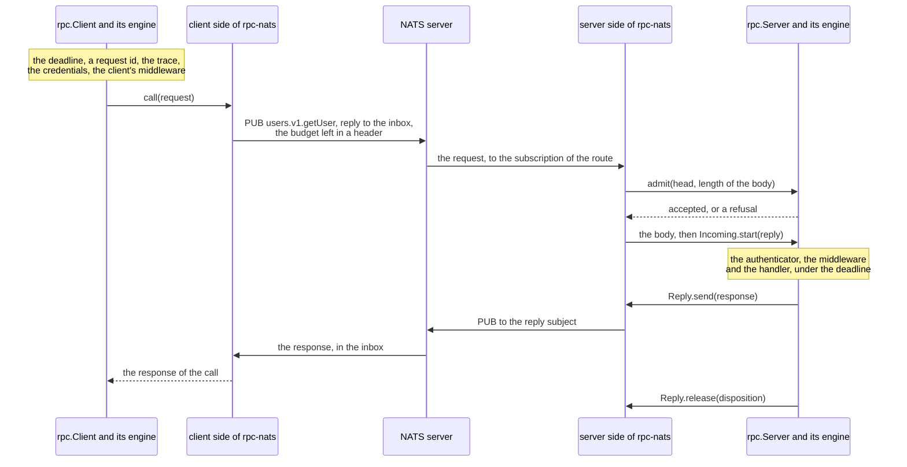
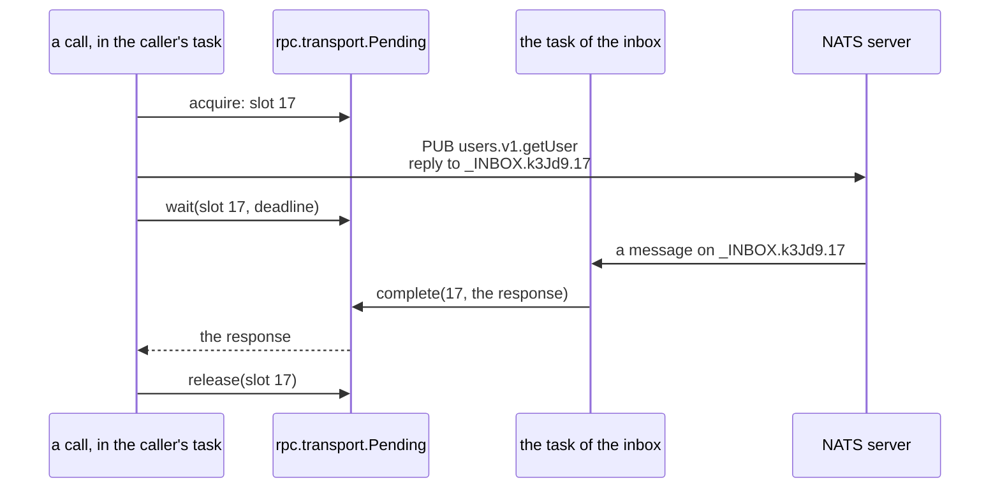
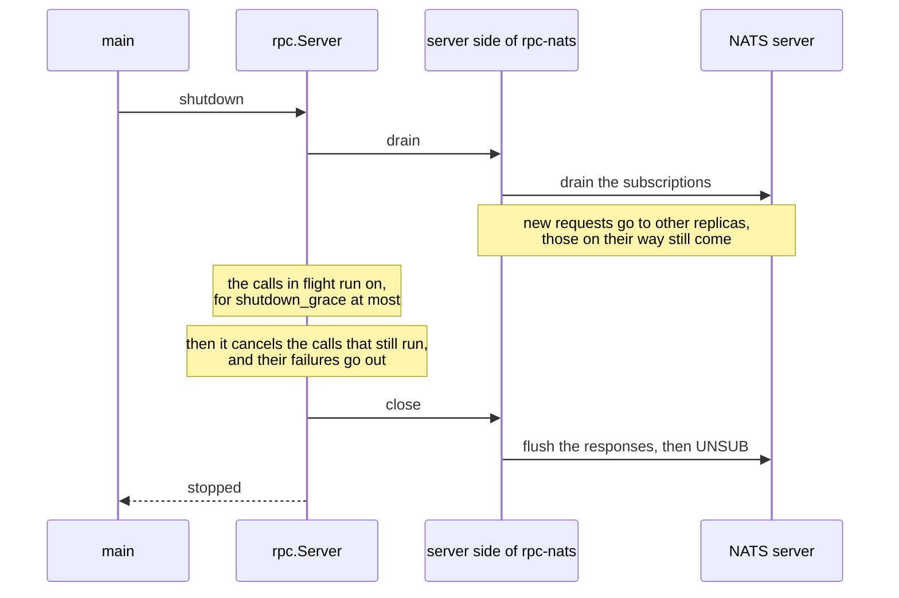
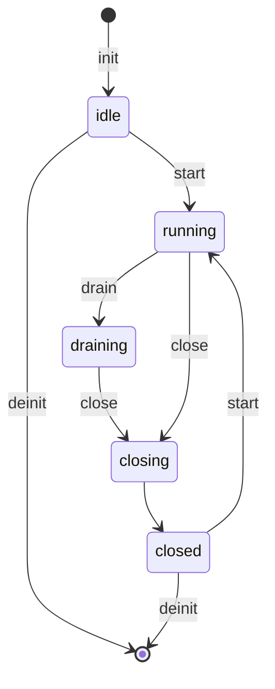

# Writing a transport: how rpc-nats is built

**A transport carries the calls of rpc, and this page shows how to write
one.** zefir-rpc moves no bytes itself: a *transport* takes a call from the
client engine to the server engine, over a network or a broker, and brings
the response back. zefir-rpc-nats is the transport that zefir ships for
rpc, the default choice of a service, and the reference implementation of a
transport. When the calls of your services must travel another way, over
another broker or a protocol of your own, write the transport the way
rpc-nats is written. This page builds it up step by step, on its real code;
the [guide of rpc-nats](README.md) shows how to use it.

Every Zig block on this page is a part of the sources of rpc-nats, as they
are: `zig build test-rpc-nats` fails when a block no longer is. For the
smallest start, take
[examples/rpc-custom-transport](../../../examples/rpc-custom-transport/README.md),
a minimal skeleton of a transport in a package of its own; this page shows
a whole one.

## Contents

- [The transport and the engine](#the-transport-and-the-engine)
- [The interfaces](#the-interfaces)
- [The server side](#the-server-side)
- [The client side](#the-client-side)
- [On the wire](#on-the-wire)
- [Start, drain, close](#start-drain-close)
- [Tests](#tests)
- [A package of your own](#a-package-of-your-own)

The code comes from these files of rpc-nats:
[Transport.zig](../Transport.zig) · [server.zig](../server.zig) ·
[client.zig](../client.zig) · [wire.zig](../wire.zig) ·
[conformance_tests.zig](../conformance_tests.zig) · [client_tests.zig](../client_tests.zig)

## The transport and the engine

Before any code, know where a transport ends. Most of what makes a call
reliable belongs to the *engine*: `rpc.RawServer` under `rpc.Server`, and
`rpc.RawClient` under `rpc.Client`. The engine keeps the deadlines, the
limits, the middleware and the stop the same on every transport, so a new
transport gets all of that for free, and only carries.

One call on NATS, and who does what:



| The engine | The transport |
| --- | --- |
| decides on a call by its head, the route, the codec, the metadata, the budget and the limits, before the body is read | reads the head of a request from the wire, and asks the engine |
| sets the deadline of a call on the client, and keeps it on the server | sends the budget left of the deadline, and waits no longer than the deadline |
| runs the authenticator, the middleware and the handler, each call in a task of its own | carries the body and the metadata byte for byte |
| sends at most one response a call | brings the response to the call that waits for it |
| leads the graceful stop: the grace, then the cancel of the calls that still run | stops taking calls, then closes, when the engine says so |
| JSON and validation, in `rpc.Server` and `rpc.Client` | turns the errors of its network or library into those of rpc |

So a transport decides little, and keeps strict rules: the engine relies on
how it treats deadlines, cancelation and memory. The next chapter lists
them.

## The interfaces

rpc knows a transport only through a few public types, and whatever
implements them is a transport: in zefir, or in a package of your own.
Five of them are interfaces on a vtable, as `std.Io` is: a pointer to an
object and a table of its functions. The sixth is a helper.

| Type | Implemented by | Called by | What |
| --- | --- | --- | --- |
| `rpc.ServerTransport` | the transport | the server engine | `start`, `drain`, `close`, `info`, and `isReady` if the transport has a condition of its own |
| `rpc.ClientTransport` | the transport | the client engine | `call`, `info` |
| `rpc.transport.Dispatcher` | the engine | the server side, from its tasks | `service`, `admit`, `fail`, `routeStats`: where the calls go |
| `rpc.transport.Incoming` | the engine | the server side, once per admitted call | `body`, `start`, `abandon`, `cancel` |
| `rpc.transport.Reply` | the transport, one per call | the engine | `send`, `release`: how the engine answers |
| `rpc.transport.Pending` | rpc, as a helper | the client side | slots for the calls that wait for their responses |

rpc-nats is one type, `rpc_nats.Transport`, for both sides on one NATS
connection:

```zig
const Transport = @This();

gpa: std.mem.Allocator,
conn: Conn,
options: Options,
/// The copies of the strings of `options`: `options` points here.
strings: []u8,
/// The copy of `options.reply_prefixes`.
reply_prefixes: [][]const u8,
pending: rpc.transport.Pending,
/// The `std.Io` the transport was first used with; Debug checks that every
/// call brings the same.
io_vtable: std.atomic.Value(?*const std.Io.VTable) = .init(null),
counts: std.EnumArray(shared.Counter, std.atomic.Value(u64)) = .initFill(.init(0)),
/// Held by the server side's `start` from its first SUB to the flush that
/// confirms them, by the client from the SUB of its inbox to its flush,
/// and by the flush of `close`: a connection tells of a refused SUB at the
/// first flush after it, which must be the flush of the side that made it.
confirming: std.Io.Mutex = .init,
server: server_side.State = .{},
client: client_side.State = .{},
```

- `conn` is the NATS connection, as the six operations the transport needs
  of it, `rpc_nats.Conn` (see
  [Another NATS library](README.md#tests-and-other-nats-libraries)).
- `pending` holds the calls of the client side that wait for their
  responses.
- `server` and `client` are the state of each side, in `server.zig` and
  `client.zig`.

The transport hands itself out as each of the two interfaces:

```zig
/// The server side, for the engine of the server. It points at `t`, which
/// stays where it is until `deinit`.
pub fn serverTransport(t: *Transport) rpc.ServerTransport {
    return .init(t);
}

/// The client side, for the engine of the client. It points at `t`, which
/// stays where it is until `deinit`.
pub fn clientTransport(t: *Transport) rpc.ClientTransport {
    return .init(t);
}
```

`.init(t)` builds the table of the interface from the methods of
`Transport` when the program compiles. A missing method, or one with
another signature, stops the build with a message that names the signature
to write. The methods hand the work to the file of each side:

```zig
/// Publishes `request` to the subject of its route and waits for the
/// response in the inbox, by the rules of `rpc.ClientTransport.call`.
pub fn call(t: *Transport, io: std.Io, request: *const rpc.transport.Request, options: rpc.ClientTransport.CallOptions) rpc.ClientTransport.CallError!rpc.Response {
    return client_side.call(t, io, request, options);
}

/// Subscribes to the routes of `dispatcher` and starts taking requests; see
/// `rpc.ServerTransport.start`. A second `start` while one runs gets
/// `error.AddressInUse`; after `close` the transport may start again.
pub fn start(t: *Transport, io: std.Io, dispatcher: rpc.transport.Dispatcher) rpc.ServerTransport.StartError!void {
    return server_side.start(t, io, dispatcher);
}

/// Drains the subscriptions: the broker sends new requests to other
/// replicas, and the requests already on their way are still served.
pub fn drain(t: *Transport, io: std.Io) void {
    server_side.drain(t, io);
}

/// Stops taking requests for good; see `rpc.ServerTransport.close`.
pub fn close(t: *Transport, io: std.Io) void {
    server_side.close(t, io);
}

/// Whether the link to the broker is up.
pub fn isReady(t: *Transport) bool {
    return t.conn.isConnected();
}
```

`info` tells the engine what the transport can do, and the conformance
suite of [Tests](#tests) chooses its checks by it:

```zig
/// The same for both sides: NATS request-reply. The broker tells a client
/// that no server took a request (no responders), and the server marks a
/// refused call; a link that breaks is seen only when the connection closes
/// for good. The largest body is the broker's `max_payload`, which
/// `publish` enforces.
pub fn info(t: *Transport) rpc.transport.Info {
    _ = t;
    return .{
        .name = "nats",
        .propagates_cancellation = false,
        .reports_unprocessed = true,
        .reports_connection_loss = false,
        .delivery = .at_most_once,
        .max_body_bytes = null,
    };
}
```

- `propagates_cancellation`: NATS has no signal that a client gave up, so
  a handler runs until its own deadline.
- `reports_unprocessed`: the broker answers at once that no server took a
  request (no responders). The client gets `error.Unavailable`, and knows
  that the call did not run.
- `reports_connection_loss`: with the broker in between, a call sees a
  link that breaks only at its deadline, unless the connection closes for
  good.
- `delivery`: a request runs at most once.
- `max_body_bytes`: null, only the limits of rpc apply; `publish` checks
  the broker's `max_payload`.

<details>
<summary>The rules of the client side, from the doc of <code>rpc.ClientTransport</code></summary>

1. **Concurrency.** Any number of tasks and threads call `call` at once.
   Shared state is guarded with `std.Io` primitives (`Io.Mutex`,
   `Io.Condition`, `Io.Event`, `Io.Queue`): a lock of the OS or of a C
   library would stop a whole thread of zio.
2. **Waiting** suspends the task through `io`, never the OS thread, and
   `io` is the instance that the library under the transport runs on:
   otherwise canceling the task would not end a wait inside the library.
3. **Deadline.** With less than 1 ms left, `call` returns `error.Timeout`
   without sending. Otherwise it sends the budget left, measured right
   before sending, and waits for the response no longer than the deadline.
   A response that comes after `Timeout` is dropped.
4. **Cancelation.** `call` returns `error.Canceled` if and only if the
   caller's task was canceled, and never swallows a cancelation. After any
   return, the transport keeps no reference to the caller's memory.
5. **Memory.** `request` is borrowed until `call` returns. Everything the
   response points to comes from `options.allocator`, during the call only.
6. **A failure of the server is a value**, not an error: a response with
   `status = .failure`, with `refused = true` when the call was refused at
   admission.

</details>

<details>
<summary>The rules of the server side, from the docs of <code>rpc.ServerTransport</code>, <code>Dispatcher</code>, <code>Incoming</code> and <code>Reply</code></summary>

- The engine calls `start` once. The transport starts its tasks with
  `io.concurrent` or `std.Io.Group.concurrent`, not `io.async`, returns
  when it is ready, and on an error leaves nothing running.
- For every request: `admit(io, &head, body_len)` before the body is read.
  `.rejected`: answer the failure in your own format, marked as not run,
  and skip the body. `.accepted`: fill `incoming.body()`, record the call,
  then `incoming.start(io, reply)`; a `Failure` from `start` is answered as
  a refusal too.
- Every accepted call gets exactly one of `incoming.start` and
  `incoming.abandon`.
- The engine calls `reply.send` at most once and `reply.release` exactly
  once, last. Both may come from another task before `start` returns, so
  the transport holds no lock across `start` or `abandon` that `send` or
  `release` take.
- `admit` is thread-safe and never waits. `Dispatcher.fail` is for the
  whole transport, broken for good; the errors of one call or of one
  connection do not go there.
- `drain`, `close` and `release` have no `error.Canceled` to return, and
  never swallow a cancelation of their task: they lock with
  `lockUncancelable`, work under `io.swapCancelProtection(.blocked)`, or
  call `io.recancel()`.
- Once `close` has returned, the transport calls neither the dispatcher
  nor a call.

</details>

## The server side

The server side turns a message of the network into a call of the engine.
rpc-nats subscribes to the subject of every route and runs one task per
subscription, which takes its requests one by one. Every request then goes
through the steps that the engine expects, always in the same order.

### Starting

`start` gets the `Dispatcher` of the engine, whose `service()` holds the
routes and the limits of the server. A second `start` while one runs is
`error.AddressInUse`. `makeRoutes` makes the subject of every route, such
as `users.v1.getUser`, and the room for the metadata of its requests, so
that no request costs an allocation; `micro.make` makes the subscriptions
of NATS micro:

```zig
pub fn start(t: *Transport, io: std.Io, dispatcher: rpc.transport.Dispatcher) rpc.ServerTransport.StartError!void {
    const s = &t.server;
    s.lifecycle.lockUncancelable(io);
    defer s.lifecycle.unlock(io);
    const before = s.phase.load(.acquire);
    switch (before) {
        .idle, .closed => {},
        .running, .draining, .closing => return error.AddressInUse,
    }
    shared.checkIo(t, io);
    const routes = try makeRoutes(t, io, dispatcher.service());
    errdefer freeRoutes(t, io, routes);
    const services: micro.Services = if (t.options.discovery.enabled) try micro.make(t, io, dispatcher.service().routes) else .empty;
    errdefer micro.free(t, io, services);
    var subscribed: usize = 0;
    var listening: usize = 0;
    errdefer {
        const protection = io.swapCancelProtection(.blocked);
        defer _ = io.swapCancelProtection(protection);
        for (routes[0..subscribed]) |*r| t.conn.unsubscribe(io, r.sub);
        for (services.listeners[0..listening]) |*l| t.conn.unsubscribe(io, l.sub);
    }
```

Every step that can fail has an `errdefer` that undoes it: a `start` that
fails leaves nothing subscribed and nothing running, as the interface
wants. Then the subscriptions:

```zig
const deadline: core.Deadline = .after(std.Io.Clock.awake.now(io), t.options.flush_timeout);
const timeout = deadline.toTimeout();
{
    // Not while the client's inbox waits for its flush: that flush
    // would answer for these subscriptions.
    shared.lockConfirming(t, io, deadline) catch |err| return startError(null, err);
    defer t.confirming.unlock(io);
    for (routes) |*r| {
        r.sub = t.conn.subscribe(io, r.subjectOf(), t.options.queue_group, timeout) catch |err| return startError(r.subjectOf(), err);
        subscribed += 1;
    }
    // Every replica answers discovery: no queue group.
    for (services.listeners) |*l| {
        l.sub = t.conn.subscribe(io, l.subjectOf(), null, timeout) catch |err| return startError(l.subjectOf(), err);
        listening += 1;
    }
    // The broker confirms the subscriptions and their permissions here;
    // without it, a denied subject would show only as no responders.
    t.conn.flush(io, timeout) catch |err| return startError(null, err);
}
```

- Every replica subscribes to a route in the queue group, so the broker
  gives each request to one of them.
- The subscriptions of NATS micro, `$SRV.PING`, `$SRV.INFO` and
  `$SRV.STATS`, have no queue group: every replica answers them.
- The flush at the end is where the broker confirms the subscriptions: a
  subject that the permissions deny fails `start` here, instead of showing
  later as calls that no one takes.
- A connection tells of a refused subscription at the first flush after
  it, so the server side and the client side of one transport confirm
  theirs one at a time, under the lock `confirming`.

`startError` turns the errors of the connection into those of
`rpc.ServerTransport.StartError`:

```zig
/// `name`: the subject the connection refused; null for the flush.
fn startError(name: ?[]const u8, err: Conn.Error) rpc.ServerTransport.StartError {
    const what = name orelse "the flush";
    return switch (err) {
        error.PermissionDenied => {
            log.warn("the NATS permissions deny the server {s}", .{name orelse "one of its subjects"});
            return error.AccessDenied;
        },
        error.Disconnected, error.ConnectionClosed, error.Timeout => error.Unavailable,
        error.Canceled => error.Canceled,
        error.OutOfMemory => error.OutOfMemory,
        error.InvalidSubject, error.PayloadTooLarge, error.SlowConsumer => {
            log.warn("the NATS connection refused {s}: {t}", .{ what, err });
            return error.Unexpected;
        },
    };
}
```

Last, the receiving tasks, one per subscription:

```zig
    s.dispatcher = dispatcher;
    s.routes = routes;
    s.services = services;
    // No task waits on it: the group is empty.
    s.started.reset();
    s.phase.store(.running, .release);
    for (routes) |*r| {
        s.group.concurrent(io, receive, .{ r, io }) catch |err| return abortStart(t, io, before, err);
    }
    for (services.listeners) |*l| {
        s.group.concurrent(io, listen, .{ l, io }) catch |err| return abortStart(t, io, before, err);
    }
    s.started.set(io);
}
```

A task waits for `started` before it takes its first request. When the
next task cannot start, `abortStart` cancels those that did, and no request
has reached the engine meanwhile.

### Receiving

A receiving task is a loop: the next message of its subscription, then the
request in it.

```zig
/// The receiving task of one route.
fn receive(r: *Route, io: std.Io) void {
    const t = r.transport;
    // A start that fails cancels the task here.
    t.server.started.wait(io) catch return;
    while (nextMessage(t, io, r.sub, r.subjectOf(), .route)) |message| {
        const protection = io.swapCancelProtection(.blocked);
        defer _ = io.swapCancelProtection(protection);
        handle(t, io, r, message);
    }
}
```

The task waits only in `next`, a cancelation point, and handles a request
with cancelation blocked. So `close` stops a task while it waits, and never
in the middle of a call. What comes out of `next` decides whether the task
goes on:

```zig
/// The next message of a subscription of the server side; null when its
/// task ends: canceled, the subscription ended, or the transport broke,
/// and then the engine has been told.
fn nextMessage(t: *Transport, io: std.Io, sub: Conn.Sub, name: []const u8, kind: Kind) ?Conn.InMsg {
    while (true) {
        const message = t.conn.next(io, sub, .none) catch |err| switch (err) {
            error.Canceled => return null,
            error.Timeout => continue,
            // The library reconnects; `isReady` is false meanwhile.
            error.Disconnected, error.OutOfMemory => {
                io.sleep(retry_pause, .awake) catch return null;
                continue;
            },
            error.SlowConsumer => {
                shared.count(t, .slow_consumer_errors);
                switch (kind) {
                    .route => log.warn("the subscription to {s} lost requests as a slow consumer; its pending limits must hold the server's max_inflight", .{name}),
                    // A burst of discovery requests: no call was lost.
                    .discovery => log.warn("the subscription to {s} lost NATS micro requests as a slow consumer", .{name}),
                }
                continue;
            },
            error.PermissionDenied => {
                fail(t, io, name, error.AccessDenied, err);
                return null;
            },
            error.ConnectionClosed, error.InvalidSubject, error.PayloadTooLarge => {
                fail(t, io, name, if (err == error.ConnectionClosed) error.Unavailable else error.Unexpected, err);
                return null;
            },
        };
        return message orelse {
            // Drained, or ended by someone else while the server runs.
            if (t.server.phase.load(.acquire) == .running) fail(t, io, name, error.Unavailable, null);
            return null;
        };
    }
}
```

- A dropped link, which the library reconnects, or no memory: the task
  tries again after a pause.
- A slow consumer, a queue of the subscription that overflowed: counted in
  `counters()`, logged, and the task goes on.
- Revoked permissions, a connection closed for good, or a subscription
  that ended while the server runs: the whole transport broke. The task
  tells the engine with `Dispatcher.fail`, and the server stops; its `wait`
  returns the error.

```zig
/// The whole transport broke: the engine stops the server.
fn fail(t: *Transport, io: std.Io, name: []const u8, err: rpc.transport.Dispatcher.FatalError, cause: ?anyerror) void {
    const protection = io.swapCancelProtection(.blocked);
    defer _ = io.swapCancelProtection(protection);
    var diagnostics: rpc.transport.Diagnostics = .{};
    if (cause) |c| {
        diagnostics.set(.receive, c, "the subscription to {s} failed: {t}", .{ name, c });
    } else {
        diagnostics.set(.receive, null, "the subscription to {s} ended while the server runs", .{name});
    }
    t.server.dispatcher.fail(io, err, &diagnostics);
}
```

`Diagnostics` carries the details for logs: the phase, the cause and a
message. Metadata values, bodies and credentials never go into it.

### One request

`handle` makes one message a call of the engine. First, what the transport
checks itself:

```zig
/// One request: to the engine, or refused.
fn handle(t: *Transport, io: std.Io, r: *Route, message: Conn.InMsg) void {
    // After the copies: the head is borrowed for `admit`, the body copied.
    defer message.release();
    const received_at = std.Io.Clock.awake.now(io);
    const reply_to = message.reply_to orelse {
        shared.count(t, .requests_without_reply_to);
        return;
    };
    if (!subject.isAllowedReplyTo(reply_to, t.reply_prefixes)) {
        shared.count(t, .requests_with_foreign_reply_to);
        return;
    }
    if (closing(t)) return refuse(t, io, reply_to, stopping);
```

- The message goes back to the adapter at the end, by `release`: the head
  is borrowed for the decision of the engine, and the body is copied.
- A request without a reply subject cannot be answered, and one whose
  reply subject is outside `reply_prefixes` must not be: otherwise anyone
  could send the responses of a service to a subject of their choice. Both
  are dropped and counted.
- While the transport closes, a request is refused at once with
  `unavailable`.

Then the head of the call, from the NATS headers:

```zig
const fields = switch (wire.parseRequest(message.header_block, r.scratch)) {
    .request => |parsed| parsed,
    .refused => |failure| return refuse(t, io, reply_to, failure),
};
const request_id = fields.request_id orelse id: {
    var id: [16]u8 = undefined;
    io.random(&id);
    break :id id;
};
const head: rpc.transport.RequestHead = .{
    .route = r.route,
    .request_id = request_id,
    .codec = fields.codec,
    .timeout = fields.timeout,
    .received_at = received_at,
    .metadata = fields.metadata,
};
```

`wire.parseRequest` reads the headers of rpc-nats: the request id, the
budget, the codec and the metadata. Broken headers of its own protocol the
transport refuses itself (see [On the wire](#on-the-wire)). A request from
`nats req` has no headers of zefir: it gets a request id made up here, and
no budget, so the method's own deadline applies. `received_at` is when the
request came, on the clock `std.Io.Clock.awake`: the deadline on the
server counts from it.

Then the engine decides, and the call starts:

```zig
    const incoming = switch (t.server.dispatcher.admit(io, &head, message.payload.len)) {
        .accepted => |incoming| incoming,
        .rejected => |failure| return refuse(t, io, reply_to, failure),
    };
    // `close` began while the engine decided: the call will not start.
    if (closing(t)) {
        incoming.abandon(io);
        return refuse(t, io, reply_to, stopping);
    }
    const call = Call.create(t, reply_to) catch {
        incoming.abandon(io);
        return refuse(t, io, reply_to, out_of_memory);
    };
    @memcpy(incoming.body(), message.payload);
    // The handler may answer and release the call before `start` returns:
    // `call` is not touched after a null.
    if (incoming.start(io, .init(call))) |failure| {
        call.destroy();
        refuse(t, io, reply_to, failure);
    }
}
```

1. `admit` decides on the call by its head and the length of its body,
   before the body is copied, so a call over the limits costs nothing.
   `.rejected` is answered as a refusal.
2. `close` may have begun while the engine decided: then the call is
   abandoned and refused.
3. `Call.create` records the call, with its reply subject. That happens
   before `start`, since the handler runs in another task and may answer
   before `start` has returned.
4. The body goes into the buffer that the engine reserved,
   `incoming.body()`.
5. `incoming.start` hands the call to the engine. Null: the call runs, and
   the transport does not touch `call` again. A `Failure`: the engine did
   not take the call, as when it has no task for it or the grace of the
   stop is over, and the transport refuses it.

### Answering

The engine answers through the `Reply` of the call. In rpc-nats that is
`Call`, which `.init(call)` above turned into an `rpc.transport.Reply`:

```zig
/// Publishes the response to the reply subject of the request.
pub fn send(c: *Call, io: std.Io, response: *const rpc.Response) Reply.SendError!void {
    const t = c.transport;
    if (t.server.phase.load(.acquire) == .closed) return error.Closed;
    publishResponse(t, io, c.reply_to, response) catch |err| return switch (err) {
        error.PayloadTooLarge => error.ResponseTooLarge,
        error.Disconnected, error.ConnectionClosed => error.Closed,
        error.Canceled => error.Canceled,
        error.OutOfMemory => error.OutOfMemory,
        error.InvalidSubject, error.PermissionDenied, error.SlowConsumer, error.Timeout => {
            log.debug("a response was not published: {t}", .{err});
            return error.Unexpected;
        },
    };
}

/// Forgets the call; NATS has nothing to acknowledge.
pub fn release(c: *Call, io: std.Io, disposition: Reply.Disposition) void {
    _ = disposition;
    const protection = io.swapCancelProtection(.blocked);
    defer _ = io.swapCancelProtection(protection);
    c.destroy();
}
```

- `send` publishes the response to the reply subject of the request, and
  turns the errors of the connection into those of
  `rpc.transport.Reply.SendError`. A response over the broker's
  `max_payload` is `ResponseTooLarge`, and the engine sends a small
  `resource_exhausted` failure in its place; a lost link is `Closed`.
- `release` comes exactly once, last, after the handler has really ended.
  NATS has nothing to acknowledge, so rpc-nats only frees the call. A
  broker that acknowledges its messages acks them here, and
  `disposition` tells how the call ended: with `.not_started`, the call
  may run on another replica.

A refusal goes out the same way, marked as not run:

```zig
/// Answers a call that did not run, as refused.
fn refuse(t: *Transport, io: std.Io, reply_to: []const u8, failure: Failure) void {
    const response: rpc.Response = .{ .status = .{ .failure = failure }, .refused = true };
    publishResponse(t, io, reply_to, &response) catch |err| log.debug("a refusal was not published: {t}", .{err});
}
```

`refused = true` travels as the header `Zefir-Rpc-Refused: 1`, and the
client sees `Response.refused`: the call did not run, so it is safe to send
again.

### When the client gives up

NATS has no signal that a client gave up, so rpc-nats never cancels a call
on the server: the handler runs until its own deadline. A transport that
has such a signal, a CANCEL frame of its protocol or the broken connection
of a direct transport, calls `incoming.cancel(io)`, and the engine cancels
the handler.

<details>
<summary>When <code>Incoming.cancel</code> may come</summary>

- Only once `start` has returned null, and before `reply.release` returns:
  the engine frees the call then. So the transport calls it under the lock
  that its `release` takes.
- A cancel that comes while `start` runs waits until `start` returns, and
  is dropped when `start` returned a `Failure`: the engine has freed the
  call by then.
- `cancel` never waits and never calls `Reply`; a second one does nothing.

`rpc.testing.MemoryTransport` keeps these rules: its code shows one way to.

</details>

## The client side

The client side turns a call of the engine into a message, and brings the
response back to the call that waits for it. Many calls share one
connection at once, so the hard part is to match a response to its call.
rpc has a helper for it, `rpc.transport.Pending`: a table of slots, one per
call that waits, each with its own event, so that a call wakes only for its
own response, its deadline or its cancelation.

All the calls of rpc-nats share one *inbox*, `<inbox_prefix>.<random
token>`: one subscription to `<inbox>.*`, read by one task of the
transport. The reply subject of a call is `<inbox>.<the id of its slot>`:



The inbox starts with the first call. Its subscription is confirmed with a
flush, so an inbox that the permissions deny fails that call with
`error.AccessDenied`, and the next call tries again.

### A call

`call` runs in the caller's task. First, what fails without sending:

```zig
pub fn call(t: *Transport, io: std.Io, request: *const rpc.transport.Request, options: CallOptions) CallError!rpc.Response {
    // A cancelation pending on entry comes before any other error.
    try io.checkCancel();
    shared.checkIo(t, io);
    const diagnostics = options.diagnostics;
    if (!t.conn.isConnected()) {
        note(diagnostics, .connect, null, "no link to the NATS server", .{});
        return error.Unavailable;
    }
    var subject_buffer: [subject.max_subject_bytes]u8 = undefined;
    const route_subject = subject.routeSubject(&subject_buffer, t.options.subject_prefix, request.route) orelse {
        note(diagnostics, .send, null, "the route {s}.v{d}.{s} has no NATS subject", .{ request.route.service, request.route.version, request.route.method });
        return error.Unexpected;
    };
    const deadline = request.ctx.deadline orelse core.Deadline.after(now(io), .max);
    if (deadline.remaining(now(io)).nanoseconds < std.time.ns_per_ms) return error.Timeout;
```

- A cancelation that was pending on entry comes before any other error.
- In Debug, `checkIo` panics when the call brings another `std.Io` than
  the transport's first one.
- Without a link to the broker, the call fails at once with
  `error.Unavailable`: a request kept in a buffer through a reconnect would
  reach the server with a stale budget.
- With less than 1 ms left until the deadline, `error.Timeout`, and
  nothing is sent.

Then the inbox, and a slot:

```zig
try startInbox(t, io, deadline, diagnostics);
const slot = t.pending.acquire(io) catch |err| {
    note(diagnostics, .send, err, "{d} calls wait for their responses already", .{t.options.max_pending});
    return err;
};
defer releaseSlot(t, io, slot);
// `failAll` reaches only the calls that wait already: an inbox that
// ended since `startInbox` returned shows here.
if (t.client.phase.load(.acquire) != .running) {
    note(diagnostics, .send, null, "the inbox of the client ended", .{});
    return error.Unavailable;
}
var reply_buffer: [subject.max_subject_bytes]u8 = undefined;
const reply_to = subject.replySubject(&reply_buffer, t.client.inbox(), slot.id);
```

- `startInbox` starts the inbox on the first call. A call that comes while
  another one starts it waits, no longer than its own deadline.
- `acquire` never waits: with `max_pending` calls waiting, it fails at once
  with `error.TooManyPendingRequests`.
- `releaseSlot` gives the slot back exactly once, whatever happens next.
- After it took its slot, a call looks at the inbox once more: `failAll`
  reaches only the calls that wait already.

Then the request goes out:

```zig
var text: wire.RequestText = .{};
// The budget left, right before publish.
const left = deadline.remaining(now(io));
if (left.nanoseconds < std.time.ns_per_ms) return error.Timeout;
const ms: u64 = @intCast(@min(@divFloor(left.nanoseconds, std.time.ns_per_ms), std.math.maxInt(u64)));
const headers = wire.requestHeaders(buffer, &text, request.request_id, request.codec, ms, request.metadata) orelse {
    note(diagnostics, .send, null, "the codec \"{s}\" cannot be a media type application/<codec>", .{request.codec});
    return error.UnsupportedProtocol;
};
t.conn.publish(io, .{ .subject = route_subject, .reply_to = reply_to, .headers = headers, .payload = request.body }, deadline.toTimeout()) catch |err| {
    note(diagnostics, .send, err, "the publish to {s} failed", .{route_subject});
    return switch (err) {
        error.PayloadTooLarge => error.RequestTooLarge,
        error.PermissionDenied => error.AccessDenied,
        error.Disconnected, error.ConnectionClosed => error.Unavailable,
        error.Timeout => error.Timeout,
        error.Canceled => error.Canceled,
        error.OutOfMemory => error.OutOfMemory,
        error.InvalidSubject, error.SlowConsumer => error.Unexpected,
    };
};
```

- The budget left goes into `Zefir-Rpc-Timeout-Ms`, measured right before
  the publish, and the publish waits no longer than the deadline.
- `buffer` holds the headers: on the stack for a call with a few entries of
  metadata, from `options.allocator` for more.
- Every error of the connection becomes one of
  `rpc.ClientTransport.CallError`, with its details in `Diagnostics`.
  `RequestTooLarge`, `AccessDenied` and `Unavailable` tell the engine that
  the call was not sent, so a retry is safe.

Last, the wait:

```zig
    const delivery = t.pending.wait(io, slot, deadline) catch |err| {
        if (err == error.ConnectionLost) note(diagnostics, .wait, null, "the NATS connection closed for good", .{});
        return err;
    };
    defer freeDelivery(io, delivery);
    const received: *Received = @ptrCast(@alignCast(delivery.context));
    // The caller's allocator; a Debug allocator may take a cancelable lock.
    const protection = io.swapCancelProtection(.blocked);
    defer _ = io.swapCancelProtection(protection);
    return wire.parseResponse(options.allocator, received.msg.header_block, received.msg.payload, .{
        .max_body_bytes = options.max_response_bytes,
        .max_metadata_entries = options.max_response_metadata_entries,
        .max_metadata_bytes = options.max_response_metadata_bytes,
    }, diagnostics);
}
```

`Pending.wait` returns the response; or `error.Timeout` at the deadline,
`error.Canceled` when the caller's task is canceled, `error.ConnectionLost`
when the inbox broke. The response is copied into `options.allocator` in
the caller's task, and only then does the message go back to the adapter:
the caller's allocator is never used from another task.

### The inbox task

The task of the inbox hands every response to the call of its number:

```zig
/// The inbox task: hands every response to the call of its number.
fn readInbox(t: *Transport, io: std.Io, sub: Conn.Sub) void {
    while (true) {
        const message = t.conn.next(io, sub, .none) catch |err| switch (err) {
            error.Canceled => return,
            error.Timeout => continue,
            // While the library reconnects, a response may still come: the
            // calls wait until their deadlines.
            error.Disconnected, error.OutOfMemory => {
                io.sleep(retry_pause, .awake) catch return;
                continue;
            },
            error.SlowConsumer => {
                shared.count(t, .slow_consumer_errors);
                log.warn("the inbox of the client lost responses as a slow consumer", .{});
                continue;
            },
            error.ConnectionClosed, error.PermissionDenied, error.InvalidSubject, error.PayloadTooLarge => return broken(t, io, err),
        } orelse return broken(t, io, null);
        const protection = io.swapCancelProtection(.blocked);
        defer _ = io.swapCancelProtection(protection);
        deliver(t, io, message);
    }
}
```

```zig
fn deliver(t: *Transport, io: std.Io, message: Conn.InMsg) void {
    const id = subject.replyId(message.subject) orelse {
        message.release();
        shared.count(t, .late_responses);
        return;
    };
    const received = t.gpa.create(Received) catch {
        // The call ends at its deadline.
        log.debug("no memory for a response; it is dropped", .{});
        message.release();
        return;
    };
    received.* = .{ .gpa = t.gpa, .msg = message };
    const delivery: Pending.Delivery = .{ .response = .{ .status = .ok, .body = message.payload }, .context = received, .release = Received.free };
    if (!t.pending.complete(io, id, delivery)) {
        // Late: the call returned with Timeout or Canceled.
        Received.free(received);
        shared.count(t, .late_responses);
    }
}
```

- `replyId` reads the number at the end of the subject.
- `complete` hands the response to the slot, and returns false when no
  call waits there: a response that came after `Timeout` or `Canceled`, or
  a foreign one. The transport frees it and counts it in
  `counters().late_responses`.
- While the library reconnects, a response may still come, so the calls
  wait on until their deadlines.

When the inbox ends for good, the calls that wait learn it at once:

```zig
/// The inbox is over: the calls that wait get ConnectionLost, a new call
/// starts another inbox.
fn broken(t: *Transport, io: std.Io, cause: ?anyerror) void {
    const protection = io.swapCancelProtection(.blocked);
    defer _ = io.swapCancelProtection(protection);
    if (cause) |err| {
        if (err == error.ConnectionClosed) log.debug("the inbox of the client ended: the connection closed", .{}) else log.warn("the inbox of the client ended: {t}", .{err});
    } else log.debug("the inbox subscription of the client ended", .{});
    // Before `failAll`: a call that takes its slot later sees it.
    setPhase(t, io, .broken);
    t.pending.failAll(io, error.ConnectionLost);
}
```

`failAll` wakes every call that waits with `error.ConnectionLost`, and a
new call starts another inbox. What every reply and every error of the
connection becomes is in
[Errors of the connection](README.md#errors-of-the-connection) of the
guide.

## On the wire

The engine hands the transport a head and a body, and takes back a
response: a status, metadata and a body. How they look on the wire is up to
the transport alone. rpc-nats puts the head of a call into NATS headers,
and a failure into the headers of the NATS Service API (ADR-32), so that
`nats req` and NATS clients in other languages can call a zefir service and
read its failures. The headers, one by one, are in
[On the wire](README.md#on-the-wire) of the guide. Whatever the wire, two
rules hold, and NATS adds a third.

**The transport refuses the broken fields of its own protocol itself**,
with `invalid_argument`, such as garbage in the budget or a header that
repeats, and a later version of its protocol with `unimplemented`; the
engine refuses the rest, such as a codec it does not know or a budget that
has run out. The refusals of rpc-nats:

```zig
/// Refusals for a request whose transport headers are broken; the
/// transport answers them itself, as the engine answers its own.
pub const refusals = struct {
    pub const invalid_version: Failure = .{ .code = .invalid_argument, .app_code = "rpc.invalid_argument", .message = "Invalid Zefir-Rpc-Version header" };
    pub const unsupported_version: Failure = .{ .code = .unimplemented, .app_code = "rpc.unsupported_version", .message = "Unsupported Zefir-Rpc-Version" };
    pub const invalid_request_id: Failure = .{ .code = .invalid_argument, .app_code = "rpc.invalid_argument", .message = "Invalid Zefir-Rpc-Request-Id header" };
    pub const invalid_timeout: Failure = .{ .code = .invalid_argument, .app_code = "rpc.invalid_argument", .message = "Invalid Zefir-Rpc-Timeout-Ms header" };
    pub const repeated_version: Failure = .{ .code = .invalid_argument, .app_code = "rpc.invalid_argument", .message = "Repeated Zefir-Rpc-Version header" };
    pub const repeated_request_id: Failure = .{ .code = .invalid_argument, .app_code = "rpc.invalid_argument", .message = "Repeated Zefir-Rpc-Request-Id header" };
    pub const repeated_timeout: Failure = .{ .code = .invalid_argument, .app_code = "rpc.invalid_argument", .message = "Repeated Zefir-Rpc-Timeout-Ms header" };
    pub const repeated_content_type: Failure = .{ .code = .invalid_argument, .app_code = "rpc.invalid_argument", .message = "Repeated Content-Type header" };
};
```

**A refusal is marked.** It travels with `Zefir-Rpc-Refused: 1`, and the
client side reads it back as `refused = true`: the call did not run.

**On NATS, a status of the broker is not a response.** `NATS/1.0 503`
without a payload is the no responders of NATS, and the call gets
`error.Unavailable`; any other status line is `error.ProtocolViolation`.

## Start, drain, close

A service stops gracefully: it stops taking calls, lets those in flight
finish, and only then closes. The engine leads the stop and counts its
grace. The transport does two things at the right moments, and keeps its
own waits bounded, so that the stop always ends.



The server side of rpc-nats goes through these phases:



`drain` drains the subscriptions: the broker sends new requests to other
replicas, and the requests already on their way still come out of `next`,
then null.

```zig
pub fn drain(t: *Transport, io: std.Io) void {
    const protection = io.swapCancelProtection(.blocked);
    defer _ = io.swapCancelProtection(protection);
    const s = &t.server;
    s.lifecycle.lockUncancelable(io);
    defer s.lifecycle.unlock(io);
    if (s.phase.load(.acquire) != .running) return;
    s.phase.store(.draining, .release);
    drainRoutes(t, io);
}

/// What is on its way still comes out of `next`, then null. NATS micro
/// stops answering too: a stopping replica leaves the lists.
fn drainRoutes(t: *Transport, io: std.Io) void {
    for (t.server.routes) |*r| {
        t.conn.drain(io, r.sub) catch |err| log.debug("the drain of {s} failed: {t}", .{ r.subjectOf(), err });
    }
    for (t.server.services.listeners) |*l| {
        t.conn.drain(io, l.sub) catch |err| log.debug("the drain of {s} failed: {t}", .{ l.subjectOf(), err });
    }
}
```

`close` comes when the grace is over:

```zig
pub fn close(t: *Transport, io: std.Io) void {
    const protection = io.swapCancelProtection(.blocked);
    defer _ = io.swapCancelProtection(protection);
    const s = &t.server;
    s.lifecycle.lockUncancelable(io);
    defer s.lifecycle.unlock(io);
    const before = s.phase.load(.acquire);
    switch (before) {
        .idle, .closed => return,
        .running, .draining => {},
        // Under `lifecycle`, a close finishes before another looks.
        .closing => unreachable,
    }
    // Before the drain: a receiving task that gets null from it must not
    // take it for a subscription that ended while the server runs.
    s.phase.store(.closing, .release);
    if (before == .running) drainRoutes(t, io);
    // A task in `next` gets the cancelation at once; one with a request
    // hands it over or refuses it first.
    s.group.cancel(io);
    // The responses published so far reach the server. Not while the
    // client's inbox waits for its flush: this one would answer for it.
    const deadline: core.Deadline = .after(std.Io.Clock.awake.now(io), t.options.flush_timeout);
    if (shared.lockConfirming(t, io, deadline)) |_| {
        defer t.confirming.unlock(io);
        t.conn.flush(io, deadline.toTimeout()) catch |err| log.debug("the flush of close failed: {t}", .{err});
    } else |err| log.debug("the flush of close did not begin: {t}", .{err});
    for (s.routes) |*r| t.conn.unsubscribe(io, r.sub);
    for (s.services.listeners) |*l| t.conn.unsubscribe(io, l.sub);
    freeRoutes(t, io, s.routes);
    micro.free(t, io, s.services);
    s.routes = &.{};
    s.services = .empty;
    s.phase.store(.closed, .release);
}
```

1. The phase turns `closing` first: a task that now gets null from a
   drained subscription does not take it for a subscription that broke.
2. `group.cancel` stops the receiving tasks. A task in `next` gets the
   cancelation at once; one that holds a request hands it over or refuses
   it first.
3. The flush waits for the responses published so far, no longer than
   `flush_timeout`.
4. The subscriptions end and their memory is freed. The phase is `closed`,
   and a late `Reply.send` gets `error.Closed`.

So `close` returns within `publish_timeout` plus `flush_timeout`, and the
time of the adapter's `drain` when no `drain` came before it. `drain` and
`close` work under `io.swapCancelProtection(.blocked)` and lock with
`lockUncancelable`: they have no `error.Canceled` to return, and must not
swallow a cancelation of the task that called them. After `close`, the
transport may start again.

<details>
<summary>The order of <code>deinit</code></summary>

- The server's `deinit` comes first: it stops the server, and with it
  closes the server side of the transport.
- Then the transport's `deinit`, after the last call has returned. It
  panics while the engine holds the `Reply` of a call, or a call waits:
  the `Reply` of a call lives until its `release`.
- Then the connection's: the transport never closes it.

</details>

## Tests

The engine relies on rules that are easy to break and hard to see: a
cancelation swallowed, a call released twice, a response that reaches
another call under load. `rpc.testing.conformance` checks them, the same
checks for every transport, through the real engine and a recording one,
so a transport that passes them works under `rpc.Server` and `rpc.Client`.
rpc-nats runs the suite without a broker, on `rpc_nats.testing.FakeConn`, a
NATS server in memory:

```zig
/// A fresh connection and transport for every check; both sides share the
/// connection, as one application does.
const Harness = struct {
    fake: FakeConn = undefined,
    bus: Transport = undefined,

    pub fn setUp(h: *Harness, io: std.Io, gpa: std.mem.Allocator) !conformance.Pair {
        _ = io;
        h.fake = .init(gpa, .{});
        h.bus = try .init(gpa, h.fake.conn(), .{});
        return .{ .client = h.bus.clientTransport(), .server = h.bus.serverTransport() };
    }

    pub fn tearDown(h: *Harness, io: std.Io, pair: conformance.Pair) void {
        _ = pair;
        h.bus.deinit(io);
        h.fake.deinit(io);
    }
};

test "the NATS transport on FakeConn passes the conformance suite of rpc" {
    // The suite's own engine warns about the failures it provokes.
    const log_level = testing.log_level;
    testing.log_level = .err;
    defer testing.log_level = log_level;
    var harness: Harness = .{};
    var report = try conformance.run(testing.io, testing.allocator, &harness, .{});
    defer report.deinit();
    if (report.failedCount() > 0) {
        std.debug.print("{f}", .{&report});
        return error.TestUnexpectedResult;
    }
    try testing.expectEqualStrings("nats", report.transport_name);
    // T12: NATS sees a broken link only at the deadline. T16: at most once.
    // T17: it needs a live broker.
    for (std.enums.values(conformance.Check)) |check| {
        const skipped = report.outcome(check) == .skipped;
        const expected = check == .t12 or check == .t16 or check == .t17;
        if (skipped != expected) {
            std.debug.print("{f}", .{&report});
            return error.TestUnexpectedResult;
        }
    }
    // The transport has its own isReady.
    try testing.expectEqual(@as(usize, 0), report.defaults.len);
}
```

- `setUp` makes a fresh pair of sides for every check, connected: here one
  transport on one fake connection, as one application has. The suite
  counts the memory that the transport takes from `gpa`: what is left
  after `tearDown` fails the check as a leak.
- `tearDown` frees them; by then the suite has stopped the server side and
  every call has returned.
- `run` returns a report instead of failing through `std.testing`, and
  `{f}` prints it, a line per check.
- A check that the transport cannot take is skipped, with the reason in the
  report. For NATS: T12, a broken link seen at once, since NATS sees one
  only at the deadline; T16, at-least-once delivery; T17, a restart of the
  broker, which needs a live one.
- `report.defaults` names the entries of the tables that the transport
  left at their defaults, such as `rpc.ServerTransport.isReady`: rpc-nats
  has its own, so the list is empty.

Against a live broker, `tests/rpc-nats/e2e/conformance.zig` runs the same
suite on zefir-nats, with `.live_broker = true` and a `restartPeer` that
stops and starts the NATS server, so T17 runs too.

<details>
<summary>The checks of the suite, T1–T22</summary>

| Check | What it proves |
| --- | --- |
| T1 | echo: bodies byte for byte, empty, not UTF-8 |
| T2 | metadata: order, repeated keys, empty values, reserved keys |
| T3 | failures: every code, app code, message, field and failure body |
| T4 | the head on the server: route, request id, codec, peer |
| T5 | budget: the server sees the time left; a past deadline is not sent |
| T6 | client deadline: Timeout on time; a late response is not seen |
| T7 | canceling the caller: Canceled once; the server is told |
| T8 | 64 calls at once with random delays: responses not mixed up |
| T9 | sizes: a body at the limit and one byte over; response limits |
| T10 | unknown route: unimplemented or Unavailable |
| T11 | drain: calls in flight answered, new ones not taken |
| T12 | broken link: ConnectionLost, Unavailable, calls canceled |
| T13 | server discipline under the recording dispatcher |
| T14 | lifecycle: a busy address, drain and close twice |
| T15 | memory: the caller's buffers and allocator after return |
| T16 | at-least-once delivery: one response per call |
| T17 | restart of the other side: new calls go through |
| T18 | reentrance: an answer before start returns, a cancel during start, start refused |
| T19 | drain, close and release keep a cancelation of their task |
| T20 | close while a request is on its way: abandon, bounded close |
| T21 | a refusal at admission arrives with refused = true |
| T22 | metadata of middleware passes unchanged |

</details>

Besides the suite, the tests of rpc-nats break the connection on purpose.
The hooks of `FakeConn` do what a real network does: `disconnect` and
`reconnect` drop the link and bring it back, `close` ends the connection
for good, `setDelay` delays every message, `failNext` makes one `next` fail
with a given error, `publishRaw` sends a message with a block of headers as
given, such as a status line, and `hangFlush` leaves the flushes
unanswered. Its options deny subjects (`.deny_publish`, `.deny_subscribe`)
and set `max_payload`. Here the connection closes for good while a call
waits:

```zig
test "the connection closes for good: a waiting call gets ConnectionLost, a new one Unavailable" {
    const io = testing.io;
    var fake: FakeConn = .init(testing.allocator, .{});
    defer fake.deinit(io);
    var bus: Transport = try .init(testing.allocator, fake.conn(), .{});
    defer bus.deinit(io);
    var service: Service = try .init(&fake, "users.v1.getUser");
    defer service.deinit();

    var caller: Caller = .init(&bus, .{ .timeout = .fromSeconds(10) });
    defer caller.deinit();
    try caller.begin();
    const msg = try service.request();
    msg.release();
    const closed_at = now();
    fake.close(io);
    caller.join();
    try testing.expectError(error.ConnectionLost, caller.result);
    try testing.expect(closed_at.durationTo(caller.ended).nanoseconds < 2 * std.time.ns_per_s);
    try testing.expectError(error.Unavailable, callNow(&bus, .{}));
}
```

`Service` is a NATS service of the test, which takes the requests itself,
and `Caller` runs one call in a task of its own. The tests of the server
side alone run under `rpc.testing.RecordingDispatcher`, a fake engine: it
records what the transport hands it, checks the rules of
`rpc.ServerTransport` on the way, and lets the test answer in place of a
handler.

## A package of your own

A transport for another protocol needs no change in zefir: it is built on
the public API of zefir-rpc alone, the types of
[The interfaces](#the-interfaces) and those around them. rpc-nats lives
inside zefir, so the `build.zig` of zefir gives it its imports: rpc, core
and nats. A transport of your own lives in a package of its own, and takes
`zefir-rpc` and `zefir-core` from the application, from the application's
own zefir dependency: then the build holds one zefir, and the types of the
transport fit those of the engine.
[examples/rpc-custom-transport](../../../examples/rpc-custom-transport/README.md)
is such a package, the minimal skeleton of a transport. Its README shows
the `build.zig` of an application and
[why the application gives the transport its zefir](../../../examples/rpc-custom-transport/README.md#why-the-application-gives-the-transport-its-zefir).

A service on NATS with another NATS library needs no transport of its own
at all: an adapter of that library to `rpc_nats.Conn` is enough, see
[Another NATS library](README.md#tests-and-other-nats-libraries).

What a transport of your own does, as rpc-nats does:

1. One type with `start`, `drain`, `close`, `info`, and `isReady` if it has
   a condition of its own, handed out by `rpc.ServerTransport.init`; with
   `call` and `info`, by `rpc.ClientTransport.init`.
2. `info` tells the truth: cancelation, unprocessed calls, a broken link,
   delivery, the largest body.
3. `start` confirms what it opened, starts its tasks with `io.concurrent`
   or `std.Io.Group.concurrent`, and leaves nothing behind when it fails.
4. Every request: its head, `admit` before the body, the body into
   `incoming.body()`, the call recorded, then `incoming.start`. A refusal
   is answered in the transport's own format, marked as not run.
5. A `Reply` per call: `send` at most once, `release` exactly once and
   last, and no lock across `start` that they take.
6. `call`: with less than 1 ms left, `Timeout` and nothing sent; the budget
   measured right before sending; no wait past the deadline; `Canceled`
   only for a caller's task that was canceled; the response in
   `options.allocator`.
7. Every wait through `std.Io`, shared state under `std.Io` primitives, and
   no cancelation swallowed.
8. `drain` and `close` end within a limit the transport documents; `close`
   abandons every accepted call that did not start, and a late `send` gets
   `Closed`.
9. The errors of the network or the library turned into those of rpc, with
   details in `Diagnostics`, never metadata values, bodies or credentials.
10. `rpc.testing.conformance.run` passes, and for a real broker the harness
    has `breakLink` and `restartPeer`, with `.live_broker = true`.
