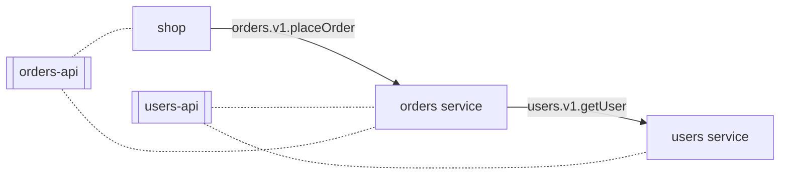
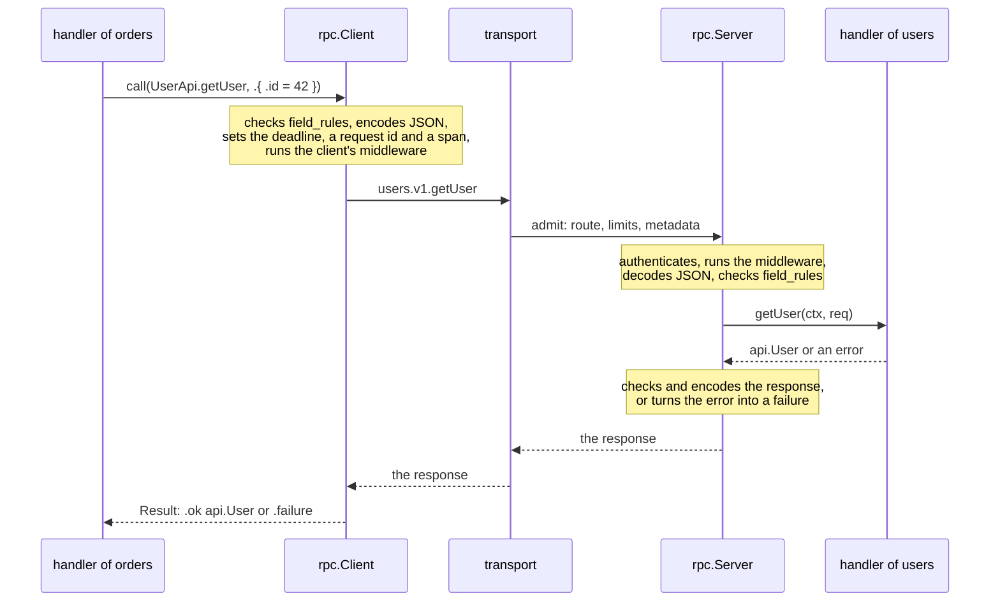
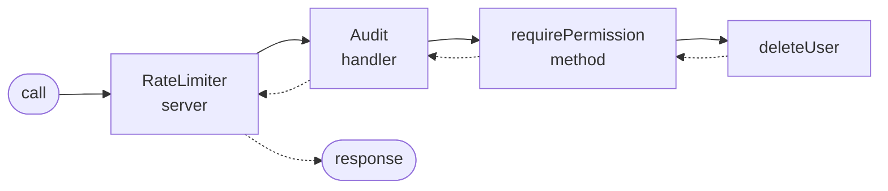
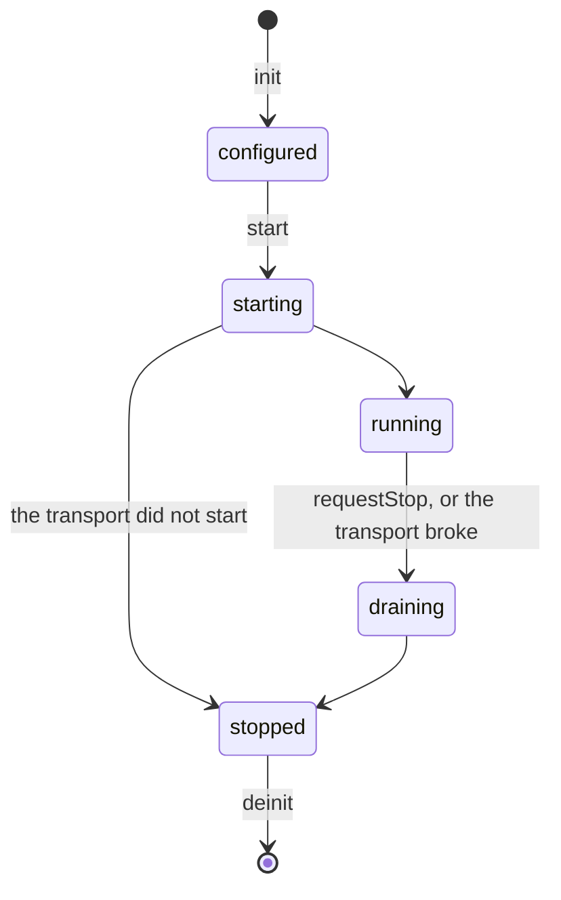

# rpc

**Typed calls between Zig services.** A service often needs an answer from
another one: the orders service asks the users service who the customer is
before it takes an order. RPC, a remote procedure call, makes that a call of
a function: orders calls `getUser` with a request and gets a user back, and
rpc carries both over the network. With zefir-rpc you describe a service
once, as a *contract* written in Zig: its methods, the types of their
requests and responses, and the errors its clients may see. The server
implements the contract, its clients call it, and the compiler checks both
sides against the same types. Calls travel as JSON over a *transport*: NATS
in production ([zefir-rpc-nats](../../rpc-nats/examples/README.md)), memory
in tests, or one you write yourself.

> [!IMPORTANT]
> **Not implemented yet (TODO):**
>
> - **Other transports.** NATS is the only network transport. HTTP
>   (Connect) and a direct transport over TCP are planned; a transport of
>   your own works today, see [Your own transport](#your-own-transport).
> - **TLS.** zefir-nats speaks plain TCP, so calls over NATS travel
>   unencrypted, tokens included: run rpc over NATS only in a network you
>   trust.
> - **Streaming.** A call is one request and one response.
> - **Codecs.** JSON only.
> - **Retries.** rpc never repeats a call by itself: which calls are safe
>   to repeat is the application's decision, see [Idempotency](#idempotency).
> - **The App container.** `main` builds the objects of a service and runs
>   its server; the App of zefir-core, which will run the lifecycle of
>   many components, is planned.
> - **Metrics.** No interface of its own: count in middleware, the way an
>   [access log](#access-logs) writes a record per call. NATS micro shows
>   the counters of every method.

A whole program: a contract, a handler, a server and a client of it.

```zig
const std = @import("std");
const log = @import("log");
const rpc = @import("rpc");

// The contract: shared by the server and its clients, usually in a package of its own.
const User = struct { id: u64, name: []const u8 };
const GetUserRequest = struct { id: u64 };
const UserApi = rpc.Contract(.{
    .name = "users",
    .version = 1,
    .methods = .{ .getUser = rpc.method(GetUserRequest, User) },
    .errors = .{
        .UserNotFound = .{ .code = .not_found, .app_code = "users.not_found", .message = "User not found" },
    },
});

// The handler: a method for each method of the contract.
const Users = struct {
    pub const rpc_handler = rpc.implement(UserApi, .{});

    pub fn getUser(_: *Users, _: *rpc.Context, req: GetUserRequest) error{UserNotFound}!User {
        if (req.id != 42) return error.UserNotFound;
        return .{ .id = 42, .name = "Ada" };
    }
};

pub fn main(init: std.process.Init) !void {
    const gpa = init.gpa;
    const io = init.io;
    const logger: log.Logger = try .init(gpa, io, .{ .format = .text });
    defer logger.deinit();

    // The memory transport keeps both sides in this process; on NATS, rpc_nats.Transport.
    var memory: rpc.testing.MemoryTransport = try .init(gpa, .{});
    defer memory.deinit(io);
    var users: Users = .{};
    var server = try rpc.Server.init(gpa, .{ .transport = memory.serverTransport(), .handlers = .{&users} });
    defer server.deinit(io);
    try server.start(io);

    var client = try rpc.Client.init(gpa, .{ .transport = memory.clientTransport() });
    defer client.deinit();
    for ([_]u64{ 42, 7 }) |id| {
        var result = try client.call(io, .root, UserApi.getUser, .{ .id = id }, .{});
        defer result.deinit();
        switch (result.outcome) {
            .ok => |user| logger.info("User found", .{ .id = user.id, .name = user.name }),
            .failure => |failure| logger.warn("No user", .{ .id = id, .app_code = failure.app_code }),
        }
    }
}
```

```text
$ zig build run
2026-10-16T09:51:59.484Z INFO  User found id=42 name=Ada
2026-10-16T09:51:59.485Z WARN  No user id=7 app_code=users.not_found
```

- **Checked when it compiles.** A handler that misses a method of its
  contract, or takes the wrong request type, stops the build with a message
  that says what to write. A client cannot send a request of another type.
- **Failures are values.** The outcome of a call is the response or a
  failure with a stable code, such as `users.not_found`; the Zig errors of
  a call say only what went wrong locally, and whether a retry is safe.
- **Deadlines travel.** A handler that calls another service passes its
  context on: the nested call gets what is left of the deadline, and its
  cancellation and its trace.
- **Validation on both sides.** The rules of zefir-validator on a request
  type are checked before the client sends it and again before the
  handler runs.
- **Middleware and authentication.** Code around calls, on three levels;
  an authenticator gives every call an identity.
- **Tests without a network.** `rpc.testing.Server` runs your handlers with
  everything around them in memory.
- **Graceful stop.** A server stops taking calls, lets the running ones
  finish within a grace, and cancels the rest.

## Contents

- [Why RPC](#why-rpc)
- [How a call travels](#how-a-call-travels)
- [Installation](#installation)
- [Getting started](#getting-started)
- [The contract](#the-contract)
- [The server](#the-server)
- [The client](#the-client)
- [Errors and failures](#errors-and-failures)
- [Middleware](#middleware)
- [Authentication](#authentication)
- [Tests](#tests)
- [Access logs](#access-logs)
- [Idempotency](#idempotency)
- [Lifecycle and stopping](#lifecycle-and-stopping)
- [Limits](#limits)
- [Your own transport](#your-own-transport)

Examples that `zig build test-rpc` compiles and runs, checking what they
print against this guide:
[getting started](getting_started.zig) · [a service that calls another](orders.zig) ·
[authentication and middleware](service.zig) · [tests](users_test.zig) ·
[access logs](access_log.zig) · [idempotency](idempotency.zig) · [a graceful stop](shutdown.zig)

## Why RPC

Picture a shop built of small services. The users service keeps the
accounts. The orders service takes orders, and before it takes one it must
know that the customer exists and what their name is. The users service
knows; orders has to ask it, and wait for the answer.



Without a framework, every such question is work: build a message, write
its JSON, send it, wait no longer than you can afford, read the answer,
tell a missing user from a broken network, and do it all again for the next
method, a little differently each time. rpc turns it into a call:
`client.call(io, ctx, UserApi.getUser, .{ .id = 42 }, .{})`. The request
and the response are your own structs, from a package that the server and
its clients share (`users-api` and `orders-api` above), so both sides agree
on them when they compile.

Use rpc when the caller needs the answer to go on. When it only tells others
that something happened, and goes on without waiting, publish an event with
[zefir-nats](../../nats/examples/README.md) instead.

## How a call travels



1. **The client** checks the request against the `field_rules` of its type:
   a request against them is not sent. It encodes the request as JSON, sets
   the deadline of the call (the earlier of the caller's and its timeout),
   draws a request id, and starts a span of the caller's trace.
2. **The client's middleware** runs around the rest; then the transport
   sends the call to the route `users.v1.getUser`.
3. **The server** admits the call by its route and its limits, or refuses
   it at once. An admitted call runs in a task of its own: the
   authenticator gives it an identity, the server's middleware runs, the
   body is decoded and checked against the rules, and the handler's method
   runs with the call's context.
4. **The method** returns the response, or an error. The server checks the
   response against the rules of its type and encodes it, or turns the
   error into a failure: `error.UserNotFound` becomes `not_found` with the
   app code `users.not_found`, as the contract says.
5. **The deadline wins.** If the deadline passes first, the server answers
   `deadline_exceeded` and cancels the method. The client decodes the
   response into `api.User`, or reads the failure.

## Installation

Add Zefir to your `build.zig.zon`; rpc ships since v0.6.0:

```sh
zig fetch --save git+https://github.com/vkiryakov/zefir#dev
```

This guide is on the `dev` branch, so the command fetches its latest commit; `--save` pins that commit. For the latest release, v0.8.0, fetch `#v0.8.0` instead.

Then import the modules in `build.zig`. The examples also read their
settings with confy, log with log, and take contexts from core. The package
of a contract imports `rpc` and `validator` and gets them from the service
that imports it: so the service and the contract use one zefir, and their
types fit.

```zig
// build.zig of the users service
const zefir = b.dependency("zefir", .{ .target = target, .optimize = optimize });

// The package of the contract, from build.zig.zon, with the modules of
// this service's zefir.
const users_api = b.dependency("users_api", .{}).module("users-api");
users_api.addImport("rpc", zefir.module("zefir-rpc"));
users_api.addImport("validator", zefir.module("zefir-validator"));

const exe = b.addExecutable(.{
    .name = "user-service",
    .root_module = b.createModule(.{
        .root_source_file = b.path("src/main.zig"),
        .target = target,
        .optimize = optimize,
        .imports = &.{
            .{ .name = "rpc", .module = zefir.module("zefir-rpc") },
            .{ .name = "core", .module = zefir.module("zefir-core") },
            .{ .name = "confy", .module = zefir.module("zefir-confy") },
            .{ .name = "log", .module = zefir.module("zefir-log") },
            .{ .name = "users-api", .module = users_api },
        },
    }),
});
b.installArtifact(exe);
b.step("run", "Run the service").dependOn(&b.addRunArtifact(exe).step);
```

The package of the contract has a `build.zig` of its own, which declares
the module and gives it no imports:

```zig
// build.zig of the package users-api
pub fn build(b: *std.Build) void {
    _ = b.addModule("users-api", .{ .root_source_file = b.path("src/root.zig") });
}
```

In a repository of several services, the package is a path in their
`build.zig.zon`: `.users_api = .{ .path = "../users-api" }`; otherwise
`zig fetch --save` its own repository, at a tag.

> [!TIP]
> rpc is also part of the umbrella module: with `zefir.module("zefir")`
> imported as `zefir`, it is `@import("zefir").rpc`.

## Getting started

The users service and a client of it, in one program. It takes four files:
the contract, the handler, the program, and the repository where the users
live.

**The contract**, the file `src/root.zig` of the package users-api:

```zig
//! The package users-api: the contract of the users service, shared by the
//! service and every client of it. It holds what goes over the wire, the
//! requests, the responses and the errors, and no code of the service.

const rpc = @import("rpc");
const v = @import("validator");

pub const User = struct {
    id: u64,
    name: []const u8,
    email: []const u8,
};

pub const CreateUserRequest = struct {
    name: []const u8,
    email: []const u8,

    // Checked on both sides: the client does not send a request against
    // them, and the server refuses one before its handler runs.
    pub const field_rules = .{
        .name = .{ v.notEmpty, v.maxLength(128) },
        .email = v.email,
    };
};

pub const GetUserRequest = struct { id: u64 };

pub const ListUsersRequest = struct {
    // A field with a default may be missing from the JSON.
    offset: u32 = 0,
    limit: u32 = 20,

    pub const field_rules = .{ .limit = v.range(1, 100) };
};

pub const ListUsersResponse = struct {
    users: []const User,
    total: u64,
};

pub const DeleteUserRequest = struct { id: u64 };

/// The users service, version 1: its methods and the errors its clients
/// see. The route of a method is users.v1.<method>.
pub const UserApi = rpc.Contract(.{
    .name = "users",
    .version = 1,
    .methods = .{
        .createUser = rpc.method(CreateUserRequest, User),
        .getUser = rpc.method(GetUserRequest, User),
        .listUsers = rpc.method(ListUsersRequest, ListUsersResponse),
        // void: success carries nothing.
        .deleteUser = rpc.method(DeleteUserRequest, void),
    },
    // An error a handler returns by one of these names reaches the client
    // as this failure; the framework's names (Canceled, DeadlineExceeded,
    // OutOfMemory, …) as their own codes; any other error as `internal`.
    .errors = .{
        .UserNotFound = .{ .code = .not_found, .app_code = "users.not_found", .message = "User not found" },
        .EmailTaken = .{ .code = .already_exists, .app_code = "users.email_taken", .message = "Email already taken" },
    },
});

test "the rules of the requests are valid" {
    comptime v.assertRules(CreateUserRequest);
    comptime v.assertRules(ListUsersRequest);
}
```

**The handler**, `UserHandler.zig` of the service:

```zig
//! The handler of the contract UserApi: a method for each method of the
//! contract, with the request and response types the contract gives it.
//! The server decodes and checks every request before a method runs, and
//! turns what a method returns into the response or the failure.

const rpc = @import("rpc");
const api = @import("users-api");
const UserRepository = @import("UserRepository.zig");

const UserHandler = @This();

repo: *UserRepository,

/// The contract this handler implements, and the settings of its methods:
/// none here, so every method gets the defaults, 3 seconds and anonymous
/// calls allowed.
pub const rpc_handler = rpc.implement(api.UserApi, .{});

pub fn createUser(self: *UserHandler, ctx: *rpc.Context, req: api.CreateUserRequest) UserRepository.Error!api.User {
    // The call's context goes down to the repository: its deadline, its
    // cancellation and its trace.
    return self.repo.insert(ctx.operation(), ctx.io(), ctx.allocator(), req.name, req.email);
}

pub fn getUser(self: *UserHandler, ctx: *rpc.Context, req: api.GetUserRequest) UserRepository.Error!api.User {
    return self.repo.find(ctx.operation(), ctx.io(), ctx.allocator(), req.id);
}

pub fn listUsers(self: *UserHandler, ctx: *rpc.Context, req: api.ListUsersRequest) UserRepository.Error!api.ListUsersResponse {
    return self.repo.list(ctx.operation(), ctx.io(), ctx.allocator(), req.offset, req.limit);
}

pub fn deleteUser(self: *UserHandler, ctx: *rpc.Context, req: api.DeleteUserRequest) UserRepository.Error!void {
    return self.repo.remove(ctx.operation(), ctx.io(), req.id);
}
```

**The program**, which serves the handler and calls it:

```zig
//! The users service and a client of it, in one program: the handler of
//! UserApi served by `rpc.Server`, and `rpc.Client` calling it, both on
//! the memory transport, which carries calls inside the process.

const std = @import("std");
const core = @import("core");
const log = @import("log");
const rpc = @import("rpc");
const api = @import("users-api");
const UserHandler = @import("UserHandler.zig");
const UserRepository = @import("UserRepository.zig");

pub fn main(init: std.process.Init) !void {
    const gpa = init.gpa;
    const io = init.io;
    const logger: log.Logger = try .init(gpa, io, .{ .format = .text });
    defer logger.deinit();
    const app = logger.scoped("app");

    var repo: UserRepository = .init(gpa);
    defer repo.deinit();
    var users: UserHandler = .{ .repo = &repo };

    // Both sides of the calls in one process; a service on NATS takes
    // rpc_nats.Transport here instead.
    var memory: rpc.testing.MemoryTransport = try .init(gpa, .{});
    defer memory.deinit(io);

    var server = try rpc.Server.init(gpa, .{
        .transport = memory.serverTransport(),
        .handlers = .{&users},
    });
    defer server.deinit(io); // stops the server, after the client's deinit
    try server.start(io);

    var client = try rpc.Client.init(gpa, .{ .transport = memory.clientTransport() });
    defer client.deinit();
    // The caller's context. It has no deadline, so every call gets the
    // client's default timeout, 3 seconds.
    const ctx: core.Context = .root;

    // A success: `.ok` holds the method's response type, api.User.
    var created = try client.call(io, ctx, api.UserApi.createUser, .{ .name = "Ada Lovelace", .email = "ada@example.com" }, .{});
    defer created.deinit();
    const ada = switch (created.outcome) {
        .ok => |user| user,
        .failure => |failure| return logFailure(app, "createUser", failure, created.sent),
    };
    app.info("User created", .{ .id = ada.id, .name = ada.name });

    var found = try client.call(io, ctx, api.UserApi.getUser, .{ .id = ada.id }, .{});
    defer found.deinit();
    switch (found.outcome) {
        .ok => |user| app.info("User found", .{ .id = user.id, .email = user.email }),
        .failure => |failure| logFailure(app, "getUser", failure, found.sent),
    }

    // A failure of the service is a value, not an error: here the
    // contract's UserNotFound.
    var missing = try client.call(io, ctx, api.UserApi.getUser, .{ .id = 42 }, .{});
    defer missing.deinit();
    switch (missing.outcome) {
        .ok => |user| app.info("User found", .{ .id = user.id, .email = user.email }),
        .failure => |failure| logFailure(app, "getUser", failure, missing.sent),
    }

    // A request against the rules of CreateUserRequest is not sent: the
    // failure lists every violation.
    var invalid = try client.call(io, ctx, api.UserApi.createUser, .{ .name = "", .email = "ada-at-example.com" }, .{});
    defer invalid.deinit();
    switch (invalid.outcome) {
        .ok => |user| app.info("User created", .{ .id = user.id, .name = user.name }),
        .failure => |failure| logFailure(app, "createUser", failure, invalid.sent),
    }

    var again = try client.call(io, ctx, api.UserApi.createUser, .{ .name = "Ada", .email = "ADA@example.com" }, .{});
    defer again.deinit();
    switch (again.outcome) {
        .ok => |user| app.info("User created", .{ .id = user.id, .name = user.name }),
        .failure => |failure| logFailure(app, "createUser", failure, again.sent),
    }

    // Fields with defaults may be left out: offset 0, limit 20.
    var page = try client.call(io, ctx, api.UserApi.listUsers, .{}, .{});
    defer page.deinit();
    switch (page.outcome) {
        .ok => |list| app.info("Users listed", .{ .total = list.total, .first = list.users[0].name }),
        .failure => |failure| logFailure(app, "listUsers", failure, page.sent),
    }

    // A method whose response is void: `.ok` holds nothing.
    var deleted = try client.call(io, ctx, api.UserApi.deleteUser, .{ .id = ada.id }, .{});
    defer deleted.deinit();
    switch (deleted.outcome) {
        .ok => app.info("User deleted", .{ .id = ada.id }),
        .failure => |failure| logFailure(app, "deleteUser", failure, deleted.sent),
    }
}

/// Logs a failure: the server's, or the client's own for a request it did
/// not send (`sent` false).
fn logFailure(app: log.Logger, method: []const u8, failure: rpc.Failure, sent: bool) void {
    app.warn("Call failed", .{ .method = method, .code = failure.code, .app_code = failure.app_code, .reason = failure.message, .sent = sent });
    for (failure.violations) |violation| {
        app.warn("Violation", .{ .field = violation.field, .code = violation.code, .reason = violation.message });
    }
}
```

<details>
<summary><b>The repository</b>, <code>UserRepository.zig</code>: the users in memory, the service's own code</summary>

```zig
//! The users of the examples, kept in memory: the application's own code,
//! which knows nothing of RPC. Like a repository on a real database, each
//! method takes the call's `core.Context`, the `std.Io` it waits on, and an
//! allocator for what it returns.

const std = @import("std");
const core = @import("core");
const api = @import("users-api");

const UserRepository = @This();

gpa: std.mem.Allocator,
/// Handlers run in tasks of their own, many at once: the mutex guards the
/// list, and waits through `std.Io` like everything a handler does.
mutex: std.Io.Mutex = .init,
users: std.ArrayList(api.User) = .empty,
next_id: u64 = 1,

/// The errors of the contract, and those of a call that runs out of time
/// or is canceled.
pub const Error = error{ UserNotFound, EmailTaken, OutOfMemory } || std.Io.Cancelable || core.ContextError;

pub fn init(gpa: std.mem.Allocator) UserRepository {
    return .{ .gpa = gpa };
}

pub fn deinit(repo: *UserRepository) void {
    for (repo.users.items) |user| repo.free(user);
    repo.users.deinit(repo.gpa);
}

/// Stores a new user; the user returned lives in `arena`.
pub fn insert(repo: *UserRepository, ctx: core.Context, io: std.Io, arena: std.mem.Allocator, name: []const u8, email: []const u8) Error!api.User {
    // A call that is out of time or canceled stops before the work.
    try ctx.check(std.Io.Clock.awake.now(io));
    try repo.mutex.lock(io);
    defer repo.mutex.unlock(io);
    for (repo.users.items) |user| {
        if (std.ascii.eqlIgnoreCase(user.email, email)) return error.EmailTaken;
    }
    const created = try copy(arena, .{ .id = repo.next_id, .name = name, .email = email });
    const stored = try copy(repo.gpa, created);
    errdefer repo.free(stored);
    try repo.users.append(repo.gpa, stored);
    repo.next_id += 1;
    return created;
}

/// The user `id`, copied into `arena`: once the mutex is released, another
/// call may delete the stored one.
pub fn find(repo: *UserRepository, ctx: core.Context, io: std.Io, arena: std.mem.Allocator, id: u64) Error!api.User {
    try ctx.check(std.Io.Clock.awake.now(io));
    try repo.mutex.lock(io);
    defer repo.mutex.unlock(io);
    for (repo.users.items) |user| {
        if (user.id == id) return copy(arena, user);
    }
    return error.UserNotFound;
}

/// A page of the users, in the order they were created.
pub fn list(repo: *UserRepository, ctx: core.Context, io: std.Io, arena: std.mem.Allocator, offset: u32, limit: u32) Error!api.ListUsersResponse {
    try ctx.check(std.Io.Clock.awake.now(io));
    try repo.mutex.lock(io);
    defer repo.mutex.unlock(io);
    const all = repo.users.items;
    const first = @min(offset, all.len);
    const page = all[first..@min(first + limit, all.len)];
    const users = try arena.alloc(api.User, page.len);
    for (page, users) |user, *out| out.* = try copy(arena, user);
    return .{ .users = users, .total = all.len };
}

pub fn remove(repo: *UserRepository, ctx: core.Context, io: std.Io, id: u64) Error!void {
    try ctx.check(std.Io.Clock.awake.now(io));
    try repo.mutex.lock(io);
    defer repo.mutex.unlock(io);
    for (repo.users.items, 0..) |user, i| {
        if (user.id == id) {
            repo.free(repo.users.orderedRemove(i));
            return;
        }
    }
    return error.UserNotFound;
}

/// How many users there are.
pub fn count(repo: *UserRepository, io: std.Io) std.Io.Cancelable!usize {
    try repo.mutex.lock(io);
    defer repo.mutex.unlock(io);
    return repo.users.items.len;
}

fn copy(allocator: std.mem.Allocator, user: api.User) error{OutOfMemory}!api.User {
    const name = try allocator.dupe(u8, user.name);
    errdefer allocator.free(name);
    return .{ .id = user.id, .name = name, .email = try allocator.dupe(u8, user.email) };
}

fn free(repo: *UserRepository, user: api.User) void {
    repo.gpa.free(user.name);
    repo.gpa.free(user.email);
}
```

</details>

What each part does:

- The contract (`rpc.Contract`) names the service `users`, version 1, and
  lists its methods with their request and response types: the route of a
  method is `users.v1.<method>`. Its `.errors` say which errors of the
  handlers the clients see, and as what.
- The handler declares `pub const rpc_handler = rpc.implement(api.UserApi,
  .{})`: it implements UserApi, with the default settings. Then it has a
  method for each method of the contract, of the form
  `pub fn getUser(self: *UserHandler, ctx: *rpc.Context, req: api.GetUserRequest) E!api.User`.
  The server calls it with a request that has been decoded and checked.
- `ctx.operation()` is the call's `core.Context`: its deadline, its
  cancellation and its trace. The handler passes it to the repository,
  which checks it before the work, as code on a real database does.
- `rpc.testing.MemoryTransport` carries the calls inside the process, so
  the server and the client run in one program here. A service on NATS
  gets `rpc_nats.Transport` instead, on a connection to the broker, and
  its contract, handlers and calls stay the same; see the
  [guide of rpc-nats](../../rpc-nats/examples/README.md).
- `rpc.Server.init` builds the server from its options and checks every
  handler when it compiles. `start` starts taking calls; `deinit`, in the
  defer, stops the server and waits for the calls in flight.
- `rpc.Client.init` builds a client on the client side of the transport.
  `client.call(io, ctx, api.UserApi.getUser, .{ .id = ada.id }, .{})` takes
  the method itself, so the compiler knows the types: the request must fit
  `GetUserRequest`, and `.ok` is an `api.User`.
- The result owns the memory of the response: `deinit` frees it, after
  which `user.name` is gone. `outcome` is `.ok` with the response or
  `.failure`; `sent` says whether the request went out at all.

Run it:

```text
$ zig build run
2026-10-16T09:42:54.134Z INFO  [app] User created id=1 name="Ada Lovelace"
2026-10-16T09:42:54.134Z INFO  [app] User found id=1 email=ada@example.com
2026-10-16T09:42:54.135Z WARN  [app] Call failed method=getUser code=not_found app_code=users.not_found reason="User not found" sent=true
2026-10-16T09:42:54.135Z WARN  [app] Call failed method=createUser code=invalid_argument app_code=rpc.invalid_request reason="Invalid request" sent=false
2026-10-16T09:42:54.135Z WARN  [app] Violation field=name code=validation.not_empty reason="must not be empty"
2026-10-16T09:42:54.135Z WARN  [app] Violation field=email code=validation.email reason="must be a valid email address"
2026-10-16T09:42:54.136Z WARN  [app] Call failed method=createUser code=already_exists app_code=users.email_taken reason="Email already taken" sent=true
2026-10-16T09:42:54.137Z INFO  [app] Users listed total=1 first="Ada Lovelace"
2026-10-16T09:42:54.137Z INFO  [app] User deleted id=1
```

Line by line:

1. `createUser` succeeds, and `getUser` reads the user back.
2. `getUser` of an unknown id fails with the contract's error: the
   repository returned `error.UserNotFound`, and the server sent the
   failure that `.errors` gives it, `not_found` with `users.not_found`.
3. The invalid request never left the client (`sent=false`): the rules of
   `CreateUserRequest` found two violations, and the failure lists both,
   with the path of each field.
4. The second Ada fails with `users.email_taken`: the repository compares
   emails without case.
5. `listUsers` with `.{}` takes the defaults of its request, offset 0 and
   limit 20; `deleteUser` answers `void`, so `.ok` holds nothing.

## The contract

The contract is what a service shows other services, and nothing of how it
works inside. It lives in a package of its own, which the service and every
client import, so they all build against the same types: a field renamed in
the contract is a compile error in every client that still uses the old
name, not a surprise in production.

`rpc.Contract` returns a value, not a type: each method is a field of it,
`api.UserApi.getUser`, which a client passes to `call`. The type of a method
holds what rpc knows about it: `@TypeOf(api.UserApi.getUser).Request` is
`GetUserRequest`, `.Response` is `User`, `.name` is "getUser", and
`.route` is the route
`.{ .service = "users", .version = 1, .method = "getUser" }`,
`users.v1.getUser` on the wire.

| Field | What | Rules |
| --- | --- | --- |
| `.name` | the service | 1 to 64 characters from `[A-Za-z0-9_-]` |
| `.version` | the major version: a new version is a new contract | 1 to 65535 |
| `.methods` | `.getUser = rpc.method(GetUserRequest, User)`: the request type and the response type | at least one; the name of the field is the name on the wire |
| `.errors` | `.UserNotFound = .{ .code = .not_found, .app_code = "users.not_found", .message = "User not found" }` | optional; see below |

An entry of `.errors` turns a Zig error of a handler, by its name, into the
failure that the client gets:

- `.code` is one of the 16 codes of `core.ErrorCode` (`.not_found`,
  `.already_exists`, `.permission_denied`, …), a class that a client can
  act on.
- `.app_code` is a stable code of your application, such as
  `users.not_found`: a client compares it, so it never changes. It is up to
  128 bytes of UTF-8 and does not start with `rpc.`, which belongs to the
  framework.
- `.message` is for people: a constant, without the internals of the
  server, up to 512 bytes.

The framework maps some names by itself, so a contract cannot list them:
`Canceled`, `Cancelled`, `DeadlineExceeded`, `InvalidArgument`,
`Unauthenticated`, `PermissionDenied`, `ResourceExhausted`, `Unavailable`,
`OutOfMemory`, `Internal` and `RpcFailure` (see
[Errors and failures](#errors-and-failures)).

### Requests and responses

A request is a struct; a response is any type below, or `void` for a method
that answers with success alone. They travel as JSON:

| Zig type | JSON |
| --- | --- |
| `bool` | `true`, `false` |
| integers of up to 32 bits | a number: `42` |
| integers of 33 to 64 bits | a string of digits: `"9007199254740993"`, so that JavaScript clients do not lose digits |
| `f32`, `f64` | a number; NaN and infinities are not sent |
| an enum | the name of its tag: `"active"` |
| an optional | `null` or the value |
| `[]const u8` | a string, UTF-8 |
| `[]const T`, `[N]T` | an array; `[N]T` has exactly N items |
| a struct | an object, its fields in the order they are declared |

So `User{ .id = 1, .name = "Ada Lovelace", .email = "ada@example.com" }` is
`{"id":"1","name":"Ada Lovelace","email":"ada@example.com"}` on the wire.
Pointers, unions, maps, recursive types and `usize` are not request or
response types: the build stops and names the field. So is a type of more
than 16 KiB, a whole request or response too: they live on the stack of
the call, which is small in a coroutine. An image as `[256 * 256]u32`
stops the build with a hint to take a slice, `[]const u32`, whose items
live in the memory of the call.

Decoding is strict where it must be, and lenient where versions differ:

- An unknown field is ignored, so an older client reads the response of a
  newer server.
- A missing field takes its default from the struct; an optional without a
  default is `null`; a missing field without a default fails the call with
  `invalid_argument` and the path of the field.
- A repeated key, a number where the type wants a string, a tag the enum
  does not have, invalid UTF-8, NaN or an infinity fail it too.
- A body nests at most 32 levels, and an array holds at most 100,000 items.

### Validation

The rules of zefir-validator on a type, `pub const field_rules = .{ … }`
and `validateSelf`, are checked on both sides:

| Where | What | When it fails |
| --- | --- | --- |
| the client, before sending | the request, every rule | the request is not sent: `.failure` with `invalid_argument`, `rpc.invalid_request`, every violation, and `sent = false` |
| the server, after decoding | the request, every rule | the failure `invalid_argument`, `rpc.invalid_request`, with every violation |
| the server, before encoding | the response | the failure `internal`, `rpc.invalid_response`: the server broke its own contract, which its log tells in detail |
| the client, after decoding | the response | `error.InvalidResponse` |

`field_rules` and `validateSelf` must be `pub`: from another file, Zig sees
no other declaration, and a type whose rules are not `pub` is never checked,
without an error. The test at the end of the contract's `src/root.zig`,
`comptime v.assertRules(CreateUserRequest)`, checks that the rules of a
type are valid.

### Changing a contract

Clients and servers are deployed one at a time, so for a while new clients
call old servers and old clients call new ones. Some changes keep working
both ways; the others need a new version:

| Change | Compatible? |
| --- | --- |
| a new field with a default, or optional | yes: old readers ignore it, new ones take the default |
| a new required field, a new type of a field, a field removed or renamed | no: a new version |
| a new method | yes for old clients; a new client gets `unimplemented` from an old server, or `error.Unavailable` over NATS, where no one serves the new subject |
| a method removed or renamed | no: a new version |
| a new tag of an enum | no: old readers refuse a tag they do not know; a new version, or do not send it to old clients |
| a new `code` or `app_code` for an error | no |
| stricter `field_rules` of a request | no: requests that passed before now fail |
| looser `field_rules` of a response | no: old clients refuse the new values with `InvalidResponse` |

A new version is a new contract, `UserApiV2` with `.version = 2`, and a
handler of its own on the same server: `.handlers = .{ &users_v1, &users_v2 }`.
Old clients go on calling `users.v1.*` until they move. Keep a test of the
two together: an old client against the new server, and a new client
against the old one.

## The server

### Handlers

A handler is a struct of your application, with what it needs as fields
(a repository, clients of other services, middleware with state), filled in
`main`. It implements a contract with its declaration `rpc_handler`, which
must be `pub`: the server finds it by name when it compiles, and from
another file Zig sees only `pub` declarations.

`rpc.implement(Api, settings)` takes the contract and these settings:

| Setting | What | Default |
| --- | --- | --- |
| `.defaults.timeout_ms` | the server's limit of a call, 1 to 300,000 ms; a client may only make it shorter | 3000 |
| `.defaults.auth` | `.required`: a call without an identity fails with `unauthenticated`; `.optional`: anonymous calls run too | `.optional` |
| `.middleware` | the handler's level of middleware: a tuple, for every method (see [Middleware](#middleware)) | `.{}` |
| `.methods.<name>` | the settings of one method: `.timeout_ms` and `.auth` replace the defaults, `.middleware` comes after the handler's | — |

A method of the handler has the form
`pub fn <name>(self: *T, ctx: *rpc.Context, req: Req) E!Resp`, with `Req`
and `Resp` from the contract (`E!void` when the response is `void`). Its
error set `E` may be any, written out or inferred: the errors become
failures as [Errors and failures](#errors-and-failures) shows. A `pub`
function of the handler that the contract does not list cannot be called
over rpc: the contract is the list of what is open.

The server runs every call in a task of its own, many at once, so a handler
serves all of them together: guard its state with `std.Io` primitives, as
`UserRepository` does with `std.Io.Mutex`.

### The context of a call

`*rpc.Context` exists for one call: the server makes it, and a handler or
middleware borrows it. Never keep it after the method returns, or hand it to
a task that outlives the call.

| Method | What it gives |
| --- | --- |
| `io()` | the `std.Io` the server runs on: every wait of the method goes through it |
| `operation()` | the call's `core.Context`: deadline, cancellation and trace; pass it on to repositories and nested calls |
| `allocator()` | the arena of the call, freed after the response is sent |
| `route()` | `service`, `version`, `method` |
| `requestId()` | 16 bytes for logs; not a key of idempotency |
| `metadata()` | the request's metadata to read: `get(key)`, `getAll(key)`, `iterator()`, without the reserved keys |
| `identity()` | `?rpc.IdentityView`: whom the authenticator found, or null for an anonymous call |
| `peer()`, `transport()` | who sent the call and over what, as the transport knows it: for logs, never for authorization |
| `setResponseMetadata(key, value)` | metadata of the response, copied into the arena, also of a failure the chain returns (a failure of the engine itself, such as the deadline, carries none); the client reads it with `result.metadata()`, as the rate limit of [Middleware](#middleware) shows |
| `fail(failure)` | ends the call with exactly this failure: `return ctx.fail(.{ .code, .app_code, .message })` |
| `requestBody()`, `responseBody()`, `failure()`, `mapError(err)` | for middleware: the bodies as bytes, the failure set with `fail`, the failure an error becomes |

The strings of a response may point into the arena, into the request or at
constants: the server encodes the response before it frees the arena. Work
in parallel inside a method goes in an `std.Io.Group` of its own that the
method awaits before it returns; its tasks do not use the arena.

### The server's options

| Option | What |
| --- | --- |
| `.transport` | the server side of a transport: `memory.serverTransport()`, `bus.serverTransport()` |
| `.handlers` | pointers to the handlers, at least one: `.{ &users, &orders }`; two handlers may not serve one route |
| `.authenticator` | optional: a pointer to the object that checks credentials (see [Authentication](#authentication)) |
| `.middleware` | optional: the server's level of middleware, around every call: `.{ &access_log, &limiter }` |
| `.limits` | optional: the limits to change, `.{ .max_active_tasks = 1024 }` (see [Limits](#limits)) |
| `.shutdown_grace` | optional: how long calls in flight may run after the stop begins; 10 seconds |

The options are a struct literal of any type, so a value inside them has
no type to take a declaration literal from: write
`.shutdown_grace = std.Io.Duration.fromSeconds(10)`, not
`.shutdown_grace = .fromSeconds(10)`, which does not compile; the same
among the limits, `.limits = .{ .max_timeout = std.Io.Duration.fromSeconds(60) }`.
Inside the options of a call, `.timeout = .fromMilliseconds(500)` works:
that field has its type.

The handlers, the authenticator and the objects of middleware are borrowed:
their owner, usually `main`, keeps them alive until the server's `deinit`.
After `start`, the server stays where it is: never copy or move it.
Starting and stopping are in [Lifecycle and stopping](#lifecycle-and-stopping).

### When the build stops

The server checks every handler where it is passed to `rpc.Server.init`,
when the program compiles. A mistake stops the build with a message that
names the handler and says what to write:

| Mistake | Message |
| --- | --- |
| no `pub const rpc_handler` | ``rpc.Server.init: <T> has no `pub const rpc_handler = rpc.implement(Api, ...)`; every handler must declare it (and it must be pub)`` |
| a method of the contract is missing or not `pub` | `rpc: <T> implements users.v1 but has no pub fn deleteUser(self: *<T>, ctx: *rpc.Context, req: <Req>) !void` |
| another signature | `rpc: <T>.getUser: expected fn (*<T>, *rpc.Context, <Req>) !<Resp>, found fn (*<T>, <Req>) !<Resp>` |
| a name in `.methods` that the contract does not have | `rpc: <T>.rpc_handler: getUsers is not a method of users.v1` |
| a handler passed by value | `rpc.Server.init: .handlers[0] is <T>; pass a pointer to a handler, e.g. &users` |
| two handlers of one route | `rpc.Server.init: <T1> and <T2> both serve users.v1` |
| `.auth = .required` without an authenticator | `rpc.Server.init: <T>.getUser requires auth, but .authenticator is not set` |
| an error of the framework in `.errors` | `rpc: users.v1: .errors.Unavailable: rpc maps Unavailable by itself, so a contract cannot list it; give the error another name` |
| a type that JSON does not carry | `rpc: users.v1.listUsers: request <Req>.limit has unsupported type usize; its size depends on the target: use u64 or i64` |

Take `deleteUser` out of `UserHandler.zig`, and the build of
[getting_started.zig](getting_started.zig) stops with this error, whose
`referenced by` then points at the line of `rpc.Server.init`:

```text
error: rpc: UserHandler implements users.v1 but has no pub fn deleteUser(self: *UserHandler, ctx: *rpc.Context, req: users_api.DeleteUserRequest) !void
```

Zig compiles only the code that something uses: a handler that is never
passed to a server is never checked. Keep a test that builds the server of
your service, as [Tests](#tests) shows, and `zig build test` runs the checks.

## The client

A client has no lifecycle: `init` does no I/O, then come calls from any
number of tasks at once, then `deinit`. The transport connects and
reconnects, not the client. One client calls any contracts on its
transport; build several when calls need other credentials or other
middleware.

| Option of `rpc.Client.init` | What | Default |
| --- | --- | --- |
| `.transport` | the client side of a transport, which outlives the client | — |
| `.credentials` | those of every call that brings none: `.{ .bearer = token }`, `.{ .basic = .{ .user = …, .password = … } }`, `.{ .provider = … }`, `.none` | `.none` |
| `.middleware` | the client's middleware, in order: functions and pointers to objects | `.{}` |
| `.default_timeout` | the timeout of a call that sets none: `std.Io.Duration.fromSeconds(3)`, written in full as on the server | 3 s |
| `.max_pending` | calls in flight at once | 1024 |
| `.max_response_bytes` | the largest response body | 1 MiB |

`init` copies the credentials, and `deinit` wipes the copy. A `.provider`
is for tokens that change, such as those of OAuth: an
`rpc.CredentialsProvider`, a pointer and the function
`get(ptr, io, ctx, arena)`, which the client calls right before it sends a
call, for that call's credentials. `error.Unavailable` from it ends the
call unsent. `AdminTokens` in [Authentication](#authentication) is one; the
client borrows a provider, so it outlives the client.

`client.call(io, ctx, method, request, options)` takes the caller's
`core.Context`: `.root` in `main`, `ctx.operation()` in a handler. Its
options:

| Option | What |
| --- | --- |
| `.timeout` | the deadline is the earlier of the caller's and now plus this; null: `default_timeout` |
| `.metadata` | metadata of the request: `&.{.{ .key = "x-tenant", .value = "acme" }}`; the keys of the framework are refused |
| `.credentials` | null: those of the client; `.none`: this call is anonymous; else these, such as the token of an end user |
| `.diagnostics` | details of a failed transport, or of `InvalidResponse`, for logs |

The result holds `outcome` (`.ok` with the response, or `.failure`),
`metadata()` of the response, `request_id`, `sent` (whether the request
went out) and `refused` (the server refused it at admission, so it surely
did not run). It owns the memory of the response: exactly one `deinit`.

### Errors of a call

A failure of the server is a value in `outcome`. The Zig errors of `call`
are what went wrong locally, and each says whether a retry is safe:

| Error | Means | Retry |
| --- | --- | --- |
| `Unavailable` | not sent, or surely not run: no link, the server drains, no server at all (on NATS: no responders), an open circuit breaker | safe |
| `DeadlineExceeded`, `Cancelled` | the deadline or a cancelation; if the request went out, the outcome is unknown | only an idempotent call |
| `ConnectionLost` | the link broke after sending; the outcome is unknown | only an idempotent call |
| `AccessDenied` | the transport or the broker refused before sending; on NATS, the permissions deny the client's inbox, while a denied publish ends with `DeadlineExceeded` ([permissions in the rpc-nats guide](../../rpc-nats/examples/README.md#permissions)) | after a change of the settings |
| `TooManyPendingRequests` | `max_pending` calls in flight; not sent | later |
| `RequestTooLarge` | larger than the transport carries; not sent | no |
| `ResponseTooLarge` | the response is over the client's limits and was dropped, though the server ran the call | only an idempotent call |
| `InvalidResponse` | the response does not decode as the method's type, or breaks its rules: the two sides have different versions of the contract | no |
| `ProtocolViolation`, `UnsupportedProtocol`, `TransportFailed` | the protocol or the transport failed; details in `.diagnostics` | only an idempotent call |
| `MiddlewareFailed` | the client's middleware returned an error outside this list, or `InvalidResponse`, which only the client itself returns; if the request went out, the outcome is unknown | only an idempotent call |
| `ClientClosed`, `OutOfMemory` | — | — |

A failure with `refused = true` is safe to retry too: the server did not
start the call.

### A service that calls another

The orders service serves its own contract and calls users from its
handler. Its contract, the package orders-api:

```zig
//! The package orders-api: the contract of the orders service.

const rpc = @import("rpc");
const v = @import("validator");

pub const Item = struct {
    sku: []const u8,
    quantity: u32,
    price_cents: u64,

    pub const field_rules = .{
        .sku = .{ v.notEmpty, v.maxLength(64) },
        .quantity = v.range(1, 99),
        // A number from a client has no bound but its type: at most
        // $1,000,000 keeps the total of 50 items, 99 of each, within a u64.
        .price_cents = v.range(1, 100_000_000),
    };
};

pub const PlaceOrderRequest = struct {
    user_id: u64,
    items: []const Item,

    // The rules of every item apply too, with paths such as items[1].quantity.
    pub const field_rules = .{ .items = .{ v.minItems(1), v.maxItems(50) } };
};

pub const Order = struct {
    id: u64,
    customer: []const u8,
    total_cents: u64,
};

pub const OrderApi = rpc.Contract(.{
    .name = "orders",
    .version = 1,
    .methods = .{
        .placeOrder = rpc.method(PlaceOrderRequest, Order),
    },
    .errors = .{
        .UnknownUser = .{ .code = .failed_precondition, .app_code = "orders.unknown_user", .message = "No such user" },
        .UsersUnavailable = .{ .code = .unavailable, .app_code = "orders.users_unavailable", .message = "Try again later" },
    },
});

test "the rules of the requests are valid" {
    comptime v.assertRules(PlaceOrderRequest);
}
```

The service, with users and the shop in the same program, each service on
a memory transport of its own:

```zig
//! The orders service, whose handler calls the users service: a service
//! that is a server and a client at once. Both services run in this one
//! program, each on a memory transport of its own, as they would on two
//! hosts.

const std = @import("std");
const confy = @import("confy");
const core = @import("core");
const log = @import("log");
const rpc = @import("rpc");
const users_api = @import("users-api");
const orders_api = @import("orders-api");
const UserHandler = @import("UserHandler.zig");
const UserRepository = @import("UserRepository.zig");

const Config = struct {
    users: struct {
        /// The longest a call to the users service may take; a caller with
        /// less time left gives the call less.
        timeout_ms: u32 = 500,
    } = .{},
};

/// Middleware of the client of users: once the users service could not
/// take a call, the breaker opens, and later calls fail at once with
/// `error.Unavailable`, without going out. A real one closes again after a
/// pause, and shares its state with the other replicas through a store.
const CircuitBreaker = struct {
    logger: log.Logger,
    /// Shared by every call at once, like every object of middleware.
    open: std.atomic.Value(bool) = .init(false),

    pub fn run(self: *CircuitBreaker, ctx: *rpc.ClientContext, next: *rpc.ClientNext) anyerror!void {
        if (self.open.load(.acquire)) {
            self.logger.info("Call not sent", .{ .method = ctx.route().method });
            // Unavailable: the caller knows that the call did not run.
            return error.Unavailable;
        }
        next.run() catch |err| {
            if (err == error.Unavailable and !self.open.swap(true, .acq_rel)) {
                self.logger.warn("Breaker opened", .{ .service = ctx.route().service });
            }
            return err;
        };
    }
};

/// The handler of OrderApi; it asks the users service who the customer is.
const OrderHandler = struct {
    /// The client of the users service. main owns it, and it outlives the
    /// server that runs this handler.
    users: *rpc.Client,
    users_timeout: std.Io.Duration,
    next_id: std.atomic.Value(u64) = .init(1001),

    pub const rpc_handler = rpc.implement(orders_api.OrderApi, .{
        // A whole call may take 2 seconds, the call to users included.
        .defaults = .{ .timeout_ms = 2000 },
    });

    pub fn placeOrder(self: *OrderHandler, ctx: *rpc.Context, req: orders_api.PlaceOrderRequest) !orders_api.Order {
        // ctx.operation() gives the nested call what is left of this
        // call's deadline, its cancellation and its trace.
        var found = self.users.call(ctx.io(), ctx.operation(), users_api.UserApi.getUser, .{ .id = req.user_id }, .{
            .timeout = self.users_timeout,
        }) catch {
            // This call ran out of time or was canceled: that ends it.
            try ctx.operation().check(std.Io.Clock.awake.now(ctx.io()));
            // It still runs, so the users service failed it.
            return error.UsersUnavailable;
        };
        defer found.deinit();
        const customer = switch (found.outcome) {
            .ok => |user| user,
            .failure => |failure| return if (failure.code == .not_found) error.UnknownUser else error.UsersUnavailable,
        };
        // The rules of Item keep the total within a u64. The arithmetic is
        // checked all the same: an overflow is then the failure `internal`,
        // while an unchecked one would stop the whole service.
        var total: u64 = 0;
        for (req.items) |item| total = try std.math.add(u64, total, try std.math.mul(u64, item.price_cents, item.quantity));
        return .{
            .id = self.next_id.fetchAdd(1, .monotonic),
            // The name lives in `found`, which deinit frees on return: the
            // response takes a copy in the arena of this call.
            .customer = try ctx.allocator().dupe(u8, customer.name),
            .total_cents = total,
        };
    }
};

pub fn main(init: std.process.Init) !void {
    const gpa = init.gpa;
    const io = init.io;
    var config: Config = undefined;
    confy.loadOrExit(init.arena.allocator(), &config, .{
        .io = io,
        .environ = init.environ_map,
        .env_prefix = "APP_",
        .sources = &.{.osEnv()},
    });
    const logger: log.Logger = try .init(gpa, io, .{ .format = .text });
    defer logger.deinit();
    const shop = logger.scoped("shop");

    // The users service, with one user.
    var repo: UserRepository = .init(gpa);
    defer repo.deinit();
    _ = try repo.insert(.root, io, init.arena.allocator(), "Ada Lovelace", "ada@example.com");
    var users: UserHandler = .{ .repo = &repo };
    var users_link: rpc.testing.MemoryTransport = try .init(gpa, .{});
    defer users_link.deinit(io);
    var users_server = try rpc.Server.init(gpa, .{ .transport = users_link.serverTransport(), .handlers = .{&users} });
    defer users_server.deinit(io);
    try users_server.start(io);

    // The orders service: its client of users, then its handler and server.
    // The defers stop the server first, then free the client it uses.
    var breaker: CircuitBreaker = .{ .logger = logger.scoped("breaker") };
    var users_client = try rpc.Client.init(gpa, .{
        .transport = users_link.clientTransport(),
        .middleware = .{&breaker},
    });
    defer users_client.deinit();
    var orders: OrderHandler = .{
        .users = &users_client,
        .users_timeout = .fromMilliseconds(config.users.timeout_ms),
    };
    var orders_link: rpc.testing.MemoryTransport = try .init(gpa, .{});
    defer orders_link.deinit(io);
    var orders_server = try rpc.Server.init(gpa, .{ .transport = orders_link.serverTransport(), .handlers = .{&orders} });
    defer orders_server.deinit(io);
    try orders_server.start(io);

    // The shop, a client of orders.
    var client = try rpc.Client.init(gpa, .{ .transport = orders_link.clientTransport() });
    defer client.deinit();

    // A shop built against an older orders-api, whose Item had no rule for
    // price_cents, sends a price no item has. The server checks the rules
    // of the request again and refuses it before the handler runs.
    try placeOrder(&client, io, shop, OldOrderApi.placeOrder, .{ .user_id = 1, .items = &.{
        .{ .sku = "grinder", .quantity = 2, .price_cents = 9_223_372_036_854_775_808 },
    } });

    // The service goes on.
    const items: []const orders_api.Item = &.{
        .{ .sku = "coffee-beans", .quantity = 2, .price_cents = 1450 },
        .{ .sku = "grinder", .quantity = 1, .price_cents = 4900 },
    };
    for ([_]u64{ 1, 7 }) |user_id| {
        try placeOrder(&client, io, shop, orders_api.OrderApi.placeOrder, .{ .user_id = user_id, .items = items });
    }

    // Without the users service, orders fails its calls on its own terms.
    try users_server.shutdown(io);
    shop.info("Users service stopped", .{});
    try placeOrder(&client, io, shop, orders_api.OrderApi.placeOrder, .{ .user_id = 1, .items = items });
    try placeOrder(&client, io, shop, orders_api.OrderApi.placeOrder, .{ .user_id = 1, .items = items });
}

/// OrderApi as an older orders-api had it, before Item had a rule for
/// price_cents. Its route is the same, so its calls reach the orders
/// service.
const OldOrderApi = rpc.Contract(.{
    .name = "orders",
    .version = 1,
    .methods = .{ .placeOrder = rpc.method(OldPlaceOrderRequest, orders_api.Order) },
});
const OldPlaceOrderRequest = struct { user_id: u64, items: []const OldItem };
const OldItem = struct { sku: []const u8, quantity: u32, price_cents: u64 };

fn placeOrder(client: *rpc.Client, io: std.Io, shop: log.Logger, comptime method: anytype, request: @TypeOf(method).Request) !void {
    const ctx: core.Context = .root;
    var placed = try client.call(io, ctx, method, request, .{});
    defer placed.deinit();
    switch (placed.outcome) {
        .ok => |order| shop.info("Order placed", .{ .order_id = order.id, .customer = order.customer, .total_cents = order.total_cents }),
        .failure => |failure| {
            shop.warn("Order refused", .{ .user_id = request.user_id, .code = failure.code, .app_code = failure.app_code, .reason = failure.message });
            for (failure.violations) |violation| {
                shop.warn("Violation", .{ .field = violation.field, .code = violation.code, .reason = violation.message });
            }
        },
    }
}
```

```text
$ zig build run
2026-10-16T11:15:04.733Z WARN  [shop] Order refused user_id=1 code=invalid_argument app_code=rpc.invalid_request reason="Invalid request"
2026-10-16T11:15:04.733Z WARN  [shop] Violation field=items[0].price_cents code=validation.range reason="must be from 1 to 100000000"
2026-10-16T11:15:04.734Z INFO  [shop] Order placed order_id=1001 customer="Ada Lovelace" total_cents=7800
2026-10-16T11:15:04.736Z WARN  [shop] Order refused user_id=7 code=failed_precondition app_code=orders.unknown_user reason="No such user"
2026-10-16T11:15:04.736Z INFO  [shop] Users service stopped
2026-10-16T11:15:04.736Z WARN  [breaker] Breaker opened service=users
2026-10-16T11:15:04.737Z WARN  [shop] Order refused user_id=1 code=unavailable app_code=orders.users_unavailable reason="Try again later"
2026-10-16T11:15:04.737Z INFO  [breaker] Call not sent method=getUser
2026-10-16T11:15:04.737Z WARN  [shop] Order refused user_id=1 code=unavailable app_code=orders.users_unavailable reason="Try again later"
```

- **Numbers from a client.** The first order comes from a shop built
  against an older orders-api, whose `Item` had no rule for `price_cents`:
  its client sent the price as it was. The server checks every request
  against the rules of its own types, so it refused the order before the
  handler ran, with the path of the field, and served the next one. Without
  the rule, `price_cents * quantity` overflows a u64, and in Debug and
  ReleaseSafe an overflow is a panic, which ends the whole process and
  every call in it. So give the numbers a client sends a range, and
  compute with them through `std.math.mul` and `std.math.add`, which return
  `error.Overflow`: the call then fails with `internal`, and the service
  goes on.
- **The deadline goes on.** `placeOrder` passes `ctx.operation()` to the
  call of users, which then gets what is left of the deadline of
  `placeOrder` (2 seconds from its start), or 500 ms, whichever is less.
  When the call of `placeOrder` is canceled, the nested one is canceled
  too, and when it carries a trace, the nested call is a span of it.
- **Failures of users become failures of orders.** A user that users does
  not know is `orders.unknown_user` for the shop; users that does not
  answer is `orders.users_unavailable`. The shop sees only the contract of
  orders.
- **Own time, own decision.** When the call of users fails, the handler
  first checks its own context: if its own call has run out of time or was
  canceled, it returns that, and the server ends the call as it must.
- **Client middleware.** The breaker sees every call of the users client.
  After the first `Unavailable` it opens, and the next call is not sent
  at all: returning an error without calling `next.run()` is allowed on the
  client.
- **The order of defers.** The orders server stops before its client of
  users is freed, since its handler uses it.

<details>
<summary>What client middleware can do</summary>

A link of the client is a function `fn (ctx: *rpc.ClientContext, next: *rpc.ClientNext) anyerror!void`,
or a pointer to an object with `pub fn run(self: *T, ctx: *rpc.ClientContext, next: *rpc.ClientNext) anyerror!void`.
It runs in the caller's task, around the transport's call:

- before `next.run()`: `ctx.route()`, `ctx.operation()`, `ctx.io()`,
  `ctx.allocator()`, `ctx.requestId()`, `ctx.transport()`;
  `ctx.addMetadata(key, value)` adds metadata, `ctx.setCredentials(…)`
  replaces the credentials;
- after it: the outcome, for metrics and logs, and `ctx.response()`, the
  server's response, a failure too, or null after an error;
  `ctx.sent()` is false when that response is the client's own refusal;
- it may replace the outcome with an error of the client's list but
  `InvalidResponse`, and return such an error without calling
  `next.run()`; success without `next.run()` is `MiddlewareFailed`.

It sees the response before the client decodes it: a success it sees may
still end the call with `InvalidResponse`. A call that the client refuses
before the chain never reaches it: a request against its rules, invalid
metadata, a caller's context that has expired or is canceled, a call over
`max_pending`. Credentials that cannot travel, such as a token with a line
break, are refused at the end of the chain, where the engine sends: the
link sees that refusal as the response, with `ctx.sent()` false.
`error.Canceled` from the I/O of a link: the link returns it as it is, and
the call ends with `Cancelled` (or `DeadlineExceeded`, once the deadline
has passed); a link that swallows it calls `ctx.io().recancel()`.

</details>

## Errors and failures

A client learns what went wrong on the server from a failure: a code of
`core.ErrorCode`, an app code and a message. The failures in the runs of
this guide, and where each came from:

| Run | Failure | Where it came from |
| --- | --- | --- |
| [Getting started](#getting-started): `getUser` of an unknown id | `not_found`, `users.not_found` | `error.UserNotFound` of the repository, which `.errors` of UserApi lists: rule 2 below |
| [A service that calls another](#a-service-that-calls-another): the price of the old shop | `invalid_argument`, `rpc.invalid_request`, a violation of `items[0].price_cents` | the server's check of the request against its rules: rule 1 |
| [Authentication](#authentication): `deleteUser` of the reporting job | `permission_denied`, `rpc.permission_denied` | `error.PermissionDenied` of `requirePermission`, a name of the framework: rule 3 |
| [Authentication](#authentication): the fourth call within a minute | `resource_exhausted`, `rate.limited` | `ctx.fail` in `RateLimiter`: rule 1 |
| [Authentication](#authentication): `listUsers` without a token | `unauthenticated`, `rpc.unauthenticated` | the server, before the chain: the method requires an identity |
| [Lifecycle and stopping](#lifecycle-and-stopping): the monthly report | `resource_exhausted`, "Server overloaded", with `refused` | the server, at admission: two calls ran already |
| [Lifecycle and stopping](#lifecycle-and-stopping): the yearly report | `cancelled`, "Server stopped the call" | the server, when the grace of the stop ran out |

An error a handler or middleware returns becomes a failure once, when the
chain of middleware has unwound, by the first rule that fits:

1. `error.RpcFailure`: the failure set with `ctx.fail(…)`, exactly as it
   was given. rpc reports the failures of its own stages the same way: a
   body that does not decode or a request against its rules is
   `invalid_argument` with `rpc.invalid_request`; a response against its
   rules is `internal` with `rpc.invalid_response`; a call over its memory
   is `resource_exhausted`.
2. An error whose name is in the contract's `.errors`: its failure.
3. A name of the framework: `Canceled` and `Cancelled` → `cancelled`,
   `DeadlineExceeded` → `deadline_exceeded`, `InvalidArgument` →
   `invalid_argument`, `Unauthenticated` → `unauthenticated`,
   `PermissionDenied` → `permission_denied`, `ResourceExhausted` and
   `OutOfMemory` → `resource_exhausted`, `Unavailable` → `unavailable`,
   `Internal` → `internal`; the app code is `rpc.<code>`, such as
   `rpc.permission_denied`.
4. Any other error: `internal` with `rpc.internal`. Its name does not leave
   the server.

The server's own failures, before a handler runs: an unknown route is
`unimplemented` with `rpc.unknown_method`; an overloaded server, a full
queue, metadata or a body over the limits are `resource_exhausted`; the
deadline is `deadline_exceeded`; a server that stops answers calls that
have not started with `unavailable`, and cancels those that run with
`cancelled`. A failure at admission comes with `refused = true`.

The violations of validation travel in the body of the failure, as JSON:
`{"violations":[{"field":"name","code":"validation.not_empty","message":"must not be empty"}]}`.
The client reads them into `failure.violations`, at most 100 of them
(`violations_truncated` says when there were more), and `failure.field` is
the path of the first one, for a client that shows one field. Other
failures have no body.

## Middleware

Middleware is code around calls: limits, permissions, audits, logs. A link
sees the call before the handler, on the way in, and its outcome after, on
the way out:



A link is one of two things:

- **a function** `fn (ctx: *rpc.Context, next: *rpc.Next) anyerror!void`,
  without state; a function with a parameter is built at compile time, as
  `requirePermission("users.delete")` below;
- **an object** with `pub fn run(self: *T, ctx: *rpc.Context, next: *rpc.Next) anyerror!void`,
  with dependencies of its own: a client of Redis, the SDK of another
  service, settings.

Links stand on three levels:

| Level | Where | An object comes from |
| --- | --- | --- |
| the server | `rpc.Server.init(gpa, .{ .middleware = .{ &access_log, &limiter } })` | a pointer in the tuple |
| the handler | `rpc.implement(Api, .{ .middleware = .{.audit} })` | a field of the handler: `.audit` is `self.audit` |
| the method | `.methods = .{ .deleteUser = .{ .middleware = .{mw.requirePermission("users.delete")} } }` | a field of the handler, the same way |

A call runs the server's links, then the handler's, then the method's,
each level left to right, and unwinds them in reverse. The middleware of
the users service:

```zig
//! The middleware of the users service: code around its calls. Each link
//! runs its part before `next.run()` on the way in and its part after it
//! on the way out, and ends the call early by returning an error.

const std = @import("std");
const log = @import("log");
const rpc = @import("rpc");
const Store = @import("Store.zig");

/// A function, built at compile time for one permission: the call goes on
/// only when the caller's identity holds it.
pub fn requirePermission(comptime permission: []const u8) rpc.MiddlewareFn {
    return struct {
        fn run(ctx: *rpc.Context, next: *rpc.Next) anyerror!void {
            const identity = ctx.identity() orelse return error.Unauthenticated;
            if (!identity.hasPermission(permission)) return error.PermissionDenied;
            return next.run();
        }
    }.run;
}

/// An object with a dependency, the store: at most `per_minute` calls a
/// minute from each caller.
pub const RateLimiter = struct {
    store: *Store,
    per_minute: u32,

    pub fn run(self: *RateLimiter, ctx: *rpc.Context, next: *rpc.Next) anyerror!void {
        const caller = if (ctx.identity()) |identity| identity.subject else "anonymous";
        const key = try std.fmt.allocPrint(ctx.allocator(), "rate:{s}", .{caller});
        // The store is waited on through ctx.io(), within the call's deadline.
        const count = self.store.incrWithExpire(ctx.io(), key, .fromSeconds(60)) catch |err| switch (err) {
            // Never swallow a cancelation: the deadline could not stop the call.
            error.Canceled => return err,
            // The store is down: let the call through (fail-open).
            else => return next.run(),
        };
        // The calls left this minute, in the metadata of the response, which
        // a failure carries too; the client reads it with result.metadata().
        const remaining = try std.fmt.allocPrint(ctx.allocator(), "{d}", .{self.per_minute -| count});
        try ctx.setResponseMetadata("ratelimit-remaining", remaining);
        if (count > self.per_minute) {
            return ctx.fail(.{ .code = .resource_exhausted, .app_code = "rate.limited", .message = "Too many requests" });
        }
        return next.run();
    }
};

/// An object with a dependency, the logger: a record of every call that
/// succeeded, and of who made it.
pub const Audit = struct {
    logger: log.Logger,

    pub fn run(self: *Audit, ctx: *rpc.Context, next: *rpc.Next) anyerror!void {
        try next.run();
        // A success here is not final yet: the deadline or a stop may still
        // fail the call.
        const caller = if (ctx.identity()) |identity| identity.subject else "anonymous";
        self.logger.info("Call audited", .{ .method = ctx.route().method, .by = caller });
    }
};
```

`RateLimiter` counts the calls in a store, and tells each caller how many
it has left this minute in the metadata of the response,
`ratelimit-remaining`: `ctx.setResponseMetadata` on the server,
`result.metadata().get("ratelimit-remaining")` on the client. A real
service keeps such counts in Redis, shared by all its replicas, through a
client of Redis that runs on `std.Io`; the examples take a stand-in with
the same calls, which [Authentication](#authentication) uses:

<details>
<summary><code>Store.zig</code>: a key-value store in memory with the calls of Redis</summary>

```zig
//! A key-value store in memory with the calls of Redis that the examples
//! need: it stands in for a Redis client on `std.Io`, which a service
//! connects in `main` and hands to its middleware. Like such a client, it
//! waits only through `std.Io`, and every call fails with
//! `error.Unavailable` while the store is down. Unlike Redis, it never
//! removes an expired key, only reuses it when the key comes again, so it
//! grows with every new key until `deinit`: enough for the examples, not
//! for a service.

const std = @import("std");

const Store = @This();

gpa: std.mem.Allocator,
mutex: std.Io.Mutex = .init,
entries: std.StringArrayHashMapUnmanaged(Entry) = .empty,
/// False: every call fails, as a client of a Redis that is down does.
up: std.atomic.Value(bool) = .init(true),

const Entry = struct { count: u64, expires: std.Io.Timestamp };

pub const Error = error{ Unavailable, OutOfMemory } || std.Io.Cancelable;

pub fn init(gpa: std.mem.Allocator) Store {
    return .{ .gpa = gpa };
}

pub fn deinit(store: *Store) void {
    for (store.entries.keys()) |key| store.gpa.free(key);
    store.entries.deinit(store.gpa);
}

/// INCR, and EXPIRE for a new key: how many times `key` was counted within
/// `ttl` of its first count.
pub fn incrWithExpire(store: *Store, io: std.Io, key: []const u8, ttl: std.Io.Duration) Error!u64 {
    const entry = try store.live(io, key, ttl);
    defer store.mutex.unlock(io);
    entry.count += 1;
    return entry.count;
}

/// SET NX EX: true when `key` was not there and is set now, for `ttl`.
pub fn setIfAbsent(store: *Store, io: std.Io, key: []const u8, ttl: std.Io.Duration) Error!bool {
    const entry = try store.live(io, key, ttl);
    defer store.mutex.unlock(io);
    entry.count += 1;
    return entry.count == 1;
}

/// The entry of `key`, a new one if it is missing or has expired, with the
/// mutex held.
fn live(store: *Store, io: std.Io, key: []const u8, ttl: std.Io.Duration) Error!*Entry {
    if (!store.up.load(.acquire)) return error.Unavailable;
    try store.mutex.lock(io);
    errdefer store.mutex.unlock(io);
    const now = std.Io.Clock.awake.now(io);
    const fresh: Entry = .{ .count = 0, .expires = now.addDuration(ttl) };
    if (store.entries.getPtr(key)) |entry| {
        if (entry.expires.nanoseconds <= now.nanoseconds) entry.* = fresh;
        return entry;
    }
    const owned = try store.gpa.dupe(u8, key);
    errdefer store.gpa.free(owned);
    try store.entries.put(store.gpa, owned, fresh);
    return store.entries.getPtr(owned).?;
}
```

</details>

<details>
<summary>The rules of the chain</summary>

1. A link calls `next.run()` exactly once. Success without calling it is
   `internal`; an error without calling it is fine, and ends the call.
2. `next.run()` returns the outcome of the links inside and the method: an
   error, also one swallowed deeper, or success.
3. An error swallowed by a link stays the outcome; it does not become a
   success. An error a link returns is the outcome, also after a success
   inside, which is not undone.
4. The error becomes a failure once, after the chain has unwound
   ([Errors and failures](#errors-and-failures)), so a link sees the real
   Zig error: `error.UserNotFound`, or `error.RpcFailure` with the failure
   in `ctx.failure()`.
5. A success a link sees is not final: the deadline, the client's cancel
   or the stop may still win, and a response the transport cannot carry
   (over its own limit, such as the NATS max payload) becomes
   `resource_exhausted`. One over `max_response_bytes` never gets that far:
   the method's encoding refuses it inside the chain, and a link sees the
   failure.
6. A link reads the route, the metadata, the identity, the context and the
   body of the request in bytes, and adds metadata to the response; it
   never changes the bodies.

</details>

**I/O in middleware.** A link runs in the task of the call, under its
deadline, so:

1. A client of Redis, HTTP or another service must run on `std.Io`, as
   zefir-nats does: a blocking client stops a whole thread of zio, with all
   the calls on it.
2. Never swallow `error.Canceled`: the deadline and the stop end a call by
   canceling it.
3. The time in Redis comes out of the call's deadline. A slow outside check
   takes a timeout of its own, shorter than the deadline.
4. When the outside system fails, the link decides: let the call through
   (fail-open, as `RateLimiter` does) or end it with
   `ctx.fail(.{ .code = .unavailable, … })` (fail-closed). An unknown error
   returned as it is becomes `internal`.
5. No background tasks on the context of a call: it and its arena end with
   the call. "Send it somewhere and do not wait" goes through a queue and a
   worker that `main` owns.
6. Checks of credentials with a trip to an outside system (sessions,
   revoked tokens) belong to the authenticator, not to middleware.

## Authentication

An authenticator says who calls. It is an object with one method,
`pub fn authenticate(self: *T, ctx: *const rpc.AuthContext) rpc.AuthError!?rpc.IdentityView`,
which the server runs in the task of every call, before the middleware.
`ctx.credentials` holds what the call brought: `.none`, `.bearer` with the
token, `.basic` with a user and a password, or `.custom` with a value of
another scheme; `ctx.io()`, `ctx.operation()`, `ctx.allocator()`,
`ctx.metadata()` and `ctx.route()` give the rest of the call. It returns the
caller's identity, or null for an anonymous call:

```zig
//! The authenticator of the users service: who calls. It checks the bearer
//! token of a call against the tokens of its settings and gives the caller
//! an identity with permissions. A real one verifies a signed token (a
//! JWT) or asks a store of sessions; its shape stays the same.

const std = @import("std");
const confy = @import("confy");
const rpc = @import("rpc");

const TokenAuthenticator = @This();

/// The token of the admin console, which may change users.
admin_token: confy.Secret,
/// The token of the reporting job, which may only read them.
reporting_token: confy.Secret,

pub fn authenticate(self: *TokenAuthenticator, ctx: *const rpc.AuthContext) rpc.AuthError!?rpc.IdentityView {
    return switch (ctx.credentials) {
        // No credentials: an anonymous call, which a method with
        // `.auth = .required` refuses.
        .none => null,
        .bearer => |token| {
            if (sameToken(token, self.admin_token.expose())) {
                return .{ .subject = "admin", .permissions = &.{ "users.write", "users.delete" } };
            }
            if (sameToken(token, self.reporting_token.expose())) return .{ .subject = "reporting" };
            // Wrong credentials never pass as anonymous ones.
            return error.InvalidCredentials;
        },
        // Basic credentials or a scheme of another kind: this service takes none.
        else => error.InvalidCredentials,
    };
}

/// Compares the tokens in a time that does not depend on where they
/// differ, so that a caller cannot guess a token byte by byte.
fn sameToken(given: []const u8, expected: []const u8) bool {
    const Sha256 = std.crypto.hash.sha2.Sha256;
    var a: [Sha256.digest_length]u8 = undefined;
    var b: [Sha256.digest_length]u8 = undefined;
    Sha256.hash(given, &a, .{});
    Sha256.hash(expected, &b, .{});
    return std.crypto.timing_safe.eql([Sha256.digest_length]u8, a, b);
}
```

- Null is an anonymous call: a method with `.auth = .required` refuses it
  with `unauthenticated` ("Authentication required"); one with `.optional`
  runs.
- `error.InvalidCredentials` is `unauthenticated` ("Invalid
  credentials"), also on a method where authentication is optional: wrong
  credentials never pass as anonymous ones. `error.Unavailable`, when the
  store of tokens is down, is `unavailable`.
- A server without an authenticator refuses every call that brings
  credentials; a method with `.auth = .required` on such a server does not
  compile.
- The identity has a `subject`, a `tenant_id` the authenticator verified,
  `roles` and `permissions`. Its strings and arrays are constants, as here,
  or live in the arena of the call (`ctx.allocator()`).
- The framework checks no permissions: that is middleware of your
  application, such as `requirePermission`. A tenant id in the metadata of
  a request is what the client says; compare it with `identity.tenant_id`.

The whole service, with the authenticator, the store and the middleware on
three levels; one client calls it as three callers, and the admin console
takes its token from a provider:

```zig
//! The users service with authentication and middleware on all three
//! levels: the server's (a rate limit on a store), the handler's (an audit
//! of every call that succeeded) and the methods' (the permissions to
//! change users). A client calls it as an anonymous caller, as the
//! reporting job and as the admin console, whose token comes from a
//! provider.

const std = @import("std");
const confy = @import("confy");
const core = @import("core");
const log = @import("log");
const rpc = @import("rpc");
const api = @import("users-api");
const mw = @import("middleware.zig");
const Store = @import("Store.zig");
const TokenAuthenticator = @import("TokenAuthenticator.zig");
const UserRepository = @import("UserRepository.zig");

const Config = struct {
    auth: struct {
        admin_token: confy.Secret,
        reporting_token: confy.Secret,
    },
    rate: struct {
        per_minute: u32 = 3,
    } = .{},
};

/// The handler of UserApi, as in UserHandler.zig, with the settings of
/// this service: an identity for every method but getUser, the audit of
/// every call, and the permissions of the methods that change users.
const UserHandler = struct {
    repo: *UserRepository,
    /// A field that the handler's level names as `.audit`.
    audit: *mw.Audit,

    pub const rpc_handler = rpc.implement(api.UserApi, .{
        .defaults = .{ .auth = .required },
        .middleware = .{.audit},
        .methods = .{
            .getUser = .{ .auth = .optional },
            .createUser = .{ .middleware = .{mw.requirePermission("users.write")} },
            .deleteUser = .{ .middleware = .{mw.requirePermission("users.delete")} },
        },
    });

    pub fn createUser(self: *UserHandler, ctx: *rpc.Context, req: api.CreateUserRequest) UserRepository.Error!api.User {
        return self.repo.insert(ctx.operation(), ctx.io(), ctx.allocator(), req.name, req.email);
    }

    pub fn getUser(self: *UserHandler, ctx: *rpc.Context, req: api.GetUserRequest) UserRepository.Error!api.User {
        return self.repo.find(ctx.operation(), ctx.io(), ctx.allocator(), req.id);
    }

    pub fn listUsers(self: *UserHandler, ctx: *rpc.Context, req: api.ListUsersRequest) UserRepository.Error!api.ListUsersResponse {
        return self.repo.list(ctx.operation(), ctx.io(), ctx.allocator(), req.offset, req.limit);
    }

    pub fn deleteUser(self: *UserHandler, ctx: *rpc.Context, req: api.DeleteUserRequest) UserRepository.Error!void {
        return self.repo.remove(ctx.operation(), ctx.io(), req.id);
    }
};

/// The tokens of the admin console, which change: a real console gets them
/// from an OAuth server and a new one before the old one expires. The
/// client asks for the credentials of a call right before sending it.
const AdminTokens = struct {
    token: confy.Secret,
    /// How many times the client asked.
    asked: std.atomic.Value(u32) = .init(0),

    fn provider(self: *AdminTokens) rpc.CredentialsProvider {
        return .{ .ptr = self, .get = get };
    }

    /// The credentials of one call. `ctx` carries the call's deadline;
    /// strings made for it come from `arena`, which lives until the call is
    /// sent; `error.Unavailable` ends the call unsent.
    fn get(ptr: *anyopaque, _: std.Io, _: core.Context, _: std.mem.Allocator) (error{ Unavailable, OutOfMemory } || std.Io.Cancelable)!rpc.Credentials {
        const self: *AdminTokens = @ptrCast(@alignCast(ptr));
        _ = self.asked.fetchAdd(1, .monotonic);
        return .{ .bearer = self.token.expose() };
    }
};

pub fn main(init: std.process.Init) !void {
    const gpa = init.gpa;
    const io = init.io;
    var config: Config = undefined;
    confy.loadOrExit(init.arena.allocator(), &config, .{
        .io = io,
        .environ = init.environ_map,
        .env_prefix = "APP_",
        .sources = &.{.osEnv()},
    });
    const logger: log.Logger = try .init(gpa, io, .{ .format = .text });
    defer logger.deinit();
    const app = logger.scoped("app");

    var store: Store = .init(gpa);
    defer store.deinit();
    var repo: UserRepository = .init(gpa);
    defer repo.deinit();
    _ = try repo.insert(.root, io, init.arena.allocator(), "Ada Lovelace", "ada@example.com");

    // The objects of the service: main owns them, the server borrows them.
    var audit: mw.Audit = .{ .logger = logger.scoped("audit") };
    var users: UserHandler = .{ .repo = &repo, .audit = &audit };
    var auth: TokenAuthenticator = .{ .admin_token = config.auth.admin_token, .reporting_token = config.auth.reporting_token };
    var limiter: mw.RateLimiter = .{ .store = &store, .per_minute = config.rate.per_minute };

    var memory: rpc.testing.MemoryTransport = try .init(gpa, .{});
    defer memory.deinit(io);
    var server = try rpc.Server.init(gpa, .{
        .transport = memory.serverTransport(),
        .handlers = .{&users},
        .authenticator = &auth,
        // The server's level: around every call of every handler.
        .middleware = .{&limiter},
    });
    defer server.deinit(io);
    try server.start(io);

    // One client; every call brings the credentials of its caller.
    var client = try rpc.Client.init(gpa, .{ .transport = memory.clientTransport() });
    defer client.deinit();
    var admin_tokens: AdminTokens = .{ .token = config.auth.admin_token };
    const anonymous: rpc.Credentials = .none;
    const forged: rpc.Credentials = .{ .bearer = "guessed-token" };
    const reporting: rpc.Credentials = .{ .bearer = config.auth.reporting_token.expose() };
    const admin: rpc.Credentials = .{ .provider = admin_tokens.provider() };

    try call(&client, io, app, "anonymous", anonymous, api.UserApi.getUser, .{ .id = 1 });
    try call(&client, io, app, "anonymous", anonymous, api.UserApi.listUsers, .{});
    try call(&client, io, app, "forged", forged, api.UserApi.getUser, .{ .id = 1 });
    try call(&client, io, app, "reporting", reporting, api.UserApi.listUsers, .{});
    try call(&client, io, app, "reporting", reporting, api.UserApi.deleteUser, .{ .id = 1 });
    try call(&client, io, app, "admin", admin, api.UserApi.createUser, .{ .name = "Alan Turing", .email = "alan@example.com" });
    try call(&client, io, app, "admin", admin, api.UserApi.deleteUser, .{ .id = 1 });
    app.info("Admin tokens given", .{ .count = admin_tokens.asked.load(.monotonic) });
    // The third and the fourth call of the reporting job within a minute.
    try call(&client, io, app, "reporting", reporting, api.UserApi.getUser, .{ .id = 2 });
    try call(&client, io, app, "reporting", reporting, api.UserApi.getUser, .{ .id = 2 });

    // Without its store the rate limit lets calls through.
    store.up.store(false, .release);
    app.info("Store down", .{});
    try call(&client, io, app, "reporting", reporting, api.UserApi.getUser, .{ .id = 2 });
}

/// One call as `caller`, with its credentials, and a record of the outcome.
fn call(
    client: *rpc.Client,
    io: std.Io,
    app: log.Logger,
    caller: []const u8,
    credentials: rpc.Credentials,
    comptime method: anytype,
    request: @TypeOf(method).Request,
) !void {
    var result = try client.call(io, .root, method, request, .{ .credentials = credentials });
    defer result.deinit();
    const name = @TypeOf(method).name;
    // Null when the rate limit did not count the call, and after a failure
    // of the engine itself, such as the deadline: it carries no metadata.
    const remaining = result.metadata().get("ratelimit-remaining");
    switch (result.outcome) {
        .ok => app.info("Call succeeded", .{ .caller = caller, .method = name, .remaining = remaining }),
        .failure => |failure| app.warn("Call failed", .{ .caller = caller, .method = name, .code = failure.code, .app_code = failure.app_code, .reason = failure.message, .remaining = remaining }),
    }
}
```

The tokens are secrets, so the program reads them with confy, from the
environment here, and they come out as `[REDACTED]` if logged:

```text
$ APP_AUTH_ADMIN_TOKEN=admin-secret APP_AUTH_REPORTING_TOKEN=reporting-secret zig build run
2026-10-16T11:25:56.439Z INFO  [audit] Call audited method=getUser by=anonymous
2026-10-16T11:25:56.439Z INFO  [app] Call succeeded caller=anonymous method=getUser remaining=2
2026-10-16T11:25:56.440Z WARN  [app] Call failed caller=anonymous method=listUsers code=unauthenticated app_code=rpc.unauthenticated reason="Authentication required" remaining=null
2026-10-16T11:25:56.440Z WARN  [app] Call failed caller=forged method=getUser code=unauthenticated app_code=rpc.unauthenticated reason="Invalid credentials" remaining=null
2026-10-16T11:25:56.441Z INFO  [audit] Call audited method=listUsers by=reporting
2026-10-16T11:25:56.441Z INFO  [app] Call succeeded caller=reporting method=listUsers remaining=2
2026-10-16T11:25:56.442Z WARN  [app] Call failed caller=reporting method=deleteUser code=permission_denied app_code=rpc.permission_denied reason="Permission denied" remaining=1
2026-10-16T11:25:56.442Z INFO  [audit] Call audited method=createUser by=admin
2026-10-16T11:25:56.443Z INFO  [app] Call succeeded caller=admin method=createUser remaining=2
2026-10-16T11:25:56.443Z INFO  [audit] Call audited method=deleteUser by=admin
2026-10-16T11:25:56.443Z INFO  [app] Call succeeded caller=admin method=deleteUser remaining=1
2026-10-16T11:25:56.444Z INFO  [app] Admin tokens given count=2
2026-10-16T11:25:56.444Z INFO  [audit] Call audited method=getUser by=reporting
2026-10-16T11:25:56.444Z INFO  [app] Call succeeded caller=reporting method=getUser remaining=0
2026-10-16T11:25:56.445Z WARN  [app] Call failed caller=reporting method=getUser code=resource_exhausted app_code=rate.limited reason="Too many requests" remaining=0
2026-10-16T11:25:56.445Z INFO  [app] Store down
2026-10-16T11:25:56.445Z INFO  [audit] Call audited method=getUser by=reporting
2026-10-16T11:25:56.446Z INFO  [app] Call succeeded caller=reporting method=getUser remaining=null
```

1. An anonymous `getUser` runs: the method allows anonymous calls. The
   audit, on the handler's level, records it, and the rate limit counts it:
   the anonymous callers have two calls left this minute.
2. An anonymous `listUsers` is refused before any middleware: the method
   requires an identity. A guessed token is refused even on `getUser`. The
   rate limit never saw these calls, so their responses have no
   `ratelimit-remaining`: `remaining=null`.
3. The reporting job may read, but `deleteUser` needs `users.delete`, which
   only the admin console holds. The failure carries the metadata that the
   rate limit set before it.
4. The client asked `AdminTokens` for the token of each call of the admin
   console: two calls, two tokens.
5. The fourth call of the reporting job within a minute is over the rate
   limit, on the server's level: `rate.limited` from `ctx.fail`.
6. With the store down, the rate limit lets the call through, uncounted.

## Tests

`rpc.testing.Server` runs handlers with everything `rpc.Server` does around
them, authentication, middleware, JSON, validation and the mapping of
errors, on a memory transport, and `t.client(options)` gives clients of it.
A test of a service needs no network:

```zig
//! Tests of the users service without a network: `rpc.testing.Server`
//! runs the handlers with the whole chain of `rpc.Server` (authentication,
//! middleware, JSON, validation, the mapping of errors) on a memory
//! transport, and `t.client(.{})` calls them. Building the server here also
//! runs the compile-time checks of the handlers in `zig build test`.

const std = @import("std");
const rpc = @import("rpc");
const api = @import("users-api");
const mw = @import("middleware.zig");
const UserHandler = @import("UserHandler.zig");
const UserRepository = @import("UserRepository.zig");

const testing = std.testing;

test "a created user can be read back" {
    var repo: UserRepository = .init(testing.allocator);
    defer repo.deinit();
    var users: UserHandler = .{ .repo = &repo };
    var t = try rpc.testing.Server.init(testing.allocator, testing.io, .{ .handlers = .{&users} });
    defer t.deinit();
    var client = try t.client(.{});
    defer client.deinit();

    var created = try client.call(testing.io, .root, api.UserApi.createUser, .{ .name = "Ada Lovelace", .email = "ada@example.com" }, .{});
    defer created.deinit();
    var found = try client.call(testing.io, .root, api.UserApi.getUser, .{ .id = created.outcome.ok.id }, .{});
    defer found.deinit();
    try testing.expectEqualStrings("Ada Lovelace", found.outcome.ok.name);
}

test "an unknown user is the failure users.not_found" {
    var repo: UserRepository = .init(testing.allocator);
    defer repo.deinit();
    var users: UserHandler = .{ .repo = &repo };
    var t = try rpc.testing.Server.init(testing.allocator, testing.io, .{ .handlers = .{&users} });
    defer t.deinit();
    var client = try t.client(.{});
    defer client.deinit();

    var r = try client.call(testing.io, .root, api.UserApi.getUser, .{ .id = 42 }, .{});
    defer r.deinit();
    try testing.expectEqual(.not_found, r.outcome.failure.code);
    try testing.expectEqualStrings("users.not_found", r.outcome.failure.app_code);
}

test "a request against the rules is not sent" {
    var repo: UserRepository = .init(testing.allocator);
    defer repo.deinit();
    var users: UserHandler = .{ .repo = &repo };
    var t = try rpc.testing.Server.init(testing.allocator, testing.io, .{ .handlers = .{&users} });
    defer t.deinit();
    var client = try t.client(.{});
    defer client.deinit();

    var r = try client.call(testing.io, .root, api.UserApi.createUser, .{ .name = "", .email = "ada@example.com" }, .{});
    defer r.deinit();
    try testing.expect(!r.sent);
    try testing.expectEqualStrings("name", r.outcome.failure.field.?);
    try testing.expectEqual(0, try repo.count(testing.io));
}

test "a lost response ends the call at its deadline" {
    var repo: UserRepository = .init(testing.allocator);
    defer repo.deinit();
    var users: UserHandler = .{ .repo = &repo };
    var t = try rpc.testing.Server.init(testing.allocator, testing.io, .{ .handlers = .{&users} });
    defer t.deinit();
    var client = try t.client(.{});
    defer client.deinit();

    // The hooks of the memory transport bring the failures of a network.
    t.memory.loseNextResponse();
    try testing.expectError(error.DeadlineExceeded, client.call(testing.io, .root, api.UserApi.createUser, .{
        .name = "Ada Lovelace",
        .email = "ada@example.com",
    }, .{ .timeout = .fromMilliseconds(100) }));
    // The server ran the call all the same.
    try testing.expectEqual(1, try repo.count(testing.io));
}

/// UserHandler with deleteUser behind the permission users.delete, as the
/// handler of service.zig has it.
const GuardedUsers = struct {
    inner: UserHandler,

    pub const rpc_handler = rpc.implement(api.UserApi, .{
        .methods = .{ .deleteUser = .{ .auth = .required, .middleware = .{mw.requirePermission("users.delete")} } },
    });

    pub fn createUser(self: *GuardedUsers, ctx: *rpc.Context, req: api.CreateUserRequest) UserRepository.Error!api.User {
        return self.inner.createUser(ctx, req);
    }
    pub fn getUser(self: *GuardedUsers, ctx: *rpc.Context, req: api.GetUserRequest) UserRepository.Error!api.User {
        return self.inner.getUser(ctx, req);
    }
    pub fn listUsers(self: *GuardedUsers, ctx: *rpc.Context, req: api.ListUsersRequest) UserRepository.Error!api.ListUsersResponse {
        return self.inner.listUsers(ctx, req);
    }
    pub fn deleteUser(self: *GuardedUsers, ctx: *rpc.Context, req: api.DeleteUserRequest) UserRepository.Error!void {
        return self.inner.deleteUser(ctx, req);
    }
};

test "deleteUser needs the permission users.delete" {
    var repo: UserRepository = .init(testing.allocator);
    defer repo.deinit();
    var users: GuardedUsers = .{ .inner = .{ .repo = &repo } };
    // Every call with credentials, whatever they are, gets this identity.
    var auth: rpc.testing.StaticAuthenticator = .{ .identity = .{ .subject = "reporting" } };
    var t = try rpc.testing.Server.init(testing.allocator, testing.io, .{ .handlers = .{&users}, .authenticator = &auth });
    defer t.deinit();
    var client = try t.client(.{ .credentials = .{ .bearer = "test" } });
    defer client.deinit();

    var created = try client.call(testing.io, .root, api.UserApi.createUser, .{ .name = "Ada Lovelace", .email = "ada@example.com" }, .{});
    defer created.deinit();
    const id = created.outcome.ok.id;
    var denied = try client.call(testing.io, .root, api.UserApi.deleteUser, .{ .id = id }, .{});
    defer denied.deinit();
    try testing.expectEqual(.permission_denied, denied.outcome.failure.code);

    // Between calls, a test may give the callers another identity.
    auth.identity = .{ .subject = "admin", .permissions = &.{"users.delete"} };
    var deleted = try client.call(testing.io, .root, api.UserApi.deleteUser, .{ .id = id }, .{});
    defer deleted.deinit();
    try testing.expect(deleted.outcome == .ok);
    try testing.expectEqual(0, try repo.count(testing.io));
}
```

- `rpc.testing.Server.init` takes the options of `rpc.Server.init` without
  `.transport`, and starts the server; `deinit` stops it. Clients end
  before it: declare them after it, and their defers run first.
- `rpc.testing.StaticAuthenticator` gives every call with credentials the
  identity it holds, and makes calls without credentials anonymous. It
  checks nothing, so it is for tests only.
- `t.memory` is the transport, with hooks for the failures of a network:
  `loseNextResponse()` drops a response, `failNext(err)` fails the next
  call, `setDelay(d)` holds calls like a slow network, `breakLink(io)` and
  `restoreLink()` cut and mend the link in the middle of calls.
- Building a server of your handlers in a test runs the checks of
  [When the build stops](#when-the-build-stops) in `zig build test`.

## Access logs

An access log keeps a record of every call a service served: which method,
how the call ended, for which tenant, how long it took. An operator reads it
when a caller reports a failure, and a log store joins it to the other
records of the request by its trace id. The access log is middleware of the
application, a few lines on zefir-log: an object first in the server's
chain, which writes its record once the rest of the chain has run. Here the
users service serves two calls of a gateway, which got a W3C traceparent
and names the tenant of each call in the metadata, `x-tenant`:

```zig
//! The access log of the users service: middleware of the application on
//! zefir-log, first in the server's chain, that writes a record of every
//! call once the rest of the chain has run. The calls come from a gateway
//! that got a W3C traceparent, so every record carries its trace id.

const std = @import("std");
const core = @import("core");
const log = @import("log");
const rpc = @import("rpc");
const api = @import("users-api");
const UserHandler = @import("UserHandler.zig");
const UserRepository = @import("UserRepository.zig");

/// Middleware of the server with a dependency, the logger: a record of
/// every call, with its route, its outcome, its tenant, its request id and
/// how long it took. Never a body, credentials or the whole metadata: only
/// the keys it names.
const AccessLog = struct {
    logger: log.Logger,

    pub fn run(self: *AccessLog, ctx: *rpc.Context, next: *rpc.Next) anyerror!void {
        const started = std.Io.Clock.awake.now(ctx.io());
        const result = next.run();
        // The failure the client gets for the error of the chain.
        const failure: ?rpc.Failure = if (result) |_| null else |err| ctx.mapError(err);
        const route = ctx.route();
        // withContext puts the trace and span ids of the call in the record.
        self.logger.withContext(ctx.operation()).info("RPC call served", .{ .rpc = .{
            .service = route.service,
            .version = route.version,
            .method = route.method,
            .code = if (failure) |f| @tagName(f.code) else "ok",
            .app_code = if (failure) |f| f.app_code else "-",
            .tenant = ctx.metadata().get("x-tenant") orelse "-",
            .request_id = log.hex(&ctx.requestId()),
            .duration_ms = started.untilNow(ctx.io(), .awake).toMilliseconds(),
        } });
        // The outcome of the chain goes on as it is.
        return result;
    }
};

pub fn main(init: std.process.Init) !void {
    const gpa = init.gpa;
    const io = init.io;
    const logger: log.Logger = try .init(gpa, io, .{ .format = .text });
    defer logger.deinit();

    var repo: UserRepository = .init(gpa);
    defer repo.deinit();
    var users: UserHandler = .{ .repo = &repo };

    var access_log: AccessLog = .{ .logger = logger.scoped("rpc") };
    var memory: rpc.testing.MemoryTransport = try .init(gpa, .{});
    defer memory.deinit(io);
    var server = try rpc.Server.init(gpa, .{
        .transport = memory.serverTransport(),
        .handlers = .{&users},
        // First in the chain, it sees the outcome of every link after it.
        .middleware = .{&access_log},
    });
    defer server.deinit(io);
    try server.start(io);

    var client = try rpc.Client.init(gpa, .{ .transport = memory.clientTransport() });
    defer client.deinit();

    // The trace of the request the gateway got, from its traceparent header.
    const trace = try core.w3c.parseTraceparent("00-4bf92f3577b34da6a3ce929d0e0e4736-00f067aa0ba902b7-01");
    const ctx = core.Context.root.withTrace(trace);
    const tenant: []const rpc.Metadata.Entry = &.{.{ .key = "x-tenant", .value = "acme" }};

    var created = try client.call(io, ctx, api.UserApi.createUser, .{ .name = "Ada Lovelace", .email = "ada@example.com" }, .{ .metadata = tenant });
    defer created.deinit();
    var missing = try client.call(io, ctx, api.UserApi.getUser, .{ .id = 42 }, .{ .metadata = tenant });
    defer missing.deinit();
}
```

```text
$ zig build run
2026-10-18T18:51:38.207Z INFO  [rpc] RPC call served rpc.service=users rpc.version=1 rpc.method=createUser rpc.code=ok rpc.app_code=- rpc.tenant=acme rpc.request_id=4c80cfd822527a6aa1d22b9effcef239 rpc.duration_ms=0 trace_id=4bf92f3577b34da6a3ce929d0e0e4736 span_id=2e03c66973dca7cc
2026-10-18T18:51:38.207Z INFO  [rpc] RPC call served rpc.service=users rpc.version=1 rpc.method=getUser rpc.code=not_found rpc.app_code=users.not_found rpc.tenant=acme rpc.request_id=1ddb82201a5dd01b9b2937be033a18a5 rpc.duration_ms=0 trace_id=4bf92f3577b34da6a3ce929d0e0e4736 span_id=1a84ac23c242e308
```

Each record has the route, `code` (`ok` or the code of the failure) with
the `app_code` of a failure, the tenant, the request id in hex, and the
time in milliseconds. `ctx.mapError` turns the error of the chain into the
failure the client gets, as the server does once the chain has unwound:
`error.UserNotFound` is `not_found` with `users.not_found`, as the contract
says. The trace id is the gateway's: `withContext` puts the trace and the
server's span of the call in the record, so a log store finds every record
of the request across services. In JSON, the format a log store reads, the
fields under `.rpc` sit in one object: `"rpc":{"service":"users","version":1,…}`.

- **Never in a record:** a body, credentials, or the metadata wholesale.
  Name the keys a record carries, as `x-tenant` here, and never a key whose
  value is a secret; `authorization` never reaches middleware as metadata.
- **First in the chain.** Before the other links of the server, it sees
  what they did, and its time covers them.
- **What middleware cannot see.** Calls the server ends before the chain
  have no record: refused at admission (an unknown method, the limits, a
  full queue), refused by the authenticator, or out of time before their
  task began; NATS micro counts those of a known route. And the outcome of
  the chain is not final: past the deadline the server sends
  `deadline_exceeded`, at the client's cancel or the stop it ends the call
  as `cancelled`, and a response the transport cannot carry goes out as
  `resource_exhausted` ([the rules of the chain](#middleware)).

A client logs its calls the same way, with middleware of `rpc.Client`
whose `run` takes `*rpc.ClientContext` and `*rpc.ClientNext` (see
[A service that calls another](#a-service-that-calls-another)).

## Idempotency

A call that fails with `DeadlineExceeded` or `ConnectionLost` after it went
out may have run: the server may have created the user and lost only the
answer. Retrying `createUser` then creates a second one. rpc never retries
by itself, and keeps no results; the convention of zefir:

- the client puts `idempotency-key: <a key of the operation>` in the
  metadata, printable ASCII of up to 128 bytes, and sends the same key with
  every retry of the same operation;
- the server sees the repeat and refuses it, with middleware on a store
  that all its replicas share: `SET idem:<key> NX EX 86400` in Redis.

```zig
//! A retry that does not create a second user. The client sends an
//! idempotency key with createUser; middleware on a store lets the first
//! call with a key through and refuses the repeats. The memory transport
//! loses the first response, as a network may: the client cannot tell
//! whether the user was created, and retries with the same key.

const std = @import("std");
const confy = @import("confy");
const log = @import("log");
const rpc = @import("rpc");
const api = @import("users-api");
const Store = @import("Store.zig");
const UserHandler = @import("UserHandler.zig");
const UserRepository = @import("UserRepository.zig");

const Config = struct {
    idempotency: struct {
        /// How long the server remembers a key.
        ttl_hours: u32 = 24,
    } = .{},
};

/// Middleware of the server's level: the first call with a key goes on, a
/// call with a key the store holds ends with `already_exists` before the
/// handler runs.
const Idempotency = struct {
    store: *Store,
    ttl: std.Io.Duration,

    pub fn run(self: *Idempotency, ctx: *rpc.Context, next: *rpc.Next) anyerror!void {
        // A call without a key is not protected.
        const key = ctx.metadata().get("idempotency-key") orelse return next.run();
        const route = ctx.route();
        const entry = try std.fmt.allocPrint(ctx.allocator(), "idem:{s}.{s}:{s}", .{ route.service, route.method, key });
        const first = self.store.setIfAbsent(ctx.io(), entry, self.ttl) catch |err| switch (err) {
            error.Canceled => return err,
            // Without the store a repeat cannot be told from a first call:
            // refuse rather than risk a second user (fail-closed).
            else => return ctx.fail(.{ .code = .unavailable, .app_code = "idem.unavailable", .message = "Try again later" }),
        };
        if (!first) {
            return ctx.fail(.{ .code = .already_exists, .app_code = "idem.duplicate_request", .message = "Duplicate request" });
        }
        return next.run();
    }
};

pub fn main(init: std.process.Init) !void {
    const gpa = init.gpa;
    const io = init.io;
    var config: Config = undefined;
    confy.loadOrExit(init.arena.allocator(), &config, .{
        .io = io,
        .environ = init.environ_map,
        .env_prefix = "APP_",
        .sources = &.{.osEnv()},
    });
    const logger: log.Logger = try .init(gpa, io, .{ .format = .text });
    defer logger.deinit();
    const app = logger.scoped("app");

    var store: Store = .init(gpa);
    defer store.deinit();
    var repo: UserRepository = .init(gpa);
    defer repo.deinit();
    var users: UserHandler = .{ .repo = &repo };
    var idempotency: Idempotency = .{ .store = &store, .ttl = .fromSeconds(@as(i64, config.idempotency.ttl_hours) * 3600) };

    var memory: rpc.testing.MemoryTransport = try .init(gpa, .{});
    defer memory.deinit(io);
    var server = try rpc.Server.init(gpa, .{
        .transport = memory.serverTransport(),
        .handlers = .{&users},
        .middleware = .{&idempotency},
    });
    defer server.deinit(io);
    try server.start(io);

    var client = try rpc.Client.init(gpa, .{ .transport = memory.clientTransport() });
    defer client.deinit();

    // The key names the operation, here the sign-up form the user sent: it
    // stays the same on every retry of it.
    const signup: api.CreateUserRequest = .{ .name = "Ada Lovelace", .email = "ada@example.com" };
    const options: rpc.Client.CallOptions = .{
        .timeout = .fromMilliseconds(200),
        .metadata = &.{.{ .key = "idempotency-key", .value = "signup-form-1001" }},
    };

    // The server creates the user, but the response never arrives.
    memory.loseNextResponse();
    try signUp(&client, io, app, signup, options);
    try signUp(&client, io, app, signup, options);
    app.info("Users stored", .{ .count = try repo.count(io) });
}

/// One try to sign up, and a record of its outcome.
fn signUp(client: *rpc.Client, io: std.Io, app: log.Logger, request: api.CreateUserRequest, options: rpc.Client.CallOptions) !void {
    var result = client.call(io, .root, api.UserApi.createUser, request, options) catch |err| switch (err) {
        // The call may have run or not: retry it only with the same key.
        error.DeadlineExceeded, error.ConnectionLost => return app.warn("No response", .{ .reason = err }),
        else => return err,
    };
    defer result.deinit();
    switch (result.outcome) {
        .ok => |user| app.info("User created", .{ .id = user.id }),
        .failure => |failure| app.warn("Call failed", .{ .code = failure.code, .app_code = failure.app_code, .reason = failure.message }),
    }
}
```

```text
$ zig build run
2026-10-16T09:42:54.972Z WARN  [app] No response reason=DeadlineExceeded
2026-10-16T09:42:54.973Z WARN  [app] Call failed code=already_exists app_code=idem.duplicate_request reason="Duplicate request"
2026-10-16T09:42:54.973Z INFO  [app] Users stored count=1
```

The first call created Ada, but its response was lost: the client cannot
know, and retries. The retry brings the same key, so the middleware refuses
it before the handler runs, and there is one user. `already_exists` with
`idem.duplicate_request` tells the client that a call with this key came
before.

- The key names the operation, not the call: the id of the sign-up form,
  of the order in the shop's own database. A new key on every retry
  protects nothing.
- The middleware cannot answer with the response of the first call: it
  never changes bodies. A handler that must, keeps the results itself, for
  example under the key in its database.
- A key stays taken for its time to live, whatever the first call ended
  with. When a failed first call must be retried, remove the key on the
  failures that surely did not run, or use a new key.

## Lifecycle and stopping



| Method | What |
| --- | --- |
| `start(io)` | starts the transport; returns once the server takes calls, or with the transport's error |
| `wait(io)` | waits until the server has stopped; at once with the error when the transport broke |
| `run(io)` | `start`, then `wait`: for a service that runs one server until it stops |
| `requestStop(io)` | begins a graceful stop, from any task, a handler too; never waits |
| `shutdown(io)` | `requestStop`, then a wait until the server has stopped |
| `isReady()`, `state()` | for health checks, from any thread: running and the transport's own condition holds; the state |
| `deinit(io)` | stops the server if it runs, waits, frees it |

What a stop does:

1. The transport stops taking new calls: they get `error.Unavailable`, and
   know that they did not run.
2. The calls in flight run on for `shutdown_grace`, counted from the stop's
   request.
3. When the grace is over, calls still waiting in the queue, and those the
   transport hands over from then on, get `unavailable` with `refused`, and
   the running ones are canceled: their clients get `cancelled` ("Server
   stopped the call") before the transport closes.
4. The transport closes, and the server is `stopped`.

```zig
//! A graceful stop. Two calls run when the server is asked to stop: a
//! short one ends within the grace and gets its response; a long one is
//! canceled when the grace runs out, and its client gets `cancelled`. A
//! call that comes after the stop is refused at once. So is a third call
//! while the two run: the server holds two calls at most.

const std = @import("std");
const confy = @import("confy");
const log = @import("log");
const rpc = @import("rpc");

// The contract of a reports service; a real one lives in its own package,
// as users-api does.
const BuildRequest = struct { name: []const u8, ms: u32 };
const Report = struct { name: []const u8, rows: u64 };
const ReportApi = rpc.Contract(.{
    .name = "reports",
    .version = 1,
    .methods = .{ .build = rpc.method(BuildRequest, Report) },
});

const Config = struct {
    shutdown: struct {
        /// How long the calls in flight may still run after the stop begins.
        grace_ms: u32 = 1000,
    } = .{},
};

/// Builds a report in `ms` milliseconds.
const Reports = struct {
    /// Set once two calls run: then the program begins the stop.
    both_running: std.Io.Event = .unset,
    running: std.atomic.Value(u32) = .init(0),

    pub const rpc_handler = rpc.implement(ReportApi, .{
        .defaults = .{ .timeout_ms = 30_000 },
    });

    pub fn build(self: *Reports, ctx: *rpc.Context, req: BuildRequest) std.Io.Cancelable!Report {
        if (self.running.fetchAdd(1, .acq_rel) + 1 == 2) self.both_running.set(ctx.io());
        // A wait through ctx.io() is where the stop cancels the call once
        // the grace is over.
        try ctx.io().sleep(.fromMilliseconds(req.ms), .awake);
        return .{ .name = req.name, .rows = 1200 };
    }
};

pub fn main(init: std.process.Init) !void {
    const gpa = init.gpa;
    const io = init.io;
    var config: Config = undefined;
    confy.loadOrExit(init.arena.allocator(), &config, .{
        .io = io,
        .environ = init.environ_map,
        .env_prefix = "APP_",
        .sources = &.{.osEnv()},
    });
    const logger: log.Logger = try .init(gpa, io, .{ .format = .text });
    defer logger.deinit();
    const app = logger.scoped("app");

    var reports: Reports = .{};
    var memory: rpc.testing.MemoryTransport = try .init(gpa, .{});
    defer memory.deinit(io);
    var server = try rpc.Server.init(gpa, .{
        .transport = memory.serverTransport(),
        .handlers = .{&reports},
        // A value in the options of init is written in full:
        // std.Io.Duration.fromMilliseconds, not .fromMilliseconds.
        .shutdown_grace = std.Io.Duration.fromMilliseconds(config.shutdown.grace_ms),
        // Two calls at once; one more is refused at admission.
        .limits = .{ .max_inflight = 2 },
    });
    defer server.deinit(io);
    try server.start(io);
    app.info("Serving", .{ .state = server.state(), .ready = server.isReady() });

    var client = try rpc.Client.init(gpa, .{ .transport = memory.clientTransport() });
    defer client.deinit();

    // Two calls in tasks of their own; the stop begins while both run. On an
    // error before their awaits, the calls are canceled and their results
    // freed.
    var daily = try io.concurrent(buildReport, .{ &client, io, "daily", 500 });
    errdefer discard(daily.cancel(io));
    var yearly = try io.concurrent(buildReport, .{ &client, io, "yearly", 10_000 });
    errdefer discard(yearly.cancel(io));
    try reports.both_running.wait(io);

    // The server holds two calls already: a third is refused at once, and
    // its client knows that it did not run.
    logOutcome(app, "monthly", buildReport(&client, io, "monthly", 100));

    app.info("Stopping", .{ .grace_ms = config.shutdown.grace_ms });
    // requestStop and a wait until the server has stopped.
    try server.shutdown(io);
    app.info("Stopped", .{ .state = server.state() });

    logOutcome(app, "daily", daily.await(io));
    logOutcome(app, "yearly", yearly.await(io));
    logOutcome(app, "weekly", buildReport(&client, io, "weekly", 100));
}

fn buildReport(client: *rpc.Client, io: std.Io, name: []const u8, ms: u32) rpc.Client.CallError!rpc.Client.Result(Report) {
    return client.call(io, .root, ReportApi.build, .{ .name = name, .ms = ms }, .{});
}

fn discard(built: rpc.Client.CallError!rpc.Client.Result(Report)) void {
    var result = built catch return;
    result.deinit();
}

fn logOutcome(app: log.Logger, name: []const u8, built: rpc.Client.CallError!rpc.Client.Result(Report)) void {
    var result = built catch |err| return app.warn("Report not sent", .{ .name = name, .reason = err });
    defer result.deinit();
    switch (result.outcome) {
        .ok => |report| app.info("Report built", .{ .name = report.name, .rows = report.rows }),
        .failure => |failure| app.warn("Report failed", .{ .name = name, .code = failure.code, .reason = failure.message, .refused = result.refused }),
    }
}
```

```text
$ zig build run
2026-10-16T11:25:56.217Z INFO  [app] Serving state=running ready=true
2026-10-16T11:25:56.218Z WARN  [app] Report failed name=monthly code=resource_exhausted reason="Server overloaded" refused=true
2026-10-16T11:25:56.218Z INFO  [app] Stopping grace_ms=1000
2026-10-16T11:25:57.221Z INFO  [app] Stopped state=stopped
2026-10-16T11:25:57.221Z INFO  [app] Report built name=daily rows=1200
2026-10-16T11:25:57.221Z WARN  [app] Report failed name=yearly code=cancelled reason="Server stopped the call" refused=false
2026-10-16T11:25:57.221Z WARN  [app] Report not sent name=weekly reason=Unavailable
```

The monthly report was asked for while the other two ran, and the server,
which holds two calls at most, refused it at once (see [Limits](#limits)).
The daily report was done in half a second and got its response; the
yearly one was canceled when the grace ran out, a second after the stop
began: it ran, so its failure is not `refused`. The weekly one came after
the stop and was not sent at all. The clients of the monthly and the
weekly reports know for sure that they did not run, so they may retry them
elsewhere.

- A method that never waits through `std.Io` cannot be canceled. When a
  handler is still running a second after it was canceled, `shutdown`
  returns `error.ShutdownTimeout` and the server stays `draining`: end the
  process then, since `deinit` would wait for that handler without a
  limit.
- `deinit` comes after every other use of the server, and before the
  transport's `deinit`; the handlers and what they use live longer than
  the server.
- The App of zefir-core will drive these methods for a whole service:
  start in order, stop on a signal, in reverse.

## Limits

A server takes as many calls as its limits let it hold, and refuses the
others at once, before it reads their bodies, so that a burst of calls, or
one huge body, cannot take its memory. The server of
[Lifecycle and stopping](#lifecycle-and-stopping) holds two calls at most:

```zig
.limits = .{ .max_inflight = 2 },
```

So its monthly report, asked for while two others ran, failed at once with
`resource_exhausted`, "Server overloaded", and `refused=true`: the server
did not run it, and the client may send it again later, or to another
replica. The limits of a server, `.limits` of `rpc.Server.init`:

| Limit | Default | What |
| --- | --- | --- |
| `max_active_tasks` | 4096 | methods that run at once |
| `queue_capacity` | 256 | calls that wait for a task, first in first out; they spend their deadline while they wait |
| `max_inflight` | the sum of the two | calls the server holds at once; one more is refused at admission |
| `max_request_bytes` | 1 MiB | the largest request body |
| `max_response_bytes` | 1 MiB | the largest response body; a larger one fails with `resource_exhausted` |
| `max_request_memory_bytes` | 8 MiB | the memory of one call: its body and what its method allocates in the arena |
| `max_live_request_memory_bytes` | 64 MiB | the memory of all calls at once |
| `max_metadata_entries` | 64 | entries of metadata in a request or a response |
| `max_metadata_bytes` | 16 KiB | the size of the metadata |
| `max_json_depth` | 32 | the deepest nesting of a body |
| `max_container_items` | 100,000 | items of one array or object |
| `max_timeout` | 300 s | no call runs longer, whatever its client or its method asks |

Limits that are zero or contradict each other make `rpc.Server.init` fail
with `error.InvalidConfiguration` when the program runs: a `max_inflight`
over `max_active_tasks + queue_capacity`, a `max_request_bytes` over
`max_request_memory_bytes` or that over `max_live_request_memory_bytes`,
a `max_response_bytes` or `max_metadata_bytes` under 1024 bytes.

A call over a limit is refused before its body is read, so a body that
claims a gigabyte costs nothing. The client has its own limits:
`max_pending` (1024) and `max_response_bytes` (1 MiB); decoding a
response may take at most 8 times `max_response_bytes`, at least 64 KiB,
and more is `ResponseTooLarge`.

<details>
<summary>The rules of names, metadata and identities</summary>

- Service and method names are 1 to 64 characters from `[A-Za-z0-9_-]`;
  the version is 1 to 65535.
- A metadata key is 1 to 64 characters from `[a-z0-9_-]`: no upper case,
  and no normalization either. A value is printable ASCII, 0x20 to 0x7E,
  without a space at either end, and may be empty. Keys may repeat, and
  keep their order.
- `authorization`, `traceparent`, `tracestate` and `zefir-correlation-id`
  are the framework's keys, as are all keys that start with `zefir-`: a
  call that sets them as metadata is not sent. Credentials go in
  `.credentials`, the trace in the context.
- An identity holds a subject and a tenant of up to 256 bytes each, up to
  64 roles and 256 permissions of up to 128 bytes each. More is
  `resource_exhausted`; an empty string or one that is not UTF-8 is
  `internal`, a bug of the authenticator.

</details>

## Your own transport

NATS is the default transport of rpc, and the reference one:
[zefir-rpc-nats](../../rpc-nats/examples/README.md) is the network
transport that zefir ships, and a transport of your own is built the way it
is. [Writing a transport](../../rpc-nats/examples/writing-a-transport.md)
builds one step by step on the code of rpc-nats, from the interfaces to the
tests. For a package of your own, the mailbox of
`examples/rpc-custom-transport` below is the minimal skeleton.

rpc does not care how the bytes of a call travel. A transport is a type
with the methods of two small interfaces, `rpc.ClientTransport` and
`rpc.ServerTransport`, and it can live in a package of its own, built only
on the public API of zefir-rpc: the engine under `rpc.Server` and
`rpc.Client` keeps the deadlines, the limits, the middleware and the stop
the same on every transport, and the transport only delivers.

[examples/rpc-custom-transport](../../../examples/rpc-custom-transport/README.md)
is such a package: a transport that carries calls through a message broker
the way RabbitMQ carries RPC, with the path of a call, how an application
wires it in, and a table from the sample to a real broker. Start from it.

- The server side gets an `rpc.transport.Dispatcher` in `start`: for every
  call, `admit` decides on it by its head before the body is read, and
  `Incoming.start` hands it to the engine with an `rpc.transport.Reply`,
  through which the engine answers at most once and releases the call
  exactly once, last.
- The client side can wait for responses in `rpc.transport.Pending`, a
  table of slots by the id of a call, with deadlines: a helper for a
  transport that matches responses to requests itself.
- `Incoming.cancel`, when the client gives up, may come only after `start`
  has returned null and before `Reply.release` returns, under the lock
  that `release` takes; a cancel during `start` waits for it, and is
  dropped when `start` returned a failure.
- Everything waits only through `std.Io`, and never swallows a
  cancelation.
- `rpc.testing.conformance.run` is the suite every transport passes:
  zefir's memory and NATS transports, and the sample, run it in their
  tests.

The doc comments of `rpc.ClientTransport`, `rpc.ServerTransport` and
`rpc.transport.Reply` hold the rules in full. Under them is the engine,
`rpc.RawServer` and `rpc.RawClient`, which sees bodies as bytes: tests of
transports use it, and an application does not need it.
