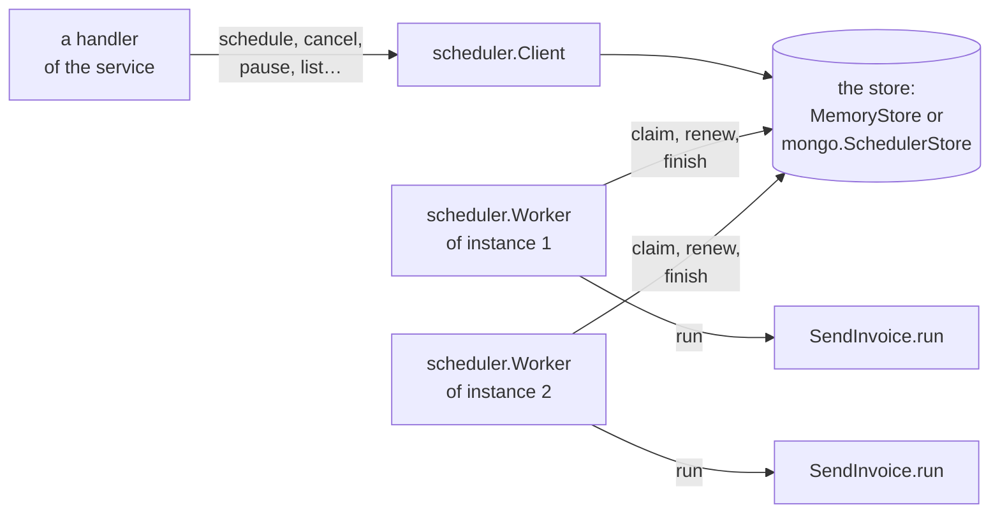
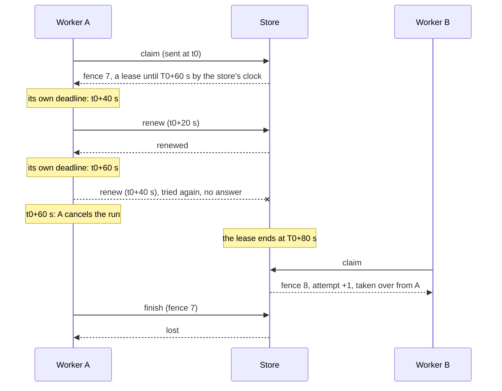

# scheduler

**Jobs that a Zig service puts on a time, and that any of its instances
runs.** A shop sends the invoice of an order a minute after the order,
reminds a customer of an unpaid order three days later, and closes the
day every night at 11 PM. zefir-scheduler keeps such *jobs* in a *store*,
and every instance of the service runs a *worker* that takes the jobs that
are due, one instance a job, and runs them. A job is a plain Zig type with
a method `run`; its data, the *payload*, is a struct that the compiler
checks when you put the job on its time, and a schedule such as
`.dailyAt(11, 0, 0, .pm)` or a cron expression is checked when the
program compiles. The store keeps everything: the jobs outlive a restart
of the service, an instance that crashes leaves its jobs to the others,
and a job that fails tries again. It is written against `std.Io` only,
runs on [zio](https://github.com/lalinsky/zio) in production, and keeps
its jobs in memory or in MongoDB.

> [!IMPORTANT]
> **Not in v1 (TODO):**
>
> - **Time zones** and their changes of the clock in summer: every time is
>   UTC.
> - **Two runs of one repeating job at once, and a queue of its runs**: a
>   run that outlasts its period delays the next one, see
>   [Missed runs](#missed-runs).
> - **Catching up every missed run** of a repeating job: one run stands
>   for those it missed, or a late one is skipped.
> - **The cron of `? L W # H`, a year and `a/n`**, and the last day of a
>   month in `monthlyOn`.
> - **Metrics, an exporter, a web panel, a span for each run**:
>   `worker.stats()` takes snapshots.
> - **Tenants in databases of their own**: a tenant is a field of a job
>   and a filter of the lists.
> - **Stores on Redis and Postgres**: a store of your own works once it
>   passes the conformance suite, see
>   [A store of your own](#a-store-of-your-own).
> - **Keeping the last N runs**: the history keeps its rows for a time.
> - **Priorities of jobs, and limits on the running jobs of a type.**
> - **Chains and graphs of jobs.**
> - **A cancel or a wake-up that reaches the other instances at once**
>   (MongoDB's change streams): a run in another instance stops at its
>   next renewal of the lease, within `renew_every`.
> - **Several jobs claimed in one request to MongoDB**: one
>   `findAndModify` for each.
> - **A method that runs a job now**: `reschedule` with `.after = .zero`
>   does it.
> - **`wtimeout` and read concerns in zefir-mongo**, which come with
>   replica sets.

From [the quick start](#quick-start): a job, and the request that puts it
on its time.

```zig
/// The job: the invoice of an order. Its fields are what it needs, the
/// data of one run is its Payload, and `run` does the work.
const SendInvoice = struct {
    app: log.Logger,
    sent: std.atomic.Value(u32) = .init(0),

    pub const scheduler_job: scheduler.Job = .{ .name = "send-invoice" };

    pub const Payload = struct { order_id: u64, amount_cents: u64 };

    pub fn run(self: *SendInvoice, ctx: *scheduler.Context, payload: Payload) !void {
        self.app.info("Invoice sent", .{ .order = payload.order_id, .amount_cents = payload.amount_cents, .attempt = ctx.info().attempt });
        _ = self.sent.fetchAdd(1, .release);
    }
};
```

```zig
// The invoice of order 42, a second from now. The key names the job,
// so the same request again changes nothing.
const request: scheduler.Client.Request(SendInvoice) = .{
    .key = "order-42",
    .when = .{ .after = .fromSeconds(1) },
    .payload = .{ .order_id = 42, .amount_cents = 1999 },
};
app.info("Scheduled", .{ .result = try client.schedule(io, .root, SendInvoice, request, .{}) });
```

- **Jobs are types.** A struct with what it needs as its fields, the data
  of a run as its `Payload`, and the work in `run`. The compiler checks a
  job wherever the code names it, and the payload of every request; a
  mistake stops the build with the line to write instead.
- **Schedules checked when the program compiles.** Steps such as
  `.everyMinutes(15)`, times of day such as `.dailyAt(11, 0, 0, .pm)`,
  where 12 AM is midnight and 12 PM is noon, weekly and monthly ones,
  pauses between runs, and cron.
- **A job for each key.** The invoice of each order, the report of each
  tenant: a key is taken once, so scheduling again is safe, and the key
  finds the job to move, pause or cancel.
- **Several instances, one owner.** A claim gives a due job to one
  worker, a lease keeps it while it runs, and when an instance dies, its
  leases run out and the others take its jobs.
- **At least once, said plainly.** After a failure a run may come twice:
  each run has a key, the same for all its attempts, by which the systems
  a job writes to do its work once, and each claim a number, by which they
  refuse an owner whose claim was taken over.
- **Failures planned for.** Retries with growing pauses, errors that end
  them, timeouts, a history of the attempts, and failed jobs kept to retry
  by hand.
- **Any store.** Memory for one instance and for tests, MongoDB for
  several instances; a store of your own works once it passes the
  conformance suite.
- **Tests without a server.** `testing.call` runs a handler alone, and
  `testing.FaultyStore` fails any store on demand.

## Contents

1. [What the scheduler does](#what-the-scheduler-does)
2. [Installation](#installation)
3. [Quick start](#quick-start)
4. [Jobs](#jobs)
5. [When jobs run](#when-jobs-run)
6. [Jobs by key](#jobs-by-key)
7. [Failures and retries](#failures-and-retries)
8. [Several instances](#several-instances)
9. [Missed runs](#missed-runs)
10. [History and retention](#history-and-retention)
11. [MongoDB](#mongodb)
12. [Under zefir.App](#under-zefirapp)
13. [Shutdown and failures of the store](#shutdown-and-failures-of-the-store)
14. [Logs and statistics](#logs-and-statistics)
15. [Tests of your jobs](#tests-of-your-jobs)
16. [A store of your own](#a-store-of-your-own)

Programs that `zig build test-scheduler` runs without a server, checking
what they print against this guide: [quick start](quick_start.zig) ·
[schedules](schedules.zig) · [orders](orders.zig) ·
[failures](failures.zig) · [under App](app.zig). Tests that it runs:
[the jobs of the invoices](jobs_test.zig), which test
[Invoices.zig](Invoices.zig) · [the conformance suite](conformance_test.zig).
Programs that `zig build e2e` in `tests/scheduler` builds and runs against
mongod, checking what they print against this guide:
[quick start on MongoDB](mongo_quick_start.zig) ·
[instances](instances.zig).

## What the scheduler does

A service often has work that is not for now: the invoice of an order, a
minute after the order; a reminder, three days later; a report, every
Monday at 9 AM. A timer in the memory of the process would do it, until
the process restarts and forgets the timer, or until the service runs in
three instances and each sends the report. The scheduler keeps such work
in a store that every instance shares, and makes sure that one instance
takes each piece:



- **A job** is a type of yours: `SendInvoice`, with what it needs as its
  fields, the declaration `scheduler_job`, the data of one run as its
  `Payload`, and the method `run`. A job *of* that type is one piece of
  work, such as the invoice of order 42.
- **The store** keeps a *record* for each job: its type, its key, its
  time, its payload as JSON, its state. `scheduler.MemoryStore` keeps them
  in the memory of one process, `mongo.SchedulerStore` in MongoDB, where
  every instance sees them; both are behind one interface,
  `scheduler.Store`.
- **The client**, `scheduler.Client`, puts jobs on their time and finds
  and changes them by their key. A handler, a controller or another job
  calls it.
- **The worker**, `scheduler.Worker(Jobs)`, runs in each instance. It
  asks the store for the jobs that are due, of the types it knows, and no
  more than it has free slots; the store gives each due job to one worker,
  which runs it, keeps a lease on it while it runs, and writes the
  outcome.

A record goes through these states:

```mermaid
stateDiagram-v2
    [*] --> pending: schedule, or a declaration at the start of a worker
    pending --> running: claimed, its time come
    running --> running: claimed again, its lease run out
    running --> pending: a retry, the next run, or a stop
    running --> paused: the run ends after a pause
    running --> succeeded: a one-shot job done, and kept
    running --> failed: its attempts spent, and kept
    running --> [*]: done, nothing kept; or cancelled
    pending --> paused: pause
    paused --> pending: unpause
    failed --> pending: retry
    pending --> [*]: cancel
    paused --> [*]: cancel
    succeeded --> [*]: its time kept is over
    failed --> [*]: its time kept is over
```



A *one-shot* job runs once, and then it is done; a *repeating* job goes
back to `pending` after each run, for its next time, and ends only when
it is cancelled. Every time is the store's: whether a job is due, whether
a lease ran out, when a run began. The instances may disagree about the
time, and still agree on what is due.

**Which store.** `MemoryStore` needs nothing but memory: for a service
of one instance, for tests, and for jobs that each instance must run on
its own, such as dropping what it keeps in its memory. Its jobs go with
the process. `mongo.SchedulerStore` keeps the jobs of a service of
several instances, in a database that outlives them all, see
[MongoDB](#mongodb).

**The promise is "at least once".** A job that is due runs, as long as a
worker that knows its type runs and the store answers; one claim at a
time holds it, and a run starts only under a claim; and the run of an
instance that died runs again elsewhere, while the job has attempts
left. The attempt that died counts: a one-shot job has five by default
and a repeating job one, so by default a repeating job skips the run its
instance lost and goes on at its next time; `.retry.attempts` gives it
more. So a run may come twice after a failure: by the key of the run,
the systems a job writes to do its work once, and by the number of the
claim they may refuse an owner whose claim was taken over; see
[Several instances](#several-instances).

## Installation

Add Zefir to your `build.zig.zon`:

```sh
zig fetch --save git+https://github.com/vkiryakov/zefir#dev
```

zefir-scheduler is on the `dev` branch until the next release. The
command fetches the latest commit of `dev`; `--save` pins that commit.
The latest release, v0.11.0, came before zefir-scheduler, so `#v0.11.0`
does not have it.

A service runs on [zio](https://github.com/lalinsky/zio). zio has no
release for Zig 0.17 yet, so pin the commit Zefir is tested with:

```sh
zig fetch --save git+https://github.com/lalinsky/zio#d15034f1a4d9ddaa42829aae8f7e02d37cd1093a
```

Then import the modules in `build.zig`: scheduler; mongo, for a store in
MongoDB; core, whose `core.Context` the calls of the client take. The
programs of this guide also use Zefir's confy for settings and log for
records, and those on MongoDB mongo-bson, for the `mongo.Database` that
drops their collections when they start:

```zig
// build.zig
const zefir = b.dependency("zefir", .{ .target = target, .optimize = optimize });
const zio = b.dependency("zio", .{ .target = target, .optimize = optimize });

const exe = b.addExecutable(.{
    .name = "shop",
    .root_module = b.createModule(.{
        .root_source_file = b.path("src/main.zig"),
        .target = target,
        .optimize = optimize,
        .imports = &.{
            .{ .name = "scheduler", .module = zefir.module("zefir-scheduler") },
            .{ .name = "mongo", .module = zefir.module("zefir-mongo") },
            .{ .name = "mongo-bson", .module = zefir.module("zefir-mongo-bson") },
            .{ .name = "core", .module = zefir.module("zefir-core") },
            .{ .name = "zio", .module = zio.module("zio") },
            .{ .name = "confy", .module = zefir.module("zefir-confy") },
            .{ .name = "log", .module = zefir.module("zefir-log") },
        },
    }),
});
b.installArtifact(exe);
b.step("run", "Run the service").dependOn(&b.addRunArtifact(exe).step);
```

> [!TIP]
> zefir-scheduler is also part of the umbrella module: with
> `zefir.module("zefir")` imported as `zefir`, it is
> `@import("zefir").scheduler`. It imports zefir-core only, and no
> database: `mongo.SchedulerStore` lives in zefir-mongo, which imports
> zefir-scheduler to implement its store contract. A service that keeps
> its jobs in memory needs scheduler and core alone.

`MemoryStore` needs no server. For a store in MongoDB you need a mongod to
talk to; with Docker:

```sh
docker run --rm -p 27017:27017 mongo:9.0.4
```

## Quick start

The invoice of an order, sent a second after the order: a job, a store, a
client that puts the job on its time, and a worker that runs it. The jobs
live in memory, in `scheduler.MemoryStore`, so the program needs no
server:

```zig
//! The quick start of the guide: a shop sends the invoice of an order a
//! second after the order. The jobs live in `scheduler.MemoryStore`, so
//! the program needs no server: it starts a worker, puts the invoice of
//! order 42 on its time, waits for the run, and stops the worker. `zig
//! build test-scheduler` runs it.

const std = @import("std");
const log = @import("log");
const scheduler = @import("scheduler");

/// The worker logs through std.log; this sends its records to the logger.
pub const std_options: std.Options = .{ .logFn = log.stdLogFn };

/// The job: the invoice of an order. Its fields are what it needs, the
/// data of one run is its Payload, and `run` does the work.
const SendInvoice = struct {
    app: log.Logger,
    sent: std.atomic.Value(u32) = .init(0),

    pub const scheduler_job: scheduler.Job = .{ .name = "send-invoice" };

    pub const Payload = struct { order_id: u64, amount_cents: u64 };

    pub fn run(self: *SendInvoice, ctx: *scheduler.Context, payload: Payload) !void {
        self.app.info("Invoice sent", .{ .order = payload.order_id, .amount_cents = payload.amount_cents, .attempt = ctx.info().attempt });
        _ = self.sent.fetchAdd(1, .release);
    }
};

pub fn main(init: std.process.Init) !void {
    const gpa = init.gpa;
    const io = init.io;
    const logger: log.Logger = try .init(gpa, io, .{ .format = .text });
    defer logger.deinit();
    logger.installStdLog();
    const app = logger.scoped("app");

    // The store keeps the jobs: the client puts them on their time, the
    // worker runs them.
    var memory: scheduler.MemoryStore = .init(gpa, io, .{});
    defer memory.deinit();
    const client: scheduler.Client = .init(gpa, io, memory.store(), .{});
    var invoices: SendInvoice = .{ .app = app };
    var worker: scheduler.Worker(struct { invoices: *SendInvoice }) = try .init(gpa, io, memory.store(), .{ .invoices = &invoices }, .{ .instance = "shop" });
    defer worker.deinit(io);
    try worker.start(io);

    // The invoice of order 42, a second from now. The key names the job,
    // so the same request again changes nothing.
    const request: scheduler.Client.Request(SendInvoice) = .{
        .key = "order-42",
        .when = .{ .after = .fromSeconds(1) },
        .payload = .{ .order_id = 42, .amount_cents = 1999 },
    };
    app.info("Scheduled", .{ .result = try client.schedule(io, .root, SendInvoice, request, .{}) });
    app.info("Scheduled again", .{ .result = try client.schedule(io, .root, SendInvoice, request, .{}) });

    // Wait for the run, then stop: the worker takes no more jobs and
    // waits for the runs to end, here for 5 s at most.
    while (invoices.sent.load(.acquire) == 0) try io.sleep(.fromMilliseconds(50), .awake);
    try worker.shutdown(io, .fromNow(io, .{ .raw = .fromSeconds(5), .clock = .awake }));
}
```

```text
$ zig build run
2026-10-27T14:23:35.038Z INFO  [scheduler] 1 job type, 10 workers, instance shop/064b88f629b1fe986fb32016b4e1c67e
2026-10-27T14:23:35.038Z INFO  [app] Scheduled result=created
2026-10-27T14:23:35.039Z INFO  [app] Scheduled again result=existing
2026-10-27T14:23:36.046Z INFO  [app] Invoice sent order=42 amount_cents=1999 attempt=1
2026-10-27T14:23:36.082Z INFO  [scheduler] stopping
2026-10-27T14:23:36.082Z INFO  [scheduler] stopped
```

What happens, from the top:

- **The job.** `SendInvoice` is a plain struct. `scheduler_job` declares
  it a job, under the name `send-invoice` that the store keeps its records
  by, with the default policy: no time limit, five attempts, and nothing
  kept once it succeeded. `Payload` is the data of one run, which the
  store keeps as JSON; `run` does the work, with the context of the run.
  Its fields are what the job needs: here the logger and a counter that
  `main` waits on, in a shop the client of its billing service.
- **The store.** `MemoryStore` keeps the jobs in the memory of the
  process. `store()` gives `scheduler.Store`, the interface that the
  client and the worker take: on MongoDB, `mongo.SchedulerStore` takes
  its place, and the rest stays as it is.
- **The client.** `scheduler.Client.init` makes a value without
  resources: copy it and share it between tasks. `schedule` puts a job of
  `SendInvoice` on its time; its request is `Client.Request(SendInvoice)`,
  which the compiler checks against `SendInvoice.Payload`, so a missing
  field or a string where a number goes stops the build. `.after =
  .fromSeconds(1)` is a second after the store took the job, by the
  store's clock.
- **The key.** One job of a type for each key: here the order. The same
  request again answers `.existing` and changes nothing, so a handler
  that retries its request, or an event that comes twice, makes one job.
- **The worker.** `scheduler.Worker` takes a struct of pointers to the
  jobs it runs; `init` checks the settings, and `start` starts its tasks:
  a poll that asks the store for due jobs every second, and ten slots that
  run them. Its instance is "shop" and 32 random hex digits, new at each
  start, which tell the instances apart in the logs and the history.
- **The run.** A second on, the poll *claims* the job: the store gives it
  to this worker alone, marks it running and starts a *lease* on it. A
  slot calls `run` in a task of its own; `ctx.info()` says this is the
  first attempt. The job succeeded, so its record is gone.
- **The stop.** `shutdown` stops the claims, lets the runs end, and
  returns once the worker stopped, here within 5 s; `deinit` frees it.
  The worker writes its lines to `std.log`, and `std_options` with
  `log.stdLogFn` and `logger.installStdLog()` send them to zefir-log, see
  [Logs and statistics](#logs-and-statistics).

On MongoDB the same program needs a client of MongoDB and the store's
indexes, and nothing else changes: see
[the quick start on MongoDB](#the-quick-start-on-mongodb).

## Jobs

A job type is a struct with three declarations. This is the invoice of
the shop's tests, from [Invoices.zig](#tests-of-your-jobs):

```zig
/// The invoice of an order: a job for each order, by its key.
pub const SendInvoice = struct {
    billing: *Billing,

    pub const scheduler_job: scheduler.Job = .{
        .name = "send-invoice",
        // A run past 30 s is cancelled, and counts as a failed attempt.
        .timeout = .fromSeconds(30),
        // An order that is gone gets no invoice, however often it tries.
        .retry = .{ .give_up_on = &.{error.OrderGone} },
        // A row of history for each attempt, kept for 90 days.
        .history = .{ .keep_for = .fromSeconds(90 * 24 * 60 * 60) },
    };

    /// The data of one run: the store keeps it as JSON.
    pub const Payload = struct {
        order_id: u64,
        amount_cents: u64,
        /// A field that a later version added has a default, so the jobs
        /// that an earlier version scheduled still read.
        note: ?[]const u8 = null,
    };

    pub fn run(self: *SendInvoice, ctx: *scheduler.Context, payload: Payload) !void {
        // The run key is the same for every attempt of this run: the key
        // of idempotency for the billing service.
        try self.billing.send(ctx.io(), ctx.info().run_key, payload.order_id);
    }
};
```

### The declaration

`pub const scheduler_job: scheduler.Job` says that the type is a job, and
how its jobs run. Every field but the name has a default:

| Field | Default | What it is |
|---|---|---|
| `name` | — | the name the store keeps the jobs by: 1–64 bytes of `a-z`, `0-9`, `-`, `_` and `.`, starting with a letter or a digit |
| `timeout` | `null`, no limit | how long one run may take; past it, the run is cancelled and counts as a failed attempt |
| `retry` | 5 attempts of a one-shot job and 1 of a repeating one, pauses from 1 s to 2 min | what follows a failed attempt, see [Failures and retries](#failures-and-retries) |
| `repeat` | `null` | a repeating job that the code declares, see [Rollouts and declared jobs](#rollouts-and-declared-jobs) |
| `misfire` | `.coalesce` | what a late run of a repeating job does, see [Missed runs](#missed-runs) |
| `history` | `.none` | whether to keep a row of history for each claim, and how long, see [History and retention](#history-and-retention) |
| `when_done` | succeeded: none; failed: 30 days | how long to keep a finished one-shot job |

Keep the name while records of the job exist: a record of an old name is
a job that no worker knows, and nobody runs it.

### The payload

`Payload` is the data of one run, a struct that the store keeps as JSON:
`std.json` writes it when the client schedules the job and reads it when
a worker runs it. Its fields are numbers, strings, bools, enums (by
name), optionals, slices and structs of them; every string is UTF-8,
since JSON is, and the client refuses another one before the store hears
of it. A job without data has no `Payload`, and its `run` no third
param.

A payload outlives the code that wrote it: a job scheduled for next week
runs on the version of the service that runs then. So change a payload
the way JSON forgives:

- a field with a default can be added: a record of the older version
  lacks it, and the field takes its default, as `note` above does;
- a field can be dropped: a reader skips the fields it does not know;
- anything else, such as a field that changes its type, is a new job
  with a new name.

A worker that cannot read the payload of a job it claimed, because a newer
version wrote it, gives the job back for another instance, see
[Rollouts and declared jobs](#rollouts-and-declared-jobs).

### `run` and its context

`pub fn run(self: *SendInvoice, ctx: *scheduler.Context, payload:
Payload) !void` does the work. It returns any error it likes: an error is
a failed attempt, and its name goes to the history and to `last`. `ctx` is
borrowed for this run only:

| Call | What it gives |
|---|---|
| `ctx.io()` | the `std.Io` of the worker: every wait of the job goes through it |
| `ctx.operation()` | a `core.Context` for the calls the job makes: the deadline of its `timeout`, the token that the worker cancels, and the trace of the code that scheduled the job, which the run goes on with |
| `ctx.allocator()` | an arena of the run, freed after the worker wrote the outcome; tasks the job starts must not use it |
| `ctx.info()` | what is known of the run, a `*const scheduler.RunInfo` |

The worker cancels the run, its token and the task that runs `run`
together, when its `timeout` passes, when the worker stops, when its
lease is lost or cannot be confirmed, and when the client cancels the
job. A handler stops at its next point of cancellation, a wait on its
`io`, or where it asks `ctx.operation().isCancelled()`.

`ctx.info()`:

| Field | What it is |
|---|---|
| `job`, `key`, `tenant` | the job; the key of a declared job is `""` |
| `run_key` | `"<job>/<key>/<scheduled_at in ms>"`: the same for every attempt of this run, so the key of idempotency for other systems |
| `attempt`, `attempts` | the number of this attempt, from 1, and how many the policy allows |
| `scheduled_at` | the time of the run by the plan, the same for every attempt |
| `started_at` | when the store gave the job to this instance, by its clock |
| `missed` | for a repeating job, how many more runs of its schedule this one stands for |
| `life`, `fence` | the life of the record, 16 random bytes, new for a record made again with the same key, and the number of this claim in that life, one more with each claim |
| `instance` | the worker that runs it: `"shop/7f3a…"` |

### What the compiler checks

`Ref.of`, `Client.schedule` and `Worker(Jobs)` check a job type when the
program compiles. Each error starts with `scheduler: `, names the type,
and says what to write:

```text
error: scheduler: SendInvoice has no scheduler_job: declare pub const scheduler_job: scheduler.Job = .{ .name = "send-invoice" };
error: scheduler: SendInvoice: the name "Send": a name is 1–64 bytes of a-z, 0-9, '-', '_' and '.', starting with a letter or a digit
error: scheduler: SendInvoice: expected pub fn run(self: *SendInvoice, ctx: *scheduler.Context, payload: SendInvoice.Payload) !void
error: scheduler: NightlyCleanup: the declared record of a repeat gets Payload{}: give every field of Payload a default, or drop .repeat
error: scheduler: SendInvoice: retry.attempts is 0: write 1 or more, or null for the default
error: scheduler: Worker(Jobs): a field of Jobs points to a job: invoices: *SendInvoice
error: scheduler: Worker(Jobs): SendInvoice and Reminder share the name "send-invoice"
```

The request of `schedule` is `Client.Request(J)`: its field `payload` is
a `J.Payload`, there only when `J` has one, so the compiler checks the
payload of every request against the job.

## When jobs run

The `when` of a request is a `scheduler.When`, one of three:

| `when` | Runs | Example |
|---|---|---|
| `.at` | once, at a moment of UTC; a moment already past runs at once | `.{ .at = .fromUtc(2026, 12, 1, 9, 0, 0, .am) }` |
| `.after` | once, this long after the store took the job, by its clock | `.{ .after = .fromSeconds(3 * days) }` |
| `.repeat` | again and again, by a schedule | `.{ .repeat = .weeklyOn(.monday, 9, 0, 0, .am) }` |

A moment is a `scheduler.Instant`, a time of UTC to the millisecond:
`Instant.fromUtc(year, month, day, hour, minute, second, clock)` makes
one, `Instant.fromTimestamp(std.Io.Clock.real.now(io))` takes the clock
of the process, and `{f}` writes one as RFC 3339,
`2026-12-01T09:00:00.000Z`. `.at` takes the years 1970 to 9999, and
`.after` 0 to 100 years; anything else is `error.InvalidArgument` before
the store hears of it. `fromUtc` with values that only the run knows, and
that make no moment, such as the 29th of February 2026, gives
`Instant.invalid`, which a call refuses the same way. Every time is UTC:
a shop in Berlin that wants 9 AM in Berlin writes 8 AM, and 7 AM in
summer, see the TODO list above.

### Ready-made schedules

A repeating job runs by a `scheduler.Schedule`, a value without memory of
its own. The ready-made ones are functions, which the code writes as
decl literals, `.dailyAt(…)`:

| Schedule | Runs |
|---|---|
| `.everySeconds(n)`, `.everyMinutes(n)`, `.everyHours(n)` | every n units, counted from the Unix epoch |
| `.dailyAt(hour, minute, second, clock)` | every day at that time |
| `.weeklyOn(day, hour, minute, second, clock)` | every week, on `.monday` … `.sunday` |
| `.monthlyOn(day, hour, minute, second, clock)` | every month, on a day from 1 to 28 |
| `.fixedDelay(duration)` | that long after the end of each run |
| `.cron(expression)` | by a cron expression |

The first run of a new repeating job is the first moment of its schedule
after the store took it, and each next one the first moment after its run
began; a `fixedDelay` counts from the end of each run instead, the first
run `duration` after the store took the job.

**Every n units from the epoch.** `.everyMinutes(7)` runs at the moments
that are multiples of 420 s from 1970-01-01T00:00:00Z. Every instance
counts the same moments, and n need not divide an hour, so the steps do
not start again at each hour or each midnight: on Saturday 24 October
2026 they come at 00:04, 00:11, …, 00:53, 01:00, 01:07. When n divides
60, as 15 does for minutes, or 24, as 6 does for hours, the moments fall
on the clock as you expect: :00, :15, :30, :45 of every hour. A run every
seven minutes that starts again at each hour, :00, :07, …, :56, is the
cron `*/7 * * * *`.

**Times of day.** `dailyAt`, `weeklyOn`, `monthlyOn` and `Instant.fromUtc`
take the time of day with its clock as the last argument, a
`scheduler.HourFormat`: `.h24` reads the hour as 0–23, `.am` and `.pm` as
1–12. **12 AM is midnight (00:xx), and 12 PM is noon (12:xx).** The
minutes and the seconds are always there:

| Code | UTC |
|---|---|
| `.dailyAt(12, 0, 0, .am)` | 00:00:00, midnight |
| `.dailyAt(12, 30, 0, .am)` | 00:30:00 |
| `.dailyAt(1, 0, 0, .am)` | 01:00:00 |
| `.dailyAt(11, 59, 59, .am)` | 11:59:59 |
| `.dailyAt(12, 0, 0, .pm)` | 12:00:00, noon |
| `.dailyAt(3, 30, 0, .pm)` | 15:30:00 |
| `.dailyAt(11, 0, 0, .pm)` | 23:00:00 |
| `.dailyAt(0, 0, 0, .h24)` | 00:00:00 |
| `.dailyAt(15, 30, 0, .h24)` | 15:30:00 |

The compiler checks the arguments it knows, and its error says what to
write instead:

```text
error: scheduler: dailyAt(13, 0, 0, .pm): an hour of the 12-hour clock is 1–12; 1 PM is .dailyAt(1, 0, 0, .pm), or .dailyAt(13, 0, 0, .h24)
error: scheduler: dailyAt(0, 0, 0, .am): an hour of the 12-hour clock is 1–12; midnight is .dailyAt(12, 0, 0, .am), or .dailyAt(0, 0, 0, .h24)
error: scheduler: dailyAt(24, 0, 0, .h24): an hour of the 24-hour clock is 0–23
```

`monthlyOn` takes the days that every month has, 1 to 28: a job on the
31st would skip five months a year without a word. Such a job is a cron
expression, where that is plain to see:

```text
error: scheduler: monthlyOn(31, 0, 0, 0, .h24): a day of monthlyOn is 1–28, which every month has; the 31st of the months that have one is .cron("0 0 0 31 * *"); the last day of a month is not in v1
```

### Cron

`.cron(expression)` takes 5 fields, minute, hour, day of the month, month
and day of the week, or 6 with the seconds first; the time is UTC.

- A field is `*`, a value `a`, a range `a-b`, a list `a,b,c`, or a step
  `*/n` or `a-b/n`. The months and the days of the week take their names
  in any case, `JAN`–`DEC` and `SUN`–`SAT`; Sunday is 0 and 7.
- **A range goes up**, from its first value to its second, and does not
  wrap round the end of its field. A range that goes down is an error
  that names the line it means: the hours `22-2` are `22-23,0-2`, and
  the weekend, since Sunday is 7 too, is `SAT-7`:

  ```text
  error: scheduler: cron "0 0 * * SAT-SUN": field 5, the day of the week, "SAT-SUN": a range goes up, and Sunday is 7 too: write SAT-7
  ```

- The macros are `@yearly` (or `@annually`), `@monthly`, `@weekly`,
  `@daily` (or `@midnight`) and `@hourly`.
- **The two day fields.** When neither the day of the month nor the day
  of the week is exactly `*`, a day that matches either one comes: `0 0
  13 * FRI` runs on the 13th of each month and on every Friday. When one
  is exactly `*`, the other decides.
- **`*/2` is no `*`.** Only `*` itself leaves the day to the other field:
  with `*/2`, or even `*/1`, either field may match, so `0 0 */2 * MON`
  runs on the odd days of the month and on Mondays, and `0 0 1 * */1`
  every day.
- A day that never comes is an error, and the compiler says why:

  ```text
  error: scheduler: cron "0 0 30 2 *": day 30 never comes in February, and the day of the week is *
  ```

  A day that comes rarely is fine: the search for the next run looks up
  to 9 years ahead, and `0 0 29 2 *` waits for the 29th of February.
- Not in v1: `?`, `L`, `W`, `#`, `H`, a field of the year, `a/n`,
  `@reboot` and `@every`; each is an error that names it.

### What the store keeps, and values known only at run time

The record of a repeating job keeps its schedule as text, which the
store never reads: `every 420s`, `delay 30s`, `daily 23:00:00`, `weekly
mon 09:00:00`, `monthly 1 00:00:00`, `cron 0 30 2 * * *`. The time of day
in it is on the 24-hour clock, however the code wrote it. `{f}` writes
that text of a schedule, and `Schedule.parse` reads it back.

The compiler checks the values it knows; values that only the run knows,
such as an hour from the settings, make a schedule that carries the
problem. `schedule.check(&diagnostics)` refuses it with the same text as
the compiler's, and so do the client's `schedule` and `reschedule`,
before the store hears of it.

`schedules.zig` prints the next runs of schedules after a fixed moment,
Saturday 24 October 2026 at midnight UTC, so every run prints the same:

```zig
//! When jobs run: the next moments of schedules after a fixed moment,
//! Saturday 2026-10-24 at midnight UTC, so that every run prints the same.
//! A schedule is a value without memory of its own: the code builds it
//! with a ready-made function or a cron expression, the compiler checks
//! the arguments it knows, `next` gives the first moment after a moment,
//! and `format` writes the text that the record of a job keeps. Values
//! known only at run time, such as settings, are checked by `check`, as
//! the client checks a schedule it is given. No store, no worker: `zig
//! build test-scheduler` runs it.

const std = @import("std");
const scheduler = @import("scheduler");
const Schedule = scheduler.Schedule;

/// The moment the next runs count from: Saturday 24 October 2026, 00:00
/// UTC.
const start: scheduler.Instant = .fromUtc(2026, 10, 24, 0, 0, 0, .h24);

pub fn main(init: std.process.Init) !void {
    var buffer: [4096]u8 = undefined;
    var stdout = std.Io.File.stdout().writer(init.io, &buffer);
    const out = &stdout.interface;
    try out.writeAll("The next runs after Sat 2026-10-24 00:00:00 UTC\n");

    try out.writeAll("\nEvery n seconds, minutes or hours, counted from the Unix epoch:\n");
    try show(out, ".everySeconds(45)", .everySeconds(45), 3);
    try show(out, ".everyMinutes(15)", .everyMinutes(15), 4);
    try show(out, ".everyMinutes(7)", .everyMinutes(7), 10);
    try show(out, ".everyHours(6)", .everyHours(6), 4);
    try show(out, ".everyHours(5)", .everyHours(5), 5);
    // A cron step starts again at each hour, a step from the epoch does not.
    try show(out, ".cron(\"*/7 * * * *\")", .cron("*/7 * * * *"), 10);

    try out.writeAll("\nTimes of day, by the clock the last argument names; 12 AM is midnight, 12 PM is noon:\n");
    try show(out, ".dailyAt(12, 0, 0, .am)", .dailyAt(12, 0, 0, .am), 1);
    try show(out, ".dailyAt(12, 30, 0, .am)", .dailyAt(12, 30, 0, .am), 1);
    try show(out, ".dailyAt(1, 0, 0, .am)", .dailyAt(1, 0, 0, .am), 1);
    try show(out, ".dailyAt(11, 59, 59, .am)", .dailyAt(11, 59, 59, .am), 1);
    try show(out, ".dailyAt(12, 0, 0, .pm)", .dailyAt(12, 0, 0, .pm), 1);
    try show(out, ".dailyAt(3, 30, 0, .pm)", .dailyAt(3, 30, 0, .pm), 1);
    try show(out, ".dailyAt(11, 0, 0, .pm)", .dailyAt(11, 0, 0, .pm), 1);
    try show(out, ".dailyAt(0, 0, 0, .h24)", .dailyAt(0, 0, 0, .h24), 1);
    try show(out, ".dailyAt(15, 30, 0, .h24)", .dailyAt(15, 30, 0, .h24), 1);
    try show(out, ".weeklyOn(.monday, 9, 0, 0, .am)", .weeklyOn(.monday, 9, 0, 0, .am), 2);
    try show(out, ".monthlyOn(1, 0, 0, 0, .h24)", .monthlyOn(1, 0, 0, 0, .h24), 2);

    try out.writeAll("\nCron, in UTC:\n");
    try show(out, ".cron(\"0 30 2 * * *\")", .cron("0 30 2 * * *"), 2);
    try show(out, ".cron(\"0 9 * * MON-FRI\")", .cron("0 9 * * MON-FRI"), 3);
    try show(out, ".cron(\"@weekly\")", .cron("@weekly"), 2);
    // Neither day field is *: a day that matches either one comes.
    try show(out, ".cron(\"0 0 13 * FRI\")", .cron("0 0 13 * FRI"), 4);
    // */2 is no *: the odd days of the month, or a Monday.
    try show(out, ".cron(\"0 0 */2 * MON\")", .cron("0 0 */2 * MON"), 5);
    // The months without the day are skipped.
    try show(out, ".cron(\"0 0 0 31 * *\")", .cron("0 0 0 31 * *"), 4);
    try show(out, ".cron(\"0 0 29 2 *\")", .cron("0 0 29 2 *"), 2);

    try out.writeAll("\nAfter each run, counted by the store:\n");
    try show(out, ".fixedDelay(.fromSeconds(30))", .fixedDelay(.fromSeconds(30)), 1);

    try out.writeAll("\nValues the program reads when it runs, which the compiler cannot check:\n");
    try fromSettings(out, 1, .pm, "0 0 30 * *");
    try fromSettings(out, 13, .pm, "0 0 30 2 *");
    try out.flush();
}

/// How the code writes the schedule and the text that the record of a job
/// keeps, then its first `count` moments after `start`, each with its date
/// when that is not the date of the moment before: one moment on the same
/// line, more on a line of their own.
fn show(out: *std.Io.Writer, code: []const u8, schedule: Schedule, count: usize) !void {
    var text: [64]u8 = undefined;
    const canonical = try std.fmt.bufPrint(&text, "{f}", .{schedule});
    if (count == 1) {
        try out.print("  {s: <34} {s: <20}", .{ code, canonical });
    } else {
        try out.print("  {s: <34} {s}\n     ", .{ code, canonical });
    }
    var after = start;
    var day: ?i64 = null;
    for (0..count) |i| {
        const moment = schedule.next(after) orelse {
            try out.writeAll(" none: the store counts it after each run");
            break;
        };
        const moment_day = @divFloor(moment.unix_ms, std.time.ms_per_day);
        try out.writeAll(if (i == 0) " " else ", ");
        try printMoment(out, moment, moment_day != day);
        day = moment_day;
        after = moment;
    }
    try out.writeByte('\n');
}

/// A moment as "Sat 2026-10-24 00:04:00", the RFC 3339 text of
/// `Instant.format` without its milliseconds; only its time, "00:04:00",
/// when `with_date` is false.
fn printMoment(out: *std.Io.Writer, moment: scheduler.Instant, with_date: bool) !void {
    var text: [32]u8 = undefined;
    const rfc3339 = try std.fmt.bufPrint(&text, "{f}", .{moment});
    if (with_date) {
        // 1970-01-01, the day 0, was a Thursday.
        const weekdays = [_][]const u8{ "Thu", "Fri", "Sat", "Sun", "Mon", "Tue", "Wed" };
        const days = @divFloor(moment.unix_ms, std.time.ms_per_day);
        try out.print("{s} {s} ", .{ weekdays[@intCast(@mod(days, 7))], rfc3339[0..10] });
    }
    try out.writeAll(rfc3339[11..19]);
}

/// Schedules from the settings of a service, known only when it runs: the
/// hour of a nightly report and a cron expression. A wrong value makes no
/// compile error; the schedule carries the problem, and `check`, as the
/// `schedule` and `reschedule` of the client, answers
/// `error.InvalidArgument` with the same text as the compiler's.
fn fromSettings(out: *std.Io.Writer, hour: u8, clock: scheduler.HourFormat, expression: []const u8) !void {
    for ([_]Schedule{ .dailyAt(hour, 0, 0, clock), .cron(expression) }) |schedule| {
        var d: scheduler.Diagnostics = .{};
        if (schedule.check(&d)) |_| {
            try out.print("  ok: {f}\n", .{schedule});
        } else |err| {
            try out.print("  error.{t}: {s}\n", .{ err, d.message() });
        }
    }
}
```

```text
$ zig build run
The next runs after Sat 2026-10-24 00:00:00 UTC

Every n seconds, minutes or hours, counted from the Unix epoch:
  .everySeconds(45)                  every 45s
      Sat 2026-10-24 00:00:45, 00:01:30, 00:02:15
  .everyMinutes(15)                  every 900s
      Sat 2026-10-24 00:15:00, 00:30:00, 00:45:00, 01:00:00
  .everyMinutes(7)                   every 420s
      Sat 2026-10-24 00:04:00, 00:11:00, 00:18:00, 00:25:00, 00:32:00, 00:39:00, 00:46:00, 00:53:00, 01:00:00, 01:07:00
  .everyHours(6)                     every 21600s
      Sat 2026-10-24 06:00:00, 12:00:00, 18:00:00, Sun 2026-10-25 00:00:00
  .everyHours(5)                     every 18000s
      Sat 2026-10-24 05:00:00, 10:00:00, 15:00:00, 20:00:00, Sun 2026-10-25 01:00:00
  .cron("*/7 * * * *")               cron */7 * * * *
      Sat 2026-10-24 00:07:00, 00:14:00, 00:21:00, 00:28:00, 00:35:00, 00:42:00, 00:49:00, 00:56:00, 01:00:00, 01:07:00

Times of day, by the clock the last argument names; 12 AM is midnight, 12 PM is noon:
  .dailyAt(12, 0, 0, .am)            daily 00:00:00       Sun 2026-10-25 00:00:00
  .dailyAt(12, 30, 0, .am)           daily 00:30:00       Sat 2026-10-24 00:30:00
  .dailyAt(1, 0, 0, .am)             daily 01:00:00       Sat 2026-10-24 01:00:00
  .dailyAt(11, 59, 59, .am)          daily 11:59:59       Sat 2026-10-24 11:59:59
  .dailyAt(12, 0, 0, .pm)            daily 12:00:00       Sat 2026-10-24 12:00:00
  .dailyAt(3, 30, 0, .pm)            daily 15:30:00       Sat 2026-10-24 15:30:00
  .dailyAt(11, 0, 0, .pm)            daily 23:00:00       Sat 2026-10-24 23:00:00
  .dailyAt(0, 0, 0, .h24)            daily 00:00:00       Sun 2026-10-25 00:00:00
  .dailyAt(15, 30, 0, .h24)          daily 15:30:00       Sat 2026-10-24 15:30:00
  .weeklyOn(.monday, 9, 0, 0, .am)   weekly mon 09:00:00
      Mon 2026-10-26 09:00:00, Mon 2026-11-02 09:00:00
  .monthlyOn(1, 0, 0, 0, .h24)       monthly 1 00:00:00
      Sun 2026-11-01 00:00:00, Tue 2026-12-01 00:00:00

Cron, in UTC:
  .cron("0 30 2 * * *")              cron 0 30 2 * * *
      Sat 2026-10-24 02:30:00, Sun 2026-10-25 02:30:00
  .cron("0 9 * * MON-FRI")           cron 0 9 * * MON-FRI
      Mon 2026-10-26 09:00:00, Tue 2026-10-27 09:00:00, Wed 2026-10-28 09:00:00
  .cron("@weekly")                   cron @weekly
      Sun 2026-10-25 00:00:00, Sun 2026-11-01 00:00:00
  .cron("0 0 13 * FRI")              cron 0 0 13 * FRI
      Fri 2026-10-30 00:00:00, Fri 2026-11-06 00:00:00, Fri 2026-11-13 00:00:00, Fri 2026-11-20 00:00:00
  .cron("0 0 */2 * MON")             cron 0 0 */2 * MON
      Sun 2026-10-25 00:00:00, Mon 2026-10-26 00:00:00, Tue 2026-10-27 00:00:00, Thu 2026-10-29 00:00:00, Sat 2026-10-31 00:00:00
  .cron("0 0 0 31 * *")              cron 0 0 0 31 * *
      Sat 2026-10-31 00:00:00, Thu 2026-12-31 00:00:00, Sun 2027-01-31 00:00:00, Wed 2027-03-31 00:00:00
  .cron("0 0 29 2 *")                cron 0 0 29 2 *
      Tue 2028-02-29 00:00:00, Sun 2032-02-29 00:00:00

After each run, counted by the store:
  .fixedDelay(.fromSeconds(30))      delay 30s            none: the store counts it after each run

Values the program reads when it runs, which the compiler cannot check:
  ok: daily 13:00:00
  ok: cron 0 0 30 * *
  error.InvalidArgument: dailyAt(13, 0, 0, .pm): an hour of the 12-hour clock is 1–12; 1 PM is .dailyAt(1, 0, 0, .pm), or .dailyAt(13, 0, 0, .h24)
  error.InvalidArgument: cron "0 0 30 2 *": day 30 never comes in February, and the day of the week is *
```

- **From the epoch.** `.everyMinutes(7)` goes on past 01:00 at 01:07,
  while the cron `*/7` starts again at 01:00; `.everyHours(5)` crosses
  midnight at 01:00 of Sunday.
- **Midnight.** `.dailyAt(12, 0, 0, .am)` and `.dailyAt(0, 0, 0, .h24)`
  are the same schedule, `daily 00:00:00`: after the midnight the program
  counts from, the next comes on Sunday.
- **The two day fields.** `0 0 13 * FRI` takes every Friday and the 13th
  of each month, whatever its day of the week; `0 0 */2 * MON` takes
  Sunday the 25th and Tuesday the 27th, odd days, and Monday the 26th, but
  not Wednesday the 28th.
- **Rare days.** `0 0 0 31 * *` skips November and February;
  `0 0 29 2 *` waits for 2028.
- **`fixedDelay`** has no moments of its own: the store counts each one
  when a run ends.
- **The settings.** `fromSettings` builds its schedules from values the
  compiler does not know: 1 PM is fine, 13 PM is not, and neither is the
  30th of February.

## Jobs by key

A service has many jobs of one type, one for each order, customer or
tenant, and the key tells them apart: a job is its type and its key, and a
store keeps one job of a type for each key. The client finds a job by its
`scheduler.Ref`, `.of(RemindToPay, "order-42")` in code, or `.{ .job =
"remind-to-pay", .key = "order-42" }` in a page for the admins, and the
calls that change a job take one:

| Call | What it does | Answers |
|---|---|---|
| `schedule(io, ctx, J, request, options)` | makes the job of the key, unless one is there | `.created`; `.existing`, which changed nothing |
| `cancel(io, ctx, ref, options)` | removes the job, in any state | `true`, or `false` when there was none |
| `pause(io, ctx, ref, options)` | a pending job waits until `unpause`; a running one pauses when its run ends, or without a run when its instance was lost and another takes it over, unless that run was its last attempt, see [Claims and leases](#claims-and-leases) | `Changed` |
| `unpause(io, ctx, ref, options)` | the job waits again for its time; a time already past runs at once | `Changed` |
| `reschedule(io, ctx, ref, when, options)` | moves the job, or changes its schedule | `Changed` |
| `retry(io, ctx, ref, options)` | gives a failed job all its attempts again, see [Failures and retries](#failures-and-retries) | `Changed` |
| `get(io, ctx, ref, arena, options)` | the record of the job, or null | `?Record` |
| `list(io, ctx, filter, page, arena, options)` | the records, a page at a time | `RecordPage` |
| `history(io, ctx, filter, page, arena, options)` | the rows of the history, see [History and retention](#history-and-retention) | `RunPage` |

`Changed` is `.changed`; `.unchanged`, when it already was so, as a pause
of a paused job; `.finished`, when the job ended and its record is kept
for its history, so the change does not apply to it; or `.not_found`,
when no job has the key, or the job the call read was cancelled before
its change: a job scheduled again with the key since is another one,
which the change leaves alone.

`orders.zig` keeps reminders to pay, one for each order, and the weekly
reports of tenants, one for each tenant. Only the client works here: no
worker runs the jobs, so the program shows what the store keeps of them:

```zig
//! Jobs by key: one job for each order and for each tenant, which the shop
//! finds, moves, pauses and cancels by its key. An order gets a reminder
//! to pay three days later, and each tenant a report every Monday at 9 AM.
//! Only the client works here, on `scheduler.MemoryStore`: no worker runs
//! the jobs, so the program shows what the store keeps of them. `zig build
//! test-scheduler` runs it.

const std = @import("std");
const log = @import("log");
const scheduler = @import("scheduler");

/// The store logs through std.log; this sends its records to the logger.
pub const std_options: std.Options = .{ .logFn = log.stdLogFn };

/// A reminder to pay an order. No worker runs it in this program.
const RemindToPay = struct {
    pub const scheduler_job: scheduler.Job = .{ .name = "remind-to-pay" };

    pub const Payload = struct { order_id: u64, amount_cents: u64 };

    pub fn run(_: *RemindToPay, _: *scheduler.Context, _: Payload) !void {}
};

/// The weekly report of a tenant: a repeating job, one for each tenant,
/// with the tenant as its key.
const WeeklyReport = struct {
    pub const scheduler_job: scheduler.Job = .{ .name = "weekly-report" };

    pub fn run(_: *WeeklyReport, _: *scheduler.Context) !void {}
};

const days: i64 = 24 * 60 * 60;

pub fn main(init: std.process.Init) !void {
    const gpa = init.gpa;
    const io = init.io;
    const logger: log.Logger = try .init(gpa, io, .{ .format = .text });
    defer logger.deinit();
    logger.installStdLog();
    const app = logger.scoped("app");

    var memory: scheduler.MemoryStore = .init(gpa, io, .{});
    defer memory.deinit();
    const client: scheduler.Client = .init(gpa, io, memory.store(), .{});

    // Three orders of two tenants: a reminder for each, three days on, by
    // the key of the order.
    for ([_]struct { []const u8, u64, []const u8 }{
        .{ "order-41", 41, "acme" },
        .{ "order-42", 42, "acme" },
        .{ "order-43", 43, "globex" },
    }) |order| {
        const key, const id, const tenant = order;
        const result = try client.schedule(io, .root, RemindToPay, .{
            .key = key,
            .when = .{ .after = .fromSeconds(3 * days) },
            .payload = .{ .order_id = id, .amount_cents = 1000 + id },
            .tenant = tenant,
        }, .{});
        app.info("Scheduled", .{ .key = key, .tenant = tenant, .result = result });
    }
    // The same request again, as a retry of the call that made it: the
    // key is taken, so nothing changes.
    const again = try client.schedule(io, .root, RemindToPay, .{
        .key = "order-42",
        .when = .{ .after = .fromSeconds(3 * days) },
        .payload = .{ .order_id = 42, .amount_cents = 1042 },
        .tenant = "acme",
    }, .{});
    app.info("Scheduled", .{ .key = "order-42", .result = again });

    // Order 41 is paid: no reminder. A second cancel finds nothing.
    for (0..2) |_| app.info("Cancelled", .{ .key = "order-41", .found = try client.cancel(io, .root, .of(RemindToPay, "order-41"), .{}) });
    // The customer of order 43 pays on payday: the reminder moves to the
    // 1st of December, 9 AM UTC.
    const moved = try client.reschedule(io, .root, .of(RemindToPay, "order-43"), .{ .at = .fromUtc(2026, 12, 1, 9, 0, 0, .am) }, .{});
    app.info("Moved", .{ .key = "order-43", .result = moved });

    // The report of each tenant, every Monday at 9 AM. acme stops its
    // reports for now: its job pauses, and a second pause changes nothing.
    for ([_][]const u8{ "acme", "globex" }) |tenant| {
        const result = try client.schedule(io, .root, WeeklyReport, .{ .key = tenant, .when = .{ .repeat = .weeklyOn(.monday, 9, 0, 0, .am) }, .tenant = tenant }, .{});
        app.info("Scheduled", .{ .key = tenant, .result = result });
    }
    for (0..2) |_| app.info("Paused", .{ .key = "acme", .result = try client.pause(io, .root, .of(WeeklyReport, "acme"), .{}) });

    // Every job, two to a page.
    var arena_state: std.heap.ArenaAllocator = .init(gpa);
    defer arena_state.deinit();
    const arena = arena_state.allocator();
    var page: scheduler.Page = .{ .limit = 2 };
    while (true) {
        const jobs = try client.list(io, .root, .{}, page, arena, .{});
        for (jobs.records) |r| app.info("Job", .{ .job = r.job, .key = r.key, .tenant = r.tenant, .state = r.state, .plan = r.plan, .run_at = r.run_at });
        page.after = jobs.next orelse break;
    }
    // The jobs of one tenant, and the paused ones.
    const of_acme = try client.list(io, .root, .{ .tenant = "acme" }, .{}, arena, .{});
    const paused = try client.list(io, .root, .{ .state = .paused }, .{}, arena, .{});
    app.info("Listed", .{ .tenant_acme = of_acme.records.len, .paused = paused.records.len });

    // One job by its key, and its payload as the type of the job's.
    const record = (try client.get(io, .root, .of(RemindToPay, "order-42"), arena, .{})) orelse return error.NoReminder;
    const payload = try record.payloadAs(RemindToPay, arena);
    app.info("Found", .{ .key = record.key, .order = payload.order_id, .amount_cents = payload.amount_cents, .attempt = record.attempt });

    // A request that breaks a rule fails before it reaches the store, and
    // the diagnostics say which rule.
    var d: scheduler.Diagnostics = .{};
    if (client.schedule(io, .root, RemindToPay, .{
        .key = "",
        .when = .{ .after = .fromSeconds(3 * days) },
        .payload = .{ .order_id = 44, .amount_cents = 1044 },
    }, .{ .diagnostics = &d })) |_| {
        return error.EmptyKeyTaken;
    } else |err| app.warn("Not scheduled", .{ .reason = err, .details = d.message() });
}
```

```text
$ zig build run
2026-10-27T14:23:36.310Z INFO  [app] Scheduled key=order-41 tenant=acme result=created
2026-10-27T14:23:36.310Z INFO  [app] Scheduled key=order-42 tenant=acme result=created
2026-10-27T14:23:36.310Z INFO  [app] Scheduled key=order-43 tenant=globex result=created
2026-10-27T14:23:36.311Z INFO  [app] Scheduled key=order-42 result=existing
2026-10-27T14:23:36.311Z INFO  [app] Cancelled key=order-41 found=true
2026-10-27T14:23:36.311Z INFO  [app] Cancelled key=order-41 found=false
2026-10-27T14:23:36.311Z INFO  [app] Moved key=order-43 result=changed
2026-10-27T14:23:36.311Z INFO  [app] Scheduled key=acme result=created
2026-10-27T14:23:36.311Z INFO  [app] Scheduled key=globex result=created
2026-10-27T14:23:36.311Z INFO  [app] Paused key=acme result=changed
2026-10-27T14:23:36.311Z INFO  [app] Paused key=acme result=unchanged
2026-10-27T14:23:36.311Z INFO  [app] Job job=remind-to-pay key=order-42 tenant=acme state=pending plan="" run_at=2026-10-30T14:23:36.310Z
2026-10-27T14:23:36.311Z INFO  [app] Job job=remind-to-pay key=order-43 tenant=globex state=pending plan="" run_at=2026-12-01T09:00:00.000Z
2026-10-27T14:23:36.311Z INFO  [app] Job job=weekly-report key=acme tenant=acme state=paused plan="weekly mon 09:00:00" run_at=2026-11-02T09:00:00.000Z
2026-10-27T14:23:36.311Z INFO  [app] Job job=weekly-report key=globex tenant=globex state=pending plan="weekly mon 09:00:00" run_at=2026-11-02T09:00:00.000Z
2026-10-27T14:23:36.311Z INFO  [app] Listed tenant_acme=2 paused=1
2026-10-27T14:23:36.311Z INFO  [app] Found key=order-42 order=42 amount_cents=1042 attempt=0
2026-10-27T14:23:36.311Z WARN  [app] Not scheduled reason=InvalidArgument details="key: empty; a key is 1–256 bytes of UTF-8 without NUL"
```

- **The key.** A key is 1 to 256 bytes of UTF-8 without NUL. The second
  request for `order-42` answers `.existing` and leaves the job as it
  was: a request may be repeated safely, and changing a live job is
  `reschedule`'s work. A key that a finished job left, kept for its
  history, is free again: `schedule` replaces that record with a new job.
  Keys show in the logs, so make them of ids, never of names or e-mail
  addresses.
- **The tenant.** A job may have a tenant, 1 to 128 bytes of UTF-8 without
  NUL, which `list` and `history` filter by. It is a field, not a wall:
  every client of the store sees every tenant's jobs.
- **`cancel`** removes the job in any state, and a second one finds
  nothing. A job that runs right now in another instance goes on until
  its worker renews the lease, within `renew_every`, 20 s by default; then
  the worker cancels the run.
- **`reschedule`** moves a one-shot job, here to a moment of `.at`. For a
  repeating job, `.at` and `.after` move its next run only, `.repeat`
  changes its schedule, and `.repeat` makes a one-shot job a repeating
  one. A change during a run wins over the outcome of that run: the job
  waits for its new time. When the instance of the run was lost, the
  worker that takes the job over does not run it before that time either.
- **`pause`** of the report of acme: a pending job waits, and keeps its
  time for `unpause`; a second pause is `.unchanged`. A running job
  pauses when its run ends; when the instance of the run was lost, the
  worker that takes the job over pauses it without a run, for the same
  run, while the job has attempts left. When the lost run was its last
  attempt, a one-shot job ends `failed`, as after a last failure, and a
  repeating one pauses at its next time. The report of acme has one
  attempt, as every repeating job unless `.retry.attempts` says more: it
  would pause until the next Monday, and the report of the lost week
  would not come. `unpause` lets it wait for its time again: a time that
  passed meanwhile runs at once, and a repeating job's runs that passed
  go by its misfire policy, see [Missed runs](#missed-runs).
- **`list`** gives the records of a filter of job, tenant and state, any
  of them null, two to a page here: `next` of a page is where the next one
  starts, and null after the last. The records of a job come together,
  their keys in order; which job comes first is the store's choice. The
  strings of the records live in the arena, as those of `get` and
  `history` do: free them all at once.
- **What a record holds.** `state`, one of `pending`, `running`,
  `paused`, `succeeded` and `failed`; `plan`, the text of the schedule,
  `""` for a one-shot job; `run_at`, when a pending job may run, and when
  a paused one may after `unpause`; the payload as JSON, which
  `record.payloadAs(J, arena)` reads as `J.Payload`. `attempt` is 0 while
  the job waits for its first claim.
- **A broken rule** fails the call before it reaches the store, with
  `error.InvalidArgument`, and `scheduler.Diagnostics` says which rule. No
  text of the client ever holds a payload, or a key.

| Rule | Limit |
|---|---|
| name of a job | 1–64 bytes of `a-z`, `0-9`, `-`, `_`, `.`, starting with a letter or a digit |
| key | 1–256 bytes of UTF-8 without NUL |
| tenant | 1–128 bytes of UTF-8 without NUL |
| payload | its JSON valid UTF-8, at most `Client.Options.max_payload_bytes`, 64 KiB by default |
| `.at` | 1970-01-01T00:00:00.000Z to 9999-12-31T23:59:59.999Z |
| `.after` | 0 to 100 years |

A change of the client reads the record, computes the change from its
state, and writes it on condition that the record is as it read it: the
same life, revision and state. The revision grows with each change of
the client, the state changes with a claim and at the end of a run, and
a job scheduled again with the key is another life. When the record
changed meanwhile, the store answers with the record as it is, and the
client computes the change again from it; after 8 such races lost in a
row, it gives up with `error.Contended`, which nothing applied, so the
call may be made again. When the job was cancelled meanwhile, the call
answers `.not_found`, and a job scheduled again with the key since, of
another life, is left alone.

<details>
<summary><b>Changes while a job runs</b></summary>

A job that runs in an instance has an owner, which renews its lease and
writes its outcome. A change of the client meets that run so:

| Change | What happens |
|---|---|
| `cancel` | the record goes at once; the owner learns it at its next renewal, within `renew_every`, cancels the run and writes a row `interrupted`, `Cancelled`, if the job keeps a history. A job scheduled again with the key meanwhile is another life, which the old run never touches |
| `pause` | the run goes on to its end; then the job pauses instead of waiting for its next time. When the instance of the run is lost, the worker that takes the job over pauses it without a run, for the same run; when that run was its last attempt, a one-shot job ends `failed`, and a repeating one pauses at its next time |
| `unpause` | a pause asked during the run is taken back |
| `reschedule` | the run goes on; then the job waits for the new time, `attempt` 0, and the outcome of the run shows only in `last` and the history. When the instance of the run is lost, the worker that takes the job over does not run it before the new time |
| `retry` | `.unchanged`: the job is not failed |

</details>

## Failures and retries

An *attempt* is one claim of a job: the worker takes it from the store,
runs `run`, and writes the outcome. An attempt fails when `run` returns
an error, or when the run passes the job's `timeout`: then the worker
cancels it, and it counts as failed with the error `Timeout`. What comes
next is the job's `retry`:

| Field | Default | What it says |
|---|---|---|
| `attempts` | `null`: 5 for a one-shot job, 1 for a repeating one | attempts in all, the first one included; 1 is no retry |
| `delay` | 1 s | the pause after the first failed attempt |
| `multiplier` | 5 | how much longer each next pause is; 1 keeps it constant |
| `max_delay` | 120 s | the longest pause |
| `give_up_on` | none | errors after which no attempt follows: `&.{error.OrderGone}` |

The pause after the k-th failed attempt is `delay × multiplier^(k−1)`, at
most `max_delay`, and shorter by a random 0–20 %, so that the jobs that
failed together, when a service they all call went down, come back apart.
By default a one-shot job tries five times:

| After the attempt | Pause | With the random cut |
|---|---|---|
| 1 | 1 s | 0.8–1 s |
| 2 | 5 s | 4–5 s |
| 3 | 25 s | 20–25 s |
| 4 | 120 s (125 s, cut to `max_delay`) | 96–120 s |
| 5 | — | the job fails |

A retry is the same run again: its `scheduled_at` and its run key stay,
`ctx.info().attempt` grows. It may come in another instance, whichever
claims it first.

**A one-shot job that fails** for good, its attempts spent or an error of
`give_up_on`, ends `failed`. Its `when_done.failed` says how long the
store keeps it, 30 days by default: it shows in `list`, with the outcome
of its last attempt in `last`, and `client.retry` gives it all its
attempts again, due at once, with the same run key. `when_done.succeeded`
is the same for a job that succeeded, none by default: its record goes
with its last run. **A repeating job** never ends that way: a failed run
leaves its outcome in `last`, and the job waits for its next time, which
plays the retry. More `attempts` give a run more tries before that: a
nightly job with `.attempts = 3`, as the shop's `CloseDay` has, tries
again within the night, after a failure and after an instance lost with
its run, see [Claims and leases](#claims-and-leases).

`failures.zig` charges cards through a payment gateway that fails in
three ways: down twice, an expired card, a hang. The pauses are short,
and the worker has one slot, so that the jobs run one after another and
the lines come in the order of the story:

```zig
//! Failures and retries: the shop charges the card of an order, and the
//! payment gateway fails in three ways. It is down for the first two
//! attempts of order 1, so the job tries again after a pause, and the
//! third attempt goes through. The card of order 2 has expired, an error of
//! `retry.give_up_on`, so the job ends failed at once; once the customer
//! gives a new card, the shop gives the job back its attempts with
//! `client.retry`. The gateway hangs on the first attempt of order 3, so
//! the run passes its timeout and is cancelled, and the next attempt goes
//! through. The jobs live in `scheduler.MemoryStore`, and the pauses are
//! short, so that the program ends in seconds. `zig build test-scheduler`
//! runs it.

const std = @import("std");
const log = @import("log");
const scheduler = @import("scheduler");

/// The worker logs through std.log; this sends its records to the logger.
pub const std_options: std.Options = .{ .logFn = log.stdLogFn };

/// The job: charges the card of an order through the payment gateway,
/// which here fails as the story above tells.
const ChargeCard = struct {
    app: log.Logger,
    /// The customer of order 2 gave a new card.
    card_renewed: std.atomic.Value(bool) = .init(false),

    pub const scheduler_job: scheduler.Job = .{
        .name = "charge-card",
        // A charge takes less; a run past it is cancelled, and counts as a
        // failed attempt.
        .timeout = .fromMilliseconds(500),
        .retry = .{
            // Three attempts in all, 500 ms after the first failure and
            // 1 s after the second, each up to 20 % shorter.
            .attempts = 3,
            .delay = .fromMilliseconds(500),
            .multiplier = 2,
            // An expired card does not get better by trying again.
            .give_up_on = &.{error.CardExpired},
        },
        // A row of history for each attempt, kept for 30 days.
        .history = .{ .keep_for = .fromSeconds(30 * 24 * 60 * 60) },
    };

    pub const Payload = struct { order_id: u64, amount_cents: u64 };

    pub fn run(self: *ChargeCard, ctx: *scheduler.Context, payload: Payload) !void {
        const attempt = ctx.info().attempt;
        self.app.info("Charging", .{ .order = payload.order_id, .attempt = attempt });
        switch (payload.order_id) {
            1 => if (attempt < 3) return error.GatewayDown,
            2 => if (!self.card_renewed.load(.acquire)) return error.CardExpired,
            // A sleep is a point of cancellation: the timeout ends it.
            3 => if (attempt == 1) try ctx.io().sleep(.fromSeconds(10), .awake),
            else => {},
        }
        self.app.info("Charged", .{ .order = payload.order_id, .amount_cents = payload.amount_cents });
    }
};

pub fn main(init: std.process.Init) !void {
    const gpa = init.gpa;
    const io = init.io;
    const logger: log.Logger = try .init(gpa, io, .{ .format = .text });
    defer logger.deinit();
    logger.installStdLog();
    const app = logger.scoped("app");

    var memory: scheduler.MemoryStore = .init(gpa, io, .{});
    defer memory.deinit();
    const client: scheduler.Client = .init(gpa, io, memory.store(), .{});
    var charges: ChargeCard = .{ .app = app };
    // One slot, so that one job runs at a time and the story keeps its
    // order; a poll every 100 ms, so that it ends sooner.
    var worker: scheduler.Worker(struct { charges: *ChargeCard }) = try .init(gpa, io, memory.store(), .{ .charges = &charges }, .{
        .instance = "shop",
        .workers = 1,
        .poll_every = .fromMilliseconds(100),
    });
    defer worker.deinit(io);
    try worker.start(io);

    // The orders one after another, each until its job ends.
    for ([_][]const u8{ "order-1", "order-2", "order-3" }, [_]u64{ 1, 2, 3 }) |key, id| {
        _ = try client.schedule(io, .root, ChargeCard, .{
            .key = key,
            .when = .{ .after = .zero },
            .payload = .{ .order_id = id, .amount_cents = 1000 * id },
        }, .{});
        try waitForEnd(io, gpa, client, key);
    }
    // The customer of order 2 gives a new card: the failed job waits
    // again, due at once, with all its attempts and the same run key.
    charges.card_renewed.store(true, .release);
    app.info("New card", .{ .order = 2 });
    const retried = try client.retry(io, .root, .of(ChargeCard, "order-2"), .{});
    try waitForEnd(io, gpa, client, "order-2");
    app.info("Retried", .{ .key = "order-2", .result = retried });
    try worker.shutdown(io, .fromNow(io, .{ .raw = .fromSeconds(5), .clock = .awake }));

    // The history: a row for each attempt, the newest first.
    var arena_state: std.heap.ArenaAllocator = .init(gpa);
    defer arena_state.deinit();
    for ([_][]const u8{ "order-1", "order-2", "order-3" }) |key| {
        const history = try client.history(io, .root, .{ .job = "charge-card", .key = key }, .{}, arena_state.allocator(), .{});
        for (history.runs) |run| app.info("Run", .{ .key = key, .fence = run.fence, .attempt = run.attempt, .outcome = run.outcome, .error_name = run.error_name });
    }
    const stats = worker.stats();
    app.info("Worker", .{ .claimed = stats.claimed, .succeeded = stats.succeeded, .failed = stats.failed, .timed_out = stats.timed_out, .gave_up = stats.gave_up });
}

/// Waits until the job of `key` has ended: it succeeded, and its record
/// went, or it failed, and its record stays; 10 s at most.
fn waitForEnd(io: std.Io, gpa: std.mem.Allocator, client: scheduler.Client, key: []const u8) !void {
    var arena_state: std.heap.ArenaAllocator = .init(gpa);
    defer arena_state.deinit();
    for (0..500) |_| {
        _ = arena_state.reset(.retain_capacity);
        const record = try client.get(io, .root, .of(ChargeCard, key), arena_state.allocator(), .{}) orelse return;
        if (record.state == .failed) return;
        try io.sleep(.fromMilliseconds(20), .awake);
    }
    return error.JobDidNotEnd;
}
```

```text
$ zig build run
2026-10-27T14:23:36.425Z INFO  [scheduler] 1 job type, 1 worker, instance shop/c3a3295597aa3601848015e92f3aac68
2026-10-27T14:23:36.517Z INFO  [app] Charging order=1 attempt=1
2026-10-27T14:23:36.517Z INFO  [scheduler] charge-card/order-1: attempt 1 failed (GatewayDown); it runs again after a pause
2026-10-27T14:23:36.951Z INFO  [app] Charging order=1 attempt=2
2026-10-27T14:23:36.952Z INFO  [scheduler] charge-card/order-1: attempt 2 failed (GatewayDown); it runs again after a pause
2026-10-27T14:23:37.910Z INFO  [app] Charging order=1 attempt=3
2026-10-27T14:23:37.910Z INFO  [app] Charged order=1 amount_cents=1000
2026-10-27T14:23:38.022Z INFO  [app] Charging order=2 attempt=1
2026-10-27T14:23:38.023Z WARN  [scheduler] charge-card/order-2: the job ended failed (CardExpired)
2026-10-27T14:23:38.129Z INFO  [app] Charging order=3 attempt=1
2026-10-27T14:23:38.632Z WARN  [scheduler] charge-card/order-3: the run passed its timeout and was cancelled
2026-10-27T14:23:38.633Z INFO  [scheduler] charge-card/order-3: attempt 1 failed (Timeout); it runs again after a pause
2026-10-27T14:23:39.114Z INFO  [app] Charging order=3 attempt=2
2026-10-27T14:23:39.114Z INFO  [app] Charged order=3 amount_cents=3000
2026-10-27T14:23:39.135Z INFO  [app] New card order=2
2026-10-27T14:23:39.223Z INFO  [app] Charging order=2 attempt=1
2026-10-27T14:23:39.223Z INFO  [app] Charged order=2 amount_cents=2000
2026-10-27T14:23:39.249Z INFO  [app] Retried key=order-2 result=changed
2026-10-27T14:23:39.249Z INFO  [scheduler] stopping
2026-10-27T14:23:39.249Z INFO  [scheduler] stopped
2026-10-27T14:23:39.249Z INFO  [app] Run key=order-1 fence=3 attempt=3 outcome=succeeded error_name=null
2026-10-27T14:23:39.249Z INFO  [app] Run key=order-1 fence=2 attempt=2 outcome=failed error_name=GatewayDown
2026-10-27T14:23:39.249Z INFO  [app] Run key=order-1 fence=1 attempt=1 outcome=failed error_name=GatewayDown
2026-10-27T14:23:39.249Z INFO  [app] Run key=order-2 fence=2 attempt=1 outcome=succeeded error_name=null
2026-10-27T14:23:39.249Z INFO  [app] Run key=order-2 fence=1 attempt=1 outcome=failed error_name=CardExpired
2026-10-27T14:23:39.249Z INFO  [app] Run key=order-3 fence=2 attempt=2 outcome=succeeded error_name=null
2026-10-27T14:23:39.249Z INFO  [app] Run key=order-3 fence=1 attempt=1 outcome=timed_out error_name=Timeout
2026-10-27T14:23:39.249Z INFO  [app] Worker claimed=7 succeeded=3 failed=4 timed_out=1 gave_up=1
```

- **Down twice.** Order 1 fails with `GatewayDown`; the worker logs the
  failure and the pause, and claims the job again 400–500 ms later, then
  0.8–1 s later. The third attempt, the last one allowed, goes through.
- **An expired card** is an error of `give_up_on`: no attempt follows,
  and the job ends `failed` at once, with a warning. A charge that cannot
  succeed does not spend the two attempts left.
- **A hang.** The first attempt of order 3 sleeps past the `timeout` of
  500 ms: the worker cancels the token of its context and the task that
  runs it, the sleep ends with `error.Canceled`, and the attempt counts as
  `timed_out`. A handler sees the cancel only at a point of
  cancellation, a wait on its `io`, or where it asks
  `ctx.operation().isCancelled()`: one that never does holds its slot
  until it ends.
- **`retry`** gives order 2 back its attempts once the customer has a new
  card: due at once, `attempt` from 1 again, the same run key, so a
  billing service that saw the first attempt knows the run. A gateway
  that keeps its answer for a key would give the old refusal again: see
  [Safe to run twice](#safe-to-run-twice) for such a receiver.
- **The history** keeps a row for each claim, here because the job asks
  for it: `fence` counts the claims of the record, and `attempt` the
  attempts of its run. The rows of order 2 show its failed claim and the
  claim after `retry`, each the first attempt of the same run.
- **The counters** of the worker: 7 claims, 3 succeeded, 4 failed
  attempts, the timeout among them, and 1 job given up.

## Several instances

A service in several instances runs a worker in each, all on one store,
and the store keeps each job to one owner at a time. This chapter is how,
what that promises, and how a job keeps the systems it writes to safe
when a promise reaches its end.

### Claims and leases

The worker has one task that polls and `workers` tasks, its *slots*, that
run jobs, 10 by default. The poll asks the store for the due jobs of its
types, at most as many as it has free slots, the oldest first; this is a
*claim*. The store marks each job it gives `running`, with this worker as
its *owner*, a *fence* one more than the job's claims before, and a
*lease* that ends `lease` later by the store's clock, 60 s by default.
The poll comes again every `poll_every`, 1 s, or sooner when the store
says the next job is due sooner, and at once when it took as many as it
had free slots.

A slot runs the job and, while it runs, *renews* the lease every
`renew_every`, 20 s. A renewal holds while the job's life, owner and fence
are those of the claim; the outcome, at the end, is written on that
condition too. If anything else took the job meanwhile, the store refuses
both, and the late owner changes nothing.

A worker that dies renews nothing. Its lease runs out, and the next claim
of another worker takes the job: its attempt counts, the fence grows, and
the history, if the job keeps one, gets a row `abandoned` for the attempt
that was lost. The worker that took the job over runs it again while it
has attempts left. When the lost attempt was the last, it runs nothing: a
one-shot job ends `failed`, and a repeating job, which has one attempt
unless `.retry.attempts` says more, goes on at its next time, so the run
that was lost is skipped. A reschedule that came during the lost run
wins over it, as over the outcome of a run, even when the lost run was
the last attempt: the job waits for its new time, and runs as its first
attempt once that time has come. A pause that came during the lost run
pauses the job without a run, for the same run, while the job has
attempts left; after the last, the job ends as above, and a repeating
one pauses at its next time instead of waiting for it. A worker that
lives but cannot reach the store stops its run first, and a claim that
takes the job over counts its attempt all the same:



The worker keeps its own deadline of each lease: the moment it sent the
last claim or renewal that the store confirmed, plus `lease`, minus
`renew_every`. The store's lease began after that send, so it ends no
sooner than `lease` after it; the run stops `renew_every` before another
instance could take the job. `init` wants `lease` more than twice
`renew_every`, so that a renewal may fail once and still come in time.
The deadline is on the clock `boot`, which goes on while the machine
sleeps: a laptop that sleeps through its lease cancels its run when it
wakes.

### What is promised, and what is not

**Promised:**

1. **One owner.** At any moment of the store's clock a job has at most one
   owner. A claim is atomic, and a renewal or an outcome counts only from
   the claim that holds the job: neither an owner whose job was taken
   over nor the run of a cancelled job changes a new job of the same key.
2. **At least once.** A job that is due, and each run of a repeating job
   that its misfire policy keeps, runs at least once, while a worker that
   knows its type runs, the store answers, and its attempts last.
3. **No job lost with an instance.** The lease of an instance that died
   runs out, 60 s by default, and another instance takes its jobs. The
   attempt that died counts, and the job runs again there while it has
   attempts left: a one-shot job that kills every instance that runs it
   ends `failed` once they are spent, and a repeating job, with one
   attempt unless `.retry.attempts` says more, skips the run that died
   with the instance and goes on at its next time.
4. **A late owner writes nothing.** The store refuses the outcome of an
   owner whose job was taken over.
5. **Without the store, nothing runs.** No job runs without a claim:
   while the store does not answer, the worker waits.
6. **A stop in time.** An instance that cannot confirm its lease cancels
   its run `renew_every` before the end of the lease by the store's
   clock.

**Not promised:**

- **Exactly once.** A run may come twice: when its handler ignores the
  cancel and outlasts its lease; when an instance dies after the effect
  and before it wrote the outcome; when the reply to the outcome is lost
  and cannot be read back; when the clock of the store jumps ahead; when
  the process stops longer than `renew_every`, as a virtual machine
  paused by its cloud does. A handler makes its effects safe to repeat,
  below.
- **Fencing by itself.** The fence grows with each claim, but keeps a
  late owner out of a system only if that system checks it, and makes no
  repeat harmless, below.
- **An exact time.** A job starts no sooner than its time by the store's
  clock, and usually within `poll_every` after it when a slot is free.
- **An order.** Each claim takes the oldest due jobs first, but among
  instances and slots there is no strict order.
- **`MemoryStore`** keeps nothing past the process, and each instance
  runs only its own jobs.
- **A cancel that stops a handler at once.** A handler stops at its next
  point of cancellation; one that never reaches any holds its slot until
  it ends.

### Safe to run twice

A run that comes twice must do its work once, and the run key is how.
The life and the fence of a claim do something else, which a system may
want too: they refuse the writes of an owner whose claim was taken over.
The shop's `Invoices.zig` shows both.

**The run key: the work of a run once.** `ctx.info().run_key` is
`"<job>/<key>/<scheduled_at in ms>"`, the same for every attempt of a
run, whichever instance makes it. A system that remembers the keys it
served does nothing the second time; a payment gateway that takes an
idempotency key takes this one. The billing service of the shop:

```zig
/// Sends the invoice of `order_id`, unless the invoice of `run_key`
/// went out before.
pub fn send(b: *Billing, io: std.Io, run_key: []const u8, order_id: u64) !void {
    if (std.mem.findScalar(u64, b.gone, order_id) != null) return error.OrderGone;
    try b.mutex.lock(io);
    defer b.mutex.unlock(io);
    if (b.sent.contains(run_key)) return;
    try b.sent.insert(run_key);
}
```

A receiver that keeps its first answer for a key, a refusal too, as some
payment gateways do, needs care: a `retry` of a failed job keeps its run
key, see [Failures and retries](#failures-and-retries), and such a
receiver answers the retry with the refusal it kept. A job that must
reach it again is scheduled again instead: a failed job leaves its key
free, and the new job's runs have run keys of their own.

**The life and the fence: no write from a late owner.** An owner whose
claim was taken over, and whose handler goes on anyway, may still write
after the claim that took it over. A system whose writes must come from
the claim that holds the job keeps, for each life of a record, the
highest fence that wrote to it, and refuses a smaller one. That makes no
repeat harmless: the claim that takes over has the greater fence, and
its run of the same work passes, so a system that adds up, as a ledger
does, needs the run key as well. The fence alone would not do: a job
cancelled and scheduled again with the same key is a new life, whose
claims count from 1 again, and its first claim must not look late. The
ledger of the shop does both:

```zig
/// Closes `days` days for the run `run_key`, which the claim `fence` of
/// the record of `life` posts: nothing when the run closed them before,
/// and error.StaleClaim when a newer claim of the record posted.
pub fn closeDays(l: *Ledger, io: std.Io, run_key: []const u8, life: scheduler.Life, fence: u64, days: u32) !void {
    try l.mutex.lock(io);
    defer l.mutex.unlock(io);
    const newest = try l.fences.getOrPut(l.gpa, life);
    if (newest.found_existing and fence < newest.value_ptr.*) return error.StaleClaim;
    newest.value_ptr.* = fence;
    if (l.closed.contains(run_key)) return;
    try l.closed.insert(run_key);
    l.days_closed += days;
}
```

The history marks the attempts whose effects nobody knows: a row
`abandoned` is an attempt whose instance died before it reported, see
[History and retention](#history-and-retention).

### Rollouts and declared jobs

A repeating job of the whole service, such as closing the day every
night, is declared in its type, with `.repeat`:

```zig
pub const scheduler_job: scheduler.Job = .{
    .name = "close-day",
    .repeat = .dailyAt(11, 0, 0, .pm),
    // Three attempts for each night: a run that fails, or whose
    // instance is lost, runs again within the night. The ledger closes
    // the days of a run once, however often it runs.
    .retry = .{ .attempts = 3 },
};
```

A repeating job has one attempt by default, so `.retry` here gives each
night two more: after a failure, and after an instance lost with its run,
see [Claims and leases](#claims-and-leases). The ledger takes each run
once, by its run key, as [Safe to run twice](#safe-to-run-twice) shows.

Its record has the key `""`. `Worker.start` makes the record if it is not
there, and writes the code's schedule into it if the code changed it;
from then on the record decides, and each run counts the next one from
the schedule in the record. A worker without declared jobs does not touch
the store at its start.

The record of a declaration goes only to the instances that declare it
with `.repeat`: a worker that knows the type without `.repeat` takes its
jobs with keys, never the record of the declaration. So a rollout, the
time when the old version and the new one run side by side, is safe both
ways:

- **A new job type.** The old instances do not know it and never claim
  its jobs: they wait for the new ones.
- **A new declaration.** Only the new instances run it.
- **A schedule that changed.** During the rollout each version writes its
  own schedule at its start; once it is over, the last version to start,
  the new one, has the last word.
- **A payload or a schedule that an instance cannot read**, since a newer
  version wrote it: the instance gives the job back for 60 s, without
  spending an attempt and without touching its history, and an instance
  that can read it runs it. A job that no instance that claimed it could
  read for `unreadable_limit` in a row, an hour by default, ends `failed`
  with `UnreadablePayload` or `UnreadableSchedule`.
- **A declaration that left the code.** Its record is *parked*, below.

The record of a declaration that left the code stays `pending`: no
instance runs it, none removes it, and it shows in `list` with the key
`""`. The scheduler never deletes what the code declared, since an
instance of the old version may still run it. A worker that knows the
type without `.repeat`, and declares jobs of its own, finds the record at
its start, warns, and counts it in `stats().undeclared`:

```text
WARN  [scheduler] close-day: the record of a declaration this code does not have is parked, and no instance of it runs it; remove it with client.cancel(io, ctx, .declared(CloseTenantDay), .{})
```

Remove it once, by hand, when the rollout is over; an instance of the old
version that still ran would make it again. The test of the rollout in
[Tests of your jobs](#tests-of-your-jobs) does:

```zig
try v2.start(io);
try testing.expectEqual(1, v2.stats().undeclared);

// Removed once, by hand, with the key "" that Ref.declared names.
try testing.expect(try client.cancel(io, .root, .declared(CloseTenantDay), .{}));
```

One pair of collections, or one store, serves one service: two services
with a job of the same name would run each other's jobs.

## Missed runs

A run of a repeating job comes late when the service was down, when
every slot was busy, or when the run before it lasted longer than the
period. A one-shot job that comes late runs once, however late; a
repeating job does what its `misfire` says:

| `misfire` | A late run |
|---|---|
| `.coalesce`, the default | runs once for all the times it missed; `ctx.info().missed` says how many more times of the schedule it stands for |
| `.{ .skip = threshold }` | does not run when it is later than `threshold`: the history gets a row `skipped`, and the record shows it in `last` |

Either way, the next run is the first time of the schedule after the
claim: the missed times are not run one by one, so a long outage leaves no
tail of runs behind it. Take a job every 15 minutes in a service that was
down from 10:07 to 10:52: the run of 10:15 is claimed at 10:52. With
`.coalesce` it runs, with `missed` 2, for 10:30 and 10:45, and the next run
is at 11:00. With `.{ .skip = .fromSeconds(5 * 60) }` it is 37 minutes
late, so it does not run, and the next run is at 11:00 too.

The scheduler starts no run of a job while a claim holds it: a run that
outlasts its period is followed by the next one at once, which is late,
and goes by the same rule. Two runs of one job overlap only when a claim
was taken over while its run went on: a handler that ignores its cancel
past its lease, a process stalled longer than `renew_every`, or a clock
of the store that jumps ahead, see
[What is promised, and what is not](#what-is-promised-and-what-is-not).

Coalesce suits work that catches up by itself. The shop closes the days
of its ledger every night, and a run after an outage closes the nights it
missed too:

```zig
pub fn run(self: *CloseDay, ctx: *scheduler.Context) !void {
    const info = ctx.info();
    // One run for the nights it missed too: misfire is .coalesce.
    try self.ledger.closeDays(ctx.io(), info.run_key, info.life, info.fence, 1 + info.missed);
}
```

Skip suits work whose time is its point. A reminder to pay belongs to the
morning, so one later than an hour waits for the next morning:

```zig
pub const scheduler_job: scheduler.Job = .{
    .name = "remind-unpaid",
    .repeat = .dailyAt(9, 0, 0, .am),
    .misfire = .{ .skip = .fromSeconds(60 * 60) },
};
```

The worker logs both at the level info: `one run stood for the runs it
missed`, and `a run later than its misfire threshold was skipped`; its
counters `coalesced` and `skipped` count them.

## History and retention

A job that asks for it, with `history`, gets a row in the history of the
store for each claim that runs it, skips its run, or is lost with its
instance:

| `history` | Rows |
|---|---|
| `.none`, the default | none |
| `.{ .keep_for = duration }` | kept that long, by the store's clock |
| `.forever` | kept until you remove them |

A row is a `scheduler.Run`: the job, its key and tenant, the `life` and
the `fence` of the claim, which make the row the only one of its claim,
the `attempt`, `scheduled_at`, `started_at` and `finished_at`, the
`outcome`, `error_name`, and the `instance` that ran it. The worker writes
the row before the outcome of the claim, so a row exists for every run
that ran, even one whose outcome the store refused:

| `outcome` | The claim | `error_name` |
|---|---|---|
| `succeeded` | `run` returned | null |
| `failed` | `run` returned an error | its name, `"CardExpired"` |
| `timed_out` | the run passed its `timeout` | `"Timeout"` |
| `interrupted` | the worker stopped the run itself | `"Shutdown"`: at the end of the grace of a stop; `"LeaseUnconfirmed"`: the lease could not be renewed in time; `"LeaseLost"`: another instance took the job over; `"Cancelled"`: the client cancelled the job |
| `skipped` | no run: a repeating job later than its `.skip` | null |
| `abandoned` | an instance claimed it and was lost before it reported | null |

**An abandoned attempt.** When a worker claims a job whose lease ran out,
it writes a row `abandoned` for the claim it took over, before the row of
its own run when it runs the job: the attempt of an instance that
vanished, whose effects nobody knows. The row has the attempt and the
moment that claim gave its run, even when the client moved the job
since, so its run key is the one that run had. If that instance comes back after all and reports, its own row
replaces the row `abandoned`: one row for each claim, and the owner's
word wins. For financial control, the attempts to check are those:
`client.history(io, ctx, .{ .outcome = .abandoned }, page, arena, .{})`
lists them, and the receiver of each says by its run key whether the
effect happened.

`history` takes a filter of `job`, `key`, `tenant` and `outcome`, any of
them null, and gives the newest rows first, a page at a time, as `list`
does. `failures.zig` reads the rows of a job and key:

```zig
const history = try client.history(io, .root, .{ .job = "charge-card", .key = key }, .{}, arena_state.allocator(), .{});
for (history.runs) |run| app.info("Run", .{ .key = key, .fence = run.fence, .attempt = run.attempt, .outcome = run.outcome, .error_name = run.error_name });
```

**The record of the job** shows its last run in `last`, whether the job
keeps a history or not: its outcome, error, attempt and times.

**Jobs that no instance can read.** A worker that cannot read the payload
or the schedule of a job it claimed, since another version of the service
wrote it, gives it back for 60 s, without spending an attempt and without
a row; the record notes since when, in `unreadable_since`. An instance
that can read it runs it. A job that every instance that claimed it found
unreadable for `unreadable_limit` in a row, an hour by default, ends
`failed`, with `UnreadablePayload` or `UnreadableSchedule` in `last`.

**Retention.** Every time to keep something is a duration of the store's
clock, after which the store may drop it at any moment:

| What | Kept |
|---|---|
| a one-shot job that succeeded | `when_done.succeeded`: not at all by default; its record goes with its run |
| a one-shot job that failed | `when_done.failed`: 30 days by default, to see it in `list` and `retry` it |
| the rows of the history | `history` of the job |

`MemoryStore` drops what expired at its next call, and keeps at most
1000 finished jobs and 1000 rows, by `MemoryStore.Options`: past that the
oldest go, with one warning. `mongo.SchedulerStore` leaves it to the TTL
monitor of MongoDB, which may keep a job or a row a minute past its time.

## MongoDB

`scheduler.MemoryStore` keeps the jobs of one process: they go with it,
and another instance never sees them. A service that runs in several
instances keeps its jobs in MongoDB: `mongo.SchedulerStore` of
zefir-mongo implements the store contract, so the client, the worker and
the jobs are the same as on memory. Every instance builds its own store
on its own `mongo.Client`, and they all share its two collections.

> [!WARNING]
> **No TLS yet: use it only in a network you trust.** zefir-mongo speaks
> plain TCP, see [its guide](../../mongo/examples/README.md). The payloads
> of the jobs travel unencrypted.

`mongo.SchedulerStore.init(gpa, io, &mongo_client, options)` checks the
names and does no I/O; the client of MongoDB must outlive the store, and
the store stays where it is once `store()` gave it out. The options:

| Option | Default | What it is |
|---|---|---|
| `database` | — | the database of the two collections |
| `jobs` | `"scheduler_jobs"` | the collection of the jobs, a document each |
| `runs` | `"scheduler_runs"` | the collection of the history, a row each |
| `write_concern` | `.{ .journal = true }` | the write concern of every write, see below |
| `start_timeout` | 10 s | how long `start` under zefir.App waits for the indexes |
| `diagnostics` | null | a `mongo.Diagnostics` that says why `init`, `ensureIndexes` or `start` failed |

One pair of collections serves one service. Two services that share it
and a name of a job would run each other's jobs, and fight over the
record of a declared one.

### The quick start on MongoDB

The quick start again, on MongoDB: the shop sends the invoice of order 42
a second after the order. The program connects, makes the indexes of the
store, starts a worker, puts the invoice on its time, waits for the run,
stops the worker, and reads what the store kept:

```zig
//! The quick start on MongoDB: the shop sends the invoice of an order a
//! second after the order, through `mongo.SchedulerStore`, the store that
//! all the instances of the shop share. It connects, makes the indexes of
//! the store, starts a worker, puts the invoice of order 42 on its time,
//! waits for the run, stops the worker, and reads what the store kept of
//! the job. Each run starts from empty collections.
//!
//! Settings, from the environment:
//!
//!   APP_MONGO_URI        the server; mongodb://127.0.0.1:27017 by default
//!   APP_MONGO_PASSWORD   the password of the user that the URI names, if
//!                        it names one
//!
//! In tests/scheduler, `zig build example-mongo_quick_start` runs it
//! against the servers of the repository's docker-compose.yml.

const std = @import("std");
const confy = @import("confy");
const core = @import("core");
const log = @import("log");
const mongo = @import("mongo");
const scheduler = @import("scheduler");
const zio = @import("zio");
const bson = @import("mongo-bson");

/// The worker and the store log through std.log; this sends their records
/// to the logger.
pub const std_options: std.Options = .{ .logFn = log.stdLogFn };

const Config = struct {
    mongo: struct {
        uri: []const u8 = "mongodb://127.0.0.1:27017",
        /// Kept out of the URI, and out of every log.
        password: ?confy.Secret = null,
    } = .{},
};

/// The job: the invoice of an order. What it needs is in its fields: here
/// the logger, in a shop the client of its billing service.
const SendInvoice = struct {
    app: log.Logger,
    /// How many invoices went out: main waits for the first.
    sent: std.atomic.Value(u32) = .init(0),

    pub const scheduler_job: scheduler.Job = .{
        .name = "send-invoice",
        // A row of history for each run, kept for 30 days.
        .history = .{ .keep_for = .fromSeconds(30 * 24 * 60 * 60) },
    };

    /// The data of one run: the store keeps it as JSON.
    pub const Payload = struct { order_id: u64, amount_cents: u64 };

    pub fn run(self: *SendInvoice, ctx: *scheduler.Context, payload: Payload) !void {
        self.app.info("Invoice sent", .{ .order = payload.order_id, .amount_cents = payload.amount_cents, .attempt = ctx.info().attempt });
        _ = self.sent.fetchAdd(1, .release);
    }
};

pub fn main(init: std.process.Init) !void {
    var config: Config = undefined;
    confy.loadOrExit(init.arena.allocator(), &config, .{
        .io = init.io,
        .environ = init.environ_map,
        .env_prefix = "APP_",
        .sources = &.{.osEnv()},
    });
    // The logger outlives the runtime, so it takes `init.io`, through which
    // the tasks of the runtime may log too.
    const logger: log.Logger = try .init(init.gpa, init.io, .{ .format = .text });
    defer logger.deinit();
    logger.installStdLog();
    const app = logger.scoped("app");

    // One runtime for the program; the client of MongoDB, the store and
    // the worker run on its `io`.
    const rt = try zio.Runtime.init(init.gpa, .{ .executors = .auto });
    defer rt.deinit();
    const io = rt.io();

    var mongo_client: mongo.Client = try .init(init.gpa, io, .{
        .uri = config.mongo.uri,
        .password = if (config.mongo.password) |password| password.expose() else null,
    });
    defer mongo_client.deinit();
    var diagnostics: mongo.Diagnostics = .{};
    mongo_client.connect(io, within(io, .fromSeconds(10)), &diagnostics) catch |err| {
        app.err("Cannot connect", .{ .reason = err, .details = diagnostics.message() });
        return err;
    };
    defer mongo_client.close(io);
    app.info("Connected", .{});
    try startAfresh(io, init.gpa, &mongo_client);

    // The store: the collections scheduler_jobs and scheduler_runs of the
    // database shop. ensureIndexes makes their indexes and measures the
    // clock of the server, by which the store keeps every time.
    var store: mongo.SchedulerStore = try .init(init.gpa, io, &mongo_client, .{ .database = "shop" });
    defer store.deinit();
    try store.ensureIndexes(io, within(io, .fromSeconds(10)));

    // The client puts jobs on their time; the worker runs them.
    const client: scheduler.Client = .init(init.gpa, io, store.store(), .{});
    var invoices: SendInvoice = .{ .app = app };
    var worker: scheduler.Worker(struct { invoices: *SendInvoice }) = try .init(init.gpa, io, store.store(), .{ .invoices = &invoices }, .{ .instance = "shop" });
    defer worker.deinit(io);
    try worker.start(io);

    const scheduled = try client.schedule(io, within(io, .fromSeconds(5)), SendInvoice, .{
        .key = "order-42",
        .when = .{ .after = .fromSeconds(1) },
        .payload = .{ .order_id = 42, .amount_cents = 1999 },
    }, .{});
    app.info("Scheduled", .{ .job = SendInvoice.scheduler_job.name, .key = "order-42", .result = scheduled });

    // The invoice goes out about a second from now: wait for it, for 10 s
    // at most.
    var waited: u32 = 0;
    while (invoices.sent.load(.acquire) == 0) : (waited += 1) {
        if (waited == 100) return error.InvoiceNotSent;
        try io.sleep(.fromMilliseconds(100), .awake);
    }
    // The worker stops claiming, and returns once the run has written its
    // outcome, within 10 s.
    try worker.shutdown(io, .fromNow(io, .{ .raw = .fromSeconds(10), .clock = .awake }));

    // The job succeeded: its record went, and the history keeps its run.
    var arena_state: std.heap.ArenaAllocator = .init(init.gpa);
    defer arena_state.deinit();
    const arena = arena_state.allocator();
    const ctx = within(io, .fromSeconds(5));
    const record = try client.get(io, ctx, .of(SendInvoice, "order-42"), arena, .{});
    app.info("Record", .{ .found = record != null });
    const history = try client.history(io, ctx, .{ .job = SendInvoice.scheduler_job.name, .key = "order-42" }, .{}, arena, .{});
    for (history.runs) |run| app.info("Run", .{
        .outcome = run.outcome,
        .attempt = run.attempt,
        .fence = run.fence,
        .instance = run.instance,
        .scheduled_at = run.scheduled_at,
        .started_at = run.started_at,
        .finished_at = run.finished_at,
    });
}

/// A context whose deadline is `budget` away.
fn within(io: std.Io, budget: std.Io.Duration) core.Context {
    return core.Context.root.withDeadline(.after(std.Io.Clock.awake.now(io), budget));
}

/// Drops the collections of the store, so that the history shows only
/// this run.
fn startAfresh(io: std.Io, gpa: std.mem.Allocator, mongo_client: *mongo.Client) !void {
    var arena_state: std.heap.ArenaAllocator = .init(gpa);
    defer arena_state.deinit();
    var ids: bson.ObjectId.Generator = .init(io);
    const db: mongo.Database = .init(mongo_client, "shop", &ids);
    const op: mongo.OperationContext = .of(within(io, .fromSeconds(10)));
    for ([_][]const u8{ "scheduler_jobs", "scheduler_runs" }) |name|
        try db.collection(name).drop(io, op, .{ .allocator = arena_state.allocator() });
}
```

Start a mongod as in [Installation](#installation), then the program:

```text
$ zig build run
2026-10-27T14:00:36.352Z INFO  [app] Connected
2026-10-27T14:00:36.368Z INFO  [scheduler] 1 job type, 10 workers, instance shop/c9a0bd9d75226b98bb9791730bdbf884
2026-10-27T14:00:36.372Z INFO  [app] Scheduled job=send-invoice key=order-42 result=created
2026-10-27T14:00:37.377Z INFO  [app] Invoice sent order=42 amount_cents=1999 attempt=1
2026-10-27T14:00:37.380Z INFO  [scheduler] stopping
2026-10-27T14:00:37.380Z INFO  [scheduler] stopped
2026-10-27T14:00:37.381Z INFO  [app] Record found=false
2026-10-27T14:00:37.382Z INFO  [app] Run outcome=succeeded attempt=1 fence=1 instance=shop/c9a0bd9d75226b98bb9791730bdbf884 scheduled_at=2026-10-27T14:00:37.371Z started_at=2026-10-27T14:00:37.374Z finished_at=2026-10-27T14:00:37.377Z
```

What is new next to [the quick start](#quick-start):

- **The client of MongoDB.** `mongo.Client` connects under a deadline,
  with the password of `confy.Secret` kept out of the connection string;
  its [guide](../../mongo/examples/README.md) has the rest. The program
  runs on zio, `rt.io()`, as a service does.
- **The indexes.** `ensureIndexes` makes the indexes of both collections
  (one that is there is no error) and measures the clock of the server,
  under its deadline. Without zefir.App a program calls it once at the
  start; under App, the store's `start` does it, see
  [Under zefir.App](#under-zefirapp).
- **The times are the server's.** Every write that sets a time takes
  `$$NOW` of the server, so the instances agree on what is due whatever
  their own clocks say: the `scheduled_at` of the run is a second after
  the server took the job, and its `started_at` when the server gave it
  to the worker. `store.now(io)` estimates that clock without I/O, from
  the clock of the process and an offset that `ensureIndexes` measured
  and every reply with the server's time refines.
- **What stays.** The job succeeded, and a succeeded job leaves no record
  by default, so `get` finds none. The history keeps a row for each claim
  of a job that asks for it, here for 30 days: the first claim of this
  record, `fence=1`, by the worker `shop/…`, the name of the instance with
  32 random hex digits, new at each start.

### What the collections hold

A job is one document of `scheduler_jobs`, whose `_id` is its job and its
key, so a key is taken once:

```text
{
  _id: "send-invoice/order-42",        <job>/<key>; a declared job has "nightly-cleanup/"
  job: "send-invoice", key: "order-42",
  tenant: "acme",                      left out without a tenant
  life: "9f1c0e5b2d41a8c6e9f0b1d2a3c4e5f6",   new when the key is scheduled again
  plan: "",                            "" once; a schedule as text: "daily 03:30:00"
  payload: "{\"order_id\":42,\"amount_cents\":1999}",   the JSON, byte for byte
  trace: "00-4bf92f…-00f067…-01",      the trace of the caller of schedule, if it had one
  state: "pending",                    pending, running, paused, succeeded, failed
  scheduled_at: Date, run_at: Date,
  wake_at: Date,                       when it may be claimed: run_at, or lease_until when running
  attempt: 0, fence: 0, revision: 0,
  pause_requested: true,               a pause asked for while it runs
  owner: "shop/7f3a…", claimed_at: Date, lease_until: Date,   while it runs
  claim: { attempt, scheduled_at },    while it runs: the attempt and the moment its claim gave the run
  prev: { owner, claimed_at, attempt, scheduled_at },   while it runs after a takeover: the claim taken over
  tag: "3e9d…",                        the mark of the last update, claim or finish, read after a lost reply
  last: { outcome, error, attempt, started_at, finished_at },   the last run
  unreadable_since: Date,              since when the instances that claimed it could not read it
  created_at: Date, updated_at: Date,
  finished_at: Date, expires_at: Date  when it is finished and kept
}
```

and each row of the history is one document of `scheduler_runs`, whose
`_id` is the life of the job and the number of the claim:
`{ _id: "<life>/<fence>", job, key, tenant, life, fence, attempt,
scheduled_at, started_at, finished_at, outcome, error, instance,
expires_at }`. A field without a value is left out, and every string of
yours goes into a pipeline as a `$literal`: a key such as `$set` or
`a.b` is a key, never an operator or a path. The indexes, which
`ensureIndexes` makes:

| Collection | Index | Keys | What for |
|---|---|---|---|
| jobs | `_id` | `"<job>/<key>"` | one document a job: `get`, changes, renewals, outcomes; `list` in its order |
| jobs | `scan` | `{job: 1, wake_at: 1}`, of the documents with `wake_at` | claims: the due jobs of the worker's types, the oldest first, and how soon the next one is due |
| jobs | `expire` | `{expires_at: 1}`, a TTL index | finished jobs kept for a time |
| jobs | `tenant` | `{tenant: 1, _id: 1}`, of the documents with a tenant | `list` by tenant |
| runs | `job_key_finished` | `{job: 1, key: 1, finished_at: -1, _id: -1}` | the history of one job, the newest first |
| runs | `job_finished` | `{job: 1, finished_at: -1, _id: -1}` | the history of a type of job |
| runs | `tenant_finished` | `{tenant: 1, finished_at: -1, _id: -1}`, of the rows with a tenant | the history of a tenant |
| runs | `expire` | `{expires_at: 1}`, a TTL index | rows kept for a time |

MongoDB's TTL monitor wakes once a minute and promises no exact time: a
finished job or a row may live a minute past its `expires_at`. Leases are
never its business: whether a lease ran out, the claim asks the server's
clock.

### Durable writes

Every write of the store goes with `write_concern`, `{w: 1, j: true}` by
default: mongod answers once the change is in its journal on disk. Without
`j`, a standalone mongod answers once the change is in its memory, and a
hard crash of the server between two flushes of the journal (100 ms
apart) loses changes that it confirmed: a job scheduled, or the outcome of
a run, which would then run again. `j` costs a flush of the journal for
each write; `.{ .journal = false }` trades that for speed. A reply with a
`writeConcernError` means the write ran without that promise, also one of
code 50, MaxTimeMSExpired, when the deadline of the call passed while the
server waited: the reply still says what the write did, so the store
returns the result as usual and, when the write changed a job or a row of
the history, logs a warning with the server's code. A write that changed
nothing, such as a poll that found no job due, logs none.
[Durable writes](../../mongo/examples/README.md#durable-writes) in the
guide of zefir-mongo has the rest.

### MongoDB 7.0

The store works on MongoDB 7.0 and later; its end-to-end tests run on
7.0.45 and 9.0.4. A claim compares the time of a job with `$$NOW`, the
clock of the server, and MongoDB 7.0 uses no index for such a comparison.
So the filter of a claim also holds a plain range, `wake_at` up to the
store's estimate of the server's clock plus 2 s, which the index `scan`
serves on every version, next to the exact comparison with `$$NOW`. The
range never decides what a claim takes; a poor estimate costs a delay or
a few more documents read, never a wrong claim.

### Several instances on one store

In production each instance is a process of its own, with its own client
of MongoDB, store and worker. `instances.zig` puts three workers in one
process on one store, which is all the same to MongoDB, and schedules the
invoices of 30 orders:

```zig
//! Three instances of the shop on one store in MongoDB. In production each
//! instance is a process of its own, with its own client of MongoDB, store
//! and worker; here three workers in one process share one store, which is
//! all the same to MongoDB. The shop puts the invoices of 30 orders on
//! their time. Each worker claims due jobs as its slots free up, and a
//! claim is atomic: every invoice goes out once, whichever instance sends
//! it. Which one sends which changes from run to run, so the program
//! counts the invoices, not who sent them. Each run starts from empty
//! collections.
//!
//! Settings, from the environment:
//!
//!   APP_MONGO_URI        the server; mongodb://127.0.0.1:27017 by default
//!   APP_MONGO_PASSWORD   the password of the user that the URI names, if
//!                        it names one
//!
//! In tests/scheduler, `zig build example-instances` runs it against the
//! servers of the repository's docker-compose.yml.

const std = @import("std");
const confy = @import("confy");
const core = @import("core");
const log = @import("log");
const mongo = @import("mongo");
const scheduler = @import("scheduler");
const zio = @import("zio");
const bson = @import("mongo-bson");

/// The worker and the store log through std.log; this sends their records
/// to the logger.
pub const std_options: std.Options = .{ .logFn = log.stdLogFn };

const Config = struct {
    mongo: struct {
        uri: []const u8 = "mongodb://127.0.0.1:27017",
        /// Kept out of the URI, and out of every log.
        password: ?confy.Secret = null,
    } = .{},
};

const orders = 30;
const instances = 3;

/// The billing service, which the invoices go to; here it only counts
/// them, by the number of the order.
const Billing = struct {
    sent: [orders + 1]std.atomic.Value(u32) = @splat(.init(0)),
    total: std.atomic.Value(u32) = .init(0),

    fn send(b: *Billing, order_id: u32) error{UnknownOrder}!void {
        if (order_id == 0 or order_id > orders) return error.UnknownOrder;
        _ = b.sent[order_id].fetchAdd(1, .acq_rel);
        _ = b.total.fetchAdd(1, .acq_rel);
    }
};

/// The job: the invoice of an order, sent to the billing service.
const SendInvoice = struct {
    billing: *Billing,

    pub const scheduler_job: scheduler.Job = .{
        .name = "send-invoice",
        // A row of history for each run, kept for 30 days.
        .history = .{ .keep_for = .fromSeconds(30 * 24 * 60 * 60) },
    };

    pub const Payload = struct { order_id: u32, amount_cents: u64 };

    pub fn run(self: *SendInvoice, _: *scheduler.Context, payload: Payload) !void {
        try self.billing.send(payload.order_id);
    }
};

const Jobs = struct { invoices: *SendInvoice };

pub fn main(init: std.process.Init) !void {
    var config: Config = undefined;
    confy.loadOrExit(init.arena.allocator(), &config, .{
        .io = init.io,
        .environ = init.environ_map,
        .env_prefix = "APP_",
        .sources = &.{.osEnv()},
    });
    const logger: log.Logger = try .init(init.gpa, init.io, .{ .format = .text });
    defer logger.deinit();
    logger.installStdLog();
    const app = logger.scoped("app");
    const rt = try zio.Runtime.init(init.gpa, .{ .executors = .auto });
    defer rt.deinit();
    const io = rt.io();

    var mongo_client: mongo.Client = try .init(init.gpa, io, .{
        .uri = config.mongo.uri,
        .password = if (config.mongo.password) |password| password.expose() else null,
    });
    defer mongo_client.deinit();
    var diagnostics: mongo.Diagnostics = .{};
    mongo_client.connect(io, within(io, .fromSeconds(10)), &diagnostics) catch |err| {
        app.err("Cannot connect", .{ .reason = err, .details = diagnostics.message() });
        return err;
    };
    defer mongo_client.close(io);
    app.info("Connected", .{});
    try startAfresh(io, init.gpa, &mongo_client);

    // The store and the client, as in mongo_quick_start.zig.
    var store: mongo.SchedulerStore = try .init(init.gpa, io, &mongo_client, .{ .database = "shop" });
    defer store.deinit();
    try store.ensureIndexes(io, within(io, .fromSeconds(10)));
    const client: scheduler.Client = .init(init.gpa, io, store.store(), .{});

    // The three instances: a job and a worker each, all named "shop"; each
    // worker adds 32 random hex digits to the name, so that the logs and
    // the history tell them apart.
    var billing: Billing = .{};
    var invoices: [instances]SendInvoice = @splat(.{ .billing = &billing });
    var workers: [instances]scheduler.Worker(Jobs) = undefined;
    var made: usize = 0;
    defer for (workers[0..made]) |*w| w.deinit(io);
    for (&workers, &invoices) |*w, *job| {
        w.* = try .init(init.gpa, io, store.store(), .{ .invoices = job }, .{ .instance = "shop" });
        made += 1;
    }
    for (&workers) |*w| try w.start(io);

    for (1..orders + 1) |order| {
        var key: [16]u8 = undefined;
        _ = try client.schedule(io, within(io, .fromSeconds(5)), SendInvoice, .{
            .key = try std.fmt.bufPrint(&key, "order-{d}", .{order}),
            .when = .{ .after = .fromSeconds(1) },
            .payload = .{ .order_id = @intCast(order), .amount_cents = 1000 + order },
        }, .{});
    }
    app.info("Scheduled", .{ .invoices = orders });

    // The invoices go out about a second from now: wait for all of them,
    // for 10 s at most, then stop the instances one after another.
    var waited: u32 = 0;
    while (billing.total.load(.acquire) < orders) : (waited += 1) {
        if (waited == 100) return error.InvoicesNotSent;
        try io.sleep(.fromMilliseconds(100), .awake);
    }
    for (&workers) |*w| try w.shutdown(io, .fromNow(io, .{ .raw = .fromSeconds(10), .clock = .awake }));

    // Every invoice once, and what the workers did together.
    var once: u32 = 0;
    for (billing.sent[1..]) |*n| {
        if (n.load(.acquire) == 1) once += 1;
    }
    app.info("Invoices sent", .{ .orders = orders, .once = once, .total = billing.total.load(.acquire) });
    var claimed: u64 = 0;
    var succeeded: u64 = 0;
    var taken_over: u64 = 0;
    for (&workers) |*w| {
        const stats = w.stats();
        claimed += stats.claimed;
        succeeded += stats.succeeded;
        taken_over += stats.taken_over;
    }
    app.info("Workers", .{ .claimed = claimed, .succeeded = succeeded, .taken_over = taken_over });

    // The history of all the instances in one place: a row for each run.
    var arena_state: std.heap.ArenaAllocator = .init(init.gpa);
    defer arena_state.deinit();
    const history = try client.history(io, within(io, .fromSeconds(5)), .{ .job = SendInvoice.scheduler_job.name }, .{}, arena_state.allocator(), .{});
    var good: u32 = 0;
    for (history.runs) |run| {
        if (run.outcome == .succeeded) good += 1;
    }
    app.info("History", .{ .rows = history.runs.len, .succeeded = good });
}

/// A context whose deadline is `budget` away.
fn within(io: std.Io, budget: std.Io.Duration) core.Context {
    return core.Context.root.withDeadline(.after(std.Io.Clock.awake.now(io), budget));
}

/// Drops the collections of the store, so that the history shows only
/// this run.
fn startAfresh(io: std.Io, gpa: std.mem.Allocator, mongo_client: *mongo.Client) !void {
    var arena_state: std.heap.ArenaAllocator = .init(gpa);
    defer arena_state.deinit();
    var ids: bson.ObjectId.Generator = .init(io);
    const db: mongo.Database = .init(mongo_client, "shop", &ids);
    const op: mongo.OperationContext = .of(within(io, .fromSeconds(10)));
    for ([_][]const u8{ "scheduler_jobs", "scheduler_runs" }) |name|
        try db.collection(name).drop(io, op, .{ .allocator = arena_state.allocator() });
}
```

```text
$ zig build run
2026-10-27T14:00:38.102Z INFO  [app] Connected
2026-10-27T14:00:38.114Z INFO  [scheduler] 1 job type, 10 workers, instance shop/9306778f0373721ca480074ae382dc81
2026-10-27T14:00:38.114Z INFO  [scheduler] 1 job type, 10 workers, instance shop/aa328e58f408f7965e6322229c49872f
2026-10-27T14:00:38.114Z INFO  [scheduler] 1 job type, 10 workers, instance shop/ca704d788b208ebfbca907d8fd1c768e
2026-10-27T14:00:38.145Z INFO  [app] Scheduled invoices=30
2026-10-27T14:00:39.253Z INFO  [scheduler] stopping
2026-10-27T14:00:39.253Z INFO  [scheduler] stopped
2026-10-27T14:00:39.254Z INFO  [scheduler] stopping
2026-10-27T14:00:39.254Z INFO  [scheduler] stopped
2026-10-27T14:00:39.254Z INFO  [scheduler] stopping
2026-10-27T14:00:39.254Z INFO  [scheduler] stopped
2026-10-27T14:00:39.254Z INFO  [app] Invoices sent orders=30 once=30 total=30
2026-10-27T14:00:39.254Z INFO  [app] Workers claimed=30 succeeded=30 taken_over=0
2026-10-27T14:00:39.256Z INFO  [app] History rows=30 succeeded=30
```

Each worker claims no more jobs than it has free slots, and a claim is
atomic: whichever worker asks first gets a job, and the others never see
it running. Thirty claims, thirty runs, thirty rows; which worker sent
which invoice changes from run to run, and the history says it, in the
`instance` of each row. How the claims, the leases and their renewals
keep one owner for each job, and what happens when an instance dies, is
in [Several instances](#several-instances).

## Under zefir.App

A service hands the lifecycle of its parts to `zefir.App` of zefir-core:
App builds them out of modules, gives each what it takes by its type,
starts them in order, and stops them all within one deadline. The parts
of the scheduler are beans as they are, and App needs no change for
them; the guides of the modules write App `core.App`, which is `zefir.App`
of the umbrella module:

- **A job** is a provider: App builds it by its `init`, whose params are
  what it takes, or by its fields, each a bean or a value of the module.
  So a job gets its dependencies, and the client of the scheduler too, to
  schedule other jobs.
- **A store** is the bean of a factory. `MemoryStore` has only `deinit`,
  which App calls at the end; `mongo.SchedulerStore` has `start` too,
  which makes the indexes and measures the server's clock under its
  `start_timeout`, after the client of MongoDB connected, and so the store
  stops after its worker and before that client.
- **A client** is the bean of a factory, a value without a lifecycle.
- **A worker** is the bean of a factory that takes the struct of its
  jobs, `jobs: SharedJobs`: App fills its pointers by type. A worker has
  `start`, `wait`, `requestStop`, `shutdown`, `isReady` and `deinit`: App
  starts it once its store started, and at the stop treats it as a
  server, stopping it first, together with the servers of http and rpc,
  so that the store and the client of MongoDB outlive it. App's budget for
  the stop, 25 s by default, holds the `shutdown_grace` of a worker, 10 s.

App gives a bean by its type, so a type is one bean in the whole
application. A service with two schedulers, here one whose jobs all its
instances share and one whose jobs each instance runs on its own, gives
each client a type of its own, a wrapper of one field:
`pub const SharedClient = struct { client: scheduler.Client };`. Its
workers are of two types already: `Worker(SharedJobs)` and
`Worker(LocalJobs)`.

`app.zig` declares that service in one module. In a service the shared
store is `mongo.SchedulerStore`, a type of its own, which the factory
makes on `*mongo.Client`; the program runs without a server, so a
`MemoryStore` stands in for it, in a wrapper, since the local store is a
`MemoryStore` too:

```zig
//! The scheduler under zefir.App, without a server. The shop has two
//! schedulers: one for the jobs that all its instances share, such as the
//! invoices of orders, and one for the jobs that each instance runs for
//! itself, such as dropping the quotes it keeps in its memory. A module
//! declares the jobs as providers, which App builds with what they take,
//! and the stores, the clients and the workers as the beans of factories.
//! App starts the workers after their stores and stops them first,
//! together with the servers of a service. App gives every bean by its
//! type, so the client of each scheduler is a type of its own. In a
//! service the shared store is `mongo.SchedulerStore`; here a MemoryStore
//! stands in for it. `zig build test-scheduler` runs it.

const std = @import("std");
const core = @import("core");
const log = @import("log");
const scheduler = @import("scheduler");

/// App and the workers log through std.log; this sends their records to
/// the logger.
pub const std_options: std.Options = .{ .logFn = log.stdLogFn };

/// The client of the jobs that every instance of the shop shares.
pub const SharedClient = struct { client: scheduler.Client };
/// The client of the jobs that each instance runs for itself.
pub const LocalClient = struct { client: scheduler.Client };

/// The store of the shared jobs. In a service, the factory returns
/// mongo.SchedulerStore, on the client of MongoDB, a type of its own; here
/// a MemoryStore stands in for it, in a type of its own too, since the
/// local store is a MemoryStore as well.
pub const SharedStore = struct {
    memory: scheduler.MemoryStore,

    pub fn deinit(s: *SharedStore) void {
        s.memory.deinit();
    }
};

/// The quotes of prices that this instance keeps in its memory, by the
/// number of the customer; here only a count of them.
pub const Quotes = struct {
    held: std.atomic.Value(u32) = .init(0),
};

/// A shared job: the invoice of an order.
pub const SendInvoice = struct {
    logger: log.Logger,
    sent: std.atomic.Value(u32) = .init(0),

    pub const scheduler_job: scheduler.Job = .{ .name = "send-invoice" };
    pub const Payload = struct { order_id: u64 };

    /// App builds it by its `init`, whose params are what it takes.
    pub fn init(logger: *const log.Logger) SendInvoice {
        return .{ .logger = logger.scoped("invoices") };
    }

    pub fn run(self: *SendInvoice, _: *scheduler.Context, payload: Payload) !void {
        self.logger.info("Invoice sent", .{ .order = payload.order_id });
        _ = self.sent.fetchAdd(1, .release);
    }
};

/// A local job: drops a quote of this instance once it expires. Another
/// instance could not: the quote is in this one's memory.
pub const ExpireQuote = struct {
    quotes: *Quotes,
    logger: *const log.Logger,

    pub const scheduler_job: scheduler.Job = .{ .name = "expire-quote" };
    pub const Payload = struct { customer: u64 };

    pub fn run(self: *ExpireQuote, _: *scheduler.Context, payload: Payload) !void {
        self.logger.scoped("quotes").info("Quote dropped", .{ .customer = payload.customer });
        _ = self.quotes.held.fetchSub(1, .acq_rel);
    }
};

/// The jobs of each worker: App fills these structs of pointers by type.
pub const SharedJobs = struct { invoices: *SendInvoice };
pub const LocalJobs = struct { quotes: *ExpireQuote };

pub const ShopModule = struct {
    pub const module: core.app.Module = .{
        .providers = &.{ Quotes, SendInvoice, ExpireQuote },
        .factories = &.{Scheduling},
        // Ready objects from main: App hands them out, and never starts or
        // frees them.
        .values = &.{*const log.Logger},
    };

    /// Each pub fn is a bean: its params are what it takes, its return type
    /// the type of the bean.
    pub const Scheduling = struct {
        pub fn sharedStore(gpa: std.mem.Allocator, io: std.Io) SharedStore {
            return .{ .memory = .init(gpa, io, .{}) };
        }
        pub fn localStore(gpa: std.mem.Allocator, io: std.Io) scheduler.MemoryStore {
            return .init(gpa, io, .{});
        }
        /// The clients: the jobs take them to schedule other jobs, and so do
        /// the controllers of a service.
        pub fn sharedClient(gpa: std.mem.Allocator, io: std.Io, store: *SharedStore) SharedClient {
            return .{ .client = .init(gpa, io, store.memory.store(), .{}) };
        }
        pub fn localClient(gpa: std.mem.Allocator, io: std.Io, store: *scheduler.MemoryStore) LocalClient {
            return .{ .client = .init(gpa, io, store.store(), .{}) };
        }
        /// A worker has requestStop: App stops it with the servers, before
        /// the store it takes.
        pub fn sharedWorker(gpa: std.mem.Allocator, io: std.Io, store: *SharedStore, jobs: SharedJobs) !scheduler.Worker(SharedJobs) {
            return .init(gpa, io, store.memory.store(), jobs, .{ .instance = "shop" });
        }
        pub fn localWorker(gpa: std.mem.Allocator, io: std.Io, store: *scheduler.MemoryStore, jobs: LocalJobs) !scheduler.Worker(LocalJobs) {
            return .init(gpa, io, store.store(), jobs, .{ .instance = "shop-local" });
        }
    };
};

pub fn main(init: std.process.Init) !void {
    const io = init.io;
    // Only the warnings of the workers: their start and stop are in the
    // quick start.
    const logger: log.Logger = try .init(init.gpa, io, .{ .format = .text, .scopes = &.{.{ .prefix = "scheduler", .level = .warn }} });
    defer logger.deinit();
    logger.installStdLog();
    const app_log = logger.scoped("app");

    var app = try core.App(ShopModule).init(init.gpa, io, .{&logger}, .{});
    defer app.deinit();
    try app.start();
    app_log.info("Started", .{});

    // What a handler of an order does: the invoice is a shared job, by
    // the key of the order.
    const shared: *SharedClient = app.get(SharedClient);
    _ = try shared.client.schedule(io, .root, SendInvoice, .{ .key = "order-42", .when = .{ .after = .zero }, .payload = .{ .order_id = 42 } }, .{});
    try waitFor(io, &app.get(SendInvoice).sent, 1);

    // A quote for customer 7, held by this instance: a local job drops it,
    // here at once, in a shop 15 minutes on.
    const quotes: *Quotes = app.get(Quotes);
    _ = quotes.held.fetchAdd(1, .acq_rel);
    const local: *LocalClient = app.get(LocalClient);
    _ = try local.client.schedule(io, .root, ExpireQuote, .{ .key = "customer-7", .when = .{ .after = .zero }, .payload = .{ .customer = 7 } }, .{});
    try waitFor(io, &quotes.held, 0);

    // What a signal does in a service: App stops the workers, then the
    // rest, and wait returns.
    app.requestStop();
    try app.wait();
    app_log.info("Stopped", .{ .state = app.state() });
}

/// Waits until `value` is `wanted`, 10 s at most.
fn waitFor(io: std.Io, value: *const std.atomic.Value(u32), wanted: u32) !void {
    for (0..500) |_| {
        if (value.load(.acquire) == wanted) return;
        try io.sleep(.fromMilliseconds(20), .awake);
    }
    return error.JobDidNotRun;
}
```

```text
$ zig build run
2026-10-27T14:23:39.368Z INFO  [zefir_app] ShopModule.Scheduling.sharedWorker started
2026-10-27T14:23:39.369Z INFO  [zefir_app] ShopModule.Scheduling.localWorker started
2026-10-27T14:23:39.369Z INFO  [app] Started
2026-10-27T14:23:40.351Z INFO  [invoices] Invoice sent order=42
2026-10-27T14:23:41.426Z INFO  [quotes] Quote dropped customer=7
2026-10-27T14:23:41.443Z INFO  [zefir_app] stopping
2026-10-27T14:23:41.444Z INFO  [zefir_app] ShopModule.Scheduling.localWorker stopped
2026-10-27T14:23:41.444Z INFO  [zefir_app] ShopModule.Scheduling.sharedWorker stopped
2026-10-27T14:23:41.444Z INFO  [zefir_app] stopped
2026-10-27T14:23:41.444Z INFO  [app] Stopped state=stopped
```

- **The beans.** App builds the providers and the factories in the order
  of their dependencies: the jobs, the stores, the clients, then the
  workers, which take the stores and the jobs. `start` starts what has a
  `start`, here the two workers, and logs each.
- **The logger** is a value of the module: `main` makes it before the
  runtime and hands it to App, which gives `*const log.Logger` to the
  beans that take it, `SendInvoice.init` and the field of `ExpireQuote`.
  The lines of the workers go to the scope `scheduler`, which the logger
  keeps at warnings here: the start and the stop of a worker are in
  [the quick start](#quick-start).
- **The two schedulers.** `SendInvoice` goes through the shared client by
  the key of its order, and any instance runs it. `ExpireQuote` goes
  through the local client, since the quote it drops is in the memory of
  this instance: only this instance can run it.
- **The stop.** `requestStop`, as a signal does in a service, begins it:
  App asks every bean to stop taking work, stops the workers together and
  logs them, the last built first, then frees the stores.

A service with MongoDB declares the client of MongoDB in the module that
it imports, and its shared store's factory takes it:
`pub fn sharedStore(gpa: std.mem.Allocator, io: std.Io, mongo_client:
*mongo.Client) !mongo.SchedulerStore { return .init(gpa, io, mongo_client,
.{ .database = "shop" }); }`. App starts the client, then the store,
which makes its indexes, then the worker; it stops them the other way
round.

**Without App** a program does the same by hand, as
[the quick start on MongoDB](#the-quick-start-on-mongodb) does: the client
of MongoDB connects, the store makes its indexes, the worker starts last
and `shutdown` stops it first, before the `deinit` of the store and the
close of the client, which `defer` runs in the reverse order.

## Shutdown and failures of the store

### The settings of a worker

`Worker(Jobs).init(gpa, io, store, jobs, options)` checks its settings,
without I/O and without tasks; a setting out of its bounds is
`error.InvalidArgument`, and `options.diagnostics` says which. `gpa` must
be thread-safe: the tasks of the worker allocate from it.

| Option | Default | What it is |
|---|---|---|
| `workers` | 10 | how many jobs this instance runs at once: its slots |
| `lease` | 60 s | how long a claim lives without a renewal, by the store's clock |
| `renew_every` | 20 s | how often a running job renews its lease; `lease` must be more than twice this |
| `poll_every` | 1 s | how often to ask the store when it did not say when the next job is due |
| `store_timeout` | 5 s | the deadline of each call of the store |
| `shutdown_grace` | 10 s | how long the running jobs go on after a stop is asked for |
| `start_timeout` | 10 s | how long `start` waits for the records of the declared jobs |
| `max_backoff` | 30 s | the longest pause of the poll while the store fails |
| `unreadable_limit` | 1 h | how long a job may stay unreadable for every instance before it ends `failed` |
| `instance` | `"worker"` | the name of the instance, 1–64 bytes; the worker adds 32 random hex digits |
| `diagnostics` | null | why `init` refused the settings |

The life of a worker: `init`; `start`, which writes the records of the
declared jobs and starts the poll and the slots; `wait`, which returns
once it stopped; `requestStop`, from any task, which begins the stop and
does not wait; `shutdown(io, deadline)`, which begins it and waits; and
`deinit`, which frees it. `run` is `start` and `wait`, for a program whose
main work the worker is. `isReady` is true while the worker runs: a store
that fails does not make the service unready, since the worker waits for
it. `state()` is one of `configured`, `starting`, `running`, `draining`
and `stopped`. Keep the worker where it is after `start`; in safe builds a
worker moved after it, a call on another `std.Io` than that of `init`,
and a `deinit` while another task is in `wait`, `run` or `shutdown`
panic.

### The stop

```zig
// Wait for the run, then stop: the worker takes no more jobs and
// waits for the runs to end, here for 5 s at most.
while (invoices.sent.load(.acquire) == 0) try io.sleep(.fromMilliseconds(50), .awake);
try worker.shutdown(io, .fromNow(io, .{ .raw = .fromSeconds(5), .clock = .awake }));
```

1. `requestStop`, which `shutdown` calls first, makes the worker
   `draining`: the poll claims no more, and the jobs claimed but not
   started go back to the store at once, due now, with the attempt they
   had.
2. The running jobs go on for `shutdown_grace`, but no longer than 2 s and
   250 ms before the deadline of `shutdown`: 2 s for the cancels, the
   outcomes and the end of the worker's tasks, 250 ms for the caller.
3. When the grace ends, each slot cancels its run, waits for its end, and
   gives the job back with the attempt it had, so the stop costs no
   attempt; the history gets a row `interrupted`, `Shutdown`.
4. `shutdown` returns once the worker stopped, and no later than 250 ms
   before its deadline, unless a call of the store holds it, see below.
   The outcomes of a stop, the returns of its jobs among them, go to the
   store until 500 ms before the deadline; a job whose return the store
   did not take by then, as with a deadline nearer than that or already
   past, comes back when its lease ends, with an attempt counted. A
   deadline already past makes `shutdown` return at once.

`error.ShutdownTimeout` means that the worker had not stopped 250 ms
before the deadline because a handler did not end after its cancel,
since it never reached a point of cancellation, or that it had not
stopped by the deadline itself because a call of the store had not
returned: one on its way when the stop began ends by its own
`store_timeout`. A deadline already past gives it too. The worker stays
`draining`, and `deinit` would wait without a limit for a handler that
does not end: end the process, as for a server of http that does not
stop. The worker logs a warning for a handler that ends more than a
second after its cancel, and for a stop that missed its deadline.

The worker does not close its store or the client of MongoDB: they
outlive it, and under zefir.App they stop after it, see
[Under zefir.App](#under-zefirapp).

### When the store fails

| When | What the worker does |
|---|---|
| at `start` | with declared jobs, `start` returns the store's error and nothing runs; without them, `start` does not touch the store |
| at a poll | waits `poll_every × 2^k`, at most `max_backoff`, give or take 10 %, and asks again; no job runs without a claim, `stats().store_down` is true, and `wait` never returns the store's errors |
| at a renewal | tries again every quarter of `renew_every` until its own deadline of the lease; then it cancels the run, `interrupted`, `LeaseUnconfirmed`, and gives the job back once the store answers, the attempt not counted, unless another instance took it over first, which counts it |
| at an outcome | tries again every quarter of `renew_every`, while the claim may still be its own and a stop leaves time, so that a short outage does not run again a job that succeeded; an error that the same outcome meets again, `InvalidArgument`, `Corrupt` or `Cancelled`, ends the tries at once, and the job comes back when its lease ends |
| at a lost reply | the store reads the job again to learn what happened; when it cannot, the call is `OutcomeUnknown`, a claim counts as not made and its lease runs out, and a renewal or an outcome is sent again |
| a long outage | the due jobs wait; when the store is back, each one-shot job runs once, each repeating job by its misfire policy, and no instance claims more than its free slots |
| the store's clock jumps | ahead: leases end sooner, and a run may come twice; back: jobs and takeovers come later |

The worker warns at the first failure of each kind of call, then once a
minute while it lasts, and once more when the store answers again; see
[Logs and statistics](#logs-and-statistics). The errors of a store are
those of `scheduler.StoreError`, and `scheduler.outcome(err)` says whether
a failed call may have changed the store: `.not_applied` or `.unknown`.

| Error | What it means | `outcome` |
|---|---|---|
| `InvalidArgument` | the request breaks a rule of the store | `.not_applied` |
| `Unavailable` | the store cannot be reached, or its pool is busy | `.not_applied` |
| `DeadlineExceeded` | less than 1 ms of the deadline was left before sending | `.not_applied` |
| `Cancelled` | the token or the task was cancelled before sending | `.not_applied` |
| `Refused` | the store refused, and the change is known not to be applied | `.not_applied` |
| `OutcomeUnknown` | the request may have arrived, and its outcome is unknown | `.unknown` |
| `Corrupt` | a record of the store does not read, damaged or of another format; the call may have changed the store all the same, as a claim that took a record and could not read it | `.unknown` |
| `OutOfMemory` | the memory ran out, maybe after the store applied the change | `.unknown` |
| `Contended` | the client lost 8 races of changes in a row | `.not_applied` |

## Logs and statistics

The worker and `MemoryStore` write to `std.log.scoped(.scheduler)`, and
`mongo.SchedulerStore` to `.mongo`, as the rest of zefir-mongo does. To
send them to zefir-log, the root file of the program names the bridge,

```zig
pub const std_options: std.Options = .{ .logFn = log.stdLogFn };
```

and the logger installs itself as the target of std.log:

```zig
logger.installStdLog();
```

The records then have the scope `scheduler`, as in the runs of this
guide, and a logger may keep it at another level, as `app.zig` does with
`.scopes = &.{.{ .prefix = "scheduler", .level = .warn }}`. Without the
bridge they go where std.log writes by default, to stderr.

No line holds a payload or a connection string; the keys of the jobs
show, so keep personal data out of them. What a worker writes:

| Level | Lines |
|---|---|
| info | its start, `1 job type, 10 workers, instance shop/7f3a…`; a declared job written, `close-day: declared, daily 23:00:00`, or its schedule changed by the code; `stopping` and `stopped`; a failed attempt with a retry ahead, `charge-card/order-1: attempt 1 failed (GatewayDown); it runs again after a pause`; a late run that stood for the runs it missed, or was skipped; a run cancelled at the end of the grace of a stop |
| warn | a failure of the store, its first and then once a minute, `the store fails: claim: error.Unavailable: …`, `the store still fails, 12 tries: …`, and its end, `the store answers claim again after 1.451s`; a job that ended `failed`; a run past its timeout; a lease that could not be confirmed, or was taken over, and a run whose job was cancelled; a claim of another instance's job whose lease ran out; a job this instance cannot read; a parked declaration at the start; a handler that ended more than a second after its cancel; an outcome that the store refused or would not take, or that could not be written before a stop or among changes of the client; a declared record that cannot be written; a stop that missed its deadline; `MemoryStore` dropping its oldest finished jobs or rows |
| debug | each claim and each outcome |

`worker.stats()` takes a snapshot of the counters of the worker, from its
start, from any task:

| Field | What it counts |
|---|---|
| `workers`, `running` | the slots, and the runs in flight now |
| `claimed` | claims |
| `succeeded`, `failed`, `timed_out` | runs that succeeded; failed attempts, timeouts among them; timeouts |
| `gave_up` | jobs that ended `failed`: their attempts spent, an error of `give_up_on`, unreadable too long, a schedule without a next run |
| `lost`, `removed` | runs stopped because their lease was taken over or could not be confirmed; because their job was cancelled |
| `taken_over` | claims of a job whose lease ran out in another claim |
| `coalesced`, `skipped` | late runs that stood for those they missed; late runs skipped |
| `unreadable` | jobs given back since this instance could not read them |
| `undeclared` | parked declarations found at the last start |
| `store_errors`, `store_down` | failed calls of the store; whether the last one failed |

`worker.isReady()` is true while the worker runs, for a probe of
readiness; under zefir.App the status of App asks it.

## Tests of your jobs

A job is code of the application, and its tests need neither MongoDB nor
a worker that waits for a time. `scheduler.testing` has the parts:

- **`testing.call(io, gpa, &job, payload, info)`** calls `run` with a
  context of a test: an arena of `gpa`, freed when `run` returns, an
  operation without a deadline and with a token nobody cancels, and
  `info` as `ctx.info()`. It returns what `run` returns. A job without
  `Payload` takes `{}`.
- **`scheduler.MemoryStore`** with a client and a worker runs the jobs as
  a service does, in the memory of the test.
- **`testing.FaultyStore`** wraps any store and fails it on demand:
  `failNext(io, op, err, times)` fails the next calls of an operation
  with a store's error, `stallNext(io, op, duration)` makes the next one
  wait `duration` first, or until its deadline, which ends it with
  `OutcomeUnknown` and the store untouched, `loseNextReply(io, op)` lets
  the store make the change and loses its reply, and `calls(io, op)`
  counts the calls that reached the store. `now` never fails.

The jobs under test are those of the shop's invoices. `Invoices.zig`
holds them, and the two systems they write to, each of which does the
work of a run once, by its run key; the ledger also refuses an owner
whose claim was taken over, see [Safe to run twice](#safe-to-run-twice):

```zig
//! The jobs of the invoices of a shop, which jobs_test.zig tests, and the
//! two systems they write to. A job runs at least once, so a run may come
//! twice, and each system does the work of a run once, by its run key,
//! which is the same for every attempt of the run. The ledger also keeps
//! an owner whose claim was taken over, and who goes on anyway, from
//! posting after the claim that took it over, by the life of the record
//! and the number of the claim; that alone would not stop a repeat, since
//! the claim that takes over has the greater number.

const std = @import("std");
const scheduler = @import("scheduler");

/// The billing service, in memory: it sends the invoice of a run key
/// once, so a second run of the same run sends nothing.
pub const Billing = struct {
    mutex: std.Io.Mutex = .init,
    /// The run keys of the invoices sent.
    sent: std.BufSet,
    /// The orders cancelled since their invoices were scheduled.
    gone: []const u64 = &.{},
    reminders: u32 = 0,

    pub fn init(gpa: std.mem.Allocator) Billing {
        return .{ .sent = .init(gpa) };
    }

    pub fn deinit(b: *Billing) void {
        b.sent.deinit();
    }

    /// Sends the invoice of `order_id`, unless the invoice of `run_key`
    /// went out before.
    pub fn send(b: *Billing, io: std.Io, run_key: []const u8, order_id: u64) !void {
        if (std.mem.findScalar(u64, b.gone, order_id) != null) return error.OrderGone;
        try b.mutex.lock(io);
        defer b.mutex.unlock(io);
        if (b.sent.contains(run_key)) return;
        try b.sent.insert(run_key);
    }

    /// Reminds the customers of their unpaid invoices.
    pub fn remindUnpaid(b: *Billing, io: std.Io) !void {
        try b.mutex.lock(io);
        defer b.mutex.unlock(io);
        b.reminders += 1;
    }

    /// How many invoices went out.
    pub fn count(b: *Billing, io: std.Io) usize {
        b.mutex.lockUncancelable(io);
        defer b.mutex.unlock(io);
        return b.sent.count();
    }
};

/// The invoice of an order: a job for each order, by its key.
pub const SendInvoice = struct {
    billing: *Billing,

    pub const scheduler_job: scheduler.Job = .{
        .name = "send-invoice",
        // A run past 30 s is cancelled, and counts as a failed attempt.
        .timeout = .fromSeconds(30),
        // An order that is gone gets no invoice, however often it tries.
        .retry = .{ .give_up_on = &.{error.OrderGone} },
        // A row of history for each attempt, kept for 90 days.
        .history = .{ .keep_for = .fromSeconds(90 * 24 * 60 * 60) },
    };

    /// The data of one run: the store keeps it as JSON.
    pub const Payload = struct {
        order_id: u64,
        amount_cents: u64,
        /// A field that a later version added has a default, so the jobs
        /// that an earlier version scheduled still read.
        note: ?[]const u8 = null,
    };

    pub fn run(self: *SendInvoice, ctx: *scheduler.Context, payload: Payload) !void {
        // The run key is the same for every attempt of this run: the key
        // of idempotency for the billing service.
        try self.billing.send(ctx.io(), ctx.info().run_key, payload.order_id);
    }
};

/// The ledger of the shop. It closes the days of a run once, by its run
/// key, so the same run again, as after a crash of the instance that ran
/// it before it wrote the outcome, closes nothing more. And it refuses the
/// post of a claim older than one that posted for the same record: an
/// owner whose claim was taken over, and who goes on anyway, writes
/// nothing after the claim that took it over.
pub const Ledger = struct {
    gpa: std.mem.Allocator,
    mutex: std.Io.Mutex = .init,
    /// The run keys of the runs that closed days.
    closed: std.BufSet,
    /// The newest claim that posted, for each life of a record: the fence
    /// alone would not do, since a record made again with the same key
    /// counts its claims from 1 again.
    fences: std.AutoHashMapUnmanaged(scheduler.Life, u64) = .empty,
    days_closed: u32 = 0,

    pub fn init(gpa: std.mem.Allocator) Ledger {
        return .{ .gpa = gpa, .closed = .init(gpa) };
    }

    pub fn deinit(l: *Ledger) void {
        l.closed.deinit();
        l.fences.deinit(l.gpa);
    }

    /// Closes `days` days for the run `run_key`, which the claim `fence` of
    /// the record of `life` posts: nothing when the run closed them before,
    /// and error.StaleClaim when a newer claim of the record posted.
    pub fn closeDays(l: *Ledger, io: std.Io, run_key: []const u8, life: scheduler.Life, fence: u64, days: u32) !void {
        try l.mutex.lock(io);
        defer l.mutex.unlock(io);
        const newest = try l.fences.getOrPut(l.gpa, life);
        if (newest.found_existing and fence < newest.value_ptr.*) return error.StaleClaim;
        newest.value_ptr.* = fence;
        if (l.closed.contains(run_key)) return;
        try l.closed.insert(run_key);
        l.days_closed += days;
    }
};

/// Closes the day in the ledger, every night at 11 PM. The code declares
/// it, so the worker keeps its record. A run that stands for the nights
/// the shop was down closes those days too.
pub const CloseDay = struct {
    ledger: *Ledger,

    pub const scheduler_job: scheduler.Job = .{
        .name = "close-day",
        .repeat = .dailyAt(11, 0, 0, .pm),
        // Three attempts for each night: a run that fails, or whose
        // instance is lost, runs again within the night. The ledger closes
        // the days of a run once, however often it runs.
        .retry = .{ .attempts = 3 },
    };

    pub fn run(self: *CloseDay, ctx: *scheduler.Context) !void {
        const info = ctx.info();
        // One run for the nights it missed too: misfire is .coalesce.
        try self.ledger.closeDays(ctx.io(), info.run_key, info.life, info.fence, 1 + info.missed);
    }
};

/// Reminds the customers of their unpaid invoices, every morning at 9 AM.
/// A run later than 10 AM is skipped: a customer gets no reminder in the
/// afternoon, and the next morning sends one.
pub const RemindUnpaid = struct {
    billing: *Billing,

    pub const scheduler_job: scheduler.Job = .{
        .name = "remind-unpaid",
        .repeat = .dailyAt(9, 0, 0, .am),
        .misfire = .{ .skip = .fromSeconds(60 * 60) },
    };

    pub fn run(self: *RemindUnpaid, ctx: *scheduler.Context) !void {
        try self.billing.remindUnpaid(ctx.io());
    }
};
```

`jobs_test.zig` tests them, from the handler alone to a rollout of two
versions of the shop:

```zig
//! The tests of the jobs of Invoices.zig, as an application writes them:
//! a handler alone, with `scheduler.testing.call`; the jobs on a worker
//! and `scheduler.MemoryStore`; a store that fails, with
//! `scheduler.testing.FaultyStore`; and a rollout that parks a declared
//! job. `zig build test-scheduler` runs them.

const std = @import("std");
const testing = std.testing;
const scheduler = @import("scheduler");
const Invoices = @import("Invoices.zig");

const io = testing.io;
const Worker = scheduler.Worker(struct { invoices: *Invoices.SendInvoice });

/// What the worker would give the first attempt of the claim `fence` of
/// the record of `life`: `testing.call` hands it to `run` as `ctx.info()`.
fn runInfo(job: []const u8, key: []const u8, run_key: []const u8, life: scheduler.Life, fence: u64) scheduler.RunInfo {
    const scheduled_at: scheduler.Instant = .fromUtc(2026, 10, 27, 9, 0, 0, .am);
    return .{
        .job = job,
        .key = key,
        .tenant = null,
        // "<job>/<key>/<scheduled_at in ms>"
        .run_key = run_key,
        .attempt = 1,
        .attempts = 5,
        .scheduled_at = scheduled_at,
        .started_at = scheduled_at,
        .missed = 0,
        .life = life,
        .fence = fence,
        .instance = "test/0123456789abcdef0123456789abcdef",
    };
}

/// A deadline for `shutdown`, 5 s on.
fn soon() std.Io.Clock.Timestamp {
    return .fromNow(io, .{ .raw = .fromSeconds(5), .clock = .awake });
}

/// Waits until the billing service sent `n` invoices: a loop on the clock,
/// 10 s at most.
fn waitForInvoices(billing: *Invoices.Billing, n: usize) !void {
    const deadline: std.Io.Clock.Timestamp = .fromNow(io, .{ .raw = .fromSeconds(10), .clock = .awake });
    while (billing.count(io) < n) {
        if (deadline.durationFromNow(io).raw.nanoseconds <= 0) return error.TestTimedOut;
        try io.sleep(.fromMilliseconds(20), .awake);
    }
}

test "an invoice goes out once for each run key" {
    var billing: Invoices.Billing = .init(testing.allocator);
    defer billing.deinit();
    var invoices: Invoices.SendInvoice = .{ .billing = &billing };
    const payload: Invoices.SendInvoice.Payload = .{ .order_id = 42, .amount_cents = 1999 };
    const first = runInfo("send-invoice", "order-42", "send-invoice/order-42/1793091600000", @splat(1), 1);
    try scheduler.testing.call(io, testing.allocator, &invoices, payload, first);
    // The same run again, as after a crash of the instance that ran it
    // before it wrote the outcome: the run key is the same, no invoice.
    var again = first;
    again.attempt = 2;
    again.fence = 2;
    try scheduler.testing.call(io, testing.allocator, &invoices, payload, again);
    try testing.expectEqual(1, billing.count(io));
    // The job of the key scheduled again, for another time, is another
    // run, with a run key of its own.
    const later = runInfo("send-invoice", "order-42", "send-invoice/order-42/1793178000000", @splat(2), 1);
    try scheduler.testing.call(io, testing.allocator, &invoices, payload, later);
    try testing.expectEqual(2, billing.count(io));
}

test "the invoice of an order that is gone fails with an error of give_up_on" {
    var billing: Invoices.Billing = .init(testing.allocator);
    defer billing.deinit();
    billing.gone = &.{42};
    var invoices: Invoices.SendInvoice = .{ .billing = &billing };
    const info = runInfo("send-invoice", "order-42", "send-invoice/order-42/1793091600000", @splat(1), 1);
    try testing.expectError(error.OrderGone, scheduler.testing.call(io, testing.allocator, &invoices, .{ .order_id = 42, .amount_cents = 1999 }, info));
    try testing.expectEqual(0, billing.count(io));
}

test "the ledger closes the night of a run once, whichever claim posts it" {
    var ledger: Invoices.Ledger = .init(testing.allocator);
    defer ledger.deinit();
    var close: Invoices.CloseDay = .{ .ledger = &ledger };
    const life: scheduler.Life = @splat(7);
    const night = "close-day//1793055600000";
    // Claim 1 closes the night, and its instance dies before it writes the
    // outcome. Claim 2 takes the job over and runs the same night again,
    // with the same run key and a greater fence: it closes nothing more.
    try scheduler.testing.call(io, testing.allocator, &close, {}, runInfo("close-day", "", night, life, 1));
    var again = runInfo("close-day", "", night, life, 2);
    again.attempt = 2;
    try scheduler.testing.call(io, testing.allocator, &close, {}, again);
    try testing.expectEqual(1, ledger.days_closed);
}

test "the ledger refuses the post of a claim that a newer one took over" {
    var ledger: Invoices.Ledger = .init(testing.allocator);
    defer ledger.deinit();
    var close: Invoices.CloseDay = .{ .ledger = &ledger };
    const life: scheduler.Life = @splat(7);
    // Claim 2 closes the night; claim 1, whose lease ran out and which went
    // on anyway, comes late and is refused.
    try scheduler.testing.call(io, testing.allocator, &close, {}, runInfo("close-day", "", "close-day//1793055600000", life, 2));
    try testing.expectError(error.StaleClaim, scheduler.testing.call(io, testing.allocator, &close, {}, runInfo("close-day", "", "close-day//1793055600000", life, 1)));
    // The record of the key made again is a new life, whose claims count
    // from 1 again: its first claim closes the next night.
    try scheduler.testing.call(io, testing.allocator, &close, {}, runInfo("close-day", "", "close-day//1793142000000", @splat(8), 1));
    // The run of the night after that, claimed two nights late, stands for
    // those two too: it closes three days.
    var late = runInfo("close-day", "", "close-day//1793228400000", @splat(8), 2);
    late.missed = 2;
    try scheduler.testing.call(io, testing.allocator, &close, {}, late);
    try testing.expectEqual(5, ledger.days_closed);
}

test "a worker sends the invoice when it is due, and the job goes" {
    var memory: scheduler.MemoryStore = .init(testing.allocator, io, .{});
    defer memory.deinit();
    const client: scheduler.Client = .init(testing.allocator, io, memory.store(), .{});
    var billing: Invoices.Billing = .init(testing.allocator);
    defer billing.deinit();
    var invoices: Invoices.SendInvoice = .{ .billing = &billing };
    var worker: Worker = try .init(testing.allocator, io, memory.store(), .{ .invoices = &invoices }, .{ .poll_every = .fromMilliseconds(100) });
    defer worker.deinit(io);
    try worker.start(io);

    _ = try client.schedule(io, .root, Invoices.SendInvoice, .{ .key = "order-42", .when = .{ .after = .zero }, .payload = .{ .order_id = 42, .amount_cents = 1999 } }, .{});
    try waitForInvoices(&billing, 1);
    try worker.shutdown(io, soon());

    // A succeeded job leaves no record; its history keeps a row.
    var arena: std.heap.ArenaAllocator = .init(testing.allocator);
    defer arena.deinit();
    try testing.expect(try client.get(io, .root, .of(Invoices.SendInvoice, "order-42"), arena.allocator(), .{}) == null);
    const history = try client.history(io, .root, .{ .job = "send-invoice", .key = "order-42" }, .{}, arena.allocator(), .{});
    try testing.expectEqual(1, history.runs.len);
    try testing.expectEqual(scheduler.RunOutcome.succeeded, history.runs[0].outcome);
    try testing.expectEqual(1, worker.stats().succeeded);
}

test "the worker waits while its store fails, and runs the job once it answers" {
    // The worker warns of the failures.
    testing.log_level = .err;
    defer testing.log_level = .warn;
    var memory: scheduler.MemoryStore = .init(testing.allocator, io, .{});
    defer memory.deinit();
    var faulty: scheduler.testing.FaultyStore = .init(memory.store());
    const client: scheduler.Client = .init(testing.allocator, io, faulty.store(), .{});
    var billing: Invoices.Billing = .init(testing.allocator);
    defer billing.deinit();
    var invoices: Invoices.SendInvoice = .{ .billing = &billing };
    var worker: Worker = try .init(testing.allocator, io, faulty.store(), .{ .invoices = &invoices }, .{ .poll_every = .fromMilliseconds(100) });
    defer worker.deinit(io);
    // The first three claims find the store unreachable.
    faulty.failNext(io, .claim, error.Unavailable, 3);
    try worker.start(io);

    _ = try client.schedule(io, .root, Invoices.SendInvoice, .{ .key = "order-42", .when = .{ .after = .zero }, .payload = .{ .order_id = 42, .amount_cents = 1999 } }, .{});
    try waitForInvoices(&billing, 1);
    const stats = worker.stats();
    try testing.expectEqual(3, stats.store_errors);
    try testing.expect(!stats.store_down);
    try worker.shutdown(io, soon());
}

test "after a lost reply, the same request again tells whether the job was made" {
    var memory: scheduler.MemoryStore = .init(testing.allocator, io, .{});
    defer memory.deinit();
    var faulty: scheduler.testing.FaultyStore = .init(memory.store());
    const client: scheduler.Client = .init(testing.allocator, io, faulty.store(), .{});
    const request: scheduler.Client.Request(Invoices.SendInvoice) = .{
        .key = "order-42",
        .when = .{ .after = .fromSeconds(60) },
        .payload = .{ .order_id = 42, .amount_cents = 1999 },
    };

    // The store cannot be reached: nothing was done, and the call is safe
    // to make again.
    faulty.failNext(io, .create, error.Unavailable, 1);
    try testing.expectError(error.Unavailable, client.schedule(io, .root, Invoices.SendInvoice, request, .{}));
    try testing.expectEqual(scheduler.Outcome.not_applied, scheduler.outcome(error.Unavailable));
    // The store makes the job, and its reply is lost: the outcome is
    // unknown.
    faulty.loseNextReply(io, .create);
    try testing.expectError(error.OutcomeUnknown, client.schedule(io, .root, Invoices.SendInvoice, request, .{}));
    try testing.expectEqual(scheduler.Outcome.unknown, scheduler.outcome(error.OutcomeUnknown));
    // The same request again: the key is taken, so the job was made.
    try testing.expectEqual(scheduler.Client.Scheduled.existing, try client.schedule(io, .root, Invoices.SendInvoice, request, .{}));
}

test "a declaration that left the code is parked until it is removed" {
    var memory: scheduler.MemoryStore = .init(testing.allocator, io, .{});
    defer memory.deinit();
    const client: scheduler.Client = .init(testing.allocator, io, memory.store(), .{});
    var billing: Invoices.Billing = .init(testing.allocator);
    defer billing.deinit();
    var ledger: Invoices.Ledger = .init(testing.allocator);
    defer ledger.deinit();

    // Version 1 of the shop declares the close of the day: its start
    // writes the record of the declaration, whose key is "".
    var close: Invoices.CloseDay = .{ .ledger = &ledger };
    var v1: scheduler.Worker(struct { close: *Invoices.CloseDay }) = try .init(testing.allocator, io, memory.store(), .{ .close = &close }, .{});
    defer v1.deinit(io);
    try v1.start(io);
    try v1.shutdown(io, soon());

    // Version 2 closes the day of each tenant, with a job by key, and no
    // longer declares it. Its start finds the record of the declaration:
    // parked, which no instance of version 2 runs or removes. It warns,
    // and counts it.
    testing.log_level = .err;
    defer testing.log_level = .warn;
    const CloseTenantDay = struct {
        pub const scheduler_job: scheduler.Job = .{ .name = "close-day" };

        pub fn run(_: *@This(), _: *scheduler.Context) !void {}
    };
    var close_tenant_day: CloseTenantDay = .{};
    var remind: Invoices.RemindUnpaid = .{ .billing = &billing };
    var v2: scheduler.Worker(struct { close: *CloseTenantDay, remind: *Invoices.RemindUnpaid }) = try .init(testing.allocator, io, memory.store(), .{ .close = &close_tenant_day, .remind = &remind }, .{});
    defer v2.deinit(io);
    try v2.start(io);
    try testing.expectEqual(1, v2.stats().undeclared);

    // Removed once, by hand, with the key "" that Ref.declared names.
    try testing.expect(try client.cancel(io, .root, .declared(CloseTenantDay), .{}));
    try v2.shutdown(io, soon());
}
```

- **A handler alone.** `runInfo` fills what the worker would give: the
  run key, the attempt, the life and the fence. The same run twice sends
  one invoice; another run of the key, with a run key of its own, sends
  another. The error of an order that is gone comes back as it is: the
  `give_up_on` of `SendInvoice` is the worker's business, see
  [Failures and retries](#failures-and-retries).
- **The ledger** closes the night of a run once, whichever claim posts
  it: the claim that took the job over has the greater fence, and the run
  key is what turns its post away. It refuses the post of a claim that a
  newer one took over, and takes the first claim of a new life; a run
  that stands for missed nights closes them too, see
  [Missed runs](#missed-runs).
- **A worker in a test** polls every 100 ms, so that the test ends
  sooner, and every wait is a loop on the clock: a run on a slow machine
  takes longer, and still passes. A test stops its worker with `shutdown`
  before it reads what the store kept: then every run has written its
  outcome.
- **A store that fails.** The worker warns at the first failure and once
  more when the store answers again, so the test lowers
  `std.testing.log_level` to `.err` around it; the test runner would
  print the warnings, and they are what the test expects. The worker
  waits out the three failures with growing pauses, runs the job, and its
  counters show them.
- **A lost reply.** `error.Unavailable` is of the class
  `scheduler.outcome` calls `.not_applied`: nothing changed, and the call
  may be made again. `error.OutcomeUnknown` is `.unknown`: the store may
  have made the job. The same request again tells, since the key of a job
  is taken once: `.existing` means the first call made it. It tells while
  the job cannot have run yet: one due at once may have run and gone
  meanwhile, and the same request then makes it again, a run that comes
  twice.
- **A rollout.** Version 1 declares the close of the day; version 2 closes
  the day of each tenant instead, with a job by key of the same name, and
  declares only the morning reminder. Its start finds the record of the
  old declaration, warns, and counts it in `stats().undeclared`; no
  instance of version 2 runs it, and the test removes it by hand,
  [as a service does](#rollouts-and-declared-jobs).

## A store of your own

The scheduler reaches its jobs only through the store contract,
`scheduler.Store`: a pointer to your store and a table of its functions,
as `std.mem.Allocator` is. `MemoryStore` and `mongo.SchedulerStore` are
two stores behind it; a store on another database, such as Redis or
Postgres, is a type of yours that keeps the same rules, and the client
and the worker run on it unchanged. The store only keeps records and
changes them on condition; what comes next, the next run, a retry, a
skip, a pause, how long to keep, the scheduler decides, the same for every
store.

### The type

A store is a type with `pub const name: []const u8`, which the report of
the conformance suite shows, and ten methods. `Store.init(&my_store)`
builds the table when the program compiles, and a method that is missing
or has another signature stops the build with the one to write:

```text
error: scheduler: Store.init: BadStore has no method claim; expected pub fn claim(self: *BadStore, io: std.Io, ctx: core.Context, request: *const scheduler.Store.ClaimRequest, options: scheduler.Store.CallOptions) scheduler.StoreError!scheduler.Store.ClaimResult
```

| Method | What it does | Answers |
|---|---|---|
| `now` | the store's clock as the process knows it, without I/O | an `Instant` |
| `create` | a record of a new life, pending; a finished record of the same `(job, key)` is replaced, a live one stays | `created`, `replaced`, `existing` |
| `get` | the record of `(job, key)` | the record, or null |
| `update` | if `life`, `revision` and `state` are those expected: the fields of `set`, `revision` one more | `updated`, `conflict` with the record as it is, `not_found` |
| `remove` | removes the record, in any state | whether it was there |
| `list` | the records of a filter, a page at a time: a job's records together, their keys in order | a page, and where the next one starts |
| `claim` | atomically, record by record: due records of the jobs asked, at most `max`, the oldest first, made running with an owner, a lease, `attempt` and `fence` one more | the records, the claim each took over, and how soon the next one is due |
| `renew` | if `life`, `owner` and `fence` are those of the claim: a new lease | `renewed`; `lost`, another claim took it; `removed`, no record or another life |
| `finish` | first the rows of the history, then, if the claim still holds and `revision` is the same, the transition | `done`; `lost`; `changed` with the record as it is |
| `history` | the rows of a filter, the newest first, a page at a time | a page, and where the next one starts |

A record may be claimed when it is `pending` and its `run_at` has come, or
`running` and its `lease_until` has passed, by the store's clock; a store
keeps that moment for each record and sets it with every change of its
state, as MongoDB's field `wake_at` does. A claim that takes over a
running record gives the claim before in `took_over`: its owner, when it
was made, and the attempt and the moment it gave its run, which the store
keeps with that claim, since a change of the client during the run moves
them in the record. A record whose key is `""`, the record of a
declaration, goes only to a claim that names its job in `any_key`; one
that names it in `keyed_only` takes its records with keys only.

### The rules

The header of [Store.zig](../Store.zig) has them in full:

1. Any task may call the store at once: it guards what tasks share with
   the primitives of `std.Io`, never a lock of the OS.
2. Every call comes on the `io` the store was made with.
3. Less than 1 ms left of the deadline of `ctx` before sending is
   `DeadlineExceeded`, and nothing was done.
4. A cancelled token is `Cancelled` before sending.
5. The request is borrowed for the call; the result lives in
   `options.allocator`, and the store keeps no reference to the caller's
   memory.
6. Each operation on one record is atomic, and a claim gives a record to
   one claimer.
7. An outcome the store is not sure of is `OutcomeUnknown`, never a
   definite answer: it reads the record again by the mark the write left,
   where it can, and sends again only a write on the same condition. The
   insert of a `create` whose reading again finds neither its record nor
   a live one of the key is none: a claim may have run that life
   meanwhile, and its finish removed it. It goes again only while the job
   is due a minute or more after the deadline of the call, by the store's
   clock; a cancel between the two inserts answered true, and the job is
   there again.
8. A definite success survives a restart of the store; `MemoryStore` is
   the exception, and says so.
9. The store never retries but to resolve an unknown outcome: retries are
   the scheduler's.
10. Its errors are those of `StoreError`, and no text of its diagnostics
    holds a payload or a password.

### The conformance suite

`scheduler.testing.conformance.run(io, gpa, &harness, options)` checks a
store against the contract: 22 checks, S1 to S22, of records and their
changes, claims and leases, outcomes and the history, retention,
deadlines, lost replies, memory, and 16 tasks that mix every operation
for 3 s, after which the invariants still hold. Each check runs on a
fresh store, in a task of its own, within 60 s; the suite returns a
report rather than failing through `std.testing`, so any test runner can
call it.

The harness is a type with two methods and an optional third:

- `setUp(h, io, gpa) !Setup` gives an empty store, and how long after its
  `expires_at` a record or a row may still be there: 0 for `MemoryStore`,
  10 s for MongoDB with its TTL monitor woken every second in the tests.
- `tearDown(h, io, setup)` frees what `setUp` made and empties the store;
  memory of `gpa` left after it fails the check as a leak.
- `loseNextReply(h, io, op)`, if the store can lose a reply: the next
  call of `op` reaches the store and is applied, and its reply is lost, as
  when a connection breaks; a proxy in front of the server does it for
  MongoDB. Without it, S17 is skipped, with the reason in the report.

`Options.time_scale` stretches the leases, waits and tolerances of the
checks, for a slow machine or a remote store, and `Options.only` runs
some of them. Here is the suite on `MemoryStore`, as the tests of a store
of your own run it on that store, against its server:

```zig
//! The conformance suite of the stores of the scheduler, run as the tests
//! of a store of your own run it: a harness gives each check a new, empty
//! store and takes it back. Here the store is `scheduler.MemoryStore`; a
//! store of your own runs the suite in the tests of its package, against
//! its server. `zig build test-scheduler` runs it.

const std = @import("std");
const scheduler = @import("scheduler");
const conformance = scheduler.testing.conformance;

/// What the suite calls for each check.
const Harness = struct {
    memory: scheduler.MemoryStore = undefined,

    /// A new, empty store, and how long after its `expires_at` a record or
    /// a row may still be there: none for MemoryStore, which drops them at
    /// its next call; MongoDB's TTL monitor wakes once a minute.
    pub fn setUp(h: *Harness, io: std.Io, gpa: std.mem.Allocator) !conformance.Setup {
        h.memory = .init(gpa, io, .{});
        return .{ .store = h.memory.store(), .expiry_lag = .zero };
    }

    /// Frees what `setUp` made: memory the store keeps after this fails the
    /// check as a leak.
    pub fn tearDown(h: *Harness, io: std.Io, setup: conformance.Setup) void {
        _ = io;
        _ = setup;
        h.memory.deinit();
    }
};

test "MemoryStore keeps the contract of the scheduler" {
    var harness: Harness = .{};
    var report = try conformance.run(std.testing.io, std.testing.allocator, &harness, .{});
    defer report.deinit();
    if (report.failedCount() > 0) {
        std.debug.print("{f}", .{&report});
        return error.TestUnexpectedResult;
    }
    // S17 needs `loseNextReply`, a hook to lose a reply: MemoryStore never
    // loses one, so its harness has none, and the check is skipped.
    try std.testing.expectEqual(1, report.skippedCount());
    try std.testing.expect(report.outcome(.s17) == .skipped);
}
```

`MemoryStore`, in [MemoryStore.zig](../MemoryStore.zig) and
[memory/Table.zig](../memory/Table.zig), is the shortest store that
passes: one `Io.Mutex` over a table of records, an index of when each may
be claimed, and its history. `mongo.SchedulerStore`, in
[SchedulerStore.zig](../../mongo/SchedulerStore.zig) and
[scheduler/](../../mongo/scheduler) of zefir-mongo, passes against mongod,
S17 too, and shows how a store of a server resolves its lost replies.
