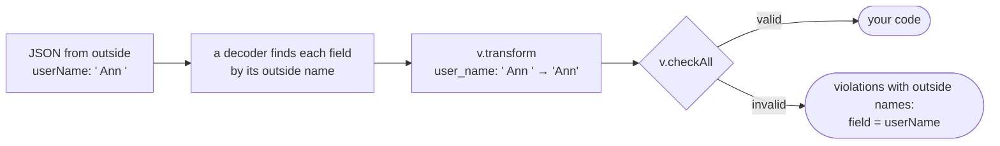

# validator

**Validation rules declared on your structs.** Write the rules of each field
next to the struct, check a value with one call, and get the first violation —
its code, message and path — without allocating. A rule that does not fit its
field is a compile error, not a surprise at run time.

```zig
const std = @import("std");
const log = @import("log");
const v = @import("validator");

const Plan = enum { free, pro, team };

const SignUp = struct {
    email: []const u8,
    plan: Plan,
    seats: u32,
    budget_eur: f64,
    accepted_terms: bool,
    referrer_id: ?u64 = null,

    // The rules of the fields. The validator finds them by this name, so the
    // struct must declare them as `pub const field_rules`.
    pub const field_rules = .{
        .email = v.email,
        .plan = v.oneOf(.{ .pro, .team }), // paid plans only
        .seats = v.range(1, 500),
        .budget_eur = v.min(10.0),
        .accepted_terms = v.equals(true),
        .referrer_id = v.positive, // null skips the rule
    };
};

pub fn main(init: std.process.Init) !void {
    const logger: log.Logger = try .init(init.gpa, init.io, .{
        .service = .{ .name = "user-service" },
        .format = .text,
    });
    defer logger.deinit();

    // The value to check, for example a decoded request body.
    const request: SignUp = .{
        .email = "ada@example.com",
        .plan = .team,
        .seats = 0,
        .budget_eur = 250.0,
        .accepted_terms = true,
    };

    // v.check allocates no memory, so it needs room from you to write the path
    // of the field that failed, such as "seats"; violation.field points into it.
    var path_buf: [256]u8 = undefined;
    if (v.check(&request, &path_buf)) |violation| {
        logger.warn("Invalid sign-up", .{ .field = violation.field, .code = violation.code, .reason = violation.message });
    }
}
```

It logs the first violation, the zero seats, as a line of text through
[zefir-log](../../log/examples/README.md); the timestamp differs in every run:

```text
$ zig build run
2026-10-13T09:41:07.415Z WARN  Invalid sign-up field=seats code=validation.range reason="must be from 1 to 500"
```

`path_buf` is where `v.check` writes the path of the field that failed: `seats`
here, `address.zip` for a field of a nested struct, `items[2].sku` for a field
of a list item. `v.check` allocates no memory, so you give it the room: a
buffer on the stack, whose contents before the call do not matter.
`violation.field` points into this buffer, so it is valid while the buffer
lives; copy the path if you need it longer. 256 bytes fit almost any path; a
longer one gives `field = null`, with `code` and `message` still set. To get
every violation, with paths of any length and no buffer, call
`v.checkAll(gpa, &request)`: it takes an allocator, and `report.deinit()` frees
the result.

`v.check` returns `?v.Violation`: `null` when the value is valid, otherwise the
first problem it found, with three fields:

| Field | Type | What it holds | In the example |
| --- | --- | --- | --- |
| `code` | `[]const u8` | a stable code for programs and clients: `validation.<rule>` for a built-in rule, or the code you gave `v.custom` or `v.fail` | `validation.range` |
| `message` | `[]const u8` | what the value must be, for people, without the field name: a built-in English message or your own | `must be from 1 to 500` |
| `field` | `?[]const u8` | the path of the value from the root; `null` for the root value itself | `seats` |

The record logs the message as `reason`, since zefir-log keeps `message` for the
record's own message, `Invalid sign-up`. `v.checkAll` returns all the violations
at once; see [Checking values](#checking-values).

## Contents

- [How it works](#how-it-works)
- [Installation](#installation)
- [Getting started](#getting-started)
- [Declaring rules](#declaring-rules)
- [Names and transforms](#names-and-transforms)
- [validateSelf and v.fail](#validateself-and-vfail)
- [v.custom](#vcustom)
- [Messages](#messages)
- [Checking values](#checking-values)
- [Testing a DTO package](#testing-a-dto-package)
- [Compile errors](#compile-errors)
- [Limits](#limits)
- [Compatibility](#compatibility)
- [All rules](#all-rules)

Rules by category: [Common](common.md) · [Numbers](numbers.md) · [Strings](strings.md) ·
[Formats](formats.md) · [Encodings](encodings.md) · [Identifiers](identifiers.md) ·
[Dates](dates.md) · [Lists](lists.md) ·
[Coming from class-validator](class_validator.md)

Examples that `zig build test` compiles and runs:
[Getting started](getting_started.zig) · [validateSelf](validate_self.zig) · [withMessage](with_message.zig) · [DTO package test](dto_test.zig) ·
[Names and transforms](names_and_transforms.zig) · [A codec by outside names](codec_test.zig)

## How it works


1. **Declare.** A struct lists the rules of its fields in `pub const field_rules`
   and checks across fields in `pub fn validateSelf`. Rules are values the
   compiler builds: `v.notEmpty`, `v.positive`, `v.each(...)`, `v.custom(...)`.
2. **Compile.** When a program calls `v.check` or `v.checkAll` for a type, or a
   test calls `comptime v.assertRules(T)`, the compiler checks the declarations
   of that type and of every type below it: each rule against its field's type,
   the keys of `field_rules`, the signature of `validateSelf`, field types the
   walk cannot enter. A mistake is a compile error that starts with `validator: `.
3. **Check.** `v.check(&value, &path_buf)` walks the value depth-first — fields
   in declaration order, items by index — and returns the first violation or
   `null`, allocating nothing. `v.checkAll(gpa, &value)` collects every
   violation, at most 100.

A value has at most one violation: its rules run left to right, the first one
that fails is its violation, and nothing inside it is checked after that.

> [!NOTE]
> confy does not run `field_rules`; to apply rules to a configuration, call
> `v.check` on it after `confy.load`.

## Installation

Add Zefir to your `build.zig.zon`; validator ships since v0.4.0:

```sh
zig fetch --save git+https://github.com/vkiryakov/zefir#dev
```

This guide is on the `dev` branch, so the command fetches its latest commit; `--save` pins that commit. For the latest release, v0.6.0, fetch `#v0.6.0` instead.

Then import the `zefir-validator` module in `build.zig`:

```zig
const zefir = b.dependency("zefir", .{
    .target = target,
    .optimize = optimize,
});

const exe = b.addExecutable(.{
    .name = "app",
    .root_module = b.createModule(.{
        .root_source_file = b.path("src/main.zig"),
        .target = target,
        .optimize = optimize,
        .imports = &.{
            .{ .name = "validator", .module = zefir.module("zefir-validator") },
        },
    }),
});
```

The validator works without other modules. The example programs of this guide
also log what they find with [zefir-log](../../log/examples/README.md), as text,
one line per record; to run them, import it too:
`.{ .name = "log", .module = zefir.module("zefir-log") }`.

> [!TIP]
> validator is also part of the umbrella module: with `zefir.module("zefir")`
> imported as `zefir`, it is `@import("zefir").validator`. Both are the same module.

## Getting started

Declare a struct with rules and check a value:

**`src/main.zig`**

```zig
const std = @import("std");
const log = @import("log");
const v = @import("validator");

const Currency = enum { eur, usd, gbp };

const Item = struct {
    sku: []const u8,
    quantity: u16,
    unit_price: f64,

    pub const field_rules = .{
        .sku = .{ v.length(6, 12), v.alphanumeric },
        .quantity = v.range(1, 99),
        .unit_price = v.positive,
    };
};

const Order = struct {
    id: []const u8,
    customer_id: u64,
    currency: Currency,
    items: []const Item, // every item is checked by the rules of Item
    express: bool = false,
    note: ?[]const u8 = null,

    pub const field_rules = .{
        .id = v.uuid, // one rule
        .customer_id = v.positive,
        .currency = v.oneOf(.{ .eur, .usd }),
        .items = .{ v.notEmpty, v.maxItems(50) }, // a tuple: its rules run in order
        .note = v.maxLength(500), // null skips the rule
    };
};

pub fn main(init: std.process.Init) !void {
    const logger: log.Logger = try .init(init.gpa, init.io, .{
        .service = .{ .name = "order-service" },
        .format = .text,
    });
    defer logger.deinit();

    const request: Order = .{
        .id = "3f9c1a2e-8b4d-4c6a-9e1f-5a7b2c8d0e41",
        .customer_id = 1042,
        .currency = .eur,
        .items = &.{
            .{ .sku = "BOOK0042", .quantity = 2, .unit_price = 12.5 },
            .{ .sku = "PEN0007", .quantity = 0, .unit_price = 1.9 },
        },
    };

    var path_buf: [256]u8 = undefined;
    if (v.check(&request, &path_buf)) |violation| {
        logger.warn("Invalid order", .{ .field = violation.field, .code = violation.code, .reason = violation.message });
    } else {
        logger.info("Order accepted", .{});
    }
}
```

It logs the first violation — the second item has a quantity of 0:

```text
$ zig build run
2026-10-13T09:41:07.415Z WARN  Invalid order field=items[1].quantity code=validation.range reason="must be from 1 to 99"
```

- `field` is the path of the value: field names joined by `.`, item indexes in
  brackets. `Item` declares rules of its own, so the walk enters every item of
  `items` and checks its fields; `items` itself has rules for the list as a
  whole.
- `message`, logged as `reason`, is a fragment without the field name or the
  value, and `code` names the rule, for clients that branch on it or translate
  it.
- `note` is `null`, so its rule is skipped; `express` has no rule at all.
- Fix the quantity and `v.check` returns `null`: the program logs
  `Order accepted`.

## Declaring rules

### field_rules

`field_rules` maps field names to rules: one rule, or a tuple of rules that run
left to right.

```zig
const Currency = enum { eur, usd, gbp, jpy };

const Order = struct {
    id: []const u8,
    quantity: u32,
    currency: Currency,
    coupons: []const []const u8,
    note: ?[]const u8 = null,

    pub const field_rules = .{
        .id = v.uuid, // one rule
        .quantity = .{ v.positive, v.max(1000) }, // a tuple
        .currency = v.oneOf(.{ .eur, .usd }), // some tags of the enum
        .coupons = .{ v.maxItems(3), v.uniqueItems, v.each(v.alphanumeric) },
        .note = v.maxLength(500), // null skips the rule
    };
};
```

- A key names a field of the struct. A misspelled key is a compile error with a
  suggestion: `validator: orders.Order.field_rules.quantiy: no such field; did you mean "quantity"?`.
- Fields are checked in declaration order, whatever the order of the keys.
- The first rule that fails is the field's only violation; the rules after it
  do not run.
- A field without a key has no rules of its own, but the walk still enters it
  when there are rules inside it. An empty `pub const field_rules = .{}` is
  allowed; an entry with an empty tuple, `.x = .{}`, is a compile error
  (`the list is empty`).
- Comptime fields are never checked; a key that names one is a compile error.
- An entry can also give the field an outside name and transforms, before its
  rules: `.email = .{ v.trim, v.toLower, v.email }`. See
  [Names and transforms](#names-and-transforms).

### Optional fields

A `null` in a `?T` field skips the field's rules and everything inside it; a
value is checked like a `T`. Presence is the job of the field type: a field that
must be present is not optional, and there is no `required` rule. `""` is a
value: `v.notEmpty` fails it.

```zig
const Checkout = struct {
    billing: ?Address = null, // the Address of Getting started
    tip_percent: ?u8 = null,
    coupon: ?[]const u8 = null,

    pub const field_rules = .{
        .tip_percent = v.max(30),
        .coupon = v.notEmpty, // null passes, "" fails
    };
};
```

An empty checkout, `.{}`, passes. With
`.billing = .{ .city = " ", .zip = "62701" }` the violation is `billing.city`
(`validation.not_blank`): the walk enters the address, and an optional adds no
segment to the path.

### Nested structs and lists

Struct fields, slices and arrays are walked automatically when there are rules
inside them:

```zig
const Item = struct {
    sku: []const u8,
    qty: u16,
    pub const field_rules = .{ .sku = v.notEmpty, .qty = v.positive };
};

fn inStock(item: *const Item) bool {
    return item.qty <= 500;
}

const Cart = struct {
    items: []const Item,
    pub const field_rules = .{
        // the list as a whole, then each item; Item's own rules check its fields
        .items = .{
            v.notEmpty,
            v.maxItems(50),
            v.uniqueBy(.sku),
            v.each(v.custom("orders.out_of_stock", "must be in stock", inStock)),
        },
    };
};
```

With items `{ "a", 1 }, { "b", 0 }` the violation is `items[1].qty`
(`validation.positive`); with `{ "a", 1 }, { "a", 2 }` it is `items`
(`validation.unique_items`, `must not contain duplicate sku values`); with one
item `{ "a", 600 }` it is `items[0]` (`orders.out_of_stock`).

- Rules of the list itself (`v.notEmpty`, `v.maxItems`, `v.uniqueBy`) come
  first; the rules of its items go into one `v.each(...)`, the last rule of the
  tuple.
- When a rule of the list fails, no item is checked. When an item's rule fails,
  that item is not entered; the other items are checked.
- Each item is walked once: first the `v.each` rules, then the rules of the
  item's own type.
- `v.each(v.each(rule))` applies `rule` to every item of every inner list of
  `[][]T`.
- `null` items of `[]const ?T` are skipped, and the indexes of the others stay
  as they are.
- The rules of an item struct's fields live in the item type: a parent cannot
  declare them. `v.each(v.custom(...))` checks an item as a whole.
- A rule declared on a struct field (such as `v.custom`) runs before anything
  inside that struct.

Unions, enums, opaque types, pointers, tuples, error unions and vectors are not
walked, and neither are slices with `volatile`, `allowzero` or an alignment
below that of their items. When one of them contains a type with rules, that is
a compile error naming the field: nothing is skipped silently. `field_rules` and
`validateSelf` belong on structs: on an enum, a union or an opaque type that the
walk reaches, they are a compile error too.

> [!NOTE]
> Containers that hide their item type — `std.HashMapUnmanaged`,
> `std.MultiArrayList` and similar — are not walked, and there is no error. Use
> slices in DTOs, or check such items in `validateSelf`. `std.ArrayList(T)` is a
> struct with `items: []T`, so its items are walked (`list.items[0].name`).

### Reusing rules

Rules are compile-time values, so a project declares its own once:

```zig
// rules.zig
const v = @import("validator");

pub const quantity = .{ v.positive, v.max(1000) }; // a tuple
pub const sku: v.Rule = v.notEmpty; // one rule
```

```zig
const v = @import("validator");
const rules = @import("rules.zig");

pub const Line = struct {
    sku: []const u8,
    qty: u16,
    pack: u32,
    pub const field_rules = .{
        .sku = rules.sku,
        .qty = rules.quantity, // the tuple is the whole entry
        .pack = rules.quantity ++ .{v.divisibleBy(2)}, // ++ joins tuples
    };
};
```

One declaration serves fields of different types, a `u16` and a `u32` here:
each use is checked against its own field. A tuple inside a tuple is not
flattened: `.pack = .{ rules.quantity, v.divisibleBy(2) }`
is a compile error (`item 0 of the tuple is a tuple; tuples are not flattened: join them with ++, e.g. name_rules ++ .{ v.notEmpty }, or use the tuple as the whole entry`).
Use a tuple as the whole entry, or join tuples with `++`.

A `v.Rule` exists only at compile time: keep rules in `const` declarations, or
return them from functions that take `comptime` parameters. A `var` or a struct
field that exists at run time cannot hold one.

> [!IMPORTANT]
> `field_rules` and `validateSelf` must be `pub`, with exactly these names. The
> validator finds them with `@hasDecl`, which sees only public declarations: a
> private `field_rules` is silently never checked, and neither `v.check` nor
> `v.assertRules` can tell. Other names are ignored the same way: `rules`,
> `fieldRules` and `validate_self`. A `pub fn validate` is left to confy,
> except one shaped like `validateSelf` (one `self` parameter, returning
> `?v.Violation`): that one is a compile error that tells you to rename it.
> Give every DTO a test with a value that must fail
> ([Testing a DTO package](#testing-a-dto-package)): it catches the rest.

## Names and transforms

> [!NOTE]
> Names and transforms are on the `dev` branch until the next release: v0.6.0
> does not have them.

Values that come from outside are rarely clean. People type a space after
their name, write their email as `Ann@Example.COM`, and tag a post `" Zig "`,
`zig` and `ZIG`, which are one tag. A rule is right to reject `" Ann"`, and it
cannot see that three spellings are one tag: a value must be brought to its
normal form before the rules check it. The names differ too: the JSON of a web
form calls a field `userName`, while the Zig struct calls it `user_name`.

Both describe a field, like its rules, so they go into the same entry of
`field_rules`, in this order:

```zig
.user_name = .{ v.rename("userName"), v.trim, v.notBlank, v.maxLength(100) },
```

1. **The outside name**, `v.rename("userName")`: what the field is called
   outside the program, in JSON both ways and in the paths of violations. At
   most one, and always first.
2. **Transforms**, such as `v.trim` and `v.toLower`: they bring the value to
   its normal form. They never reject it.
3. **Rules**, as in [Declaring rules](#declaring-rules): they check the value
   that the transforms made.

Each part is optional: `.id = v.rename("ID")` and `.email = v.trim` are whole
entries.

The validator itself reads no JSON. A decoder fills the struct, finding each
field by its outside name; `v.transform` runs the transforms; `v.checkAll` runs
the rules on the result; and only then does your code get the value:



### A talk proposal, from the form to the rules

A conference collects talk proposals through a web form. The form sends
camelCase keys and the values exactly as people typed them; the service keeps
Zig names and wants clean values before its rules run:

**`src/main.zig`**

```zig
const std = @import("std");
const log = @import("log");
const v = @import("validator");

/// Drops the spaces, dashes, dots and parentheses that people type between
/// the digits of a phone number: "+44 (20) 7946-0958" becomes
/// "+442079460958". Anything else stays, for the rule after it to judge.
fn normalizePhone(allocator: std.mem.Allocator, phone: []const u8) std.mem.Allocator.Error![]const u8 {
    const separators = " -.()";
    if (std.mem.findAny(u8, phone, separators) == null) return phone; // nothing to drop, nothing allocated
    const out = try allocator.alloc(u8, phone.len);
    var len: usize = 0;
    for (phone) |c| {
        if (std.mem.findScalar(u8, separators, c) != null) continue;
        out[len] = c;
        len += 1;
    }
    return out[0..len];
}

/// A phone number in E.164 form: "+" and 8 to 15 digits.
fn isE164(phone: []const u8) bool {
    if (phone.len < 9 or phone.len > 16 or phone[0] != '+') return false;
    for (phone[1..]) |c| {
        if (!std.ascii.isDigit(c)) return false;
    }
    return true;
}

const Speaker = struct {
    display_name: []const u8,
    email: []const u8,
    country: []const u8,
    phone: ?[]const u8 = null,

    // Per field, in this order: the outside name, the transforms, the rules.
    pub const field_rules = .{
        .display_name = .{ v.rename("displayName"), v.trim, v.notBlank, v.maxLength(60) },
        .email = .{ v.trim, v.toLower, v.email },
        .country = .{ v.trim, v.toUpper, v.length(2, 2), v.alpha },
        .phone = .{ // null skips it all
            v.transformWith(normalizePhone),
            v.custom("talks.phone_e164", "must be a phone number such as +442079460958", isE164),
        },
    };
};

const TalkProposal = struct {
    title: []const u8,
    duration_minutes: u16,
    tags: []const []const u8,
    speakers: []const Speaker, // every speaker gets the names and transforms of Speaker

    pub const field_rules = .{
        .title = .{ v.trim, v.length(10, 80) },
        .duration_minutes = .{ v.rename("durationMinutes"), v.oneOf(.{ 25, 50 }) },
        .tags = .{ v.maxItems(5), v.uniqueItems, v.each(.{ v.trim, v.toLower, v.notEmpty }) },
        .speakers = .{ v.notEmpty, v.maxItems(3) },
    };
};

pub fn main(init: std.process.Init) !void {
    const logger: log.Logger = try .init(init.gpa, init.io, .{
        .service = .{ .name = "talks-service" },
        .format = .text,
    });
    defer logger.deinit();

    // A proposal as a decoder read it from the form: found by the outside
    // names (durationMinutes, displayName), with the values as people typed them.
    var proposal: TalkProposal = .{
        .title = "  Comptime for the rest of us ",
        .duration_minutes = 30,
        .tags = &.{ " Zig ", "comptime", "ZIG" },
        .speakers = &.{
            .{ .display_name = " Ada Lovelace", .email = " Ada@Example.COM ", .country = "gb", .phone = "+44 (20) 7946-0958" },
            .{ .display_name = " \t", .email = "grace@example.org", .country = "US " },
        },
    };
    const before = proposal; // the strings and lists it points to stay as they are

    // What the transforms allocate lives in an arena, freed with the request.
    var arena: std.heap.ArenaAllocator = .init(init.gpa);
    defer arena.deinit();
    try v.transform(arena.allocator(), &proposal); // 1. the transforms

    logger.info("Normalized", .{ .field = "title", .before = before.title, .after = proposal.title });
    logger.info("Normalized", .{ .field = "tags", .before = before.tags, .after = proposal.tags });
    logger.info("Normalized", .{ .field = "speakers[0].email", .before = before.speakers[0].email, .after = proposal.speakers[0].email });
    logger.info("Normalized", .{ .field = "speakers[0].country", .before = before.speakers[0].country, .after = proposal.speakers[0].country });
    logger.info("Normalized", .{ .field = "speakers[0].phone", .before = before.speakers[0].phone, .after = proposal.speakers[0].phone });

    const report = try v.checkAll(init.gpa, &proposal); // 2. the rules, on the normalized value
    defer report.deinit();
    for (report.violations) |violation| {
        logger.warn("Invalid proposal", .{ .field = violation.field, .code = violation.code, .reason = violation.message });
    }
}
```

It logs what the transforms changed, then what the rules still find:

```text
$ zig build run
<!-- OUTPUT: names_and_transforms -->
```

- **The rules check the normal form.** The email passes `v.email` only
  without its spaces. `" Zig "` and `"ZIG"` both become `zig`, so
  `v.uniqueItems` sees a duplicate that the raw values hid.
- **Violations name fields by their outside names**: `durationMinutes`, and
  `speakers[1].displayName` for a field of a list item. A client that sent
  `displayName` reads `displayName` in the answer.
- **The second speaker's name** is a space and a tab: `v.trim` leaves `""`,
  and `v.notBlank` reports it.
- **`phone` is optional.** The first speaker's number goes through
  `normalizePhone`, a function of the program; the second speaker has none, so
  nothing runs.
- **`before` still holds what the form sent.** `v.transform` never writes into
  a list: it copied `tags` and `speakers` into the arena and changed the
  copies.
- **A name fits any field**: `durationMinutes` is a `u16`. Transforms are for
  strings, or for any type with a function of your own.

### Transform first, then check

`v.transform` runs the transforms and skips the rules; `v.check` and
`v.checkAll` run the rules and never transform. So a handler calls them in
this order:

1. decode the request, finding the fields by their outside names;
2. `try v.transform(arena, &request)`: the transforms;
3. `v.check` or `v.checkAll`: the rules, on the normalized value;
4. your code.

Skip step 2, and the rules check the raw values: `" Ada@Example.COM "` fails
`v.email` because of its spaces, and `" Zig "` and `"ZIG"` pass
`v.uniqueItems` as two different tags.

The order inside an entry is fixed for the same reason: name, transforms,
rules. A transform after a rule is a compile error, so an entry reads the way
it runs: `.email = .{ v.trim, v.toLower, v.email }` trims, lowercases, then
checks.

### v.rename

`v.rename("displayName")` gives a field the name it has outside the program.

- **Both ways.** A decoder finds the field by this name, an encoder writes it,
  and the paths of violations use it: `displayName`, `speakers[1].displayName`.
  A field without `v.rename` is called outside as it is in Zig.
- **The name** is 1 to 64 characters from `A-Z`, `a-z`, `0-9`, `_` and `-`,
  so that it fits a JSON key and a query parameter alike.
- **The outside names of a struct differ**, renamed or not: a decoder could
  not tell two fields of one name apart. `.user_name = v.rename("login")` in a
  struct that also has a field `login` is a compile error.
- **Any field type** takes a name: strings, numbers, enums, nested structs,
  lists.
- **List items have no name**, so `v.rename` never goes inside `v.each`.

<details>
<summary>Names in validateSelf and v.fail</summary>

`v.fail(@This(), .display_name, ...)` takes the Zig name of the field, as
before, and the walk reports the violation at the field's outside name:
`speakers[1].displayName`. The `field` of the violation that `v.fail` itself
returns holds the Zig name; `v.check` and `v.checkAll` turn it into the path.

</details>

### The built-in transforms

| Transform | What it does | Before | After | Allocates |
| --- | --- | --- | --- | --- |
| `v.trim` | strips white space from both ends | `"  Ada Lovelace\t"` | `"Ada Lovelace"` | never: the result is a part of the same string |
| `v.trimStart` | strips white space from the start | `"  Ada "` | `"Ada "` | never |
| `v.trimEnd` | strips white space from the end | `"  Ada "` | `"  Ada"` | never |
| `v.toLower` | turns the ASCII letters `A-Z` into `a-z` | `"Ada@Example.COM"` | `"ada@example.com"` | a new string, only when some letter changes |
| `v.toUpper` | turns the ASCII letters `a-z` into `A-Z` | `"gb"` | `"GB"` | as `v.toLower` |

- **They take strings**: a `[]const u8` field, or a `?[]const u8` one, where
  they run when the value is there. On a list of strings they go inside
  `v.each`. Any other type is a compile error, `[:0]const u8` and `[]u8`
  included: a transform returns a new `[]const u8`.
- **White space** is what `v.notBlank` treats as blank: the 25 code points of
  Unicode White_Space. Besides the space, the tab and the line breaks, they
  include the no-break space U+00A0 that comes with text copied from a web
  page, and the ideographic space U+3000 of Chinese and Japanese input.
- A string of white space alone becomes `""`, which `v.notBlank` and
  `v.notEmpty` then reject.
- **Case changes only for the ASCII Latin letters** in this version, since
  std has no Unicode case tables: `v.toLower` turns `"ÄRGER"` into `"Ärger"`,
  and `v.toUpper` turns `"straße"` into `"STRAßE"`. That is all that emails,
  country codes and currency codes need. For other text, write the function
  yourself with `v.transformWith`.

<details>
<summary>The 25 code points, and strings that are not UTF-8</summary>

- White space: TAB, LF, VT, FF, CR, space, U+0085, U+00A0, U+1680,
  U+2000-200A, U+2028, U+2029, U+202F, U+205F and U+3000, the list of
  [v.notBlank](strings.md#vnotblank).
- Format characters and fillers are content and stay, as for `v.notBlank`:
  U+200B, U+FEFF, U+2060, U+180E, U+3164.
- A string that is not valid UTF-8 is not trimmed: it stays as it is, and the
  rule after the transform, `v.utf8` or any rule that reads code points,
  rejects it. `v.toLower` and `v.toUpper` change the ASCII bytes of such a
  string and leave the other bytes alone.

</details>

### v.transformWith

`v.transformWith(f)` runs a function of your own. `f` takes the allocator and
the value and returns the new value:

```zig
fn (allocator: std.mem.Allocator, value: T) E!T // or, when it cannot fail:
fn (allocator: std.mem.Allocator, value: T) T
```

`T` is exactly the field type without `?`, and inside `v.each` the item type
without `?`. Any type works, not only strings: on a `u32` field,
`fn (std.mem.Allocator, u32) u32`.

The example's `normalizePhone` drops the separators of a phone number:
`"+44 (20) 7946-0958"` becomes `"+442079460958"`. It shows the three habits of
a good transform:

- **Return the value itself when nothing changes.** Nothing is allocated, and
  a list whose items stay the same is not copied.
- **Allocate from `allocator`**, the one given to `v.transform`, and never free
  the value you got: it belongs to the decoder.
- **Do not judge the value.** When a value cannot be normalized, return it as
  it is, and let a rule after the transform report it with a code and a path:
  `normalizePhone` keeps letters, and its `v.custom` rule rejects them as
  `talks.phone_e164`.

An error that `f` returns stops `v.transform` and comes out of it as it is.
Keep errors for failures of the transform itself, such as `error.OutOfMemory`:
no rule runs, and the request fails as a whole, without violations.
`v.TransformError(T)`, the error set of `v.transform` on a `*T`, is exact:
`error.OutOfMemory` and the errors of every `v.transformWith` function that
the walk reaches from `T`. For `TalkProposal` it is `error{OutOfMemory}`; a
function that returns `error{TagTooLong}![]const u8` would add `TagTooLong`.

<details>
<summary>After an error, and what f may do</summary>

- After an error the value may be partly transformed: some fields changed,
  others not yet. Do not use it; free the arena.
- Keep `f` pure, like a `v.custom` function: no I/O, no global state, the same
  result for the same value. It may allocate from `allocator`.
- A generic function, a pointer to a function or any other shape is a compile
  error that shows the type it got and the signature to write.

</details>

### Lists, optionals and nested structs

`v.transform` walks a value the way `v.checkAll` does: the fields of nested
structs, the value inside an optional, the items of slices and arrays. A
struct's own `field_rules` apply wherever it appears, as `Speaker`'s apply to
every speaker.

- **Items.** `v.each` takes transforms too, before its rules:
  `v.each(.{ v.trim, v.toLower, v.notEmpty })` normalizes every item, then
  checks it. Transforms alone make an entry too: `v.each(v.trim)`.
- **Optionals.** `null` skips the transforms along with the rules; a value is
  transformed like a `T`. `null` items of a list are skipped.
- **Order.** The parts of a value come first, then its own transforms, left
  to right: the items of a list before the transforms of the list, the fields
  of a struct before the transforms of the field that holds it. Fields go in
  declaration order. So a `v.transformWith` on a whole list, one that sorts
  the tags for example, gets them already trimmed.
- **Lists are copied, never written to.** A slice may be shared, or live in
  read-only memory, like the `&.{ ... }` literals of the example. When an item
  changes, `v.transform` copies the slice into the allocator, once, at the
  first item that changes, and puts the copy in the field; a list whose items
  all stay as they are is not copied. Arrays, `[N]T`, and the fields of
  structs change in place.

### Memory

`v.transform` frees nothing. The strings and lists that it replaces belong to
whoever made them, the decoder or your program, and the ones it makes are what
the value now points to. So give it an arena that lives as long as the value,
usually the arena of the request, and free everything at once when the request
is done:

| What | Allocates |
| --- | --- |
| `v.trim`, `v.trimStart`, `v.trimEnd` | never: the result is a part of the same string |
| `v.toLower`, `v.toUpper` | one new string, only when some letter changes |
| `v.transformWith(f)` | what `f` takes from the allocator |
| a slice with a changed item | one copy of the slice, made at the first changed item |
| a type without transforms | nothing: `v.transform` does not even read the value |

- **Who frees:** the owner of the arena, with `defer arena.deinit()`. After
  that, the value points into freed memory: copy out whatever must live longer.
- **The decoder's arena is the natural choice.** The decoded strings, the
  transformed ones and the copied lists then live and die together.
- **A DTO without transforms costs nothing**, so code that reads or writes
  many types can call `v.transform` on each of them without asking whether
  the type has transforms.
- **`v.checkAll` keeps its own memory**: its `Report` comes from the allocator
  you give it, the `gpa` of the example, until `report.deinit()`.

<details>
<summary>Threads</summary>

`v.transform` writes the value: no other thread may read or check it during
the call. Values that share nothing can be transformed on several threads at
once, each with its own arena.

</details>

### Names for codecs: v.nameOf and v.fieldNamed

A codec, the code that reads a struct from JSON, a query string or a form and
writes it back, takes the outside names from the validator:

```zig
pub fn nameOf(comptime T: type, comptime field: std.meta.FieldEnum(T)) []const u8
pub fn fieldNamed(comptime T: type, name: []const u8) ?std.meta.FieldEnum(T)
```

- `v.nameOf(T, .tracking_number)` is `"trackingNumber"`: the name that the
  entry gives the field with `v.rename`, or else its Zig name. It works for any
  struct, with `field_rules` or without, and it is known at compile time.
- `v.fieldNamed(T, key)` goes the other way, for the keys that a decoder
  reads: the field, or `null` for a key that names none. It works at run time,
  from a table built at compile time. A renamed field is found by its outside
  name only, never by its Zig name.

`std.json` knows nothing of `v.rename`: `std.json.parseFromSlice` reads Zig
names, so it would look for `tracking_number`. A codec of your own bridges the
two. This test shows a small one: `decode` puts each key under the Zig name of
its field and lets std.json fill the struct, `encode` writes the outside names,
and in between the event goes through `v.transform` and `v.check`:

```zig
const std = @import("std");
const v = @import("validator");

const Status = enum { label_created, in_transit, delivered };

/// An event from a courier's webhook, whose JSON names fields in camelCase.
const ParcelEvent = struct {
    tracking_number: []const u8,
    status: Status,
    eta_days: ?u8 = null,

    pub const field_rules = .{
        .tracking_number = .{ v.rename("trackingNumber"), v.trim, v.toUpper, v.alphanumeric },
        .eta_days = .{ v.rename("etaDays"), v.max(30) },
    };
};

/// Reads a JSON object into a `T` by the outside names of its fields: each
/// key goes under the Zig name of its field, and std.json fills the struct.
/// One level deep: the fields of nested structs keep their Zig names.
fn decode(comptime T: type, arena: std.mem.Allocator, text: []const u8) !T {
    const outside = try std.json.parseFromSliceLeaky(std.json.Value, arena, text, .{});
    if (outside != .object) return error.UnexpectedToken;
    var inside: std.json.ObjectMap = .empty;
    for (outside.object.keys(), outside.object.values()) |key, value| {
        const field = v.fieldNamed(T, key) orelse return error.UnknownField;
        try inside.put(arena, @tagName(field), value);
    }
    return std.json.parseFromValueLeaky(T, arena, .{ .object = inside }, .{});
}

/// Writes a `T` as a JSON object, with the outside names as keys.
fn encode(w: *std.Io.Writer, value: anytype) std.Io.Writer.Error!void {
    const T = @TypeOf(value);
    var json: std.json.Stringify = .{ .writer = w };
    try json.beginObject();
    inline for (comptime std.meta.tags(std.meta.FieldEnum(T))) |field| {
        try json.objectField(v.nameOf(T, field));
        try json.write(@field(value, @tagName(field)));
    }
    try json.endObject();
}

test "the codec reads and writes the fields by their outside names" {
    var arena: std.heap.ArenaAllocator = .init(std.testing.allocator);
    defer arena.deinit();

    const body =
        \\{"trackingNumber": " 1z999aa10123456784 ", "status": "in_transit", "etaDays": 2}
    ;
    var event = try decode(ParcelEvent, arena.allocator(), body);
    try v.transform(arena.allocator(), &event);
    var path_buf: [256]u8 = undefined;
    try std.testing.expectEqual(null, v.check(&event, &path_buf));

    var out: std.Io.Writer.Allocating = .init(arena.allocator());
    try encode(&out.writer, event);
    try std.testing.expectEqualStrings(
        \\{"trackingNumber":"1Z999AA10123456784","status":"in_transit","etaDays":2}
    , out.written());
}

test "a renamed field is found by its outside name only" {
    try std.testing.expectEqualStrings("trackingNumber", v.nameOf(ParcelEvent, .tracking_number));
    try std.testing.expectEqualStrings("status", v.nameOf(ParcelEvent, .status));
    try std.testing.expect(v.fieldNamed(ParcelEvent, "trackingNumber") == .tracking_number);
    try std.testing.expect(v.fieldNamed(ParcelEvent, "tracking_number") == null);

    var arena: std.heap.ArenaAllocator = .init(std.testing.allocator);
    defer arena.deinit();
    const zig_names =
        \\{"tracking_number": "1Z999AA10123456784", "status": "delivered"}
    ;
    try std.testing.expectError(error.UnknownField, decode(ParcelEvent, arena.allocator(), zig_names));
}
```

`decode` reads one level, which is enough for a flat event; a codec for nested
structs and lists asks the same two questions at every level.

<details>
<summary>Comptime fields</summary>

A comptime field is never read from outside: `v.fieldNamed` does not find it,
and it may share its name with another field. `v.nameOf` gives its Zig name.

</details>

### Compile errors of names and transforms

A mistake in a name or a transform is a compile error, like a rule that does
not fit its field. For example, the build prints (file and line numbers
shortened):

```text
<!-- OUTPUT: compile errors -->
```

As in the errors of rules, a transform is named by its label: `trim`,
`trim_start`, `to_lower`, `transform_with(...)`.

| You wrote | The error ends with |
| --- | --- |
| `.email = .{ v.trim, v.rename("mail") }`: the name after a transform | `rename comes first: name, then transforms, then rules` |
| `.email = .{ v.rename("mail"), v.rename("eMail") }` | `rename appears twice; a field has one outside name` |
| `.email = .{ v.email, v.trim }`: a transform after a rule | `email is a rule; transforms (trim) must come before the rules` |
| `.tags = v.each(.{ v.rename("tag"), v.trim })` | `rename inside each: list items have no name` |
| `.duration_minutes = v.trim` on a `u16` | `trim expects a string, field is u16` |
| `.tags = v.trim` on a list of strings | `trim expects a string, field is []const []const u8; use v.each(v.trim)` |
| `.code = v.trim` on a `[:0]const u8` | `trim expects []const u8, field is [:0]const u8; transforms take and return []const u8` |
| `.login = v.rename("displayName")` next to `.display_name = v.rename("displayName")` | `display_name and login are both named "displayName" outside` |
| `v.rename("display name")` | `rename("display name"): an outside name is 1 to 64 characters from A-Z, a-z, 0-9, '_' and '-'` |
| `v.transformWith(f)` with `fn ([]const u8) []const u8` | `transform_with(...) is fn ([]const u8) []const u8; write fn (allocator: std.mem.Allocator, value: []const u8) E![]const u8` |
| `v.transform(arena, &request)` on a `const request` | `transform changes the value: pass a pointer to a var (&value), got *const ...` |

## validateSelf and v.fail

A check across fields goes into `pub fn validateSelf(self: *const T) ?v.Violation`:

```zig
const std = @import("std");
const log = @import("log");
const v = @import("validator");

const Room = enum { single, double, family };

const Booking = struct {
    room: Room,
    guests: u16,
    check_in: []const u8,
    check_out: []const u8,

    pub const field_rules = .{
        .guests = v.positive,
        .check_in = v.date,
        .check_out = v.date,
    };

    pub fn validateSelf(self: *const Booking) ?v.Violation {
        // It runs only when every field passed: both dates are YYYY-MM-DD, so
        // they compare as strings.
        if (!std.mem.lessThan(u8, self.check_in, self.check_out))
            return v.fail(@This(), .check_out, "bookings.check_out_too_early", "must be after the check-in date");
        const beds: u16 = switch (self.room) {
            .single => 1,
            .double => 2,
            .family => 4,
        };
        if (self.guests > beds)
            return v.fail(@This(), null, "bookings.too_many_guests", "must have a bed for every guest");
        return null;
    }
};

const Trip = struct {
    bookings: []const Booking,

    pub const field_rules = .{ .bookings = .{ v.notEmpty, v.maxItems(10) } };
};

pub fn main(init: std.process.Init) !void {
    const logger: log.Logger = try .init(init.gpa, init.io, .{
        .service = .{ .name = "booking-service" },
        .format = .text,
    });
    defer logger.deinit();

    const trip: Trip = .{
        .bookings = &.{
            // three guests, two beds: the booking itself
            .{ .room = .double, .guests = 3, .check_in = "2026-07-01", .check_out = "2026-07-05" },
            // checks out before it checks in: check_out
            .{ .room = .single, .guests = 1, .check_in = "2026-07-05", .check_out = "2026-07-03" },
            // guests fails, so validateSelf does not run
            .{ .room = .family, .guests = 0, .check_in = "2026-07-09", .check_out = "2026-07-09" },
        },
    };

    const report = try v.checkAll(init.gpa, &trip);
    defer report.deinit();
    for (report.violations) |violation| {
        logger.warn("Invalid trip", .{ .field = violation.field, .code = violation.code, .reason = violation.message });
    }
}
```

It logs:

```text
$ zig build run
2026-10-13T09:41:07.415Z WARN  Invalid trip field=bookings[0] code=bookings.too_many_guests reason="must have a bed for every guest"
2026-10-13T09:41:07.415Z WARN  Invalid trip field=bookings[1].check_out code=bookings.check_out_too_early reason="must be after the check-in date"
2026-10-13T09:41:07.416Z WARN  Invalid trip field=bookings[2].guests code=validation.positive reason="must be greater than 0"
```

- `validateSelf` runs after all fields of its struct, and only when none of
  them, at any depth, had a violation in this call; nested structs run theirs
  first. So it can rely on the rules of the fields: here both dates are valid
  `YYYY-MM-DD`. The third booking checks out on the day it checks in, but its
  `guests` field fails, so its `validateSelf` does not run.
- It returns one violation, or `null` when the value is valid. An `inline fn` is
  accepted; any other signature is a compile error that shows the expected one.
- `v.fail(@This(), .field, code, message)` builds the violation and checks it at
  compile time: the field must be a non-comptime field of the struct, the code
  follows the [custom code grammar](#vcustom), and the message is 1-512 bytes of
  valid UTF-8. A misspelled field is Zig's own error at your line, such as
  `enum 'meta.FieldEnum(bookings.Booking)' has no member named 'chek_out'` for
  `Booking` in `bookings.zig`.
- The walk appends the field to the struct's path: `bookings[1].check_out`. A
  `null` field gives the struct's own path, `bookings[0]`, and `field = null`
  for the root.
- `validateSelf` must be pure: no I/O, no global state, no allocation, the same
  answer every time. `check` and `checkAll` may call it a different number of
  times.
- Conditional rules (class-validator's `@ValidateIf`) are code in `validateSelf`.

A violation built by hand, `.{ .code = ..., .message = ..., .field = "check_out" }`,
compiles too, but nothing checks it at compile time. So the walk checks every
result of `validateSelf` at run time — the code grammar, the message, the field
name — and a malformed one is a programmer error:

| Build mode | A malformed result |
| --- | --- |
| Debug | panics: `validator: <Type>.validateSelf returned a malformed violation: …` |
| ReleaseSafe, ReleaseFast, ReleaseSmall | becomes `validation.invalid` / `is invalid` at the struct's path |

> [!WARNING]
> The `code` and `message` of a hand-built violation must be static strings:
> literals or comptime values. The violation outlives the call — `check` returns
> it, a `Report` keeps it — so a string built from `self` would put data from the
> value into logs and responses, or dangle. `v.fail` guarantees static strings;
> when the field is chosen at run time, `switch` over it with one `v.fail` per
> field.

## v.custom

```zig
pub fn custom(comptime code: []const u8, comptime message: []const u8, comptime f: anytype) v.Rule
```

A rule with your own predicate: it passes when `f` returns `true`; otherwise the
violation has your code and message.

```zig
fn startsWithAt(s: []const u8) bool {
    return s.len > 0 and s[0] == '@';
}

fn isEven(n: u64) bool {
    return n % 2 == 0;
}

const Profile = struct {
    handle: [:0]const u8,
    seats: u16,
    pub const field_rules = .{
        .handle = v.custom("profiles.handle_format", "must start with @", startsWithAt),
        .seats = .{ v.positive, v.custom("profiles.odd_seats", "must be even", isEven) },
    };
};
```

**The function** is the function itself (not a pointer to it) with one parameter
and a `bool` result. `T` below is the field type without `?` (inside `v.each`,
the item type); the parameter must be a type that `T` converts to without loss:

| Parameter of `f` | Accepted when | Example |
| --- | --- | --- |
| `T` | always | `fn (u32) bool` on `u32` |
| an integer `P` | the same signedness and `P` at least as wide, or `T` unsigned and `P` signed and wider | `fn (u64) bool` on `u8`, `u16`, `u32`; `fn (i64) bool` on `u32` |
| a float `P` | `P` at least as wide as `T` | `fn (f64) bool` on `f32` |
| a slice or a pointer `P` | the same kind and item type, adding `const` or dropping the sentinel | `fn ([]const u8) bool` on `[]u8`, `[:0]const u8`, `[:0]u8`; `fn ([]const Item) bool` on `[]Item` |
| `?Q` | `T` is accepted for `Q` | `fn (?u32) bool` on `u32` |
| `E!Q` | `T` is accepted for `Q` | `fn (anyerror!u32) bool` on `u32` |
| `*const Q` | `T` is accepted for `Q` | `fn (*const Item) bool` on `Item` (a pointer to the field itself); `fn (*const u64) bool` on `u16` (to a converted copy) |

Anything else is a compile error that names what was expected: a narrower
integer, a signed field with an unsigned parameter, an unsigned field with a
signed parameter that is not wider, a pointer or slice with different
`volatile` or `align` attributes, `*T`, an `anytype` or `comptime` parameter,
zero or several parameters, a result other than `bool`. An `inline fn` is
accepted.

```text
validator: users.Account.field_rules.age: custom("users.ok", ...): f must be fn (P) bool or fn (*const P) bool where u32 coerces to P, got fn (i8) bool
```

When `f` fits the items of a list field, the error ends with
`; use v.each(v.custom(...))`.

**The code** is ASCII segments `[a-z][a-z0-9_]*` joined by `.`: at least two
segments, at most 128 bytes (`v.max_code_bytes`), not starting with
`validation.` or `rpc.`:

```text
code    = segment 1*("." segment)                 ; at least 2 segments
segment = %x61-7A *(%x61-7A / DIGIT / "_")        ; [a-z][a-z0-9_]*
```

| Code | Compile error |
| --- | --- |
| `users.name_taken`, `orders.v2.limit`, `a.b1_`, `validationx.y`, `x.validation` | none: accepted |
| longer than 128 bytes (checked first) | `is longer than 128 bytes` |
| `users..taken`, `.users`, `users.` | `has an empty segment` |
| `users.Taken`, `users.name-taken`, `users.café` | `has a character outside [a-z0-9_.]` |
| `users.2fa`, `_a.b` | `has a segment that does not start with a letter` |
| `users` | `needs at least 2 segments` |
| `validation.mine`, `rpc.mine` (checked last) | `uses a reserved prefix (validation., rpc.)` |

`validation.` is reserved for the codes of the built-in rules and `rpc.` for
zefir's RPC module. Start a code with your service or domain:
`users.name_taken`, `orders.end_before_start`. The same grammar applies to
`v.fail` and to every `validateSelf` result.

**The message** is literal: 1-512 bytes (`v.max_message_bytes`) of valid UTF-8,
counted in bytes, so a Cyrillic letter takes two. Braces are plain characters
here; a message given later with `.withMessage` is a template
([Messages](#messages)).

**Behaviour.** There is no precondition: `f` sees NaN, invalid UTF-8 and `""`.
The rule works on a field of any type, unions and structs included, inside
`v.each`, and several times on one field (the first one that fails is
reported). `f` must be pure: no I/O, no global state, no allocation, the same
answer every time, bounded in time; it must not keep a pointer it receives.

## Messages

A built-in rule reports its code and a **default message**: English, a fragment
in lower case that starts with `must` and has no trailing period. It names
neither the field (the path is in `field`) nor the value (a violation never
contains it), and it shows the parameters of the rule, which are known when the
program is compiled: `v.min(18)` says `must be at least 18`. The compiler also
chooses the singular or the plural (`must have at least 1 item`,
`must have at least 2 items`), the variant for one listed value
(`v.oneOf(.{.admin})` says `must be admin`) and the variant for equal bounds
(`v.range(7, 7)` says `must be 7`). The page of each rule lists its messages.

### .withMessage

```zig
pub fn withMessage(comptime rule: v.Rule, comptime template: []const u8) v.Rule
```

`rule.withMessage(template)` returns a copy of the rule with another message;
the code stays. The template must be known at compile time (a literal, a
`const`, or `++` of them): the compiler fills in the placeholders, and the rule
keeps the result as a static string.

```zig
const std = @import("std");
const log = @import("log");
const v = @import("validator");

const Role = enum { admin, editor, viewer };
const Language = enum { en, de, fr, ja };

// A rule with a message is a value: declare it once, use it on any field.
const filled = v.notEmpty.withMessage("please fill in this field");

const Profile = struct {
    name: []const u8,
    nickname: []const u8,
    age: u8,
    role: Role,
    languages: []const Language,
    website: ?[]const u8 = null,
    height: f64,
    weight: f64,

    pub const field_rules = .{
        .name = filled,
        .nickname = filled,
        .age = v.range(18, 120).withMessage("age must be from {min} to {max}"),
        .role = v.oneOf(.{ .admin, .editor }).withMessage("role must be one of: {values}"),
        .languages = v.maxItems(2).withMessage("at most {max} languages"),
        .website = v.httpUrl.withMessage("website must be a link such as https://example.com"),
        .height = v.positive.withMessage("height must be above zero"), // NaN keeps validation.finite
        .weight = .{ v.finite.withMessage("weight must be a number"), v.positive },
    };
};

pub fn main(init: std.process.Init) !void {
    const logger: log.Logger = try .init(init.gpa, init.io, .{
        .service = .{ .name = "profile-service" },
        .format = .text,
    });
    defer logger.deinit();

    const profile: Profile = .{
        .name = "",
        .nickname = "ada",
        .age = 17,
        .role = .viewer,
        .languages = &.{ .en, .fr, .de },
        .website = "example.com",
        .height = std.math.nan(f64),
        .weight = std.math.nan(f64),
    };

    const report = try v.checkAll(init.gpa, &profile);
    defer report.deinit();
    for (report.violations) |violation| {
        logger.warn("Invalid profile", .{ .field = violation.field, .code = violation.code, .reason = violation.message });
    }
}
```

It logs the violation of every field that fails (`nickname` passes). The codes
are the rules' own, and the messages come from the templates, except for
`height`, whose precondition keeps its own:

```text
$ zig build run
2026-10-13T09:41:07.415Z WARN  Invalid profile field=name code=validation.not_empty reason="please fill in this field"
2026-10-13T09:41:07.415Z WARN  Invalid profile field=age code=validation.range reason="age must be from 18 to 120"
2026-10-13T09:41:07.415Z WARN  Invalid profile field=role code=validation.one_of reason="role must be one of: admin, editor"
2026-10-13T09:41:07.415Z WARN  Invalid profile field=languages code=validation.max_items reason="at most 2 languages"
2026-10-13T09:41:07.416Z WARN  Invalid profile field=website code=validation.http_url reason="website must be a link such as https://example.com"
2026-10-13T09:41:07.416Z WARN  Invalid profile field=height code=validation.finite reason="must be a finite number"
2026-10-13T09:41:07.416Z WARN  Invalid profile field=weight code=validation.finite reason="weight must be a number"
```

- `.withMessage` works on every rule except `v.each`, which has no message of
  its own: put it on the rules inside, `v.each(v.notEmpty.withMessage("..."))`.
- It replaces the message of the rule's own check and never changes the code.
  A violation of a precondition keeps its code and message, as `height` shows
  ([Preconditions](#preconditions)).
- A second `.withMessage` replaces the first:
  `v.minItems(8).withMessage("a {min}").withMessage("b {min}")` says `b 8`. The
  rule that `.withMessage` was called on keeps its message.
- A rule with a message is a value like any rule: `filled` above is declared
  once and used on two fields, and a tuple of rules with messages can be the
  whole entry of a field ([Reusing rules](#reusing-rules)).
- The message of `v.custom` and `v.fail` is literal text, braces included. A
  template given to `.withMessage` on a `v.custom` rule is read like any other,
  and `v.custom` has no placeholders.

### Placeholders

A placeholder is the name of a parameter of the rule in braces. `.withMessage`
replaces it with the parameter as the default message shows it. The names belong
to the contract of a rule, like its code.

| Placeholder | Rules | The parameter | Shown as |
| --- | --- | --- | --- |
| `{expected}` | `v.equals` | the value | a value, as below |
| `{forbidden}` | `v.notEquals` | the value | a value, as below |
| `{values}` | `v.oneOf`, `v.noneOf`, `v.containsAll`, `v.containsNone` | the listed values | each value as below, joined with `, ` |
| `{min}` | `v.min`, `v.range`, `v.minLength`, `v.length`, `v.minBytes`, `v.minDate`, `v.minItems` | the lower bound; the least number of characters, bytes or items; the earliest date | a number as written; a count in decimal; a date bound as written |
| `{max}` | `v.max`, `v.range`, `v.maxLength`, `v.length`, `v.maxBytes`, `v.maxDate`, `v.maxItems` | the upper bound; the largest number of characters, bytes or items; the latest date | as `{min}` |
| `{divisor}` | `v.divisibleBy` | the divisor | an integer in decimal |
| `{seed}` | `v.contains`, `v.notContains` | the substring | a string as below |
| `{min_length}`, `{min_lowercase}`, `{min_uppercase}`, `{min_numbers}`, `{min_symbols}` | `v.strongPassword` | the options of the same names, all five also when 0 | an integer in decimal |
| `{min_decimal_digits}`, `{max_decimal_digits}` | `v.decimal` | the options of the same names; `{max_decimal_digits}` only when the option is set | an integer in decimal |
| `{algorithm}` | `v.hash` | the algorithm | its tag name, without the dot: `sha256` |
| `{network}` | `v.btcAddress` | the network | its tag name, without the dot: `mainnet`, `testnet` or `any` |
| `{key}` | `v.uniqueBy` | the key | the field name, without the dot |

A rule that is not listed has no placeholders, and the page of each rule names
its own. A placeholder that the rule does not have is a compile error that lists
the ones it has.

A parameter is shown the same way in a default message and in a placeholder:

| A value | Shown as | Example |
| --- | --- | --- |
| an integer | decimal | `v.max(255)`: `must be at most 255` |
| a float | decimal digits when 1e-6 ≤ \|x\| < 1e21, scientific notation otherwise; `0.0` and `-0.0` as `0` | `v.min(0.5)`: `must be at least 0.5`; `v.max(1e-7)`: `must be at most 1e-7` |
| a `bool` | `true` or `false` | `v.notEquals(false)`: `must not be equal to false` |
| an enum tag | its name, without the dot | `v.equals(.admin)`: `must be equal to admin` |
| a string | escaped, without quotes; the empty string as `""` | `v.oneOf(.{ "", "x" })`: `must be one of: "", x` |
| a list | its values joined with `, ` | `v.oneOf(.{ 1, 2, 3 })`: `must be one of: 1, 2, 3` |

- A number is shown as written, before it is converted to the field type:
  `v.max(0.1)` on an `f32` field says `must be at most 0.1`, not
  `0.10000000149011612`.
- Escaping is that of `std.zig.fmtString`, so a message stays on one line: `\n`,
  `\r`, `\t`, `\\` and `"` are escaped, and control bytes, invalid UTF-8, U+0085,
  U+2028, U+2029 and U+FEFF are written in hex (`\xe2\x80\xa8`). Cyrillic and other
  valid UTF-8 stays as it is.
- A listed value that contains `, ` itself makes the message ambiguous:
  `v.oneOf(.{ "a, b", "c" })` says `must be one of: a, b, c`. Give such a list a
  message of your own with `.withMessage`.

### Template syntax

| In the template | Result |
| --- | --- |
| `{name}` | the placeholder `name` |
| `{{` | `{` |
| `}}` | `}` |
| a `}` alone | `}` |
| a `{` without a closing `}` | a compile error |

For example, `v.min(18).withMessage("at least {min} years")` says
`at least 18 years`, `v.divisibleBy(5).withMessage("{{divisor}} = {divisor}")`
says `{divisor} = 5`, and `v.negative.withMessage("a } b")` says `a } b`.

There is no `{value}` (a violation never contains the value), no `{field}` (the
path exists only at run time) and no syntax for plurals: the number is known at
compile time, so write the word in the form you need. The template is read from
left to right, and its first unknown or unclosed placeholder is the error.

A mistake in a template is a compile error at the `.withMessage` call. It starts
with the call of the rule and the template, escaped:

```text
validator: divisibleBy(5).withMessage("must be a multiple of {n}"): unknown placeholder {n}; available: {divisor}
validator: negative.withMessage("{value} must be negative"): unknown placeholder {value}; this rule has no placeholders
validator: divisibleBy(5).withMessage("must be divisible by {divisor"): '{' without a closing '}'; write '{{' for a literal '{'
validator: notEmpty.withMessage(""): message must not be empty
validator: maxItems(5).withMessage("<the 513-byte template>"): message is longer than 512 bytes
validator: min(1).withMessage("\xc3"): message must be valid UTF-8
validator: each(...).withMessage("x"): each has no message of its own; put .withMessage on the inner rules
```

Mistakes that Zig itself rejects (no template, a template that is not a string
or not known at compile time) are listed under [Compile errors](#compile-errors).

### Any language, and the 512-byte limit

- Templates of `.withMessage` and messages of `v.custom` and `v.fail` can be in
  any language: any valid UTF-8, 1-512 bytes (`v.max_message_bytes`). Bytes are
  counted, not characters: a Cyrillic letter takes 2, a CJK character 3 and an
  emoji 4, so 512 bytes hold about 250 Cyrillic letters. The limit applies to the
  message after the placeholders are filled in.
- Placeholders work the same in every language. Since the number in a
  placeholder is known at compile time, write the word in the form you need.
- Default messages are English only, and there are no translation catalogs. To
  localize, give the rules messages in your language with `.withMessage`, or
  translate on the client by `code`, which is stable and part of the contract of
  the rule.

### Fallback messages

A default message that shows a list, a string or a number of hundreds of digits
can grow beyond 512 bytes. The rules `v.equals`, `v.notEquals`, `v.oneOf`,
`v.noneOf`, `v.contains`, `v.notContains`, `v.minDate`, `v.maxDate`,
`v.containsAll` and `v.containsNone` then use a general message instead, chosen
at compile time; the code does not change:

| Rule | Fallback message |
| --- | --- |
| `v.equals` | `must be equal to the expected value` |
| `v.notEquals` | `must not be equal to the forbidden value` |
| `v.oneOf` | `must be one of the allowed values` |
| `v.noneOf` | `must not be one of the forbidden values` |
| `v.contains` | `must contain the required text` |
| `v.notContains` | `must not contain the forbidden text` |
| `v.minDate` | `must not be before the minimum date` |
| `v.maxDate` | `must not be after the maximum date` |
| `v.containsAll` | `must contain all of the required values` |
| `v.containsNone` | `must not contain any of the forbidden values` |

A message of exactly 512 bytes stays; one byte more falls back. `.withMessage`
replaces a fallback as it replaces any message, and its placeholders still show
the whole parameter: every listed value, the whole substring or the whole bound
(the result must still fit in 512 bytes).

`v.min`, `v.max`, `v.range` and `v.divisibleBy` have no fallback. Their default
message is longer than 512 bytes only for a bound or a divisor of hundreds of
digits (very wide integer types, `f80` and `f128`), and then the field is a
compile error unless `.withMessage` replaces the message:

```text
validator: <Type>.field_rules.<field>: min(<the 512-digit value of 2^1700>): the default message would be 529 bytes (limit 512); use .withMessage(...)
```

### Preconditions

A precondition is what a rule needs from its input before its own check means
anything. The rules that compare a number need a finite one on a float field:
NaN, `+inf` and `-inf` fail with `validation.finite` /
`must be a finite number`, before the check of the rule runs. The rules with
this precondition are `v.equals`, `v.notEquals`, `v.min`, `v.max`, `v.range`,
`v.positive`, `v.nonNegative`, `v.negative`, `v.nonPositive`, `v.divisibleBy`,
`v.latitude` and `v.longitude`; on integers, `bool`, enums and strings they have
none ([D16](class_validator.md#deviations-from-validatorjs)). The string rules
that read code points need valid UTF-8: invalid UTF-8 fails `v.minLength`,
`v.maxLength`, `v.length`, `v.notBlank`, `v.fullWidth`, `v.halfWidth`,
`v.variableWidth` and `v.strongPassword` with `validation.utf8` /
`must be valid UTF-8` ([D13](class_validator.md#deviations-from-validatorjs)).
`v.minDate` and `v.maxDate` need a value of the form of their bound: with a
date bound, a value that is not a date fails with `validation.date` /
`must be a valid date in YYYY-MM-DD format`; with a date-time bound, a value
that is not an RFC 3339 date-time fails with `validation.rfc3339` /
`must be a valid RFC 3339 date-time` ([Dates](dates.md#vmindatemin)).

- The code and the message of a precondition are fixed: `.withMessage` does not
  change them. `v.positive.withMessage("must be above zero")` reports
  `validation.finite` / `must be a finite number` for NaN and
  `validation.positive` / `must be above zero` for `-1`. A text such as "name is
  too long" for an input of the wrong form would be false.
- A precondition is checked first, even when the check of the rule could decide
  without it. Its violation is the value's only violation, like any other.

To give the precondition a message of your own, put the rule that checks the
same condition first in the tuple, with your message:

```zig
.price = .{ v.finite.withMessage("price must be a number"), v.positive },
.name = .{ v.utf8.withMessage("the name must be UTF-8"), v.maxLength(64) },
```

`v.finite` and `v.utf8` are ordinary rules: their own check reports the same
code as the precondition, so `.withMessage` applies to them. Each stands first,
the first rule that fails is the only violation of the field, and `v.positive`
never sees a NaN, nor `v.maxLength` invalid UTF-8.

## Checking values

### v.Violation

```zig
pub const Violation = struct {
    code: []const u8,
    message: []const u8,
    field: ?[]const u8 = null,
};
```

- `code`: `validation.<kind>` for a built-in rule (`validation.not_empty`), a
  precondition's code (`validation.finite`), `validation.invalid` for a
  malformed `validateSelf` result outside Debug builds, or the `code` of
  `v.custom` and `v.fail`. Codes are part of the [compatibility](#compatibility)
  contract: branch on them, send them to clients, translate by them.
- `message`: what the value must be, without the field name: a built-in English
  message such as `must not be empty`, or your own from `.withMessage`,
  `v.custom` or `v.fail`. Always 1-512 bytes of valid UTF-8.
- `field`: the path of the value from the root: `email`, `address.city`,
  `items[2].name`, `[1].email` for a slice root. Fields appear by their
  outside names: `speakers[1].displayName` for a field renamed with
  `v.rename("displayName")`. `null` means the root value itself or, for `check`
  only, a path that did not fit `path_buf`.

### v.check

```zig
pub fn check(value: anytype, path_buf: []u8) ?v.Violation
```

```zig
var path_buf: [256]u8 = undefined;
if (v.check(&request, &path_buf)) |violation| {
    // violation.code, violation.message, violation.field: ?[]const u8
    logger.warn("Invalid request", .{ .field = violation.field, .code = violation.code, .reason = violation.message });
}
```

- `value` is a pointer to one value: `&request`. Passing the value itself, or a
  slice without `&`, is a compile error. The root can be any type: a struct, a
  slice (`&users`, paths such as `[1].email`), an array, an optional, a scalar.
- The result is the first violation in walk order, or `null`. `check`
  allocates nothing and returns no errors.
- `field` points into `path_buf`: it is valid while the buffer lives and until
  the next call with the same buffer. A path of exactly `path_buf.len` bytes
  fits; a longer one gives `field = null` with the full `code` and `message`.
  The bytes of `path_buf` outside `field` are undefined after the call.
- `path_buf` must not overlap the checked value: the walk writes the path into
  it while it still reads the value. The recommended size is 256 bytes.
- The violation does not point into the checked value: free the value, and the
  violation stays valid.

### v.checkAll and Report

```zig
pub fn checkAll(gpa: std.mem.Allocator, value: anytype) std.mem.Allocator.Error!v.Report
```

```zig
const report = try v.checkAll(gpa, &request);
defer report.deinit();
for (report.violations) |violation| {
    logger.warn("Invalid request", .{ .field = violation.field, .code = violation.code, .reason = violation.message });
}
if (report.truncated) logger.warn("More violations not reported", .{ .reported = report.violations.len });
```

- `violations` are in walk order, at most one per value and at most 100
  (`v.max_report_violations`) in all; `truncated` is `true` exactly when there
  was a 101st. The first violation equals the result of `check` (its `field`
  too, when the path fits `path_buf`).
- The report owns its memory, like `std.json.Parsed`: one arena from `gpa`
  holds the list and every path, and paths have no length limit. Call `deinit`
  exactly once after every successful call, even for a valid value. After it
  `violations` and every `field` are gone; `code` and `message` are static
  strings and stay valid.
- The only run-time error is `error.OutOfMemory`; nothing leaks then.

### Threads

`check` and `checkAll` keep no global state, so several threads can check
values at once, the same value included, when:

- calls that run at the same time use different `path_buf`s;
- no thread changes the value during a call;
- a `gpa` shared by `checkAll` calls on several threads is thread-safe;
- `v.custom` functions and `validateSelf` are pure, as they must be anyway.

### Violation

```zig
pub const Violation = struct {
    code: []const u8,
    message: []const u8,
    field: ?[]const u8 = null,
};
```

| Field | Content |
| --- | --- |
| `code` | `validation.<rule>` for a built-in rule (`validation.not_empty`); your code for `v.custom` and `v.fail`; `validation.finite` for NaN or an infinity in a float field; `validation.invalid` for a malformed `validateSelf` result outside Debug |
| `message` | the rule's default message (`must not be empty`) or yours: 1-512 bytes of UTF-8, never containing the value (a default message has no field name either) |
| `field` | the path of the value from the root, by the outside names of the fields (`email`, `address.city`, `items[2].name`, `[1].email`, `speakers[1].displayName`); `null` for the root itself |

A violation from a built-in rule, `v.custom` or `v.fail` never contains the
checked value, so it is safe to log and to send to a client as it is. A
hand-built `validateSelf` result is safe only when its `code` and `message` are
static strings (see the warning in [validateSelf and v.fail](#validateself-and-vfail)).

### Paths

| Value | Path |
| --- | --- |
| a field of the root | `email` |
| a field renamed with `v.rename("displayName")` | `displayName` |
| a field of a nested struct | `address.city` |
| a field of a slice item | `items[2].name` |
| an item of a nested array | `matrix[1][0]` |
| a field of an item of a root slice | `[1].email` |
| a field inside an optional | `billing.city` (an optional adds no segment) |
| `validateSelf` with a field / without | `items[2].end` / `items[2]` |
| the root itself | `field = null` |

The grammar, for clients in other languages:

```text
path  = first *rest
first = name / index
rest  = "." name / index
index = "[" ( "0" / %x31-39 *DIGIT ) "]"   ; decimal from 0, no leading zeros
name  = 1*( any byte except %x00, ".", "[" and "]" )
```

Names are the outside names of the fields: the name that `v.rename` gives a
field, or else its name as declared, non-ASCII ones included
([Names and transforms](#names-and-transforms)). A field name with `.`, `[` or
`]` in a struct the walk enters is a compile error, unless `v.rename` gives the
field an outside name, which is made of `A-Z`, `a-z`, `0-9`, `_` and `-` only.

> [!NOTE]
> `field = null` from `check` means either the root itself or a path that did
> not fit `path_buf`; the two cannot be told apart. From `checkAll` it always
> means the root.

## Testing a DTO package

Zig compiles only the code that is used. A DTO that nothing in its own package
passes to `v.check` is not checked when the package builds: a mistake in its
`field_rules`, or in a `v.fail` inside its `validateSelf`, shows up later, in
the first service that calls `check`. So every DTO package calls
`comptime v.assertRules(T)` in a test. It runs exactly the compile-time checks
of `v.check` and `v.transform` for `T` and every type below it, outside names,
transforms and the bodies of `validateSelf` included, and does nothing at run
time.

```zig
const std = @import("std");
const v = @import("validator");

pub const Role = enum { admin, editor, viewer };

pub const CreateUserRequest = struct {
    email: []const u8,
    name: []const u8,
    birthday: []const u8,
    roles: []const Role,
    team_id: ?u32 = null,

    pub const field_rules = .{
        .email = v.email,
        .name = .{ v.notBlank, v.maxLength(64) },
        .birthday = v.minDate("1900-01-01"),
        .roles = .{ v.notEmpty, v.uniqueItems },
        .team_id = v.positive,
    };
};

test "every DTO of this file passes v.assertRules" {
    comptime v.assertRules(@This()); // the file itself: a DTO when it has top-level fields
    inline for (comptime std.meta.declarations(@This())) |name| {
        const decl = @field(@This(), name);
        if (@TypeOf(decl) == type) comptime v.assertRules(decl);
    }
}

test "CreateUserRequest rejects an invalid email" {
    var path_buf: [256]u8 = undefined;
    const bad: CreateUserRequest = .{ .email = "ada.example.com", .name = "Ada", .birthday = "1990-12-10", .roles = &.{.admin} };
    const violation = v.check(&bad, &path_buf) orelse return error.NoViolation;
    try std.testing.expectEqualStrings("validation.email", violation.code);
    try std.testing.expectEqualStrings("email", violation.field.?);
}
```

- The first test checks the file itself, for a file that is a DTO (top-level
  fields, as in `User.zig`), and every `pub` type declared at the top level of
  the file. DTOs in other files get the same test in their file, and the
  package root pulls those tests in with `test { _ = @import("orders.zig"); }`.
- The checks reach types through fields, not declarations: DTOs nested in a
  namespace struct (`pub const users = struct { pub const Create = ... };`)
  are not checked by the first test. List them:
  `inline for (.{ users.Create, users.Update }) |Dto| comptime v.assertRules(Dto);`.
- `assertRules` takes the type itself. A `pub` alias of a pointer type
  (`pub const UserRef = *const User;`) or a `pub` union of DTOs fails the first
  test, because pointers and unions are not walked; list the DTOs instead of
  the loop: `inline for (.{ CreateUserRequest, User }) |Dto| comptime v.assertRules(Dto);`.
- `assertRules` cannot see a private `field_rules` and does not run the rules.
  The second test, a value that must fail, catches both.

## Compile errors

A mistake in a declaration is a compile error whose text starts with
`validator: ` and says where it is:

```text
error: validator: orders.Order.field_rules.id: positive expects a number, field is []const u8
```

`orders.Order` is the type as Zig names it (the struct `Order` in `orders.zig`),
`field_rules.id` the entry. Inside `v.each` the path ends with `[]`:
`orders.Order.field_rules.coupons[]`. In hints, rules are written as code you can
paste: `use v.each(v.positive)`. The errors of outside names and transforms are
listed in [their own section](#compile-errors-of-names-and-transforms).

Errors come from two places, and Zig points to them differently:

| | Rule constructors | Declarations |
| --- | --- | --- |
| What | the arguments of a rule (`v.custom`, `v.each`, `v.min`, `v.oneOf`, …), of `v.rename` and of `v.transformWith`, and the template of `.withMessage`, whatever the field | a rule or a transform that does not fit its field, an entry out of order, two fields with one outside name, an unknown key, a wrong `validateSelf`, a field type the walk cannot enter |
| Text | the call as written: `validator: custom("Taken", ...): code 'Taken' has a character outside [a-z0-9_.]; ...` | the path: `validator: orders.Order.field_rules.id: ...` |
| Where Zig points | into the library; a `note: called at comptime here` shows your line with the call | into the library. With `v.check` or `v.checkAll`, in a test or a program, the first entry under `referenced by:` is your call and the rest are its callers; with `comptime v.assertRules(T)` there is no such list, and the last `note: called at comptime here` shows your call. Either way Zig shows the call, not the DTO, so the path in the text is your pointer |

For example, a code that breaks the grammar (file and line numbers shortened):

```text
…/validator/core.zig:…: error: validator: custom("Taken", ...): code 'Taken' has a character outside [a-z0-9_.]; use segments of [a-z][a-z0-9_]* joined by '.', e.g. 'users.name_taken'
…/validator/custom.zig:…: note: called at comptime here
accounts.zig:7:48: note: called at comptime here
```

The errors of `v.fail` inside `validateSelf` (a bad code or message, a comptime
field) are reported inside the library as well; your line is in the
`referenced by:` list.

**Errors from Zig itself.** Some mistakes are caught by the compiler before the
library runs. These errors point at your line and do not start with
`validator: `; their wording belongs to Zig and can change with its version:

| You wrote | Zig says |
| --- | --- |
| `v.notEmpty()`: a rule without parameters called like a function | `type 'core.Rule' not a function` |
| `v.fail(@This(), .chek_out, ...)`: a field the struct does not have | `enum 'meta.FieldEnum(bookings.Booking)' has no member named 'chek_out'` |
| `v.custom("users.ok", isFree)`: a missing argument | `expected 3 argument(s), found 2` |
| `v.minItems.withMessage("...")`: `.withMessage` on a rule that needs a call | `no field or member function named 'withMessage' in 'fn (comptime usize) core.Rule'` |
| `v.minItems(-1)`: a negative count, or one above `maxInt(usize)` | `type 'usize' cannot represent integer value '-1'` |
| `v.maxItems(1.5)`: a fractional count (`3.0` is accepted) | `fractional component prevents float value '1.5' from coercion to type 'usize'` |
| `v.strongPassword(.{ .minLength = 12 })`: an option the struct does not have | `no field named 'minLength' in struct 'strings.StrongPasswordOptions'` |
| `v.decimal(.{ .decimal_digits = "1,2" })`: an option the rule does not have, such as validator.js's `decimal_digits` | `no field named 'decimal_digits' in struct 'formats.DecimalOptions'` |
| `v.macAddress(.{ .no_separators = true })`: the same for `isMACAddress`'s `no_separators`; write `.format = .bare` | `no field named 'no_separators' in struct 'formats.MacAddressOptions'` |
| `v.macAddress(.{ .eui = .eui32 })`: a tag the option does not have | `enum 'formats.MacAddressOptions.Eui' has no member named 'eui32'` |
| `v.macAddress(.{ .eui = "48" })`: validator.js's string instead of a tag | `expected type 'formats.MacAddressOptions.Eui', found '*const [2:0]u8'` |
| `v.decimal(.{ .max_decimal_digits = -1 })`: an option value of another type, such as a negative count, a string, or `1` for a bool | `expected type '?usize', found 'comptime_int'` |
| `v.fqdn(true)`, `v.decimal(2)`: a value instead of the options struct | `expected type 'formats.FqdnOptions', found 'bool'` |
| `v.macAddress(.eui48)`: a tag instead of the options struct; write `v.macAddress(.{ .eui = .eui48 })` | `struct 'formats.MacAddressOptions' has no member named 'eui48'` |
| `v.fqdn()`: the options left out; write `v.fqdn(.{})` | `expected 1 argument(s), found 0` |
| `v.decimal.withMessage("...")`: `.withMessage` on a rule that needs its options | `no field or member function named 'withMessage' in 'fn (comptime formats.DecimalOptions) core.Rule'` |
| `v.hash(.sha3_256)`, `v.btcAddress(.regtest)`: a tag the selector's enum does not have (tags are lower case: `.sha256`, not `.SHA256`) | `enum 'identifiers.HashAlgorithm' has no member named 'sha3_256'` |
| `v.hash("sha256")`: a string instead of a tag, as in class-validator | `expected type 'identifiers.HashAlgorithm', found '*const [6:0]u8'` |
| `v.hash(@fromBackingInt(14))`: a number that is no tag of the selector's enum | `enum 'identifiers.HashAlgorithm' has no tag with value '14'` |
| `v.notEmpty.withMessage()`: no template, or two | `member function expected 1 argument(s), found 0` |
| `v.notEmpty.withMessage(5)`: a template that is not a string | `expected type '[]const u8', found 'comptime_int'` |
| `v.maxItems(limit)`, `v.hash(alg)`, `.withMessage(text)`: a parameter or a template known only at run time; for an algorithm or a network chosen at run time, call the predicate in `validateSelf`: `v.isHash(s, alg)`, `v.isBtcAddress(s, network)` | `unable to resolve comptime value` (note: `argument to comptime parameter must be comptime-known`) |

**What is not checked at compile time:**

- `field_rules` and `validateSelf` without `pub`, and rules under another name
  (`rules`, `fieldRules`, `validate_self`): they are invisible and do nothing;
- items of containers that hide their item type (`std.HashMapUnmanaged`,
  `std.MultiArrayList`);
- the result of `validateSelf`: it is checked at run time (a panic in Debug,
  `validation.invalid` in the other modes);
- whether `v.custom` and `v.transformWith` functions and `validateSelf` are
  pure;
- types that no `v.check`, `v.checkAll` or `v.assertRules` reaches
  ([Testing a DTO package](#testing-a-dto-package)).

## Limits

| Limit | Value | What it limits |
| --- | --- | --- |
| `v.max_code_bytes` | 128 | a code: `v.custom`, `v.fail` and `validateSelf` results |
| `v.max_message_bytes` | 512 | a message, in bytes |
| `v.max_report_violations` | 100 | the violations in a `Report` |
| `v.max_unique_items` | 1000 | the items of a list whose integers, strings or non-exhaustive enum tags `v.uniqueItems` and `v.uniqueBy` compare: a slice needs an earlier `v.maxItems(n)` with `n` at most this, `[N]T` an `N` at most this |
| `v.max_json_depth` | 64 | the nesting of a JSON text that `v.json` and `v.isJson` accept |

The limits are `comptime_int` constants and part of the contract (see below).

## Compatibility

- **The behaviour of a rule is a contract** from the first release that ships
  it: what it accepts, its code, its default message and the names of its
  placeholders. So are the walk — which violations `check` and `checkAll`
  return, in which order, with which paths — and the values of the limits.
- Until 1.0, such a change comes only in a minor release, and its release notes
  say so; a patch release never changes a rule.
- **Security fixes** are the exception: a rule that panics on some input, takes
  unbounded time, or accepts an input that its documented specification
  rejects may be tightened in a patch release. A tightened rule can reject
  values that were stored or written into configuration before the fix: check
  such data with the new rule before you upgrade.
- **Outside names and transforms** are part of the contract of a DTO with its
  clients. Changing a `v.rename` renames the field in JSON and in the paths of
  violations, which breaks the clients that use the old name; renaming the Zig
  field and keeping its `v.rename` changes nothing outside. What a built-in
  transform does is a contract like the behaviour of a rule.
- Compile error texts and hints are not part of the contract; a release may
  improve them as long as the same declarations still compile, or still fail.
- **One copy of zefir.** The packages that share DTOs — the DTO package, API
  packages, services and their clients — must resolve the same zefir package:
  the same version and the same `b.dependency` options. Two copies have two
  different `v.Rule` and `v.Violation` types, and their rules do not mix.
- A client and a server that check the same value get the same first violation
  only when the types whose width depends on the target — `usize`, `isize`,
  `c_int`, `c_long`, `c_longdouble` and similar — have the same width on both.
  Fixed-width types such as `u64` avoid the question. For the same `field`
  from `check`, both also need a `path_buf` of the same size: a path that fits
  one buffer may not fit a smaller one.

## All rules

Every rule by category, with an example of its entry in `field_rules`. Each
heading links to the page of its category, and each rule to its section on that
page. [all_rules.zig](all_rules.zig) declares every example, so
`zig build test` compiles them all.

[Common](#common) · [Numbers](#numbers) · [Lists](#lists) · [Custom](#custom) ·
[Strings](#strings) · [Formats](#formats) · [Encodings](#encodings) ·
[Identifiers](#identifiers) · [Dates](#dates)

### [Common](common.md)

| Rule | Example | Checks | Code |
| --- | --- | --- | --- |
| [`v.equals(expected)`](common.md#vequalsexpected) | `.terms_accepted = v.equals(true)` | a value is equal to `expected` | `validation.equals` |
| [`v.notEquals(forbidden)`](common.md#vnotequalsforbidden) | `.adjustment = v.notEquals(0)` | a value is not equal to `forbidden` | `validation.not_equals` |
| [`v.oneOf(.{ ... })`](common.md#voneofvalues) | `.currency = v.oneOf(.{ "EUR", "USD" })` | a string, an enum tag or an integer is one of the listed values | `validation.one_of` |
| [`v.noneOf(.{ ... })`](common.md#vnoneofvalues) | `.username = v.noneOf(.{ "admin", "root" })` | a string, an enum tag or an integer is none of the listed values | `validation.none_of` |
| [`v.empty`](common.md#vempty) | `.honeypot = v.empty` | a string has no bytes, a slice no items | `validation.empty` |
| [`v.notEmpty`](common.md#vnotempty) | `.name = v.notEmpty` | a string has at least 1 byte, a slice at least 1 item | `validation.not_empty` |

### [Numbers](numbers.md)

| Rule | Example | Checks | Code |
| --- | --- | --- | --- |
| [`v.min(min)`](numbers.md#vminmin) | `.amount_cents = v.min(100)` | a number is at least `min` | `validation.min` |
| [`v.max(max)`](numbers.md#vmaxmax) | `.discount_percent = v.max(50)` | a number is at most `max` | `validation.max` |
| [`v.range(min, max)`](numbers.md#vrangemin-max) | `.age = v.range(18, 120)` | a number is from `min` to `max` | `validation.range` |
| [`v.positive`](numbers.md#vpositive) | `.quantity = v.positive` | a number is greater than 0 | `validation.positive` |
| [`v.nonNegative`](numbers.md#vnonnegative) | `.balance_cents = v.nonNegative` | a number is at least 0 | `validation.non_negative` |
| [`v.negative`](numbers.md#vnegative) | `.debit_cents = v.negative` | a number is less than 0 | `validation.negative` |
| [`v.nonPositive`](numbers.md#vnonpositive) | `.stock_correction = v.nonPositive` | a number is at most 0 | `validation.non_positive` |
| [`v.divisibleBy(divisor)`](numbers.md#vdivisiblebydivisor) | `.duration_minutes = v.divisibleBy(15)` | a number is a multiple of `divisor` | `validation.divisible_by` |
| [`v.finite`](numbers.md#vfinite) | `.weight_kg = v.finite` | a float is neither NaN nor an infinity | `validation.finite` |

### [Lists](lists.md)

| Rule | Example | Checks | Code |
| --- | --- | --- | --- |
| [`v.minItems(min)`](lists.md#vminitemsmin) | `.options = v.minItems(2)` | a slice has at least `min` items | `validation.min_items` |
| [`v.maxItems(max)`](lists.md#vmaxitemsmax) | `.attachments = v.maxItems(5)` | a slice has at most `max` items | `validation.max_items` |
| [`v.uniqueItems`](lists.md#vuniqueitems) | `.tags = .{ v.maxItems(10), v.uniqueItems }` | no two items of a slice or an array are equal | `validation.unique_items` |
| [`v.uniqueBy(.key)`](lists.md#vuniquebykey) | `.lines = .{ v.maxItems(50), v.uniqueBy(.sku) }` | no two struct items of a slice or an array have equal values of the field `key` | `validation.unique_items` |
| [`v.containsAll(.{ ... })`](lists.md#vcontainsallvalues) | `.scopes = v.containsAll(.{"openid"})` | every listed value is an item of a slice or an array | `validation.contains_all` |
| [`v.containsNone(.{ ... })`](lists.md#vcontainsnonevalues) | `.roles = v.containsNone(.{.owner})` | no item of a slice or an array is a listed value | `validation.contains_none` |
| [`v.each(rules)`](lists.md#veachrules) | `.emails = v.each(v.email)` | the rules of every item of a slice or an array | the inner rule's code |

### [Custom](#vcustom)

| Rule | Example | Checks | Code |
| --- | --- | --- | --- |
| [`v.custom(code, message, f)`](#vcustom) | `.handle = v.custom("profiles.handle_format", "must start with @", startsWithAt)` | your predicate `f` returns `true` | your `code` |

### [Strings](strings.md)

| Rule | Example | Checks | Code |
| --- | --- | --- | --- |
| [`v.minLength(min)`](strings.md#vminlengthmin) | `.review = v.minLength(20)` | a string has at least `min` code points | `validation.min_length` |
| [`v.maxLength(max)`](strings.md#vmaxlengthmax) | `.title = v.maxLength(120)` | a string has at most `max` code points | `validation.max_length` |
| [`v.length(min, max)`](strings.md#vlengthmin-max) | `.nickname = v.length(3, 32)` | a string has from `min` to `max` code points | `validation.length` |
| [`v.minBytes(min)`](strings.md#vminbytesmin) | `.signing_key = v.minBytes(32)` | a string has at least `min` bytes | `validation.min_bytes` |
| [`v.maxBytes(max)`](strings.md#vmaxbytesmax) | `.subject = v.maxBytes(255)` | a string has at most `max` bytes | `validation.max_bytes` |
| [`v.utf8`](strings.md#vutf8) | `.display_name = v.utf8` | a string is valid UTF-8 | `validation.utf8` |
| [`v.notBlank`](strings.md#vnotblank) | `.comment = v.notBlank` | a string has a code point outside Unicode White_Space | `validation.not_blank` |
| [`v.ascii`](strings.md#vascii) | `.payment_reference = v.ascii` | every byte of a string is ASCII | `validation.ascii` |
| [`v.printableAscii`](strings.md#vprintableascii) | `.api_key = v.printableAscii` | every byte of a string is printable ASCII (0x20-0x7E) | `validation.printable_ascii` |
| [`v.alphanumeric`](strings.md#valphanumeric) | `.coupon_code = v.alphanumeric` | every byte of a string is an ASCII letter or digit | `validation.alphanumeric` |
| [`v.alpha`](strings.md#valpha) | `.country_code = v.alpha` | every byte of a string is an ASCII letter | `validation.alpha` |
| [`v.digits`](strings.md#vdigits) | `.pin = .{ v.length(4, 4), v.digits }` | every byte of a string is an ASCII digit | `validation.digits` |
| [`v.lowercase`](strings.md#vlowercase) | `.slug = v.lowercase` | a string has no ASCII uppercase letter | `validation.lowercase` |
| [`v.uppercase`](strings.md#vuppercase) | `.ticker = v.uppercase` | a string has no ASCII lowercase letter | `validation.uppercase` |
| [`v.multibyte`](strings.md#vmultibyte) | `.native_name = v.multibyte` | a string has a byte outside ASCII | `validation.multibyte` |
| [`v.fullWidth`](strings.md#vfullwidth) | `.name_kana = v.fullWidth` | a string has a character outside validator.js's half-width class | `validation.full_width` |
| [`v.halfWidth`](strings.md#vhalfwidth) | `.account_holder_kana = v.halfWidth` | a string has a character in validator.js's half-width class | `validation.half_width` |
| [`v.variableWidth`](strings.md#vvariablewidth) | `.product_name = v.variableWidth` | a string has characters in and outside that class | `validation.variable_width` |
| [`v.contains(seed)`](strings.md#vcontainsseed) | `.sms_template = v.contains("{code}")` | a string contains `seed` | `validation.contains` |
| [`v.notContains(seed)`](strings.md#vnotcontainsseed) | `.login = v.notContains(" ")` | a string does not contain `seed` | `validation.not_contains` |
| [`v.strongPassword(.{ ... })`](strings.md#vstrongpasswordoptions) | `.password = v.strongPassword(.{ .min_length = 12 })` | a password has the length and the classes of characters that the options ask for | `validation.strong_password` |

### [Formats](formats.md)

| Rule | Example | Checks | Code |
| --- | --- | --- | --- |
| [`v.numberString`](formats.md#vnumberstring) | `.amount = v.numberString` | a string is a number in decimal notation | `validation.number_string` |
| [`v.decimal(.{ ... })`](formats.md#vdecimaloptions) | `.price = v.decimal(.{ .max_decimal_digits = 2 })` | a string is a decimal number with as many digits after the point as the options allow | `validation.decimal` |
| [`v.booleanString`](formats.md#vbooleanstring) | `.newsletter = v.booleanString` | a string is `true`, `false`, `1` or `0` | `validation.boolean_string` |
| [`v.hexadecimal`](formats.md#vhexadecimal) | `.nonce = v.hexadecimal` | a string is a hexadecimal number | `validation.hexadecimal` |
| [`v.octal`](formats.md#voctal) | `.file_mode = v.octal` | a string is an octal number | `validation.octal` |
| [`v.port`](formats.md#vport) | `.port = v.port` | a string is a port number from 0 to 65535 | `validation.port` |
| [`v.latitude`](formats.md#vlatitude) | `.lat = v.latitude` | a string or a float is a latitude from -90 to 90 | `validation.latitude` |
| [`v.longitude`](formats.md#vlongitude) | `.lng = v.longitude` | a string or a float is a longitude from -180 to 180 | `validation.longitude` |
| [`v.latLong`](formats.md#vlatlong) | `.location = v.latLong` | a string is a `latitude,longitude` pair | `validation.lat_long` |
| [`v.email`](formats.md#vemail) | `.email = v.email` | a string is an email address | `validation.email` |
| [`v.httpUrl`](formats.md#vhttpurl) | `.website = v.httpUrl` | a string is an http or https URL | `validation.http_url` |
| [`v.fqdn(.{ ... })`](formats.md#vfqdnoptions) | `.domain = v.fqdn(.{})` | a string is a domain name | `validation.fqdn` |
| [`v.ip`](formats.md#vip) | `.client_ip = v.ip` | a string is an IPv4 or an IPv6 address | `validation.ip` |
| [`v.ipv4`](formats.md#vipv4) | `.gateway_v4 = v.ipv4` | a string is an IPv4 address | `validation.ipv4` |
| [`v.ipv6`](formats.md#vipv6) | `.gateway_v6 = v.ipv6` | a string is an IPv6 address | `validation.ipv6` |
| [`v.macAddress(.{ ... })`](formats.md#vmacaddressoptions) | `.device_mac = v.macAddress(.{})` | a string is a MAC address | `validation.mac_address` |

### [Encodings](encodings.md)

| Rule | Example | Checks | Code |
| --- | --- | --- | --- |
| [`v.json`](encodings.md#vjson) | `.metadata = v.json` | a string is a JSON object or array, nested at most 64 levels | `validation.json` |
| [`v.jwt`](encodings.md#vjwt) | `.id_token = v.jwt` | a string has the shape of a JWT | `validation.jwt` |
| [`v.base32`](encodings.md#vbase32) | `.totp_secret = v.base32` | a string is canonical padded base32 | `validation.base32` |
| [`v.base58`](encodings.md#vbase58) | `.public_key = v.base58` | a string uses the base58 alphabet | `validation.base58` |
| [`v.base64`](encodings.md#vbase64) | `.signature = v.base64` | a string is canonical padded base64 | `validation.base64` |
| [`v.base64Url`](encodings.md#vbase64url) | `.code_challenge = v.base64Url` | a string is canonical base64url without padding | `validation.base64_url` |
| [`v.dataUri`](encodings.md#vdatauri) | `.avatar = v.dataUri` | a string is an RFC 2397 data URL | `validation.data_uri` |
| [`v.magnetUri`](encodings.md#vmagneturi) | `.magnet_link = v.magnetUri` | a string is a magnet URI with an exact topic | `validation.magnet_uri` |
| [`v.mimeType`](encodings.md#vmimetype) | `.content_type = v.mimeType` | a string is a media type with parameters | `validation.mime_type` |
| [`v.locale`](encodings.md#vlocale) | `.language = v.locale` | a string is a well-formed BCP 47 language tag | `validation.locale` |
| [`v.semVer`](encodings.md#vsemver) | `.version = v.semVer` | a string is a semantic version | `validation.sem_ver` |
| [`v.hexColor`](encodings.md#vhexcolor) | `.brand_color = v.hexColor` | a string is a CSS hex color | `validation.hex_color` |
| [`v.rgbColor`](encodings.md#vrgbcolor) | `.background = v.rgbColor` | a string is a CSS `rgb()` or `rgba()` color | `validation.rgb_color` |
| [`v.hslColor`](encodings.md#vhslcolor) | `.accent = v.hslColor` | a string is a CSS `hsl()` or `hsla()` color | `validation.hsl_color` |

### [Identifiers](identifiers.md)

| Rule | Example | Checks | Code |
| --- | --- | --- | --- |
| [`v.uuid`](identifiers.md#vuuid) | `.request_id = v.uuid` | a string is a UUID: 8-4-4-4-12 hex digits | `validation.uuid` |
| [`v.mongoId`](identifiers.md#vmongoid) | `.user_id = v.mongoId` | a string is a MongoDB ObjectId: 24 hex digits | `validation.mongo_id` |
| [`v.firebasePushId`](identifiers.md#vfirebasepushid) | `.message_id = v.firebasePushId` | a string is a Firebase push ID | `validation.firebase_push_id` |
| [`v.hash(algorithm)`](identifiers.md#vhashalgorithm) | `.digest = v.hash(.sha256)` | a string is a hex digest of `algorithm` | `validation.hash` |
| [`v.creditCard`](identifiers.md#vcreditcard) | `.card_number = v.creditCard` | a string is a card number with a valid Luhn check digit | `validation.credit_card` |
| [`v.isbn`](identifiers.md#visbn) | `.isbn = v.isbn` | a string is an ISBN-10 or an ISBN-13 | `validation.isbn` |
| [`v.isbn10`](identifiers.md#visbn10) | `.isbn_10 = v.isbn10` | a string is an ISBN-10 | `validation.isbn10` |
| [`v.isbn13`](identifiers.md#visbn13) | `.isbn_13 = v.isbn13` | a string is an ISBN-13 | `validation.isbn13` |
| [`v.issn`](identifiers.md#vissn) | `.issn = v.issn` | a string is an ISSN, `NNNN-NNNC` | `validation.issn` |
| [`v.ean`](identifiers.md#vean) | `.barcode = v.ean` | a string is an EAN-8, EAN-13 or GTIN-14 | `validation.ean` |
| [`v.isin`](identifiers.md#visin) | `.isin = v.isin` | a string is an ISIN | `validation.isin` |
| [`v.isrc`](identifiers.md#visrc) | `.isrc = v.isrc` | a string is an ISRC | `validation.isrc` |
| [`v.bic`](identifiers.md#vbic) | `.bic = v.bic` | a string is a BIC | `validation.bic` |
| [`v.iban`](identifiers.md#viban) | `.iban = v.iban` | a string is an IBAN | `validation.iban` |
| [`v.btcAddress(network)`](identifiers.md#vbtcaddressnetwork) | `.wallet = v.btcAddress(.mainnet)` | a string is a Bitcoin address of `network` | `validation.btc_address` |
| [`v.ethereumAddress`](identifiers.md#vethereumaddress) | `.eth_address = v.ethereumAddress` | a string is an Ethereum address | `validation.ethereum_address` |

### [Dates](dates.md)

| Rule | Example | Checks | Code |
| --- | --- | --- | --- |
| [`v.date`](dates.md#vdate) | `.birthday = v.date` | a string is a date `YYYY-MM-DD` | `validation.date` |
| [`v.rfc3339`](dates.md#vrfc3339) | `.created_at = v.rfc3339` | a string is an RFC 3339 date-time with an offset | `validation.rfc3339` |
| [`v.iso8601`](dates.md#viso8601) | `.published_at = v.iso8601` | a string is an ISO 8601 date or date-time | `validation.iso8601` |
| [`v.minDate(min)`](dates.md#vmindatemin) | `.starts = v.minDate("2020-01-01")` | a date or a date-time is not before `min` | `validation.min_date` |
| [`v.maxDate(max)`](dates.md#vmaxdatemax) | `.ends = v.maxDate("2030-12-31")` | a date or a date-time is not after `max` | `validation.max_date` |
| [`v.militaryTime`](dates.md#vmilitarytime) | `.opens_at = v.militaryTime` | a string is a time `HH:MM` or `HHMM` | `validation.military_time` |
