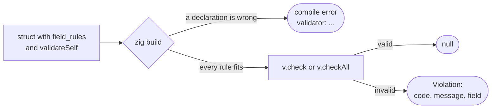

# validator

**Validation rules declared on your structs.** Write the rules of each field
next to the struct, check a value with one call, and get the first violation —
its code, message and path — without allocating. A rule that does not fit its
field is a compile error, not a surprise at run time.

```zig
const SignUp = struct {
    name: []const u8,
    age: u8,
    tags: []const []const u8 = &.{},

    pub const field_rules = .{
        .name = v.notEmpty,
        .age = v.positive,
        .tags = v.each(v.notEmpty),
    };
};

var path_buf: [256]u8 = undefined;
if (v.check(&request, &path_buf)) |violation| {
    // violation.field: "tags[1]", violation.code: "validation.not_empty",
    // violation.message: "must not be empty"
}
```

## Contents

- [How it works](#how-it-works)
- [Installation](#installation)
- [Getting started](#getting-started)
- [Declaring rules](#declaring-rules)
- [validateSelf and v.fail](#validateself-and-vfail)
- [v.custom](#vcustom)
- [Checking values](#checking-values)
- [Testing a DTO package](#testing-a-dto-package)
- [Compile errors](#compile-errors)
- [Limits](#limits)
- [Compatibility](#compatibility)
- [All rules](#all-rules)

Rules by category: [Common](common.md) · [Numbers](numbers.md) · [Lists](lists.md) ·
[Coming from class-validator](class_validator.md)

Examples that `zig build test` compiles and runs:
[Getting started](getting_started.zig) · [validateSelf](validate_self.zig) · [DTO package test](dto_test.zig)

## How it works



1. **Declare.** A struct lists the rules of its fields in `pub const field_rules`
   and checks across fields in `pub fn validateSelf`. Rules are values the
   compiler builds: `v.notEmpty`, `v.positive`, `v.each(...)`, `v.custom(...)`.
2. **Compile.** When a program calls `v.check` or `v.checkAll` for a type, or a
   test calls `comptime v.assertRules(T)`, the compiler checks the declarations
   of that type and of every type below it: each rule against its field's type,
   the keys of `field_rules`, the signature of `validateSelf`, field types the
   walk cannot enter. A mistake is a compile error that starts with `validator: `.
3. **Check.** `v.check(&value, &path_buf)` walks the value depth-first — fields
   in declaration order, items by index — and returns the first violation or
   `null`, allocating nothing. `v.checkAll(gpa, &value)` collects every
   violation, at most 100.

A value has at most one violation: its rules run left to right, the first one
that fails is its violation, and nothing inside it is checked after that.

> [!NOTE]
> confy does not run `field_rules`; to apply rules to a configuration, call
> `v.check` on it after `confy.load`.

## Installation

> [!IMPORTANT]
> **Unreleased: ships in v0.3.0.** zefir-validator is on the `dev` branch only.
> Until the release, pin a commit of `dev`:
>
> ```sh
> zig fetch --save git+https://github.com/vkiryakov/zefir#<dev commit>
> ```

Then import the `zefir-validator` module in `build.zig`:

```zig
const zefir = b.dependency("zefir", .{
    .target = target,
    .optimize = optimize,
});

const exe = b.addExecutable(.{
    .name = "app",
    .root_module = b.createModule(.{
        .root_source_file = b.path("src/main.zig"),
        .target = target,
        .optimize = optimize,
        .imports = &.{
            .{ .name = "validator", .module = zefir.module("zefir-validator") },
        },
    }),
});
```

> [!TIP]
> validator is also part of the umbrella module: with `zefir.module("zefir")`
> imported as `zefir`, it is `@import("zefir").validator`. Both are the same module.

## Getting started

Declare a struct with rules and check a value:

**`src/main.zig`**

```zig
const std = @import("std");
const v = @import("validator");

const SignUp = struct {
    name: []const u8,
    age: u8,
    tags: []const []const u8 = &.{},
    nickname: ?[]const u8 = null,

    pub const field_rules = .{
        .name = v.notEmpty, // one rule
        .age = v.positive,
        .tags = .{ v.notEmpty, v.each(v.notEmpty) }, // the list, then each item
        .nickname = v.notEmpty, // null skips the rule
    };
};

pub fn main(init: std.process.Init) !void {
    var stdout_buffer: [256]u8 = undefined;
    var stdout = std.Io.File.stdout().writerStreaming(init.io, &stdout_buffer);
    const out = &stdout.interface;
    defer out.flush() catch {};

    const request: SignUp = .{ .name = "Ada", .age = 36, .tags = &.{ "admin", "" } };

    var path_buf: [256]u8 = undefined;
    if (v.check(&request, &path_buf)) |violation| {
        try out.print("{s}: {s} ({s})\n", .{ violation.field orelse "(root)", violation.message, violation.code });
    } else {
        try out.print("valid\n", .{});
    }
}
```

It prints the first violation — the second tag is empty:

```text
tags[1]: must not be empty (validation.not_empty)
```

- `field` is the path of the value: field names joined by `.`, item indexes in
  brackets. `message` is a fragment without the field name or the value, and
  `code` names the rule, for clients that branch on it or translate it.
- `nickname` is `null`, so its rule is skipped; `""` would fail it.
- Fix the tag and `v.check` returns `null`.

## Declaring rules

### field_rules

`field_rules` maps field names to rules: one rule, or a tuple of rules that run
left to right.

```zig
fn atMost1000(n: u32) bool {
    return n <= 1000;
}

const Order = struct {
    id: []const u8,
    quantity: u32,
    tags: []const []const u8,
    note: ?[]const u8 = null,

    pub const field_rules = .{
        .id = v.notEmpty, // one rule
        .quantity = .{ v.positive, v.custom("orders.max_quantity", "must be at most 1000", atMost1000) }, // a tuple
        .tags = .{ v.notEmpty, v.each(v.notEmpty) },
        .note = v.notEmpty, // null skips the rule; "" fails it
    };
};
```

- A key names a field of the struct. A misspelled key is a compile error with a
  suggestion: `validator: orders.Order.field_rules.quantiy: no such field; did you mean "quantity"?`.
- Fields are checked in declaration order, whatever the order of the keys.
- The first rule that fails is the field's only violation; the rules after it
  do not run.
- A field without a key has no rules of its own, but the walk still enters it
  when there are rules inside it. An empty `.{}` is allowed.
- Comptime fields are never checked; a key that names one is a compile error.

### Optional fields

A `null` in a `?T` field skips the field's rules and everything inside it; a
value is checked like a `T`. Presence is the job of the field type: a field that
must be present is not optional, and there is no `required` rule. `""` is a
value: `v.notEmpty` fails it.

### Nested structs and lists

Struct fields, slices and arrays are walked automatically when there are rules
inside them:

```zig
const Item = struct {
    sku: []const u8,
    qty: u32,
    pub const field_rules = .{ .sku = v.notEmpty, .qty = v.positive };
};

fn inStock(item: *const Item) bool {
    return item.qty <= 500;
}

const Cart = struct {
    items: []const Item,
    pub const field_rules = .{
        // the list as a whole, then each item; Item's own rules check its fields
        .items = .{ v.notEmpty, v.each(v.custom("orders.out_of_stock", "must be in stock", inStock)) },
    };
};
```

With items `{ "a", 1 }, { "b", 0 }` the violation is `items[1].qty`
(`validation.positive`); with one item `{ "a", 600 }` it is `items[0]`
(`orders.out_of_stock`).

- Rules of the list itself (`v.notEmpty`) come first; the rules of its items go
  into one `v.each(...)`, the last rule of the tuple.
- When a rule of the list fails, no item is checked. When an item's rule fails,
  that item is not entered; the other items are checked.
- Each item is walked once: first the `v.each` rules, then the rules of the
  item's own type.
- `v.each(v.each(rule))` applies `rule` to every item of every inner list of
  `[][]T`.
- `null` items of `[]const ?T` are skipped, and the indexes of the others stay
  as they are.
- The rules of an item struct's fields live in the item type: a parent cannot
  declare them. `v.each(v.custom(...))` checks an item as a whole.
- A rule declared on a struct field (such as `v.custom`) runs before anything
  inside that struct.

Unions, pointers, tuples, error unions and vectors are not walked, and neither
are slices with `volatile`, `allowzero` or an alignment below that of their
items. When one of them contains a type with rules, that is a compile error
naming the field: nothing is skipped silently.

> [!NOTE]
> Containers that hide their item type — `std.HashMapUnmanaged`,
> `std.MultiArrayList` and similar — are not walked, and there is no error. Use
> slices in DTOs, or check such items in `validateSelf`. `std.ArrayList(T)` is a
> struct with `items: []T`, so its items are walked (`list.items[0].name`).

### Reusing rules

Rules are compile-time values, so a project declares its own once:

```zig
// rules.zig
const v = @import("validator");

fn atMost1000(n: u32) bool {
    return n <= 1000;
}

pub const quantity = .{ v.positive, v.custom("orders.max_quantity", "must be at most 1000", atMost1000) }; // a tuple
pub const sku: v.Rule = v.notEmpty; // one rule
```

```zig
const v = @import("validator");
const rules = @import("rules.zig");

fn isEven(n: u32) bool {
    return n % 2 == 0;
}

pub const Line = struct {
    sku: []const u8,
    qty: u32,
    pack: u32,
    pub const field_rules = .{
        .sku = rules.sku,
        .qty = rules.quantity, // the tuple is the whole entry
        .pack = rules.quantity ++ .{v.custom("orders.odd_pack", "must be even", isEven)}, // ++ joins tuples
    };
};
```

A tuple inside a tuple is not flattened: `.pack = .{ rules.quantity, v.custom(...) }`
is a compile error (`item 0 of the tuple is struct { ... }`). Use a tuple as the
whole entry, or join tuples with `++`.

A `v.Rule` exists only at compile time: keep rules in `const` declarations, or
return them from functions that take `comptime` parameters. A `var` or a struct
field that exists at run time cannot hold one.

> [!IMPORTANT]
> `field_rules` and `validateSelf` must be `pub`. The validator finds them with
> `@hasDecl`, which sees only public declarations: a private `field_rules` is
> silently never checked, and neither `v.check` nor `v.assertRules` can tell.
> Give every DTO a test with a value that must fail
> ([Testing a DTO package](#testing-a-dto-package)).

## validateSelf and v.fail

A check across fields goes into `pub fn validateSelf(self: *const T) ?v.Violation`:

```zig
const std = @import("std");
const v = @import("validator");

const Booking = struct {
    start_day: u32,
    end_day: u32,
    guests: u8,

    pub const field_rules = .{ .guests = v.positive };

    pub fn validateSelf(self: *const Booking) ?v.Violation {
        if (self.end_day < self.start_day)
            return v.fail(@This(), .end_day, "bookings.end_before_start", "must not be before the start day");
        if (self.end_day - self.start_day > 30)
            return v.fail(@This(), null, "bookings.too_long", "must not be longer than 30 days");
        return null;
    }
};

const Trip = struct {
    bookings: []const Booking,

    pub const field_rules = .{ .bookings = v.notEmpty };
};

pub fn main(init: std.process.Init) !void {
    var stdout_buffer: [512]u8 = undefined;
    var stdout = std.Io.File.stdout().writerStreaming(init.io, &stdout_buffer);
    const out = &stdout.interface;
    defer out.flush() catch {};

    const trip: Trip = .{
        .bookings = &.{
            .{ .start_day = 1, .end_day = 40, .guests = 2 }, // too long: the booking itself
            .{ .start_day = 5, .end_day = 3, .guests = 2 }, // ends before it starts: end_day
            .{ .start_day = 9, .end_day = 7, .guests = 0 }, // guests fails, so validateSelf does not run
        },
    };

    const report = try v.checkAll(init.gpa, &trip);
    defer report.deinit();
    for (report.violations) |violation| {
        try out.print("{s}: {s} ({s})\n", .{ violation.field orelse "(root)", violation.message, violation.code });
    }
}
```

It prints:

```text
bookings[0]: must not be longer than 30 days (bookings.too_long)
bookings[1].end_day: must not be before the start day (bookings.end_before_start)
bookings[2].guests: must be greater than 0 (validation.positive)
```

- `validateSelf` runs after all fields of its struct, and only when none of
  them, at any depth, had a violation in this call; nested structs run theirs
  first. The third booking ends before it starts too, but its `guests` field
  fails, so its `validateSelf` does not run.
- It returns one violation, or `null` when the value is valid. An `inline fn` is
  accepted; any other signature is a compile error that shows the expected one.
- `v.fail(@This(), .field, code, message)` builds the violation and checks it at
  compile time: the field must be a non-comptime field of the struct, the code
  follows the [custom code grammar](#vcustom), and the message is 1-512 bytes of
  valid UTF-8. A misspelled field is Zig's own error at your line, such as
  `enum 'meta.FieldEnum(bookings.Booking)' has no member named 'ned'` for
  `Booking` in `bookings.zig`.
- The walk appends the field to the struct's path: `bookings[1].end_day`. A
  `null` field gives the struct's own path, `bookings[0]`, and `field = null`
  for the root.
- `validateSelf` must be pure: no I/O, no global state, no allocation, the same
  answer every time. `check` and `checkAll` may call it a different number of
  times.
- Conditional rules (class-validator's `@ValidateIf`) are code in `validateSelf`.

A violation built by hand, `.{ .code = ..., .message = ..., .field = "end_day" }`,
compiles too, but nothing checks it at compile time. So the walk checks every
result of `validateSelf` at run time — the code grammar, the message, the field
name — and a malformed one is a programmer error:

| Build mode | A malformed result |
| --- | --- |
| Debug | panics: `validator: <Type>.validateSelf returned a malformed violation: …` |
| ReleaseSafe, ReleaseFast, ReleaseSmall | becomes `validation.invalid` / `is invalid` at the struct's path |

> [!WARNING]
> The `code` and `message` of a hand-built violation must be static strings:
> literals or comptime values. The violation outlives the call — `check` returns
> it, a `Report` keeps it — so a string built from `self` would put data from the
> value into logs and responses, or dangle. `v.fail` guarantees static strings;
> when the field is chosen at run time, `switch` over it with one `v.fail` per
> field.

## v.custom

```zig
pub fn custom(comptime code: []const u8, comptime message: []const u8, comptime f: anytype) v.Rule
```

A rule with your own predicate: it passes when `f` returns `true`; otherwise the
violation has your code and message.

```zig
fn startsWithAt(s: []const u8) bool {
    return s.len > 0 and s[0] == '@';
}

fn isEven(n: u64) bool {
    return n % 2 == 0;
}

const Profile = struct {
    handle: [:0]const u8,
    seats: u16,
    pub const field_rules = .{
        .handle = v.custom("profiles.handle_format", "must start with @", startsWithAt),
        .seats = .{ v.positive, v.custom("profiles.odd_seats", "must be even", isEven) },
    };
};
```

**The function** is the function itself (not a pointer to it) with one parameter
and a `bool` result. `T` below is the field type without `?` (inside `v.each`,
the item type); the parameter must be a type that `T` converts to without loss:

| Parameter of `f` | Accepted when | Example |
| --- | --- | --- |
| `T` | always | `fn (u32) bool` on `u32` |
| an integer `P` | the same signedness and `P` at least as wide, or `T` unsigned and `P` signed and wider | `fn (u64) bool` on `u8`, `u16`, `u32`; `fn (i64) bool` on `u32` |
| a float `P` | `P` at least as wide as `T` | `fn (f64) bool` on `f32` |
| a slice or a pointer `P` | the same kind and item type, adding `const` or dropping the sentinel | `fn ([]const u8) bool` on `[]u8`, `[:0]const u8`, `[:0]u8`; `fn ([]const Item) bool` on `[]Item` |
| `?Q` | `T` is accepted for `Q` | `fn (?u32) bool` on `u32` |
| `E!Q` | `T` is accepted for `Q` | `fn (anyerror!u32) bool` on `u32` |
| `*const Q` | `T` is accepted for `Q` | `fn (*const Item) bool` on `Item` (a pointer to the field itself); `fn (*const u64) bool` on `u16` (to a converted copy) |

Anything else is a compile error that names what was expected: a narrower
integer or a signedness change, a pointer or slice with different `volatile` or
`align` attributes, `*T`, an `anytype` or `comptime` parameter, zero or several
parameters, a result other than `bool`. An `inline fn` is accepted.

```text
validator: users.Account.field_rules.age: custom("users.ok", ...): f must be fn (P) bool or fn (*const P) bool where u32 coerces to P, got fn (i8) bool
```

When `f` fits the items of a list field, the error ends with
`; use v.each(v.custom(...))`.

**The code** is ASCII segments `[a-z][a-z0-9_]*` joined by `.`: at least two
segments, at most 128 bytes (`v.max_code_bytes`), not starting with
`validation.` or `rpc.`:

```text
code    = segment 1*("." segment)                 ; at least 2 segments
segment = %x61-7A *(%x61-7A / DIGIT / "_")        ; [a-z][a-z0-9_]*
```

| Code | Compile error |
| --- | --- |
| `users.name_taken`, `orders.v2.limit`, `a.b1_`, `validationx.y`, `x.validation` | none: accepted |
| longer than 128 bytes (checked first) | `is longer than 128 bytes` |
| `users..taken`, `.users`, `users.` | `has an empty segment` |
| `users.Taken`, `users.name-taken`, `users.имя` | `has a character outside [a-z0-9_.]` |
| `users.2fa`, `_a.b` | `has a segment that does not start with a letter` |
| `users` | `needs at least 2 segments` |
| `validation.mine`, `rpc.mine` (checked last) | `uses a reserved prefix (validation., rpc.)` |

`validation.` is reserved for the codes of the built-in rules and `rpc.` for
zefir's RPC module. Start a code with your service or domain:
`users.name_taken`, `orders.end_before_start`. The same grammar applies to
`v.fail` and to every `validateSelf` result.

**The message** is literal: 1-512 bytes (`v.max_message_bytes`) of valid UTF-8,
counted in bytes, so a Cyrillic letter takes two. Braces are plain characters.

**Behaviour.** There is no precondition: `f` sees NaN, invalid UTF-8 and `""`.
The rule works on a field of any type, unions and structs included, inside
`v.each`, and several times on one field (the first one that fails is
reported). `f` must be pure: no I/O, no global state, no allocation, the same
answer every time, bounded in time; it must not keep a pointer it receives.

## Checking values

### v.check

```zig
pub fn check(value: anytype, path_buf: []u8) ?v.Violation
```

```zig
var path_buf: [256]u8 = undefined;
if (v.check(&request, &path_buf)) |violation| {
    // violation.code, violation.message, violation.field: ?[]const u8
}
```

- `value` is a pointer to one value: `&request`. Passing the value itself, or a
  slice without `&`, is a compile error. The root can be any type: a struct, a
  slice (`&users`, paths such as `[1].email`), an array, an optional, a scalar.
- The result is the first violation in walk order, or `null`. `check`
  allocates nothing and returns no errors.
- `field` points into `path_buf`: it is valid while the buffer lives and until
  the next call with the same buffer. A path of exactly `path_buf.len` bytes
  fits; a longer one gives `field = null` with the full `code` and `message`.
  The bytes of `path_buf` outside `field` are undefined after the call.
- The violation does not point into the checked value: free the value, and the
  violation stays valid.

### v.checkAll and Report

```zig
pub fn checkAll(gpa: std.mem.Allocator, value: anytype) std.mem.Allocator.Error!v.Report
```

```zig
const report = try v.checkAll(gpa, &request);
defer report.deinit();
for (report.violations) |violation| {
    std.debug.print("{s}: {s} ({s})\n", .{ violation.field orelse "(root)", violation.message, violation.code });
}
if (report.truncated) std.debug.print("more than {d} violations\n", .{v.max_report_violations});
```

- `violations` are in walk order, at most one per value and at most 100
  (`v.max_report_violations`) in all; `truncated` is `true` exactly when there
  was a 101st. The first violation equals the result of `check` (its `field`
  too, when the path fits `path_buf`).
- The report owns its memory, like `std.json.Parsed`: one arena from `gpa`
  holds the list and every path, and paths have no length limit. Call `deinit`
  exactly once after every successful call, even for a valid value. After it
  `violations` and every `field` are gone; `code` and `message` are static
  strings and stay valid.
- The only run-time error is `error.OutOfMemory`; nothing leaks then.

### Violation

```zig
pub const Violation = struct {
    code: []const u8,
    message: []const u8,
    field: ?[]const u8 = null,
};
```

| Field | Content |
| --- | --- |
| `code` | `validation.<rule>` for a built-in rule (`validation.not_empty`); your code for `v.custom` and `v.fail`; `validation.finite` for NaN or an infinity in a float field; `validation.invalid` for a malformed `validateSelf` result outside Debug |
| `message` | the rule's default message (`must not be empty`) or yours: 1-512 bytes of UTF-8, without the field name or the value |
| `field` | the path of the value from the root (`email`, `address.city`, `items[2].name`, `[1].email`); `null` for the root itself |

A violation never contains the checked value, so it is safe to log and to send
to a client as it is.

### Paths

| Value | Path |
| --- | --- |
| a field of the root | `email` |
| a field of a nested struct | `address.city` |
| a field of a slice item | `items[2].name` |
| an item of a nested array | `matrix[1][0]` |
| a field of an item of a root slice | `[1].email` |
| a field inside an optional | `billing.city` (an optional adds no segment) |
| `validateSelf` with a field / without | `items[2].end` / `items[2]` |
| the root itself | `field = null` |

The grammar, for clients in other languages:

```text
path  = first *rest
first = name / index
rest  = "." name / index
index = "[" ( "0" / %x31-39 *DIGIT ) "]"   ; decimal from 0, no leading zeros
name  = 1*( any byte except %x00, ".", "[" and "]" )
```

Names are the field names of the types, as declared, non-ASCII ones included; a
field name with `.`, `[` or `]` in a struct the walk enters is a compile error.

> [!NOTE]
> `field = null` from `check` means either the root itself or a path that did
> not fit `path_buf`; the two cannot be told apart. From `checkAll` it always
> means the root.

## Testing a DTO package

Zig compiles only the code that is used. A DTO that nothing in its own package
passes to `v.check` is not checked when the package builds: a mistake in its
`field_rules`, or in a `v.fail` inside its `validateSelf`, shows up later, in
the first service that calls `check`. So every DTO package calls
`comptime v.assertRules(T)` in a test. It runs exactly the compile-time checks
of `v.check` for `T` and every type below it, the bodies of `validateSelf`
included, and does nothing at run time.

```zig
const std = @import("std");
const v = @import("validator");

pub const Role = enum { admin, editor, viewer };

pub const CreateUserRequest = struct {
    name: []const u8,
    age: u8,
    roles: []const Role,
    nickname: ?[]const u8 = null,

    pub const field_rules = .{
        .name = v.notEmpty,
        .age = v.positive,
        .roles = v.notEmpty,
        .nickname = v.notEmpty,
    };
};

test "every DTO of this file passes v.assertRules" {
    comptime v.assertRules(@This()); // the file itself: a DTO when it has top-level fields
    inline for (comptime std.meta.declarations(@This())) |name| {
        const decl = @field(@This(), name);
        if (@TypeOf(decl) == type) comptime v.assertRules(decl);
    }
}

test "CreateUserRequest rejects an empty name" {
    var path_buf: [256]u8 = undefined;
    const bad: CreateUserRequest = .{ .name = "", .age = 30, .roles = &.{.admin} };
    const violation = v.check(&bad, &path_buf) orelse return error.NoViolation;
    try std.testing.expectEqualStrings("validation.not_empty", violation.code);
    try std.testing.expectEqualStrings("name", violation.field.?);
}
```

- The first test checks the file itself, for a file that is a DTO (top-level
  fields, as in `User.zig`), and every `pub` type declared at the top level of
  the file. DTOs in other files get the same test in their file, and the
  package root pulls those tests in with `test { _ = @import("orders.zig"); }`.
- The checks reach types through fields, not declarations: DTOs nested in a
  namespace struct (`pub const users = struct { pub const Create = ... };`)
  are not checked by the first test. List them:
  `inline for (.{ users.Create, users.Update }) |Dto| comptime v.assertRules(Dto);`.
- `assertRules` takes the type itself. A `pub` alias of a pointer type
  (`pub const UserRef = *const User;`) or a `pub` union of DTOs fails the first
  test, because pointers and unions are not walked; list the DTOs instead of
  the loop: `inline for (.{ CreateUserRequest, User }) |Dto| comptime v.assertRules(Dto);`.
- `assertRules` cannot see a private `field_rules` and does not run the rules.
  The second test, a value that must fail, catches both.

## Compile errors

A mistake in a declaration is a compile error whose text starts with
`validator: ` and says where it is:

```text
error: validator: orders.Order.field_rules.id: positive expects a number, field is []const u8
```

`orders.Order` is the type as Zig names it (the struct `Order` in `orders.zig`),
`field_rules.id` the entry. Inside `v.each` the path ends with `[]`:
`orders.Order.field_rules.tags[]`. In hints, rules are written as code you can
paste: `use v.each(v.positive)`.

Errors come from two places, and Zig points to them differently:

| | Rule constructors | Declarations |
| --- | --- | --- |
| What | the arguments of `v.custom` and `v.each`, whatever the field | a rule that does not fit its field, an unknown key, a wrong `validateSelf`, a field type the walk cannot enter |
| Text | the call as written: `validator: custom("Taken", ...): code 'Taken' has a character outside [a-z0-9_.]; ...` | the path: `validator: orders.Order.field_rules.id: ...` |
| Where Zig points | into the library; a `note: called at comptime here` shows your line with the call | into the library; `referenced by:` ends at the `v.check`, `v.checkAll` or `v.assertRules` call, not at the DTO, so the path in the text is your pointer |

For example, a code that breaks the grammar (file and line numbers shortened):

```text
…/validator/core.zig:…: error: validator: custom("Taken", ...): code 'Taken' has a character outside [a-z0-9_.]; use segments of [a-z][a-z0-9_]* joined by '.', e.g. 'users.name_taken'
…/validator/custom.zig:…: note: called at comptime here
accounts.zig:7:48: note: called at comptime here
```

The errors of `v.fail` inside `validateSelf` (a bad code or message, a comptime
field) are reported inside the library as well; your line is in the
`referenced by:` list.

**Errors from Zig itself.** Some mistakes are caught by the compiler before the
library runs. These errors point at your line and do not start with
`validator: `; their wording belongs to Zig and can change with its version:

| You wrote | Zig says |
| --- | --- |
| `v.notEmpty()`: a rule without parameters called like a function | `type 'core.Rule' not a function` |
| `v.fail(@This(), .ned, ...)`: a field the struct does not have | `enum 'meta.FieldEnum(bookings.Booking)' has no member named 'ned'` |
| `v.custom("users.ok", isFree)`: a missing argument | `expected 3 argument(s), found 2` |

**What is not checked at compile time:**

- `field_rules` and `validateSelf` without `pub`: they are invisible and do
  nothing;
- items of containers that hide their item type (`std.HashMapUnmanaged`,
  `std.MultiArrayList`);
- the result of `validateSelf`: it is checked at run time (a panic in Debug,
  `validation.invalid` in the other modes);
- whether `v.custom` functions and `validateSelf` are pure;
- types that no `v.check`, `v.checkAll` or `v.assertRules` reaches
  ([Testing a DTO package](#testing-a-dto-package)).

## Limits

| Limit | Value | What it limits |
| --- | --- | --- |
| `v.max_code_bytes` | 128 | a code: `v.custom`, `v.fail` and `validateSelf` results |
| `v.max_message_bytes` | 512 | a message, in bytes |
| `v.max_report_violations` | 100 | the violations in a `Report` |

The limits are `comptime_int` constants and part of the contract (see below).

## Compatibility

- **The behaviour of a rule is a contract** from the first release that ships
  it: what it accepts, its code, its default message. So are the walk — which
  violations `check` and `checkAll` return, in which order, with which paths —
  and the values of the limits.
- Until 1.0, such a change comes only in a minor release, and its release notes
  say so; a patch release never changes a rule.
- **Security fixes** are the exception: a rule that panics on some input, takes
  unbounded time, or accepts an input that its documented specification
  rejects may be tightened in a patch release. A tightened rule can reject
  values that were stored or written into configuration before the fix: check
  such data with the new rule before you upgrade.
- Compile error texts and hints are not part of the contract; a release may
  improve them as long as the same declarations still compile, or still fail.
- **One copy of zefir.** The packages that share DTOs — the DTO package, API
  packages, services and their clients — must resolve the same zefir package:
  the same version and the same `b.dependency` options. Two copies have two
  different `v.Rule` and `v.Violation` types, and their rules do not mix.
- A client and a server that check the same value get the same first violation
  only when the types whose width depends on the target — `usize`, `isize`,
  `c_int`, `c_long`, `c_longdouble` and similar — have the same width on both.
  Fixed-width types such as `u64` avoid the question.

## All rules

| Rule | Checks | Code | Page |
| --- | --- | --- | --- |
| `v.notEmpty` | a string has at least 1 byte, a slice at least 1 item | `validation.not_empty` | [common](common.md#vnotempty) |
| `v.positive` | a number is greater than 0 | `validation.positive` | [numbers](numbers.md#vpositive) |
| `v.each(rules)` | the rules of every item of a slice or an array | the inner rule's code | [lists](lists.md#veachrules) |
| `v.custom(code, message, f)` | your predicate `f` returns `true` | your `code` | [v.custom](#vcustom) |
